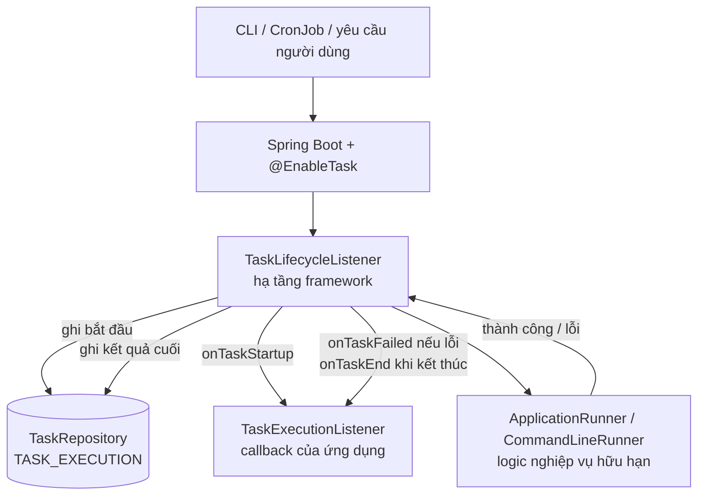
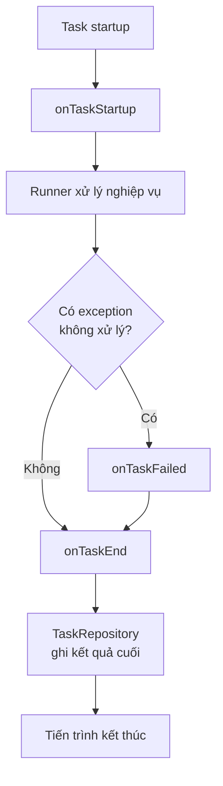
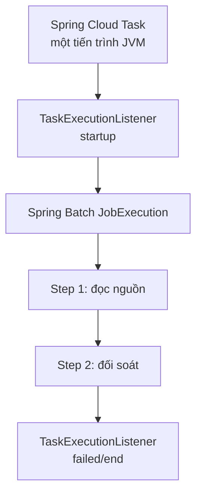

# TaskExecutionListener và các điểm mở rộng vòng đời

## Mục tiêu bài học

Trong chương **Listener** của mô-đun **Spring Cloud Task**, chúng ta sẽ gắn hành vi tùy chỉnh vào vòng đời của một ứng dụng Spring Boot **chạy hữu hạn**. Spring Cloud Task theo dõi mỗi lần chạy thông qua `TaskRepository`; listener giúp ứng dụng ghi log có cấu trúc, đính kèm thông điệp kết thúc, phản ứng với thất bại và bổ sung khả năng quan sát.

Sau bài học, bạn có thể:

- Phân biệt **`TaskLifecycleListener` của framework** với **`TaskExecutionListener` dành cho ứng dụng**.
- Viết các callback `onTaskStartup`, `onTaskFailed` và `onTaskEnd` đúng chữ ký, hiểu thời điểm và đường đi của từng sự kiện.
- Chọn giữa triển khai interface với các annotation `@BeforeTask`, `@FailedTask`, `@AfterTask`.
- Biết cách ghi `exitMessage`, đọc `exitCode`/`errorMessage`, giữ nguyên ý nghĩa của kết quả thực thi.
- Xử lý ngoại lệ do listener gây ra, hiểu điều kiện callback không được chạy và thiết kế logic bổ sung an toàn khi retry.
- Kết hợp listener với Spring Batch, bộ lập lịch, metrics và vận hành tác vụ theo yêu cầu.

## 1. Bài toán: công việc xong rồi, làm sao biết điều gì đã xảy ra?

Một ứng dụng nhập giao dịch mỗi đêm nhận `--businessDate=2026-11-23`, thực hiện đối soát, lưu báo cáo và thoát. `TaskRepository` của Spring Cloud Task đã có thể lưu `TaskExecution` với `executionId`, `taskName`, `startTime`, `endTime`, `exitCode` và lỗi. Tuy nhiên nhóm vận hành cần thêm hành vi:

1. Khi tác vụ bắt đầu, ghi log kèm `executionId` để tìm đúng lượt chạy.
2. Khi phát sinh exception, bổ sung thông điệp nghiệp vụ dễ hiểu.
3. Khi hoàn tất, ghi một dòng tổng kết để liên kết log với metadata.
4. Không làm gián đoạn tác vụ chính chỉ vì hệ thống gửi thông báo bên ngoài tạm thời bị lỗi.

**`TaskExecutionListener`** là điểm mở rộng được cung cấp cho chính các nhu cầu này. Nó giúp phản ứng theo vòng đời Task mà không phải chèn cùng một đoạn “ghi log bắt đầu/kết thúc” vào mọi `ApplicationRunner`.

Điểm quan trọng là **listener không tự tạo lịch chạy**. Cron, Kubernetes CronJob, CLI, yêu cầu người dùng hoặc nền tảng điều phối sẽ kích hoạt tiến trình. `ApplicationRunner`/`CommandLineRunner` thực hiện nghiệp vụ. `TaskExecutionListener` chỉ nhận các callback trong một lần chạy của tiến trình đó.

## 2. Phân biệt hai loại listener có tên gần giống

Trong Spring Cloud Task, hai tên sau dễ bị hiểu là cùng một interface:

| Thành phần | Ai sử dụng? | Trách nhiệm |
| --- | --- | --- |
| `TaskLifecycleListener` | **Hạ tầng Spring Cloud Task** | Theo dõi các sự kiện của Spring Boot, ghi bắt đầu/kết thúc qua `TaskRepository`, phát callback cho listener ứng dụng |
| `TaskExecutionListener` | **Mã ứng dụng** | Xử lý callback bắt đầu, thất bại và kết thúc; bổ sung log, thông điệp, metrics hoặc hành vi riêng |

`TaskLifecycleListener` là thành phần của framework, có liên quan đến `ApplicationReadyEvent`, `ApplicationFailedEvent` và `SmartLifecycle`. Thông thường, bạn bật lifecycle Task bằng `@EnableTask` rồi để Spring quản lý nó.

Ngược lại, bạn **tự triển khai `TaskExecutionListener`** (hoặc khai báo các phương thức có annotation listener) để bổ sung hành vi. Bạn không cần tạo thủ công `TaskLifecycleListener` hay gọi `TaskRepository.completeTaskExecution(...)` trong callback của ứng dụng.



Sơ đồ là thứ tự **logic cấp cao**. Chi tiết thời điểm callback chạy so với commit trong repository có thể khác theo phiên bản; không dùng listener thay cho một giao dịch nghiệp vụ nguyên tử.

## 3. Ba callback quan trọng của `TaskExecutionListener`

Interface nằm trong package `org.springframework.cloud.task.listener`. Các chữ ký Java:

```java
void onTaskStartup(TaskExecution taskExecution);

void onTaskFailed(TaskExecution taskExecution, Throwable throwable);

void onTaskEnd(TaskExecution taskExecution);
```

Đây là **chữ ký phương thức**, không phải lớp Java độc lập để biên dịch. Trong các nhánh hiện đại (ví dụ Javadoc 3.0.4), interface có **default implementation rỗng**, nên có thể override phương thức cần thiết. Với nhánh cũ (ví dụ 2.3.x), các phương thức có thể là abstract; để minh họa tương thích rộng, ví dụ đầy đủ bên dưới vẫn override cả ba.

| Callback | Khi nào diễn ra? | Nên làm | Không nên làm |
| --- | --- | --- | --- |
| `onTaskStartup(TaskExecution)` | Trong giai đoạn **bắt đầu** Task, trước khi runner thực thi | Ghi log ID, chuẩn bị thông tin quan sát nhẹ, khởi tạo mã tương quan | Tự tạo TaskExecution thứ hai hoặc dựa tuyệt đối vào trạng thái commit |
| `onTaskFailed(TaskExecution, Throwable)` | Khi framework nhận lỗi **không được xử lý** trong thực thi Task; trước callback kết thúc | Ghi lỗi có cấu trúc, mô tả nguyên nhân phù hợp | Nuốt lỗi để coi Task thành công, thực hiện retry không kiểm soát |
| `onTaskEnd(TaskExecution)` | Trong pha **kết thúc**, trước khi metadata cuối được cập nhật | Ghi tổng kết, đặt `exitMessage` | Mặc định coi mọi lượt kết thúc đều thành công; sửa ID hoặc giả mạo exit code |

### 3.1. Một chi tiết về thời điểm `onTaskStartup`

Tài liệu Features của một số nhánh diễn đạt callback xảy ra **trước khi ghi** `TaskExecution` vào repository. Tuy nhiên, Javadoc `TaskExecutionListener` 3.0.4 và đường xử lý `TaskLifecycleListener` trong mã nguồn hiện hành thể hiện `onTaskStartup` được gọi **sau thao tác tạo/bắt đầu** `TaskExecution`. Vì vậy, cách sử dụng an toàn là: callback thuộc **pha startup**, có đối tượng `TaskExecution` để đọc thông tin, nhưng **không giả định đây là hook trước INSERT hay đảm bảo transaction đã commit**. Nếu ứng dụng có yêu cầu phụ thuộc thời điểm ghi chính xác, phải kiểm tra API và mã nguồn của **đúng phiên bản** đang chạy.

Hai callback còn lại nhất quán về trình tự: ở đường lỗi được framework ghi nhận, `onTaskFailed` chạy **trước** `onTaskEnd`; cập nhật kết quả cuối vào repository được thực hiện sau pha callback kết thúc.

### 3.2. Thành công và thất bại không có cùng chuỗi callback



*Lưu ý:* Đây là luồng **bình thường** khi Spring Boot đã đi đến giai đoạn Task được quản lý. Nếu JVM bị hủy bằng `SIGKILL`, mất điện, hết bộ nhớ nghiêm trọng hoặc context khởi tạo thất bại rất sớm, không thể đảm bảo các callback kết thúc sẽ được gọi.

## 4. Ví dụ 1: triển khai interface trực tiếp

Giả sử tác vụ đối soát cần log thống nhất theo `executionId`. Tạo một bean Spring triển khai interface:

```java
package com.example.reconciliation;

import org.slf4j.Logger;
import org.slf4j.LoggerFactory;
import org.springframework.cloud.task.listener.TaskExecutionListener;
import org.springframework.cloud.task.repository.TaskExecution;
import org.springframework.stereotype.Component;

@Component
public class ReconciliationAuditListener implements TaskExecutionListener {

    private static final Logger log =
            LoggerFactory.getLogger(ReconciliationAuditListener.class);

    @Override
    public void onTaskStartup(TaskExecution taskExecution) {
        log.info("Task bat dau: id={}, name={}",
                taskExecution.getExecutionId(),
                taskExecution.getTaskName());
    }

    @Override
    public void onTaskFailed(TaskExecution taskExecution, Throwable error) {
        log.error("Task that bai: id={}, errorType={}",
                taskExecution.getExecutionId(),
                error.getClass().getSimpleName(), error);
    }

    @Override
    public void onTaskEnd(TaskExecution taskExecution) {
        Integer exitCode = taskExecution.getExitCode();
        boolean success = Integer.valueOf(0).equals(exitCode);

        log.info("Task ket thuc: id={}, exitCode={}",
                taskExecution.getExecutionId(), exitCode);

        if (taskExecution.getExitMessage() == null) {
            taskExecution.setExitMessage(
                success ? "Hoan tat xu ly" : "Xu ly khong thanh cong"
            );
        }
    }
}
```

Ở đây:

1. `@Component` khiến Spring phát hiện listener khi quét package ứng dụng.
2. `onTaskStartup` chỉ ghi log; không khởi chạy nghiệp vụ hay thêm bản ghi Task mới.
3. `onTaskFailed` giữ nguyên ngoại lệ để framework tiếp tục xử lý; ghi loại lỗi và stack trace vào log nội bộ.
4. `onTaskEnd` đọc `exitCode` dưới dạng `Integer` có thể `null`; chỉ `0` được xem là thành công trong logic minh họa.
5. `setExitMessage(...)` đặt một thông điệp **ngắn và không chứa thông tin nhạy cảm** để repository lưu ở metadata kết thúc.

Listener có thể được dùng để phân biệt lỗi vận hành và lỗi nghiệp vụ ở mức log/quan sát. Nhưng **không ghi mật khẩu, token, thông tin khách hàng hoặc nội dung nhạy cảm vào `exitMessage`**, vì nó được lưu trong cơ sở dữ liệu và có thể hiển thị qua hệ thống tra cứu.

### 4.1. Vì sao không gọi `TaskRepository` trong callback?

Ở thời điểm end/fail, framework đã quản lý cập nhật kết quả cuối. Một listener gọi `completeTaskExecution(...)` riêng có thể tạo tranh chấp hoặc thông tin kết thúc không nhất quán. Với mục tiêu lưu **mô tả kết thúc**, dùng `taskExecution.setExitMessage(...)` như tài liệu chính thức. Nếu cần lưu kết quả đối soát chi tiết, dùng service/bảng nghiệp vụ riêng, không nhồi nội dung lớn vào `EXIT_MESSAGE`.

### 4.2. `exitMessage` khác `errorMessage`

| Thuộc tính | Ý nghĩa | Ai nên đặt? |
| --- | --- | --- |
| `exitCode` | Mã kết quả thực thi được Spring Boot/Task xác định | Framework cùng cơ chế exit code của ứng dụng |
| `exitMessage` | Chuỗi mô tả ngắn do ứng dụng có thể bổ sung | Listener, ví dụ `setExitMessage(...)` |
| `errorMessage` | Thông tin exception/stack trace khi có lỗi | Framework theo ngoại lệ được ghi nhận |

Một lượt có `exitMessage="Đã tạo báo cáo"` **không chứng minh dữ liệu báo cáo đúng** nếu nghiệp vụ không kiểm tra. Ngược lại, một listener đặt `exitMessage` thành câu “Thành công” không nên được dùng để che `exitCode != 0`.

### 4.3. Quy tắc ưu tiên của `exitMessage`

Khi nhiều pha listener đặt thông điệp, tài liệu Spring Cloud Task mô tả ưu tiên:

1. `onTaskEnd` (cao nhất).
2. `onTaskFailed`.
3. `onTaskStartup`.

Ví dụ `onTaskStartup` đặt `"Đang chạy"`; nếu phát sinh lỗi, `onTaskFailed` đặt `"Sai dữ liệu"`; nếu `onTaskEnd` tiếp tục đặt `"Đã kiểm tra"`, thông điệp từ end có thể ghi đè lỗi trước. Vì thế, **đừng ghi đè mù quáng trong `onTaskEnd`**; hãy kiểm tra giá trị có sẵn và kết quả thực thi.

Lưu ý nhiều **listener cùng chạy ở một pha** còn có thể tác động tới cùng `exitMessage`; nên chỉ định rõ một thành phần có quyền đặt thông điệp kết thúc, tránh phụ thuộc thứ tự bean không được bảo đảm cho nghiệp vụ.

## 5. Ví dụ 2: dùng annotation ở cấp phương thức

Spring Cloud Task còn hỗ trợ khai báo callback trên **các phương thức của một Spring bean**. Ba annotation tương ứng:

- `@BeforeTask` → callback startup.
- `@FailedTask` → callback lỗi.
- `@AfterTask` → callback kết thúc.

Ví dụ độc lập với lớp listener ở mục 4:

```java
package com.example.reconciliation;

import org.slf4j.Logger;
import org.slf4j.LoggerFactory;
import org.springframework.cloud.task.listener.annotation.AfterTask;
import org.springframework.cloud.task.listener.annotation.BeforeTask;
import org.springframework.cloud.task.listener.annotation.FailedTask;
import org.springframework.cloud.task.repository.TaskExecution;
import org.springframework.stereotype.Component;

@Component
public class AnnotatedTaskHooks {

    private static final Logger log =
            LoggerFactory.getLogger(AnnotatedTaskHooks.class);

    @BeforeTask
    public void before(TaskExecution execution) {
        log.info("Chuan bi task {}", execution.getExecutionId());
    }

    @FailedTask
    public void failed(TaskExecution execution, Throwable failure) {
        log.warn("Task {} gap loi {}", execution.getExecutionId(),
                 failure.getClass().getSimpleName());
        execution.setExitMessage("Loi nghiep vu hoac he thong");
    }

    @AfterTask
    public void after(TaskExecution execution) {
        log.info("Task {} ket thuc", execution.getExecutionId());
        // Khong ghi de exitMessage da duoc pha failure gan.
    }
}
```

**Chọn một hình thức cho cùng một trách nhiệm.** Nếu bạn vừa đăng ký interface listener vừa viết thêm phương thức annotation cho chính sự kiện đó, các callback có thể được gọi nhiều lần theo các đường đăng ký khác nhau. Chỉ dùng kết hợp khi thật sự cần nhiều công việc độc lập và đã kiểm tra thứ tự/side effect.

Annotation **không yêu cầu** gắn `@EnableTask` lên từng bean: `@EnableTask` thuộc lớp cấu hình khởi động để có lifecycle Task; `@BeforeTask`/`@AfterTask`/`@FailedTask` thuộc những bean mà ứng dụng muốn nhận callback.

### 5.1. Khi nào nên chọn cách nào?

| Tiêu chí | `TaskExecutionListener` | Annotation trên phương thức |
| --- | --- | --- |
| Một lớp phụ trách cả ba callback | Phù hợp | Có thể dùng nhưng dễ phân tán |
| Chỉ cần một callback trong một service | Có thể triển khai một phương thức với interface đời mới | Viết `@AfterTask` hoặc `@FailedTask` trực tiếp trên bean |
| Cần tập trung logic quan sát trong một nơi | Rõ ràng | Cần giữ các phương thức cùng chủ đích |
| Mã cần chạy trên nhánh cũ của Spring Cloud Task | Kiểm tra interface; có thể phải implement đủ ba method | Kiểm tra tên annotation và API đúng nhánh |

Trong nhánh 3.x, `TaskExecutionListenerSupport` đã **deprecated** vì interface có default methods. Với code mới, ưu tiên triển khai trực tiếp interface hoặc annotation thay vì kế thừa lớp hỗ trợ đã lỗi thời.

## 6. Ghép listener vào ứng dụng Task hữu hạn

Giả sử tạo dự án bằng [Spring Initializr](https://start.spring.io/) với Spring Boot, **Task (Spring Cloud)**, H2 Database và bộ version Spring Boot/Spring Cloud tương thích. Dependencies của dự án Maven sẽ chứa những thành phần tương đương:

```xml
<dependencies>
    <dependency>
        <groupId>org.springframework.cloud</groupId>
        <artifactId>spring-cloud-starter-task</artifactId>
    </dependency>
    <dependency>
        <groupId>com.h2database</groupId>
        <artifactId>h2</artifactId>
        <scope>runtime</scope>
    </dependency>
</dependencies>
```

Đây chỉ là dependencies, **không phải `pom.xml` đầy đủ**. Giữ Spring Boot parent/BOM do công cụ khởi tạo tạo ra và để Spring Cloud release train quản lý phiên bản starter.

Lớp ứng dụng:

```java
package com.example.reconciliation;

import java.time.LocalDate;
import java.util.List;

import org.springframework.boot.ApplicationArguments;
import org.springframework.boot.ApplicationRunner;
import org.springframework.boot.SpringApplication;
import org.springframework.boot.autoconfigure.SpringBootApplication;
import org.springframework.cloud.task.configuration.EnableTask;
import org.springframework.context.annotation.Bean;

@SpringBootApplication
@EnableTask
public class ReconciliationTaskApplication {

    public static void main(String[] args) {
        SpringApplication.run(ReconciliationTaskApplication.class, args);
    }

    @Bean
    ApplicationRunner reconciliationRunner() {
        return (ApplicationArguments args) -> {
            List<String> dates = args.getOptionValues("businessDate");
            if (dates == null || dates.size() != 1) {
                throw new IllegalArgumentException(
                    "Can truyen --businessDate=yyyy-MM-dd"
                );
            }

            LocalDate date = LocalDate.parse(dates.get(0));
            System.out.println("Doi soat ngay " + date);

            if (args.containsOption("simulateFailure")) {
                throw new IllegalStateException("Mo phong loi doi soat");
            }

            // Goi service doi soat va ghi du lieu nghiep vu tai day.
            System.out.println("Doi soat hoan tat");
        };
    }
}
```

Đặt hai lớp listener của mục 4 và 5 trong cùng package `com.example.reconciliation` hoặc package con để Spring quét thấy. Khi thực hành, nên **chỉ giữ một trong hai ví dụ listener** để dễ quan sát số lần callback.

### 6.1. Cấu hình dữ liệu minh họa

Tệp `src/main/resources/application.yml`:

```yaml
spring:
  application:
    name: daily-reconciliation
  main:
    web-application-type: none
  datasource:
    url: jdbc:h2:file:./data/task-metadata
    driver-class-name: org.h2.Driver
    username: sa
    password: ""
  cloud:
    task:
      closecontext-enabled: true
```

H2 dạng **file** giữ metadata giữa các lần khởi động tại cùng thư mục làm việc; H2 in-memory và Map repository không phù hợp để truy lịch sử sau khi JVM thoát. Tên Task mặc định thường được xác định từ tên ứng dụng (hoặc cấu hình `spring.cloud.task.name`). Với môi trường vận hành, cần datasource có lưu trữ bền vững và schema Task theo phiên bản.

`closecontext-enabled: true` yêu cầu đóng context khi các runner hoàn tất và kết quả Task đã được cập nhật; nó **không** tự thay thế logic giải phóng tài nguyên hay chính sách timeout của bộ điều phối.

### 6.2. Chạy trường hợp thành công

Build ứng dụng bằng Maven wrapper:

```bash
./mvnw package
java -jar target/daily-reconciliation-0.0.1-SNAPSHOT.jar --businessDate=2026-11-23
```

Thay tên JAR bằng `artifactId`/`version` thực tế từ dự án. Với listener interface ở mục 4, log kỳ vọng sẽ chứa ý tương đương:

```text
Task bat dau: id=101, name=daily-reconciliation
Doi soat ngay 2026-11-23
Doi soat hoan tat
Task ket thuc: id=101, exitCode=0
```

`101` chỉ là ID minh họa, không phải giá trị cố định. Sau khi JVM thoát, truy vấn `TASK_EXECUTION`:

```sql
SELECT
    TASK_EXECUTION_ID,
    TASK_NAME,
    START_TIME,
    END_TIME,
    EXIT_CODE,
    EXIT_MESSAGE,
    ERROR_MESSAGE
FROM TASK_EXECUTION
ORDER BY TASK_EXECUTION_ID DESC;
```

Lượt chạy thành công thường có `EXIT_CODE = 0`, `END_TIME` và `EXIT_MESSAGE` tương ứng với nội dung listener đã đặt.

### 6.3. Chạy trường hợp lỗi

```bash
java -jar target/daily-reconciliation-0.0.1-SNAPSHOT.jar \
  --businessDate=2026-11-23 --simulateFailure
```

Trên terminal PowerShell Windows, nhập câu lệnh trên **một dòng** hoặc dùng ký tự nối dòng hợp lệ của PowerShell (ví dụ dấu backtick). Dấu `\` trong ví dụ là kiểu nối dòng của shell Bash.

Ứng dụng ném `IllegalStateException` trong runner. Theo đường lỗi được Spring Boot/Task ghi nhận, thứ tự callback về mặt logic:

1. `onTaskStartup` khi bắt đầu.
2. Runner thực hiện, rồi phát sinh exception.
3. `onTaskFailed` nhận `Throwable` của lỗi.
4. `onTaskEnd` xử lý phần kết thúc.
5. Repository lưu trạng thái cuối; bộ điều phối nhận mã thoát tiến trình.

Khi quan sát kết quả, đối chiếu cả **log**, `EXIT_CODE`, `ERROR_MESSAGE` và `EXIT_MESSAGE`. Không dựa vào riêng `EXIT_MESSAGE` để quyết định thành bại.

## 7. Điều gì xảy ra nếu listener tự ném exception?

Một callback là **một phần đường đi của vòng đời Task**, không phải một hook bên ngoài được bảo đảm “chạy lỗi cũng không sao”. Tài liệu chính thức mô tả:

- Nếu một callback ném exception, quá trình chạy **các listener còn lại của chính sự kiện đó** bị dừng; vì vậy thứ tự và ảnh hưởng tới các listener khác có thể quan trọng.
- Các pha khác vẫn có thể được xử lý để hoàn tất Task, tùy điểm lỗi và trạng thái framework.
- Nếu lỗi xảy ra ở `onTaskStartup`, ứng dụng có thể không đi đến runner và exit code được ghi nhận là lỗi (tài liệu nêu mã `1`).
- Nếu callback `onTaskEnd` hoặc `onTaskFailed` ném exception, trạng thái cuối và exit code chịu ảnh hưởng của cơ chế xử lý lỗi của framework; cần kiểm chứng bằng chính phiên bản được triển khai.
- Tài liệu cũng nêu `ExitCodeExceptionMapper` **không thể dùng để ghi đè tùy ý** mã thoát phát sinh từ ngoại lệ listener.

Ví dụ thiết kế không an toàn:

```java
@AfterTask
public void notifyExternalSystem(TaskExecution execution) {
    // Nếu HTTP timeout, callback có thể ném lỗi và ảnh hưởng kết quả Task.
    externalNotificationClient.send(execution);
}
```

Nếu mục tiêu chỉ là **gửi thông báo không quan trọng cho việc đối soát**, không nên cho lỗi mạng của dịch vụ thông báo quyết định kết quả nghiệp vụ. Có thể:

1. Ghi một sự kiện thông báo vào **outbox bền vững** của ứng dụng trong giao dịch thích hợp, để thành phần khác phát đi.
2. Dùng hệ thống điều phối quan sát trạng thái Task và gửi thông báo **sau khi** đã xác nhận DB/process.
3. Với log/metric thuần quan sát, bắt các ngoại lệ **có thể dự kiến** của hoạt động phụ, log ngắn gọn rồi kết thúc callback, thay vì để các lỗi quan sát lấn át lỗi nghiệp vụ.

**Không áp dụng “luôn bắt và bỏ qua mọi exception”**: lỗi hệ thống nghiêm trọng hoặc chính sách kiểm toán bắt buộc có thể yêu cầu Task thất bại. Hãy xác định rõ tác động nào là **điều kiện thành công bắt buộc**, tác động nào chỉ là quan sát bổ sung.

### 7.1. Listener có chạy khi JVM bị kill không?

Không có bảo đảm callback cuối được gọi nếu tiến trình bị hủy đột ngột, crash, OOM nghiêm trọng, bị cắt điện hoặc context chưa khởi tạo đủ. Khi đó có thể xuất hiện bản ghi Task thiếu `END_TIME` hoặc không có bản ghi nào.

Vì vậy, các tác vụ cần vận hành an toàn phải được giám sát cả bằng **exit code thực tế của tiến trình**, trạng thái pod/job/cron, timeout và log bên ngoài `TaskRepository`. Nếu cần một hành động chắc chắn được thực hiện ngay cả khi máy chết, đừng đặt toàn bộ trách nhiệm vào `onTaskEnd`.

### 7.2. Những điều không nên làm trong callback

| Cách dùng rủi ro | Vì sao không phù hợp | Cách thay thế |
| --- | --- | --- |
| Đăng ký thêm một `TaskExecution` từ `onTaskStartup` | Dễ sinh bản ghi không tương ứng tiến trình | Để `TaskLifecycleListener` quản lý repository |
| Đặt `exitCode=0` trong `onTaskEnd` khi runner lỗi | Có thể che lỗi nghiệp vụ và sai lệch trạng thái | Giữ cơ chế exception/exit code chuẩn |
| Gọi API bên ngoài chậm không giới hạn | Làm chậm kết thúc Task hoặc gây lỗi phụ | Timeout ngắn, gửi bất đồng bộ hoặc outbox |
| Ghi nguyên arguments/exception vào hệ thống công khai | Có thể lộ token hoặc dữ liệu nhạy cảm | Giảm thiểu và che dữ liệu; phân quyền truy cập |
| Lưu trạng thái từng lượt chạy vào field mutable của singleton listener | Dễ rò rỉ trạng thái hoặc xung đột trong ngữ cảnh phức tạp | Dùng `TaskExecution`, khóa thực thi, context hoặc kho riêng |
| Coi `onTaskFailed` là cơ chế tự retry | Callback chỉ nhận thông tin lỗi, không tự quản lý retry | Dùng scheduler/Spring Batch hoặc retry ở tầng nghiệp vụ |

## 8. Mối liên hệ với các điểm mở rộng khác

`TaskExecutionListener` chỉ là một phần trong hệ sinh thái mở rộng của Spring Cloud Task:

| Điểm mở rộng | Dùng để làm gì? | Khác listener Task ở đâu? |
| --- | --- | --- |
| `TaskNameResolver` | Xác định `taskName` của lần chạy | Ảnh hưởng tên Task, không phải callback theo vòng đời |
| `TaskConfigurer` | Chọn `TaskRepository`, `TaskExplorer`, transaction manager, datasource | Cấu hình hạ tầng, không chạy logic startup/end của mỗi Task |
| `ExitCodeExceptionMapper` và `ExitCodeGenerator` | Ánh xạ lỗi thành mã thoát cho Spring Boot | Quy định giá trị exit code; listener thường chỉ quan sát |
| Spring Boot `ApplicationListener<ApplicationReadyEvent>` | Theo dõi sự kiện chung khi ứng dụng ready | Phạm vi sự kiện Spring Boot rộng hơn Task; thứ tự với `TaskLifecycleListener` cần cân nhắc |
| `JobExecutionListener` của Spring Batch | Theo dõi **JobExecution** trước/sau Batch Job | Cấp độ Job; một Task có thể chạy nhiều Batch Job |
| `StepExecutionListener` của Spring Batch | Theo dõi mỗi **Step** xử lý dữ liệu | Chi tiết theo bước, checkpoint, batch metrics |
| Micrometer Observation | Ghi metrics/tracing cho runner và Task nếu bật | Thu thập số liệu, không thay lifecycle callback nghiệp vụ |

### 8.1. Đừng nhầm listener Task với listener Batch

Ví dụ một Task gọi Spring Batch Job xử lý một triệu giao dịch:



Trong trường hợp này, listener Task bao quanh **toàn bộ tiến trình**; `JobExecutionListener` theo dõi Job, còn `StepExecutionListener` theo dõi từng Step. Các lớp này không thay thế cho nhau. Nếu cần restart từ chunk/step thất bại, dùng Spring Batch thay vì đặt checkpoint thủ công trong callback `onTaskEnd`.

Ngoài ra, nếu Batch Job báo `FAILED` nhưng runner không phát lỗi hoặc exit code không phản ánh Job thất bại, Task có thể được ghi nhận khác mong đợi. Cần cấu hình/ánh xạ trạng thái Batch sang kết quả Task theo phiên bản đang dùng.

### 8.2. Khi nào dùng `ApplicationReadyEvent` riêng?

Đối với **sự kiện chung của Spring Boot**, có thể dùng `ApplicationListener`. Nhưng tài liệu Spring Cloud Task cảnh báo rằng đặt một `ApplicationListener` chạy quá sớm so với `TaskLifecycleListener` có thể tạo tác động không mong đợi. Khi chỉ cần phản ứng với **vòng đời Task**, hãy dùng `TaskExecutionListener` để tránh phụ thuộc vào thứ tự sự kiện Spring Boot.

Trong Spring Cloud Task phiên bản hỗ trợ observation, có thể bật `spring.cloud.task.observation.enabled=true` để tích hợp với Micrometer cho `ApplicationRunner`/`CommandLineRunner`. Tính năng này yêu cầu các dependency quan sát thích hợp như Spring Boot Actuator và registry/tracing tương ứng; nó **bổ sung**, không thay thế callback nghiệp vụ.

## 9. Checklist vận hành cho listener

Khi xây dựng listener cho Task chạy theo lịch hoặc theo yêu cầu, nên kiểm tra:

1. **Một bean listener được đăng ký đúng cách:** package được quét, có `@Component` hoặc cấu hình `@Bean`; ứng dụng có `@EnableTask`.
2. **Log có mã tương quan:** ghi `taskName`, `executionId`, thời điểm và mã kết quả; tránh log raw arguments chứa secret.
3. **Callback ngắn và có kiểm soát lỗi:** timeout cho I/O bên ngoài, xác định rõ callback nào được phép khiến Task thất bại.
4. **`exitMessage` súc tích:** ghi trạng thái hữu ích, không ghi stack trace dài hoặc dữ liệu nhạy cảm.
5. **Không kỳ vọng exactly-once callback:** khi tiến trình chết, callback có thể không được gọi; khi retry, một lượt chạy mới có `executionId` mới.
6. **Tách nghiệp vụ và metadata:** transaction, idempotency và kết quả dữ liệu phải được thiết kế riêng.
7. **Kiểm tra phiên bản:** chữ ký method, default method và timing có thể khác; đặc biệt với hệ thống nâng cấp từ nhánh cũ.
8. **Đối chiếu từ bên ngoài:** nếu `END_TIME` còn null quá lâu, cần kiểm tra trạng thái scheduler/container, không coi repository là nguồn duy nhất.

## 10. Câu hỏi tự đánh giá

**1. `TaskLifecycleListener` và `TaskExecutionListener` có phải một không?**

> Không. Thành phần thứ nhất là hạ tầng Spring Cloud Task quản lý vòng đời và repository; thành phần thứ hai là điểm mở rộng để ứng dụng phản ứng ở các pha startup, failure và end.

**2. Lượt chạy thành công thường gọi những callback nào?**

> `onTaskStartup`, sau đó `onTaskEnd`. `onTaskFailed` chỉ thuộc đường lỗi được framework ghi nhận.

**3. Nếu một runner ném exception không xử lý, callback nào chạy trước: `onTaskFailed` hay `onTaskEnd`?**

> `onTaskFailed` được gọi trước `onTaskEnd` khi Task đi qua đường xử lý lỗi bình thường.

**4. Có nên gửi HTTP request quan trọng ở `@AfterTask` rồi coi callback chắc chắn chạy không?**

> Không. JVM có thể chết trước callback; HTTP có thể timeout và làm ảnh hưởng quá trình kết thúc. Với yêu cầu giao nhận đáng tin cậy, cân nhắc outbox bền vững hoặc điều phối từ ngoài tiến trình.

**5. Có thể dùng `setExitMessage(...)` để ghi tên file báo cáo không?**

> Có, nếu chuỗi ngắn và không chứa thông tin nhạy cảm. Nhưng `exitMessage` không thay thế dữ liệu nghiệp vụ hoặc kiểm tra đúng/sai của báo cáo.

**6. Vì sao `@AfterTask` đặt exit message có thể che thông điệp lỗi ở `@FailedTask`?**

> Vì tài liệu xác định mức ưu tiên `onTaskEnd` cao hơn `onTaskFailed`. Cần giữ hoặc kết hợp thông điệp hiện có thay vì ghi đè mà không xem trạng thái.

## Ghi nhớ

- **`TaskExecutionListener` là callback của ứng dụng**, khác `TaskLifecycleListener` quản lý vòng đời của framework.
- **`onTaskStartup` → runner → [`onTaskFailed` nếu lỗi] → `onTaskEnd`** là luồng logic thường gặp khi Task đã khởi tạo được.
- Có thể dùng interface hoặc **`@BeforeTask`, `@FailedTask`, `@AfterTask`**, và cần chú ý việc đăng ký bean.
- **`exitMessage` có thể được bổ sung từ listener**, nhưng `exitCode` và `errorMessage` phải phản ánh đúng kết quả thực thi.
- Callback **có thể thất bại hoặc không được gọi** nếu tiến trình chết bất thường; vận hành an toàn cần giám sát ngoài process, DB bền vững và idempotency.

## Tài liệu tham khảo

1. [Spring Cloud Task 3.3 — Features: Task Execution Listener, exceptions, exit messages](https://docs.spring.io/spring-cloud-task/reference/3.3/features.html)
2. [Javadoc `TaskExecutionListener` (3.0.4) — chữ ký và thời điểm callback](https://docs.spring.io/spring-cloud-task/docs/current/apidocs/org/springframework/cloud/task/listener/TaskExecutionListener.html)
3. [Javadoc `TaskExecution` — các trường metadata và `setExitMessage`](https://docs.spring.io/spring-cloud-task/docs/current/apidocs/org/springframework/cloud/task/repository/TaskExecution.html)
4. [Javadoc `FailedTask` — annotation và chữ ký phương thức](https://docs.spring.io/spring-cloud-task/docs/current/apidocs/org/springframework/cloud/task/listener/annotation/FailedTask.html)
5. [Spring Cloud Task — Getting Started](https://docs.spring.io/spring-cloud-task/reference/getting-started.html)
6. [Mã nguồn `TaskLifecycleListener` — trình tự cập nhật và gọi listener](https://github.com/spring-cloud/spring-cloud-task/blob/main/spring-cloud-task-core/src/main/java/org/springframework/cloud/task/listener/TaskLifecycleListener.java)
7. [Javadoc `TaskExecutionListenerSupport` — deprecated từ 3.0](https://docs.spring.io/spring-cloud-task/docs/current/apidocs/org/springframework/cloud/task/listener/TaskExecutionListenerSupport.html)
