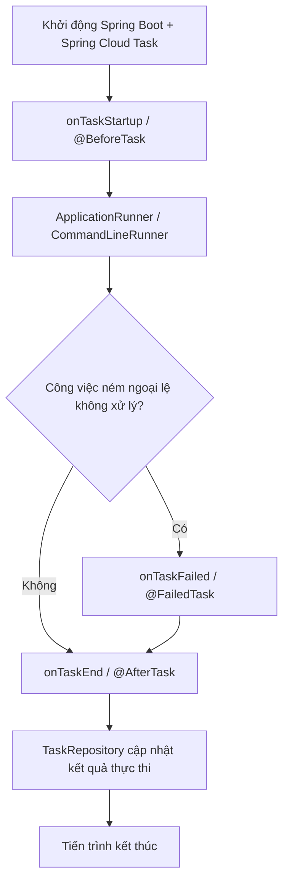

# Đăng ký listener bằng bean và bằng annotation

## 1. Listener giải quyết vấn đề gì trong Spring Cloud Task?

**Spring Cloud Task** xây dựng trên Spring Boot để chạy những công việc có thời gian thực thi hữu hạn, chẳng hạn nhập dữ liệu theo ngày, tạo báo cáo, đồng bộ tệp hoặc chạy xử lý theo yêu cầu. Một lần khởi động task có thể thành công, thất bại hoặc bị gián đoạn. Framework dùng **`TaskRepository`** lưu metadata của lần chạy (`TaskExecution`), bao gồm tên task, thời gian bắt đầu/kết thúc, mã thoát và thông tin lỗi.

Trong quá trình vận hành, ứng dụng thường cần làm thêm một số việc **theo vòng đời task**: ghi log lúc bắt đầu, theo dõi thời gian thực thi, bổ sung `exitMessage`, gửi tín hiệu quan sát hoặc ghi nhận nguyên nhân thất bại. Nếu đưa tất cả việc đó vào `ApplicationRunner` hoặc dịch vụ nghiệp vụ, mã xử lý chính sẽ bị trộn lẫn với việc theo dõi vòng đời.

**Task execution listener** cho phép xử lý các sự kiện của một lần chạy ở một nơi riêng. Spring Cloud Task có **hai cách đăng ký chính**:

1. Đăng ký một **Spring bean triển khai interface `TaskExecutionListener`**, bằng `@Bean` hoặc `@Component`.
2. Đăng ký một **Spring bean có các phương thức gắn annotation** `@BeforeTask`, `@AfterTask`, `@FailedTask`; không cần triển khai interface.

Hai cách đều dùng chung các sự kiện vòng đời. Khác biệt chủ yếu nằm ở cách tổ chức Java code và khai báo callback.

### Listener không thay thế nghiệp vụ

| Thành phần | Trách nhiệm chính |
| --- | --- |
| `ApplicationRunner` / `CommandLineRunner` | Nhận tham số và kích hoạt một use case khi ứng dụng chạy |
| Business service | Thực hiện quy tắc nghiệp vụ, giao dịch, lưu kết quả công việc |
| `TaskRepository` | Lưu metadata của mỗi `TaskExecution` |
| `TaskExecutionListener` hoặc phương thức có annotation | Phản ứng với thời điểm bắt đầu, thất bại và kết thúc của lần chạy |
| Scheduler / orchestrator | Quyết định khi nào khởi động tiến trình, retry, giới hạn đồng thời, cảnh báo |

Listener thích hợp cho tác vụ ngắn, phục vụ quan sát và bổ sung metadata. Không nên đặt xử lý dữ liệu khối lượng lớn, retry toàn bộ công việc, gửi email bắt buộc hoặc giao dịch nghiệp vụ dài vào listener: một lỗi nhỏ ở listener có thể ảnh hưởng đến chính vòng đời task.

## 2. Ba callback và thứ tự thực thi

Interface nằm trong package `org.springframework.cloud.task.listener.TaskExecutionListener`. Các phương thức tương ứng:

| Interface method | Annotation tương ứng | Điều kiện gọi | Tham số |
| --- | --- | --- | --- |
| `onTaskStartup` | `@BeforeTask` | Khi task bắt đầu vòng đời thực thi, trước khi chạy công việc chính | `TaskExecution` |
| `onTaskFailed` | `@FailedTask` | Khi một ngoại lệ không được xử lý gây thất bại trong lần chạy | `TaskExecution`, `Throwable` |
| `onTaskEnd` | `@AfterTask` | Khi vòng đời task được kết thúc bình thường qua framework, kể cả sau đường xử lý lỗi | `TaskExecution` |

Một điểm cần hiểu chính xác: **`@AfterTask` không chỉ dành cho lần chạy thành công**. Nếu task gặp ngoại lệ không được xử lý, Spring Cloud Task gọi callback thất bại trước, rồi gọi callback kết thúc trong luồng xử lý lỗi được framework quản lý. Trong trường hợp tiến trình bị `kill -9`, mất điện hoặc JVM bị buộc dừng, không thể đảm bảo listener kết thúc hay thất bại được gọi.



Sơ đồ biểu diễn **thứ tự callback ở mức khái niệm**. Thời điểm ghi metadata đầu tiên vào `TaskRepository` có thể được mô tả khác nhau giữa các phiên bản tài liệu/Javadoc. Vì vậy, không đặt logic phụ thuộc vào việc bản ghi đầu tiên đã được commit và có thể truy vấn từ kết nối độc lập ngay trong `@BeforeTask`. Nếu cần bảo đảm một hành động diễn ra sau một transaction cụ thể, hãy thiết kế điểm đồng bộ/transaction của chính ứng dụng.

### Phân biệt với các loại listener khác

- `ApplicationListener<ApplicationReadyEvent>` hoặc các callback vòng đời Spring Boot nhận sự kiện **của ứng dụng Spring**, không phải API listener chuyên dụng của Spring Cloud Task.
- Spring Batch có `JobExecutionListener`, `StepExecutionListener` và các listener cho chunk/item. Chúng theo dõi **job, step hoặc item**, không thay cho `TaskExecutionListener`.
- `@BeforeTask` không chạy trước **mỗi** method trong service; nó gắn với **một lần thực thi task**.

## 3. Chuẩn bị ứng dụng mẫu

Ví dụ sau dùng một task nhập dữ liệu mô phỏng, chạy xong sẽ thoát. Ta sẽ đăng ký listener theo **hai profile khác nhau**, nhờ vậy có thể chạy cùng một JAR để quan sát sự khác biệt mà không kích hoạt cả hai cách cùng lúc.

### 3.1. Dependency và cấu hình

Trong một dự án Maven đã quản lý phiên bản **Spring Boot và Spring Cloud tương thích** bằng BOM thích hợp, dùng các dependency:

```xml
<dependencies>
    <dependency>
        <groupId>org.springframework.cloud</groupId>
        <artifactId>spring-cloud-starter-task</artifactId>
    </dependency>
    <dependency>
        <groupId>com.h2database</groupId>
        <artifactId>h2</artifactId>
        <scope>runtime</scope>
    </dependency>
</dependencies>
```

Ví dụ được viết trong package `com.example.taskdemo`. Các file Java đặt dưới `src/main/java/com/example/taskdemo/`. Cấu hình tại `src/main/resources/application.yml`:

```yaml
spring:
  application:
    name: listener-demo
  main:
    web-application-type: none
  datasource:
    driver-class-name: org.h2.Driver
    url: jdbc:h2:file:./data/listener-demo;DB_CLOSE_ON_EXIT=FALSE
    username: sa
    password: ""
  cloud:
    task:
      name: listener-demo
      initialize-enabled: true
```

`web-application-type: none` làm ứng dụng chạy dạng tiến trình hữu hạn. H2 file-based giúp giữ metadata qua nhiều lần chạy **từ cùng working directory**. `initialize-enabled: true` chỉ thích hợp cho bài học khi schema được hỗ trợ khởi tạo theo đúng phiên bản Spring Cloud Task. Trong production, cần database bền vững, quyền tối thiểu và migration schema có kiểm soát.

Tạo `ListenerDemoApplication.java`:

```java
package com.example.taskdemo;

import org.springframework.boot.ApplicationRunner;
import org.springframework.boot.SpringApplication;
import org.springframework.boot.autoconfigure.SpringBootApplication;
import org.springframework.context.annotation.Bean;

@SpringBootApplication
public class ListenerDemoApplication {

    public static void main(String[] args) {
        SpringApplication.run(ListenerDemoApplication.class, args);
    }

    @Bean
    ApplicationRunner runImport() {
        return args -> {
            System.out.println("BUSINESS: bắt đầu nhập dữ liệu");

            if (args.containsOption("fail")) {
                throw new IllegalStateException("Lỗi mô phỏng trong runner");
            }

            // Ứng dụng thực tế sẽ gọi business service tại đây.
            System.out.println("BUSINESS: nhập dữ liệu thành công");
        };
    }
}
```

Ở đây, `--fail` tạo một lỗi **không được xử lý** để minh họa callback thất bại. Không nên viết `try/catch` chỉ để in lỗi rồi trả về bình thường, vì như vậy framework có thể ghi nhận task thành công dù nghiệp vụ thất bại.

> Ví dụ minh họa source code đầy đủ các class liên quan, nhưng giả định dự án đã cấu hình build executable JAR. Tên `target/listener-demo.jar` trong các lệnh dưới đây phải được thay bằng tên file JAR thực tế.

## 4. Cách thứ nhất: đăng ký Spring bean triển khai TaskExecutionListener

### 4.1. Viết class triển khai interface

Tạo `AuditTaskListener.java`:

```java
package com.example.taskdemo;

import org.slf4j.Logger;
import org.slf4j.LoggerFactory;
import org.springframework.cloud.task.listener.TaskExecutionListener;
import org.springframework.cloud.task.repository.TaskExecution;

public class AuditTaskListener implements TaskExecutionListener {

    private static final Logger log =
            LoggerFactory.getLogger(AuditTaskListener.class);

    @Override
    public void onTaskStartup(TaskExecution execution) {
        log.info("BEAN_START task={} executionId={}",
                execution.getTaskName(), execution.getExecutionId());
    }

    @Override
    public void onTaskFailed(TaskExecution execution, Throwable error) {
        log.error("BEAN_FAILED task={} executionId={} errorType={}",
                execution.getTaskName(), execution.getExecutionId(),
                error.getClass().getSimpleName());
    }

    @Override
    public void onTaskEnd(TaskExecution execution) {
        log.info("BEAN_END task={} executionId={} exitCode={}",
                execution.getTaskName(), execution.getExecutionId(),
                execution.getExitCode());
    }
}
```

`TaskExecution` cho biết tên, ID, thời gian và các trường trạng thái của lần chạy. `Throwable` trong `onTaskFailed` là lỗi chưa được xử lý tại thời điểm failure callback. Mẫu log chỉ ghi loại lỗi; khi cần stack trace nên dùng hệ thống log có kiểm soát dữ liệu nhạy cảm, tránh đưa mật khẩu, token hoặc payload khách hàng vào metadata/log.

Trong các phiên bản mới, interface có thể cung cấp default method; ví dụ vẫn override đủ ba phương thức để trình bày hợp đồng rõ ràng và dễ bảo trì.

### 4.2. Đăng ký bằng @Bean

Class `AuditTaskListener` phía trên là class Java thông thường. Để Spring Cloud Task nhìn thấy listener, đưa instance của nó vào **Spring application context** bằng một phương thức `@Bean`:

```java
package com.example.taskdemo;

import org.springframework.cloud.task.listener.TaskExecutionListener;
import org.springframework.context.annotation.Bean;
import org.springframework.context.annotation.Configuration;
import org.springframework.context.annotation.Profile;

@Configuration(proxyBeanMethods = false)
@Profile("listener-bean")
public class BeanListenerConfiguration {

    @Bean
    TaskExecutionListener auditTaskListener() {
        return new AuditTaskListener();
    }
}
```

Vì bean có kiểu `TaskExecutionListener`, cấu hình task có thể thu thập và gọi nó trong vòng đời thực thi. `@Profile("listener-bean")` dùng để bật ví dụ này khi chạy với profile tương ứng; không phải yêu cầu bắt buộc của Spring Cloud Task.

Ưu điểm của `@Bean`: có thể tạo listener trong một class `@Configuration`, dễ truyền dependency vào constructor, sử dụng điều kiện cấu hình hoặc tái sử dụng một listener từ thư viện riêng.

### 4.3. Biến thể đăng ký bằng @Component

Nếu muốn Spring tự phát hiện qua component scanning, có thể **thay thế** cách `@Bean` bằng `@Component` trên class triển khai:

```java
@Component
public class AuditTaskListener implements TaskExecutionListener {
    // Triển khai ba callback như ví dụ phía trên.
}
```

Đây là **đoạn minh họa cách khai báo thay thế**, không phải class thứ hai cần chép thêm nguyên trạng. Nếu chọn `@Component`, hãy bỏ `@Bean auditTaskListener()` và đảm bảo class nằm trong package được Spring quét. Nếu giữ cả `@Component` lẫn `@Bean` tạo instance mới, bạn có thể đăng ký **hai listener cùng hành vi** và nhận log hoặc side effect bị lặp.

**Điều kiện cốt lõi:** class `implements TaskExecutionListener` **chưa đủ**; instance phải thực sự được đăng ký thành Spring bean trong context đang chạy.

## 5. Cách thứ hai: đăng ký listener bằng annotation trên phương thức

Spring Cloud Task cũng hỗ trợ ba annotation trong package `org.springframework.cloud.task.listener.annotation`:

- `@BeforeTask` tương ứng `onTaskStartup(TaskExecution)`.
- `@AfterTask` tương ứng `onTaskEnd(TaskExecution)`.
- `@FailedTask` tương ứng `onTaskFailed(TaskExecution, Throwable)`.

Một bean có phương thức mang các annotation trên **không cần `implements TaskExecutionListener`**. Spring Cloud Task tìm những method phù hợp ở các Spring bean và dùng cơ chế thực thi listener của framework để gọi vào sự kiện tương ứng.

Tạo `AnnotatedAuditHooks.java`:

```java
package com.example.taskdemo;

import org.slf4j.Logger;
import org.slf4j.LoggerFactory;
import org.springframework.cloud.task.listener.annotation.AfterTask;
import org.springframework.cloud.task.listener.annotation.BeforeTask;
import org.springframework.cloud.task.listener.annotation.FailedTask;
import org.springframework.cloud.task.repository.TaskExecution;
import org.springframework.context.annotation.Profile;
import org.springframework.stereotype.Component;

@Component
@Profile("listener-annotation")
public class AnnotatedAuditHooks {

    private static final Logger log =
            LoggerFactory.getLogger(AnnotatedAuditHooks.class);

    @BeforeTask
    public void before(TaskExecution execution) {
        log.info("ANNOTATION_START task={} executionId={}",
                execution.getTaskName(), execution.getExecutionId());
    }

    @FailedTask
    public void failed(TaskExecution execution, Throwable error) {
        log.error("ANNOTATION_FAILED task={} executionId={} errorType={}",
                execution.getTaskName(), execution.getExecutionId(),
                error.getClass().getSimpleName());
    }

    @AfterTask
    public void after(TaskExecution execution) {
        log.info("ANNOTATION_END task={} executionId={} exitCode={}",
                execution.getTaskName(), execution.getExecutionId(),
                execution.getExitCode());
    }
}
```

`@Component` đăng ký class thành bean; `@Profile("listener-annotation")` giúp chỉ bật class này khi chọn profile đó. Tên phương thức (`before`, `failed`, `after`) có thể đặt theo mục đích của ứng dụng; quan trọng là **annotation và chữ ký tham số** phù hợp với sự kiện.

Nếu không muốn dùng `@Component`, có thể tạo **một bean kiểu `AnnotatedAuditHooks` qua `@Bean`** trong class cấu hình; điều kiện vẫn là object đó phải nằm trong Spring application context và được cơ chế xử lý annotation nhận diện.

### Các lỗi thường gặp khi dùng annotation

| Vấn đề | Vì sao không hoạt động đúng? | Cách sửa |
| --- | --- | --- |
| Gắn `@BeforeTask` lên class thường không phải Spring bean | Framework quét callback từ bean của context, không quét tất cả đối tượng tạo bằng `new` | Thêm `@Component` ở package được scan hoặc đăng ký bằng `@Bean` |
| Nhầm `@BeforeTask` với `@Before` của AOP | Hai API phục vụ hai mục đích khác nhau | Import đúng `org.springframework.cloud.task.listener.annotation.BeforeTask` |
| Viết `@FailedTask` chỉ nhận `Exception` hoặc đảo thứ tự tham số | Chữ ký callback phải phù hợp với kiểu sự kiện | Dùng `(TaskExecution execution, Throwable error)` |
| Đặt callback có side effect lớn | Callback chạy ở luồng lifecycle, lỗi có thể ảnh hưởng việc hoàn tất task | Giữ ngắn, chỉ ghi nhận dữ liệu/metric cần thiết; tách xử lý đáng tin cậy sang service hoặc outbox |
| Bật đồng thời listener bean và annotation làm hai lần log | Hai bean/cơ chế đều đang đăng ký | Kiểm tra profile, component scan và danh sách listener |

## 6. So sánh bean listener và annotation listener

| Tiêu chí | `TaskExecutionListener` bean | Annotation trên phương thức |
| --- | --- | --- |
| Cách khai báo | Class `implements TaskExecutionListener` | Class bean chứa `@BeforeTask`, `@AfterTask`, `@FailedTask` |
| Số callback phải viết | Có thể override các method cần thiết theo phiên bản interface; ví dụ override cả ba | Chỉ gắn annotation vào các method cần xử lý |
| Đăng ký bean | `@Bean` hoặc `@Component` | `@Component` hoặc trả object từ `@Bean` |
| Tổ chức mã | Hợp với một listener riêng quản lý nhiều sự kiện | Hợp khi sự kiện chỉ cần vài phương thức gọn trong bean liên quan |
| Truyền dependency | Constructor injection của class hoặc factory method | Constructor injection vào bean được đăng ký |
| Khả năng kiểm thử | Có thể gọi trực tiếp `onTaskStartup`, `onTaskEnd`, `onTaskFailed` | Có thể gọi trực tiếp các method; cần tích hợp để xác nhận annotation được framework gọi |
| Rủi ro thường gặp | Quên đăng ký thành bean, vô tình tạo hai instance | Import sai annotation, chữ ký callback sai, class không được scan |

Không có cách nào mặc định tốt hơn cho mọi dự án. Nếu bạn muốn gom logic audit vào một thành phần rõ hợp đồng, interface listener phù hợp. Nếu chỉ cần một hoặc hai hook ngắn, annotation có thể gọn hơn. Với cùng một mục đích, chọn một cách để tránh ghi log, tăng metric hoặc gửi tín hiệu hai lần.

## 7. Chạy thử hai kiểu đăng ký và kiểm tra TaskRepository

Sau khi build executable JAR và tạo thư mục `data` tại working directory, chạy lần lượt:

```bash
mkdir data

# Cách 1: bean triển khai interface, chạy thành công
java -jar target/listener-demo.jar --spring.profiles.active=listener-bean

# Cách 1: bean triển khai interface, mô phỏng lỗi
java -jar target/listener-demo.jar --spring.profiles.active=listener-bean --fail

# Cách 2: bean có method annotation, chạy thành công
java -jar target/listener-demo.jar --spring.profiles.active=listener-annotation

# Cách 2: bean có method annotation, mô phỏng lỗi
java -jar target/listener-demo.jar --spring.profiles.active=listener-annotation --fail
```

Các lệnh là ví dụ cú pháp Bash/Linux. Khi một lần chạy `--fail` trả exit code khác 0, shell có thể dừng một script cấu hình `set -e`; trong bài lab, hãy chạy **từng lệnh độc lập**. Ứng dụng dùng cùng JDBC URL để lưu lịch sử của các lần chạy đã hoàn tất.

### 7.1. Thứ tự log kỳ vọng

Với profile `listener-bean`, một lần chạy thành công thường cho thứ tự có ý nghĩa:

```text
BEAN_START  ...
BUSINESS: bắt đầu nhập dữ liệu
BUSINESS: nhập dữ liệu thành công
BEAN_END    ...
```

Với `--fail`, thứ tự callback kỳ vọng:

```text
BEAN_START  ...
BUSINESS: bắt đầu nhập dữ liệu
BEAN_FAILED ...
BEAN_END    ...
```

Chạy `listener-annotation` cũng có ý nghĩa tương tự, chỉ khác tiền tố `ANNOTATION_`. Các dòng ví dụ đã lược bỏ log khởi động của Spring; không nên dùng thứ tự giữa những listener **khác nhau** làm một cam kết nếu chưa cấu hình và kiểm tra rõ ràng.

### 7.2. Kiểm tra metadata đã ghi

Sau khi đóng tiến trình, mở H2 Shell hoặc database client với JDBC URL `jdbc:h2:file:./data/listener-demo;IFEXISTS=TRUE` từ **cùng working directory**. Truy vấn:

```sql
SELECT TASK_EXECUTION_ID,
       TASK_NAME,
       START_TIME,
       END_TIME,
       EXIT_CODE,
       EXIT_MESSAGE,
       ERROR_MESSAGE
FROM TASK_EXECUTION
ORDER BY TASK_EXECUTION_ID DESC;
```

`TaskRepository` lưu metadata về từng lần chạy. `TASK_EXECUTION_ID` khác nhau giữa các lần, `TASK_NAME` thường giữ `listener-demo`. Khi runner thất bại và framework xử lý được sự kiện lỗi, `EXIT_CODE`/`ERROR_MESSAGE` phản ánh tình trạng thực tế tùy version và cấu hình; nên đối chiếu thêm exit status của tiến trình và log. Nếu `END_TIME` vẫn rỗng sau khi tiến trình bị dừng cưỡng bức, không thể kết luận chỉ từ một hàng metadata rằng nó còn đang chạy.

**Lưu ý về thời điểm:** `@AfterTask` / `onTaskEnd` được gọi trước cập nhật cuối cùng vào repository, vì vậy log trong callback có thể thấy những trường trạng thái chưa giống hệt dữ liệu cuối cùng được commit trong DB. Để kiểm tra trạng thái cuối, hãy truy vấn **sau khi tiến trình đã dừng**.

## 8. Bổ sung exitMessage một cách có kiểm soát

`TaskExecution` có `setExitMessage(String)`. Listener có thể gắn thông tin tóm tắt cho lần chạy, giúp người vận hành hiểu kết quả mà không phải đọc toàn bộ log.

Ví dụ một callback `@AfterTask` riêng **chỉ bổ sung thông báo khi thành công**:

```java
@AfterTask
public void annotateSuccess(TaskExecution execution) {
    if (Integer.valueOf(0).equals(execution.getExitCode())) {
        execution.setExitMessage("Đã xử lý xong công việc");
    }
}
```

Đây là **đoạn code mở rộng**, cần đặt bên trong một Spring bean đã đăng ký listener annotation (chẳng hạn `AnnotatedAuditHooks`); không phải một hàm độc lập được Java chạy tự động. Kiểm tra `Integer.valueOf(0).equals(...)` giúp tránh `NullPointerException` nếu `exitCode` chưa có giá trị ở thời điểm callback.

Theo tài liệu, khi nhiều hook cùng đặt `exitMessage`, giá trị trong callback kết thúc có độ ưu tiên cao hơn callback thất bại, còn callback thất bại cao hơn callback bắt đầu. Do đó, **không đặt một thông báo thành công vô điều kiện trong `@AfterTask`**: nó có thể ghi đè thông báo lỗi hữu ích từ `@FailedTask`.

`exitMessage` chỉ là thông tin bổ sung; không dùng nó thay thế cơ chế báo thất bại của tiến trình, giao dịch nghiệp vụ hoặc chính sách retry. Không ghi token, mật khẩu, dữ liệu cá nhân hoặc stack trace chứa bí mật vào thông báo hiển thị cho người vận hành.

## 9. Lỗi trong listener ảnh hưởng đến tác vụ thế nào?

Listener chạy trong quá trình framework quản lý vòng đời. Nếu một callback **ném ngoại lệ**, chuỗi xử lý listener ở sự kiện tương ứng có thể bị dừng và những callback cùng sự kiện ở listener khác có thể không còn được gọi. Framework có cơ chế xử lý lỗi ở các giai đoạn tiếp theo, nhưng điều đó **không bảo đảm mọi hook còn lại sẽ chạy** trong mọi tình huống.

Tài liệu Spring Cloud Task nêu các quy tắc exit code riêng khi callback ném exception; việc ánh xạ bằng `ExitCodeExceptionMapper` có giới hạn trong trường hợp này. Vì vậy, mã thoát cuối cùng cần được xác minh theo phiên bản framework, cấu hình và trường hợp lỗi thực tế, thay vì coi exception trong listener là vô hại.

Một số tình huống cần phân biệt:

| Tình huống | Điều có thể xảy ra | Cách thiết kế |
| --- | --- | --- |
| Runner ném exception không xử lý | Framework đi qua callback thất bại rồi kết thúc khi còn điều kiện xử lý | Không nuốt lỗi; để scheduler nhận biết thất bại và ghi nhận `TaskExecution` |
| Listener bắt đầu ném exception | Việc khởi chạy task có thể lỗi; các listener khác của cùng sự kiện bị bỏ qua | Chỉ làm việc nhanh, tránh network call bắt buộc hoặc SQL nặng |
| Listener thất bại lại ném exception | Có thể làm phức tạp ghi nhận nguyên nhân ban đầu và mã thoát | Bảo đảm xử lý lỗi trong callback ghi log/metric là đơn giản, giới hạn side effect |
| Listener kết thúc ném exception | Có thể ảnh hưởng cập nhật kết thúc và báo lỗi cuối | Không đặt thao tác bắt buộc dài hoặc khó retry ở `@AfterTask` |
| JVM bị dừng cưỡng bức / mất điện | Callback kết thúc hoặc thất bại có thể không được gọi | Dùng giám sát ngoài tiến trình, timeout, phát hiện bản ghi chưa kết thúc |

Nếu gửi một thông báo ra message broker là yêu cầu bắt buộc của nghiệp vụ, hãy xem **transactional outbox, bảng trạng thái công việc hoặc cơ chế đáng tin cậy ở service**. Một listener gửi thông báo trực tiếp không tự đem lại delivery guarantee hoặc exactly-once. Dữ liệu nghiệp vụ và metadata trong `TaskRepository` cũng không mặc nhiên dùng một giao dịch nguyên tử.

### Có nên thêm nhiều listener?

Spring có thể đăng ký nhiều bean `TaskExecutionListener` và nhiều method annotated. Tuy nhiên, **thứ tự giữa các listener độc lập không nên bị coi là quy tắc nghiệp vụ**. Nếu bước B buộc phải chạy sau bước A, hãy gom chúng vào một service/luồng điều phối có thứ tự rõ ràng hoặc sử dụng cơ chế ordering được chính phiên bản framework hỗ trợ và kiểm thử. Đừng chỉ dựa vào tên bean hoặc thứ tự class trong source code.

## 10. Kết hợp với chạy theo lịch và Spring Batch

Với một task chạy mỗi đêm qua cron, Kubernetes CronJob hoặc hệ thống điều phối, **mỗi tiến trình Spring Cloud Task** thường tạo một `TaskExecution`. Listener phản ứng với vòng đời của tiến trình đó, dù task được khởi động thủ công hay theo lịch.

Khi task kích hoạt một **Spring Batch job**, cần phân biệt:

- `TaskExecutionListener` thuộc Spring Cloud Task: quan sát **toàn bộ lần chạy ứng dụng task**.
- `JobExecutionListener` thuộc Spring Batch: quan sát **một lần chạy Batch job**.
- `StepExecutionListener` và các listener item/chunk: quan sát **các bước xử lý bên trong Batch job**.

Task có thể kích hoạt nhiều Batch job hoặc một Batch job có nhiều step; một callback `@AfterTask` không thay thế callback hoàn tất của từng job/step. Metadata của task (`TASK_*`) và Batch (`BATCH_*`) cũng cần schema, kho dữ liệu và quyền truy cập tương ứng phiên bản.

Khi task được tự động retry sau timeout, listener có thể chạy lại ở **một `TaskExecution` mới**. Vì vậy, không dùng callback làm nơi đảm bảo rằng một email, một giao dịch thanh toán hay một bản ghi nghiệp vụ chỉ được xử lý đúng một lần. Đối với tác vụ có side effect, hãy dùng `requestId`, idempotency key, ràng buộc duy nhất và chính sách retry ở service/orchestrator.

## 11. Bài thực hành và câu hỏi tự kiểm tra

1. Đăng ký `AuditTaskListener` bằng `@Bean` và chạy với profile `listener-bean`. Chỉ ra ba method callback và thứ tự khi runner thành công.
2. Chạy thêm `--fail`. Quan sát `onTaskFailed` trước `onTaskEnd`. Truy vấn `TASK_EXECUTION` và đối chiếu `EXIT_CODE`, `ERROR_MESSAGE` với log.
3. Bỏ bean listener, chuyển sang `AnnotatedAuditHooks` với profile `listener-annotation`. Vì sao class annotation vẫn cần `@Component` hoặc `@Bean`?
4. Cố ý import sai một annotation hoặc bỏ `@Component`; xác định nguyên nhân vì sao callback không được gọi. Sau đó sửa và chạy lại.
5. Chọn một cách đăng ký duy nhất, thêm `setExitMessage` khi thành công. Chạy lại cả đường thành công và thất bại; bảo đảm callback kết thúc không ghi đè thông báo lỗi.
6. Mô phỏng lỗi bên trong callback **chỉ trên môi trường lab**. Xem số hook được gọi, log lỗi và exit code thực tế. Vì sao không nên để callback gọi mạng bắt buộc trong môi trường production?
7. Đề xuất cách theo dõi một task bị dừng cưỡng bức mà không có `@AfterTask`, và cách phân biệt `TaskExecutionListener` với listener của Spring Batch.

Sau bài học, bạn cần nắm được cách **đăng ký listener bằng bean và bằng annotation**, chữ ký của ba callback, thứ tự vòng đời, cách quan sát metadata trong `TaskRepository`, cách ghi `exitMessage` đúng mục đích và những giới hạn cần lưu ý để chạy task theo lịch, theo yêu cầu hoặc kết hợp với Spring Batch một cách an toàn.

## 12. Tài liệu tham khảo

- [Spring Cloud Task Reference — Features, Task Execution Listener](https://docs.spring.io/spring-cloud-task/reference/features.html): các sự kiện, annotation, xử lý exception và exit message.
- [Javadoc `TaskExecutionListener`](https://docs.spring.io/spring-cloud-task/docs/current/apidocs/org/springframework/cloud/task/listener/TaskExecutionListener.html): interface và chữ ký callback.
- [Javadoc `TaskListenerExecutor`](https://docs.spring.io/spring-cloud-task/docs/current/apidocs/org/springframework/cloud/task/listener/annotation/TaskListenerExecutor.html): cơ chế thực thi callback được gắn annotation.
- [Javadoc `TaskExecution`](https://docs.spring.io/spring-cloud-task/docs/current/apidocs/org/springframework/cloud/task/repository/TaskExecution.html): các trường metadata, `getExitCode()` và `setExitMessage()`.

Khi triển khai trong dự án thật, kiểm tra Javadoc và cấu hình **đúng phiên bản Spring Cloud Task đang chạy**, vì thứ tự chi tiết và cách xử lý lỗi trong lifecycle có thể thay đổi giữa các dòng phiên bản.
