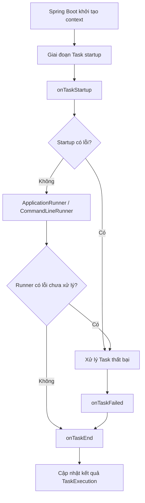

# Thứ tự listener và tác động khi listener ném ngoại lệ trong Spring Cloud Task

## 1. Bối cảnh và mục tiêu

**Spring Cloud Task** giúp xây dựng các ứng dụng Spring Boot có thời gian chạy hữu hạn: khởi động, thực hiện công việc, ghi kết quả thực thi rồi kết thúc. Mỗi lần chạy được theo dõi bởi `TaskRepository` thông qua `TaskExecution`. Các tiến trình này có thể được kích hoạt bằng lệnh, theo lịch hoặc qua hệ thống điều phối; một số còn gọi Spring Batch để xử lý dữ liệu theo lô.

`TaskExecutionListener` là điểm mở rộng để thêm hành vi tại các mốc quan trọng của vòng đời: chuẩn bị trước công việc, ghi nhận kết quả hoặc xử lý một lần chạy thất bại. Khi có **nhiều listener**, thứ tự gọi trở nên quan trọng. Nếu một listener **ném ngoại lệ**, các callback còn lại có thể không chạy, trong khi metadata và mã thoát có thể khác kỳ vọng ban đầu.

Ví dụ một Task nhập đơn hàng có ba hoạt động phụ:

- Kiểm tra quyền sử dụng tên khách hàng và tham số đầu vào.
- Ghi metric/tracing khi bắt đầu và kết thúc.
- Đặt thông điệp `exitMessage` để người vận hành đọc được trạng thái.

Nếu listener kiểm tra đầu vào ném lỗi trước khi runner chạy, có thể bỏ qua phần xử lý nghiệp vụ. Nếu listener ghi metric ném lỗi khi Task kết thúc, một phần kết quả nghiệp vụ **đã được thực hiện**, nhưng phần thông báo hoàn tất có thể bị ảnh hưởng. Đó là lý do phải hiểu cả **thứ tự callback** lẫn **chính sách xử lý lỗi**.

Sau bài này, bạn sẽ:

1. Phân biệt `onTaskStartup`, `onTaskFailed` và `onTaskEnd`.
2. Dùng `@Order` để làm rõ thứ tự giữa các bean listener, đồng thời nhận biết chiều gọi khác nhau ở giai đoạn startup và kết thúc.
3. Dự đoán tác động của ngoại lệ phát sinh tại từng callback tới các listener khác, runner, `TaskRepository` và `exitCode`.
4. Viết listener an toàn, tránh ghi đè thông điệp lỗi, che mất ngoại lệ gốc hoặc tạo tác dụng phụ không thể chạy lại.
5. Thiết kế cách kiểm chứng trên phiên bản Spring Cloud Task mà dự án đang sử dụng.

## 2. Các callback thuộc vòng đời nào?

Interface `org.springframework.cloud.task.listener.TaskExecutionListener` định nghĩa ba phương thức chính:

| Callback | Khi nào được gọi? | Công việc phù hợp |
| --- | --- | --- |
| `onTaskStartup(TaskExecution)` | Trong giai đoạn bắt đầu Task, trước các `ApplicationRunner` / `CommandLineRunner` | Ghi dấu bắt đầu, xác thực điều kiện sớm, chuẩn bị thông tin quan sát |
| `onTaskFailed(TaskExecution, Throwable)` | Khi Task có lỗi chưa được xử lý và framework nhận được sự kiện thất bại | Phân loại lỗi, tạo mã lý do, ghi metric thất bại |
| `onTaskEnd(TaskExecution)` | Trong giai đoạn hoàn tất, trước khi trạng thái cuối của Task được cập nhật trong repository | Đặt tóm tắt kết thúc, hoàn tất metric, giải phóng tài nguyên phụ |

`onTaskFailed` không thay thế `onTaskEnd`. Trong luồng thất bại được Spring Cloud Task xử lý, `onTaskFailed` chạy **trước** `onTaskEnd`. Nếu thành công bình thường, `onTaskFailed` không được gọi.



Sơ đồ thể hiện **luồng logic**. Chi tiết callback có được gọi khi lỗi xảy ra rất sớm, ở thời điểm bootstrap hoặc khi tiến trình bị cưỡng bức dừng, phụ thuộc vào việc Spring Cloud Task đã khởi tạo và nhận được sự kiện lifecycle hay chưa. Nếu `ApplicationContext` thất bại trước khi Task được tạo, `TaskRepository` có thể **không có bản ghi** của lần chạy.

### Cùng một TaskExecution, nhiều mốc khác nhau

`TaskExecution` thường có `executionId`, `taskName`, `startTime`, `endTime`, `exitCode`, `exitMessage` và `errorMessage`. Trong startup, nhiều trường kết quả chưa có giá trị cuối; khi Task thất bại, ngoại lệ gốc được chuyển tới `onTaskFailed`; khi kết thúc, `onTaskEnd` có thể đọc kết quả mà framework đã xác định.

Không nên xem listener là một transaction chung với toàn bộ logic nghiệp vụ. Listener có thể chạy trước hoặc sau các transaction thực tế của dịch vụ; một lệnh gọi HTTP hoặc ghi file trong listener không tự rollback khi dữ liệu nghiệp vụ thất bại.

## 3. “Thứ tự” có hai nghĩa khác nhau

Có hai loại thứ tự cần phân biệt:

1. **Thứ tự giữa các giai đoạn:** startup trước runner; khi Task lỗi thì failed trước end.
2. **Thứ tự giữa các listener trong cùng một giai đoạn:** nếu có A, B, C cùng triển khai `TaskExecutionListener`, chúng được gọi theo trật tự của tập bean listener do Spring Cloud Task sử dụng.

Spring có `@Order` (hoặc interface `Ordered`) để hỗ trợ sắp xếp bean được inject vào collection. **Số nhỏ hơn có độ ưu tiên cao hơn** trong danh sách do Spring sắp xếp.

Trong triển khai `TaskLifecycleListener` hiện hành được đối chiếu từ mã nguồn Spring Cloud Task:

- Các bean `TaskExecutionListener` được tập hợp thành danh sách (ngoài ra còn có bộ thực thi các phương thức gắn annotation).
- **`onTaskStartup` duyệt bản sao của danh sách theo chiều đảo ngược**.
- **`onTaskFailed` và `onTaskEnd` duyệt theo chiều danh sách gốc**.

Điều đó có thể gây bất ngờ:

| Bean listener | `@Order` | Startup (theo chiều đảo) | Failed / End (theo chiều gốc) |
| --- | ---: | ---: | ---: |
| `AuditListener` | `10` | Gọi sau | Gọi trước |
| `GuardListener` | `20` | Gọi trước | Gọi sau |

Nếu danh sách đã được Spring sắp thành `AuditListener` rồi `GuardListener`, luồng khi không có lỗi là:

```text
STARTUP: GuardListener(20) -> AuditListener(10)
RUNNER : xử lý công việc
END    : AuditListener(10) -> GuardListener(20)
```

Với runner thất bại:

```text
STARTUP: GuardListener(20) -> AuditListener(10)
RUNNER : ném ngoại lệ
FAILED : AuditListener(10) -> GuardListener(20)
END    : AuditListener(10) -> GuardListener(20)
```

**Lưu ý về phiên bản:** thứ tự đảo ở startup là đặc điểm quan sát được trong mã nguồn `TaskLifecycleListener` được dẫn ở cuối bài. `@Order` và thứ tự bean cũng có thể bị ảnh hưởng bởi cách cấu hình, proxy và bộ xử lý annotation. Không coi toàn bộ thứ tự của callback là một giao ước bất biến giữa mọi phiên bản; nếu nghiệp vụ thật sự phụ thuộc vào thứ tự, phải kiểm tra ở chính phiên bản được khóa bởi BOM của dự án.

### Listener interface và listener bằng annotation

Ngoài interface, Spring Cloud Task hỗ trợ:

| Annotation | Callback tương ứng |
| --- | --- |
| `@BeforeTask` | `onTaskStartup` |
| `@FailedTask` | `onTaskFailed` |
| `@AfterTask` | `onTaskEnd` |

Ví dụ ngắn:

```java
import org.springframework.cloud.task.listener.annotation.BeforeTask;
import org.springframework.cloud.task.listener.annotation.AfterTask;
import org.springframework.cloud.task.listener.annotation.FailedTask;
import org.springframework.cloud.task.repository.TaskExecution;
import org.springframework.stereotype.Component;

@Component
public class SimpleLifecycleHooks {
    @BeforeTask
    public void before(TaskExecution execution) {
        System.out.println("Before: " + execution.getExecutionId());
    }

    @FailedTask
    public void failed(TaskExecution execution, Throwable error) {
        System.out.println("Failed: " + error.getClass().getSimpleName());
    }

    @AfterTask
    public void after(TaskExecution execution) {
        System.out.println("After: " + execution.getExecutionId());
    }
}
```

Các phương thức gắn annotation được gọi qua cơ chế `TaskListenerExecutor`. Nếu trong cùng một bean có nhiều phương thức `@BeforeTask` hoặc nhiều bean chứa annotation, không nên tự đoán thứ tự chi tiết của các phương thức đó. Với một chuỗi phụ thuộc thực sự, hãy gom thành một nơi điều phối rõ ràng hoặc dùng các bean listener tách biệt, có thứ tự và kiểm thử.

## 4. Ví dụ hoàn chỉnh: hai listener có @Order và Task mô phỏng lỗi

Ví dụ dùng Java 17+, `spring-cloud-starter-task`, Spring Boot và Spring Cloud phiên bản tương thích. Hãy đảm bảo `TaskRepository` có datasource và schema phù hợp. Ba lớp dưới đây nằm trong cùng package `com.example.listenerdemo`.

### 4.1. Ứng dụng chạy một công việc hữu hạn

`TaskOrderDemoApplication.java`:

```java
package com.example.listenerdemo;

import java.util.Arrays;

import org.springframework.boot.ApplicationRunner;
import org.springframework.boot.SpringApplication;
import org.springframework.boot.autoconfigure.SpringBootApplication;
import org.springframework.cloud.task.configuration.EnableTask;
import org.springframework.context.annotation.Bean;

@SpringBootApplication
@EnableTask
public class TaskOrderDemoApplication {

    public static void main(String[] args) {
        SpringApplication.run(TaskOrderDemoApplication.class, args);
    }

    @Bean
    ApplicationRunner runImport() {
        return arguments -> {
            System.out.println("RUNNER: bắt đầu xử lý dữ liệu");

            if (Arrays.asList(arguments.getSourceArgs())
                      .contains("--demo.fail-runner=true")) {
                throw new IllegalStateException(
                    "Lỗi mô phỏng trong logic nghiệp vụ"
                );
            }

            System.out.println("RUNNER: hoàn tất xử lý dữ liệu");
        };
    }
}
```

Phương thức `getSourceArgs()` chỉ dùng ở đây để nhận **chính xác cờ mô phỏng**. Trong ứng dụng thật, hãy dùng parser có kiểm tra giá trị, không in toàn bộ đối số dòng lệnh vì chúng có thể chứa thông tin nhạy cảm.

### 4.2. AuditListener có thứ tự 10

`AuditListener.java`:

```java
package com.example.listenerdemo;

import org.springframework.cloud.task.listener.TaskExecutionListener;
import org.springframework.cloud.task.repository.TaskExecution;
import org.springframework.core.annotation.Order;
import org.springframework.stereotype.Component;

@Component
@Order(10)
public class AuditListener implements TaskExecutionListener {

    @Override
    public void onTaskStartup(TaskExecution execution) {
        System.out.println("AUDIT: START");
    }

    @Override
    public void onTaskFailed(
            TaskExecution execution, Throwable throwable) {
        System.out.println("AUDIT: FAILED");

        if (execution.getArguments()
                     .contains("--demo.fail-in-failed=true")) {
            throw new IllegalStateException(
                "Lỗi mô phỏng trong AuditListener.onTaskFailed"
            );
        }
    }

    @Override
    public void onTaskEnd(TaskExecution execution) {
        System.out.println("AUDIT: END");

        if (execution.getArguments()
                     .contains("--demo.fail-in-end=true")) {
            throw new IllegalStateException(
                "Lỗi mô phỏng trong AuditListener.onTaskEnd"
            );
        }

        // Đặt tóm tắt thành công khi Task không có lỗi.
        if (Integer.valueOf(0).equals(execution.getExitCode())
                && execution.getErrorMessage() == null) {
            execution.setExitMessage("IMPORT_COMPLETED");
        }
    }
}
```

### 4.3. GuardListener có thứ tự 20

`GuardListener.java`:

```java
package com.example.listenerdemo;

import org.springframework.cloud.task.listener.TaskExecutionListener;
import org.springframework.cloud.task.repository.TaskExecution;
import org.springframework.core.annotation.Order;
import org.springframework.stereotype.Component;

@Component
@Order(20)
public class GuardListener implements TaskExecutionListener {

    @Override
    public void onTaskStartup(TaskExecution execution) {
        System.out.println("GUARD: START");

        if (execution.getArguments()
                     .contains("--demo.fail-startup=true")) {
            throw new IllegalArgumentException(
                "Đầu vào mô phỏng không đạt điều kiện khởi chạy"
            );
        }
    }

    @Override
    public void onTaskFailed(
            TaskExecution execution, Throwable throwable) {
        System.out.println("GUARD: FAILED");
        execution.setExitMessage(
            "IMPORT_FAILED; reason=TASK_EXCEPTION"
        );
    }

    @Override
    public void onTaskEnd(TaskExecution execution) {
        System.out.println("GUARD: END");
    }
}
```

Hai listener được đăng ký qua `@Component`. Vì thứ tự 10 và 20 khác nhau, chúng có vị trí rõ ràng trong collection listener của Spring; phần gọi startup sẽ đảo danh sách như đã giải thích. Những cờ `demo.*` chỉ phục vụ bài học, không phải API cấu hình của Spring Cloud Task.

### 4.4. Chạy và dự đoán thứ tự

Giả sử ứng dụng đã được đóng gói thành `task-order-demo.jar`:

```bash
# Thành công
java -jar task-order-demo.jar

# Runner ném ngoại lệ
java -jar task-order-demo.jar --demo.fail-runner=true

# GuardListener ném ngoại lệ khi startup
java -jar task-order-demo.jar --demo.fail-startup=true

# Runner thất bại, AuditListener tiếp tục ném lỗi khi xử lý failed
java -jar task-order-demo.jar \
  --demo.fail-runner=true \
  --demo.fail-in-failed=true

# Runner thành công, AuditListener ném lỗi trong end
java -jar task-order-demo.jar --demo.fail-in-end=true
```

Các dòng log do ví dụ tự in, bỏ qua log khởi tạo của Spring:

| Kịch bản | Thứ tự log dự kiến của ví dụ | Điểm cần chú ý |
| --- | --- | --- |
| Không có cờ lỗi | `GUARD START → AUDIT START → RUNNER → AUDIT END → GUARD END` | Cả startup và end đều chạy hết |
| `fail-runner` | `GUARD START → AUDIT START → RUNNER → AUDIT FAILED → GUARD FAILED → AUDIT END → GUARD END` | Failed trước End |
| `fail-startup` | `GUARD START → AUDIT FAILED → GUARD FAILED → AUDIT END → GUARD END` | Không gọi Audit startup và runner |
| `fail-runner` + `fail-in-failed` | `GUARD START → AUDIT START → RUNNER → AUDIT FAILED → AUDIT END → GUARD END` | Guard failed bị bỏ qua khi Audit failed ném lỗi |
| `fail-in-end` | `GUARD START → AUDIT START → RUNNER → AUDIT END` | Guard end bị bỏ qua khi Audit end ném lỗi |

Đây là **thứ tự dự kiến theo cơ chế duyệt listener được mô tả trong bài**, không phải bản ghi chạy thực tế của một dự án cụ thể. Để kiểm chứng, hãy chạy và so sánh log trong đúng phiên bản Spring Cloud Task đang dùng.

## 5. Ngoại lệ xảy ra ở mỗi callback ảnh hưởng thế nào?

Tài liệu Spring Cloud Task mô tả nguyên tắc quan trọng: **nếu một callback listener ném ngoại lệ, việc gọi các listener còn lại của chính loại callback đó bị dừng**. Các loại callback khác vẫn được xử lý theo quy trình thất bại/kết thúc trong điều kiện framework còn hoạt động.

| Nơi ném ngoại lệ | Ảnh hưởng trực tiếp | Các bước tiếp theo thường thấy | Rủi ro vận hành |
| --- | --- | --- | --- |
| `onTaskStartup` | Dừng các `onTaskStartup` còn lại; không vào runner | Kích hoạt xử lý thất bại, `onTaskFailed` rồi `onTaskEnd` | Dừng trước nghiệp vụ; listener cleanup cần chịu được khởi tạo dở |
| Runner (không phải listener) | Ngắt công việc tại nơi ném | `onTaskFailed` rồi `onTaskEnd` | Có thể đã ghi một phần dữ liệu nghiệp vụ |
| `onTaskFailed` | Dừng các `onTaskFailed` còn lại | `onTaskEnd` vẫn có thể được gọi | Có thể mất metric/thông điệp lỗi bổ sung; dễ che khuất nguyên nhân gốc |
| `onTaskEnd` | Dừng các `onTaskEnd` còn lại | Framework tiếp tục xử lý hoàn tất nếu có thể | Cleanup/metric ở listener sau không chạy; mã thoát cần kiểm chứng theo phiên bản |

### 5.1. Lỗi trong onTaskStartup

Giả sử `GuardListener.onTaskStartup` kiểm tra quyền hoặc cấu hình môi trường và ném `IllegalArgumentException`. Vì startup được duyệt ngược trong triển khai đã đối chiếu, `AuditListener.onTaskStartup` có thể chưa chạy. Runner không được gọi.

Trong đường xử lý phù hợp, Spring Cloud Task chuyển sang luồng thất bại và kết thúc. Tài liệu chính thức nêu **lỗi ném từ `onTaskStartup` khiến ứng dụng có exit code 1**. Không nên cố ánh xạ lỗi listener startup sang một mã riêng bằng `ExitCodeExceptionMapper`; tài liệu chỉ rõ cơ chế mapper này không áp dụng để override exit code của lỗi do callback listener ném.

Khi callback startup lỗi, một phần bean hoặc tài nguyên ứng dụng vẫn có thể được tạo; `onTaskFailed` và `onTaskEnd` cần chịu được trạng thái khởi tạo chưa đầy đủ. Ví dụ listener cuối không được mặc định một file tạm đã tồn tại nếu phần tạo file xảy ra trong listener startup bị bỏ qua.

### 5.2. Lỗi trong onTaskFailed

`onTaskFailed` vốn chạy khi Task **đã có thất bại**. Nếu một listener xử lý lỗi lại ném ngoại lệ, các listener `onTaskFailed` đứng sau không được gọi trong lượt đó, làm giảm khả năng quan sát.

Ví dụ `AuditListener.onTaskFailed` (order 10) ném lỗi, `GuardListener.onTaskFailed` (order 20) không chạy. Vì vậy thông điệp `IMPORT_FAILED; reason=TASK_EXCEPTION` mà Guard lẽ ra đặt trong `exitMessage` có thể **không được ghi**.

Các bản triển khai Spring Cloud Task cố ghi nhận lỗi phát sinh trong listener, nhưng không nên dựa vào việc mọi thông điệp hoặc trạng thái vẫn hoàn hảo khi chính logic báo lỗi bị hỏng. Cần kiểm tra **cả ngoại lệ gốc và ngoại lệ của listener** trong log; không thay thông tin nguyên nhân gốc bằng lỗi phát sinh khi gửi metric hay thông báo.

### 5.3. Lỗi trong onTaskEnd

Đây là trường hợp dễ bị đánh giá thấp nhất: **nghiệp vụ có thể đã hoàn tất**, sau đó listener gửi webhook/metric ở `onTaskEnd` mới ném ngoại lệ.

Trong ví dụ, `AuditListener.onTaskEnd` ném lỗi nên `GuardListener.onTaskEnd` không chạy. Nếu logic gửi notification đặt ở Guard end, thông báo có thể mất mặc dù dữ liệu nhập đã thành công.

Tài liệu tham khảo mô tả các quy tắc exit code liên quan tới `ExitCodeEvent`, `ExitCodeGenerator` và giá trị mặc định khi listener ném lỗi. Tuy nhiên, **việc tính exit code và thời điểm catch ngoại lệ ở callback end là chi tiết triển khai có thể khác theo phiên bản**. Đừng cam kết rằng mọi bản Spring Cloud Task đều biến lỗi `onTaskEnd` thành mã thoát 1. Hãy thử tình huống này trên phiên bản thực tế, kiểm tra đồng thời exit code của tiến trình, `TASK_EXECUTION.EXIT_CODE`, `ERROR_MESSAGE` và log của scheduler.

Quy tắc thiết kế thực tế: `onTaskEnd` dùng cho thao tác quan sát/bổ trợ cần **cố gắng thực hiện**; nếu gửi thông báo bắt buộc và ảnh hưởng tính đúng đắn nghiệp vụ, hãy đưa nó vào luồng nghiệp vụ có giao dịch/outbox và cơ chế retry riêng, thay vì trông chờ listener end ném lỗi sẽ rollback tất cả.

### 5.4. Đừng lấy ExitCodeExceptionMapper làm “lưới an toàn” cho callback lỗi

`ExitCodeExceptionMapper` của Spring Boot có thể ánh xạ các ngoại lệ ứng dụng sang exit code. Nhưng tài liệu Spring Cloud Task nêu ngoại lệ từ `onTaskStartup`, `onTaskFailed` hoặc `onTaskEnd` **không thể tùy ý override bằng `ExitCodeExceptionMapper`**. Đối với lỗi listener, việc framework xét `ExitCodeEvent` hoặc `ExitCodeGenerator` và cách nó ghi kết quả cuối cần được kiểm tra với phiên bản cụ thể.

Nếu muốn trả mã đặc biệt cho **lỗi tham số trước khi xử lý**, có thể xác thực trong runner/service và ném ngoại lệ ứng dụng có cơ chế ánh xạ rõ ràng. Nếu bắt buộc fail fast ở startup listener, hãy chấp nhận tác động riêng của lifecycle callback và kiểm chứng kết quả.

## 6. Thứ tự exitMessage khác với thứ tự listener

`TaskExecution.exitMessage` là thông điệp ngắn mà listener có thể gán bằng `setExitMessage(...)`. Nó **không phải** exit code, và không đồng nghĩa với `errorMessage` (thường lưu chi tiết ngoại lệ khi Task thất bại).

Tài liệu Spring Cloud Task mô tả ưu tiên giữa các **giai đoạn ghi thông điệp**:

| Giai đoạn | Độ ưu tiên của thông điệp |
| --- | ---: |
| `onTaskEnd` | Cao nhất |
| `onTaskFailed` | Giữa |
| `onTaskStartup` | Thấp nhất |

Ví dụ, nếu `onTaskStartup` đặt `"STARTED"` và khi xảy ra lỗi `onTaskFailed` đặt `"VALIDATION_FAILED"`, kết quả sau thất bại thường giữ thông điệp từ failed. Nhưng nếu `onTaskEnd` sau đó **đặt một chuỗi không null**, nó có thể **ghi đè** thông điệp thất bại.

**Quy tắc an toàn:** chỉ ghi `"COMPLETED"` trong `onTaskEnd` khi Task thực sự thành công; dùng trường `exitCode`/`errorMessage` và trạng thái nghiệp vụ phù hợp để quyết định. Không gán `"SUCCESS"` vô điều kiện trong một listener end “chạy cho mọi trường hợp”.

Ví dụ:

```java
@Override
public void onTaskEnd(TaskExecution execution) {
    if (Integer.valueOf(0).equals(execution.getExitCode())
            && execution.getErrorMessage() == null) {
        execution.setExitMessage("COMPLETED");
    }
    // Khi thất bại: giữ exitMessage do onTaskFailed tạo ra.
}
```

Trong **cùng một loại callback**, nếu nhiều listener cùng gán `exitMessage` lên đối tượng được truyền, giá trị nào cuối cùng phụ thuộc vào thứ tự gọi; đừng để hai listener cùng “sở hữu” một trường kết quả nếu chưa định nghĩa rõ chính sách.

Mã nguồn cũng cho thấy framework có thể truyền **bản sao `TaskExecution`** cho các listener và chỉ chuyển một số trường được hỗ trợ về đối tượng chính khi hoàn tất. Vì vậy không nên gọi `setExitCode`, thay ID hoặc sửa các trường khác trong listener rồi mặc định chúng sẽ được lưu đúng như mong muốn. Sử dụng API/exit-code mechanism chính thức và đọc lại repository để xác nhận.

## 7. Thiết kế listener đáng tin cậy

### 7.1. Phân loại hành vi theo mức độ quan trọng

| Hành vi | Nên đặt ở đâu? | Chiến lược khi có lỗi |
| --- | --- | --- |
| Kiểm tra điều kiện bắt buộc trước khi chạy | Parser/service hoặc startup listener khi thật cần | Fail fast, nêu mã lý do rõ |
| Xử lý dữ liệu và ghi kết quả | `ApplicationRunner` / dịch vụ nghiệp vụ; Spring Batch nếu cần | Giao dịch, idempotency, exception propagation |
| Ghi metric và trace | Listener; thư viện observation/metrics phù hợp | Catch lỗi quan sát để tránh làm hỏng Task |
| Gửi thông báo không bắt buộc | Listener hoặc hàng đợi bất đồng bộ | Catch và ghi log an toàn, retry độc lập |
| Gửi sự kiện bắt buộc phải đúng một lần về mặt nghiệp vụ | Outbox/giao dịch hoặc bước nghiệp vụ rõ ràng | Không đặt niềm tin vào một callback cleanup |
| Dọn tài nguyên phụ | `try/finally` hoặc cơ chế đóng tài nguyên của ứng dụng | Đảm bảo dọn khi khởi tạo dở hoặc đóng bất thường trong phạm vi có thể |

**Mẫu xử lý lỗi cho listener chỉ phục vụ quan sát:**

```java
@Override
public void onTaskEnd(TaskExecution execution) {
    try {
        metricsPublisher.publishTaskCompletion(
            execution.getExecutionId(),
            execution.getExitCode()
        );
    } catch (RuntimeException metricError) {
        logger.warn(
            "Không gửi được metric cho TaskExecution {}",
            execution.getExecutionId(),
            metricError
        );
        // Không ném lại: thất bại của metric không làm đổi kết quả nghiệp vụ.
    }
}
```

Đây là **đoạn trong một listener**, giả định đã inject `metricsPublisher` và `logger`; không phải một lớp Java hoàn chỉnh. Chỉ áp dụng khi việc thiếu metric là chấp nhận được. Đối với sự kiện bắt buộc, cần thiết kế retry/outbox có khả năng phục hồi.

### 7.2. Không che mất ngoại lệ gốc

Trong `onTaskFailed(TaskExecution execution, Throwable throwable)`, `throwable` đại diện cho lỗi đã dẫn tới đường thất bại. Tránh mọi thao tác có nguy cơ thay thế hoàn toàn dấu vết nguyên nhân:

```java
@Override
public void onTaskFailed(
        TaskExecution execution, Throwable throwable) {
    String reason = classify(throwable); // Ví dụ: INPUT, STORAGE, UNKNOWN.
    execution.setExitMessage("TASK_FAILED; reason=" + reason);

    try {
        alertPublisher.notifyFailure(execution.getExecutionId(), reason);
    } catch (RuntimeException notificationError) {
        logger.warn("Không gửi được cảnh báo phụ", notificationError);
    }
}
```

`classify` cần trả mã lỗi ổn định, không đưa password/token hoặc dữ liệu khách hàng vào `exitMessage`. `alertPublisher` và `logger` là các dependency giả định. Nếu việc alert thất bại có thể khôi phục, xử lý bằng job riêng hoặc hàng đợi; không bắt mọi `Throwable` và bỏ qua lỗi nghiêm trọng của JVM.

### 7.3. Điều phối nhiều bước có phụ thuộc lẫn nhau

Nếu listener A tạo tài nguyên mà listener B bắt buộc sử dụng, phụ thuộc đó phải được thể hiện rõ. Dựa vào tên class hoặc thứ tự Spring quét component là không đủ. Một số lựa chọn:

- Đưa hai bước vào **một service** có phương thức rõ ràng, được gọi theo thứ tự trong runner.
- Nếu vẫn cần listener, dùng `@Order` khác nhau và kiểm thử thứ tự callback trên bản Spring Cloud Task đang dùng.
- Thiết kế listener tiếp theo chịu được việc callback trước không chạy hoặc ném lỗi; không mặc định mọi đối tượng trung gian đều được khởi tạo.
- Không trộn nhiều listener annotation với nhiều listener interface trong cùng một chuỗi phụ thuộc nếu chưa kiểm chứng thứ tự tổng thể.

### 7.4. Phối hợp với Spring Batch

Spring Cloud Task theo dõi **lần chạy tiến trình**, còn Spring Batch theo dõi **JobExecution** và **StepExecution**. Một Task có thể chạy Batch Job, sau đó các listener Task nhận sự kiện kết thúc ở cấp tiến trình. Nếu Batch Job thất bại nhưng runner bắt lỗi rồi hoàn tất bình thường, Spring Cloud Task có thể vẫn coi Task thành công.

Vì vậy, hãy truyền trạng thái thất bại cần thiết từ Batch Job lên luồng Task bằng logic có chủ đích. Không dùng `onTaskFailed` như nơi duy nhất phát hiện mọi `BatchStatus.FAILED`; callback này chỉ được kích hoạt khi vòng đời Task đi vào nhánh thất bại.

## 8. Kiểm chứng thứ tự và xử lý ngoại lệ

Đừng chỉ nhìn log “Application started” mà kết luận mọi listener đã chạy. Khi kiểm chứng, cần xem **thứ tự callback, exit code tiến trình và metadata được lưu**.

### Ma trận thử nghiệm

| Ca | Cách kích hoạt | Điều cần xác nhận |
| --- | --- | --- |
| A — bình thường | Không có cờ lỗi | Startup đảo, End thuận; runner chạy một lần; `exitCode` thành công |
| B — runner thất bại | `--demo.fail-runner=true` | Failed chạy trước End; repository ghi nhận lỗi |
| C — listener startup thất bại | `--demo.fail-startup=true` | Các Startup sau điểm lỗi không chạy; runner không chạy; luồng Failed và End diễn ra nếu context còn hoạt động |
| D — listener failed thất bại | `--demo.fail-runner=true --demo.fail-in-failed=true` | Các Failed sau điểm lỗi bị bỏ qua; tìm cả ngoại lệ gốc và ngoại lệ listener |
| E — listener end thất bại | `--demo.fail-in-end=true` | Các End sau điểm lỗi bị bỏ qua; xác minh thực tế mã thoát và metadata |
| F — nhiều listener cùng đặt thông điệp | Thêm `setExitMessage` ở hai nơi | Xác minh thông điệp cuối và chính sách không ghi đè lỗi |

### SQL kiểm tra TaskRepository

Với schema chuẩn của Spring Cloud Task, có thể tra các bản ghi mới nhất:

```sql
SELECT
    TASK_EXECUTION_ID,
    TASK_NAME,
    START_TIME,
    END_TIME,
    EXIT_CODE,
    EXIT_MESSAGE,
    CASE WHEN ERROR_MESSAGE IS NULL THEN 'NO' ELSE 'YES' END
        AS HAS_ERROR_MESSAGE
FROM TASK_EXECUTION
ORDER BY TASK_EXECUTION_ID DESC;
```

Nếu `TASK_EXECUTION` được đổi tiền tố hoặc nằm trong schema riêng, điều chỉnh truy vấn theo cấu hình `TaskRepository`. Đối chiếu `TASK_EXECUTION_ID` và thời điểm với log của scheduler/container. Không đưa toàn bộ `ERROR_MESSAGE` lên dashboard chung vì đó có thể là stack trace chứa thông tin nhạy cảm.

Khi test:

1. Chạy từng trường hợp trên bản Spring Boot/Spring Cloud được quản lý bằng BOM của dự án, ghi lại cả exit code của tiến trình.
2. Đọc log để xác nhận **các callback có và không được gọi**, đặc biệt ở ca startup lỗi.
3. Truy vấn repository để kiểm tra `endTime`, `exitCode`, `exitMessage` và sự hiện diện của `errorMessage`.
4. Nếu kết quả khác tài liệu, đối chiếu source code/điều kiện khởi tạo của **đúng version**; phân biệt lỗi do Task, listener, cơ sở dữ liệu và scheduler.
5. Kiểm thử restart/retry: một lần chạy lại có thể tạo `TaskExecution` mới và tác vụ nghiệp vụ phải bảo đảm idempotency khi cần.

**Cảnh báo thực tế:** nếu tiến trình bị `SIGKILL`, mất nguồn hoặc `ApplicationContext` không khởi tạo xong, một số callback có thể không chạy và dữ liệu cuối có thể chưa được ghi. Không dùng listener như cơ chế đảm bảo tuyệt đối phải chạy khi mọi kiểu kết thúc xảy ra.

## 9. Bài tập thực hành

**Bài 1 — Dự đoán thứ tự:** Cho ba listener `A(order=5)`, `B(order=15)` và `C(order=25)`. Với cơ chế duyệt listener đã mô tả, hãy viết thứ tự gọi tại startup, failed và end. Sau đó cho B ném lỗi ở startup. Callback nào bị bỏ qua? Runner có được chạy không?

**Bài 2 — Giải quyết ghi đè thông điệp:** Listener X đặt `exitMessage="VALIDATION_FAILED"` tại failed. Listener Y đặt `exitMessage="DONE"` vô điều kiện tại end. Hãy giải thích thông điệp cuối và sửa Y để chỉ ghi `DONE` khi chạy thành công.

**Bài 3 — Dữ liệu đã ghi nhưng listener end lỗi:** Runner đã commit 1.000 bản ghi vào database, sau đó listener gửi metric ném ngoại lệ. Hãy đề xuất cách kiểm soát retry, idempotency và cảnh báo sao cho không nhập trùng 1.000 bản ghi.

**Bài 4 — Lỗi phụ khi báo lỗi:** Listener gửi cảnh báo qua HTTP trong `onTaskFailed`. Dịch vụ HTTP tạm thời không truy cập được. Hãy sửa listener để bảo vệ nguyên nhân gốc của Task và retry cảnh báo bằng cơ chế riêng.

**Bài 5 — Trường hợp có Batch Job:** Một `JobExecution` có trạng thái thất bại nhưng `TaskExecution.exitCode` bằng 0. Giải thích nguyên nhân có thể có và nơi cần sửa logic truyền thất bại.

### Câu hỏi tự đánh giá

- Vì sao `@Order(10)` không nhất thiết đồng nghĩa listener đó luôn chạy trước `@Order(20)` ở tất cả callback?
- Vì sao listener `onTaskFailed` có thể chạy nhưng listener `onTaskStartup` tương ứng chưa từng được gọi?
- Nếu listener A ném lỗi trong `onTaskEnd`, listener B có thể bị ảnh hưởng như thế nào?
- Vì sao cần kiểm tra `exitCode` **và** `exitMessage` thay vì chỉ đọc một trường?
- Khi nào nên ném ngoại lệ để chặn Task, và khi nào nên bắt lỗi phụ của metric/notification?

**Tiêu chí hoàn thành:** Bạn đọc được luồng callback trong cả nhánh thành công và thất bại; giải thích được thứ tự giữa nhiều listener và điểm dừng khi có ngoại lệ; nhận biết giới hạn của `ExitCodeExceptionMapper` với lỗi listener; và chứng minh bằng log/repository rằng hành vi thực tế của phiên bản đang chạy phù hợp với thiết kế vận hành.

## Tài liệu tham khảo chính thức

- [Spring Cloud Task — Features: Task Execution Listener, Exceptions, Exit Messages](https://docs.spring.io/spring-cloud-task/reference/features.html): callback, hành vi khi listener ném ngoại lệ và ưu tiên thông điệp.
- [Spring Cloud Task — TaskLifecycleListener (mã nguồn)](https://github.com/spring-cloud/spring-cloud-task/blob/main/spring-cloud-task-core/src/main/java/org/springframework/cloud/task/listener/TaskLifecycleListener.java): cách duyệt listener ở từng giai đoạn; luôn đối chiếu nhánh nguồn với phiên bản dự án.
- [Spring Cloud Task — TaskExecutionListener API](https://docs.spring.io/spring-cloud-task/docs/current/apidocs/org/springframework/cloud/task/listener/TaskExecutionListener.html).
- [Spring Framework — Using @Order](https://docs.spring.io/spring-framework/reference/core/beans/annotation-config/standard-annotations.html): thứ tự bean trong collection và phạm vi áp dụng.
- [Spring Batch — Reference Documentation](https://docs.spring.io/spring-batch/reference/): lifecycle của JobExecution/StepExecution và trạng thái Batch.
