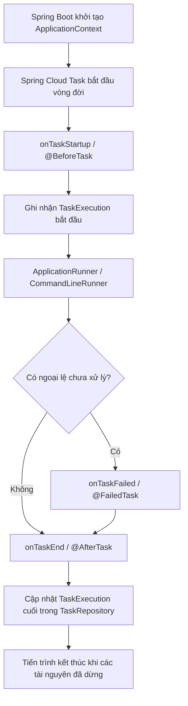
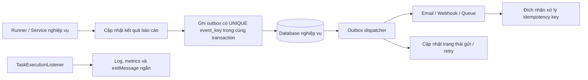

# Giữ listener gọn, xử lý lỗi và tránh tác dụng phụ lặp

## Mục tiêu

**SPRING_CLOUD_TASK (Spring Cloud Task)** được dùng để xây dựng ứng dụng Spring Boot thực hiện công việc **có thời gian chạy hữu hạn**, chẳng hạn xuất báo cáo, nhập dữ liệu hoặc đồng bộ đơn hàng. Mỗi lượt chạy có thể được theo dõi trong cơ sở dữ liệu qua `TaskRepository` và bản ghi `TaskExecution`: thời điểm bắt đầu, thời điểm kết thúc, mã thoát và thông tin lỗi. Tác vụ có thể chạy theo lịch, theo yêu cầu hoặc kết hợp với Spring Batch.

Trong chương **Listener**, bài này giải quyết một yêu cầu vận hành thiết thực: **giữ listener ngắn và dễ dự đoán, xử lý lỗi theo mức độ quan trọng, đồng thời tránh các tác dụng phụ bị thực hiện lặp khi retry hoặc chạy lại**.

Sau khi học, bạn có thể:

- Phân biệt callback vòng đời Task với `ApplicationRunner`, `CommandLineRunner` và listener của Spring Batch.
- Sử dụng `TaskExecutionListener` hoặc `@BeforeTask`, `@FailedTask`, `@AfterTask` theo đúng mục đích.
- Giải thích điều xảy ra khi một callback listener ném ngoại lệ, bao gồm tác động đến các listener khác và mã thoát.
- Quyết định thao tác nào được phép ở listener và thao tác nào phải đưa sang nghiệp vụ hoặc bộ xử lý bất đồng bộ.
- Thiết kế khóa idempotency, outbox và cơ chế đối chiếu trạng thái để tránh gửi sự kiện, email hoặc ghi dữ liệu lặp.
- Kiểm tra cả metadata Task, log và trạng thái của bộ điều phối khi có lỗi.

## 1. Listener trong vòng đời Spring Cloud Task

Spring Cloud Task cung cấp interface `org.springframework.cloud.task.listener.TaskExecutionListener` để ứng dụng đăng ký callback ở ba mốc:

| Callback | Annotation tương ứng | Khi nào được gọi? | Mục đích hợp lý |
| --- | --- | --- | --- |
| `onTaskStartup(TaskExecution)` | `@BeforeTask` | Quanh mốc bắt đầu một lượt Task, trước các runner nghiệp vụ. | Ghi log nhận diện lượt chạy, khởi tạo ngữ cảnh chẩn đoán nhẹ. |
| `onTaskFailed(TaskExecution, Throwable)` | `@FailedTask` | Khi tác vụ có ngoại lệ chưa được xử lý; callback này đến **trước** `onTaskEnd`. | Ghi nhận tóm tắt lỗi, bổ sung ngữ cảnh chẩn đoán. |
| `onTaskEnd(TaskExecution)` | `@AfterTask` | Trước khi repository cập nhật trạng thái cuối của Task. Có thể xảy ra ở cả đường thành công lẫn thất bại. | Ghi log kết thúc, gắn exit message ngắn khi phù hợp. |

**Lưu ý về mốc ghi metadata:** Các phiên bản tài liệu chính thức mô tả `onTaskStartup` gần bước ghi `TaskExecution`; tài liệu reference và Javadoc của một số phiên bản dùng cách diễn đạt khác nhau về “trước”/“sau” thao tác lưu ban đầu. Vì vậy, không đặt logic nghiệp vụ dựa trên giả định rằng bản ghi đã commit và lập tức được tiến trình khác đọc thấy ngay trong `@BeforeTask`. Hãy đối chiếu đúng phiên bản thư viện và kiểm tra trong môi trường thử nghiệm nếu cần tính nhất quán tuyệt đối.

Luồng logic thường được mô tả như sau:



Sơ đồ nhấn mạnh **thứ tự xử lý**, không khẳng định từng lời gọi JDBC hoặc transaction commit sẽ xảy ra ở chính xác một thời điểm giống nhau trong mọi bản phát hành. Trường hợp lỗi quá sớm trong lúc khởi tạo `ApplicationContext` có thể xảy ra trước khi listener của Task được gọi; trường hợp JVM bị hủy đột ngột cũng có thể khiến callback kết thúc không chạy.

Một listener của Spring Cloud Task theo dõi **một lượt chạy của ứng dụng**. Nó không thay thế cho logic nghiệp vụ trong runner và không phải cơ chế bảo đảm gửi thông báo đúng một lần.

## 2. Ranh giới trách nhiệm: listener nên làm ít việc

Listener là một phần trong quá trình ghi nhận trạng thái Task. Công việc kéo dài hoặc phụ thuộc dịch vụ bên ngoài làm tăng thời gian chạy, thêm điểm lỗi và có thể cản trở quá trình lưu trạng thái cuối.

| Hành động | Nên đặt ở đâu? | Vì sao? |
| --- | --- | --- |
| Ghi log tên Task, execution ID, thời điểm callback | Listener | Nhanh, ít phụ thuộc, hỗ trợ quan sát. |
| Bổ sung `exitMessage` ngắn, không nhạy cảm | Listener | Là trường metadata được thiết kế cho ngữ cảnh kết thúc. |
| Ghi bộ đếm hoặc span quan sát nhẹ | Listener hoặc cơ chế observability của framework | Được nhưng phải có giới hạn lỗi và thời gian. |
| Xác thực và xử lý tham số nghiệp vụ | Runner/service | Là một phần hợp đồng của lượt chạy và cần lỗi rõ ràng. |
| Xuất báo cáo, gọi API thanh toán, cập nhật đơn hàng | Service nghiệp vụ | Có yêu cầu giao dịch, retry và idempotency riêng. |
| Gửi email, webhook hoặc thông báo đến hệ ngoài | Outbox + worker/dispatcher chuyên trách | Lệnh mạng có thể timeout nhưng đã được phía nhận thực hiện. |
| Xác nhận đã commit kết quả Task trong repository | Thành phần theo dõi/đối chiếu sau commit | `@AfterTask` được gọi **trước** lần cập nhật kết thúc; chưa phải bằng chứng dữ liệu đã lưu thành công. |
| Tính toán lại kết quả nghiệp vụ khi retry | Runner/service có chiến lược restart | Listener không nắm đủ checkpoint và tính đúng đắn của dữ liệu. |

Quy tắc thiết kế: listener nên **quan sát và bổ sung ngữ cảnh**, còn quyết định nghiệp vụ và thay đổi dữ liệu phải nằm ở nơi có thể kiểm soát giao dịch, lỗi và chạy lại.

### Ngắn không chỉ là ít dòng code

Một method `@AfterTask` chỉ có ba dòng nhưng gọi đồng bộ API bên ngoài có timeout 60 giây vẫn là listener “nặng”. Ngược lại, method 15 dòng chỉ chuẩn hóa nhãn metric và ghi log nội bộ thường dễ kiểm soát. Đánh giá theo **thời gian thực thi, side effect, số phụ thuộc và hành vi khi lỗi**.

Không giữ khóa quá lâu, không mở thread chờ vô hạn, không chờ người dùng nhập dữ liệu và không gọi `System.exit(…)` từ listener. Những thao tác này có thể ngăn Spring Cloud Task hoàn tất cập nhật metadata hoặc dừng tiến trình theo cách dự kiến.

## 3. Đăng ký listener qua interface

Với Spring Cloud Task 3.x, các method của `TaskExecutionListener` có triển khai mặc định nên lớp chỉ cần override callback quan tâm. Tạo bean Spring bằng `@Component` là cách phổ biến:

```java
package com.example.report.listener;

import org.slf4j.Logger;
import org.slf4j.LoggerFactory;
import org.springframework.cloud.task.listener.TaskExecutionListener;
import org.springframework.cloud.task.repository.TaskExecution;
import org.springframework.stereotype.Component;

@Component
public class TaskLogListener implements TaskExecutionListener {

    private static final Logger log =
            LoggerFactory.getLogger(TaskLogListener.class);

    @Override
    public void onTaskStartup(TaskExecution execution) {
        log.info("Task bắt đầu: name={}, executionId={}",
                execution.getTaskName(), execution.getExecutionId());
    }

    @Override
    public void onTaskFailed(TaskExecution execution, Throwable error) {
        String errorType = error == null
                ? "Unknown" : error.getClass().getSimpleName();
        log.error("Task thất bại: name={}, executionId={}, type={}",
                execution.getTaskName(), execution.getExecutionId(),
                errorType);
    }

    @Override
    public void onTaskEnd(TaskExecution execution) {
        log.info("Task đến mốc kết thúc: name={}, executionId={}",
                execution.getTaskName(), execution.getExecutionId());
    }
}
```

Mẫu này **chỉ ghi log**, không gửi thông báo, không thực hiện lại nghiệp vụ, không ghi SQL thủ công vào `TASK_EXECUTION`. `onTaskEnd` chỉ ghi “đến mốc kết thúc”: tại thời điểm callback, repository có thể **chưa** cập nhật xong `END_TIME` và mã thoát cuối.

Khi cần log stack trace, có thể truyền nguyên ngoại lệ vào logger trong hệ thống log được bảo vệ và có quy định che dữ liệu. Không tự nối toàn bộ stack trace hoặc tham số người dùng vào `exitMessage`, email hay webhook vì dữ liệu có thể chứa bí mật.

### Sử dụng annotation thay cho interface

Spring Cloud Task cũng hỗ trợ các annotation trong package `org.springframework.cloud.task.listener.annotation`. Đây là **phương án thay thế** cho interface ở trên:

```java
package com.example.report.listener;

import org.slf4j.Logger;
import org.slf4j.LoggerFactory;
import org.springframework.cloud.task.listener.annotation.AfterTask;
import org.springframework.cloud.task.listener.annotation.BeforeTask;
import org.springframework.cloud.task.listener.annotation.FailedTask;
import org.springframework.cloud.task.repository.TaskExecution;
import org.springframework.stereotype.Component;

@Component
public class AnnotatedTaskLogListener {

    private static final Logger log =
            LoggerFactory.getLogger(AnnotatedTaskLogListener.class);

    @BeforeTask
    public void before(TaskExecution execution) {
        log.info("beforeTask executionId={}", execution.getExecutionId());
    }

    @FailedTask
    public void failed(TaskExecution execution, Throwable error) {
        log.warn("failedTask executionId={}, errorType={}",
                execution.getExecutionId(),
                error == null ? "Unknown"
                        : error.getClass().getSimpleName());
    }

    @AfterTask
    public void after(TaskExecution execution) {
        log.info("afterTask executionId={}", execution.getExecutionId());
    }
}
```

Chỉ đăng ký **một** trong hai ví dụ trên nếu mục tiêu là log mỗi mốc một lần. Nếu cùng đăng ký cả hai, mỗi mốc có thể xuất hiện hai dòng log; điều này là hệ quả của hai listener khác nhau được kích hoạt, không nhất thiết là lỗi framework.

Các ví dụ giả định ứng dụng đã khai báo Spring Cloud Task starter và cấu hình `@EnableTask` hoặc cơ chế auto-configuration tương ứng với phiên bản đang dùng, cùng `DataSource` và schema phù hợp khi lưu metadata JDBC.

## 4. Mối liên hệ với ApplicationRunner và dữ liệu thực thi

Ví dụ tác vụ tạo báo cáo hằng ngày:

```java
package com.example.report;

import java.time.LocalDate;
import java.util.List;
import org.springframework.boot.ApplicationRunner;
import org.springframework.boot.SpringApplication;
import org.springframework.boot.autoconfigure.SpringBootApplication;
import org.springframework.cloud.task.configuration.EnableTask;
import org.springframework.context.annotation.Bean;

@SpringBootApplication
@EnableTask
public class DailyReportTaskApplication {

    public static void main(String[] args) {
        SpringApplication.run(DailyReportTaskApplication.class, args);
    }

    @Bean
    ApplicationRunner reportRunner(ReportService reportService) {
        return args -> {
            List<String> dates = args.getOptionValues("businessDate");
            if (dates == null || dates.size() != 1) {
                throw new IllegalArgumentException(
                        "Cần đúng một --businessDate=yyyy-MM-dd");
            }
            LocalDate businessDate = LocalDate.parse(dates.get(0));
            reportService.generate(businessDate);
        };
    }
}
```

`ReportService` là service nghiệp vụ do dự án cung cấp; đoạn mã mô tả **điểm điều phối**, không bao gồm phần xuất báo cáo và persistence của service này. Quy tắc mong muốn:

1. Listener đánh dấu nhận diện execution và ghi log nhẹ.
2. Runner kiểm tra `businessDate`, sau đó gọi service.
3. Service xử lý theo giao dịch và khóa nghiệp vụ để chạy lại không gây trùng.
4. Nếu service ném ngoại lệ chưa xử lý, Spring Cloud Task thông báo `onTaskFailed` rồi `onTaskEnd` và cố gắng ghi trạng thái cuối.
5. Bộ điều phối đọc exit code và metadata để quyết định chạy lại hoặc báo người vận hành.

Không “chữa” lỗi ở listener bằng cách chạy lại `reportService.generate(…)` trong `@FailedTask`. Khi ấy việc chạy lại diễn ra **ngay trong callback kết thúc**, có thể tạo thêm side effect ngoài logic retry đã kiểm soát.

## 5. Điều gì xảy ra khi chính listener ném lỗi?

Spring Cloud Task có quy tắc xử lý ngoại lệ listener riêng; nó không đơn giản là “bỏ qua rồi gọi toàn bộ callback tiếp theo”.

| Nơi phát sinh lỗi | Ảnh hưởng đáng chú ý | Khuyến nghị |
| --- | --- | --- |
| `onTaskStartup` / `@BeforeTask` | Lỗi ở callback đầu có thể khiến các startup listener còn lại **không được gọi**; ứng dụng nhận trạng thái lỗi khởi động Task. | Không gọi mạng đồng bộ; chỉ ném lỗi nếu đó là điều kiện bắt buộc để phép chạy được coi là hợp lệ. |
| `onTaskFailed` / `@FailedTask` | Xảy ra ngay trên đường đang xử lý lỗi; ngoại lệ thứ hai có thể làm phức tạp chẩn đoán và ảnh hưởng exit code. | Giữ callback chẩn đoán đơn giản, bắt lỗi phụ của kênh quan sát; không che nguyên nhân chính. |
| `onTaskEnd` / `@AfterTask` | Các callback end phía sau có thể không được gọi; ngoại lệ có thể ảnh hưởng quá trình kết thúc và kết quả trả về. | Không thực hiện tác dụng phụ không thể đảo ngược; tuyệt đối tránh luồng nghiệp vụ có thể thất bại ở đây. |
| Runner/service | Nếu ném ngoại lệ chưa xử lý, Task có thể đi qua `onTaskFailed` và `onTaskEnd` rồi ghi kết quả thất bại. | Để lỗi quan trọng lan truyền; chỉ khôi phục khi thực sự đạt tiêu chí thành công. |

Theo hướng dẫn Spring Cloud Task, **một callback của một loại sự kiện ném lỗi có thể dừng việc gọi các listener còn lại của cùng loại sự kiện**. Các loại callback khác (`onTaskFailed`/`onTaskEnd`) vẫn tham gia cơ chế hoàn tất phù hợp; tuy nhiên, không nên dựa vào thứ tự nhiều listener như một giao thức nghiệp vụ có bảo đảm.

Về **exit code**, tài liệu Spring Cloud Task mô tả riêng lỗi listener:

- Nếu `onTaskStartup` ném lỗi, ứng dụng nhận exit code `1`.
- Với lỗi trong `onTaskEnd` hoặc `onTaskFailed`, quy tắc có thể dựa trên `ExitCodeEvent`, `ExitCodeGenerator` và mặc định `1` nếu không có cấu hình/nguồn mã thoát phù hợp.
- `ExitCodeExceptionMapper` **không thể ghi đè** mã thoát cho ngoại lệ phát sinh trong những callback listener này theo cơ chế được tài liệu hóa.

Do các quy tắc trên phụ thuộc đường lỗi và phiên bản, phải kiểm chứng mã thoát thật của artifact đang dùng. Đừng tự đặt “thành công” bằng cách sửa `TaskExecution.exitCode` trong listener để che ngoại lệ khác.

### Phân loại lỗi theo trách nhiệm

**Lỗi bắt buộc (critical):** ví dụ cấu hình đầu ra không hợp lệ hoặc người chạy không có quyền thực thi công việc. Điều kiện này nên được **kiểm tra rõ ở runner/service**, để tác vụ thất bại có nguyên nhân dễ theo dõi và không thực hiện nghiệp vụ ngoài kiểm soát.

**Lỗi hỗ trợ (best effort):** ví dụ endpoint gửi metric hoặc nơi ghi thêm chẩn đoán không sẵn sàng. Nếu yêu cầu nghiệp vụ không phụ thuộc vào metric, callback không nên làm hỏng Task chỉ vì kênh chẩn đoán tạm thời lỗi.

Ví dụ cách cô lập lỗi phụ khi có dịch vụ quan sát tùy chọn:

```java
@FailedTask
public void reportFailure(TaskExecution taskExecution, Throwable cause) {
    try {
        diagnosticRecorder.recordFailure(
                taskExecution.getExecutionId(),
                cause == null ? "Unknown"
                        : cause.getClass().getSimpleName());
    } catch (RuntimeException monitoringError) {
        log.warn("Không ghi được chẩn đoán cho executionId={}",
                taskExecution.getExecutionId(), monitoringError);
    }
}
```

Trong đoạn minh họa, `diagnosticRecorder` và `log` là các dependency của bean listener, được tiêm và cấu hình trong dự án. Đừng áp dụng pattern bắt mọi `Exception` bừa bãi cho nghiệp vụ: việc **không lan truyền lỗi** ở đây chỉ đúng vì dịch vụ chẩn đoán là **phụ trợ**. Nếu hệ thống bắt buộc phải ghi audit hợp lệ mới được coi là hoàn tất, hãy thiết kế audit như một bước nghiệp vụ có transaction và chiến lược retry riêng.

## 6. Vì sao side effect trong listener dễ bị lặp?

Giả sử `@AfterTask` gửi email “Báo cáo hoàn thành” ngay sau khi runner chạy xong:

```java
// Không nên: minh họa một listener có side effect mạng.
@AfterTask
public void after(TaskExecution taskExecution) {
    mailClient.sendReportFinished(taskExecution.getExecutionId());
}
```

Các rủi ro:

1. Máy chủ email đã nhận thư, nhưng HTTP/SMTP response bị timeout. Listener tưởng thất bại và hạ tầng retry; người nhận có thể nhận thư hai lần.
2. Listener gửi thư thành công nhưng repository cập nhật `TaskExecution` thất bại sau đó. Trạng thái cuối trong DB không xác nhận thành công trong khi thư đã gửi.
3. Scheduler chạy lại tác vụ sau timeout hoặc người vận hành khởi chạy lại cùng ngày; lần chạy mới có `TASK_EXECUTION_ID` khác và listener lại gửi thông báo.
4. Hai bản sao Task có thể chạy cùng `businessDate` nếu nền tảng không hạn chế concurrency; kiểm tra một biến boolean trong JVM không ngăn trùng giữa các tiến trình.
5. Tiến trình bị `kill -9` trước khi `@AfterTask` chạy; thông báo có thể **không được gửi lần nào**.

Vì thế, callback vòng đời **không** mang bảo đảm “exactly once” cho side effect ngoài tiến trình. Muốn đạt hành vi gần như một lần theo nghiệp vụ, phải thiết kế cơ chế lưu trạng thái bền vững và idempotency ở phía dữ liệu/đích nhận.

### Phân biệt hai loại trùng lặp

| Mục tiêu | Khóa idempotency minh họa | Khi nào dùng? |
| --- | --- | --- |
| Một thông báo **cho mỗi lần chạy** | `task:8421:finished` | Muốn mỗi `TaskExecution` có một kết quả riêng, kể cả chạy lại cùng ngày. |
| Một kết quả **cho mỗi ngày nghiệp vụ** | `daily-report:2026-11-23:ready` | Chỉ muốn tạo một báo cáo chính thức cho ngày đó, dù chạy lại nhiều lần. |
| Một hành động nghiệp vụ cụ thể | `invoice:INV-2901:issued` | Không được gửi hóa đơn hai lần cho cùng hóa đơn. |

`executionId` phân biệt **mỗi lượt chạy**. Nó không thay thế `businessDate` hay khóa nghiệp vụ khi yêu cầu là “mỗi ngày chỉ có một báo cáo”.

Đặt khóa idempotency trước khi thiết kế callback để xác định chính xác hành vi mong muốn. Nếu không, việc “chống trùng theo executionId” chỉ chống lặp trong **cùng lượt chạy** mà vẫn gửi lặp khi scheduler chạy lại một lượt mới.

## 7. Giải pháp: ghi nhận kết quả bền vững và phát sự kiện sau

Đối với side effect cần gửi sang hệ ngoài, nên chuyển bước phát thông báo sang **transactional outbox** hoặc dịch vụ điều phối chuyên trách:



Trong thiết kế này, listener được giữ nhẹ: nó quan sát trạng thái Task, trong khi **service nghiệp vụ** ghi kết quả và event chờ gửi trong cùng giao dịch. Một worker riêng đọc outbox, gửi và quản lý retry.

Ví dụ PostgreSQL để lưu sự kiện chờ gửi:

```sql
CREATE TABLE report_outbox (
    event_key VARCHAR(160) PRIMARY KEY,
    event_type VARCHAR(40) NOT NULL,
    payload_json TEXT NOT NULL,
    created_at TIMESTAMP NOT NULL DEFAULT CURRENT_TIMESTAMP,
    dispatched_at TIMESTAMP NULL
);

-- Thực hiện trong cùng giao dịch với việc ghi báo cáo thành công.
INSERT INTO report_outbox(event_key, event_type, payload_json)
VALUES (
    'daily-report:2026-11-23:ready',
    'REPORT_READY',
    '{"businessDate":"2026-11-23"}'
)
ON CONFLICT (event_key) DO NOTHING;
```

`ON CONFLICT` là cú pháp PostgreSQL; với database khác, chọn cơ chế upsert/ràng buộc unique tương ứng. `event_key` phải được sinh từ khóa nghiệp vụ đáng tin cậy, không ghép trực tiếp input chưa kiểm tra vào SQL.

Lợi ích:

- Nếu transaction nghiệp vụ rollback, cả báo cáo và event chờ gửi cùng rollback.
- Nếu Task retry cùng ngày, ràng buộc `PRIMARY KEY` ngăn tạo thêm event cùng mục đích.
- Worker phát thông báo có thể thử lại khi dịch vụ ngoài tạm mất kết nối.
- Việc ghi metadata cuối của Spring Cloud Task bị lỗi không tạo ra một thông báo “thành công” mới chỉ vì callback được gọi lại.

**Giới hạn:** outbox bảo đảm không tạo trùng **bản ghi sự kiện theo khóa**, nhưng không tự bảo đảm dịch vụ ngoài chỉ xử lý một lần. Worker có thể gửi thành công rồi chết trước khi đánh dấu `dispatched_at`. Vì vậy, nên truyền cùng `event_key` cho bên nhận và yêu cầu bên nhận xử lý idempotent, hoặc dùng API có idempotency key.

Nếu thông báo phải phản ánh **kết quả cuối đã lưu trong `TaskRepository`**, hãy có một dịch vụ giám sát/đối chiếu trạng thái sau cập nhật metadata rồi tạo outbox khi thấy trạng thái phù hợp. **Đừng** gửi “Task đã ghi nhận thành công” ngay trong `@AfterTask`, vì callback này diễn ra trước thao tác cập nhật cuối.

## 8. Exit message: hữu ích nhưng dễ ghi đè nhầm

`TaskExecution` có `exitMessage` để cung cấp thông tin ngắn về kết quả, bên cạnh `errorMessage` dành cho thông tin lỗi do framework lưu khi có ngoại lệ.

Spring Cloud Task cho phép listener gọi:

```java
@FailedTask
public void failed(TaskExecution taskExecution, Throwable error) {
    taskExecution.setExitMessage(
            "REPORT_FAILED: kiểm tra log theo executionId="
                    + taskExecution.getExecutionId());
}
```

Ví dụ này chỉ ghi thông điệp ngắn, không chép stack trace, mật khẩu hay dữ liệu người dùng. Trong hệ thống thật, thông điệp cần tương ứng với lỗi có thật và không khẳng định trạng thái thành công khi chưa được kiểm chứng.

**Thứ tự ưu tiên exit message** mà tài liệu Spring Cloud Task mô tả là:

1. `onTaskEnd` / `@AfterTask`.
2. `onTaskFailed` / `@FailedTask`.
3. `onTaskStartup` / `@BeforeTask`.

Do đó, một `@AfterTask` gọi `setExitMessage("SUCCESS")` vô điều kiện có thể **ghi đè thông điệp thất bại** mà `@FailedTask` đặt trước đó. Đây là lý do chỉ nên có một nơi chịu trách nhiệm quyết định nội dung thông điệp, hoặc thiết lập rõ chính sách ưu tiên dựa trên kết quả thật.

Một cách an toàn thường là **không tự đặt exit message trong `@AfterTask`** nếu không cần: để framework ghi kết quả lỗi, còn listener chỉ log các mốc. Khi cần message nghiệp vụ, hãy dùng giá trị đã được service nghiệp vụ xác nhận và kiểm chứng sau khi Task kết thúc.

Không sửa `TaskExecution.exitCode` chỉ để sửa trạng thái mà không xử lý nguyên nhân thực. Mã thoát tiến trình, mã thoát metadata và kết quả nghiệp vụ đều phải được theo dõi; chúng có thể khác nhau khi lỗi xảy ra ở giai đoạn lưu metadata cuối.

## 9. Nhiều listener và thứ tự xử lý

Ứng dụng có thể có nhiều bean `TaskExecutionListener`, ví dụ một bean log, một bean metrics và một bean bổ sung exit message. Khi phối hợp nhiều listener:

- Không dựa vào “listener A luôn chạy trước listener B” để tạo transaction, khóa tài nguyên hoặc truyền dữ liệu nghiệp vụ.
- Nếu một listener của cùng sự kiện ném ngoại lệ, các listener còn lại của sự kiện đó có thể không được gọi.
- Nếu một listener chỉ thực hiện side effect, việc được gọi trước/sau listener khác **không tạo ra transaction chung** với bên ngoài.
- Tránh đăng ký trùng cùng logic ở cả interface và annotation hoặc tạo hai bean từ một đối tượng.
- Nếu nhiều listener cùng ghi `exitMessage`, kết quả có thể khó dự đoán; xác định một thành phần sở hữu nội dung này.

Khi thật sự cần thứ tự nhiều bước nghiệp vụ, thực hiện trong một **service điều phối duy nhất** có hợp đồng giao dịch rõ ràng; listener chỉ theo dõi service đó. `@Order` của Spring có thể điều chỉnh thứ tự một số bean/callback nhưng không thay thế cơ chế điều phối nghiệp vụ bền vững.

Đừng đăng ký `ApplicationListener` để can thiệp trước `TaskLifecycleListener` nếu chưa hiểu thứ tự sự kiện; tài liệu Spring Cloud Task cảnh báo việc cài listener quá sớm trong chuỗi sự kiện ứng dụng có thể dẫn đến hành vi bất ngờ.

## 10. Khi Task kết hợp Spring Batch

Nếu một Spring Cloud Task chạy Spring Batch Job, có hai tầng vòng đời:

| Tầng | Listener thường dùng | Theo dõi |
| --- | --- | --- |
| Spring Cloud Task | `TaskExecutionListener`, `@BeforeTask`, `@AfterTask`, `@FailedTask` | Một lần thực thi **ứng dụng** hữu hạn. |
| Spring Batch | `JobExecutionListener`, `StepExecutionListener` và listener item/chunk tùy trường hợp | Một `JobExecution`, `StepExecution` hoặc giai đoạn xử lý dữ liệu. |

Một `TaskExecution` có thể liên kết với một hoặc nhiều `JobExecution`; ID của hai loại execution khác nhau. Nếu muốn ghi log tổng quan “tiến trình bắt đầu/kết thúc”, dùng Task listener. Nếu muốn xác thực kết quả của một Batch Step hoặc cập nhật checkpoint, dùng cơ chế Batch phù hợp.

Đặc biệt lưu ý: Batch Job có trạng thái `FAILED` không phải lúc nào cũng tự biến thành ngoại lệ chưa được xử lý ở tầng ứng dụng. Nếu ứng dụng chỉ ghi log trạng thái Batch rồi runner kết thúc bình thường, `@FailedTask` có thể **không chạy**, và Task có thể được xem là thành công về mặt kỹ thuật. Hãy kiểm tra và ánh xạ kết quả Batch về tín hiệu thất bại của Task theo hợp đồng vận hành, thay vì hy vọng Task listener tự phát hiện lỗi Batch.

Nếu một bước Batch được restart, `JobExecutionListener` có thể được gọi lại theo lượt Batch mới; `TaskExecutionListener` cũng gắn với một lần tiến trình Task mới. Với email hoặc cập nhật trạng thái bên ngoài, phải xác định khóa idempotency theo **kết quả nghiệp vụ** hoặc theo **lượt thực thi** tùy yêu cầu, không chỉ theo số lần callback.

## 11. Quan sát và truy tìm sự cố

Thông tin quan sát hữu ích gồm tên Task, `TASK_EXECUTION_ID`, ngày nghiệp vụ, correlation ID, loại lỗi, thời lượng và mã thoát. Không nên log đầy đủ toàn bộ argument nếu chúng có thể chứa thông tin nhạy cảm; Spring Cloud Task còn có thể lưu argument vào metadata `TASK_EXECUTION_PARAMS`.

Truy vấn metadata sau khi Task kết thúc, với tên bảng mặc định:

```sql
SELECT TASK_EXECUTION_ID,
       TASK_NAME,
       START_TIME,
       END_TIME,
       EXIT_CODE,
       EXIT_MESSAGE
FROM TASK_EXECUTION
WHERE TASK_NAME = 'daily-report-task'
ORDER BY TASK_EXECUTION_ID DESC;
```

Lưu ý cột `EXIT_MESSAGE` và bảng thực tế tùy schema/prefix của phiên bản Spring Cloud Task. Nếu Task bị kill đột ngột, mất database hoặc lỗi ngay trong khởi động context, bản ghi có thể thiếu hoặc không có `END_TIME`; đừng mặc định rằng `@AfterTask` đã chạy.

Ví dụ nhật ký hợp lý:

```text
02:00:01 INFO  task-start  taskName=daily-report-task executionId=8421
02:00:01 INFO  report-run  businessDate=2026-11-23 requestId=req-736
02:00:04 INFO  report-run  businessDate=2026-11-23 rows=156
02:00:04 INFO  task-end    taskName=daily-report-task executionId=8421
```

Đây là log **minh họa do ứng dụng thiết kế**, không phải format bắt buộc của framework. Khi có lỗi:

1. Kiểm tra log và trạng thái tiến trình/Job từ scheduler.
2. Tra `TaskExecution` theo execution ID; kiểm tra metadata được cập nhật đến đâu.
3. Đối chiếu kết quả nghiệp vụ, khóa idempotency và bảng outbox để xem side effect đã phát sinh hay chưa.
4. Chỉ retry khi đã xác định một lượt chạy trước còn hoạt động hay đã hoàn tất; ngăn chạy song song nếu có thể xung đột cùng dữ liệu.

## 12. Ma trận kiểm thử cần có

| Kịch bản | Cách thử trong môi trường cô lập | Kết quả mong đợi |
| --- | --- | --- |
| Thành công | Runner hoàn tất bình thường. | Startup và end callback được gọi; failed callback không được gọi; metadata có kết quả phù hợp. |
| Lỗi nghiệp vụ | Runner ném exception chưa xử lý. | Failed callback chạy trước end callback; trạng thái lỗi được ghi nếu repository hoạt động. |
| Runner bắt lỗi rồi bỏ qua | Runner `catch` exception và trả về bình thường. | `@FailedTask` có thể không chạy; bài test chỉ ra “thành công giả” cần sửa. |
| Startup listener ném lỗi | Cài một listener thử nghiệm ném exception ở `onTaskStartup`. | Lượt chạy thất bại, các startup listener sau có thể không chạy; không có tác dụng phụ nghiệp vụ. |
| End listener ném lỗi | Cài listener thử nghiệm ném exception ở `onTaskEnd`. | Có tín hiệu lỗi theo cơ chế framework; xác minh exit code và metadata thực tế. |
| Bộ thu metrics mất kết nối | Cho diagnostic sink ném lỗi, nhưng nó là best effort. | Task nghiệp vụ vẫn xử lý được; có log cảnh báo, không phát sinh retry nghiệp vụ không cần thiết. |
| Gửi cùng event hai lần | Gọi lưu outbox hai lần với cùng `event_key`. | Chỉ một bản ghi nhờ ràng buộc unique. |
| Retry cùng ngày | Chạy hai TaskExecution với cùng `businessDate`. | Có hai execution để audit, chỉ một kết quả nghiệp vụ chính thức nếu yêu cầu. |
| Dispatcher gửi rồi timeout | Giả lập phía nhận đã xử lý nhưng phía gửi chưa biết kết quả. | Đích nhận dùng idempotency key; không tạo hiệu ứng trùng sau retry. |
| Dừng đột ngột | Kết thúc tiến trình cưỡng bức trong môi trường thử nghiệm. | Hiểu rằng end callback có thể không chạy; có cơ chế đối chiếu scheduler và metadata. |
| Spring Batch thất bại | Batch Job trả trạng thái FAILED nhưng không ném exception. | Runner ánh xạ thành thất bại Task theo yêu cầu, không chỉ dựa vào Task listener. |

Không viết test chỉ kiểm tra số lần method của listener được gọi trong một JVM rồi kết luận “exactly once”. Phần chống trùng phải được kiểm chứng **qua lần chạy khác, transaction rollback, timeout mạng và nhiều tiến trình** nếu hệ thống yêu cầu.

## 13. Bài thực hành tổng hợp

**Tình huống:** `daily-report-task` được Kubernetes CronJob chạy lúc 02:00 mỗi ngày. Task có thể được khởi chạy lại bằng tay; khi báo cáo thành công cần gửi một webhook cho hệ thống nhận báo cáo, mỗi ngày chỉ ghi nhận **một báo cáo chính thức**.

1. Tạo Spring Boot Task có `ApplicationRunner` nhận `--businessDate=yyyy-MM-dd` và gọi một `ReportService` giả lập.
2. Cài một bean `TaskExecutionListener` hoặc listener theo annotation để ghi log execution ID khi bắt đầu, thất bại và kết thúc. Không đưa nghiệp vụ xuất báo cáo vào listener.
3. Thử một lượt chạy thành công, truy vấn `TASK_EXECUTION` và xác nhận thứ tự log callback.
4. Thử runner ném exception; quan sát `@FailedTask` và `@AfterTask`, kiểm tra mã thoát và dữ liệu lỗi. Đảm bảo không có message “SUCCESS” được ghi vô điều kiện khi thất bại.
5. Tạo bảng outbox có khóa `daily-report:<businessDate>:ready`; khi báo cáo commit thành công, ghi event vào outbox **cùng transaction**.
6. Dùng một dispatcher riêng gửi webhook; truyền `event_key` làm idempotency key. Mô phỏng webhook xử lý thành công rồi trả timeout.
7. Chạy lại Task với cùng `businessDate` nhưng một execution ID mới; kiểm tra lịch sử có nhiều execution, nhưng báo cáo/outbox không bị nhân đôi.
8. Mô phỏng mất kết nối metadata ở cuối tiến trình; đối chiếu trạng thái tiến trình, kết quả báo cáo và outbox để quyết định có cần phục hồi.

**Tiêu chí đạt:** listener gọn, không có side effect khó phục hồi; lỗi nghiệp vụ làm Task thất bại rõ ràng; lỗi kênh quan sát phụ không phá hỏng nghiệp vụ; retry không tạo trùng báo cáo hay webhook; người vận hành có thể tra cứu execution và trạng thái thực tế.

## 14. Tài liệu tham khảo

- [Spring Cloud Task — Features: Task Execution Listener](https://docs.spring.io/spring-cloud-task/reference/features.html): ba callback, annotation tương ứng, ngoại lệ listener và exit message.
- [TaskExecutionListener API](https://docs.spring.io/spring-cloud-task/docs/current/apidocs/org/springframework/cloud/task/listener/TaskExecutionListener.html): chữ ký callback và thông tin thời điểm được gọi theo Javadoc.
- [BeforeTask API](https://docs.spring.io/spring-cloud-task/docs/current/apidocs/org/springframework/cloud/task/listener/annotation/BeforeTask.html), [AfterTask API](https://docs.spring.io/spring-cloud-task/docs/current/apidocs/org/springframework/cloud/task/listener/annotation/AfterTask.html), [FailedTask API](https://docs.spring.io/spring-cloud-task/docs/current/apidocs/org/springframework/cloud/task/listener/annotation/FailedTask.html): cách khai báo annotation.
- [Spring Cloud Task Reference Guide](https://docs.spring.io/spring-cloud-task/docs/current/reference/html/): vòng đời Task, metadata, mã thoát và tích hợp Spring Batch.

Các ví dụ dùng cấu trúc API phổ biến trong Spring Cloud Task 3.x. Phải đối chiếu phiên bản Spring Cloud Task, Spring Boot và Spring Batch của dự án trước khi áp dụng vào môi trường sản xuất.

## Ghi nhớ

- `TaskExecutionListener` là **hook vòng đời**, phù hợp để quan sát và bổ sung ngữ cảnh; nghiệp vụ và giao dịch nên nằm trong runner/service.
- `@FailedTask` đến trước `@AfterTask` khi có ngoại lệ chưa xử lý; `@AfterTask` không đồng nghĩa “thành công” hay “metadata cuối đã commit”.
- Listener ném lỗi có thể làm dừng các listener cùng sự kiện, ảnh hưởng mã thoát và che lỗi gốc. Giữ callback ngắn, phân biệt lỗi bắt buộc với lỗi quan sát phụ.
- **Execution ID** phân biệt từng lượt chạy; **khóa nghiệp vụ** mới giúp chống tạo kết quả trùng khi chạy lại. Không dùng biến trong JVM làm cơ chế chống trùng giữa các tiến trình.
- Dùng transaction, unique key, outbox và phía nhận idempotent cho side effect ngoài hệ thống; luôn đối chiếu trạng thái scheduler, metadata Task và kết quả nghiệp vụ khi có sự cố.
