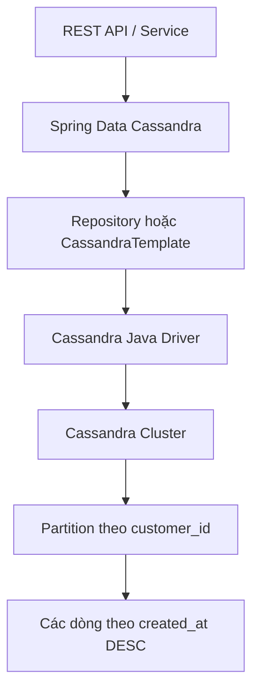

# Spring Data Cassandra là gì và giải quyết bài toán truy cập dữ liệu nào?

## Mục tiêu học tập

Sau bài này, bạn có thể:

- Giải thích mối quan hệ giữa **Apache Cassandra**, **Spring Data Cassandra** và ứng dụng Spring.
- Nhận diện loại bài toán phù hợp với cơ sở dữ liệu phân tán có lưu lượng đọc/ghi lớn, truy vấn tương đối ổn định.
- Hiểu vì sao phải **thiết kế bảng từ truy vấn**, đặc biệt là `partition key` và `clustering column`.
- Phân biệt `CassandraRepository`, `CassandraTemplate` và CQL trực tiếp; chọn cách truy cập phù hợp.
- Nhận biết các quyết định ảnh hưởng đến tính nhất quán, paging và hiệu năng trước khi đưa một tính năng vào vận hành.

## 1. Tách bạch Cassandra và Spring Data Cassandra

**Apache Cassandra** là hệ quản trị cơ sở dữ liệu NoSQL dạng *wide-column* phân tán. Dữ liệu được chia thành các **partition** và phân bố trên nhiều node theo partition key. Cassandra hỗ trợ sao chép dữ liệu (*replication*) giữa các node, mở rộng theo chiều ngang và xử lý những workload có lượng ghi lớn. Một hàng được xác định bằng khóa chính gồm partition key và, nếu có, các clustering column.

**Spring Data Cassandra** là thư viện thuộc hệ sinh thái Spring Data, cung cấp lớp tích hợp để ứng dụng Spring làm việc với Cassandra. Thay vì tự viết lại phần chuyển đổi giữa đối tượng Java và bản ghi CQL cho từng thao tác, ứng dụng có thể dùng:

- **Entity mapping**: ánh xạ class/field Java với bảng/cột Cassandra qua annotation.
- **Repository**: khai báo giao diện truy cập dữ liệu theo mô hình repository, gồm các thao tác CRUD và truy vấn được định nghĩa rõ.
- **`CassandraTemplate` / `CassandraOperations`**: API lập trình để tạo truy vấn, đọc, ghi và thao tác với entity.
- **CQL** (*Cassandra Query Language*): viết truy vấn sát khả năng của Cassandra khi cần kiểm soát chính xác câu lệnh.
- **Tích hợp Spring Boot**: cấu hình kết nối, dependency injection và quản lý đối tượng truy cập dữ liệu.

Spring Data Cassandra thường làm việc qua Java driver của Cassandra. Thư viện **không biến Cassandra thành cơ sở dữ liệu quan hệ**, không cung cấp JOIN tùy ý giữa các bảng, và không tự thiết kế partition key hoặc bảo đảm mọi truy vấn đều hiệu quả. Các quyết định về dữ liệu phân tán vẫn thuộc trách nhiệm của người thiết kế hệ thống.

| Thành phần | Trách nhiệm chính | Câu hỏi cần trả lời |
| --- | --- | --- |
| Apache Cassandra | Lưu trữ, phân vùng, sao chép và phục vụ dữ liệu | Dữ liệu nằm ở partition nào? Đọc/ghi cần mức consistency nào? |
| Spring Data Cassandra | Mapping, repository, template và tích hợp Spring | Java object được lưu/lấy bằng API nào? |
| Ứng dụng | Quy tắc nghiệp vụ, thiết kế truy vấn và xử lý lỗi | Người dùng cần xem gì, theo thứ tự nào, với giới hạn nào? |

## 2. Bài toán thực tế: đọc đơn hàng gần đây của một khách hàng

Giả sử dịch vụ bán hàng nhận nhiều đơn mỗi giây. Một màn hình cần hiển thị **20 đơn hàng gần nhất của một khách hàng**. Các yêu cầu đã biết:

1. Ghi đơn hàng với thông lượng cao.
2. Đọc theo `customer_id`, sắp xếp mới nhất trước.
3. Giới hạn số dòng trả về, có thể xem tiếp các trang sau.
4. Có thể mở rộng cụm Cassandra khi lượng dữ liệu tăng.

Với Cassandra, ta bắt đầu từ **câu hỏi sẽ truy vấn**, rồi xác định bảng phục vụ câu hỏi đó. Một mô hình bảng phù hợp là:

```sql
CREATE TABLE orders_by_customer (
    customer_id  uuid,
    created_at   timestamp,
    order_id     uuid,
    status       text,
    total_amount decimal,
    PRIMARY KEY ((customer_id), created_at, order_id)
) WITH CLUSTERING ORDER BY (created_at DESC, order_id ASC);
```

Ý nghĩa của khóa chính:

- **`customer_id` là partition key**: mọi đơn của cùng khách hàng thuộc cùng một partition logic. Cassandra dùng nó để xác định vị trí dữ liệu trong cluster.
- **`created_at` là clustering column thứ nhất**: sắp thứ tự bản ghi bên trong partition, mới nhất trước.
- **`order_id` là clustering column thứ hai**: phân biệt các đơn có cùng thời điểm tạo, đồng thời tạo thứ tự ổn định.
- **`status` và `total_amount` là cột dữ liệu**: không tham gia khóa chính.

Truy vấn cho màn hình:

```sql
SELECT customer_id, created_at, order_id, status, total_amount
FROM orders_by_customer
WHERE customer_id = ?
LIMIT 20;
```

Ở đây, `WHERE customer_id = ?` xác định trực tiếp partition cần đọc; thứ tự clustering đã khai báo giúp lấy các đơn mới nhất mà không yêu cầu sắp xếp toàn bộ dữ liệu. Dấu `?` là giá trị tham số được bind, không phải chuỗi cần ghép thủ công.

**Tại sao không chỉ có bảng `orders` chung?** Với cơ sở dữ liệu quan hệ, có thể quen lưu một bảng `orders` rồi tạo chỉ mục hoặc JOIN cho nhiều báo cáo. Trong Cassandra, một bảng thường được thiết kế cho **một nhóm mẫu truy vấn cụ thể**. Nếu cần tìm đơn theo `order_id` mà không biết `customer_id`, có thể cần bảng riêng như `orders_by_id`, với quy trình đồng bộ dữ liệu phù hợp. Việc lưu trùng dữ liệu giữa các bảng theo truy vấn là lựa chọn có chủ đích; nó tăng chi phí ghi và đòi hỏi quản lý tính nhất quán giữa các bản sao ứng dụng.

> **Điểm mấu chốt:** Cassandra vận hành tốt khi truy vấn đi theo partition key và đường đọc được dự đoán trước. Một lớp repository tiện lợi không làm truy vấn thiếu partition key trở nên rẻ.

## 3. Sơ đồ luồng truy cập dữ liệu



Trong luồng này, Spring Data Cassandra lo ánh xạ và gọi driver, còn Cassandra quyết định node/replica nào phục vụ partition. Để thiết kế đúng, cần xem cả **API Java** lẫn **mô hình truy cập trên cluster**.

## 4. Entity mapping: từ khóa chính Cassandra đến class Java

Ví dụ sau minh họa cách biểu diễn khóa chính tổng hợp. Các annotation nằm trong package `org.springframework.data.cassandra.core.mapping`.

```java
import java.io.Serializable;
import java.time.Instant;
import java.util.Objects;
import java.util.UUID;
import org.springframework.data.cassandra.core.cql.Ordering;
import org.springframework.data.cassandra.core.mapping.PrimaryKeyClass;
import org.springframework.data.cassandra.core.mapping.PrimaryKeyColumn;
import org.springframework.data.cassandra.core.mapping.PrimaryKeyType;

@PrimaryKeyClass
public class OrderKey implements Serializable {

    @PrimaryKeyColumn(name = "customer_id", ordinal = 0,
            type = PrimaryKeyType.PARTITIONED)
    private UUID customerId;

    @PrimaryKeyColumn(name = "created_at", ordinal = 0,
            type = PrimaryKeyType.CLUSTERED, ordering = Ordering.DESCENDING)
    private Instant createdAt;

    @PrimaryKeyColumn(name = "order_id", ordinal = 1,
            type = PrimaryKeyType.CLUSTERED, ordering = Ordering.ASCENDING)
    private UUID orderId;

    public OrderKey() {}

    public OrderKey(UUID customerId, Instant createdAt, UUID orderId) {
        this.customerId = customerId;
        this.createdAt = createdAt;
        this.orderId = orderId;
    }

    public UUID getCustomerId() { return customerId; }
    public void setCustomerId(UUID customerId) { this.customerId = customerId; }
    public Instant getCreatedAt() { return createdAt; }
    public void setCreatedAt(Instant createdAt) { this.createdAt = createdAt; }
    public UUID getOrderId() { return orderId; }
    public void setOrderId(UUID orderId) { this.orderId = orderId; }

    @Override
    public boolean equals(Object value) {
        if (this == value) return true;
        if (!(value instanceof OrderKey other)) return false;
        return Objects.equals(customerId, other.customerId)
                && Objects.equals(createdAt, other.createdAt)
                && Objects.equals(orderId, other.orderId);
    }

    @Override
    public int hashCode() {
        return Objects.hash(customerId, createdAt, orderId);
    }
}
```

Entity tương ứng:

```java
import java.math.BigDecimal;
import org.springframework.data.cassandra.core.mapping.Column;
import org.springframework.data.cassandra.core.mapping.PrimaryKey;
import org.springframework.data.cassandra.core.mapping.Table;

@Table("orders_by_customer")
public class OrderByCustomer {

    @PrimaryKey
    private OrderKey key;

    @Column("status")
    private String status;

    @Column("total_amount")
    private BigDecimal totalAmount;

    public OrderByCustomer() {}

    public OrderByCustomer(OrderKey key, String status, BigDecimal totalAmount) {
        this.key = key;
        this.status = status;
        this.totalAmount = totalAmount;
    }

    public OrderKey getKey() { return key; }
    public void setKey(OrderKey key) { this.key = key; }
    public String getStatus() { return status; }
    public void setStatus(String status) { this.status = status; }
    public BigDecimal getTotalAmount() { return totalAmount; }
    public void setTotalAmount(BigDecimal totalAmount) {
        this.totalAmount = totalAmount;
    }
}
```

Ở ví dụ này:

- `@Table` ánh xạ entity đến bảng CQL.
- `@PrimaryKeyClass` và `@PrimaryKeyColumn` mô tả thành phần khóa và thứ tự partition/clustering.
- `@PrimaryKey` gắn khóa tổng hợp vào entity.
- Java `Instant` tương ứng với kiểu `timestamp`, `UUID` với `uuid`, `BigDecimal` với `decimal`.
- Khóa chính cần phản ánh **đúng schema thực tế**; thay đổi annotation không tự biến đổi dữ liệu đã lưu.

Việc có `equals`/`hashCode` đầy đủ cho class khóa giúp các thao tác so sánh khóa trong Java có hành vi rõ ràng. Trong dự án thực tế, nên tách các class thành file riêng và giữ mapping nhất quán với schema được quản lý bằng migration hoặc quy trình triển khai riêng.

## 5. Repository: truy cập dữ liệu bằng giao diện

Khi cần CRUD và một số truy vấn ổn định, `CassandraRepository` giúp lớp nghiệp vụ tránh lặp lại mã mapping. Ví dụ khai báo truy vấn CQL trực tiếp trên một phương thức repository:

```java
import java.util.List;
import java.util.UUID;
import org.springframework.data.cassandra.repository.CassandraRepository;
import org.springframework.data.cassandra.repository.Query;

public interface OrdersByCustomerRepository
        extends CassandraRepository<OrderByCustomer, OrderKey> {

    @Query("SELECT customer_id, created_at, order_id, status, total_amount "
         + "FROM orders_by_customer WHERE customer_id = ?0 LIMIT 20")
    List<OrderByCustomer> findRecent(UUID customerId);
}
```

Tại service, dùng dependency injection để gọi `repository.findRecent(customerId)`. Ngoài các phương thức có sẵn như `save` và `findById`, Spring Data Cassandra có khả năng xây dựng truy vấn từ tên phương thức trong những trường hợp được hỗ trợ. Tuy nhiên, phương thức được đặt tên tiện lợi **không thay đổi quy tắc truy vấn của Cassandra**: muốn truy cập hiệu quả vẫn phải có partition key phù hợp, và không nên kỳ vọng JOIN hoặc lọc tự do như SQL quan hệ.

Lưu ý: `save` với khóa chính đã tồn tại tuân theo ngữ nghĩa ghi/upsert của Cassandra; không nên hiểu là thao tác `INSERT` luôn thất bại khi trùng khóa. Nếu nghiệp vụ cần điều kiện “chỉ tạo nếu chưa tồn tại”, cần chủ động thiết kế thao tác có điều kiện, chẳng hạn `IF NOT EXISTS`, và chấp nhận chi phí của lightweight transaction (LWT).

## 6. CassandraTemplate: khi cần điều khiển truy vấn bằng mã

`CassandraTemplate` cung cấp các thao tác mức thấp hơn repository nhưng vẫn tận dụng entity mapping. Ví dụ:

```java
import java.util.List;
import java.util.UUID;
import org.springframework.data.cassandra.core.CassandraTemplate;
import org.springframework.data.cassandra.core.query.Criteria;
import org.springframework.data.cassandra.core.query.Query;
import org.springframework.stereotype.Service;

@Service
public class OrderReadService {

    private final CassandraTemplate template;

    public OrderReadService(CassandraTemplate template) {
        this.template = template;
    }

    public List<OrderByCustomer> recentOrders(UUID customerId) {
        Query query = Query.query(
                Criteria.where("customer_id").is(customerId)
        ).limit(20);
        return template.select(query, OrderByCustomer.class);
    }
}
```

Ở đây, điều kiện `customer_id = ...` vẫn là điều kiện đi vào **đúng partition**. Template hữu ích khi cần ghép các tiêu chí được phép, giới hạn bản ghi hoặc viết logic truy vấn phức tạp hơn so với giao diện repository; nó không miễn trừ yêu cầu thiết kế schema đúng.

| Cách truy cập | Phù hợp khi | Cần chú ý |
| --- | --- | --- |
| `CassandraRepository` | CRUD, truy vấn có tên rõ ràng, service đơn giản | Derived query vẫn bị ràng buộc bởi khả năng CQL |
| `CassandraTemplate` | Cần tạo truy vấn bằng mã và tái sử dụng mapping | Kiểm soát điều kiện theo partition/clustering |
| CQL trực tiếp qua driver/session | Cần tối ưu hoặc dùng tính năng CQL cụ thể | Tự quản lý binding, kết quả và mức trừu tượng thấp hơn |

Không nhất thiết chọn một cách cho toàn dự án. Có thể dùng repository cho đường truy cập phổ biến và template/CQL cho một số thao tác có yêu cầu đặc biệt.

## 7. Cấu hình kết nối trong ứng dụng Spring Boot

Ví dụ cấu hình cho một Cassandra chạy **cục bộ** với Spring Boot dùng namespace `spring.cassandra`:

```yaml
spring:
  cassandra:
    contact-points: localhost:9042
    local-datacenter: datacenter1
    keyspace-name: shop
    schema-action: NONE
```

Giá trị `datacenter1` phải khớp tên datacenter thực tế do cluster công bố; `shop` phải tồn tại trước khi truy cập. Cấu hình thuộc phiên bản Spring Boot đang sử dụng: một số phiên bản cũ có namespace thuộc `spring.data.cassandra`. Tránh sao chép máy móc cấu hình giữa các major version.

Một keyspace thử nghiệm trên một node có thể được tạo bằng CQL:

```sql
CREATE KEYSPACE shop
WITH replication = {
    'class': 'SimpleStrategy',
    'replication_factor': 1
};
```

Đây chỉ là cấu hình **minh họa môi trường phát triển**. Ở môi trường nhiều node/datacenter, cần chọn replication strategy và replication factor theo kiến trúc thực tế (thường là `NetworkTopologyStrategy`) và kiểm thử hành vi khi node hoặc mạng gặp sự cố. Chính sách tạo/sửa schema cần được quản lý tách khỏi các luồng đọc/ghi thông thường.

## 8. Partition key, clustering key và giới hạn truy vấn

Trong Cassandra, thiết kế khóa ảnh hưởng trực tiếp tới vị trí dữ liệu, băng thông và độ trễ:

| Thành phần | Vai trò | Sai lầm thường gặp |
| --- | --- | --- |
| Partition key | Chọn partition để định tuyến truy vấn | Bỏ điều kiện partition key, gây quét phạm vi rộng hoặc truy vấn không hợp lệ |
| Clustering columns | Xếp thứ tự các dòng **bên trong partition** | Nghĩ chúng có thể tự tạo thứ tự toàn cục của toàn bảng |
| Khóa chính hoàn chỉnh | Xác định duy nhất một dòng trong bảng | Chọn khóa khiến dữ liệu ghi đè ngoài ý muốn |
| Cột dữ liệu thường | Chứa giá trị nghiệp vụ | Dùng chúng để lọc tùy ý dù không có mô hình truy cập hỗ trợ |

Giả sử màn hình mới cần “tìm mọi đơn `status = 'PAID'` của tất cả khách hàng theo thời gian”. Bảng `orders_by_customer` chưa được thiết kế cho câu hỏi đó. Thêm `WHERE status = 'PAID'` hay `ALLOW FILTERING` không phải cách sửa mặc định: nó có thể buộc Cassandra đọc nhiều dữ liệu rồi lọc, làm chi phí tăng khó đoán. Nên cân nhắc tạo bảng phục vụ truy vấn mới, tính toán trước kết quả hoặc sử dụng hệ thống tìm kiếm/phân tích phù hợp.

**Tránh partition quá lớn hoặc quá nóng.** Trong ví dụ, một khách hàng có hàng triệu đơn có thể làm `customer_id` trở thành partition lớn; một khách hàng phát sinh lượng ghi vượt trội có thể tạo điểm nóng. Một cách thiết kế lại là chia theo thời gian:

```sql
CREATE TABLE orders_by_customer_month (
    customer_id  uuid,
    year_month   text,
    created_at   timestamp,
    order_id     uuid,
    status       text,
    PRIMARY KEY ((customer_id, year_month), created_at, order_id)
) WITH CLUSTERING ORDER BY (created_at DESC, order_id ASC);
```

Lúc này, đọc đơn tháng `2026-11` cần cả `customer_id` và `year_month`. Muốn hiển thị 20 đơn mới nhất xuyên nhiều tháng, ứng dụng phải truy vấn các bucket liên tiếp theo thứ tự, dừng khi đủ dữ liệu. Kích thước bucket phải dựa vào phân bố dữ liệu và lưu lượng đo được; **bucketing không có hiệu quả tự động nếu cách đọc không được điều chỉnh theo**.

## 9. Tính nhất quán: lựa chọn theo nghiệp vụ

Cassandra sao chép dữ liệu trên nhiều replica. **Consistency level** của từng thao tác quy định mức xác nhận từ các replica trước khi đọc/ghi hoàn tất. Điều này cho phép cân bằng độ trễ, tính sẵn sàng và mức độ cập nhật của dữ liệu được đọc.

Ví dụ trong một datacenter có replication factor bằng 3:

- `LOCAL_ONE`: thao tác thường cần một replica trong datacenter cục bộ phản hồi; có thể có độ trễ thấp hơn nhưng lần đọc có nguy cơ gặp bản sao chưa cập nhật.
- `LOCAL_QUORUM`: cần đa số replica cục bộ, tức 2/3 trong ví dụ. Khi mức đọc và ghi cùng đáp ứng quorum trên cùng tập replica thích hợp, cơ hội quan sát giá trị mới được cải thiện, với chi phí độ trễ/khả dụng tương ứng.
- `ALL`: cần tất cả replica liên quan phản hồi; nhạy hơn với sự cố replica.

Quorum thông thường giúp tăng bảo đảm quan sát ghi đã hoàn tất nếu các giả định phù hợp, **nhưng không tự biến mọi chuỗi cập nhật cạnh tranh thành giao dịch tuần tự tuyệt đối**. Cassandra dùng cơ chế giải quyết xung đột dựa trên timestamp của các giá trị ghi; nghiệp vụ đòi hỏi điều kiện “kiểm tra rồi ghi” có thể phải dùng LWT/CAS hoặc thiết kế khác.

Ví dụ chọn mức nhất quán theo nhu cầu:

| Tình huống | Điều cần cân nhắc |
| --- | --- |
| Feed hoạt động, số lượt xem | Có thể chấp nhận dữ liệu chậm cập nhật trong một khoảng ngắn |
| Trạng thái đơn hàng vừa đổi | Cần xác định mức độ quan trọng của việc đọc thấy ngay kết quả ghi |
| Giữ chỗ, khóa tài nguyên, trừ tồn kho cạnh tranh | Không được giả định read + write thường là thao tác nguyên tử; cần cơ chế phối hợp phù hợp |

Đừng nhầm **replication factor** (số bản sao được cấu hình) với **consistency level** (số phản hồi cần để thao tác được coi là hoàn tất). Cần xem thêm cấu hình driver, timeout, retry và hành vi khi replica lỗi trước khi đưa ra cam kết về dữ liệu.

## 10. Paging và truy vấn có giới hạn

Khi một khách hàng có nhiều đơn, không nên đọc toàn bộ partition vào bộ nhớ rồi mới phân trang. Cassandra hỗ trợ **paging dựa trên trạng thái tiếp tục truy vấn** (*paging state*), thay vì bỏ qua hàng triệu dòng bằng `OFFSET` như nhiều hệ SQL.

Một luồng hợp lý cho danh sách đơn hàng:

1. Gửi truy vấn theo `customer_id` với page size phù hợp.
2. Lấy tập kết quả hiện tại và paging state do driver trả về khi còn trang tiếp theo.
3. Khi người dùng chọn “Xem thêm”, gửi lại truy vấn tương thích với trạng thái trang tiếp theo.
4. Hết paging state thì dừng; không giả định có tổng số trang rẻ để tính sẵn.

`LIMIT 20` trong CQL giới hạn **tổng số dòng tối đa của truy vấn**, còn **page size** cấu hình cách driver lấy kết quả theo từng lượt. Hai cơ chế này phục vụ hai mục đích khác nhau. Nếu muốn xem liên tục các trang lớn, cần lựa chọn giới hạn và phương thức paging phù hợp, kiểm tra hỗ trợ theo phiên bản Spring Data Cassandra/driver đang dùng.

Paging state là dấu tiếp tục phụ thuộc truy vấn và phiên làm việc; không phải số trang độc lập có thể tùy tiện nhảy đến. Không ghép paging state với truy vấn, thứ tự sắp xếp hoặc tập tham số đã thay đổi. Nếu xuất nó ra API bên ngoài, cần xem nó như một token có thể cần bảo vệ và giới hạn thời gian sử dụng.

## 11. Hiệu năng và vận hành: điều gì có thể làm hệ thống chậm?

Spring Data Cassandra giảm mã boilerplate trong ứng dụng nhưng **không triệt tiêu chi phí truy cập phân tán**. Các điểm cần quan sát:

- **Thiết kế theo truy vấn**: điều kiện tìm kiếm có xác định partition không, có đọc quá nhiều partition hoặc quá nhiều dòng không?
- **Phân bố partition**: kích thước partition có tăng không giới hạn, có partition nóng so với phần còn lại không?
- **Lượng dữ liệu trả về**: chọn cột cần thiết, giới hạn kết quả hợp lý, dùng paging cho dữ liệu lớn.
- **Ghi và xóa**: TTL, delete và các lần cập nhật có thể tạo *tombstone*; số tombstone lớn làm quá trình đọc/compaction tốn kém.
- **Batch**: batch không phải công cụ mặc định để tăng tốc ghi; batch trải qua nhiều partition có thể gây thêm tải và không thay thế giao dịch SQL đa bảng.
- **LWT và consistency**: điều kiện ghi và consistency mạnh hơn thường tăng số vòng trao đổi giữa replica; đo latency thay vì chọn theo cảm tính.
- **Retry và idempotency**: retry sau timeout có thể gửi lại ghi khi kết quả lần đầu chưa rõ. Thiết kế khóa và thao tác ghi an toàn để thử lại khi phù hợp.
- **Giám sát**: theo dõi latency p95/p99, timeout, số retry, hàng đợi kết nối, tombstone, kích thước partition và tải giữa các node.

Không mặc định rằng **thêm secondary index hoặc `ALLOW FILTERING`** sẽ giải quyết một mẫu truy vấn chưa có thiết kế bảng. Cần đánh giá loại chỉ mục được phiên bản Cassandra hỗ trợ, kích thước/tính chọn lọc của dữ liệu và đặc tính thực tế của workload.

## 12. Khi nào nên và không nên chọn Spring Data Cassandra?

**Phù hợp** khi ứng dụng Spring đã xác định rõ các mẫu truy vấn; cần lượng ghi lớn, phân tán trên nhiều node, dữ liệu có thể tổ chức theo partition key ổn định và chấp nhận các cân bằng của mô hình Cassandra. Ví dụ: dữ liệu sự kiện, trạng thái thiết bị, hoạt động theo người dùng, lịch sử ghi nhận theo mốc thời gian hoặc bảng đọc được tổ chức theo tenant.

**Cần cân nhắc công nghệ khác** nếu phần lớn yêu cầu là JOIN nhiều bảng, truy vấn phân tích tự do, ràng buộc quan hệ phức tạp hoặc giao dịch ACID đa bản ghi thường xuyên. Spring Data Cassandra là lớp truy cập tốt **khi Cassandra đã phù hợp với bài toán dữ liệu**; nó không phải lý do độc lập để chuyển từ hệ cơ sở dữ liệu quan hệ sang Cassandra.

## 13. Checklist khi triển khai một tính năng

Trước khi tạo repository hoặc viết CQL, hãy kiểm tra:

1. **Mẫu truy vấn**: API sẽ nhận tham số gì, lọc và sắp xếp theo trường nào, trả tối đa bao nhiêu dòng?
2. **Khóa**: partition key có xuất hiện trong truy vấn chính không; clustering columns có tạo đúng thứ tự cần xem không?
3. **Kích thước**: partition dự kiến lớn đến đâu sau 1 tháng, 1 năm; có cần bucket theo thời gian hoặc tenant không?
4. **Tính nhất quán**: nghiệp vụ có thể chấp nhận bản đọc chưa mới nhất không; có thao tác ghi cạnh tranh cần điều kiện không?
5. **API truy cập**: repository đủ rõ hay cần template/CQL để thể hiện chính xác truy vấn?
6. **Paging**: có giới hạn số dòng và cách lấy tiếp bằng paging state không?
7. **Xác minh**: thử với Cassandra thực tế và dữ liệu đủ lớn; kiểm tra CQL, latency, lỗi timeout và hành vi khi node/replica gặp sự cố.

### Ví dụ suy luận từ yêu cầu đến thiết kế

| Yêu cầu | Quyết định thiết kế |
| --- | --- |
| “20 đơn gần nhất của khách A” | Partition theo `customer_id`, clustering `created_at DESC`, giới hạn kết quả |
| “Mở đơn bằng mã đơn” | Cần đường đọc theo `order_id`, thường là bảng phục vụ truy vấn riêng |
| “Khách A có hàng triệu đơn” | Đo kích thước partition; cân nhắc bucket theo tháng |
| “Xem trang tiếp theo” | Dùng paging state/driver paging; không dựng `OFFSET` |
| “Không được nhận trùng một thao tác tạo” | Xác định idempotency key hoặc cơ chế ghi điều kiện phù hợp |

## 14. Tổng kết kiến thức

Spring Data Cassandra giúp ứng dụng Spring truy cập Apache Cassandra bằng entity mapping, `CassandraRepository`, `CassandraTemplate` và CQL, từ đó giảm mã lặp trong tầng dữ liệu. Giá trị lớn nhất là tổ chức mã truy cập rõ ràng và tích hợp với hệ sinh thái Spring.

Để giải quyết đúng bài toán dữ liệu, vẫn phải bắt đầu từ **truy vấn của người dùng**, thiết kế **partition key** và **clustering key** tương ứng, rồi chọn consistency, cách paging và giới hạn kích thước partition. Một ứng dụng chỉ thực sự tận dụng được Cassandra khi mô hình dữ liệu, cách đọc/ghi và các cam kết nghiệp vụ được thiết kế cùng nhau.
