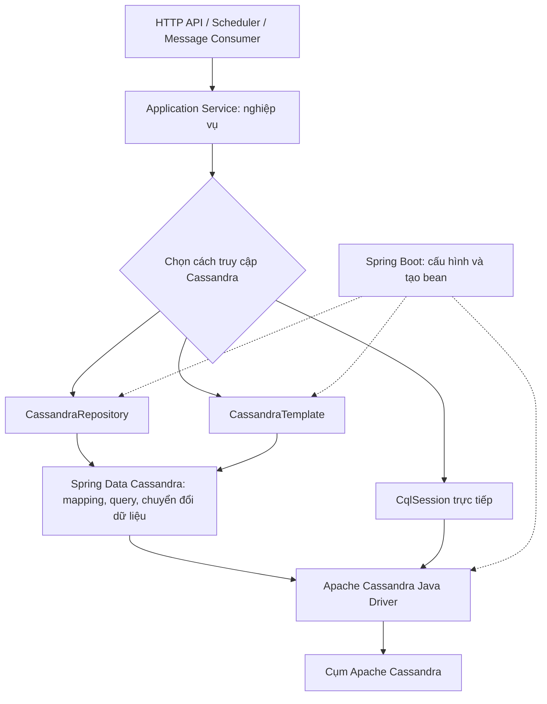

# Vị trí của Spring Data, Spring Boot và Java Driver trong ứng dụng

Khi xây dựng ứng dụng Java truy cập **Apache Cassandra**, ba cái tên thường xuất hiện cùng nhau là **Spring Boot**, **Spring Data Cassandra** và **Apache Cassandra Java Driver**. Chúng giải quyết ba nhóm công việc khác nhau:

- **Spring Boot** khởi tạo ứng dụng, quản lý cấu hình, vòng đời và tự động lắp ghép các thành phần cần thiết.
- **Spring Data Cassandra** cung cấp mô hình lập trình dữ liệu theo entity, repository, `CassandraTemplate` và các phép ánh xạ giữa đối tượng Java với bảng Cassandra.
- **Java Driver** quản lý kết nối tới cụm Cassandra, gửi câu lệnh **CQL** (Cassandra Query Language), nhận kết quả và xử lý các cơ chế như prepared statement, paging, consistency và retry theo cấu hình.

Ứng dụng có thể sử dụng cả ba cùng lúc: Spring Boot cấu hình hạ tầng; mã nghiệp vụ gọi repository hoặc template của Spring Data; Spring Data sử dụng Java Driver để trao đổi với Cassandra. Khi cần điều khiển CQL ở mức thấp, mã ứng dụng cũng có thể gọi trực tiếp Java Driver.

## 1. Bức tranh kiến trúc



Sơ đồ thể hiện **đường đi logic** của một thao tác dữ liệu; Spring Boot chủ yếu tham gia ở giai đoạn khởi tạo/cấu hình, không phải một tầng phải đi qua cho từng yêu cầu CQL. `CqlSession` là API trung tâm của Java Driver hiện đại và thường được Spring Boot tạo thành bean dùng chung.

| Thành phần | Chịu trách nhiệm chính | API/lớp thường gặp | Không tự giải quyết |
| --- | --- | --- | --- |
| Spring Boot | Chạy ứng dụng, nạp cấu hình, dependency injection, auto-configuration, lifecycle | `@SpringBootApplication`, `application.yml`, starter, bean | Chọn partition key, sửa truy vấn CQL kém hiệu quả |
| Spring Data Cassandra | Mapping bảng–object, repository, template, chuyển đổi và tạo truy vấn theo khả năng Cassandra | `@Table`, `@PrimaryKey`, `CassandraRepository`, `CassandraTemplate`, `@Query` | Biến Cassandra thành cơ sở dữ liệu quan hệ có JOIN và transaction đa bảng |
| Java Driver | Kết nối và giao tiếp với cụm Cassandra, thực thi CQL, pooling, paging state, consistency, timeout | `CqlSession`, `SimpleStatement`, `PreparedStatement`, `Row` | Thiết kế API nghiệp vụ, tự suy ra mô hình entity |
| Cassandra Server | Lưu trữ phân tán, phân vùng dữ liệu, sao chép và xử lý CQL | Keyspace, table, partition key, clustering column | Tự tạo mô hình truy vấn phù hợp với nhu cầu sản phẩm |

**Điểm mấu chốt:** `CassandraRepository` và `CassandraTemplate` không thay thế Java Driver. Chúng là API cấp cao và cuối cùng vẫn dựa vào driver để gửi CQL tới Cassandra.

## 2. Spring Boot nằm ở đâu?

Trong một ứng dụng Spring Boot có dependency Spring Data Cassandra, Boot đọc cấu hình Cassandra, khởi tạo các bean kết nối và tích hợp chúng với hệ thống dependency injection của Spring. Nhờ đó, service chỉ cần khai báo constructor nhận repository, template hoặc `CqlSession`; không phải tự mở kết nối mỗi lần xử lý HTTP request.

### Khai báo dependency

Ví dụ Maven khi sử dụng **Spring Boot dependency management**:

```xml
<dependency>
    <groupId>org.springframework.boot</groupId>
    <artifactId>spring-boot-starter-data-cassandra</artifactId>
</dependency>
```

Starter mang các thành phần Spring Data Cassandra và Java Driver tương thích với phiên bản Spring Boot của dự án. Thông thường không cần tự gán phiên bản riêng cho từng thư viện; nếu ghi đè version, cần kiểm tra tính tương thích.

### Cấu hình kết nối

Ví dụ `application.yml` theo nhóm thuộc tính `spring.cassandra` của Spring Boot hiện đại:

```yaml
spring:
  cassandra:
    contact-points: 127.0.0.1
    port: 9042
    local-datacenter: datacenter1
    keyspace-name: learning
    schema-action: none
```

- `contact-points` cung cấp điểm liên lạc ban đầu để driver khám phá cụm, không phải danh sách đầy đủ các node mà ứng dụng được phép truy vấn.
- `local-datacenter` phải khớp tên datacenter thực tế của cụm; đây là thông tin quan trọng với cơ chế định tuyến của driver.
- `keyspace-name` chỉ định keyspace mặc định; keyspace cần tồn tại trước khi ứng dụng truy cập.
- `schema-action: none` thể hiện chủ đích quản lý schema riêng. Trong môi trường thực tế, nên chủ động triển khai và kiểm soát thay đổi CQL schema thay vì dựa vào hành vi tạo bảng tự động khi khởi động.

Tên và phạm vi các thuộc tính cấu hình có thể khác nhau giữa các dòng Spring Boot; khi tích hợp vào dự án cụ thể, đối chiếu documentation của **đúng phiên bản đang chạy**.

Khi khởi động, luồng điển hình là: Boot đọc properties → tạo/cấu hình `CqlSession` → Spring Data thiết lập mapping, template và repository → service được inject các bean. Việc tự khai báo bean cấu hình riêng có thể thay đổi phần auto-configuration tương ứng.

## 3. Spring Data Cassandra nằm ở đâu?

Spring Data giúp người viết nghiệp vụ làm việc với **entity Java** thay vì phải tự chuyển từng `Row` từ driver sang object. Nó đặc biệt hữu ích cho các thao tác đọc/ghi đơn giản dựa trên khóa chính và các truy vấn CQL đã được thiết kế rõ ràng.

### Ví dụ xuyên suốt: tra cứu khóa học theo ID

Giả sử hệ thống học tập cần tải thông tin khóa học bằng `course_id`. Bảng Cassandra có thể được thiết kế như sau (keyspace `learning` đã tồn tại):

```sql
CREATE TABLE IF NOT EXISTS learning.courses_by_id (
    course_id uuid PRIMARY KEY,
    title text,
    published boolean
);
```

Đây là bảng phục vụ truy vấn **theo ID**. Không nên suy ra rằng bảng này cũng có thể lọc hiệu quả tùy ý theo `published` hoặc tìm kiếm toàn văn theo `title`.

Entity tương ứng:

```java
import java.util.UUID;
import org.springframework.data.cassandra.core.mapping.Column;
import org.springframework.data.cassandra.core.mapping.PrimaryKey;
import org.springframework.data.cassandra.core.mapping.Table;

@Table("courses_by_id")
public class Course {
    @PrimaryKey("course_id")
    private UUID courseId;

    @Column("title")
    private String title;

    @Column("published")
    private boolean published;

    protected Course() { }

    public Course(UUID courseId, String title, boolean published) {
        this.courseId = courseId;
        this.title = title;
        this.published = published;
    }

    public UUID getCourseId() { return courseId; }
    public void setCourseId(UUID courseId) { this.courseId = courseId; }

    public String getTitle() { return title; }
    public void setTitle(String title) { this.title = title; }

    public boolean isPublished() { return published; }
    public void setPublished(boolean published) { this.published = published; }
}
```

`@Table`, `@PrimaryKey` và `@Column` hướng dẫn Spring Data ánh xạ Java object sang bảng, khóa chính và cột CQL. Annotation không thay đổi quy tắc phân vùng hay khả năng truy vấn của Cassandra.

### Cách 1: Repository cho thao tác phổ biến

```java
import java.util.UUID;
import org.springframework.data.cassandra.repository.CassandraRepository;

public interface CourseRepository extends CassandraRepository<Course, UUID> {
}
```

```java
import java.util.NoSuchElementException;
import java.util.UUID;
import org.springframework.stereotype.Service;

@Service
public class CourseService {
    private final CourseRepository courses;

    public CourseService(CourseRepository courses) {
        this.courses = courses;
    }

    public Course getById(UUID courseId) {
        return courses.findById(courseId)
                .orElseThrow(() -> new NoSuchElementException("Course not found"));
    }

    public Course save(Course course) {
        return courses.save(course);
    }
}
```

Đường đi của `getById`: `CourseService` → `CourseRepository` → Spring Data mapping/truy vấn → Java Driver → Cassandra. Repository giảm mã lặp nhưng không tạo thêm chỉ mục hay thay đổi chi phí truy vấn. Theo ngữ nghĩa ghi thông thường của Cassandra, `save` thường dẫn tới hành vi ghi kiểu **upsert**; đừng mặc định đó là lệnh “chỉ insert nếu chưa tồn tại”.

### Cách 2: `CassandraTemplate` khi cần thao tác linh hoạt hơn

```java
import java.util.UUID;
import org.springframework.data.cassandra.core.CassandraTemplate;
import org.springframework.stereotype.Service;

@Service
public class CourseTemplateService {
    private final CassandraTemplate template;

    public CourseTemplateService(CassandraTemplate template) {
        this.template = template;
    }

    public Course find(UUID courseId) {
        return template.selectOneById(courseId, Course.class);
    }

    public Course insert(Course course) {
        return template.insert(course);
    }
}
```

`CassandraTemplate` cung cấp các thao tác trực tiếp với entity và API truy vấn của Spring Data. Nó phù hợp khi truy vấn cần được tạo theo logic trong service hoặc khi API repository không diễn đạt thuận tiện. `selectOneById` có thể trả về `null` nếu không thấy bản ghi; khác với `Optional` của `findById`. Tương tự repository, template vẫn đi qua mapping của Spring Data và Java Driver.

## 4. Java Driver nằm ở đâu?

Java Driver là tầng gần giao thức Cassandra nhất trong ứng dụng Java. API chính `CqlSession` nhận statement, chọn node thích hợp theo chính sách driver, gửi CQL và trả kết quả dưới dạng `ResultSet`/`Row`. Driver cũng phụ trách metadata cụm, quản lý kết nối, chuẩn bị statement, paging và thực thi bất đồng bộ theo các API tương ứng.

Ví dụ gọi driver trực tiếp, **dùng lại `CqlSession` được Spring Boot quản lý**:

```java
import com.datastax.oss.driver.api.core.CqlSession;
import com.datastax.oss.driver.api.core.cql.Row;
import com.datastax.oss.driver.api.core.cql.SimpleStatement;
import java.util.Optional;
import java.util.UUID;
import org.springframework.stereotype.Component;

@Component
public class CourseTitleLookup {
    private final CqlSession session;

    public CourseTitleLookup(CqlSession session) {
        this.session = session;
    }

    public Optional<String> findTitle(UUID courseId) {
        SimpleStatement statement = SimpleStatement.newInstance(
                "SELECT title FROM courses_by_id WHERE course_id = ?", courseId);
        Row row = session.execute(statement).one();
        return row == null ? Optional.empty()
                : Optional.ofNullable(row.getString("title"));
    }
}
```

Ở đây người viết code tự quyết định câu CQL, đọc `Row` và ánh xạ giá trị trả về. Đổi lại, có quyền kiểm soát chi tiết hơn đối với statement, consistency, page size, execution profile và các thao tác đặc thù của driver. Với câu CQL được thực thi lặp lại nhiều lần, cân nhắc `PreparedStatement` cùng bound parameters để tận dụng việc chuẩn bị truy vấn và quản lý tham số đúng cách.

**Không tạo `CqlSession` mới trong mỗi request.** Session của driver được thiết kế để dùng chung và quản lý kết nối; tự tạo lặp lại sẽ gây tốn kết nối và tài nguyên. Việc đóng session nên gắn với vòng đời ứng dụng hoặc bean sở hữu nó.

## 5. Chọn repository, template hay driver trực tiếp?

| Nhu cầu | Lựa chọn thường phù hợp | Lý do |
| --- | --- | --- |
| CRUD và truy vấn cố định theo khóa chính, trả về entity | `CassandraRepository` | API ngắn, tách truy cập dữ liệu khỏi nghiệp vụ, dễ tổ chức theo aggregate |
| Truy vấn CQL hợp lệ với cấu trúc thay đổi theo ngữ cảnh, vẫn muốn ánh xạ entity | `CassandraTemplate` | Kiểm soát truy vấn linh hoạt hơn và tận dụng mapping của Spring Data |
| Cần toàn quyền dùng statement, driver options, loại kết quả hoặc tính năng CQL đặc thù | `CqlSession` | Làm việc trực tiếp với API Java Driver |
| Muốn cấu hình kết nối và vòng đời bean ít mã hơn | Spring Boot starter | Tự động lắp ghép driver, Spring Data và cấu hình liên quan |

Các lựa chọn có thể **cùng tồn tại**. Ví dụ đa số màn hình dùng repository, một báo cáo dùng template và một thao tác cần `PreparedStatement`/execution profile dùng trực tiếp driver. Không cần ép toàn bộ codebase dùng chung một kiểu API. Dù chọn cách nào, hiệu năng vẫn phụ thuộc chủ yếu vào bảng, partition và câu CQL thực tế.

## 6. Giới hạn đến từ Cassandra, không phải từ Spring

Spring Data cung cấp cảm giác quen thuộc cho lập trình viên Spring, nhưng Cassandra là cơ sở dữ liệu phân tán kiểu **wide-column**, được thiết kế xoay quanh truy vấn và phân vùng, không vận hành như một RDBMS tổng quát.

### Mô hình dữ liệu phải xuất phát từ câu hỏi cần trả lời

Giả sử màn hình cần xem tiến độ các khóa học của một học viên trong một tổ chức. Bảng phục vụ truy vấn này có thể là:

```sql
CREATE TABLE IF NOT EXISTS learning.progress_by_student (
    tenant_id uuid,
    student_id uuid,
    course_id uuid,
    completed_lessons int,
    updated_at timestamp,
    PRIMARY KEY ((tenant_id, student_id), course_id)
);
```

- `(tenant_id, student_id)` là **partition key ghép**: các dòng của một học viên trong một tenant thuộc cùng một logical partition.
- `course_id` là **clustering column**: phân biệt và sắp xếp các dòng bên trong partition theo quy tắc clustering của bảng.
- Truy vấn theo đầy đủ partition key sẽ xác định chính xác nhóm dữ liệu mà Cassandra cần đọc:

```sql
SELECT course_id, completed_lessons, updated_at
FROM learning.progress_by_student
WHERE tenant_id = ? AND student_id = ?;
```

Nếu nghiệp vụ cần “tất cả học viên đã hoàn thành một khóa học”, truy vấn đó có **hướng truy cập khác**. Có thể cần thêm bảng `students_by_course` hoặc một mô hình phục vụ truy vấn tương ứng; không nên mong phương thức repository tự xử lý hiệu quả bằng cách lọc trên mọi partition. Cần giới hạn kích thước partition và tránh trường hợp một học viên sinh số lượng bản ghi không kiểm soát được.

### Những điều dễ hiểu nhầm khi làm việc qua Spring Data

1. **Tên method không đảm bảo truy vấn rẻ.** Method suy diễn hoặc `@Query` vẫn chịu các giới hạn `WHERE`, partition key và clustering column của Cassandra. Tránh dùng `ALLOW FILTERING` như giải pháp mặc định cho mô hình bảng sai.
2. **Không có JOIN theo mô hình quan hệ.** Việc nhân bản dữ liệu sang nhiều bảng theo cách đọc (denormalization) là kỹ thuật thường gặp; ứng dụng phải có chiến lược cập nhật các biểu diễn liên quan.
3. **Transaction khác RDBMS.** Không mặc định `@Transactional` cho một service có thể cung cấp rollback ACID trên nhiều partition/bảng. Cassandra có thao tác điều kiện/LWT cho các trường hợp cần phối hợp mạnh hơn, nhưng chi phí và ngữ nghĩa khác transaction quan hệ.
4. **Paging không phải offset pagination tùy ý.** Cassandra đọc dữ liệu theo trang dựa trên trạng thái tiếp diễn của truy vấn. Với tập kết quả lớn, cần quản lý page size/paging state và giữ nguyên ngữ cảnh câu truy vấn khi lấy trang tiếp theo; tránh giả định có thể nhảy thẳng tới trang thứ 1.000 bằng offset.
5. **Consistency là quyết định nghiệp vụ.** Mức như `LOCAL_ONE` và `LOCAL_QUORUM` ảnh hưởng cân bằng độ trễ, tính sẵn sàng và mức nhất quán của phép đọc/ghi. Driver cho phép cấu hình theo session, profile hoặc statement, nhưng lựa chọn phải phù hợp replication factor, datacenter và yêu cầu của dữ liệu.
6. **Không tự động có transaction hoặc schema migration như JPA.** Chủ động kiểm soát CQL schema, truy vấn, test hiệu năng và điều kiện triển khai ở cluster thật.

Những giới hạn này áp dụng như nhau dù truy vấn bắt nguồn từ repository, template hay gọi `CqlSession` trực tiếp.

## 7. Luồng thực thi, độ trễ và điểm cần quan sát

Khi một request `GET /courses/{id}` tới ứng dụng:

1. Controller gọi `CourseService.getById(id)`.
2. `CourseRepository` xác định entity/khóa và xây câu lệnh đọc phù hợp.
3. Spring Data chuyển lời gọi sang Java Driver và ánh xạ kết quả trả về thành `Course`.
4. Driver định tuyến statement, gửi yêu cầu tới Cassandra và lấy kết quả.
5. Service nhận `Course` hoặc thông báo không tìm thấy, rồi trả về API.

Để tìm nguyên nhân một request chậm, cần phân biệt vấn đề ở các tầng:

| Triệu chứng | Kiểm tra trước |
| --- | --- |
| Ứng dụng không khởi động hoặc không kết nối | Contact points, tên datacenter, keyspace, authentication/TLS, mạng, cấu hình Boot |
| Lỗi mapping hoặc dữ liệu Java không đúng | `@Table`/`@PrimaryKey`/`@Column`, kiểu dữ liệu, converter và schema thực tế |
| Query bị từ chối hoặc phải lọc rất nhiều | CQL được sinh/gửi, partition key, clustering key, thiết kế bảng, điều kiện `WHERE` |
| Latency tăng hoặc timeout | Driver timeout/pool/metrics, page size, partition quá lớn, tải node, coordinator và mức consistency |
| Kết quả trang sau bất thường | Cùng statement và tham số chưa, page state có tương thích, dữ liệu có biến động giữa các lần đọc không |

Ở môi trường production, nên thu thập metrics phía driver và Cassandra, quan sát tỉ lệ timeout, latency theo truy vấn, kích thước partition và hành vi paging. Spring Boot Actuator có thể giúp quan sát ứng dụng nếu dự án cấu hình thích hợp, nhưng không thay thế metrics từ Cassandra cluster.

## 8. Imperative và reactive nằm ở lớp nào?

Trong hệ sinh thái Spring Data Cassandra, có hai phong cách truy cập:

- **Imperative/blocking:** dùng `CassandraRepository`, `CassandraTemplate` và lời gọi đồng bộ như `CqlSession.execute(...)`; thread gọi sẽ chờ kết quả.
- **Reactive:** có starter `spring-boot-starter-data-cassandra-reactive` và API như `ReactiveCassandraRepository`, `ReactiveCassandraTemplate`, trả về `Mono`/`Flux` để tổ chức luồng bất đồng bộ theo Reactive Streams.

Reactive thay đổi cách ứng dụng sử dụng tài nguyên thread và xử lý backpressure; nó **không tự đổi partition key, consistency hay khả năng truy vấn của Cassandra**. Đừng chèn lời gọi driver đồng bộ vào luồng reactive nhạy với blocking. Chọn một phong cách phù hợp kiến trúc tổng thể, và đo đạc tải thực tế trước khi kết luận reactive luôn nhanh hơn.

## 9. Tình huống chọn công cụ

**Tình huống A — API lấy khóa học theo ID.** Bảng `courses_by_id` đã tối ưu cho ID; dùng repository `findById` để giữ code nghiệp vụ ngắn gọn. Boot cấu hình và cung cấp kết nối; driver thực thi CQL bên dưới.

**Tình huống B — tác vụ cập nhật tiến độ với truy vấn linh hoạt.** Nếu vẫn truy vấn trong partition `(tenant_id, student_id)` và cần tạo điều kiện CQL theo tham số hợp lệ, cân nhắc `CassandraTemplate`. Thiết kế bảng mới nếu phát sinh hướng truy cập theo `course_id` mà bảng hiện tại không hỗ trợ hiệu quả.

**Tình huống C — thao tác có yêu cầu driver riêng.** Nếu cần đặt consistency trên một statement, sử dụng paging state hoặc một tùy chọn thực thi đặc thù, dùng `CqlSession` trực tiếp. Vẫn nhận session từ Spring Boot để dùng chung tài nguyên kết nối.

### Tự kiểm tra kiến thức

1. Một service chỉ dùng `CassandraRepository` có còn dùng Java Driver không? **Có**: repository dựa trên tầng Spring Data và Java Driver để giao tiếp với Cassandra.
2. Đổi từ repository sang template có giúp truy vấn thiếu partition key tự nhiên hiệu quả hơn không? **Không**: cần sửa CQL hoặc mô hình bảng theo hướng truy vấn.
3. Spring Boot có quyết định cách partition phân bố trên cluster không? **Không**: Boot cấu hình ứng dụng và kết nối; schema, partition key và cơ chế phân phối thuộc Cassandra.
4. Khi nào gọi `CqlSession` trực tiếp? **Khi** cần mức kiểm soát CQL/statement/driver mà API cấp cao không biểu đạt thuận tiện, đồng thời chấp nhận tự mapping kết quả và quản lý logic truy vấn.

Nhớ mối quan hệ cốt lõi: **Spring Boot lắp ghép ứng dụng → Spring Data Cassandra đơn giản hóa truy cập dữ liệu → Java Driver thực thi giao tiếp CQL → Cassandra lưu trữ và xử lý dữ liệu phân tán.** Hiểu vị trí từng tầng giúp chọn API phù hợp mà vẫn giữ thiết kế bảng, consistency và hiệu năng ở đúng nơi cần chịu trách nhiệm.
