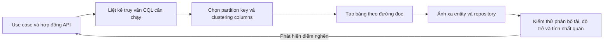

# Thiết kế dữ liệu theo truy vấn và tác động đến API ứng dụng

Trong hệ quản trị quan hệ, một mô hình dữ liệu chuẩn hóa có thể phục vụ nhiều kiểu đọc nhờ `JOIN`, chỉ mục và bộ tối ưu truy vấn. Với **Apache Cassandra**, cách tiếp cận thường hiệu quả hơn là bắt đầu từ **những truy vấn ứng dụng thực sự cần**, rồi thiết kế bảng để từng truy vấn đi đến đúng partition và đọc dữ liệu đã được sắp xếp phù hợp. **Spring Data Cassandra** giúp ánh xạ entity, xây repository, dùng `CassandraTemplate` và thực thi CQL, nhưng không tự biến Cassandra thành một cơ sở dữ liệu quan hệ.

Chủ đề này giải thích quan hệ hai chiều giữa thiết kế dữ liệu và hợp đồng API: API cần đọc theo tiêu chí nào sẽ chi phối bảng và khóa; ngược lại, bảng Cassandra có thể phục vụ truy vấn nào sẽ quyết định API hỗ trợ bộ lọc, sắp xếp, phân trang và mức độ nhất quán ra sao.

## 1. Tư duy query-first: bắt đầu từ thao tác đọc

Giả sử hệ thống đặt hàng cần ba chức năng:

| Nhu cầu của ứng dụng | Truy vấn cần tối ưu | Đặc tính cần làm rõ |
| --- | --- | --- |
| Khách xem đơn hàng gần đây | Đọc đơn của **một khách**, mới nhất trước | `customerId`, thời gian giảm dần, đọc từng trang |
| Xem chi tiết đơn hàng | Tra cứu **một đơn** bằng `orderId` | Đọc một bản ghi, độ trễ ổn định |
| Khách lọc đơn theo trạng thái | Đọc đơn của **một khách và một trạng thái** | `customerId`, `status`, thời gian giảm dần |

Trước khi tạo bảng, cần trả lời thêm: mỗi khách có bao nhiêu đơn, khách nào tạo nhiều đơn nhất, thời gian lưu trữ là bao lâu, API có cần cập nhật trạng thái gần như tức thì không, và truy vấn phải đáp ứng độ trễ nào ở tải cao. Hai API có cùng dữ liệu trả về nhưng cách lọc khác nhau có thể cần **hai bảng vật lý**.

Quy trình thiết kế thường đi theo chiều:



Điều cần tránh là tạo trước một bảng `orders` theo thói quen SQL rồi kỳ vọng mọi endpoint có thể tự do thêm `WHERE`, `ORDER BY`, `JOIN` hay `OFFSET`. Cassandra được tối ưu cho đường truy cập có thể dự đoán, đặc biệt khi đã biết partition key.

## 2. Partition key và clustering columns quyết định đường đọc

Thiết kế bảng phục vụ API `GET /customers/{customerId}/orders`:

```sql
CREATE TABLE orders_by_customer (
    customer_id uuid,
    created_at timestamp,
    order_id uuid,
    status text,
    total_amount decimal,
    PRIMARY KEY ((customer_id), created_at, order_id)
) WITH CLUSTERING ORDER BY (created_at DESC, order_id ASC);
```

Phân tích khóa chính:

| Thành phần | Vai trò | Hệ quả đối với truy vấn |
| --- | --- | --- |
| `customer_id` — partition key | Xác định partition và phân phối dữ liệu lên các nút | Truy vấn theo một khách có thể định vị partition; tất cả đơn của khách đó cùng logical partition |
| `created_at` — clustering column thứ nhất | Tổ chức thứ tự bản ghi trong partition | Đọc đơn mới nhất và áp điều kiện khoảng thời gian thuận lợi |
| `order_id` — clustering column thứ hai | Phân biệt các đơn có cùng thời điểm | Thứ tự xác định hơn khi nhiều đơn trùng `created_at` |

Các truy vấn khớp với cách tổ chức trên:

```sql
-- Lấy đơn gần đây của đúng một khách.
SELECT * FROM orders_by_customer
WHERE customer_id = 11111111-1111-1111-1111-111111111111
LIMIT 20;

-- Giới hạn theo thời gian trong cùng partition.
SELECT * FROM orders_by_customer
WHERE customer_id = 11111111-1111-1111-1111-111111111111
  AND created_at >= '2026-01-01T00:00:00Z'
LIMIT 20;
```

Trong thiết kế này, các yêu cầu sau **không tự nhiên được hỗ trợ** bằng một phép đọc hiệu quả trên cùng bảng:

- `GET /orders/{orderId}`: chưa biết `customer_id`, nên không xác định được partition từ `orderId`.
- `GET /customers/{id}/orders?status=PAID`: `status` là cột thường, không nằm trong đường khóa của truy vấn này.
- `GET /orders?sort=totalAmount`: sắp xếp toàn cục theo `total_amount` không có sẵn trong cấu trúc bảng.

Không nên biến `ALLOW FILTERING` thành cách sửa nhanh cho các endpoint này. Nó có thể buộc Cassandra đọc và lọc lượng dữ liệu lớn, khó kiểm soát độ trễ khi quy mô tăng. Secondary index hoặc Storage-Attached Index (SAI) có thể phù hợp với một số mẫu truy vấn cụ thể, nhưng cần đánh giá theo phiên bản Cassandra, cardinality, phân bố dữ liệu và tải thực tế; chúng không thay thế việc thiết kế đường đọc cho những truy vấn chính có lưu lượng lớn.

### Partition key tốt phải vừa đúng truy vấn, vừa phân tán tải

Chọn `customer_id` giúp truy vấn theo khách hiệu quả, nhưng một khách có hàng triệu đơn có thể tạo **partition lớn** hoặc **hot partition** nếu đồng thời phát sinh nhiều lượt đọc/ghi. Cần ước lượng kích thước và lưu lượng theo *khách có tải cao nhất*, không chỉ theo trung bình.

Một phương án khi dữ liệu tăng dài hạn là phân vùng theo thời gian:

```sql
CREATE TABLE orders_by_customer_month (
    customer_id uuid,
    month_bucket text,
    created_at timestamp,
    order_id uuid,
    status text,
    total_amount decimal,
    PRIMARY KEY ((customer_id, month_bucket), created_at, order_id)
) WITH CLUSTERING ORDER BY (created_at DESC, order_id ASC);
```

Ở đây `month_bucket` có thể là `2026-11`. API phải biết cần đọc tháng nào; nếu lấy lịch sử dài hơn một tháng, service cần đọc nhiều partition theo từng tháng, kết hợp kết quả và quản lý cursor tương ứng. Bucketing giảm độ lớn mỗi partition nhưng tăng độ phức tạp của đọc và phân trang. Chỉ bổ sung khi có căn cứ từ lưu lượng, dung lượng và retention; không có một ngưỡng kích thước partition an toàn chung cho mọi workload.

## 3. Một đối tượng nghiệp vụ có thể cần nhiều bảng đọc

Để tìm đơn theo `orderId`, tạo thêm bảng:

```sql
CREATE TABLE order_by_id (
    order_id uuid PRIMARY KEY,
    customer_id uuid,
    created_at timestamp,
    status text,
    total_amount decimal
);

SELECT * FROM order_by_id
WHERE order_id = 22222222-2222-2222-2222-222222222222;
```

Nếu endpoint lọc trạng thái là chức năng quan trọng và được gọi thường xuyên, một bảng khác có thể phục vụ trực tiếp:

```sql
CREATE TABLE orders_by_customer_and_status (
    customer_id uuid,
    status text,
    created_at timestamp,
    order_id uuid,
    total_amount decimal,
    PRIMARY KEY ((customer_id, status), created_at, order_id)
) WITH CLUSTERING ORDER BY (created_at DESC, order_id ASC);
```

Hệ quả của các lựa chọn trên:

| Bảng | Endpoint phục vụ tốt | Chi phí phải trả |
| --- | --- | --- |
| `orders_by_customer` | Danh sách đơn theo khách và thời gian | Partition có thể lớn; không lọc trạng thái trực tiếp |
| `order_by_id` | Chi tiết một đơn theo ID | Thêm một bản sao dữ liệu cần ghi/cập nhật |
| `orders_by_customer_and_status` | Danh sách đơn theo khách, trạng thái, thời gian | Phải di chuyển hàng khi trạng thái thay đổi; thêm write amplification |

Đây là **phi chuẩn hóa có chủ đích**: nhân bản một số trường để biến các truy vấn ứng dụng thành truy cập dự đoán được. Không có `JOIN` tự động giữa các bảng này. Với Cassandra, tên bảng như `orders_by_customer` hoặc `order_by_id` thường truyền đạt *cách bảng được đọc* rõ hơn tên chỉ mô tả một thực thể nghiệp vụ.

### Khi trạng thái đơn thay đổi

Giả sử đơn `O1` chuyển từ `PENDING` sang `PAID`:

1. Cập nhật trạng thái trong `order_by_id`.
2. Cập nhật bản ghi tương ứng trong `orders_by_customer`.
3. Xóa hàng mang khóa `(customer_id, PENDING, created_at, order_id)` khỏi `orders_by_customer_and_status`, rồi thêm hàng có trạng thái `PAID`.
4. Thiết kế retry, idempotency và cơ chế đối soát để xử lý trường hợp chỉ một phần các bản sao được cập nhật.

**Cassandra `BATCH` không phải giao dịch ACID kiểu SQL**, và dùng batch lớn trên nhiều partition không phải cách tăng tốc ghi. Với nhiều bảng đọc, cần chủ động quy định nguồn sự thật, thứ tự cập nhật, thời điểm API có thể nhìn thấy dữ liệu cũ, cơ chế retry và sửa lệch. Một read model có thể được cập nhật bất đồng bộ nếu nghiệp vụ chấp nhận độ trễ đồng bộ hóa; khi đó phải nói rõ trong hợp đồng API.

## 4. Ánh xạ khóa và bảng bằng Spring Data Cassandra

Spring Data Cassandra dùng annotation để ánh xạ bảng CQL vào Java. Với khóa phức hợp, đặt partition key và clustering columns trong lớp `@PrimaryKeyClass`:

```java
import java.io.Serializable;
import java.time.Instant;
import java.util.UUID;

import org.springframework.data.cassandra.core.cql.Ordering;
import org.springframework.data.cassandra.core.mapping.PrimaryKeyClass;
import org.springframework.data.cassandra.core.mapping.PrimaryKeyColumn;
import org.springframework.data.cassandra.core.mapping.PrimaryKeyType;

@PrimaryKeyClass
public class OrderByCustomerKey implements Serializable {

    @PrimaryKeyColumn(
        name = "customer_id", ordinal = 0,
        type = PrimaryKeyType.PARTITIONED
    )
    private UUID customerId;

    @PrimaryKeyColumn(
        name = "created_at", ordinal = 1,
        type = PrimaryKeyType.CLUSTERED, ordering = Ordering.DESCENDING
    )
    private Instant createdAt;

    @PrimaryKeyColumn(
        name = "order_id", ordinal = 2,
        type = PrimaryKeyType.CLUSTERED, ordering = Ordering.ASCENDING
    )
    private UUID orderId;

    // Bổ sung constructor, getter/setter, equals() và hashCode().
}
```

```java
import java.math.BigDecimal;

import org.springframework.data.cassandra.core.mapping.Column;
import org.springframework.data.cassandra.core.mapping.PrimaryKey;
import org.springframework.data.cassandra.core.mapping.Table;

@Table("orders_by_customer")
public class OrderByCustomer {

    @PrimaryKey
    private OrderByCustomerKey key;

    @Column("status")
    private String status;

    @Column("total_amount")
    private BigDecimal totalAmount;

    // Bổ sung constructor, getter/setter theo quy ước mapping của dự án.
}
```

`@PrimaryKeyColumn` biểu diễn **vị trí và vai trò của từng thành phần khóa**, còn `@Column` ánh xạ các trường dữ liệu thường. Entity có khóa đúng **không** đồng nghĩa mọi phương thức truy vấn tự sinh đều hợp lệ hoặc hiệu quả: mỗi câu CQL vẫn phải tuân theo hạn chế partition/clustering của Cassandra.

Có thể dùng repository riêng cho từng read model:

```java
import java.util.UUID;

import org.springframework.data.cassandra.repository.CassandraRepository;
import org.springframework.data.cassandra.repository.Query;
import org.springframework.data.domain.Pageable;
import org.springframework.data.domain.Slice;

public interface OrdersByCustomerRepository
        extends CassandraRepository<OrderByCustomer, OrderByCustomerKey> {

    @Query("SELECT * FROM orders_by_customer WHERE customer_id = ?0")
    Slice<OrderByCustomer> findByCustomerId(UUID customerId, Pageable pageable);
}
```

Mục tiêu của `@Query` là làm rõ đường đọc: API danh sách đơn của khách chỉ cung cấp `customer_id` và yêu cầu phân trang. Với một endpoint tra cứu `orderId`, dùng entity/repository khác ánh xạ `order_by_id`, thay vì truy vấn quét bảng `orders_by_customer`.

Khi câu CQL động hoặc logic truy cập phức tạp hơn mức repository phù hợp, có thể dùng `CassandraTemplate` để kiểm soát query, ánh xạ kết quả và các tùy chọn thực thi. Dù chọn repository hay template, **quy tắc phân vùng và hiệu năng đến từ schema và CQL**; công cụ Spring không thay đổi bản chất truy vấn.

## 5. Thiết kế API theo khả năng truy vấn thực tế

Ví dụ hợp đồng API có kiểm soát:

```http
GET /customers/11111111-1111-1111-1111-111111111111/orders?limit=20

HTTP/1.1 200 OK
Content-Type: application/json

{
  "items": [
    {
      "orderId": "22222222-2222-2222-2222-222222222222",
      "createdAt": "2026-11-25T02:00:00Z",
      "status": "PAID",
      "totalAmount": 175000
    }
  ],
  "nextCursor": "opaque-page-token"
}
```

`nextCursor` trong ví dụ là ký hiệu minh họa, **không** phải chuỗi paging state thật. Mỗi cursor thực tế phải do server tạo và có thể kiểm tra an toàn khi client gửi lại. Một hợp đồng rõ ràng nên quy định:

- **Bộ lọc được hỗ trợ:** ví dụ `customerId` là bắt buộc; `status` chỉ được hỗ trợ nếu backend có bảng hoặc đường truy vấn tương ứng. Không công bố `filter` tùy ý nếu Cassandra không thể phục vụ.
- **Thứ tự:** mới nhất trước theo `created_at`; dùng `order_id` làm khóa phụ để tránh nhập nhằng khi cùng timestamp. Không hứa hỗ trợ mọi kiểu `sort`.
- **Kích thước trang:** đặt mặc định và giới hạn tối đa theo tải thực tế; `limit=20` chỉ là ví dụ.
- **Phân trang:** ưu tiên cursor/paging state thay cho `page=500&size=20` hoặc `OFFSET`. Cassandra không hỗ trợ nhảy tới trang N bằng cơ chế offset rẻ như một số hệ SQL.
- **Tổng số bản ghi:** đừng hứa `totalPages`/`totalElements` nếu cần quét hoặc đếm nhiều partition. Trả danh sách và chỉ báo có trang tiếp theo thường phù hợp hơn.
- **Độ mới dữ liệu:** nếu nhiều read model cập nhật bất đồng bộ, mô tả khả năng trạng thái hiển thị chậm so với thao tác ghi.

### Cursor và `Slice` trong Spring Data Cassandra

Spring Data Cassandra có `CassandraPageRequest` và hỗ trợ truy xuất theo từng `Slice`, phù hợp với khả năng phân trang dựa trên paging state của Cassandra. Luồng xử lý điển hình:

1. Trang đầu tạo `CassandraPageRequest.first(pageSize)` và gọi phương thức repository trả về `Slice`.
2. Nếu slice còn dữ liệu, backend sử dụng thông tin phân trang tiếp theo từ kết quả hoặc driver để chuẩn bị yêu cầu kế tiếp.
3. Backend đóng gói thông tin phân trang thành cursor **opaque**, có kiểm tra tính hợp lệ và liên kết với truy vấn (ví dụ khách hàng, bộ lọc, giới hạn trang).
4. Client gửi lại cursor, backend dựng yêu cầu đọc tiếp; không cho client chỉnh trực tiếp paging state hoặc dùng lại cursor cho truy vấn khác.

Paging state phụ thuộc vào truy vấn và tham số thực thi, không phải số trang độc lập. Vì dữ liệu có thể được ghi/xóa trong lúc khách phân trang, việc duyệt nhiều trang **không mặc nhiên là một snapshot nhất quán**; API cần xác định hành vi chấp nhận được nếu có đơn mới hoặc cập nhật đồng thời.

## 6. Những ràng buộc vận hành cũng ảnh hưởng API

### Phân bố partition và hot keys

Một thiết kế có truy vấn CQL hợp lệ vẫn có thể chậm nếu traffic tập trung vào một số partition. Theo dõi phân bố khóa, kích thước partition, số request/partition, tốc độ ghi, p95/p99 latency và tải trên các nút. Cân nhắc bucketing khi có bằng chứng hot partition hoặc dữ liệu không còn phù hợp trong một partition; chấp nhận rằng API có thể cần fan-out đọc nhiều bucket.

### Consistency level và kỳ vọng đọc-sau-ghi

Cassandra cho phép chọn consistency level theo từng thao tác (ví dụ `LOCAL_ONE`, `LOCAL_QUORUM`, tùy topology và cấu hình). Việc tăng mức nhất quán thường đánh đổi với độ trễ hoặc tính sẵn sàng khi có lỗi. Consistency level giúp điều chỉnh cách đọc/ghi bản sao, nhưng **không tự bảo đảm các bảng phi chuẩn hóa đồng bộ ngay lập tức** hay tạo giao dịch nhiều bảng. API phải diễn đạt đúng cam kết nghiệp vụ, nhất là sau `POST /orders` hoặc `PATCH /orders/{id}/status`.

### TTL, delete và tombstones

Khi đơn hết hạn, xóa hoặc TTL có thể tạo tombstone. Những truy vấn đọc nhiều bản ghi đã xóa/hết TTL có thể chịu chi phí cao. Quy định retention theo use case, theo dõi tombstones và đọc lại mẫu truy vấn sau khi áp TTL; tránh dùng TTL đại trà mà không đánh giá pattern truy vấn và compaction.

### Khả năng thay đổi schema và API

Thêm tiêu chí lọc không đơn thuần là thêm tham số HTTP: đôi khi phải tạo bảng đọc mới, backfill dữ liệu lịch sử, cập nhật luồng ghi, kiểm thử độ đồng bộ và triển khai chuyển đổi theo từng bước. Vì thế cần xem **query pattern như một phần của thiết kế API** và lập kế hoạch thay đổi schema cùng với thay đổi endpoint.

## 7. Quy trình thực hành từ yêu cầu đến đo lường

Giả sử sản phẩm yêu cầu: “Khách xem 20 đơn mới nhất, lọc theo trạng thái và bấm vào một đơn để xem chi tiết.” Có thể triển khai theo thứ tự:

1. **Liệt kê truy vấn:** danh sách theo khách, danh sách theo khách + trạng thái, chi tiết theo ID. Ghi rõ khóa lọc, thứ tự, kích thước trang, tải và thời gian lưu dữ liệu.
2. **Thiết kế bảng:** `orders_by_customer`, `orders_by_customer_and_status`, `order_by_id`. Xác minh mỗi CQL định vị được partition và cách sắp xếp phù hợp.
3. **Ánh xạ Spring Data Cassandra:** tạo entity/key phù hợp cho từng bảng và repository hoặc `CassandraTemplate` với CQL có tham số bind.
4. **Thiết kế cập nhật:** xác định nơi ghi dữ liệu gốc, cách nhân bản sang read model, xử lý thay đổi trạng thái, idempotency, retry và đối soát.
5. **Công bố hợp đồng API:** chỉ cho phép các filter/sort có đường đọc hợp lý; dùng cursor có giới hạn page size và trạng thái nhất quán được mô tả rõ.
6. **Kiểm thử bằng phân bố dữ liệu thật:** tạo cả khách ít đơn và khách rất nhiều đơn; đo p95/p99, số partition chạm tới, tỷ lệ timeout, kích thước partition, tombstones và chi phí nhân bản khi tăng tải.

Ví dụ đối chiếu một yêu cầu mới:

> **Yêu cầu:** “Thêm bộ lọc `minAmount` vào danh sách đơn theo khách.”  
> **Câu hỏi kỹ thuật cần trả lời:** Cột `total_amount` hiện nằm ở đâu trong khóa? Có index phù hợp với phân bố và tải thực tế không? Có cần read model riêng, giới hạn phạm vi thời gian hoặc thay đổi trải nghiệm lọc không? Tác động ghi, lưu trữ, backfill và latency có chấp nhận được không?

Không nên quyết định chỉ dựa trên việc Spring Data Cassandra có cho phép khai báo phương thức repository tương ứng hay không.

## 8. Các sai lầm phổ biến và cách kiểm tra

| Sai lầm | Dấu hiệu trong ứng dụng | Hướng xử lý |
| --- | --- | --- |
| Thiết kế một bảng cho mọi endpoint | Truy vấn cần `ALLOW FILTERING`, quét nhiều partition | Thiết kế bảng theo đường truy cập chính |
| Chỉ nhìn tải trung bình | Một vài khách nóng gây p99 tăng mạnh | Đo phân bố khóa, xem xét bucketing có kiểm soát |
| Dùng phân trang offset | API muốn nhảy trang N, thời gian đọc tăng | Cursor/paging state, không cam kết random access |
| Coi `Page` và tổng số trang là miễn phí | Đếm toàn bộ kết quả tốn tài nguyên | Trả `Slice`, `hasNext` hoặc `nextCursor` |
| Nhân bản bảng nhưng không thiết kế cập nhật | Trạng thái đơn không khớp giữa các endpoint | Retry idempotent, quy tắc nhất quán, đối soát |
| Hỗ trợ bộ lọc/sort tùy ý | Chậm đột biến khi thêm tham số mới | API contract giới hạn theo truy vấn hỗ trợ |
| Lạm dụng TTL/xóa | Tombstone nhiều, đọc chậm | Kiểm tra retention, compaction và truy vấn thực tế |

## Tự kiểm tra kiến thức

1. Vì sao `PRIMARY KEY ((customer_id), created_at, order_id)` phù hợp với danh sách đơn theo khách nhưng không phù hợp để tìm đơn chỉ bằng `order_id`?
2. Nếu API cần lọc thêm `status`, các lựa chọn thiết kế dữ liệu là gì và mỗi lựa chọn ảnh hưởng đến ghi như thế nào?
3. Tại sao một cursor Cassandra không nên được xem như số trang hoặc snapshot của toàn bộ kết quả?
4. Khi một khách có hàng triệu đơn, việc thêm `month_bucket` giải quyết vấn đề nào và khiến API phải xử lý thêm việc gì?
5. Khi cập nhật trạng thái đơn sang nhiều bảng, vì sao consistency level của một lần đọc không đủ bảo đảm tất cả endpoint trả cùng trạng thái?

**Điểm cần ghi nhớ:** Trong Spring Data Cassandra, thiết kế bảng, truy vấn CQL, entity/repository và hợp đồng API phải được xây cùng nhau. Partition key quyết định dữ liệu cần định vị, clustering columns quyết định thứ tự đọc trong partition, còn việc hỗ trợ nhiều đường đọc thường kéo theo các bảng phi chuẩn hóa và trách nhiệm giữ chúng nhất quán. Thiết kế tốt biến mỗi endpoint quan trọng thành một truy vấn có phạm vi rõ ràng, giới hạn tải được và hành vi có thể giải thích cho người sử dụng API.
