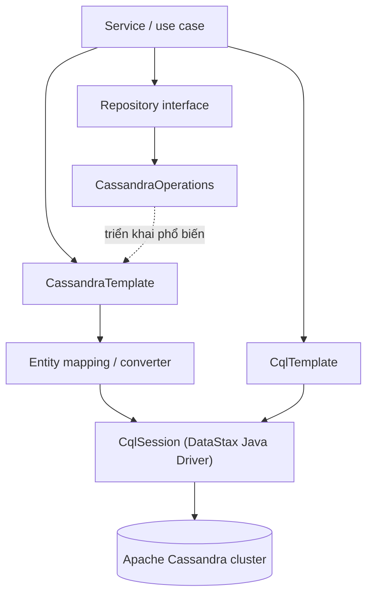

# Repository, CassandraTemplate và CqlTemplate: vai trò và quan hệ

Trong Spring Data Cassandra, một ứng dụng có thể truy cập Apache Cassandra thông qua **Repository**, **CassandraTemplate** hoặc **CqlTemplate**. Cả ba đều dẫn tới cùng hệ thống Cassandra nhưng làm việc ở các mức trừu tượng khác nhau: Repository diễn đạt thao tác trên đối tượng miền nghiệp vụ; CassandraTemplate cho phép chủ động xây dựng truy vấn mà vẫn tận dụng ánh xạ entity; CqlTemplate làm việc gần CQL và dữ liệu trả về từ driver hơn.

Điểm quan trọng là **chọn cách truy cập sau khi đã thiết kế bảng theo truy vấn**. Spring Data giúp giảm mã lặp và ánh xạ dữ liệu, nhưng không biến Cassandra thành cơ sở dữ liệu quan hệ: truy vấn vẫn phải phù hợp với partition key, clustering column và đặc tính phân tán.

## 1. Ba tầng truy cập nằm ở đâu?



- **Repository** là giao diện cấp cao, thường kế thừa `CassandraRepository<Entity, Id>`. Spring Data tạo phần triển khai và sử dụng các thao tác `CassandraOperations` ở bên dưới. Lập trình viên chủ yếu làm việc với entity và phương thức của repository.
- **CassandraTemplate** là một triển khai chính của `CassandraOperations`. Nó cung cấp `insert`, `update`, `select`, `delete`, truy vấn `Query`/`Criteria` và ánh xạ dữ liệu theo annotation của entity.
- **CqlTemplate** triển khai các thao tác CQL ở mức thấp hơn thông qua `CqlOperations`. Nó thực thi statement và trả dữ liệu thô hoặc ánh xạ từng `Row` qua `RowMapper`; bản thân nó không tự dùng entity mapping giống `CassandraTemplate`.
- **CqlSession** thuộc Java Driver là thành phần thực sự giao tiếp với cluster, quản lý kết nối, thực thi statement, cấu hình retry và các tùy chọn driver. Cả hai template có thể sử dụng cùng session được ứng dụng cấu hình.

Mối quan hệ này là **phân tầng khả năng**, không phải quy tắc rằng mọi lời gọi đều đi tuần tự qua cả ba API. Đặc biệt, Repository thường được xây trên `CassandraOperations`, còn CqlTemplate là một lối vào riêng khi cần làm việc trực tiếp với CQL.

| Tiêu chí | Repository | CassandraTemplate | CqlTemplate |
| --- | --- | --- | --- |
| Đối tượng thao tác chính | Entity và ID | Entity cùng `Query`/`Criteria` | Statement CQL và `Row` |
| Ánh xạ | Spring Data tự ánh xạ | Spring Data tự ánh xạ | Tự ánh xạ bằng `RowMapper` hoặc thao tác kết quả |
| Mức mã cần viết | Ít | Vừa | Nhiều hơn |
| Tình huống hợp lý | CRUD, truy vấn ổn định, API nghiệp vụ đơn giản | Truy vấn động, thao tác trên entity tùy biến | CQL đặc thù, thao tác hạ tầng, kiểm soát câu lệnh |
| Điều không thay đổi | Vẫn phải tuân thủ key và giới hạn truy vấn Cassandra | Tương tự | Tương tự |

## 2. Bắt đầu từ bảng và mẫu truy vấn

Giả sử ứng dụng ghi sự kiện và cần trả lời câu hỏi: **“Lấy các sự kiện mới nhất của một tenant trong một ngày.”** Một bảng phù hợp có thể là:

```sql
CREATE TABLE events_by_tenant_day (
    tenant_id  text,
    event_day  date,
    event_id   timeuuid,
    event_type text,
    payload    text,
    PRIMARY KEY ((tenant_id, event_day), event_id)
) WITH CLUSTERING ORDER BY (event_id DESC);
```

Giải thích cấu trúc:

- `(tenant_id, event_day)` là **partition key ghép**. Các sự kiện của cùng tenant trong cùng ngày nằm trong một phân vùng logic.
- `event_id` là **clustering column**. Kiểu `timeuuid` cho phép sắp xếp theo thời gian tạo UUID; `DESC` phục vụ yêu cầu đọc mới nhất trước.
- Truy vấn `WHERE tenant_id = ? AND event_day = ? LIMIT ?` chỉ đụng đến một partition xác định, thuận lợi cho truy vấn có giới hạn.
- Phân vùng phải có kích thước hợp lý. Nếu một tenant phát sinh lượng sự kiện quá lớn mỗi ngày, có thể cần bucket nhỏ hơn (theo giờ hoặc shard được thiết kế trước) và điều chỉnh mẫu truy vấn.

Đây là thiết kế **theo truy vấn (query-first)**: có thể cần một bảng khác để tra cứu sự kiện theo `event_type` hoặc theo ID trên toàn hệ thống. Không nên mặc định dùng `ALLOW FILTERING` hay kỳ vọng Cassandra tự JOIN và quét như hệ quản trị quan hệ.

### Entity và composite primary key

Spring Data Cassandra mô tả bảng trên bằng `@Table`, `@PrimaryKeyClass` và `@PrimaryKeyColumn`:

```java
import java.io.Serializable;
import java.time.LocalDate;
import java.util.UUID;
import org.springframework.data.cassandra.core.cql.Ordering;
import org.springframework.data.cassandra.core.mapping.*;

@PrimaryKeyClass
public class EventKey implements Serializable {
    @PrimaryKeyColumn(name = "tenant_id", ordinal = 0,
            type = PrimaryKeyType.PARTITIONED)
    private String tenantId;

    @PrimaryKeyColumn(name = "event_day", ordinal = 1,
            type = PrimaryKeyType.PARTITIONED)
    private LocalDate eventDay;

    @PrimaryKeyColumn(name = "event_id", ordinal = 2,
            type = PrimaryKeyType.CLUSTERED, ordering = Ordering.DESCENDING)
    private UUID eventId;

    public EventKey() {}

    // Bổ sung constructor, getter/setter, equals() và hashCode().
}

@Table("events_by_tenant_day")
public class Event {
    @PrimaryKey
    private EventKey key;

    @Column("event_type")
    private String eventType;

    @Column("payload")
    private String payload;

    public Event() {}

    // Bổ sung constructor và getter/setter.
}
```

Đoạn mã tập trung vào annotation ánh xạ; khi đưa vào dự án cần hoàn thiện các phương thức được ghi chú. Đặc biệt, một key dùng làm ID cần `equals()` và `hashCode()` có ngữ nghĩa giá trị ổn định. Thứ tự ordinal phân biệt thành phần partition key và clustering column đúng như CQL.

## 3. Repository: giao diện cho các thao tác quen thuộc

Repository phù hợp khi cách đọc/ghi đã rõ và tương đối ổn định. Chỉ cần khai báo một interface:

```java
import java.time.LocalDate;
import java.util.List;
import org.springframework.data.cassandra.repository.CassandraRepository;
import org.springframework.data.cassandra.repository.Query;

public interface EventRepository
        extends CassandraRepository<Event, EventKey> {

    @Query("SELECT * FROM events_by_tenant_day " +
           "WHERE tenant_id = ?0 AND event_day = ?1 LIMIT 50")
    List<Event> findRecentInDay(String tenantId, LocalDate day);
}
```

Service có thể sử dụng:

```java
@Service
public class EventService {
    private final EventRepository repository;

    public EventService(EventRepository repository) {
        this.repository = repository;
    }

    public Event save(Event event) {
        return repository.save(event);
    }

    public List<Event> recent(String tenantId, LocalDate day) {
        return repository.findRecentInDay(tenantId, day);
    }
}
```

Các thao tác như `save`, `findById`, `existsById`, `deleteById` có sẵn từ repository; Spring Data chịu trách nhiệm ánh xạ giữa `Event` và hàng Cassandra. `@Query` cho phép khai báo CQL cụ thể, với tham số `?0`, `?1` được bind thay cho việc nối chuỗi dữ liệu đầu vào.

Spring Data còn hỗ trợ cơ chế truy vấn theo tên phương thức ở những trường hợp tương thích với mô hình dữ liệu. Tuy nhiên, **tên phương thức không vượt qua hạn chế của CQL**. Chẳng hạn, yêu cầu lọc tất cả sự kiện theo `event_type` mà không có partition key không tự trở nên hiệu quả vì được đặt tên `findByEventType`.

**Chọn Repository khi:** cần lưu/đọc entity theo khóa, tập truy vấn có thể mô tả rõ ràng, muốn service tập trung vào nghiệp vụ và tránh lặp mã ánh xạ.

## 4. CassandraTemplate: điều khiển truy vấn trên entity

Khi giới hạn kết quả hoặc điều kiện cần được xây dựng lúc chạy, `CassandraTemplate` cho phép viết trực tiếp với `Query` và `Criteria` trong khi vẫn nhận `Event` đã ánh xạ:

```java
import java.time.LocalDate;
import java.util.List;
import org.springframework.data.cassandra.core.CassandraTemplate;
import org.springframework.data.cassandra.core.query.Criteria;
import org.springframework.data.cassandra.core.query.Query;
import org.springframework.stereotype.Service;

@Service
public class EventReader {
    private final CassandraTemplate template;

    public EventReader(CassandraTemplate template) {
        this.template = template;
    }

    public List<Event> recent(String tenantId, LocalDate day, int limit) {
        if (limit < 1 || limit > 100) {
            throw new IllegalArgumentException("limit phải trong [1, 100]");
        }

        Query query = Query.query(Criteria.where("tenant_id").is(tenantId))
                .and(Criteria.where("event_day").is(day))
                .limit(limit);

        return template.select(query, Event.class);
    }
}
```

Ở đây, `Criteria` xác định đúng **toàn bộ partition key**; `limit` giới hạn số hàng trả về. `CassandraTemplate` sử dụng metadata của `Event` để ánh xạ cột và chuyển dữ liệu Cassandra sang Java. So với Repository, template cho phép tự lắp ghép `Query`, chọn thao tác `insert/update/delete`, và viết repository tùy biến khi thật sự cần.

Không nên xem `Query`/`Criteria` như bộ xây dựng SQL tự do. Một `Criteria.where("event_type").is(...)` không hợp lệ hoặc gây quét dữ liệu vẫn có thể bị Cassandra từ chối, dù đoạn Java biên dịch thành công.

**Chọn CassandraTemplate khi:** logic truy vấn thay đổi theo tham số trong phạm vi các access pattern được bảng hỗ trợ; cần API thao tác entity linh hoạt hơn phương thức repository; hoặc muốn triển khai một custom repository.

## 5. CqlTemplate: làm việc trực tiếp với CQL và Row

`CqlTemplate` phù hợp khi cần kiểm soát cú pháp CQL hoặc đọc dữ liệu không gắn với entity. Ví dụ, đọc thông tin cluster từ bảng hệ thống:

```java
import java.util.List;
import com.datastax.oss.driver.api.core.CqlSession;
import org.springframework.data.cassandra.core.cql.CqlTemplate;

public class ClusterDiagnostics {
    private final CqlTemplate cql;

    public ClusterDiagnostics(CqlSession session) {
        this.cql = new CqlTemplate(session);
    }

    public List<String> clusterNames() {
        return cql.query(
                "SELECT cluster_name FROM system.local",
                (row, rowNum) -> row.getString("cluster_name"));
    }
}
```

Lệnh truy vấn trả về `Row` của driver; lambda đóng vai trò `RowMapper<String>`, chủ động đọc cột `cluster_name`. Không có `@Table` hoặc `@PrimaryKey` tham gia quá trình ánh xạ này.

Trong dự án Spring, có thể khai báo một bean `CqlTemplate` dùng `CqlSession` chung nếu cấu hình hiện tại chưa cung cấp bean phù hợp. Tránh tạo session độc lập cho mỗi truy vấn. Ngoài `query`, CqlTemplate còn phục vụ các thao tác thực thi statement/CQL ở mức thấp.

Với tham số từ người dùng, **không nối chuỗi để tạo CQL**. Hãy sử dụng bind values của driver hoặc prepared/bound statement. Ví dụ về ý tưởng khi cần tùy chọn thực thi đặc thù:

```java
import com.datastax.oss.driver.api.core.DefaultConsistencyLevel;
import com.datastax.oss.driver.api.core.cql.SimpleStatement;

SimpleStatement statement = SimpleStatement.builder(
        "SELECT event_type FROM events_by_tenant_day " +
        "WHERE tenant_id = ? AND event_day = ? LIMIT ?")
    .addPositionalValues(tenantId, day, limit)
    .setConsistencyLevel(DefaultConsistencyLevel.LOCAL_QUORUM)
    .build();

List<String> types = cqlTemplate.query(
    statement,
    (row, rowNum) -> row.getString("event_type"));
```

Đoạn này minh họa cách **bind tham số**, đặt consistency ở mức statement và ánh xạ một cột. `cqlTemplate`, `tenantId`, `day`, `limit` được giả định đã có trong scope. Với truy vấn được gọi nhiều lần, cân nhắc `CqlSession.prepare(...)` và bind statement đã prepare để tái sử dụng.

**Chọn CqlTemplate khi:** cần CQL đặc thù, muốn đọc các cột chọn lọc hoặc bảng hệ thống mà không định nghĩa entity, hoặc cần xử lý trực tiếp kết quả ở dạng `Row`. Nếu cần các tính năng rất riêng của driver (chẳng hạn điều khiển paging state ở mức chi tiết), có thể làm việc với `CqlSession` trực tiếp; ba API này không che giấu hoàn toàn khả năng của driver.

## 6. Ba API giải quyết cùng một yêu cầu như thế nào?

Với yêu cầu đọc sự kiện theo tenant và ngày, luồng xử lý về bản chất giống nhau:

| Cách làm | Câu lệnh/đầu vào | Kết quả ứng dụng nhận | Phần ứng dụng phải tự lo |
| --- | --- | --- | --- |
| Repository | `findRecentInDay(tenantId, day)` | `List<Event>` | Định nghĩa interface và CQL hợp lệ |
| CassandraTemplate | `Query` gồm hai khóa và `limit` | `List<Event>` | Xây dựng `Query` đúng mẫu truy vấn |
| CqlTemplate | Statement có bind values | `List<String>` trong ví dụ | CQL, `RowMapper`, dữ liệu cần lấy |

Trong cùng một ứng dụng có thể dùng Repository cho ghi/đọc đơn giản, CassandraTemplate cho truy vấn entity tùy biến và CqlTemplate cho tác vụ CQL chuyên biệt. Một custom repository cũng có thể nhận `CassandraOperations` qua dependency injection để hiện thực phần truy vấn vượt khả năng interface mặc định.

Không cần đi từ Repository sang CassandraTemplate rồi sang CqlTemplate bằng tay: hãy inject đúng abstraction mà use case cần. Việc chọn tầng API **không làm thay đổi partition key, consistency level mặc định, hoặc tính chất không có JOIN tùy ý** của Cassandra.

## 7. Những giới hạn Cassandra cả ba tầng đều phải tôn trọng

### 7.1. Partition key và clustering column quyết định truy vấn

Truy vấn hiệu quả thường cung cấp đầy đủ partition key và dùng clustering column theo thứ tự được cho phép. Nếu màn hình cần “xem tất cả sự kiện loại X trong 30 ngày”, hãy cân nhắc bảng bổ sung theo `event_type` và bucket thời gian, cùng quy trình ghi dữ liệu phục vụ hai hướng đọc. Tránh dựa vào `ALLOW FILTERING` như một giải pháp chung: việc quét dữ liệu phân tán có thể rất đắt và tăng độ trễ khi dữ liệu lớn.

### 7.2. Paging là paging state, không phải OFFSET

Cassandra đọc theo **trang kết quả có trạng thái tiếp tục (paging state)**; nó không hỗ trợ kiểu phân trang nhảy đến `OFFSET 100000` như trong SQL truyền thống. Khi dùng các API repository có `Pageable`/`Slice` (tùy kiểu truy vấn và phiên bản Spring Data), cần hiểu trạng thái tiếp tục và không mặc định rằng luôn có tổng số bản ghi hay truy cập ngẫu nhiên mọi trang với chi phí thấp.

Với luồng xem sự kiện mới nhất, thường ưu tiên `LIMIT`, trang vừa phải và nút “Xem tiếp”. Nếu API trả token paging cho client, token phải gắn với **cùng truy vấn, cùng tham số và cấu hình page size**; kiểm soát tính hợp lệ và không xem đó là dữ liệu đầu vào tùy ý.

### 7.3. Consistency và ghi dữ liệu

Cassandra cho phép cấu hình **consistency level** theo hoạt động đọc/ghi, ví dụ `LOCAL_ONE` hoặc `LOCAL_QUORUM`, tùy topology và mục tiêu độ trễ/tính nhất quán. `LOCAL_QUORUM` trong ví dụ CqlTemplate là một lựa chọn minh họa, không phải giá trị tối ưu cho mọi cluster. Cần cân nhắc replication factor, số data center, SLA và tính sẵn sàng.

`repository.save(event)` hay `template.insert(event)` cũng không có toàn bộ ngữ nghĩa của ORM quan hệ. Cassandra có cơ chế **upsert** cho nhiều thao tác ghi, cơ chế đối chiếu timestamp và chính sách TTL; giao dịch nhiều hàng/bảng không hoạt động như transaction ACID quan hệ. Nếu nghiệp vụ cần điều kiện ghi kiểu `IF NOT EXISTS` hoặc compare-and-set, hãy nghiên cứu **lightweight transaction (LWT)** và chi phí thực thi riêng của nó.

### 7.4. Hiệu năng và an toàn câu lệnh

- **Thiết kế bảng theo truy vấn:** kiểm tra partition key, clustering order và giới hạn kết quả trước khi quyết định dùng API nào.
- **Không để partition quá lớn hoặc quá nóng:** dùng time bucket/shard có chủ đích nếu lưu lượng đòi hỏi.
- **Bind giá trị đầu vào:** tránh nối chuỗi CQL, đặc biệt ở tầng CqlTemplate.
- **Không dùng `COUNT(*)` trên tập dữ liệu lớn để làm số trang mặc định:** chi phí có thể rất cao; cân nhắc bộ đếm hoặc thống kê riêng theo yêu cầu.
- **Quan sát vận hành:** theo dõi p95/p99 latency, timeout, retry, truy vấn chậm, kích thước partition, số lượng round trip và tỷ lệ lỗi; không chỉ đo tốc độ của một phương thức Java.
- **Kiểm thử trên Cassandra thực:** các phép ánh xạ có thể chạy đúng nhưng CQL vẫn lỗi do thiếu khóa, thứ tự clustering hoặc schema. Integration test với Cassandra/Testcontainers giúp bắt những lỗi này.

## 8. Chọn công cụ trong tình huống thực tế

| Nhu cầu | Lựa chọn ưu tiên | Lý do |
| --- | --- | --- |
| Lưu sự kiện mới và đọc theo ID | Repository | CRUD và mapping ngắn gọn, dễ kiểm thử |
| Đọc 20–100 sự kiện mới nhất theo tenant/ngày với limit động | CassandraTemplate | Tạo `Query` có kiểm soát, vẫn ánh xạ entity |
| Đọc thông tin `system.local` để chẩn đoán | CqlTemplate | Kết quả nhỏ, không cần entity |
| Dùng statement với consistency/tùy chọn driver riêng | CqlTemplate hoặc `CqlSession` | Kiểm soát sát CQL/driver |
| Đọc theo trường không thuộc access pattern đã thiết kế | Thiết kế lại/bổ sung bảng trước | Đổi API không làm truy vấn thiếu khóa trở nên hiệu quả |

**Tự kiểm tra:** Nếu một ứng dụng đã có `EventRepository`, có nên thay toàn bộ repository bằng `CqlTemplate` để “tăng tốc” không? Không có cơ sở để kết luận như vậy. Thời gian truy vấn chủ yếu phụ thuộc vào partition, câu CQL, lượng dữ liệu, paging, consistency, network và cluster. API cao hơn có thêm chi phí ánh xạ nhưng thường không phải nút thắt đầu tiên. Chỉ hạ mức trừu tượng khi có yêu cầu cụ thể và số đo chứng minh.

## 9. Ghi nhớ

**Repository** giúp trình bày truy cập dữ liệu như thao tác nghiệp vụ trên entity. **CassandraTemplate** đem lại quyền điều khiển truy vấn mà vẫn giữ entity mapping. **CqlTemplate** phục vụ thao tác CQL và ánh xạ `Row` trực tiếp. Cả ba cuối cùng đều dựa vào driver để truy cập Apache Cassandra; không tầng nào thay thế việc thiết kế bảng đúng với partition key, clustering column, consistency và paging.

Khi chọn công cụ, hãy đi theo thứ tự: **xác định truy vấn cần phục vụ → thiết kế bảng và khóa → kiểm tra CQL hợp lệ/hiệu quả → chọn Repository, CassandraTemplate hoặc CqlTemplate ở mức trừu tượng vừa đủ**.
