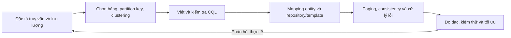

# Phạm vi kiến thức, điều kiện đầu vào và thứ tự học Spring Data Cassandra

## 1. Mục tiêu và cách tiếp cận

**Spring Data Cassandra** là mô-đun của hệ sinh thái Spring Data giúp ứng dụng Java truy cập **Apache Cassandra** thông qua ánh xạ entity, repository, `CassandraTemplate` và các truy vấn CQL. Tuy nhiên, viết được repository chưa đủ để xây dựng ứng dụng chạy tốt trên Cassandra: cách **thiết kế bảng theo truy vấn**, chọn **partition key**, hiểu **tính nhất quán**, **paging** và kiểm soát hiệu năng quyết định phần lớn hành vi thực tế của hệ thống.

Bài này xác định người học cần biết gì, cần chuẩn bị gì và nên học theo thứ tự nào. Đây là bản đồ học tập để dùng khi đọc các bài chuyên sâu hoặc thực hành dự án, không phải tài liệu tham chiếu đầy đủ cho mọi API.

Sau khi hoàn thành lộ trình, bạn cần có khả năng:

1. Giải thích vì sao mô hình dữ liệu Cassandra bắt đầu từ **truy vấn cần phục vụ**, thay vì chuẩn hóa dữ liệu rồi dựa vào phép `JOIN`.
2. Thiết kế bảng với partition key, clustering columns và kích thước partition phù hợp với nhu cầu đọc/ghi.
3. Ánh xạ khóa và cột Cassandra sang entity Java; dùng repository hoặc `CassandraTemplate` đúng tình huống.
4. Viết, kiểm tra và giới hạn truy vấn CQL; triển khai đọc theo trang dựa trên trạng thái phân trang.
5. Diễn giải ảnh hưởng của replication, consistency level, timeout và lỗi từng phần đến kết quả đọc/ghi.
6. Nhận diện các nguy cơ như hot partition, partition quá lớn, tombstone, truy vấn quét dữ liệu và thao tác nhiều dòng không có bảo đảm giao dịch như cơ sở dữ liệu quan hệ.

## 2. Phạm vi kiến thức

| Nhóm kiến thức | Cần học và thực hành | Ranh giới cần hiểu |
| --- | --- | --- |
| Kiến trúc Cassandra | Node, cluster, keyspace, replication, partition và phân phối dữ liệu theo token | Không cần trở thành quản trị viên cluster trước khi học ứng dụng |
| Thiết kế dữ liệu | Query-first modeling, partition key, clustering columns, bảng phục vụ từng mẫu truy vấn, bucket theo thời gian khi cần | Cassandra không tối ưu cho `JOIN` tùy ý và các truy vấn phân tích tùy hứng |
| CQL | `CREATE TABLE`, `INSERT`, `UPDATE`, `DELETE`, `SELECT`, `WHERE`, `LIMIT`, TTL và truy vấn theo khóa | CQL có cú pháp quen thuộc với SQL nhưng quy tắc truy vấn khác đáng kể |
| Mapping trong Spring | `@Table`, `@PrimaryKey`, khóa tổng hợp, chuyển đổi kiểu, entity lifecycle | Annotation không thay thế cho việc chọn đúng physical data model |
| Truy cập dữ liệu | `CassandraRepository`, phương thức truy vấn, `@Query`, `CassandraTemplate`, khi nào cần truy cập driver mức thấp | Repository chỉ trừu tượng hóa thao tác; truy vấn vẫn chịu giới hạn Cassandra |
| Phân trang | Fetch size, paging state, `Slice`/truy vấn kế tiếp và xử lý trang tuần tự | Không coi paging là `OFFSET` hoặc truy cập ngẫu nhiên trang thứ *n* |
| Tính nhất quán | Replication factor, `ONE`, `LOCAL_QUORUM`, trade-off độ trễ và khả dụng, truy vấn điều kiện khi thực sự cần | Không mặc định rằng mọi thao tác đều có tính nhất quán mạnh hoặc transaction nhiều dòng |
| Vận hành và hiệu năng | Hot partition, partition size, tombstone, TTL, retry/timeout, đo latency và hành vi khi lỗi | Không suy luận hiệu năng chỉ từ kết quả chạy trên một node ở máy cá nhân |
| Kiểm thử | Test mapping/CQL, chạy tích hợp với Cassandra, kiểm chứng query pattern và ranh giới dữ liệu | Mock repository không chứng minh được thiết kế partition hoặc CQL hợp lệ |

Các chủ đề như tuning nội bộ của toàn cluster, backup đa vùng, bảo mật hạ tầng chuyên sâu, streaming ở quy mô rất lớn và mọi khả năng riêng của từng phiên bản Cassandra thuộc phạm vi mở rộng. **Reactive Cassandra** có thể học sau khi nắm chắc mô hình dữ liệu và truy vấn đồng bộ; sử dụng reactive không tự giải quyết truy vấn kém hiệu quả.

### Tại sao thứ tự kiến thức lại quan trọng?

Trong cơ sở dữ liệu quan hệ, một nhóm thực thể thường được chuẩn hóa trước, sau đó truy vấn kết hợp chúng. Với Cassandra, ứng dụng nên liệt kê trước những câu hỏi cần trả lời, ví dụ: “Lấy 20 sự kiện mới nhất của người dùng trong một ngày”. Từ truy vấn đó mới lựa chọn partition key và thứ tự clustering columns. Nếu thiết kế khóa sai, việc thêm annotation hoặc đổi từ repository sang template không làm truy vấn tự nhiên trở nên hiệu quả.



## 3. Điều kiện đầu vào

### 3.1. Bắt buộc

- **Java:** nắm class, interface, generic, collection, `UUID`, `Instant`/`LocalDate`, exception và cách đọc stack trace.
- **Spring và Spring Boot:** hiểu dependency injection, bean, cấu hình `application.yml`, lớp service, phân biệt tầng web và tầng truy cập dữ liệu.
- **Build và chạy ứng dụng:** biết sử dụng Maven hoặc Gradle, chạy test, đọc log và quản lý dependency theo phiên bản của dự án.
- **Dữ liệu cơ bản:** hiểu bản ghi, khóa, chỉ mục ở mức khái niệm, đọc được truy vấn `SELECT` và thao tác CRUD. Biết SQL là lợi thế nhưng cần chủ động bỏ giả định rằng mọi câu SQL đều chuyển nguyên trạng sang CQL.
- **Môi trường thử nghiệm:** có JDK phù hợp phiên bản Spring Boot/Spring Data được chọn và một Cassandra có thể kết nối qua cổng CQL, chẳng hạn môi trường cục bộ hoặc cluster thử nghiệm. Cần biết tên keyspace, địa chỉ node, cổng, local datacenter và thông tin xác thực nếu có.

### 3.2. Nên có nhưng không bắt buộc

- Biết Docker hoặc cách khởi động môi trường Cassandra thử nghiệm để lặp lại bài thực hành.
- Biết khái niệm hệ phân tán: network partition, replication, retry, idempotency và eventual consistency.
- Biết dùng `cqlsh`, đọc log driver và đo độ trễ truy vấn ở mức cơ bản.

**Điểm kiểm tra đầu vào:** bạn có thể tạo một ứng dụng Spring Boot chạy được, giải thích được service gọi repository như thế nào, kết nối đến Cassandra thử nghiệm và thực thi một câu CQL đơn giản. Nếu chưa đạt, hãy bổ sung đúng phần còn thiếu trước khi tiếp tục phần mapping.

> **Lưu ý về phiên bản:** tên cấu hình, API, driver và yêu cầu JDK có thể khác giữa các dòng Spring Boot/Spring Data Cassandra. Chọn một bộ phiên bản tương thích và bám theo tài liệu của bộ đó trong suốt bài thực hành. Không sao chép cấu hình từ nhiều thế hệ framework vào cùng một dự án.

## 4. Bài toán xuyên suốt: lịch sử sự kiện theo người dùng

Giả sử ứng dụng cần ghi nhận sự kiện của người dùng và đáp ứng các truy vấn chính:

1. Ghi một sự kiện với thời điểm xảy ra và loại sự kiện.
2. Lấy tối đa 20 sự kiện mới nhất **của một người dùng trong một ngày**.
3. Đọc tiếp trang kế của cùng truy vấn mà không tải toàn bộ lịch sử vào bộ nhớ.
4. Giữ dữ liệu một khoảng thời gian nhất định và theo dõi hiệu năng khi lưu lượng tăng.

Một bảng được thiết kế trực tiếp cho truy vấn số 2 có thể là:

```sql
CREATE TABLE events_by_user_day (
    user_id uuid,
    event_day date,
    occurred_at timestamp,
    event_id uuid,
    event_type text,
    payload text,
    PRIMARY KEY ((user_id, event_day), occurred_at, event_id)
) WITH CLUSTERING ORDER BY (occurred_at DESC, event_id ASC);
```

Trong ví dụ này:

- `(user_id, event_day)` là **partition key tổng hợp**: các sự kiện của cùng người dùng trong cùng ngày nằm trong một partition logic.
- `occurred_at` và `event_id` là **clustering columns**: tạo thứ tự trong partition và bảo đảm phân biệt các sự kiện có cùng thời điểm.
- `event_type`, `payload` là cột dữ liệu thông thường; không thể tùy tiện lọc hiệu quả theo chúng chỉ vì chúng tồn tại trong bảng.
- Chia theo `event_day` là một cách **time bucketing** minh họa; có ứng dụng nên chia theo giờ, tháng hoặc cơ chế khác, phụ thuộc lưu lượng và kích thước partition đo được.

Truy vấn đúng với đường truy cập đã thiết kế:

```sql
SELECT occurred_at, event_id, event_type
FROM events_by_user_day
WHERE user_id = ? AND event_day = ?
LIMIT 20;
```

Truy vấn này đi thẳng đến partition cần đọc và hưởng thứ tự clustering. Nếu sản phẩm đòi hỏi “lấy tất cả sự kiện theo `event_type` trên toàn hệ thống”, cần **thiết kế thêm đường truy cập/bảng tương ứng** hoặc chọn công cụ phục vụ phân tích; không tự động thêm `ALLOW FILTERING` như một giải pháp mặc định. Nếu cần lịch sử nhiều ngày, ứng dụng phải xác định chiến lược đọc nhiều partition và hợp nhất kết quả phù hợp.

Trong Spring Data Cassandra, khóa tổng hợp được ánh xạ bằng cấu trúc khóa riêng (ví dụ `@PrimaryKeyClass` và các `@PrimaryKeyColumn`) rồi gắn vào entity với `@PrimaryKey`. Repository thường phù hợp với thao tác CRUD/đường truy cập chuẩn; `CassandraTemplate` phù hợp khi cần chủ động xây dựng câu truy vấn hoặc điều khiển thao tác theo ngữ cảnh. **Cả hai đều dùng cùng bảng và chịu cùng giới hạn CQL.** Việc triển khai chính xác thuộc các chặng thực hành sau.

## 5. Thứ tự học đề xuất

Học lần lượt vì mỗi chặng đặt nền tảng cho chặng sau. Có thể quay lại điều chỉnh thiết kế bảng khi phát hiện truy vấn hoặc tải thực tế khác dự đoán.

| Chặng | Nội dung trọng tâm | Việc cần làm và tiêu chí hoàn thành |
| --- | --- | --- |
| **1. Nắm mô hình Cassandra** | Cluster, node, keyspace, replication, partition, khác biệt với RDBMS | Vẽ được đường đi khái niệm từ partition key đến dữ liệu được phân phối; giải thích vì sao truy vấn phải quan tâm khóa |
| **2. Đặc tả truy vấn trước schema** | Query-first modeling, cardinality, access pattern, hot partition, clustering | Viết danh sách truy vấn cùng tần suất, số bản ghi, độ lớn partition dự kiến và chọn khóa cho từng truy vấn |
| **3. CQL cơ bản** | Tạo keyspace/bảng trong môi trường thử nghiệm, CRUD, TTL, giới hạn `WHERE` và `ORDER BY` | Tạo bảng ví dụ, ghi dữ liệu và chạy truy vấn theo đủ partition key; biết giải thích truy vấn bị từ chối hoặc tốn kém |
| **4. Kết nối Spring Boot** | Dependency, cấu hình Cassandra, session/driver, mapping kiểu dữ liệu | Ứng dụng khởi động, kết nối được đến Cassandra và lưu/đọc một entity bằng API Spring Data |
| **5. Mapping và repository** | `@Table`, `@PrimaryKey`, khóa tổng hợp, repository, derived query/`@Query` | Mapping chính xác bảng ví dụ; phân biệt khóa partition và clustering trong cả Java lẫn CQL |
| **6. `CassandraTemplate` và truy vấn chủ động** | Chọn repository hay template, query criteria, bind parameter, xử lý lỗi | Viết một đường đọc/ghi bằng template và kiểm tra truy vấn thực thi phù hợp schema |
| **7. Paging và consistency** | Fetch size, paging state, đọc tiếp `Slice`, replication và consistency level | Duyệt nhiều trang tuần tự, xử lý token/trạng thái trang an toàn, giải thích trade-off của mức nhất quán |
| **8. Hiệu năng và kiểm thử** | Partition size, tombstone/TTL, hot key, timeout/retry, kiểm thử tích hợp | Kiểm tra các trường hợp dữ liệu lớn, truy vấn chậm và lỗi kết nối; giải thích rủi ro của thiết kế hiện tại |
| **9. Bài thực hành tổng hợp** | Kết hợp mô hình dữ liệu, mapping, truy vấn, paging và vận hành | Hoàn thiện API lịch sử sự kiện với tiêu chí chấp nhận rõ ràng, đo lường cơ bản và ghi lại quyết định thiết kế |

### Gợi ý học theo vòng lặp nhỏ

Ở mỗi chặng, hãy đi theo chu trình: **nêu nhu cầu đọc/ghi → dự đoán đường truy cập → thực thi trên Cassandra → quan sát kết quả và độ trễ → giải thích bằng mô hình partition**. Khi gặp lỗi, kiểm tra query pattern và khóa trước khi đổi annotation hoặc tăng timeout. Cách này giúp liên kết kiến thức CQL, Spring Data và hệ phân tán thành một kỹ năng thống nhất.

## 6. Các quyết định cần nắm trước khi dùng trong sản phẩm

### 6.1. Thiết kế bảng theo truy vấn

Một bảng Cassandra thường phục vụ một hoặc vài mẫu truy vấn đã biết. **Lặp lại dữ liệu có chủ đích** giữa các bảng phục vụ truy vấn khác nhau là kỹ thuật thường gặp, nhưng đổi lại ứng dụng phải xử lý việc ghi nhiều nơi và trạng thái không đồng bộ tức thời. Đừng chỉ chuyển nguyên schema quan hệ sang Cassandra rồi mong repository tự sinh truy vấn hiệu quả.

### 6.2. Partition key và phân bố tải

Partition key ảnh hưởng nơi dữ liệu được phân bố và lượng dữ liệu phải đọc. Khóa chỉ có rất ít giá trị có thể tạo **hot partition**; partition tích lũy không giới hạn theo thời gian có thể quá lớn. Với dữ liệu theo thời gian, cân nhắc bucket và đo kích thước thực tế. Bucket quá nhỏ lại làm tăng số partition phải đọc khi truy vấn dài ngày: đây là bài toán đánh đổi, không có kích thước cố định đúng cho mọi ứng dụng.

### 6.3. Tính nhất quán và lỗi từng phần

Cassandra hỗ trợ các **consistency level** cho thao tác đọc và ghi, chẳng hạn `ONE` hoặc `LOCAL_QUORUM`. Lựa chọn phụ thuộc replication, topology, độ trễ và nhu cầu ứng dụng; lựa chọn nhất quán cao hơn thường đòi hỏi nhiều replica phản hồi hơn. Không nên khái quát rằng Cassandra luôn trả về dữ liệu mới nhất trong mọi điều kiện. Khi thao tác timeout, client cũng không được tự kết luận rằng ghi **chắc chắn thất bại**: cần thiết kế retry/idempotency và xác minh trạng thái theo nghiệp vụ. Nếu cần cập nhật có điều kiện, tìm hiểu lightweight transaction (LWT) và chi phí của nó trước khi dùng.

### 6.4. Phân trang theo trạng thái

Paging của Cassandra dựa trên **paging state** từ truy vấn trước để tiếp tục đọc, không dựa trên việc bỏ qua tùy ý hàng triệu bản ghi theo `OFFSET`. Giữ ổn định truy vấn, tham số, thứ tự và kích thước trang khi sử dụng trạng thái phân trang; chỉ trả trạng thái này cho client qua cơ chế phù hợp và xem nó như dữ liệu cần bảo vệ. Không hứa hẹn rằng trang 2 là ảnh chụp bất biến của trang 1 khi các ghi mới diễn ra giữa hai lần đọc. Số trang và tổng số dòng có thể không sẵn có hoặc rất tốn kém để tính.

### 6.5. Ghi, xóa và vòng đời dữ liệu

TTL giúp dữ liệu tự hết hạn nhưng tạo dấu xóa (**tombstone**) mà hệ thống cần xử lý trong quá trình đọc và compaction. Batch không đồng nghĩa transaction tổng quát cho nhiều partition; dùng batch chỉ khi có lý do rõ ràng, không gom mọi ghi độc lập vào một batch lớn để “tăng tốc”. Các thay đổi schema và chiến lược hết hạn dữ liệu cần được thử với tải tương tự sản phẩm.

## 7. Bài thực hành tổng hợp và tiêu chí đánh giá

**Đề bài:** tạo một ứng dụng Spring Boot đơn giản cung cấp thao tác ghi sự kiện người dùng và đọc lịch sử theo ngày, có phân trang. Có thể triển khai REST API nếu đã quen Spring Web, hoặc dùng service/test tích hợp nếu muốn tập trung vào dữ liệu.

Các đầu ra tối thiểu:

1. Tài liệu ngắn mô tả **hai mẫu truy vấn chính**, lưu lượng giả định, partition key và lý do chọn clustering order.
2. CQL tạo bảng `events_by_user_day` cùng dữ liệu mẫu của ít nhất hai người dùng, nhiều ngày và nhiều sự kiện có cùng `occurred_at`.
3. Entity Java và khóa tổng hợp ánh xạ đúng schema; một đường ghi, một đường đọc bằng repository hoặc `CassandraTemplate`.
4. Đọc 20 sự kiện mỗi lần, lấy được trang kế mà không dùng `OFFSET` hay tải hết dữ liệu rồi cắt danh sách trong Java.
5. Kiểm thử tích hợp với Cassandra thật hoặc môi trường thử nghiệm tương đương: đọc đúng người dùng/ngày, đúng thứ tự, đúng ranh giới trang; thử trường hợp không có dữ liệu và dữ liệu tăng trong lúc phân trang.
6. Ghi lại lựa chọn consistency level, cách ứng dụng phản ứng khi timeout, cách tránh ghi trùng khi retry và ít nhất một chỉ số hiệu năng (chẳng hạn độ trễ truy vấn ở kích thước dữ liệu xác định).

**Đạt yêu cầu** khi người học giải thích được *vì sao* câu CQL chạy đúng theo thiết kế partition và nhận diện được các giới hạn còn lại. Chạy thành công một API với vài dòng dữ liệu mẫu chỉ chứng minh hệ thống đã kết nối được; chưa đủ chứng minh mô hình dữ liệu phù hợp khi triển khai phân tán.

## 8. Tự kiểm tra trước khi chuyển bài

Thử trả lời mà không xem lại ví dụ:

1. Vì sao `PRIMARY KEY ((user_id, event_day), occurred_at, event_id)` phù hợp cho truy vấn “sự kiện của một người dùng trong một ngày”?
2. Nếu cần tìm mọi sự kiện theo `event_type` mà không biết `user_id`, bạn sẽ sửa mô hình truy vấn như thế nào?
3. Nếu một người dùng phát sinh hàng triệu sự kiện mỗi ngày, thiết kế bucket hiện tại có thể gặp vấn đề gì?
4. Điểm khác giữa clustering order và sắp xếp toàn bộ dữ liệu trên các partition là gì?
5. Vì sao repository có thể tạo cảm giác giống CRUD quan hệ nhưng vẫn phải tuân thủ điều kiện CQL?
6. Tại sao một token phân trang không tương đương với chỉ số trang cố định?
7. Một thao tác ghi bị timeout có luôn đồng nghĩa với việc dữ liệu chưa được ghi không? Cần xử lý retry như thế nào?

Nếu chưa trả lời được các câu 1–3, hãy ôn **thiết kế bảng và partition key** trước khi học mapping. Nếu chưa chắc câu 4–6, ôn **truy vấn CQL và paging**. Nếu vướng câu 7, ưu tiên học **consistency và lỗi trong hệ phân tán** trước khi thiết kế quy trình ghi quan trọng.

## 9. Hướng học tiếp

Sau bài định hướng này, bắt đầu từ kiến trúc Cassandra và cách truy vấn phân bố theo partition, rồi luyện CQL với một bảng thật. Chỉ chuyển sang Spring Data repository và `CassandraTemplate` khi đã giải thích được đường truy cập của truy vấn. Tiếp đó, hoàn thiện paging, consistency, kiểm thử tích hợp và đo hiệu năng trên dữ liệu đủ lớn để làm lộ những giới hạn của thiết kế.
