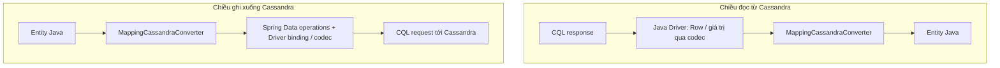

# Cơ chế ánh xạ của MappingCassandraConverter

Khi một repository của **Spring Data Cassandra** trả về `OrderRow`, Cassandra không gửi sẵn một đối tượng Java hoàn chỉnh. Database trả kết quả CQL gồm cột và giá trị; driver giải mã dữ liệu ở mức giao thức, sau đó lớp ánh xạ của Spring Data phải xác định **cột nào tương ứng với thuộc tính nào, kiểu Java nào cần tạo và cách dựng entity**. Thành phần trung tâm của bước này là **`MappingCassandraConverter`**.

Trong chương **Chuyển đổi kiểu**, chúng ta sẽ lần theo luồng đọc và ghi của `MappingCassandraConverter`, xem vai trò của metadata `@Table`, `@PrimaryKey`, `@Column`, cách ánh xạ kiểu dữ liệu thông thường, cách đăng ký **custom conversions**, và cách chẩn đoán lỗi khi entity không khớp schema. Chủ đề liên quan trực tiếp tới repository, `CassandraTemplate` và truy vấn CQL, nhưng khác với những quyết định về partition key, consistency level, paging và hiệu năng của mô hình dữ liệu phân tán.

> **Mục tiêu:** Sau bài này, bạn có thể giải thích vì sao một hàng CQL trở thành một entity Java, vì sao một value object cần converter tùy chỉnh, và làm thế nào để kiểm chứng cả hai chiều chuyển đổi trên schema Cassandra thật.

## 1. MappingCassandraConverter giải quyết bài toán gì?

Giả sử ứng dụng đọc một hàng:

```text
tenant_id     : uuid       = 11111111-1111-1111-1111-111111111111
order_id      : uuid       = 22222222-2222-2222-2222-222222222222
state_code    : text       = "PAID"
total_amount  : decimal    = 125000.50
created_at    : timestamp  = 2026-11-25T03:00:00Z
tags          : set<text>  = {"mobile", "priority"}
```

Ứng dụng lại muốn nhận:

```java
OrderRow order = repository.findById(orderKey).orElseThrow();

OrderState state = order.getState();
BigDecimal amount = order.getTotalAmount();
Instant createdAt = order.getCreatedAt();
```

Có nhiều việc phải làm hơn thao tác đọc một chuỗi từ CQL:

1. Tìm định nghĩa entity `OrderRow` được Spring Data quản lý.
2. Ghép tên cột `state_code` với thuộc tính Java `state`, `total_amount` với `totalAmount`.
3. Tạo một đối tượng `OrderKey` từ hai cột khóa `tenant_id` và `order_id`.
4. Chuyển các giá trị cơ bản như `decimal` thành `BigDecimal` và `timestamp` thành kiểu thời gian Java phù hợp.
5. Chuyển mã `"PAID"` thành value object `OrderState` nếu ứng dụng đã khai báo custom converter.
6. Chọn constructor hoặc cơ chế property population để tạo entity.
7. Trả entity cho repository hoặc lớp service.

**`MappingCassandraConverter` là phần ánh xạ object–column ở cấp Spring Data**. Nó không quyết định Cassandra lưu partition trên node nào, không cấp thêm replica, không biến một truy vấn thiếu partition key thành truy vấn hiệu quả, cũng không làm mọi phép `ORDER BY` trở nên hợp lệ.

### So sánh ba tầng dễ bị nhầm

| Tầng | Xử lý chính | Ví dụ |
| --- | --- | --- |
| **Apache Cassandra / CQL schema** | Cột, kiểu dữ liệu CQL, primary key, partition/clustering, replication | `state_code text`, `total_amount decimal` |
| **DataStax/Apache Cassandra Java Driver** | Kết nối, prepared statements, request routing, codec CQL ↔ giá trị driver/Java | Giá trị cột `timestamp` được đọc qua API driver; `Row`, `UdtValue` |
| **Spring Data MappingCassandraConverter** | Mapping metadata, entity instantiation, thuộc tính và custom conversions | `state_code` → `OrderState`; `tenant_id` + `order_id` → `OrderKey` |

Trong tài liệu và mã nguồn, từ **converter** có thể dùng cho cả driver codec lẫn Spring Data converter. Chúng chạy ở **các tầng khác nhau**: thêm một `Converter` của Spring Data không đồng nghĩa cài một codec mới cho mọi câu lệnh `CqlSession.execute(...)`.

## 2. Kiến trúc luồng đọc và luồng ghi



Sơ đồ là mô hình khái niệm. Tên lớp trung gian và cách chuẩn bị statement có thể khác theo phương thức repository/template và phiên bản Spring Data Cassandra. Nhưng hai ranh giới cần nhớ là ổn định:

- **Đọc:** metadata + giá trị từ driver → entity.
- **Ghi:** entity + metadata → các giá trị/cột dùng để tạo/bind statement.

### Đọc một hàng thành entity

Ở mức khái niệm:

```text
CqlSession / ResultSet / Row
    -> xác định CassandraPersistentEntity và CassandraPersistentProperty
    -> tra tên cột qua @Table, @Column, @PrimaryKeyColumn, naming strategy
    -> lấy giá trị qua driver và chuyển sang kiểu đích
    -> áp dụng @ReadingConverter nếu phù hợp
    -> tạo entity qua persistence constructor
    -> điền những property còn lại theo metadata
    -> trả về object
```

Với entity bất biến, các thuộc tính `final` nên có mặt trong persistence constructor. Nếu constructor yêu cầu trường mà truy vấn không trả về hoặc metadata không tìm được tên tham số, quá trình materialization có thể thất bại.

### Ghi entity thành statement

Ở chiều ngược lại:

```text
Entity Java
    -> đọc metadata persistent properties và các giá trị object
    -> áp dụng @WritingConverter phù hợp
    -> xác định cột CQL và kiểu biểu diễn khi ghi
    -> Spring Data Cassandra tạo/điền statement cho thao tác insert/update
    -> Driver codec mã hóa tham số
    -> Cassandra xử lý câu lệnh CQL
```

Converter **không tự cấp consistency level** và không đảm bảo optimistic locking. Ghi vào Cassandra còn phụ thuộc primary key, request options, replica và cách ứng dụng xử lý đồng thời.

## 3. Những thành phần tham gia mapping

| Thành phần | Công việc | Điều cần kiểm tra khi lỗi |
| --- | --- | --- |
| `MappingCassandraConverter` | Triển khai chuyển đổi giữa đối tượng và dạng dữ liệu Cassandra mà Spring Data sử dụng | Có thực sự đi qua Spring Data converter không? |
| `CassandraMappingContext` | Giữ metadata của các kiểu persistent được quản lý | Entity có được scan/nhận diện không? |
| `CassandraPersistentEntity` | Mô tả entity, table, primary key và đặc tính mapping | `@Table`, constructor, ID |
| `CassandraPersistentProperty` | Mô tả property và cột tương ứng | `@Column`, `@PrimaryKeyColumn`, kiểu đích |
| `CassandraCustomConversions` | Chứa/đăng ký các converter tùy chỉnh bên cạnh cơ chế mặc định | Converter có đúng chiều, đúng source/target type? |
| `@ReadingConverter` | Đánh dấu chuyển đổi dùng khi đọc giá trị vào model | Có được chọn cho kiểu nguồn từ driver? |
| `@WritingConverter` | Đánh dấu chuyển đổi dùng khi ghi model ra kiểu lưu trữ | Target có phải loại CQL/driver hỗ trợ? |
| **Driver codec registry** | Giải mã/mã hóa giá trị CQL ở tầng driver | Driver có codec cho kiểu CQL và Java tương ứng? |

Trong Spring Data Cassandra, `CassandraMappingContext` và `MappingCassandraConverter` phối hợp để xử lý metadata. Chỉ khai báo một class Java cùng tên bảng không có nghĩa framework sẽ tự ánh xạ nếu entity nằm ngoài phạm vi scanning hoặc cấu hình mapping không nhất quán.

Các tên API được trình bày theo hệ Spring Data Cassandra hiện đại. Với phiên bản cũ, chữ ký constructor/configuration và khả năng mapping có thể khác; luôn đối chiếu tài liệu của phiên bản ứng dụng đang dùng.

## 4. Bảng CQL mẫu để theo dõi chuyển đổi

Ta dùng một read model đơn giản, tìm đơn hàng bằng tenant và order ID. Keyspace `orders_ks` được giả định đã tạo bằng migration trước đó:

```sql
CREATE TABLE IF NOT EXISTS orders_ks.orders_by_id (
    tenant_id uuid,
    order_id uuid,
    state_code text,
    total_amount decimal,
    created_at timestamp,
    tags set<text>,
    PRIMARY KEY ((tenant_id, order_id))
);
```

Lưu ý:

- `(tenant_id, order_id)` là **composite partition key**: mỗi cặp định danh tương ứng với một partition logic chứa một hàng ở bảng này.
- Không có clustering column; không phải mọi bảng đều cần clustering key.
- `state_code` lưu mã trạng thái nghiệp vụ dưới dạng CQL `text`.
- `total_amount` là `decimal`; `created_at` là `timestamp`; `tags` là `set<text>`.
- Cassandra schema quyết định cách lưu; Java mapping quyết định cách biểu diễn thành object.

Một truy vấn đại diện:

```sql
SELECT tenant_id, order_id, state_code, total_amount, created_at, tags
FROM orders_ks.orders_by_id
WHERE tenant_id = 11111111-1111-1111-1111-111111111111
  AND order_id = 22222222-2222-2222-2222-222222222222;
```

Truy vấn này có **đầy đủ partition key**. Nó phù hợp với yêu cầu tìm một đơn cụ thể và giúp phân biệt lỗi chuyển đổi kiểu với lỗi truy cập bảng. Đừng chẩn đoán converter bằng cách thay câu truy vấn thành quét toàn bảng hoặc thêm `ALLOW FILTERING`.

## 5. Ánh xạ metadata bằng @Table, @PrimaryKey và @Column

Ví dụ một khóa composite bất biến:

```java
import java.io.Serializable;
import java.util.Objects;
import java.util.UUID;

import org.springframework.data.annotation.PersistenceCreator;
import org.springframework.data.cassandra.core.cql.PrimaryKeyType;
import org.springframework.data.cassandra.core.mapping.PrimaryKeyClass;
import org.springframework.data.cassandra.core.mapping.PrimaryKeyColumn;

@PrimaryKeyClass
public final class OrderKey implements Serializable {

    @PrimaryKeyColumn(
        name = "tenant_id",
        ordinal = 0,
        type = PrimaryKeyType.PARTITIONED
    )
    private final UUID tenantId;

    @PrimaryKeyColumn(
        name = "order_id",
        ordinal = 1,
        type = PrimaryKeyType.PARTITIONED
    )
    private final UUID orderId;

    @PersistenceCreator
    public OrderKey(UUID tenantId, UUID orderId) {
        this.tenantId = Objects.requireNonNull(tenantId, "tenantId");
        this.orderId = Objects.requireNonNull(orderId, "orderId");
    }

    public UUID getTenantId() {
        return tenantId;
    }

    public UUID getOrderId() {
        return orderId;
    }

    @Override
    public boolean equals(Object value) {
        if (this == value) return true;
        if (!(value instanceof OrderKey other)) return false;
        return tenantId.equals(other.tenantId)
            && orderId.equals(other.orderId);
    }

    @Override
    public int hashCode() {
        return Objects.hash(tenantId, orderId);
    }
}
```

Hai trường `tenantId` và `orderId` đều được đánh dấu `PARTITIONED`. Khi entity được materialize, hai cột CQL của partition key được gom thành property khóa kiểu `OrderKey`.

Ví dụ entity:

```java
import java.math.BigDecimal;
import java.time.Instant;
import java.util.Objects;
import java.util.Set;

import org.springframework.data.annotation.PersistenceCreator;
import org.springframework.data.cassandra.core.mapping.Column;
import org.springframework.data.cassandra.core.mapping.PrimaryKey;
import org.springframework.data.cassandra.core.mapping.Table;

@Table("orders_by_id")
public final class OrderRow {

    @PrimaryKey
    private final OrderKey key;

    @Column("state_code")
    private final OrderState state;

    @Column("total_amount")
    private final BigDecimal totalAmount;

    @Column("created_at")
    private final Instant createdAt;

    @Column("tags")
    private final Set<String> tags;

    @PersistenceCreator
    public OrderRow(
        OrderKey key,
        OrderState state,
        BigDecimal totalAmount,
        Instant createdAt,
        Set<String> tags
    ) {
        this.key = Objects.requireNonNull(key, "key");
        this.state = Objects.requireNonNull(state, "state");
        this.totalAmount = totalAmount;
        this.createdAt = createdAt;
        this.tags = tags == null ? Set.of() : Set.copyOf(tags);
    }

    public OrderKey getKey() { return key; }
    public OrderState getState() { return state; }
    public BigDecimal getTotalAmount() { return totalAmount; }
    public Instant getCreatedAt() { return createdAt; }
    public Set<String> getTags() { return tags; }
}
```

Property `state` có kiểu nghiệp vụ `OrderState`, trong khi cột CQL `state_code` có kiểu `text`. Đây là chỗ cần **custom converter** ở phần tiếp theo.

Mẫu dùng `@PersistenceCreator` minh họa việc framework bind property vào constructor. **Tên tham số Java** như `totalAmount` phải khớp persistent property Java; `@Column("total_amount")` dùng để ghép property với **tên cột CQL**. Khi dùng Java compiler, hãy bảo đảm metadata tên tham số (chẳng hạn `-parameters`) có thể được Spring Data tìm thấy. Các trường `final` nên được khởi tạo trong constructor thay vì trông chờ gán về sau.

**Về dữ liệu null:** ví dụ chọn `state` và `key` là bắt buộc ở cấp Java, nhưng Cassandra không tự áp đặt quy tắc non-null tương đương trên mọi regular column. Nếu dữ liệu lịch sử thiếu `state_code`, constructor có thể từ chối materialization. Chính sách nullable cần dựa vào miền nghiệp vụ và cách migration dữ liệu.

## 6. Chuyển đổi kiểu cơ bản: những gì thường không cần custom converter

Các kiểu CQL thông dụng đã có cơ chế hỗ trợ qua driver và Spring Data:

| CQL | Kiểu Java thường gặp | Chú ý |
| --- | --- | --- |
| `uuid` | `UUID` | Phân biệt với các yêu cầu đặc biệt của `timeuuid` |
| `text` / `varchar` | `String` | Phải tự quy định mã trạng thái nếu muốn domain type |
| `int` | `Integer` / `int` | Dùng wrapper khi có thể thiếu/null |
| `bigint` | `Long` / `long` | Kiểm tra phạm vi số |
| `boolean` | `Boolean` / `boolean` | Wrapper phù hợp với trạng thái chưa có giá trị |
| `decimal` | `BigDecimal` | Hữu ích cho số thập phân cần độ chính xác |
| `double` | `Double` / `double` | Là floating point, không lý tưởng cho tiền |
| `timestamp` | `Instant` hoặc kiểu thời gian được converter hỗ trợ | Tránh nhầm với múi giờ hiển thị |
| `date` | `LocalDate` hoặc kiểu được phiên bản hỗ trợ | Chỉ chứa ngày, không phải thời điểm tuyệt đối |
| `blob` | `ByteBuffer` hoặc cách biểu diễn được codec hỗ trợ | Cẩn thận với vị trí/khả năng sửa `ByteBuffer` |
| `list<text>` | `List<String>` | Thứ tự list có nghĩa; xem semantics cập nhật collection |
| `set<text>` | `Set<String>` | Không dựa vào thứ tự lặp của `Set` |
| `map<text, int>` | `Map<String, Integer>` | Converter nested types cần xác minh theo phiên bản |

Đây là **bảng định hướng**, không phải khẳng định mọi cặp kiểu Java đều được hỗ trợ bởi mọi phiên bản driver. Một số kiểu như `timeuuid`, tuple, UDT, duration, vector hoặc custom scalar cần kiểm tra thêm codec và mapping của hệ phiên bản triển khai.

Ví dụ `decimal` → `BigDecimal` thường nên **giữ độ chính xác**. Không chuyển tiền tệ từ `BigDecimal` sang `double` chỉ vì code Java ngắn hơn. Với `timestamp`, dùng `Instant` thể hiện một thời điểm; nếu UI cần múi giờ Hà Nội/Hồ Chí Minh, thực hiện chuyển đổi hiển thị ở biên ứng dụng bằng `ZoneId` phù hợp.

### Chuyển kiểu không thay đổi mô hình truy vấn

Ví dụ một cột `total_amount decimal` đã ánh xạ được `BigDecimal` không có nghĩa bảng `orders_by_id` hỗ trợ:

```sql
-- Không phù hợp với thiết kế partition key ở ví dụ:
SELECT * FROM orders_ks.orders_by_id
WHERE total_amount > 100000;
```

Converter chỉ quyết định biểu diễn `decimal` thành `BigDecimal` sau khi hàng được lấy. Cassandra vẫn cần read model, index thích hợp hoặc công cụ truy vấn khác nếu nghiệp vụ thật sự cần lọc theo tổng tiền. Tương tự, converter không tự sắp xếp xuyên partition và không giải quyết paging.

## 7. Tạo một value object nghiệp vụ thay cho String

Giả sử `state_code` chỉ nhận các mã `"NEW"`, `"PAID"` và `"CANCELLED"`. Nếu Java dùng `String` ở mọi nơi, lập trình viên có thể vô tình tạo `"PADI"` mà compiler không cảnh báo. Ta định nghĩa kiểu riêng:

```java
import java.util.Set;

public record OrderState(String code) {

    private static final Set<String> ALLOWED =
        Set.of("NEW", "PAID", "CANCELLED");

    public OrderState {
        if (code == null || !ALLOWED.contains(code)) {
            throw new IllegalArgumentException(
                "Unknown order state: " + code
            );
        }
    }

    public static OrderState paid() {
        return new OrderState("PAID");
    }
}
```

Trong Java, đây là value object bất biến. Cassandra vẫn lưu `text`. Ta cần chỉ định:

- **Đọc:** một `String` lấy từ cột `state_code` trở thành `OrderState`.
- **Ghi:** `OrderState` trở thành `String` để bind vào cột `text`.

Điểm hay của cách này là tách **quy tắc nghiệp vụ** khỏi định dạng lưu trữ. Nếu domain muốn một kiểu có validation, service không buộc phải truyền các chuỗi thô quanh hệ thống.

Tuy nhiên, value object và hai converter không làm Cassandra tự có constraint danh sách giá trị. Những ứng dụng khác ghi trực tiếp CQL vẫn có thể đưa mã khác vào cùng cột; hãy có chính sách dữ liệu và tương thích mã trạng thái qua các phiên bản service.

## 8. @ReadingConverter: từ String thành OrderState

Tạo converter đọc:

```java
import org.springframework.core.convert.converter.Converter;
import org.springframework.data.convert.ReadingConverter;

@ReadingConverter
public final class StringToOrderState
        implements Converter<String, OrderState> {

    @Override
    public OrderState convert(String source) {
        return new OrderState(source);
    }
}
```

Converter này nhận **`String` đã được đọc từ dạng CQL text** và tạo `OrderState`. Nó không tự chạy trên mọi câu lệnh driver; nó tham gia khi Spring Data sử dụng hệ thống chuyển đổi đã đăng ký.

Nếu database có mã lạ như `"UNKNOWN"`, constructor của `OrderState` sẽ ném exception. Điều đó có thể hữu ích để phát hiện dữ liệu sai, nhưng với hệ thống có nhiều phiên bản ứng dụng, cần cân nhắc **forward compatibility**: phiên bản mới có thể ghi mã mà phiên bản cũ chưa biết.

Các chiến lược thường dùng:

1. Từ chối mã không hợp lệ khi luật nghiệp vụ bắt buộc.
2. Dùng trạng thái “unknown” có chủ đích và log/metric nếu màn hình cần chịu được mã mới.
3. Lập kế hoạch rollout schema/data contract sao cho consumer cũ không đọc giá trị mới ngoài khả năng.
4. Không tự chuyển mã lạ thành `"NEW"` nếu điều đó làm sai ý nghĩa trạng thái thật.

`@ReadingConverter` cần đúng source/target type. Nếu driver trả một kiểu nguồn khác `String` vì cột/codec cấu hình khác, converter có thể không được chọn.

## 9. @WritingConverter: từ OrderState thành String

Tạo converter ghi:

```java
import org.springframework.core.convert.converter.Converter;
import org.springframework.data.convert.WritingConverter;

@WritingConverter
public final class OrderStateToString
        implements Converter<OrderState, String> {

    @Override
    public String convert(OrderState source) {
        return source.code();
    }
}
```

Khi Spring Data chuẩn bị một thao tác lưu entity, nó có thể dùng converter này để đưa property `state` về giá trị `String` tương thích CQL `text`.

### Vì sao cần đánh dấu chiều converter?

Trong một số trường hợp, cả source lẫn target đều là kiểu Java mà framework chưa biết nên coi bên nào là **giá trị lưu trữ**. Đánh dấu `@ReadingConverter` và `@WritingConverter` giúp phân biệt mục đích. Điều này đặc biệt hữu ích khi source/target đều là các kiểu không rõ ràng với hệ thống default conversions.

Một cặp converter thông thường nên đáp ứng ý tưởng **round trip**:

\[
\operatorname{read}(\operatorname{write}(x)) = x
\]

Nếu `OrderState("PAID")` ghi thành `"PAID"`, đọc lại nên tạo một `OrderState` tương đương. Tính tương đương ở đây có thể là `equals` của value object, không bắt buộc cùng object reference.

Đừng viết converter đọc và ghi có logic không đối xứng trừ khi đó là quy tắc nghiệp vụ được ghi rõ và kiểm thử, vì có thể làm dữ liệu thay đổi ý nghĩa sau một vòng save/read.

## 10. Đăng ký CassandraCustomConversions

Chỉ tạo các lớp converter trong project chưa đủ để khẳng định chúng được sử dụng. Cần đăng ký vào hệ thống custom conversions của Spring Data Cassandra.

Ví dụ cấu hình Java minh họa theo API Spring Data Cassandra hiện đại:

```java
import java.util.List;

import org.springframework.context.annotation.Bean;
import org.springframework.context.annotation.Configuration;
import org.springframework.data.cassandra.core.convert.CassandraCustomConversions;

@Configuration
public class CassandraConversionConfig {

    @Bean
    CassandraCustomConversions cassandraCustomConversions() {
        return new CassandraCustomConversions(
            List.of(
                new StringToOrderState(),
                new OrderStateToString()
            )
        );
    }
}
```

Điều cần hiểu:

- `CassandraCustomConversions` tập hợp các chuyển đổi tùy chỉnh dành cho tầng mapping.
- Khi configuration được Spring sử dụng, Spring Data Cassandra cần nhận đúng instance custom conversions này khi tạo converter/mapping infrastructure.
- Một ứng dụng có thể tùy chỉnh hạ tầng Cassandra theo cách riêng; nếu tự xây bean `MappingCassandraConverter` hoặc `CassandraMappingContext`, cần bảo đảm wiring custom conversions đúng.
- Hình thức constructor/factory/adapter để cấu hình có thể khác giữa các **phiên bản Spring Data Cassandra**. Hãy kiểm tra chữ ký API, auto-configuration Spring Boot và tránh tạo nhiều bean custom conversions mâu thuẫn.
- Chỉ đăng ký các chuyển đổi thật sự cần. Một converter quá tổng quát, ví dụ `String` → kiểu khác được dùng ở nhiều property không mong muốn, có thể gây nhầm phạm vi ánh xạ.

**Điểm kiểm thử bắt buộc:** một bài test thực hiện `repository.save(...)` rồi `repository.findById(...)` với `OrderState`. Việc bean converter được tạo thành công chỉ là bước đầu; kết quả round trip mới xác nhận cả hai chiều đã được framework sử dụng đúng.

### Kiểm tra phạm vi áp dụng

Nếu `OrderState` xuất hiện ở nhiều entity, conversion có thể được tái sử dụng cho những property được Spring Data nhận diện cùng cặp kiểu. Điều này thường là mong muốn với value object thống nhất toàn hệ thống. Nếu chỉ một bảng dùng representation đặc biệt, phải cân nhắc phạm vi converter hoặc mô hình dữ liệu để tránh áp dụng logic không mong muốn.

Ví dụ: bảng A lưu `OrderState` dưới `text`, bảng B lại dùng `int` làm mã. Đăng ký một converter global `OrderState` → `String` không tự cung cấp quy tắc ghi `int` cho B. Cần thống nhất representation hoặc thiết kế chuyển đổi rõ ràng theo schema thật.

## 11. Dùng repository và CassandraTemplate với converter

Repository minh họa:

```java
import org.springframework.data.cassandra.repository.CassandraRepository;

public interface OrderRepository
        extends CassandraRepository<OrderRow, OrderKey> {
}
```

Đọc một hàng:

```java
OrderKey key = new OrderKey(tenantId, orderId);

OrderRow row = repository.findById(key)
    .orElseThrow(() -> new IllegalArgumentException("Not found"));

OrderState state = row.getState();
```

Khi repository thực hiện mapping entity, dữ liệu từ cột `state_code` có thể đi qua `StringToOrderState`. Khi lưu object chứa `OrderState`, hệ thống ghi có thể dùng `OrderStateToString` để bind giá trị `text`.

`CassandraTemplate` cũng là một API Spring Data Cassandra làm việc với entity và metadata mapping. Ví dụ đọc một entity bằng khóa:

```java
import org.springframework.data.cassandra.core.CassandraTemplate;

OrderRow row = cassandraTemplate.selectOneById(
    new OrderKey(tenantId, orderId),
    OrderRow.class
);
```

Với API phù hợp của phiên bản Spring Data Cassandra, template và repository thường sử dụng cùng hạ tầng converter đã cấu hình. **Việc chuyển từ repository sang `CassandraTemplate` không tự sửa lỗi thiếu bảng, sai kiểu CQL hoặc query thiếu partition key.**

### Truy vấn CQL trực tiếp qua CqlSession có khác không?

Có. Nếu dùng Java Driver trực tiếp:

```java
import com.datastax.oss.driver.api.core.cql.Row;

Row raw = session.execute(
    "SELECT state_code FROM orders_ks.orders_by_id " +
    "WHERE tenant_id = 11111111-1111-1111-1111-111111111111 " +
    "AND order_id = 22222222-2222-2222-2222-222222222222"
).one();

String stateCode = raw == null
    ? null
    : raw.getString("state_code");
```

Đây là **driver Row**, không phải `OrderRow` qua Spring Data. Các `Converter` đã đăng ký với `CassandraCustomConversions` không nhất thiết được gọi trong lệnh `Row.getString(...)` này. Nếu cần `OrderState`, service phải tự chuyển hoặc đưa kết quả qua cơ chế mapping của Spring Data phù hợp.

Do đó, trước khi nói “converter không chạy”, hãy xem đường thực thi: repository, template entity mapping, query projection hay raw driver API.

## 12. @CassandraType và những trường hợp kiểu Java chưa đủ rõ

Nhiều kiểu Java có thể tương ứng với hơn một cách biểu diễn trong CQL. Ví dụ `UUID` có thể được dùng với cột `uuid`; một số trường hợp dùng `timeuuid` có yêu cầu riêng. Với collection, cần biết kiểu phần tử/khóa/giá trị. Spring Data Cassandra cung cấp annotation như **`@CassandraType`** để khai báo thông tin kiểu Cassandra khi cần.

Ví dụ ý tưởng:

```java
import java.util.UUID;

import org.springframework.data.cassandra.core.mapping.CassandraType;
import org.springframework.data.cassandra.core.mapping.Column;

// Trong một entity đã khai báo @Table:
@CassandraType(type = CassandraType.Name.TIMEUUID)
@Column("event_id")
private UUID eventId;
```

Annotation này diễn đạt kiểu Cassandra kỳ vọng cho property. Nó **không** đổi một cột `uuid` đã có thành `timeuuid` hoặc tự biến `UUID` bất kỳ thành UUID version 1 hợp lệ. Phải thống nhất schema và giá trị được tạo ở ứng dụng.

Với custom converter như `OrderState` → `String`, cột `state_code text` đã có kiểu lưu trữ rõ ràng. Một số phiên bản/cấu hình có thể cần thông tin kiểu cụ thể khi sinh DDL hoặc bind value; hãy xác minh trên schema và driver thực tế thay vì mặc định annotation luôn được suy ra đúng.

### Giá trị cụ thể từ Cassandra vẫn quan trọng

Hãy phân biệt:

- **Kiểu Java**: `UUID`, `String`, `BigDecimal`, `Instant`, `OrderState`.
- **Kiểu CQL**: `uuid`, `text`, `decimal`, `timestamp`, `timeuuid`.
- **Kiểu trung gian driver**: giá trị Java mà driver codec đang expose cho một cột cụ thể.
- **Kiểu đích khi mapping entity**: persistent property sau khi Spring Data conversions đã chạy.

Nếu lỗi cho biết “không có codec” hoặc “invalid type”, nguồn lỗi có thể nằm ở tầng driver binding. Nếu lỗi cho biết không thể convert property sang `OrderState`, hãy kiểm tra `CassandraCustomConversions` và mapping metadata. Hai trường hợp có thể cùng xuất hiện nhưng cần cách sửa khác nhau.

## 13. UDT, tuple và collection đi qua converter ra sao?

Dữ liệu Cassandra không chỉ có scalar. Nó có collection, user-defined type (UDT), tuple và các kiểu phức hợp khác. Những đối tượng này cần metadata chính xác và khả năng hỗ trợ của phiên bản driver/Spring Data Cassandra.

### Ví dụ user-defined type

CQL:

```sql
CREATE TYPE IF NOT EXISTS orders_ks.shipping_address (
    city text,
    postal_code text
);

CREATE TABLE IF NOT EXISTS orders_ks.orders_shipping_by_id (
    tenant_id uuid,
    order_id uuid,
    destination frozen<shipping_address>,
    PRIMARY KEY ((tenant_id, order_id))
);
```

Java mapping minh họa:

```java
import org.springframework.data.cassandra.core.mapping.Column;
import org.springframework.data.cassandra.core.mapping.UserDefinedType;

@UserDefinedType("shipping_address")
public class ShippingAddress {

    @Column("city")
    private String city;

    @Column("postal_code")
    private String postalCode;

    // Constructor, getter/setter theo thiết kế entity.
}
```

Ứng dụng có thể dùng kiểu `ShippingAddress` làm một property của entity tương ứng, với metadata UDT phù hợp. Ở mức driver, một UDT được biểu diễn bằng cơ chế giá trị/codec như `UdtValue`; Spring Data có thể materialize kiểu Java được mapping.

**Chú ý:** ví dụ chưa trình bày toàn bộ annotation và schema entity chứa `destination`. Tùy phiên bản, thông tin type, frozen UDT, nested UDT và collection-of-UDT có yêu cầu mapping khác nhau. Cần integration test CQL ↔ Java trước khi đưa vào hệ thống thực.

### Collection

Với `tags set<text>`, một property `Set<String>` là lựa chọn tự nhiên. Nhưng:

- `Set` không hứa hẹn thứ tự hiển thị; nếu UI cần thứ tự, phải xác định quy tắc riêng.
- `Map<K,V>` yêu cầu cả key và value có kiểu tương thích.
- Collection có thể lớn, tạo chi phí đọc/ghi và tombstones nếu cập nhật liên tục.
- Custom conversion của các **phần tử bên trong collection** không nên được suy đoán là luôn chạy giống scalar property; kiểm tra API và test trên kiểu collection/UDT cụ thể.
- Với immutable entity, `Set.copyOf(...)` hoặc các defensive copy có thể giúp bảo vệ state Java, nhưng không thay đổi semantics collection trong Cassandra.

### Tuple

Tuple CQL là dạng có vị trí phần tử. Driver có cơ chế `TupleValue` và codec tương ứng. Nếu dùng tuple trong entity, cần metadata và conversion hỗ trợ cho kiểu tuple thực tế. Không tự coi nó là một Java record mà Spring Data sẽ tự suy ra trong mọi phiên bản.

## 14. Chọn constructor và ảnh hưởng của null khi đọc

`MappingCassandraConverter` cần dựng entity. Với lớp có một persistence constructor được đánh dấu `@PersistenceCreator`, framework dùng thông tin property để cung cấp đối số. Nếu tham số `createdAt` không có dữ liệu hoặc tên không khớp, object có thể không tạo được.

Ví dụ truy vấn thiếu cột:

```sql
SELECT tenant_id, order_id, state_code
FROM orders_ks.orders_by_id
WHERE tenant_id = 11111111-1111-1111-1111-111111111111
  AND order_id = 22222222-2222-2222-2222-222222222222;
```

Nếu dùng truy vấn này để materialize toàn bộ `OrderRow`:

- `total_amount`, `created_at` và `tags` không được trả về.
- Một số property có thể nhận null/default theo mapping; điều này không tự có nghĩa entity đã hợp lệ.
- Nếu persistence constructor yêu cầu non-null, materialization có thể báo lỗi.
- Nếu entity dùng wrapper/default khiến nó vẫn tạo được, ứng dụng có thể nhầm **cột chưa được truy vấn** với **cột thật sự thiếu dữ liệu**.

Giải pháp là chọn đủ cột cho entity đầy đủ hoặc dùng **projection/DTO phù hợp với tập cột được chọn**. Cách Spring Data Cassandra hỗ trợ projections cần kiểm tra theo phiên bản, và DTO mapping cũng có quy tắc constructor riêng.

### Null, unset và tombstone không giống nhau

Cần tách ba khái niệm:

| Khái niệm | Ý nghĩa thực tế |
| --- | --- |
| **Null trong Java** | Property không có giá trị trong object |
| **Null trong CQL write** | Tùy statement/driver, ghi null có thể mang ý nghĩa xóa giá trị cột và tạo tombstone |
| **UNSET khi bind prepared statement** | Tín hiệu không cung cấp giá trị cho tham số/không cập nhật cột tương ứng theo semantics của Cassandra |

Không nên mặc định `repository.save(entity)` với `null` luôn là “giữ nguyên cột cũ”, cũng không nên mặc định mọi biến `null` đều tạo tombstone trong tất cả cách xây statement. **Hành vi phụ thuộc thao tác, phiên bản framework, cách bind và cấu hình null-handling**; cần integration test kiểm chứng cho đường ghi của dự án.

Một converter thường không được gọi khi giá trị nguồn là null theo quy ước của hệ thống chuyển đổi; đừng dựa vào converter để biến mọi null thành một giá trị business mặc định nếu chưa kiểm tra cơ chế null handling. Những thay đổi mặc định có thể che lỗi dữ liệu lịch sử.

## 15. Ghi cập nhật: chuyển đổi kiểu khác với kiểm soát đồng thời

Một entity có thể bất biến và custom converter chạy hoàn hảo, nhưng vẫn mất cập nhật nếu hai request ghi cùng primary key.

Ví dụ:

```text
Request A đọc: state = NEW
Request B đọc: state = NEW
A tạo OrderState(PAID) rồi ghi
B tạo OrderState(CANCELLED) rồi ghi
```

`OrderStateToString` chỉ quyết định cách biến `OrderState` thành chuỗi mã lưu trữ. Nó không kiểm tra “trạng thái cũ có còn NEW không?” và không khóa hàng.

Cassandra xử lý các bản ghi theo timestamp và quy tắc giải quyết xung đột của nó. Nếu cần thay đổi trạng thái có điều kiện, ứng dụng có thể phải dùng **lightweight transaction (LWT)/CAS**, thiết kế idempotency hoặc một workflow xử lý tranh chấp được kiểm soát. Việc dùng repository, `CassandraTemplate` hay custom conversions không thay đổi nhu cầu này.

Tương tự, **đổi partition key** của entity là đổi danh tính/vị trí lưu trữ của hàng, không phải một phép cập nhật cột thông thường. Converter có thể chuyển đúng kiểu `UUID` nhưng không tự di chuyển và xóa bản ghi cũ.

## 16. Conversion, SchemaAction và migration là ba chuyện khác nhau

| Câu hỏi | Thành phần liên quan |
| --- | --- |
| Object Java được chuyển sang/đọc từ cột thế nào? | `MappingCassandraConverter` và custom conversions |
| Framework có thử tạo bảng từ entity lúc startup không? | `SchemaAction` và cấu hình schema |
| Bảng production được thêm cột/đổi schema ra sao? | Migration CQL có kiểm soát |
| Dữ liệu lịch sử được chuyển sang read model mới thế nào? | Backfill, đối soát, dual-write nếu cần |
| Partition nào được truy vấn? | CQL + partition key |
| Bao nhiêu replica cần trả lời? | Replication factor và consistency level |

Ví dụ đổi cách lưu trạng thái từ `text` sang một cấu trúc khác:

- Thay Java converter **không** tự đổi kiểu CQL của cột đã tồn tại.
- Thay `SchemaAction.CREATE_IF_NOT_EXISTS` **không** tự chạy `ALTER TABLE` cho bảng cũ.
- Nếu thay dữ liệu/schema, cần migration, kế hoạch tương thích ứng dụng cũ, backfill và kiểm tra query.
- Nếu muốn lưu cùng domain object vào bảng khác có kiểu cột khác, cần thiết kế representation phù hợp từng đường đọc.

Một bài toán mapping được giải quyết tốt phải thống nhất cả **giá trị trong Cassandra**, **entity được Spring Data materialize** và **hợp đồng của các endpoint nghiệp vụ**.

## 17. Quy trình chẩn đoán lỗi conversion

Khi gặp exception lúc đọc hoặc ghi, đừng thay đổi đồng thời schema, converter và consistency level. Hãy đi từng lớp:

1. **Kiểm tra câu CQL và schema thật.** `DESCRIBE TABLE` hoặc `system_schema.columns` cho biết tên cột, kind và type.
2. **Kiểm tra query có trả đúng cột không.** Một projection thiếu cột cần cho constructor có thể làm entity lỗi.
3. **Xác định đường truy cập.** Repository/template entity mapping hay raw `CqlSession`?
4. **Xem kiểu nguồn từ driver.** `text` thường trả `String`; `decimal` thường trả `BigDecimal`. Nếu codec không tồn tại, kiểm tra driver/type/binding.
5. **Kiểm tra persistent property.** Tên Java, `@Column`, khóa composite, constructor parameter và metadata `-parameters`.
6. **Kiểm tra converter.** Đúng `@ReadingConverter`/`@WritingConverter`, generic types và đăng ký `CassandraCustomConversions` chưa?
7. **Thử một round trip nhỏ.** Ghi một hàng test với giá trị rõ ràng rồi đọc lại bằng cùng repository.
8. **Bổ sung test cho null và phiên bản cũ.** Giá trị code lạ, cột mới, collection rỗng và dữ liệu lịch sử là nguồn lỗi phổ biến.

### Bảng triệu chứng và khả năng nguyên nhân

| Biểu hiện | Nguyên nhân cần kiểm tra | Hướng sửa |
| --- | --- | --- |
| `CodecNotFound` hoặc lỗi codec | Driver không có codec phù hợp giữa kiểu CQL và Java bind | Kiểm tra kiểu cột, Java type, codec và statement |
| Lỗi không convert từ `String` sang `OrderState` | Converter đọc chưa đăng ký hoặc sai cặp kiểu | Kiểm tra `@ReadingConverter` và `CassandraCustomConversions` |
| Lưu entity lỗi kiểu `OrderState` | Converter ghi chưa chạy, target không tương thích CQL | Thêm/đăng ký `@WritingConverter` phù hợp |
| `state` null sau khi đọc | Cột null/thiếu, query không select cột, tên mapping sai | Kiểm tra row, `@Column("state_code")` và constructor |
| Mã trạng thái mới làm app cũ lỗi | Validation converter không biết mã mới | Kế hoạch version compatibility hoặc unknown handling |
| Đọc đúng cột nhưng constructor không chạy | Metadata tham số, nhiều constructor hoặc creator mơ hồ | `@PersistenceCreator` và `-parameters` |
| Kiểu `decimal` bị mất độ chính xác | Chuyển qua `double` hoặc format không phù hợp | Giữ `BigDecimal`, kiểm tra conversion |
| `set<text>` đọc được nhưng hiển thị thứ tự thay đổi | `Set` không bảo đảm thứ tự trong UI | Sắp ở tầng hiển thị hoặc chọn mô hình phù hợp |
| Converter chạy trong repository nhưng không chạy trong driver trực tiếp | Raw driver không dùng Spring Data mapping layer | Tự chuyển hoặc đi qua API mapping của Spring Data |
| Thêm converter mà bảng vẫn sai kiểu | Converter không phải migration | Chạy DDL/migration phù hợp và kiểm tra dữ liệu |

Có thể bật logging ở phạm vi phù hợp để xem CQL và lỗi converter; tránh log bí mật, dữ liệu cá nhân, giá trị nhạy cảm hoặc toàn bộ bản ghi production. Nếu cần log parameter, dùng dữ liệu test/sanitized và giới hạn tần suất.

## 18. Kiểm thử MappingCassandraConverter đúng cách

Một unit test của `StringToOrderState` là hữu ích nhưng chưa đủ. Nó không chứng minh entity scan, constructor binding, schema CQL và driver codec hoạt động cùng nhau.

### Lớp 1 — unit test hai chiều chuyển đổi

```java
import static org.junit.jupiter.api.Assertions.assertEquals;

import org.junit.jupiter.api.Test;

class OrderStateConverterTest {

    private final StringToOrderState reader =
        new StringToOrderState();
    private final OrderStateToString writer =
        new OrderStateToString();

    @Test
    void shouldRoundTripState() {
        OrderState initial = new OrderState("PAID");

        String stored = writer.convert(initial);
        OrderState reloaded = reader.convert(stored);

        assertEquals("PAID", stored);
        assertEquals(initial, reloaded);
    }
}
```

Test này kiểm tra logic thuần Java, không cần Cassandra.

### Lớp 2 — integration test lưu và đọc entity

Trên Cassandra test đã chuẩn bị schema `orders_by_id`, sử dụng repository thực và configuration custom conversions.

Ví dụ phần thân test minh họa:

```java
OrderKey key = new OrderKey(
    UUID.randomUUID(),
    UUID.randomUUID()
);

OrderRow expected = new OrderRow(
    key,
    new OrderState("PAID"),
    new BigDecimal("125000.50"),
    Instant.parse("2026-11-25T03:00:00Z"),
    Set.of("mobile", "priority")
);

repository.save(expected);

OrderRow actual = repository.findById(key).orElseThrow();

assertEquals(expected.getState(), actual.getState());
assertEquals(expected.getTotalAmount(), actual.getTotalAmount());
assertEquals(expected.getCreatedAt(), actual.getCreatedAt());
assertEquals(expected.getTags(), actual.getTags());
```

Đoạn code giả định có repository, imports, test context và schema test phù hợp; cần bổ sung setup/cleanup và cấu hình CL theo môi trường. Nếu giá trị timestamp bị làm tròn theo độ chính xác của CQL/driver, so sánh theo độ chính xác hỗ trợ của kiểu lưu trữ thay vì yêu cầu nanosecond không thể lưu.

### Lớp 3 — xác minh dữ liệu thực tế ở CQL

Sau khi lưu, dùng `cqlsh` hoặc driver kiểm tra:

```sql
SELECT state_code, total_amount, created_at, tags
FROM orders_ks.orders_by_id
WHERE tenant_id = 11111111-1111-1111-1111-111111111111
  AND order_id = 22222222-2222-2222-2222-222222222222;
```

Cặp UUID này chỉ minh họa; trong test hãy sử dụng key vừa tạo. Mục tiêu là xác minh **Cassandra thật sự lưu `"PAID"` dưới dạng `text`**, không phải một object `OrderState` hoặc một biểu diễn ngầm khác.

### Những edge case nên có

- `state_code` có một mã hợp lệ khác, ví dụ `NEW`.
- `state_code` null hoặc thiếu nếu schema/data migration có thể tạo ra trường hợp này.
- `state_code` chứa mã mới mà phiên bản cũ chưa biết.
- `tags` rỗng, null và có nhiều phần tử.
- `total_amount` mang phần thập phân, giá trị lớn hoặc scale khác nhau.
- `created_at` có độ chính xác dưới mili giây nếu ứng dụng tạo `Instant` như vậy.
- Một hàng được đọc bằng **raw driver** để xác minh ranh giới converter.
- Bảng và entity không khớp tên cột để bảo đảm test phát hiện lỗi mapping.
- Ghi/đọc theo consistency level tương thích với RF của môi trường kiểm thử.

## 19. Đánh giá hiệu năng khi mapping nhiều hàng

Mỗi hàng đọc từ Cassandra phải được giải mã và có thể được materialize thành entity. Việc tạo object, chuyển kiểu, defensive copy và converter phức tạp đều tiêu tốn CPU/bộ nhớ.

Nhưng trước khi tối ưu converter, hãy kiểm tra **mô hình truy vấn**:

| Triệu chứng | Điều nên đo trước |
| --- | --- |
| Truy vấn list trả hàng trăm nghìn hàng | Page size, LIMIT, số partition và dữ liệu trả về |
| Độ trễ cao dù convert đơn giản | Network, replica, CL, hot partition, query pattern |
| CPU JVM cao khi materialize | Profile converter, tạo object, parse string, collection copy |
| GC tăng khi đọc collection lớn | Cỡ collection, projection, số entity mỗi page |
| Thời gian tăng khi ghi cùng dữ liệu nhiều lần | Cập nhật collection/UDT, write amplification, tombstone |
| Mapping phản hồi chậm khi dữ liệu thay đổi | Schema drift, converter validation/exception và retry không phù hợp |

Những gợi ý:

- Không đặt lời gọi network, truy vấn DB thứ hai hoặc xử lý tốn kém vào `Converter.convert(...)`; converter nên là hàm ngắn gọn và xác định.
- Tránh parse JSON lớn từ một cột `text` cho mỗi row nếu mô hình bảng có thể biểu diễn dữ liệu bằng kiểu CQL phù hợp.
- Dùng projection khi API chỉ cần một phần dữ liệu, nhưng phải bảo đảm DTO/constructor mapping đúng.
- Chọn page size và giới hạn truy vấn phù hợp; Spring Data hỗ trợ paging thông qua cơ chế driver và API tương ứng, không có nghĩa có `OFFSET` rẻ cho dữ liệu phân tán.
- Không dùng custom converter để thay thế việc thiết kế partition key hoặc index.

**Độ đúng của dữ liệu quan trọng hơn một tối ưu vi mô.** Converter tự ý bỏ phần thập phân, đổi timezone hay mặc định trạng thái không hợp lệ có thể tạo lỗi nghiệp vụ khó phát hiện hơn vài mili giây xử lý.

## 20. Bài tập áp dụng

### Bài 1 — tìm đúng tầng xử lý

Một ứng dụng dùng `CqlSession.execute(...)` để đọc `Row` rồi gọi `row.getString("state_code")`. Nó đã khai báo `StringToOrderState` trong `CassandraCustomConversions`, nhưng API vẫn nhận `String`.

**Câu hỏi:** Có phải converter bị lỗi không?

<details>
<summary>Đáp án gợi ý</summary>

Chưa đủ cơ sở kết luận lỗi converter. Đường raw driver `Row.getString(...)` không tự chạy toàn bộ Spring Data entity mapping. Muốn nhận `OrderState`, gọi converter theo cách có kiểm soát hoặc sử dụng repository/`CassandraTemplate` với mapping đã cấu hình.

</details>

### Bài 2 — phân biệt tên CQL và property

Cột CQL là `total_amount decimal`. Java entity có:

```java
@Column("total_amount")
private final BigDecimal totalAmount;
```

Constructor nhận tham số tên `total_amount`.

**Câu hỏi:** Rủi ro nào xuất hiện?

<details>
<summary>Đáp án gợi ý</summary>

Persistence constructor binding thường ghép theo tên **persistent property Java**, tức `totalAmount`, chứ không phải tên cột `total_amount`. Hãy đổi tên tham số thành `totalAmount`, giữ `@Column` để ánh xạ cột, và bảo đảm metadata tham số có thể được framework phát hiện.

</details>

### Bài 3 — chọn đúng hai chiều chuyển đổi

Ứng dụng lưu `Temperature` dưới cột `temperature_celsius double` và muốn Java không sử dụng số `double` trực tiếp ở service.

**Yêu cầu:** Nêu cặp converter cần có.

<details>
<summary>Đáp án gợi ý</summary>

Một converter đọc nhận kiểu số do driver/Spring Data hỗ trợ (chẳng hạn `Double`) và trả `Temperature`; một converter ghi nhận `Temperature` và trả `Double`. Đánh dấu chiều bằng `@ReadingConverter` và `@WritingConverter`, đăng ký vào `CassandraCustomConversions`, kiểm thử cả hai chiều. Cần xác nhận đơn vị đo và không làm tròn ngoài ý muốn.

</details>

### Bài 4 — schema thay đổi, converter vẫn cũ

Bảng `orders_by_id` đổi cột `state_code` từ `text` sang representation khác thông qua migration. Ứng dụng vẫn dùng `Converter<OrderState, String>`.

**Câu hỏi:** Chỉ nâng version Spring Data Cassandra có sửa được không?

<details>
<summary>Đáp án gợi ý</summary>

Không. Kiểu CQL thực tế, driver codec và converter ghi phải thống nhất. Cần thiết kế migration dữ liệu/schema và cập nhật cặp converter phù hợp, sau đó chạy integration test. Nâng version framework không tự suy diễn conversion nghiệp vụ giữa các representation.

</details>

### Bài 5 — giá trị null khi cập nhật

Service load một entity, thay một property thành `null` và gọi `save`. Developer cho rằng mọi field null nghĩa là “không thay đổi gì” trong Cassandra.

**Câu hỏi:** Nhận định đó có chắc chắn đúng?

<details>
<summary>Đáp án gợi ý</summary>

Không. Semantics của null trong CQL write khác với UNSET; ghi null có thể thể hiện xóa cột và tạo tombstone tùy statement/driver/framework. Cần xác nhận cách repository/template bind null của phiên bản đang dùng và test dữ liệu trước/sau update. Không suy từ việc Java property nullable.

</details>

## 21. Checklist khi dùng MappingCassandraConverter

- [ ] Đã biết cột và kiểu CQL thực tế của bảng, không chỉ tên property Java.
- [ ] Entity được scan và ánh xạ đúng `@Table`, `@PrimaryKey`, `@PrimaryKeyColumn` và `@Column`.
- [ ] Đã phân biệt tầng driver codec với tầng Spring Data custom conversions.
- [ ] Những kiểu CQL thường dùng được biểu diễn bằng kiểu Java phù hợp, nhất là `BigDecimal` và `Instant`.
- [ ] Kiểu domain tùy chỉnh có converter đọc/ghi đúng source và target types.
- [ ] Converter được đăng ký đúng trong `CassandraCustomConversions` và wiring của ứng dụng.
- [ ] Constructor/`@PersistenceCreator` nhận đủ property cần thiết; tên tham số có metadata đúng.
- [ ] Quy tắc non-null, dữ liệu cũ và forward compatibility của giá trị nghiệp vụ đã được xác định.
- [ ] Collection, UDT và tuple được test theo schema/driver/framework thực tế nếu sử dụng.
- [ ] Đã kiểm tra tính đối xứng của chuyển đổi đọc/ghi và dữ liệu thực trong Cassandra.
- [ ] Không giả định raw `CqlSession` tự dùng Spring Data converter.
- [ ] Không dùng converter để giải quyết filter, sort, partition key hoặc consistency level.
- [ ] Đã hiểu khác biệt giữa null, UNSET và hành vi tombstone khi ghi.
- [ ] Có integration test repository/`CassandraTemplate`, kể cả null, sai mapping và kiểu dữ liệu biên.
- [ ] Khi thay kiểu CQL hoặc read model, có migration và backfill phù hợp.
- [ ] Đã đo page size, số hàng, độ trễ và CPU trước khi tối ưu converter.

**Ghi nhớ:** `MappingCassandraConverter` nối **metadata entity của Spring Data** với **giá trị CQL do driver cung cấp**. Nó đảm nhiệm ánh xạ cột ↔ property và phối hợp những converter được cấu hình, còn driver codec xử lý biểu diễn dữ liệu ở tầng CQL. Dùng đúng hai tầng này giúp repository và `CassandraTemplate` trả về domain object có ý nghĩa; dùng đúng schema, partition key, paging và consistency level mới giúp ứng dụng truy cập Apache Cassandra hiệu quả và chính xác trong môi trường phân tán.
