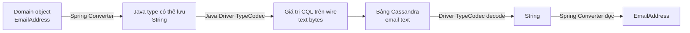

# Phân biệt Spring Converter với TypeCodec của Java Driver

## 1. Bài toán chuyển đổi kiểu trong Spring Data Cassandra

Ứng dụng **Spring Data Cassandra** lưu dữ liệu vào Apache Cassandra thông qua entity mapping, repository, `CassandraTemplate` hoặc câu lệnh CQL. Ở phía Java, một thuộc tính có thể là kiểu nghiệp vụ như `EmailAddress`, `Money`, `OrderStatus` hoặc một value object do dự án định nghĩa. Trong bảng Cassandra, giá trị tương ứng thường là một kiểu CQL như `text`, `decimal`, `uuid` hoặc UDT.

Giữa **đối tượng nghiệp vụ Java** và **các byte truyền qua native protocol** tồn tại hai tầng chuyển đổi có trách nhiệm khác nhau:



Khi cần **biến một value object thành kiểu Java mà Spring Data Cassandra đã hiểu để ánh xạ entity**, thường dùng `org.springframework.core.convert.converter.Converter` và đăng ký với **Spring Data Cassandra custom conversions**. Khi cần **quy định Java Driver mã hóa/giải mã một kiểu Java ứng với một kiểu CQL ở cấp giao thức**, dùng `com.datastax.oss.driver.api.core.type.codec.TypeCodec`.

Hai cơ chế không thay thế nhau trong mọi tình huống. Chúng giải quyết hai ranh giới khác nhau trong chuỗi đọc/ghi; lựa chọn sai tầng có thể khiến repository không nhận kiểu, `CqlSession` không tìm được codec, hoặc giá trị được chuyển đổi hai lần.

## 2. Bảng so sánh nhanh

| Tiêu chí | Spring `Converter<S, T>` | Java Driver `TypeCodec<T>` |
| --- | --- | --- |
| Thuộc thư viện | Spring Core / Spring Data Cassandra | Apache Cassandra Java Driver 4.x |
| Nơi sử dụng chính | Mapping entity ↔ kiểu Java được Cassandra hỗ trợ | Java value ↔ binary representation của **CQL type** |
| Ngữ cảnh | `MappingCassandraConverter`, repository, `CassandraTemplate` | `CqlSession`, bound statement, `Row`, driver |
| Hợp đồng chính | `T convert(S source)` | `getCqlType`, `getJavaType`, `encode`, `decode`, `format`, `parse` |
| Có cần tự xử lý `ByteBuffer`? | Không | Có thể cần; thường nên ủy quyền cho codec có sẵn |
| Hiểu annotation entity? | Có thể tham gia quá trình mapping theo metadata của Spring Data | Không biết `@Table`, `@Column`, `@PrimaryKey` |
| Đăng ký | `CassandraCustomConversions` / cấu hình Spring Data | `CqlSessionBuilder.addTypeCodecs(...)` hoặc cấu hình codec registry phù hợp |
| Phạm vi ảnh hưởng | Những đường ghi/đọc đi qua mapping của Spring Data | Những đường tương tác driver mà registry chọn codec |
| Trường hợp điển hình | `EmailAddress ↔ String`, `Money ↔ BigDecimal` | Tùy biến ánh xạ CQL `text` ↔ `EmailAddress` khi dùng driver trực tiếp |

**Không nên đánh đồng** `CassandraCustomConversions` với `CodecRegistry` của driver. Đăng ký Spring `Converter` không tự làm cho `row.get("email", EmailAddress.class)` ở driver hiểu `EmailAddress`. Ngược lại, chỉ đăng ký driver `TypeCodec<EmailAddress>` cũng **không bảo đảm** Spring Data nhận `EmailAddress` là một simple property và tự ánh xạ entity đúng; còn phụ thuộc vào metadata mapping và cấu hình chuyển đổi của Spring Data đang dùng.

## 3. Mô hình ví dụ: value object `EmailAddress`

Giả sử ứng dụng quản lý liên hệ. Email là kiểu dữ liệu nghiệp vụ: không muốn mọi service dùng chuỗi tự do, nên định nghĩa một value object.

```java
public record EmailAddress(String value) {

    public EmailAddress {
        if (value == null || value.isBlank()) {
            throw new IllegalArgumentException("Email không được rỗng");
        }
    }
}
```

`record` ở đây minh họa **Java 17+**. Quy tắc kiểm tra email đầy đủ trong hệ thống thật có thể chặt chẽ hơn. Mục tiêu của bài là chuyển đổi kiểu, không phải xây bộ xác thực địa chỉ email hoàn chỉnh.

Lược đồ CQL:

```sql
CREATE KEYSPACE IF NOT EXISTS demo_conversion
WITH replication = {
    'class': 'SimpleStrategy',
    'replication_factor': 1
};

CREATE TABLE IF NOT EXISTS demo_conversion.contacts_by_id (
    contact_id uuid PRIMARY KEY,
    email text,
    display_name text
);
```

`SimpleStrategy` và replication factor 1 **chỉ để thực hành trên Cassandra local một node**. Trong cluster triển khai thực tế, chọn `NetworkTopologyStrategy` và replication phù hợp topology.

Mục tiêu lưu một `EmailAddress("user@example.com")` vào cột CQL `email text`, rồi đọc lại thành `EmailAddress` mà không buộc phần nghiệp vụ phải thao tác với `String` ở mọi nơi.

Hai cách dưới đây là **hai phương án minh họa riêng**. Không cần áp dụng đồng thời cho cùng một thuộc tính.

## 4. Phương án A: Spring Converter cho entity mapping

### 4.1. Tạo converter ghi `EmailAddress → String`

```java
import org.springframework.core.convert.converter.Converter;
import org.springframework.data.convert.WritingConverter;

@WritingConverter
public final class EmailAddressWriteConverter
        implements Converter<EmailAddress, String> {

    @Override
    public String convert(EmailAddress source) {
        return source.value();
    }
}
```

Đầu vào là **kiểu domain**, đầu ra là `String` Java. Driver đã có codec cho `String ↔ text`, vì vậy Spring Converter **không cần biết** byte encoding hay native protocol.

### 4.2. Tạo converter đọc `String → EmailAddress`

```java
import org.springframework.core.convert.converter.Converter;
import org.springframework.data.convert.ReadingConverter;

@ReadingConverter
public final class EmailAddressReadConverter
        implements Converter<String, EmailAddress> {

    @Override
    public EmailAddress convert(String source) {
        return new EmailAddress(source);
    }
}
```

`@WritingConverter` và `@ReadingConverter` giúp phân biệt **hướng chuyển đổi** của converter trong Spring Data, nhất là khi các kiểu nguồn/đích có thể dùng ở nhiều ngữ cảnh. Chúng không phải annotation của Java Driver và không làm converter tự xuất hiện trong registry Cassandra nếu dự án chưa đăng ký.

Spring conversion thông thường không gọi `convert` cho `null`; khi dữ liệu đọc có thể thiếu, cần thiết kế entity, validation và xử lý giá trị null ở tầng phù hợp. Không nên giả định conversion sẽ biến một ô CQL `null` thành `new EmailAddress(null)` rồi thành công.

### 4.3. Đăng ký với CassandraCustomConversions

Trong một ứng dụng Spring Boot có Spring Data Cassandra, cấu hình có thể tạo bean chuyển đổi dành riêng cho Cassandra:

```java
import java.util.List;

import org.springframework.context.annotation.Bean;
import org.springframework.context.annotation.Configuration;
import org.springframework.data.cassandra.core.convert.CassandraCustomConversions;

@Configuration
public class CassandraConversionConfiguration {

    @Bean
    CassandraCustomConversions cassandraCustomConversions() {
        return new CassandraCustomConversions(List.of(
            new EmailAddressWriteConverter(),
            new EmailAddressReadConverter()
        ));
    }
}
```

Trong đoạn này, hai converter được đăng ký **với Spring Data Cassandra**; Spring Boot có thể cung cấp `MappingCassandraConverter` và repository sử dụng cấu hình đó. Nếu dự án đã có bean `CassandraCustomConversions`, hãy **gộp converter vào bean hiện có** thay vì tạo các bean cạnh tranh hoặc ghi đè cấu hình tùy biến đang chạy.

API xây dựng và tùy biến `CassandraCustomConversions` có thể có thêm lựa chọn ở các thế hệ Spring Data khác nhau. Khi dùng một bản cụ thể, đối chiếu reference của bản đó và kiểm tra trong integration test rằng converter thật sự được áp dụng cho entity.

### 4.4. Entity và repository sử dụng value object

```java
import java.util.UUID;

import org.springframework.data.cassandra.core.mapping.CassandraType;
import org.springframework.data.cassandra.core.mapping.Column;
import org.springframework.data.cassandra.core.mapping.PrimaryKey;
import org.springframework.data.cassandra.core.mapping.Table;

@Table("contacts_by_id")
public class Contact {

    @PrimaryKey("contact_id")
    private UUID contactId;

    @Column("email")
    @CassandraType(type = CassandraType.Name.TEXT)
    private EmailAddress email;

    @Column("display_name")
    private String displayName;

    protected Contact() {
    }

    public Contact(UUID contactId, EmailAddress email, String displayName) {
        this.contactId = contactId;
        this.email = email;
        this.displayName = displayName;
    }

    public UUID getContactId() {
        return contactId;
    }

    public EmailAddress getEmail() {
        return email;
    }

    public String getDisplayName() {
        return displayName;
    }
}
```

`@CassandraType(type = CassandraType.Name.TEXT)` nêu rõ **kiểu CQL mong đợi** cho thuộc tính được ánh xạ. Việc property là `EmailAddress` hay `String` vẫn cần converter ở tầng Spring Data như trên; annotation không tự cài một `TypeCodec` mới vào driver.

```java
import java.util.UUID;
import org.springframework.data.cassandra.repository.CassandraRepository;

public interface ContactRepository
        extends CassandraRepository<Contact, UUID> {
}
```

Với keyspace mặc định `demo_conversion`, service có thể dùng:

```java
UUID id = UUID.randomUUID();

repository.save(new Contact(
    id, new EmailAddress("user@example.com"), "Người dùng A"
));

Contact loaded = repository.findById(id).orElseThrow();
EmailAddress email = loaded.getEmail();
```

Trong đường ghi, Spring Data chuyển `EmailAddress → String`, Java Driver mã hóa `String → text`. Đường đọc thực hiện ngược lại. Đó là **trường hợp điển hình chọn Spring Converter** vì yêu cầu chủ yếu nằm ở entity/repository.

### 4.5. Spring Converter tác động đến gì và không tác động đến gì?

Nó có thể tác động đến:

- Thuộc tính `EmailAddress` của entity qua Spring Data Cassandra mapping.
- Các thao tác tương ứng trong repository hoặc `CassandraTemplate` khi sử dụng entity mapping.
- Cách Spring Data xây/đọc giá trị thông qua các đường chuyển đổi đã đăng ký.

Nó **không** tự thay đổi:

- Cột CQL `email text` thành một kiểu mới ở Cassandra.
- Codec mặc định `text ↔ String` của Java Driver.
- Cách đọc `Row` bằng Java Driver trực tiếp với yêu cầu kiểu `EmailAddress`.
- Partition key, clustering order, consistency level hoặc giới hạn số partition cần đọc.

Ví dụ `row.getString("email")` trong code Java Driver trực tiếp vẫn trả `String` như thường lệ. Spring custom conversions không mặc nhiên tham gia vào lời gọi đó.

## 5. Phương án B: Java Driver TypeCodec cho việc mã hóa/giải mã

### 5.1. Vì sao driver cần TypeCodec?

Java Driver biết cách chuyển giữa **kiểu CQL** và **kiểu Java** mà driver hỗ trợ. Khi gửi một bound statement, driver phải mã hóa giá trị thành dạng nhị phân theo protocol; khi nhận dữ liệu từ Cassandra, nó giải mã byte thành kiểu Java.

Các mapping phổ biến **đã có codec mặc định**:

| Kiểu CQL | Kiểu Java thường dùng | Có cần custom TypeCodec? |
| --- | --- | --- |
| `text` | `String` | Thông thường không |
| `uuid`, `timeuuid` | `UUID` | Thông thường không |
| `timestamp` | `Instant` | Thông thường không |
| `decimal` | `BigDecimal` | Thông thường không |
| `list<text>` | `List<String>` | Thông thường không, nếu dùng kiểu mặc định |
| `text` | `EmailAddress` | Có thể cần nếu muốn driver trực tiếp đọc/ghi bằng `EmailAddress` |

**TypeCodec không phải trình quản lý schema.** Đăng ký codec cho `text ↔ EmailAddress` không thay đổi cột `email` thành một CQL type mới. Schema vẫn là `text`; codec chỉ cho driver biết chuyển đổi giá trị như thế nào.

### 5.2. Những phương thức chính của TypeCodec

Một `TypeCodec<T>` của Java Driver 4.x thường cung cấp:

```java
DataType getCqlType();
GenericType<T> getJavaType();
ByteBuffer encode(T value, ProtocolVersion protocolVersion);
T decode(ByteBuffer bytes, ProtocolVersion protocolVersion);
String format(T value);
T parse(String value);
```

Trong đó:

- `getCqlType()` nói codec phục vụ **kiểu CQL nào**.
- `getJavaType()` nói codec phục vụ **kiểu Java nào**, kể cả thông tin generic type nếu cần.
- `encode` / `decode` xử lý **dạng nhị phân của native protocol**.
- `format` / `parse` xử lý **biểu diễn literal CQL dạng văn bản**, khác hoàn toàn với quá trình encode/decode byte trên wire.

Không nên tự viết thao tác `UTF-8`, xử lý byte order hoặc binary layout cho kiểu CQL đã có codec chuẩn, trừ khi thực sự có yêu cầu giao thức đặc biệt. Có thể **ủy quyền** cho codec chuẩn rồi chỉ chuyển đổi domain type ở ranh giới ngoài cùng.

### 5.3. Viết custom codec bằng cách ủy quyền cho `TypeCodecs.TEXT`

Ví dụ sau là **một phương án thay thế** cho Spring custom conversions ở trên khi làm việc trực tiếp với Java Driver.

```java
import java.nio.ByteBuffer;

import com.datastax.oss.driver.api.core.ProtocolVersion;
import com.datastax.oss.driver.api.core.type.DataType;
import com.datastax.oss.driver.api.core.type.DataTypes;
import com.datastax.oss.driver.api.core.type.codec.TypeCodec;
import com.datastax.oss.driver.api.core.type.codec.TypeCodecs;
import com.datastax.oss.driver.api.core.type.reflect.GenericType;

public final class EmailAddressCodec implements TypeCodec<EmailAddress> {

    @Override
    public DataType getCqlType() {
        return DataTypes.TEXT;
    }

    @Override
    public GenericType<EmailAddress> getJavaType() {
        return GenericType.of(EmailAddress.class);
    }

    @Override
    public ByteBuffer encode(
            EmailAddress value, ProtocolVersion protocolVersion) {
        return TypeCodecs.TEXT.encode(
            value == null ? null : value.value(), protocolVersion);
    }

    @Override
    public EmailAddress decode(
            ByteBuffer bytes, ProtocolVersion protocolVersion) {
        String value = TypeCodecs.TEXT.decode(bytes, protocolVersion);
        return value == null ? null : new EmailAddress(value);
    }

    @Override
    public String format(EmailAddress value) {
        return TypeCodecs.TEXT.format(
            value == null ? null : value.value());
    }

    @Override
    public EmailAddress parse(String value) {
        String parsed = TypeCodecs.TEXT.parse(value);
        return parsed == null ? null : new EmailAddress(parsed);
    }
}
```

Ở đây, **codec chuẩn `TypeCodecs.TEXT`** lo binary/literal encoding của kiểu CQL `text`, còn `EmailAddressCodec` chỉ thêm việc tạo hoặc bóc value object. Cách này giảm rủi ro tự triển khai sai giao thức.

Một số nguyên tắc khi hiện thực codec:

1. **Null:** `encode(null)` có thể trả `null` để biểu diễn SQL/CQL null; `decode(null)` phải trả giá trị thích hợp. Tránh tạo đối tượng nghiệp vụ không hợp lệ từ null.
2. **Stateless:** codec thường được chia sẻ giữa nhiều request; giữ bất biến, an toàn khi truy cập đồng thời.
3. **Kiểu và biểu diễn:** `getCqlType()` phải khớp cột thật; `getJavaType()` phải khớp kiểu Java mà statement/row yêu cầu.
4. **Literal:** `format`/`parse` phải xử lý đúng cú pháp literal CQL, dấu nháy và escaping; dùng codec chuẩn để tránh lỗi.
5. **Giá trị bất thường:** kiểm thử chuỗi Unicode, rỗng, ký tự đặc biệt, `null`, giá trị không hợp lệ và dữ liệu cũ.

### 5.4. Đăng ký codec trên `CqlSession`

Khi **tự tạo session** bằng Java Driver:

```java
import com.datastax.oss.driver.api.core.CqlSession;

try (CqlSession session = CqlSession.builder()
        .addTypeCodecs(new EmailAddressCodec())
        // Bổ sung contact points, local DC và auth phù hợp môi trường.
        .build()) {

    // Thực hiện các thao tác Java Driver trực tiếp tại đây.
}
```

Trong ứng dụng Spring Boot đang dùng **auto-configured `CqlSession`**, không nên vô tình tạo thêm một session chỉ để cài codec. Hãy cấu hình builder/driver theo **điểm mở rộng được Boot hỗ trợ trong phiên bản dự án**, để codec nằm trong **chính session mà Spring Data sử dụng**. Tên hook và thứ tự cấu hình tùy phiên bản Boot/driver; cần kiểm tra integration test, không suy đoán một customizer tự động được gọi.

### 5.5. Dùng codec trong prepared statement và Row

Giả sử `CqlSession` đã có codec `EmailAddressCodec`, một thao tác driver trực tiếp có thể dùng:

```java
import java.util.UUID;
import com.datastax.oss.driver.api.core.cql.BoundStatement;
import com.datastax.oss.driver.api.core.cql.PreparedStatement;
import com.datastax.oss.driver.api.core.cql.Row;

UUID id = UUID.randomUUID();
EmailAddress email = new EmailAddress("user@example.com");

PreparedStatement insert = session.prepare(
    "INSERT INTO demo_conversion.contacts_by_id " +
    "(contact_id, email) VALUES (?, ?)"
);

BoundStatement bound = insert.boundStatementBuilder()
    .setUuid(0, id)
    .set(1, email, EmailAddress.class)
    .build();
session.execute(bound);

PreparedStatement select = session.prepare(
    "SELECT email FROM demo_conversion.contacts_by_id WHERE contact_id = ?"
);
Row row = session.execute(select.bind(id)).one();
EmailAddress readBack = row == null
    ? null
    : row.get("email", EmailAddress.class);
```

Tại `.set(1, email, EmailAddress.class)` và `.get("email", EmailAddress.class)`, **Java Driver** tìm codec tương ứng kiểu CQL và kiểu Java được yêu cầu. Nếu chưa đăng ký codec hoặc session không dùng registry đã cấu hình, việc chuyển đổi trực tiếp này có thể báo không tìm thấy codec phù hợp.

Ngược lại, `.getString("email")` hoặc `.get("email", String.class)` có thể sử dụng codec `text ↔ String` có sẵn. Không cần codec riêng chỉ để đọc `String`.

## 6. Một kiểu nghiệp vụ, hai con đường — chọn đường nào?

Với `EmailAddress`, ta có hai đường đi khác nhau:

```text
Phương án A — Spring Data mapping:
Contact.email (EmailAddress)
    -> Spring WritingConverter<EmailAddress, String>
    -> driver codec TEXT<String>
    -> Cassandra column: email text

Phương án B — Java Driver trực tiếp:
EmailAddress
    -> EmailAddressCodec (TEXT<EmailAddress>)
    -> Cassandra column: email text
```

| Nhu cầu thực tế | Cơ chế nên cân nhắc | Lý do |
| --- | --- | --- |
| Entity có field value object và đọc/ghi chủ yếu bằng repository | **Spring Converter** | Tập trung vào domain-to-persistence mapping |
| `CassandraTemplate` ánh xạ entity chứa kiểu nghiệp vụ riêng | **Spring Converter** | Được tích hợp ở tầng Spring Data mapping |
| Dùng `CqlSession`/`Row`/bound statement trực tiếp với kiểu Java mới | **TypeCodec** | Đòi hỏi driver tự chuyển kiểu khi bind và đọc |
| Cần ánh xạ Java ↔ biểu diễn CQL mà driver chưa có codec | **TypeCodec** | Đây là nhiệm vụ của driver codec registry |
| Cột CQL chỉ là `text`, entity dùng `String` bình thường | **Không cần custom conversion** | Driver đã có codec; Spring Data đã hiểu `String` |
| Enum/domain type dùng trong một vài entity | Thường bắt đầu từ **Spring Converter** hoặc cách mapping được Spring Data hỗ trợ | Không cần can thiệp native protocol nếu không có lý do |
| UDT/collection phức tạp với entity Spring Data | Ưu tiên khả năng mapping/annotation UDT được framework hỗ trợ; chỉ viết converter/codec khi cần | Tránh thay thế toàn bộ codec/UDT mapping đã có |

### Vì sao không nên đăng ký cả hai cho cùng value object theo thói quen?

Giả sử đã có `WritingConverter<EmailAddress, String>`. Khi Spring Data ghi entity, driver nhận **`String`** và codec chuẩn `TEXT` xử lý. Nếu đồng thời đăng ký một `TypeCodec<EmailAddress>` vào driver, codec đó có thể **không hề được dùng** trên đường entity vì giá trị đã được chuyển thành `String` trước đó.

Trong một cấu hình khác, Spring Data có thể xem một kiểu custom là simple type của driver và đường mapping thay đổi. Nếu không xác nhận thứ tự chuyển đổi, dự án có thể gặp lỗi codec không khớp, chuyển đổi bị bỏ qua hoặc mapping sai. Cách chắc chắn là **chọn một ranh giới chuyển đổi chính**, kiểm tra kết quả bind/readback và tài liệu đúng phiên bản Spring Data/Driver.

Điều này càng quan trọng khi làm với **UDT**. Spring Data Cassandra có cơ chế mapping UDT riêng; việc tự viết `TypeCodec` để xử lý UDT rồi lại viết converter UDT ↔ domain có thể tạo hai con đường khác nhau rất khó bảo trì. Trước khi tùy biến, kiểm tra `@UserDefinedType`/mapping được framework hỗ trợ, hình dạng CQL UDT và nhu cầu thay đổi schema.

## 7. Phân biệt Converter, codec với các cơ chế dễ nhầm

### 7.1. `ConversionService` không đồng nghĩa với `CassandraCustomConversions`

Spring có hệ thống chuyển đổi kiểu tổng quát (`ConversionService`) được dùng ở nhiều nơi: binding HTTP, cấu hình, validation, serialization hoặc thành phần khác. Trong Spring Data Cassandra, những converter dùng cho entity persistence phải được **đăng ký vào `CassandraCustomConversions`** hoặc điểm cấu hình tương đương mà framework sử dụng.

Không nên chỉ thêm `@Component` cho `Converter` rồi mặc định kết luận mọi repository đã sử dụng converter đó. Tương tự, đăng ký một `Converter` cho Spring MVC request binding **không bảo đảm** nó được dùng khi đọc/ghi cột CQL.

### 7.2. Jackson JSON không phải Java Driver TypeCodec

Nếu ứng dụng chọn lưu JSON trong cột `text`, việc serialize domain object thành JSON có thể xảy ra bên trong một Spring converter hoặc service. Nhưng Driver cuối cùng vẫn mã hóa **chuỗi JSON như một giá trị CQL `text`**. Jackson quyết định cấu trúc JSON; `TypeCodecs.TEXT` quyết định bytes cho chuỗi CQL.

Thay đổi cấu trúc JSON không tự cập nhật schema hay chỉ mục Cassandra. Một cột JSON `text` không cho phép truy vấn hiệu quả tùy ý theo từng field JSON như database tài liệu. Thiết kế bảng theo query vẫn là ưu tiên.

### 7.3. `@CassandraType` không thay thế codec hoặc converter

`@CassandraType(type = CassandraType.Name.TEXT)` là **metadata kiểu CQL** cho mapping. Nó giúp xác định kiểu dữ liệu mong đợi ở cột, nhưng:

- Không tự biến `EmailAddress` thành `String`.
- Không tự đăng ký `TypeCodec<EmailAddress>`.
- Không sửa bảng CQL đã tồn tại.
- Không tạo chỉ mục, partition key hay đổi quy tắc clustering.

### 7.4. `TypeCodec` không phải phương thức kiểm soát hiệu năng truy vấn

Một codec tối ưu có thể giảm chi phí encode/decode trên từng hàng, nhưng **không** làm cho `WHERE` thiếu partition key trở thành truy vấn tốt. Nếu API đọc 1.000 partition để lấy 20 kết quả, vấn đề chính vẫn nằm ở schema, CQL, fan-out, tombstone hoặc paging — không phải chuyển đổi domain type.

## 8. Xử lý null, collection, generic và lỗi chuyển đổi

### Null và dữ liệu cũ

Trong Cassandra, một cột thường có thể không có giá trị hoặc đã bị xóa. Với field `EmailAddress`, cần quyết định rõ:

- `email` có bắt buộc ở tầng nghiệp vụ hay không?
- Đọc một hàng cũ thiếu `email` thì trả `null`, bỏ qua, hay báo dữ liệu không hợp lệ?
- `EmailAddressReadConverter` có nên validate chuỗi khi đọc? Nếu dữ liệu cũ không hợp lệ, quy trình migration/sửa dữ liệu là gì?

Đừng cố ép `null` vào value object có constructor không nhận null. Trong `TypeCodec`, handling null cần phù hợp với hợp đồng driver. Trong Spring Converter, có thể hệ thống mapping bỏ qua lời gọi converter khi nguồn null.

### Collection và generic type

Giả sử cột CQL là `list<text>`. Java Driver đã biết codec cho `List<String>`, nhưng ứng dụng muốn `List<EmailAddress>`:

- **Ở Spring Data:** cân nhắc mapping/converter dành cho phần tử hoặc collection tùy khả năng của phiên bản framework; kiểm tra kết quả đọc/ghi một list có nhiều phần tử.
- **Ở Java Driver:** có thể cần codec có `GenericType<List<EmailAddress>>` tương ứng, hoặc chuyển từng phần tử trước khi bind `List<String>`.

Không giả định `TypeCodec<EmailAddress>` đơn lẻ tự động được ghép vào codec cho `List<EmailAddress>` trong mọi phiên bản hoặc mọi cách bind. Java generic type bị type erasure khi chỉ có `Class<List>`; driver dùng `GenericType` để phân biệt khi cần.

### Lỗi chuyển đổi phải được nhìn nhận theo tầng

| Triệu chứng | Tầng cần kiểm tra đầu tiên | Ví dụ nguyên nhân |
| --- | --- | --- |
| Repository báo không thể convert `EmailAddress` | Spring Data mapping | Converter chưa đăng ký, hướng converter sai, metadata type không khớp |
| `Row.get(..., EmailAddress.class)` báo không tìm thấy codec | Java Driver | Chưa cài `EmailAddressCodec` vào session hoặc type pair không khớp |
| Lỗi encode/decode dữ liệu CQL | Driver codec / schema | Codec khai báo nhầm `DataTypes`, byte format không hợp lệ |
| Đọc entity trả sai `email` | Spring Data và schema | Sai tên cột, đọc sai field, converter bị bypass hoặc dữ liệu cũ |
| Chỉ một phần bản ghi trong collection bị lỗi | Mapping generic / dữ liệu | Phần tử không hợp lệ, collection codec không tương thích |
| Chậm khi quét lịch sử dù converter đúng | Query/data model | Hot partition, fan-out, tombstone, clustering range không phù hợp |

## 9. Kiểm thử chuyển đổi để tránh lỗi chỉ xuất hiện khi deploy

Nên kiểm thử ở **hai mức**, phù hợp với ranh giới mà dự án tùy biến.

### 9.1. Kiểm thử converter/codec ở mức đơn vị

Với Spring converter:

```java
EmailAddress source = new EmailAddress("user@example.com");

String cqlJavaValue = new EmailAddressWriteConverter().convert(source);
EmailAddress restored =
    new EmailAddressReadConverter().convert(cqlJavaValue);

assert cqlJavaValue.equals("user@example.com");
assert restored.equals(source);
```

Với Java Driver codec:

```java
import com.datastax.oss.driver.api.core.ProtocolVersion;

EmailAddressCodec codec = new EmailAddressCodec();
EmailAddress source = new EmailAddress("user@example.com");

var bytes = codec.encode(source, ProtocolVersion.V4);
EmailAddress restored = codec.decode(bytes, ProtocolVersion.V4);

assert restored.equals(source);
assert codec.getCqlType().equals(DataTypes.TEXT);
```

`assert` trong các đoạn trên chỉ để minh họa ý tưởng; trong dự án nên dùng JUnit/AssertJ theo convention của nhóm. Thử thêm null, ký tự Unicode, chuỗi dài, chuỗi có dấu nháy và giá trị invalid.

### 9.2. Integration test với Cassandra thật

Với phương án Spring Converter:

1. Tạo keyspace, bảng `contacts_by_id` và cấu hình session chỉ đến keyspace đúng.
2. Lưu `Contact(UUID, EmailAddress, ...)` qua repository.
3. Đọc lại qua repository và xác minh thuộc tính Java là `EmailAddress` có giá trị đúng.
4. Đọc trực tiếp bằng CQL `SELECT email ... WHERE contact_id = ?`, xác minh cột thực sự lưu dạng `text` và nội dung mong muốn.
5. Thử hàng cũ có `email` null hoặc thiếu, xem ánh xạ có đáp ứng quy tắc nghiệp vụ không.

Với phương án Java Driver TypeCodec:

1. Tạo `CqlSession` **có registry codec đúng**.
2. Bind `EmailAddress` vào prepared statement bằng `set(..., EmailAddress.class)`.
3. Đọc bằng `row.get("email", EmailAddress.class)`, so sánh object.
4. Đọc bằng `row.getString("email")` để xác nhận biểu diễn CQL vẫn là chuỗi.
5. Cố tình chạy cùng thao tác trên session **không đăng ký custom codec** để xác nhận lỗi giúp nhận biết khi cấu hình bị thiếu.

Nếu dự án dùng đồng thời repository và driver trực tiếp, hãy kiểm thử **mỗi đường đọc/ghi**. Một integration test chỉ qua repository không chứng minh code driver trực tiếp đã đăng ký codec và ngược lại.

### 9.3. Kiểm thử tính nhất quán và giới hạn vận hành

Đặc biệt khi `Converter` mã hóa dữ liệu thành JSON hoặc chuỗi tùy biến, hãy kiểm tra thay đổi phiên bản biểu diễn có phá khả năng đọc dữ liệu cũ không. Với các bảng phi chuẩn hóa, bảo đảm cùng một kiểu domain được ánh xạ nhất quán ở mọi đường ghi.

Codec và converter đúng về mặt kỹ thuật **không bảo đảm** dữ liệu vừa ghi đã được đọc ngay ở mọi replica hoặc các bảng đã đồng bộ. Vẫn phải chọn consistency level phù hợp topology, dùng paging state đúng truy vấn và thiết kế bảng theo partition key/clustering columns. Đo số hàng đọc, fan-out và p95/p99 trước khi quy lỗi hiệu năng cho chuyển đổi kiểu.

## 10. Bài tập tình huống

**Bài 1 — Domain value object:** Bảng `accounts_by_id` có cột `account_id uuid PRIMARY KEY` và `currency_code text`. Entity dùng `CurrencyCode` thay cho `String`. Hãy viết `CurrencyCodeWriteConverter`, `CurrencyCodeReadConverter`, đăng ký bằng `CassandraCustomConversions` và giải thích vì sao không cần viết `TypeCodec` mới.

**Bài 2 — Driver trực tiếp:** Ứng dụng dùng `CqlSession` để ghi `IPAddress` vào một cột CQL `text`; lập trình viên muốn gọi `.set(..., IPAddress.class)` và `row.get(..., IPAddress.class)`. Hãy chỉ ra cần một `TypeCodec<IPAddress>` như thế nào, dùng codec `TEXT` sẵn có ra sao và phải đăng ký ở đâu.

**Bài 3 — Converter không được dùng:** Repository trả `String` thay vì value object mong đợi, trong khi nhóm chỉ đặt `@Component` trên hai Spring converters. Hãy đề xuất bước kiểm tra bean `CassandraCustomConversions`, mapping của thuộc tính và integration test để xác nhận đường conversion.

**Bài 4 — Đổi schema:** Nhóm muốn thay `email text` bằng Cassandra UDT gồm `local_part` và `domain`. Việc sửa `TypeCodec` hoặc `Converter` có tự đổi CQL schema không? Hãy mô tả những thay đổi cần xem xét ở DDL, migration dữ liệu, mapping và compatibility với hàng cũ.

**Bài 5 — Hiệu năng:** Một API đọc hàng trăm partition để tìm 20 giao dịch mới nhất; nhóm muốn viết `TypeCodec` tối ưu hơn. Hãy xác định vì sao ưu tiên trước tiên phải là bảng theo truy vấn, phân trang và số partition cần đọc; khi nào đo encode/decode mới đáng làm.

### Câu hỏi tự kiểm tra

1. Spring Converter và Java Driver TypeCodec nằm ở những ranh giới nào trong đường ghi và đường đọc?
2. Khi entity chứa `EmailAddress` nhưng bảng lưu `text`, cơ chế nào thường thích hợp nhất?
3. Vì sao thêm Spring `Converter` không tự cho phép `Row.get("email", EmailAddress.class)`?
4. `TypeCodec.getCqlType()` và `getJavaType()` có vai trò gì trong chọn codec?
5. `encode/decode` khác `format/parse` ở điểm nào?
6. Vì sao không cần custom codec cho CQL `uuid` khi thuộc tính Java là `UUID`?
7. Vì sao `@CassandraType` không tự tạo schema và không thay thế custom conversion?
8. Một value object có nhiều field được lưu dưới dạng UDT nên được xem xét thế nào trước khi tự viết codec?
9. Những test nào giúp xác nhận repository và đường driver trực tiếp đều đọc/ghi đúng?

## Kết luận

**Spring Converter** xử lý việc **biến đổi giá trị ở tầng Spring Data entity mapping**; **Java Driver TypeCodec** xử lý **ánh xạ giữa kiểu Java và kiểu CQL ở tầng giao thức/driver**. Với value object lưu trong cột CQL đơn giản và thao tác chủ yếu qua repository hoặc `CassandraTemplate`, thường bắt đầu từ `@WritingConverter`, `@ReadingConverter` và `CassandraCustomConversions`. Khi code dùng `CqlSession`, `Row` hoặc bound statement trực tiếp cần đọc/ghi kiểu Java mới, dùng `TypeCodec` và đăng ký trên đúng session. Chỉ tùy biến một tầng khi tầng đó thật sự cần; kiểm tra cả đường ghi lẫn đường đọc, tránh double conversion và vẫn thiết kế schema, partition key, paging, consistency theo nhu cầu truy vấn của Cassandra phân tán.
