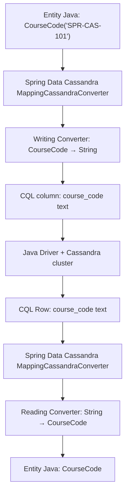

# CassandraCustomConversions và đăng ký bộ chuyển đổi

Khi truy cập **Apache Cassandra bằng Spring Data Cassandra**, lập trình viên thường muốn entity Java sử dụng các kiểu giàu ý nghĩa nghiệp vụ: `CourseCode`, `EmailAddress`, `MoneyAmount` hoặc mã trạng thái được kiểm soát. Nhưng Cassandra lưu dữ liệu bằng những kiểu CQL cụ thể như `text`, `uuid`, `int`, `timestamp`, `decimal`, collection, tuple và UDT.

**`CassandraCustomConversions`** là nơi đăng ký các bộ chuyển đổi (**converter**) để Spring Data Cassandra biết cách biến **giá trị Java** thành **giá trị phù hợp với CQL khi ghi**, rồi khôi phục kiểu Java khi đọc. Bộ chuyển đổi cho phép entity giữ kiểu miền nhất quán, không phải tự gọi `toString()` hoặc `parse()` ở mỗi repository/service.

Ví dụ xuyên suốt của bài: ứng dụng quản lý khóa học có trường `course_code text` trong Cassandra, nhưng trong Java muốn lưu trường này thành đối tượng `CourseCode` được chuẩn hóa và kiểm tra định dạng. Ta sẽ xây dựng hai converter, đăng ký chúng, ánh xạ entity, thực hiện đọc/ghi và kiểm thử.

Đến cuối bài, bạn có thể:

- Phân biệt conversion ở tầng Spring Data, codec ở tầng Java Driver và serialization của HTTP/JSON.
- Tạo converter **ghi** và **đọc** bằng `Converter<S, T>`, `@WritingConverter` và `@ReadingConverter`.
- Đăng ký tường minh trong `CassandraCustomConversions` qua Spring Boot hoặc `AbstractCassandraConfiguration`.
- Giải thích thời điểm nên dùng converter theo kiểu và khi nào nên dùng converter theo thuộc tính.
- Xử lý `null`, giá trị lưu trữ cũ, lỗi format, schema CQL và chuyển đổi ảnh hưởng đến khóa chính.
- Kiểm chứng converter bằng unit test và integration test trên Cassandra thật.

## 1. Chuyển đổi diễn ra ở đâu?

Một thao tác `repository.save(course)` hoặc `template.insert(course)` gồm nhiều tầng:



Spring Data Cassandra có nhiều ánh xạ built-in. Ví dụ, `UUID` thường đi với CQL `uuid`, `String` với `text`, `Instant` với `timestamp` và `Integer` với `int`. Đối với **kiểu miền do ứng dụng định nghĩa**, framework có thể không biết nên lưu dưới dạng gì. Lúc đó cần converter rõ ràng.

| Thành phần | Mục đích | Có tự dùng `CassandraCustomConversions`? |
| --- | --- | --- |
| `CassandraRepository` | Đọc/ghi entity dựa trên mapping và khóa | Khi đi qua Spring Data mapping, các converter đã đăng ký có thể được dùng |
| `CassandraTemplate` | Đọc/ghi entity và truy vấn theo Spring Data | Có, ở các thao tác đi qua mapping converter |
| `MappingCassandraConverter` | Chuyển đổi giữa giá trị/đối tượng và biểu diễn Cassandra | Là nơi sử dụng custom conversions |
| `CqlSession` của Java Driver | Gửi CQL, bind giá trị và đọc `Row` | **Không** tự sử dụng bộ Spring Data converter |
| `TypeCodec` của Java Driver | Chuyển đổi Java value sang dạng binary của giao thức Cassandra | Cơ chế riêng của driver, ở tầng thấp hơn |
| Jackson/HTTP converter | Chuyển đổi JSON request/response | Cơ chế riêng, không tự kế thừa Spring Data converter |

**Một nhầm lẫn phổ biến:** đã đăng ký `Converter<CourseCode, String>` trong Spring Data không có nghĩa câu `session.prepare(...).bind(courseCode)` của Java Driver tự hiểu `CourseCode`. Với `CqlSession` trực tiếp, hãy bind `courseCode.value()` hoặc dùng driver codec được cấu hình riêng nếu cần.

## 2. Trước tiên phải chọn kiểu lưu trữ CQL

Converter không thay đổi cách Cassandra định tuyến partition, áp dụng consistency hay phân trang. Hãy xác định **CQL schema và truy vấn** trước khi thêm lớp Java.

Ví dụ bảng tra cứu khóa học theo ID (keyspace `learning` đã tồn tại):

```sql
CREATE TABLE IF NOT EXISTS learning.courses_by_id (
    course_id uuid PRIMARY KEY,
    course_code text,
    title text,
    published boolean
);
```

API sử dụng bảng này để đọc bằng `course_id`:

```sql
SELECT course_id, course_code, title, published
FROM learning.courses_by_id
WHERE course_id = ?;
```

Quyết định thiết kế:

- `course_id` là partition key, dùng `UUID` trên Java và CQL `uuid`, không cần converter riêng.
- `course_code` là mã nghiệp vụ, nhưng được **lưu bằng CQL `text`**; converter xử lý biểu diễn `CourseCode ↔ String`.
- `title` là chuỗi thông thường; không cần bắt tất cả `String` trong hệ thống đi qua một converter mới.
- `published` là CQL `boolean`; chọn `Boolean` nếu trạng thái có thể chưa được ghi, hoặc `boolean` khi mọi hàng đều có giá trị hợp lệ theo hợp đồng nghiệp vụ.

Bộ chuyển đổi **không tự làm** câu `SELECT ... WHERE course_code = ?` trở nên hiệu quả trên bảng này. Nếu cần tìm bằng mã khóa học, hãy thiết kế một bảng `courses_by_code` với partition key phù hợp hoặc đánh giá cơ chế index phù hợp phiên bản Cassandra và tải thực tế.

## 3. Tạo value object Java cho dữ liệu nghiệp vụ

Ứng dụng muốn mã khóa học phải viết hoa, không có khoảng trắng thừa và theo định dạng nhất quán.

Ví dụ sử dụng Java record:

```java
import java.util.Locale;
import java.util.Objects;

public record CourseCode(String value) {

    public CourseCode {
        Objects.requireNonNull(value, "courseCode");

        value = value.trim().toUpperCase(Locale.ROOT);

        if (!value.matches("[A-Z0-9][A-Z0-9_-]{2,31}")) {
            throw new IllegalArgumentException(
                "courseCode must have 3-32 uppercase letters, digits, _ or -");
        }
    }

    public static CourseCode of(String raw) {
        return new CourseCode(raw);
    }
}
```

`CourseCode.of(" spr-cas-101 ")` trả về đối tượng mang giá trị chuẩn hóa `"SPR-CAS-101"`. Đối tượng giúp không lặp logic chuẩn hóa ở controller, service và repository.

Vài điểm quan trọng:

1. **Dữ liệu cũ có thể không tuân thủ regex mới.** Khi đọc từ Cassandra, converter đọc sẽ gọi constructor; giá trị cũ không hợp lệ có thể làm quá trình ánh xạ lỗi. Trước khi siết validation, cần đánh giá/chuẩn hóa dữ liệu cũ.
2. **Chuẩn hóa phải có tính ổn định.** Ghi một `CourseCode` rồi đọc lại nên cho ra cùng giá trị miền. Tránh chuyển đổi phụ thuộc múi giờ mặc định hoặc locale của máy.
3. **`CourseCode` không phải entity Cassandra.** Nó là value object dùng trong thuộc tính entity, và CQL không có native type mang tên `CourseCode`.

Khi dùng Java trước record (chẳng hạn Java 11), có thể viết class immutable với constructor, getter, `equals` và `hashCode`; ý tưởng converter vẫn giống nhau.

## 4. Viết converter theo chiều ghi

Một converter **ghi** biến `CourseCode` thành kiểu Java mà Cassandra/Java Driver hỗ trợ, ở đây là `String`.

```java
import org.springframework.core.convert.converter.Converter;
import org.springframework.data.convert.WritingConverter;

@WritingConverter
public final class CourseCodeWriteConverter
        implements Converter<CourseCode, String> {

    @Override
    public String convert(CourseCode source) {
        return source.value();
    }
}
```

Giải thích:

- `Converter<CourseCode, String>` cho biết **source type** và **target type** bằng generic parameters. Direction phải đúng.
- `@WritingConverter` đánh dấu converter dùng trong hướng **Java domain → Cassandra store representation**.
- Method `convert` chỉ trả chuỗi đã được value object chuẩn hóa, không tự mở kết nối Cassandra hoặc tạo CQL.
- Từ khóa `final` không bắt buộc; converter nên **không có trạng thái mutable** để dùng lại an toàn khi nhiều request xử lý song song.

`@WritingConverter` không tự đăng ký class này vào Spring Data Cassandra. Việc đăng ký được thực hiện ở `CassandraCustomConversions` trong phần sau.

Không dùng converter ghi để tự ý thay đổi tính nhất quán, TTL hoặc keyspace. Chúng là cấu hình statement/schema riêng.

## 5. Viết converter theo chiều đọc

Khi Cassandra trả về CQL `text`, Java Driver có thể cung cấp giá trị `String`; Spring Data cần chuyển nó về `CourseCode`.

```java
import org.springframework.core.convert.converter.Converter;
import org.springframework.data.convert.ReadingConverter;

@ReadingConverter
public final class CourseCodeReadConverter
        implements Converter<String, CourseCode> {

    @Override
    public CourseCode convert(String source) {
        return CourseCode.of(source);
    }
}
```

Ngược với converter ghi:

- Source là `String` được đọc từ Cassandra.
- Target là `CourseCode` của miền nghiệp vụ.
- `@ReadingConverter` xác định hướng **Cassandra → domain**.
- Constructor miền áp dụng cùng một quy tắc validation và normalization cho dữ liệu được đọc lại.

Một cặp converter lý tưởng thỏa mãn:

```text
write(CourseCode.of("spr-cas-101")) == "SPR-CAS-101"

read("SPR-CAS-101").equals(CourseCode.of("spr-cas-101")) == true
```

Nhưng không phải lúc nào `read(write(x))` cũng có thể đảo hoàn toàn. Nếu converter ghi **làm tròn tiền**, **mất múi giờ** hoặc **cắt chuỗi**, dữ liệu đã mất không thể khôi phục từ Cassandra. Hãy định nghĩa rõ thuộc tính nào bắt buộc bảo toàn.

## 6. Đăng ký với CassandraCustomConversions trong Spring Boot

### 6.1. Cách khuyến nghị cho Spring Boot auto-configuration

Nếu ứng dụng đã dùng `spring-boot-starter-data-cassandra` và để Boot tạo hạ tầng Spring Data, có thể đăng ký một bean `CassandraCustomConversions`:

```java
import org.springframework.context.annotation.Bean;
import org.springframework.context.annotation.Configuration;
import org.springframework.data.cassandra.core.convert.CassandraCustomConversions;

@Configuration(proxyBeanMethods = false)
public class CassandraConversionConfiguration {

    @Bean
    public CassandraCustomConversions cassandraCustomConversions() {
        return CassandraCustomConversions.create(adapter -> {
            adapter.registerConverter(new CourseCodeWriteConverter());
            adapter.registerConverter(new CourseCodeReadConverter());
        });
    }
}
```

Ở Spring Data Cassandra **4.2 trở lên**, `CassandraCustomConversions.create(...)` là API cấu hình theo adapter được tài liệu Spring Data giới thiệu. Với dòng phiên bản cũ hơn chưa có API này, có thể dùng constructor nhận danh sách:

```java
import java.util.List;
import org.springframework.context.annotation.Bean;
import org.springframework.data.cassandra.core.convert.CassandraCustomConversions;

@Bean
CassandraCustomConversions cassandraCustomConversions() {
    return new CassandraCustomConversions(List.of(
        new CourseCodeWriteConverter(),
        new CourseCodeReadConverter()
    ));
}
```

**Đây là hai cách tạo cùng một bean, không khai báo đồng thời cả hai.** Đoạn thứ hai là phần phương thức đặt trong một class `@Configuration`, không phải một ứng dụng Java hoàn chỉnh đứng độc lập.

Trong các phiên bản Spring Boot có auto-configuration Cassandra Data, hạ tầng mặc định thường dùng bean `CassandraCustomConversions` có sẵn trong context. Nếu ứng dụng đã tự cấu hình `CassandraConverter`, `CassandraTemplate` hoặc nhiều `CqlSession`, phải bảo đảm **converter thực sự được gắn vào đúng mapping converter** đang sử dụng. Việc thấy bean tồn tại trong Spring context chưa đủ để chứng minh mọi đường truy cập đều dùng nó.

### 6.2. Nếu ứng dụng dùng AbstractCassandraConfiguration

Một ứng dụng tự cấu hình Spring Data có thể kế thừa `AbstractCassandraConfiguration` và override `customConversions()`:

```java
import org.springframework.context.annotation.Configuration;
import org.springframework.data.cassandra.config.AbstractCassandraConfiguration;
import org.springframework.data.cassandra.core.convert.CassandraCustomConversions;

@Configuration
public class ManualCassandraConfiguration
        extends AbstractCassandraConfiguration {

    @Override
    protected String getKeyspaceName() {
        return "learning";
    }

    @Override
    public CassandraCustomConversions customConversions() {
        return CassandraCustomConversions.create(adapter -> {
            adapter.registerConverter(new CourseCodeWriteConverter());
            adapter.registerConverter(new CourseCodeReadConverter());
        });
    }
}
```

Đây là ví dụ về **kiểu đăng ký**, không phải cấu hình production đầy đủ: các phần tạo `CqlSession`, contact points, local datacenter, authentication/TLS và quyền truy cập phải được tổ chức theo hạ tầng dự án. Không đồng thời dùng một `AbstractCassandraConfiguration` tùy chỉnh và một bộ auto-configuration chồng chéo mà chưa hiểu bean nào được chọn.

**Chỉ chọn một con đường cấu hình rõ ràng.** Nếu dùng Spring Boot starter, một bean `CassandraCustomConversions` thường đơn giản hơn việc thay thế toàn bộ phần cấu hình Cassandra.

### 6.3. Vì sao phải đăng ký tường minh?

Spring Data **không tự quét toàn bộ class implement `Converter`** rồi đăng ký để dùng cho Cassandra. Lý do: cùng một cặp kiểu có thể mang nhiều ý nghĩa và vô tình ảnh hưởng đến các nơi khác nhau trong ứng dụng.

Ví dụ, ứng dụng có hai phép chuyển đổi:

- `String ↔ CourseCode`: chuỗi là **mã khóa học**.
- `String ↔ EmailAddress`: chuỗi là **địa chỉ email**.

Nếu framework tự chọn mọi converter chỉ vì thấy interface, kết quả sẽ dễ gây xung đột. Đăng ký tập converter có kiểm soát giúp người lập trình xác định chính xác phạm vi chuyển đổi được phép.

**`@Component` trên converter class không thay thế bước đăng ký CassandraCustomConversions.** Một bean `Converter` thông thường của Spring MVC `ConversionService` không mặc nhiên được dùng bởi `MappingCassandraConverter`.

## 7. Ánh xạ entity dùng kiểu CourseCode

Sau khi có hai converter và cấu hình, entity giữ value object thay cho chuỗi rời rạc.

```java
import java.util.UUID;

import org.springframework.data.cassandra.core.mapping.CassandraType;
import org.springframework.data.cassandra.core.mapping.Column;
import org.springframework.data.cassandra.core.mapping.PrimaryKey;
import org.springframework.data.cassandra.core.mapping.Table;

@Table("courses_by_id")
public class Course {

    @PrimaryKey("course_id")
    private UUID courseId;

    @Column("course_code")
    @CassandraType(type = CassandraType.Name.TEXT)
    private CourseCode courseCode;

    @Column("title")
    private String title;

    @Column("published")
    private Boolean published;

    protected Course() { }

    public Course(
            UUID courseId,
            CourseCode courseCode,
            String title,
            Boolean published) {
        this.courseId = courseId;
        this.courseCode = courseCode;
        this.title = title;
        this.published = published;
    }

    public UUID getCourseId() { return courseId; }
    public CourseCode getCourseCode() { return courseCode; }
    public String getTitle() { return title; }
    public Boolean getPublished() { return published; }

    // Setter và các phương thức miền nếu ứng dụng cần.
}
```

`@CassandraType(type = CassandraType.Name.TEXT)` nêu rõ kiểu CQL mong muốn cho cột `course_code`, đặc biệt hữu ích để mapping/schema derivation không phải đoán kiểu store từ value object. **Nó không thay thế converter** và không tự sửa một cột đã tồn tại trên Cassandra.

Với `schema-action: none`, bảng cần được tạo/migration trước. Nếu CQL thật là `course_code uuid` trong khi converter trả `String`, cần giải quyết mâu thuẫn schema; không chỉ thêm annotation để “ép” driver chấp nhận.

Repository:

```java
import java.util.UUID;
import org.springframework.data.cassandra.repository.CassandraRepository;

public interface CourseRepository
        extends CassandraRepository<Course, UUID> {
}
```

Service có thể gọi:

```java
import java.util.UUID;

public class CourseExampleService {
    private final CourseRepository repository;

    public CourseExampleService(CourseRepository repository) {
        this.repository = repository;
    }

    public Course create(String rawCode, String title) {
        Course course = new Course(
            UUID.randomUUID(),
            CourseCode.of(rawCode),
            title,
            Boolean.FALSE
        );
        return repository.save(course);
    }

    public Course find(UUID id) {
        return repository.findById(id).orElseThrow();
    }
}
```

Đường đi lúc ghi: `Course` → `MappingCassandraConverter` → `CourseCodeWriteConverter` → `String` → Java Driver → CQL `text`. Lúc đọc chiều ngược lại sử dụng `CourseCodeReadConverter`.

Lưu ý: `save()` của Cassandra thường có ngữ nghĩa upsert; converter không biến nó thành “insert chỉ khi chưa tồn tại” hay tự tạo transaction liên bảng.

## 8. Đọc/ghi cùng kiểu qua CassandraTemplate và CqlSession

### CassandraTemplate

Khi chọn `CassandraTemplate` để thao tác với entity:

```java
import java.util.UUID;
import org.springframework.data.cassandra.core.CassandraTemplate;

public class CourseTemplateService {
    private final CassandraTemplate template;

    public CourseTemplateService(CassandraTemplate template) {
        this.template = template;
    }

    public Course findById(UUID id) {
        return template.selectOneById(id, Course.class);
    }

    public Course insert(Course course) {
        return template.insert(course);
    }
}
```

Với `CassandraTemplate` đang dùng cùng `CassandraConverter` được cấu hình, việc mapping `CourseCode` vẫn đi qua các converter. `selectOneById` có thể trả `null` khi không có hàng; method repository `findById` trả `Optional`. Phải phân biệt “không tìm thấy entity” với “cột `course_code` trong hàng tồn tại có giá trị NULL”.

### CqlSession trực tiếp

Nếu cần kiểm soát CQL/statement, có thể đọc bằng Java Driver:

```java
import java.util.UUID;

import com.datastax.oss.driver.api.core.CqlSession;
import com.datastax.oss.driver.api.core.cql.Row;
import com.datastax.oss.driver.api.core.cql.SimpleStatement;

public class CourseCodeLookup {
    private final CqlSession session;

    public CourseCodeLookup(CqlSession session) {
        this.session = session;
    }

    public CourseCode findCode(UUID courseId) {
        Row row = session.execute(SimpleStatement.newInstance(
            "SELECT course_code FROM courses_by_id WHERE course_id = ?",
            courseId
        )).one();

        if (row == null || row.isNull("course_code")) {
            return null;
        }
        return CourseCode.of(row.getString("course_code"));
    }
}
```

Ở đây chúng ta **chủ động gọi `CourseCode.of`**; `CqlSession` không tự sử dụng Spring Data converters. Ví dụ giả định session có keyspace mặc định `learning`. Có thể dùng tên bảng đủ `learning.courses_by_id` nếu không có keyspace mặc định.

Hãy cân nhắc trả về DTO hoặc `Optional` riêng cho API thực tế thay vì trả `null`: `null` ở ví dụ này có thể biểu diễn cả “không có hàng” lẫn “hàng thiếu course_code”, nếu hai trạng thái cần phân biệt thì phải thiết kế kiểu kết quả khác.

### So sánh với Java Driver TypeCodec

`TypeCodec<CourseCode>` (nếu tự triển khai và đăng ký bằng driver) giải quyết **mã hóa/giải mã giá trị ở mức giao thức**; có thể phục vụ những lời gọi driver trực tiếp không đi qua Spring Data. Đây là một cơ chế khác với `Converter<CourseCode, String>` trong Spring Data.

Không nên viết cả hai chỉ để làm một bài toán đơn giản khi mọi truy cập đều đi qua entity/repository. Chọn tầng mở rộng theo đường truy cập thực tế:

- **Chỉ Spring Data entity**: cân nhắc `CassandraCustomConversions`.
- **Truy cập driver trực tiếp ở nhiều nơi bằng kiểu đặc thù**: cân nhắc `TypeCodec` theo hỗ trợ driver.
- **Chỉ biến đổi HTTP JSON**: dùng JSON serialization/deserialization phù hợp.
- **Chỉ một field cần cách lưu đặc biệt**: cân nhắc property-based converter thay vì global converter.

## 9. Chọn đúng chiều chuyển đổi: ReadingConverter và WritingConverter

Spring Data phân loại converter dựa trên kiểu nguồn/đích và những kiểu native mà Cassandra biết xử lý. Khi chỉ một phía là native, framework thường có thể suy ra chiều. Tuy nhiên, **đánh dấu tường minh** bằng annotation làm ý định rõ ràng và tránh trường hợp mơ hồ.

| Converter | Source | Target | Annotation | Vai trò |
| --- | --- | --- | --- | --- |
| `CourseCodeWriteConverter` | `CourseCode` | `String` | `@WritingConverter` | Domain → CQL `text` |
| `CourseCodeReadConverter` | `String` | `CourseCode` | `@ReadingConverter` | CQL `text` → domain |
| Ví dụ `Converter<String, Long>` | `String` | `Long` | Cần chọn đúng chiều nếu đăng ký | Cả hai là kiểu thông dụng; dễ bị suy luận sai |
| Ví dụ `Converter<Long, String>` | `Long` | `String` | Cần chủ đích về chiều và phạm vi | Có thể ảnh hưởng nhiều field không liên quan |

### 9.1. Converter theo kiểu có ảnh hưởng rộng

Converter theo cặp `String ↔ CourseCode` có thể được áp dụng tới **mọi property có kiểu `CourseCode`** nằm trong mapping context. Điều đó thường tốt nếu mọi `CourseCode` đều có cùng chuẩn biểu diễn.

Ngược lại, một converter toàn cục kiểu `String → String` để “viết hoa trước khi lưu” là nguy hiểm: rất nhiều trường có `String` sẽ bị ảnh hưởng. Nó có thể làm thay đổi tên người dùng, địa chỉ hoặc nội dung ghi chú dù không có nhu cầu.

Khi quy tắc chỉ áp dụng cho **một field của một entity**, hãy cân nhắc converter **theo thuộc tính**.

### 9.2. Property-based converters

Từ những phiên bản Spring Data Cassandra hỗ trợ property conversions, `CassandraCustomConversions` cung cấp adapter để cấu hình chuyển đổi cho **một thuộc tính cụ thể**. Khác converter theo kiểu áp dụng rộng, property-based converter có thể xử lý một trường mà không ảnh hưởng toàn bộ `String` của ứng dụng.

Ví dụ tình huống: hai field `contactEmail` và `displayName` đều là `String`. Nếu chỉ `contactEmail` cần chuyển đổi đặc biệt, không nên tạo converter global `String → String`. Cân nhắc `@ValueConverter` hoặc đăng ký với `configurePropertyConversions(...)` tùy phiên bản Spring Data Cassandra.

Các điểm cần biết:

- Property converter có API riêng (ví dụ `PropertyValueConverter`/`CassandraValueConverter`); không phải cứ thêm `@ReadingConverter` vào `String → String` là giới hạn được phạm vi.
- Property converter nhận ngữ cảnh conversion để có thể phối hợp logic đọc/ghi theo property.
- Nếu dùng cấu hình lambda, schema derivation có thể **không suy ra kiểu cột chỉ từ lambda**; cần khai báo CQL type rõ ràng và kiểm chứng trên Cassandra thật.
- Không nên chọn converter theo property để che giấu một thay đổi schema chưa migration.

Tài liệu chính thức về property converters có ví dụ `CassandraCustomConversions.create(adapter -> adapter.configurePropertyConversions(...))` và chỉ rõ giới hạn của việc đăng ký theo tên thuộc tính.

## 10. Null, giá trị thiếu và lỗi chuyển đổi

### 10.1. Null không phải value object hợp lệ mặc định

Cassandra cho phép regular column chưa được ghi hoặc đã bị xóa/TTL hết hạn. Lúc đọc `course_code` có thể là CQL NULL. Không được tự coi `null` bằng mã `"UNKNOWN"` nếu nghiệp vụ cần phân biệt chưa có dữ liệu.

Trong Spring Data conversion, thường không gọi `Converter<S,T>.convert(...)` với đầu vào NULL; mapping giữ giá trị thiếu theo cơ chế của framework. Dù vậy, nếu dùng **property converter** hoặc custom mapper có xử lý null riêng, cần kiểm tra `readNull`/`writeNull` và hành vi thực tế của đường đi dữ liệu.

### 10.2. Đọc giá trị cũ không hợp lệ

Giả sử Cassandra từng lưu mã `"sp cas 101"` trước khi app bổ sung quy tắc chỉ cho phép chữ, số và dấu `-`/`_`. Converter đọc hiện tại:

```java
return CourseCode.of(source);
```

có thể ném `IllegalArgumentException`. Điều này **phơi bày dữ liệu không hợp lệ**, không phải lỗi kết nối Cassandra.

Các lựa chọn xử lý:

1. Chạy kiểm kê và migration chuẩn hóa dữ liệu cũ trước khi nâng validation.
2. Hỗ trợ đọc định dạng cũ trong giai đoạn chuyển tiếp có giới hạn thời gian, rồi loại bỏ.
3. Quarantined record: ghi nhận ID/cột gây lỗi (không log thông tin nhạy cảm), chuyển sang xử lý thủ công nếu nghiệp vụ yêu cầu.

Không nên bắt mọi `RuntimeException` rồi trả `CourseCode.of("UNKNOWN")`. Làm vậy che lỗi dữ liệu và có thể khiến logic truy vấn/sử dụng khóa bị sai.

### 10.3. Null khi ghi có thể mang ý nghĩa xóa

Trong CQL, ghi regular column bằng NULL thường có ngữ nghĩa xóa giá trị/tạo tombstone. Trong khi đó, **UNSET** với bind variable của Java Driver thường có nghĩa “không cập nhật cột”.

Đừng giả định converter có thể giải quyết nghĩa của PATCH:

| Request | Ý nghĩa mong muốn | Cách ghi nên thể hiện |
| --- | --- | --- |
| Không có `courseCode` | Giữ mã hiện tại | Không đưa cột vào mutation hoặc dùng UNSET phù hợp |
| `courseCode: null` | Xóa mã (nếu nghiệp vụ cho phép) | CQL NULL/DELETE với quy tắc rõ ràng |
| `courseCode: "spr-cas-101"` | Ghi mã mới hợp lệ | Parse thành `CourseCode` rồi convert sang `String` |
| `courseCode: ""` | Giá trị không hợp lệ theo quy tắc mẫu | Từ chối request trước khi ghi |

Nếu một entity chỉ chứa vài field được tạo từ PATCH rồi được lưu bằng `repository.save`, có rủi ro các field NULL ngoài ý muốn tham gia statement ghi. Cần kiểm tra cách Spring Data tạo statement ở phiên bản thực tế, và ưu tiên update chỉ định rõ cột cần sửa khi API có ngữ nghĩa partial update.

### 10.4. Primitive và wrapper

Converter không làm kiểu nguyên thủy `int`, `boolean` biểu diễn được NULL. Với dữ liệu có thể chưa được ghi, cân nhắc `Integer` và `Boolean`, hoặc trạng thái nghiệp vụ rõ ràng.

Một converter đọc không nên lặng lẽ biến CQL NULL thành `0`/`false` nếu hai giá trị đó có ý nghĩa khác “chưa biết”.

## 11. Chuyển đổi thời gian, số tiền và kiểu phức tạp

### 11.1. Không tự tạo converter cho thứ đã được hỗ trợ

Spring Data Cassandra và Java Driver đã hỗ trợ nhiều kiểu CQL phổ biến cùng những converter có sẵn. Trước khi viết converter tùy chỉnh cho `UUID`, `Instant`, `LocalDate` hoặc `BigDecimal`, hãy kiểm tra **bảng mapping của phiên bản đang dùng** và ngữ nghĩa dữ liệu.

| Dữ liệu | Kiểu CQL thường phù hợp | Lưu ý |
| --- | --- | --- |
| ID dạng UUID | `uuid` | Giữ `UUID`; tránh đổi sang text chỉ để tiện debug |
| Thời điểm tuyệt đối | `timestamp` | Thường dùng `Instant`/giải pháp có timezone rõ ràng |
| Ngày lịch | `date` | Phù hợp `LocalDate` nếu đúng ngữ nghĩa |
| Số tiền cần số thập phân chính xác | `decimal` | Cân nhắc `BigDecimal` và quy tắc scale/rounding |
| Đếm số lượng | `int`/`bigint` | Dùng wrapper nếu có thể chưa có giá trị |
| Cấu trúc cố định có nhiều trường | UDT | Dùng mapping `@UserDefinedType` khi phù hợp |
| Tập nhiều phần tử | `list`/`set`/`map` | Phải tính kích thước collection và cách truy cập |

Không dùng `double` để biểu diễn số tiền chính xác theo quy tắc tài chính nếu bài toán cần decimal. Trước khi tạo `Converter<Money, String>`, cần cân nhắc lưu amount/currency theo **hai cột rõ ràng** hoặc UDT, tùy khả năng truy vấn/kiểu dữ liệu thật.

### 11.2. Tránh sai múi giờ

`LocalDateTime` không tự mang timezone. Một converter biến `LocalDateTime` thành `Date`/`timestamp` qua timezone mặc định của máy có thể cho kết quả khác nhau giữa local, CI và production. Ưu tiên `Instant` cho thời điểm tuyệt đối hoặc đặt timezone rõ ràng trong logic conversion.

Ví dụ nguyên tắc:

```java
import java.time.Instant;
import java.time.LocalDateTime;
import java.time.ZoneOffset;

Instant instant = LocalDateTime
        .parse("2026-11-25T09:30:00")
        .toInstant(ZoneOffset.UTC);
```

Chọn UTC ở ví dụ này chỉ đúng nếu dữ liệu đầu vào **được định nghĩa là UTC**; không tự coi mọi thời gian lịch địa phương là UTC. Cần xác nhận miền nghiệp vụ trước khi chuyển.

### 11.3. UDT khác custom converter

Nếu CQL là:

```sql
CREATE TYPE IF NOT EXISTS learning.course_contact (
    email text,
    phone text
);
```

và bảng có cột `contact frozen<course_contact>`, việc ánh xạ qua `@UserDefinedType` thường phản ánh schema rõ ràng hơn là tự ép toàn bộ đối tượng thành một chuỗi JSON. Hãy chọn UDT khi cần cấu trúc CQL có field rõ ràng; chọn custom conversion nếu thật sự muốn một biểu diễn store khác.

Ngược lại, nếu hệ thống chủ động lưu một blob/text JSON để không truy vấn từng field, converter có thể phù hợp. Nhưng lúc đó cần chính sách version hóa định dạng, validation và cân nhắc kích thước payload.

## 12. Converter và thiết kế bảng theo truy vấn

Giả sử ứng dụng muốn một API mới:

```text
GET /tenants/{tenantId}/courses/by-code/{courseCode}
```

Lúc này dùng `CourseCode` làm kiểu tham số trong service là hợp lý. Tuy nhiên, bảng `courses_by_id` chỉ có partition key `course_id`, nên Spring Data custom converter không tạo chỉ mục trên `course_code`.

Một bảng phục vụ truy vấn theo mã trong tenant có thể được thiết kế như sau:

```sql
CREATE TABLE IF NOT EXISTS learning.courses_by_code (
    tenant_id uuid,
    course_code text,
    course_id uuid,
    title text,
    published boolean,
    PRIMARY KEY ((tenant_id, course_code))
);
```

Nếu cần đọc theo `(tenant_id, course_code)`:

```sql
SELECT course_id, title, published
FROM learning.courses_by_code
WHERE tenant_id = ? AND course_code = ?;
```

Ở tầng service, `CourseCode.of(raw)` chuẩn hóa mã rồi lấy `value()` làm bind parameter nếu dùng driver trực tiếp. Với Spring Data mapping, có thể dùng value object nhưng **vẫn phải xác minh CQL được sinh và cách tham số được chuyển đổi** ở API repository/template cụ thể, nhất là với `@Query` custom.

### Tác động đến primary key

Thay đổi logic chuẩn hóa của `CourseCode` có thể ảnh hưởng khóa chính nếu cột `course_code` nằm trong partition key:

- `"spr-cas-101"` và `"SPR-CAS-101"` có thể từng được lưu thành **hai khóa CQL khác nhau**.
- Một converter mới tự viết hoa input sẽ trỏ về khóa mới, không thể tìm thấy hàng lưu dưới khóa cũ nếu chưa migrate.
- Sửa primary key không giống update regular column: thường phải ghi hàng ở khóa mới rồi xóa khóa cũ đúng kế hoạch.
- Nếu dữ liệu bị nhân bản theo các bảng truy vấn khác nhau, phải cập nhật tất cả biểu diễn liên quan và đối soát.

Vì vậy, **converter không được âm thầm thay đổi quy tắc định danh ở production** chỉ để “chuẩn hóa đẹp hơn”. Cần kiểm kê khóa cũ, xử lý trùng, thiết kế migration và rollout tương thích.

## 13. Test converter như một hợp đồng dữ liệu

### 13.1. Unit test tính chất cơ bản

Unit test cho hai converter có thể nhanh, không cần Cassandra:

```java
import org.junit.jupiter.api.Test;
import static org.assertj.core.api.Assertions.assertThat;
import static org.junit.jupiter.api.Assertions.assertThrows;

class CourseCodeConverterTest {
    private final CourseCodeWriteConverter writer =
            new CourseCodeWriteConverter();
    private final CourseCodeReadConverter reader =
            new CourseCodeReadConverter();

    @Test
    void roundTripPreservesDomainValue() {
        CourseCode original = CourseCode.of(" spr-cas-101 ");

        String stored = writer.convert(original);
        CourseCode restored = reader.convert(stored);

        assertThat(stored).isEqualTo("SPR-CAS-101");
        assertThat(restored).isEqualTo(original);
    }

    @Test
    void invalidCodeIsRejected() {
        assertThrows(
            IllegalArgumentException.class,
            () -> reader.convert("invalid with spaces")
        );
    }
}
```

Đây là test logic converter. Nó **không chứng minh** Spring Boot đã đăng ký đúng bean hoặc repository thật sự dùng converter đó.

### 13.2. Integration test với Cassandra thật

Dùng Testcontainers Cassandra hoặc cluster test cô lập để xác minh đường đi hoàn chỉnh:

1. Tạo keyspace và bảng `courses_by_id` bằng CQL trong môi trường test.
2. Khởi động Spring Boot context có `CassandraCustomConversions` và repository.
3. Lưu `Course` chứa `CourseCode.of("spr-cas-101")`.
4. Dùng `CqlSession` đọc cột `course_code` trực tiếp, xác nhận CQL `text` chứa `"SPR-CAS-101"`.
5. Dùng repository đọc lại cùng khóa, xác nhận field có kiểu `CourseCode` và giá trị chính xác.
6. Kiểm tra một hàng có `course_code` NULL, nếu schema cho phép.
7. Kiểm tra dữ liệu cũ sai format và cách ứng dụng phản hồi theo chính sách migration.
8. Nếu ứng dụng có template và repository khác nhau, xác nhận cả hai dùng đúng converter.

Ví dụ phần assertion chính trong một integration test **đã chuẩn bị entity, schema và injection**:

```java
import static org.assertj.core.api.Assertions.assertThat;

UUID id = UUID.randomUUID();
Course saved = repository.save(
    new Course(id, CourseCode.of("spr-cas-101"), "Cassandra", true)
);

Row raw = session.execute(SimpleStatement.newInstance(
    "SELECT course_code FROM courses_by_id WHERE course_id = ?", id
)).one();

assertThat(raw).isNotNull();
assertThat(raw.getString("course_code")).isEqualTo("SPR-CAS-101");

Course loaded = repository.findById(id).orElseThrow();
assertThat(loaded.getCourseCode()).isEqualTo(CourseCode.of("SPR-CAS-101"));
```

Cần import `UUID`, `Row`, `SimpleStatement` và cung cấp `repository`/`session` qua test class. Đây là đoạn assertion rút gọn; nó chỉ chứng minh hợp đồng khi chạy trong integration test có cấu hình thực tế.

**Không dùng unit test kiểu chỉ gọi converter trực tiếp để kết luận đã đăng ký Spring Data thành công.**

### 13.3. Kiểm tra conversion registry nếu nghi ngờ cấu hình

Có thể xác minh container thực sự có bean `CassandraCustomConversions` và mapping converter được tạo theo cấu hình mong đợi. Tuy nhiên, **có bean không có nghĩa mọi đường đi đọc/ghi đều sử dụng nó**: nếu bạn tự tạo một `MappingCassandraConverter` hoặc `CassandraTemplate` khác, phải bảo đảm nó nhận đúng conversions.

Đối với lỗi conversion, kiểm tra:

- Bean nào đã được tạo, có nhiều bean cạnh tranh hay không.
- `Converter<S, T>` có đúng generic source/target hay không.
- `@ReadingConverter`/`@WritingConverter` có đúng chiều hay không.
- CQL column type thực tế có khớp target type không.
- Entity field có đúng `@Column`/`@CassandraType` không.
- Query có đi qua entity mapping hay đang dùng `CqlSession` trực tiếp.
- Có dữ liệu legacy sai định dạng hoặc CQL NULL hay không.

## 14. Những lỗi thường gặp

| Triệu chứng | Nguyên nhân có thể | Cách xử lý |
| --- | --- | --- |
| Lưu `CourseCode` báo không biết kiểu CQL | Writing converter chưa đăng ký/không được dùng, field type không rõ | Đăng ký `CassandraCustomConversions`, kiểm tra mapping và `@CassandraType` |
| Đọc cột text không thành `CourseCode` | Reading converter thiếu hoặc sai generic/annotation | Kiểm tra `Converter<String, CourseCode>` và bean thực |
| Đánh `@Component` nhưng converter không chạy | Converter bean thông thường không được đăng ký với Cassandra conversion registry | Đăng ký tường minh trong `CassandraCustomConversions` |
| Một số request chạy, một số lỗi mapping | Có nhiều converter/template tự cấu hình hoặc dữ liệu legacy | Kiểm tra bean graph và dữ liệu gây lỗi |
| Chạy `CqlSession` trực tiếp không nhận `CourseCode` | Driver không dùng Spring Data converters | Bind kiểu native hoặc đăng ký driver `TypeCodec` phù hợp |
| `@Query` nhận object nhưng bind lỗi | Đường bind/query API không dùng converter như mong đợi | Kiểm tra cách bind thực tế, cân nhắc chuyển sang kiểu CQL native |
| Đổi quy tắc chuẩn hóa khiến không tìm thấy hàng | Giá trị nằm trong primary key đã thay đổi cách lưu | Migration khóa có kiểm soát và backfill/đối soát |
| CQL cột là `uuid` nhưng converter trả `String` | Mismatch schema/target type | Chọn cặp Java ↔ CQL chính xác, migration nếu cần |
| Giá trị thời gian lệch giữa local và prod | Dùng timezone mặc định hoặc converter thiếu ngữ cảnh | Chuẩn hóa ngữ nghĩa thời gian và timezone |
| Null làm mất dữ liệu khi PATCH | Ghi entity partial chứa NULL ngoài ý muốn | UPDATE chỉ field cần sửa hoặc UNSET phù hợp |
| Một converter `String → String` làm sai các field khác | Converter toàn cục quá rộng | Dùng value object hoặc property converter |
| Schema tạo tự động khác CQL mong muốn | Thiếu store type metadata, version khác nhau | Khai báo CQL type và schema migration rõ ràng |
| Test xanh nhưng production lỗi | Test không dùng Cassandra thật hoặc thiếu dữ liệu legacy | Integration test + kiểm thử migration thực tế |

## 15. Quy trình thêm converter mới an toàn

Một quy trình thực hành có thể áp dụng trong code review:

1. **Viết lý do nghiệp vụ**: vì sao field cần value object, thay vì để `String` hoặc dùng kiểu CQL/native hiện có?
2. **Chọn biểu diễn lưu trữ**: `text`, `uuid`, `decimal`, UDT hay nhiều cột? Xem khả năng truy vấn và kích thước dữ liệu.
3. **Xác định chiều và tính bảo toàn**: viết một cặp `Converter<Domain, Store>` và `Converter<Store, Domain>`, tránh chuyển đổi mất dữ liệu không chủ đích.
4. **Đặt phạm vi phù hợp**: global type converter hay property-based converter? Không áp dụng rộng khi chỉ một field cần đổi.
5. **Đăng ký với `CassandraCustomConversions`** đúng cách cấu hình Spring Data của ứng dụng.
6. **Khớp entity với schema**: `@Column`, `@CassandraType`, migration CQL và keyspace; không trông chờ annotation tự sửa cluster.
7. **Định nghĩa xử lý null và dữ liệu cũ**: legacy validation, TTL, PATCH semantics, lỗi parsing và hướng phục hồi.
8. **Test từ converter đến Cassandra thật**: round-trip, raw CQL column type, entity read/write, dữ liệu thiếu và dữ liệu legacy.
9. **Đo và quan sát**: conversion có chạy trong đường hot path không, có tạo object/JSON không cần thiết hoặc làm latency tăng không?
10. **Rollout tương thích** nếu thay đổi định dạng đang lưu hoặc ảnh hưởng partition key; cần hỗ trợ đọc dữ liệu cũ, backfill và đối soát trước khi bỏ logic cũ.

### Bài tập tự thực hành

Hệ thống học tập có entity `Student` và cột `email text`. Team muốn dùng kiểu miền `StudentEmail` bảo đảm địa chỉ email đã được chuẩn hóa theo **chính sách ứng dụng**. Ngoài ra có cột `display_name text` không cần chuẩn hóa theo cùng quy tắc.

Hãy trả lời:

1. Nên tạo `Converter<StudentEmail, String>` hay `Converter<String, StudentEmail>` cho chiều ghi?
2. Hai class converter cần annotation gì và đăng ký tại đâu?
3. Nếu thêm `@Component` cho cả hai class nhưng không đăng ký trong `CassandraCustomConversions` thì có bảo đảm mapping chạy không?
4. Vì sao `Converter<String, String>` toàn cục để chuẩn hóa email là lựa chọn nguy hiểm?
5. Nếu code dùng `CqlSession` trực tiếp, converter Spring Data có tự áp dụng khi bind tham số `StudentEmail` không?
6. Nếu cột `email` nằm trong partition key, thay đổi quy tắc chuẩn hóa email có thể làm mất khả năng tìm dữ liệu lịch sử thế nào?
7. Nếu có hàng cũ với email không hợp lệ theo validator mới, converter đọc nên làm gì và team phải chuẩn bị migration ra sao?
8. Test nào xác nhận giá trị trong **CQL `text`** và giá trị trong **entity `StudentEmail`** cùng đúng?
9. Nếu chỉ một property cần xử lý đặc biệt nhưng rất nhiều field khác cùng kiểu `String`, có lựa chọn conversion nào phù hợp?
10. Nếu API PATCH không gửi email, vì sao không được tự convert `null` thành chuỗi rỗng rồi lưu?

**Gợi ý:** chiều ghi là `StudentEmail → String` với `@WritingConverter`; chiều đọc là `String → StudentEmail` với `@ReadingConverter`. Đăng ký cả hai trong `CassandraCustomConversions`, dùng value object hoặc property-based converter để giới hạn phạm vi. Spring Data conversion và Java Driver codec là hai cơ chế riêng. Thay đổi định dạng của dữ liệu thuộc primary key cần migration và đối soát; integration test phải kiểm tra raw CQL lẫn entity mapping.

## 16. Ghi nhớ

**`CassandraCustomConversions` là trung tâm đăng ký converter của Spring Data Cassandra.** Muốn một value object Java được lưu trong một CQL column, cần xác định rõ kiểu lưu trữ, triển khai hướng ghi và đọc, đăng ký tường minh và kiểm tra đường ánh xạ thực tế.

**`@WritingConverter` và `@ReadingConverter` giúp xác định chiều**, nhất là khi kiểu nguồn và đích đều phổ biến hoặc khi Spring Data không thể suy đoán an toàn. Converter theo kiểu áp dụng rộng, còn converter theo property phù hợp hơn khi chỉ một thuộc tính có quy tắc riêng.

**Converter không thay thế schema và mô hình dữ liệu Cassandra.** Nó không tạo partition key, index, transaction liên bảng, paging hay policy consistency. Khi converter tác động tới primary key hoặc biểu diễn dữ liệu đã lưu, hãy xử lý như một thay đổi hợp đồng dữ liệu có version, migration, kiểm thử và kế hoạch triển khai.

### Tài liệu tham khảo chính thức

- [Spring Data Cassandra — Custom Conversions](https://docs.spring.io/spring-data/cassandra/reference/cassandra/converters.html)
- [Spring Data Cassandra — Property-based Converters](https://docs.spring.io/spring-data/cassandra/reference/cassandra/property-converters.html)
- [Spring Data Cassandra — Mapping](https://docs.spring.io/spring-data/cassandra/reference/object-mapping.html)
- [Spring Data Cassandra — CassandraCustomConversions API](https://docs.spring.io/spring-data/cassandra/docs/current/api/org/springframework/data/cassandra/core/convert/CassandraCustomConversions.html)
- [Spring Boot — Working with NoSQL Technologies](https://docs.spring.io/spring-boot/reference/data/nosql.html)
