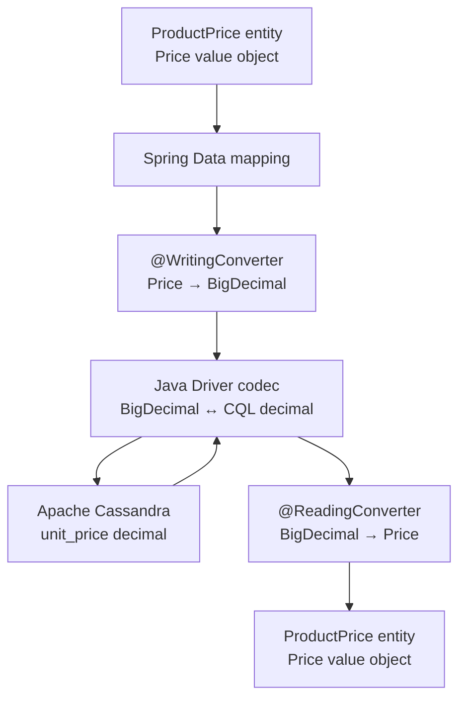

# @ReadingConverter và @WritingConverter

## Mục tiêu học tập

Trong Spring Data Cassandra, các kiểu Java thông dụng như `UUID`, `String`, `BigDecimal` và `Instant` thường đã có cách ánh xạ phù hợp với kiểu CQL tương ứng. Nhưng ứng dụng thực tế còn có **value object** biểu diễn quy tắc nghiệp vụ, chẳng hạn `Price`, `ProductCode` hay `DeviceIdentifier`. Những kiểu này không nhất thiết là kiểu mà Apache Cassandra Java Driver có thể ghi hoặc đọc trực tiếp.

Hai annotation **`@WritingConverter`** và **`@ReadingConverter`** giúp chỉ rõ **hướng chuyển đổi tùy biến** cho Spring Data. Bài học thuộc chương **Chuyển đổi kiểu** của module `SPRING_DATA_CASSANDRA`, tập trung vào cách ứng dụng các converter đó khi dùng entity mapping, repository, `CassandraTemplate` và truy vấn CQL.

Học xong bài, bạn có thể:

- Phân biệt đường đi **Java entity → giá trị CQL** với **hàng CQL → Java entity**.
- Viết converter một chiều bằng `Converter<S, T>`, đặt đúng `@WritingConverter` hoặc `@ReadingConverter`.
- Đăng ký converter với `CassandraCustomConversions` để mapping infrastructure của Spring Data Cassandra sử dụng.
- Giải thích vì sao converter không tự sửa schema, thay thế driver codec hoặc làm cho truy vấn thiếu partition key trở nên hợp lệ.
- Thiết kế phép chuyển đổi có khả năng **round-trip**, giữ đúng độ chính xác, xử lý `null` và không phá vỡ khóa phân vùng.
- Kiểm tra những lỗi thường gặp: converter không được đăng ký, đảo nhầm chiều, dữ liệu cũ không đọc được hoặc phép chuyển không thể đảo ngược.

## 1. Converter nằm ở đâu trong luồng truy cập Cassandra?

Giả sử ứng dụng dùng Java class `ProductPrice` với thuộc tính `Price`, trong khi bảng CQL lưu giá tiền bằng `decimal`.



Sơ đồ mô tả **vai trò logic**; đường thực thi của framework có thể còn nhiều đối tượng trung gian. Các lớp chịu trách nhiệm:

| Lớp/khái niệm | Trách nhiệm chính | Ví dụ trong bài |
| --- | --- | --- |
| **CQL schema** | Định nghĩa cột và kiểu dữ liệu Cassandra. | `unit_price decimal`. |
| **Java Driver codec** | Mã hóa/giải mã giá trị CQL với kiểu Java được driver hỗ trợ. | `decimal ↔ BigDecimal`. |
| **Spring Data mapping** | Biết entity, thuộc tính, tên bảng/cột và khóa. | `@Table`, `@Column("unit_price")`, `@PrimaryKey`. |
| **`@WritingConverter`** | Chuyển kiểu ứng dụng thành kiểu Java phù hợp để ghi vào cột CQL. | `Price → BigDecimal`. |
| **`@ReadingConverter`** | Chuyển kiểu Java nhận được từ CQL thành kiểu của thuộc tính entity. | `BigDecimal → Price`. |
| **`CassandraCustomConversions`** | Đăng ký các cặp chuyển đổi để mapping converter sử dụng. | Danh sách hai converter của `Price`. |

`CassandraMappingContext` và `MappingCassandraConverter` là những thành phần nền của Spring Data Cassandra. Converter tùy biến không tự chạy chỉ vì class có annotation: nó cần được **đăng ký trong hệ thống conversions** mà mapping infrastructure đang sử dụng.

### Vì sao cần hai annotation khác nhau?

Spring có một abstraction chung, `org.springframework.core.convert.converter.Converter<S, T>`:

```java
public interface Converter<S, T> {
    T convert(S source);
}
```

Tuy nhiên, với dữ liệu lưu trữ, hướng chuyển đổi có ý nghĩa rõ ràng:

- **Ghi:** chuyển từ **kiểu domain của ứng dụng** sang **kiểu được datastore hỗ trợ**.
- **Đọc:** chuyển từ **kiểu dữ liệu đã lấy ra** sang **kiểu domain của ứng dụng**.

Đánh dấu `@WritingConverter` và `@ReadingConverter` giúp Spring Data phân loại hướng chuyển đổi, đặc biệt khi một cặp kiểu có thể gây mơ hồ về bên nào là kiểu thuộc mô hình ứng dụng và bên nào là kiểu lưu trữ. Hai annotation nằm trong package `org.springframework.data.convert`.

**Không nên hiểu** `@WritingConverter` là “tự động chạy mọi lúc gọi `save()` bất kể kiểu dữ liệu”, hay `@ReadingConverter` là “bộ biến đổi toàn bộ hàng CQL theo ý muốn”. Chúng được chọn khi mapping system có đường chuyển đổi phù hợp giữa kiểu nguồn và kiểu đích.

## 2. Ví dụ xuyên suốt: giá tiền dưới dạng value object

Giả sử dịch vụ quản lý sản phẩm lưu đơn giá bằng CQL `decimal`. Ở tầng Java, nhóm phát triển muốn dùng value object `Price` để thống nhất quy tắc **không âm** và **hai chữ số thập phân**.

### 2.1. Bảng CQL lưu kiểu chuẩn

```sql
CREATE TABLE IF NOT EXISTS product_price_by_id (
    product_id uuid PRIMARY KEY,
    product_name text,
    unit_price decimal
);
```

Đây là bảng đơn giản dành cho truy vấn **đọc giá theo `product_id`**. `product_id` là partition key. Chúng ta không cần biến `Price` thành một kiểu CQL mới; có thể lưu giá trị thập phân đã chuẩn hóa trong cột `decimal`.

### 2.2. Định nghĩa value object Price

Ví dụ dưới đây sử dụng Java 17+ với `record`:

```java
import java.math.BigDecimal;
import java.math.RoundingMode;
import java.util.Objects;

public record Price(BigDecimal amount) {

    public Price {
        Objects.requireNonNull(amount, "amount");
        amount = amount.setScale(2, RoundingMode.UNNECESSARY);
        if (amount.signum() < 0) {
            throw new IllegalArgumentException("Price must not be negative");
        }
    }
}
```

Ý nghĩa:

- `Price` là **kiểu miền nghiệp vụ**, không phải kiểu CQL.
- Hàm tạo chuẩn hóa scale về 2 chữ số. `RoundingMode.UNNECESSARY` báo lỗi nếu dữ liệu cần được làm tròn; đây là **quy tắc ví dụ**, không phải quy tắc mặc định của Spring Data.
- `new Price(new BigDecimal("149.90"))` hợp lệ; `new Price(new BigDecimal("-1.00"))` bị từ chối.
- `new Price(new BigDecimal("149.999"))` bị từ chối để tránh âm thầm mất chính xác.

Trong ứng dụng thực tế có nhiều tiền tệ, một `Price` chỉ chứa số tiền có thể chưa đủ: cần xác định currency và scale theo nghiệp vụ. Cột `decimal` không tự giải quyết câu hỏi đơn vị tiền.

### 2.3. Entity ánh xạ vào bảng

```java
import java.util.UUID;

import org.springframework.data.cassandra.core.mapping.Column;
import org.springframework.data.cassandra.core.mapping.PrimaryKey;
import org.springframework.data.cassandra.core.mapping.Table;

@Table("product_price_by_id")
public class ProductPrice {

    @PrimaryKey("product_id")
    private UUID productId;

    @Column("product_name")
    private String productName;

    @Column("unit_price")
    private Price unitPrice;

    public ProductPrice() {
    }

    public ProductPrice(UUID productId, String productName, Price unitPrice) {
        this.productId = productId;
        this.productName = productName;
        this.unitPrice = unitPrice;
    }

    public UUID getProductId() {
        return productId;
    }

    public String getProductName() {
        return productName;
    }

    public Price getUnitPrice() {
        return unitPrice;
    }
}
```

Entity cho biết tên cột bằng `@Column`; nó **chưa** đủ để chuyển một `Price` thành `BigDecimal`. Cần khai báo conversion.

## 3. @WritingConverter: từ Price sang BigDecimal

Khi Spring Data tạo lệnh ghi cho entity, giá trị của `unitPrice` phải được chuyển thành dạng driver có thể bind vào cột `decimal`.

```java
import java.math.BigDecimal;

import org.springframework.core.convert.converter.Converter;
import org.springframework.data.convert.WritingConverter;

@WritingConverter
public final class PriceWriteConverter
        implements Converter<Price, BigDecimal> {

    @Override
    public BigDecimal convert(Price source) {
        return source.amount();
    }
}
```

Đọc định nghĩa `Converter<Price, BigDecimal>` theo thứ tự:

- **Source:** `Price` — kiểu Java mà entity đang dùng.
- **Target:** `BigDecimal` — kiểu Java mà codec của cột CQL `decimal` có thể xử lý.
- **Direction:** có annotation `@WritingConverter`, dùng cho đường ghi.

Ví dụ:

```text
product.unitPrice = Price(149.90)
       ↓ PriceWriteConverter
BigDecimal("149.90")
       ↓ Java Driver codec
decimal 149.90 trong Cassandra
```

Ở ví dụ này, converter **không sinh câu lệnh INSERT/UPDATE**, không cần tự mở kết nối và cũng không nhận đối tượng `Row`. Spring Data đảm nhiệm mapping entity và thao tác dữ liệu; converter chỉ thực hiện phép biến đổi một giá trị.

### Tránh đưa logic phụ thuộc hệ thống ngoài vào converter

Một converter tốt thường:

- **Deterministic:** cùng input tạo cùng output.
- **Không có side effect:** không gọi HTTP, database khác hoặc ghi log dữ liệu nhạy cảm ở mọi lần convert.
- **Rõ ngữ nghĩa:** không biến giá chưa hợp lệ thành giá khác mà không báo.
- **Nhanh:** phép biến đổi có thể được gọi rất nhiều lần khi đọc/ghi hàng loạt.

Không nên để một converter tự gọi Cassandra để tìm tỷ giá hoặc cập nhật tồn kho. Những việc đó thuộc tầng nghiệp vụ riêng và có mô hình lỗi/nhất quán khác hẳn việc ánh xạ một giá trị.

## 4. @ReadingConverter: từ BigDecimal về Price

Chiều đọc phải biến giá trị `BigDecimal` từ cột `decimal` thành `Price` mà ứng dụng mong muốn.

```java
import java.math.BigDecimal;

import org.springframework.core.convert.converter.Converter;
import org.springframework.data.convert.ReadingConverter;

@ReadingConverter
public final class PriceReadConverter
        implements Converter<BigDecimal, Price> {

    @Override
    public Price convert(BigDecimal source) {
        return new Price(source);
    }
}
```

Đọc định nghĩa `Converter<BigDecimal, Price>`:

- **Source:** `BigDecimal` — kiểu được driver giải mã từ CQL `decimal`.
- **Target:** `Price` — thuộc tính của entity.
- **Direction:** annotation `@ReadingConverter` đánh dấu chuyển đổi khi đọc.

Luồng:

```text
decimal 149.90 trong Cassandra
       ↓ Java Driver codec
BigDecimal("149.90")
       ↓ PriceReadConverter
Price(149.90)
       ↓
ProductPrice.unitPrice
```

Điểm đáng chú ý: **dữ liệu lịch sử có thể không tuân thủ quy tắc mới**. Ví dụ, trước đây bảng cho phép ghi `149.999`; converter đọc mới sẽ gọi `new Price(...)` và ném exception do `RoundingMode.UNNECESSARY`. Đây không phải lỗi mạng hay thiếu partition key, mà là xung đột giữa dữ liệu đã lưu và invariant của value object.

Trước khi áp dụng converter cho dữ liệu thực:

1. Đánh giá dữ liệu đã lưu có tuân thủ quy tắc mới không.
2. Quyết định chính sách với bản ghi sai: làm sạch/backfill, từ chối, đưa vào luồng xử lý lỗi hoặc dùng phiên bản chuyển đổi tương thích.
3. Không âm thầm biến `149.999` thành `150.00` nếu nghiệp vụ chưa cho phép.

Một hệ thống có hàng triệu bản ghi cần chuẩn bị đặc biệt cho tình huống thay đổi logic đọc có thể làm nhiều trang kết quả lỗi liên tiếp.

## 5. Đăng ký bằng CassandraCustomConversions

Viết hai class converter và đặt annotation **chưa đảm bảo chúng được dùng**. Spring Data Cassandra cần có một tập conversions được khai báo trong cấu hình mà `MappingCassandraConverter` thực sự sử dụng.

Với tổ hợp phiên bản Spring Data Cassandra hỗ trợ constructor nhận danh sách converters, có thể khai báo cấu hình như sau:

```java
import java.util.List;

import org.springframework.context.annotation.Bean;
import org.springframework.context.annotation.Configuration;
import org.springframework.data.cassandra.core.convert.CassandraCustomConversions;

@Configuration
public class PriceConversionConfiguration {

    @Bean
    public CassandraCustomConversions cassandraCustomConversions() {
        return new CassandraCustomConversions(List.of(
                new PriceWriteConverter(),
                new PriceReadConverter()
        ));
    }
}
```

**Kiểm tra cách tạo bean theo đúng phiên bản Spring Boot/Spring Data Cassandra đang dùng.** Các phiên bản và kiểu cấu hình Java-based có thể cung cấp extension point, factory method hoặc cách đăng ký khác. Nếu dự án đã kế thừa `AbstractCassandraConfiguration` hoặc có cấu hình conversions riêng, cần tích hợp vào **một nguồn cấu hình thống nhất**, không vô tình khai báo nhiều `CassandraCustomConversions` hay nhiều `MappingCassandraConverter`.

### Vì sao không chỉ đánh dấu converter bằng @Component?

`@Component` (nếu dùng) chỉ khiến Spring phát hiện một bean thông thường. Điều quan trọng là **converter phải được đăng ký với hệ thống custom conversions** mà tầng mapping đang sử dụng. Không nên giả định mọi bean `Converter` trong application context sẽ tự động được dùng để chuyển CQL trong mọi cấu hình.

Hãy xác minh converter đã được đưa vào `CassandraCustomConversions` bằng một phép đọc–ghi tích hợp, thay vì chỉ kiểm tra hai bean converter có tồn tại.

### Cần đăng ký cả hai chiều không?

Tùy bài toán:

| Tình huống | Converter cần có |
| --- | --- |
| Chỉ chuyển giá trị để ghi, không ánh xạ ngược thành value object | `@WritingConverter` có thể đủ trong trường hợp dùng đúng đường ghi đó. |
| Chỉ đọc dữ liệu cũ thành value object | `@ReadingConverter` có thể đủ nếu không có đường ghi tương ứng. |
| Entity phải ghi rồi đọc lại cùng kiểu domain | **Cả hai chiều**, như ví dụ `Price ↔ BigDecimal`. |

Với entity dùng cho CRUD bình thường, thiếu chiều đọc có thể khiến lệnh `INSERT` chạy được nhưng `findById()` lỗi khi materialize entity. Ngược lại, thiếu chiều ghi có thể khiến dữ liệu đọc được nhưng `save()` không thể bind thuộc tính custom.

## 6. Dùng qua repository và CassandraTemplate

Sau khi schema, entity và conversions được cấu hình phù hợp, repository có thể thao tác với `ProductPrice` mà không cần gọi converter thủ công.

```java
import java.util.UUID;

import org.springframework.data.cassandra.repository.CassandraRepository;

public interface ProductPriceRepository
        extends CassandraRepository<ProductPrice, UUID> {
}
```

Ví dụ service:

```java
import java.math.BigDecimal;
import java.util.UUID;

public final class ProductPricingService {

    private final ProductPriceRepository repository;

    public ProductPricingService(ProductPriceRepository repository) {
        this.repository = repository;
    }

    public Price saveAndReload(UUID productId) {
        Price value = new Price(new BigDecimal("149.90"));
        repository.save(new ProductPrice(productId, "Cà phê rang xay", value));
        return repository.findById(productId)
                .orElseThrow()
                .getUnitPrice();
    }
}
```

Để hoạt động, ứng dụng cần kết nối đến keyspace chứa bảng `product_price_by_id` và sử dụng cấu hình conversions đã đăng ký. `save()` thực hiện thao tác ghi theo semantics của Cassandra; đây **không phải giao dịch ORM quan hệ** và không ngầm tạo schema.

Với `CassandraTemplate` cũng tương tự:

```java
// Giả định biến template đã được inject, và product đã có khóa chính.
template.insert(product);

// Kết quả truy vấn qua API mapping có thể được chuyển thành entity.
ProductPrice loaded = template.selectOneById(
        product.getProductId(), ProductPrice.class);
```

Đoạn mã dùng API điển hình của `CassandraTemplate`; chữ ký cụ thể, các biến thể trả kết quả và sự khác biệt giữa insert/upsert cần được kiểm tra theo phiên bản đang dùng. Cả repository và template đều phải sử dụng **mapping converter có đăng ký custom conversions**.

### Điều gì xảy ra với CqlSession.execute trực tiếp?

Nếu service tự gọi Java Driver:

```java
// Driver thuần: Price không phải kiểu CQL có codec mặc định.
PreparedStatement prepared = session.prepare("""
    UPDATE product_price_by_id
    SET unit_price = ?
    WHERE product_id = ?
    """);

BoundStatement bound = prepared.bind(
        price.amount(),  // BigDecimal, không phải Price
        productId
);
session.execute(bound);
```

Ví dụ giả định đã có `session`, `price` và `productId` cùng các import driver. Khi gọi driver trực tiếp, cần bind một kiểu Java mà driver codec hỗ trợ. **Custom converter của Spring Data không mặc nhiên được Java Driver sử dụng** khi bạn gọi `session.execute()` bên ngoài Spring Data mapping.

Nếu bạn muốn hỗ trợ trực tiếp một kiểu Java tùy biến ở cấp driver, đó là một bài toán khác liên quan đến **TypeCodec của Java Driver** hoặc việc tự chuyển giá trị trước khi bind. Không nhầm lẫn giữa hai lớp extension:

| Phương án | Tác động |
| --- | --- |
| Spring Data `@ReadingConverter`/`@WritingConverter` | Tầng ánh xạ entity của Spring Data Cassandra. |
| Java Driver `TypeCodec` tùy biến | Cách driver mã hóa/giải mã kiểu Java với kiểu CQL. |
| Chuyển giá trị thủ công trước khi bind | Chỉ áp dụng tại nơi lập trình viên gọi phép chuyển đổi. |

## 7. Những nguyên tắc về độ chính xác và khả năng đảo ngược

Một thiết kế converter tốt thường có hai thuộc tính:

1. **Round-trip hợp lệ:** sau khi ghi và đọc lại, đối tượng có ý nghĩa nghiệp vụ tương đương ban đầu.
2. **Quy tắc biểu diễn ổn định:** cùng giá trị domain sẽ được chuyển thành cùng biểu diễn CQL khi nghiệp vụ cần so sánh, làm khóa hoặc retry.

### 7.1. Không mất độ chính xác khi chuyển kiểu số

Giá tiền không nên được chuyển qua `double` rồi mới thành `BigDecimal`:

```java
// Không nên: đi qua double có thể mang sai số nhị phân.
BigDecimal unsafe = new BigDecimal(0.1);

// Nên dùng: tạo trực tiếp từ biểu diễn thập phân.
BigDecimal exact = new BigDecimal("0.10");
```

Với `Price ↔ BigDecimal`, cả hai chiều chỉ đi qua `BigDecimal`, không qua `Double`. Nhưng việc dùng `BigDecimal` không tự bảo đảm chính xác nếu converter tự làm tròn không theo chính sách nghiệp vụ.

### 7.2. Không dùng múi giờ mặc định để chuyển giá trị thời gian

Với các kiểu thời gian, hãy phân biệt `Instant` (thời điểm tuyệt đối), `LocalDate` (ngày không mang múi giờ) và `LocalDateTime` (thời gian địa phương không mang offset).

Ví dụ, một converter biến `Instant` thành ngày bằng:

```java
// Tạo bucket ngày cố định theo UTC:
LocalDate day = instant.atZone(ZoneOffset.UTC).toLocalDate();
```

sẽ ổn định hơn việc dùng `ZoneId.systemDefault()` nếu các service chạy ở nhiều múi giờ mà nghiệp vụ yêu cầu bucket UTC. Nhưng **chuyển Instant → LocalDate không thể đảo ngược**, vì đã mất thông tin giờ/phút/giây; không nên áp dụng làm phép đọc–ghi đối xứng khi cần bảo toàn thời điểm.

### 7.3. Chuẩn hóa chuỗi có thể thay đổi partition key

Nếu value object `ProductCode` được chuyển thành `String` bằng cách xóa khoảng trắng và chuyển chữ thường, cần áp dụng quy tắc đó **trước khi ghi và trong mọi dịch vụ liên quan**.

Ví dụ:

```text
"SKU-001"  -> "sku-001"
"sku-001"  -> "sku-001"
```

Hai giá trị Java khác nhau có thể bị gộp thành cùng giá trị lưu trữ nếu converter tự chuẩn hóa. Điều này có thể là chủ đích, nhưng cũng có thể gây trùng khóa chính hoặc mất phân biệt định danh. Thay đổi quy tắc chuẩn hóa khi hệ thống đã có dữ liệu cũ cần kế hoạch tương thích/migration.

## 8. Chuyển đổi cho thành phần khóa chính: cần thận trọng đặc biệt

Đối với Cassandra, **toàn bộ partition key quyết định cách định tuyến dữ liệu**; clustering columns quyết định định danh/thứ tự hàng trong partition. Một converter làm thay đổi biểu diễn của một giá trị khóa có thể làm ứng dụng không tìm lại được hàng đã ghi.

Ví dụ, một trường `tenantId` kiểu miền riêng được lưu ở cột CQL `uuid`. Converter viết sang một UUID khác nhau mỗi lần gọi sẽ gây sai nghiêm trọng:

```java
// Phản ví dụ, không dùng trong ứng dụng:
@WritingConverter
class BadTenantIdWriter implements Converter<TenantId, UUID> {
    @Override
    public UUID convert(TenantId value) {
        return UUID.randomUUID(); // Cùng tenant nhưng mỗi lần ghi một khóa khác!
    }
}
```

Những yêu cầu tối thiểu cho converter khóa:

- **Ổn định:** cùng input luôn cho cùng giá trị CQL.
- **Không đổi do cấu hình môi trường:** tránh phụ thuộc locale, múi giờ hay các giá trị ngẫu nhiên.
- **Có thể tìm lại:** đường đọc/truy vấn và các service phải tính được khóa tương ứng.
- **Không va chạm ngoài ý muốn:** hai định danh nghiệp vụ khác nhau không nên biến thành cùng khóa khi nghiệp vụ cần phân biệt.
- **Có chiến lược migration:** đổi thuật toán viết khóa đồng nghĩa có thể phải chuyển dữ liệu sang partition khác.

Converter không giúp Cassandra tự thực hiện `JOIN`, `ALLOW FILTERING` miễn phí hay đọc được dữ liệu nếu request thiếu thành phần partition key.

### Khi nào nên tránh converter trên khóa?

Nếu CQL đã có kiểu `uuid` và ứng dụng cũng có thể dùng `UUID` trực tiếp, một converter không mang lại lợi ích nghiệp vụ rõ ràng có thể khiến hệ thống phức tạp hơn. Chỉ dùng value object ở khóa khi nó thực sự cải thiện tính đúng đắn của domain và có kiểm chứng về sự ổn định/khả năng đảo ngược.

## 9. Xử lý null, dữ liệu thiếu và ngoại lệ

Trong Java, `null` không phải là một instance của `Price`. Ở tầng mapping, Spring Data có thể xử lý giá trị `null` mà không gọi phương thức `convert()` của converter, tùy đường chuyển đổi. **Đừng xây dựng logic mặc định nghiệp vụ chỉ dựa vào kỳ vọng converter sẽ luôn nhận `null`**.

Nên quy định rõ:

| Trường hợp | Quyết định cần có |
| --- | --- |
| Dữ liệu CQL thiếu giá trị `unit_price` | Entity cho phép `Price` là `null` hay phải báo lỗi nghiệp vụ? |
| Dữ liệu lịch sử sai quy tắc mới | Backfill/sửa dữ liệu hay đọc bằng logic tương thích có phiên bản? |
| Giá trị không hợp lệ ở API | Validate trước khi lưu, không đợi đến converter rồi mới phát hiện? |
| Một request chỉ cập nhật một cột | Có dùng cập nhật cột mục tiêu để tránh ghi nhầm các trường `null`? |
| Converter ném exception | Có ghi nhận lỗi rõ nguyên nhân và kiểm soát retry không? |

Khi giao tiếp với Cassandra, ghi `null` ở regular column có thể có ngữ nghĩa xóa giá trị/tombstone tùy cách lập câu lệnh; `null` không đồng nghĩa “giữ nguyên giá trị cũ” trong mọi trường hợp. Đây là vấn đề thao tác ghi, không phải phần việc mà `@WritingConverter` tự xử lý.

**Tuyệt đối tránh** quy tắc “không đọc được thì trả giá 0” khi cột đại diện giá tiền. Giá `0.00` là một giá trị nghiệp vụ có nghĩa, không nên che một bản ghi sai bằng cách tạo giá 0 giả.

## 10. Converter có thể ảnh hưởng toàn bộ entity hoặc chỉ một thuộc tính?

Trong ví dụ, cặp `Price ↔ BigDecimal` phục vụ các thuộc tính kiểu `Price` mà mapping infrastructure xác định cần chuyển sang/đọc từ `BigDecimal`. Converter không tự phân biệt `unitPrice` với `discountPrice` dựa vào tên thuộc tính.

Điều này quan trọng nếu **cùng một kiểu Java** được dùng cho hai trường với quy tắc lưu trữ khác nhau:

- `unitPrice` cần lưu giá chính xác 2 chữ số.
- `exchangeRate` cần lưu 6 chữ số.
- Cả hai đều vô tình được mô hình hóa thành cùng kiểu `Price`.

Một converter chung không thể đoán rằng mỗi cột có quy tắc scale khác nhau. Khi quy tắc khác nhau, cân nhắc **value object khác nhau**, thiết kế domain rõ hơn hoặc cách chuyển đổi riêng có ngữ cảnh phù hợp. Không đăng ký một conversion quá rộng rồi kỳ vọng nó chỉ chạy với một field cụ thể.

### Chuyển đổi cấu trúc phức tạp

Đối với một tập thuộc tính như địa chỉ hoặc dữ liệu cấu trúc, trước khi viết converter biến cả object thành JSON/text, hãy xem xét:

- CQL có kiểu phù hợp hơn như UDT/collection theo nhu cầu truy vấn không?
- Có cần lọc theo từng thuộc tính bên trong không?
- Định dạng JSON có phiên bản và khả năng tương thích với dữ liệu cũ chưa?
- Kích thước payload có gây ảnh hưởng tới paging, partition và truyền dữ liệu không?

Spring Data Cassandra hỗ trợ nhiều kiểu dữ liệu và cơ chế mapping khác nhau; **converter không phải luôn là lựa chọn đầu tiên** khi cần lưu một object.

## 11. Kiểm thử: unit test, round-trip và integration test

### 11.1. Unit test cho hai converter

Các phép chuyển đổi thuần túy nên có unit test không cần kết nối Cassandra:

```java
import static org.junit.jupiter.api.Assertions.assertEquals;
import static org.junit.jupiter.api.Assertions.assertThrows;

import java.math.BigDecimal;
import org.junit.jupiter.api.Test;

class PriceConvertersTest {

    private final PriceWriteConverter writer = new PriceWriteConverter();
    private final PriceReadConverter reader = new PriceReadConverter();

    @Test
    void roundTripKeepsAmount() {
        Price original = new Price(new BigDecimal("149.90"));

        BigDecimal stored = writer.convert(original);
        Price restored = reader.convert(stored);

        assertEquals(new BigDecimal("149.90"), stored);
        assertEquals(original, restored);
    }

    @Test
    void rejectsMoreThanTwoDecimalPlaces() {
        assertThrows(ArithmeticException.class,
                () -> reader.convert(new BigDecimal("149.999")));
    }
}
```

Trong ví dụ, `setScale(2, RoundingMode.UNNECESSARY)` ném `ArithmeticException` khi bắt buộc phải làm tròn. Unit test này kiểm tra quy tắc của value object và converter, **chưa chứng minh** Spring Data đã chọn chúng trong runtime.

### 11.2. Integration test qua Spring Data Cassandra

Cần thêm test dùng môi trường Cassandra phù hợp (ví dụ một instance dành riêng cho test, container thử nghiệm hoặc môi trường integration đã chuẩn bị):

1. Tạo bảng `product_price_by_id` với cột `unit_price decimal`.
2. Khởi động Spring context có `CassandraCustomConversions` vừa đăng ký.
3. `repository.save(...)` một entity có `Price("149.90")`.
4. Kiểm tra giá trị CQL thực là `decimal 149.90`.
5. `repository.findById(...)` và xác nhận `Price` đọc về đúng.
6. Kiểm tra dữ liệu thiếu, scale bất hợp lệ, nhiều lần ghi/đọc và trường hợp converter không được cấu hình.

Không nên chỉ unit test `new PriceReadConverter().convert(...)` rồi kết luận rằng mọi repository đang dùng conversion đó. Cần test **wiring thực tế** của Spring Data.

### 11.3. Test thay đổi quy tắc qua phiên bản ứng dụng

Giả sử phiên bản cũ cho phép đơn giá âm để biểu diễn khoản hoàn trả, nhưng phiên bản mới cấm giá âm trong `Price`. Các hàng cũ có thể làm converter đọc mới lỗi. Trước khi rollout:

- Kiểm kê dữ liệu lịch sử có còn giá trị âm không.
- Quyết định có cần một kiểu khác cho khoản hoàn trả không.
- Lên kế hoạch làm sạch, versioning hoặc read compatibility.
- Kiểm tra rolling deployment khi instance cũ và mới cùng hoạt động.

Converter là một phần của **hợp đồng lưu trữ**, không chỉ là một tiện ích viết Java.

## 12. Những lỗi thường gặp và cách gỡ

| Dấu hiệu | Nguyên nhân có thể | Hướng kiểm tra |
| --- | --- | --- |
| Lệnh `save()` báo không thể chuyển `Price` | Thiếu `@WritingConverter` hoặc không đăng ký đúng. | Kiểm tra `CassandraCustomConversions` được mapping converter đang dùng. |
| Ghi thành công nhưng `findById()` thất bại | Thiếu `@ReadingConverter` hoặc dữ liệu không hợp lệ với value object. | Kiểm tra chiều `BigDecimal → Price`, dữ liệu thực và ngoại lệ gốc. |
| Converter chạy trong unit test nhưng không chạy trong repository | Class không nằm trong cấu hình conversions thực tế, bean trùng hoặc context khác. | Kiểm tra cấu hình Boot, `MappingCassandraConverter` và integration test. |
| Dùng `CqlSession.execute` không nhận kiểu `Price` | Driver codec không tự biết custom conversion của Spring Data. | Bind `BigDecimal` hoặc dùng extension point driver khi cần. |
| Tiền bị sai số ở vài chữ số cuối | Chuyển qua `float/double` hoặc làm tròn không nhất quán. | Dùng `BigDecimal` và chính sách scale/rounding. |
| Không đọc lại được dữ liệu cũ | Quy tắc validation/conversion mới không tương thích. | Kiểm thử dữ liệu lịch sử, migration/backfill hoặc logic tương thích. |
| Truy vấn theo mã sản phẩm không tìm thấy bản ghi | Conversion của khóa thay đổi giá trị hoặc query thiếu partition key. | So sánh giá trị khóa Java–CQL và schema khóa chính. |
| App khởi động lỗi do nhiều bean mapping/converter | Cấu hình thủ công đè hoặc mâu thuẫn autoconfiguration. | Hợp nhất cấu hình và dùng một nguồn `CassandraCustomConversions` rõ ràng. |
| Truy vấn chậm sau khi thêm converter | Có thể do converter xử lý nặng, payload lớn hoặc chính mô hình partition. | Profile chuyển đổi, đo latency, page size, phân bố partition và network. |

Một quy trình debug hiệu quả:

1. **Xác nhận schema CQL:** cột thực có đúng kiểu `decimal` hay không?
2. **Xác nhận entity:** `@Table`, `@Column` và Java property đúng tên, đúng kiểu chưa?
3. **Xác nhận registry:** hai converter có nằm trong `CassandraCustomConversions` được dùng thật không?
4. **Xác nhận chiều:** `Price → BigDecimal` là writing, `BigDecimal → Price` là reading.
5. **Xác nhận dữ liệu:** giá trị cũ có vi phạm invariant không?
6. **Xác nhận truy vấn:** `WHERE product_id = ...` có định vị đúng partition không?
7. **Xác nhận vận hành:** dùng page size, timeout, consistency và tải phù hợp; không quy mọi lỗi sang converter.

## 13. Bài tập vận dụng

**Câu 1.** Một entity có trường `ProductCode`, CQL lưu `sku text`. Converter `Converter<ProductCode, String>` cần annotation nào?

**Gợi ý:** `@WritingConverter`, vì chuyển giá trị ứng dụng thành kiểu Java được dùng để ghi vào `text`. Cần thêm `Converter<String, ProductCode>` với `@ReadingConverter` khi muốn đọc entity trở lại.

**Câu 2.** Hai converter `Price ↔ BigDecimal` đã chạy đúng khi gọi trực tiếp trong unit test, nhưng `repository.findById()` vẫn lỗi. Bước tiếp theo là gì?

**Gợi ý:** Kiểm tra `CassandraCustomConversions` đã được đăng ký đúng trong application context và `MappingCassandraConverter` của repository có sử dụng registry đó không; chạy integration test để xác minh.

**Câu 3.** Nếu dữ liệu cũ có `unit_price = 149.999`, converter đọc hiện tại có trả `Price(150.00)` không?

**Gợi ý:** Không. Với ví dụ `RoundingMode.UNNECESSARY`, việc cần làm tròn làm hàm tạo ném ngoại lệ. Phải có quyết định nghiệp vụ về sửa hoặc đọc tương thích trước khi thay đổi quy tắc.

**Câu 4.** Đăng ký `@WritingConverter` có khiến lệnh `session.prepare(...).bind(price, id)` tự dùng converter của Spring Data không?

**Gợi ý:** Không mặc nhiên. Java Driver có tầng codec riêng; hãy bind `price.amount()` kiểu `BigDecimal` hoặc dùng giải pháp chuyển đổi tại tầng driver khi có yêu cầu thực sự.

**Câu 5.** Có nên chuyển `TenantId` thành một UUID ngẫu nhiên mới ở mỗi lần ghi để “phân tán partition tốt hơn”?

**Gợi ý:** Không. Cùng tenant sẽ sinh ra các partition key khác nhau và không thể truy vấn lại theo cùng định danh. Phân vùng và shard phải được thiết kế ổn định theo mẫu truy vấn.

**Câu 6.** Vì sao converter chạy đúng vẫn không bảo đảm query `WHERE unit_price > 100` hợp lệ và nhanh?

**Gợi ý:** Converter chỉ xử lý biểu diễn giá trị. Bảng `product_price_by_id` định tuyến theo `product_id`; một điều kiện theo `unit_price` là bài toán thiết kế bảng/index/CQL riêng.

## Tổng kết

`@WritingConverter` và `@ReadingConverter` xác định **hai hướng chuyển đổi** giữa kiểu domain Java và kiểu lưu trữ mà Spring Data Cassandra có thể xử lý. Với ví dụ `Price ↔ BigDecimal`, writing chuyển value object thành số `decimal`, reading dựng lại value object từ số thập phân mà driver đọc được. Để hoạt động trong repository hoặc `CassandraTemplate`, các converter phải được đăng ký trong cấu hình `CassandraCustomConversions` thích hợp.

Hãy thiết kế conversion **rõ hướng, ổn định, không làm mất thông tin và có kiểm thử round-trip**. Đặc biệt thận trọng khi converter tác động đến khóa phân vùng, số tiền, ngày giờ hoặc dữ liệu lịch sử. Spring Data mapping giúp ứng dụng sử dụng value object thuận tiện, nhưng không thay thế schema CQL, quy tắc truy vấn theo partition key, consistency, paging và kiểm soát hiệu năng của Apache Cassandra.
