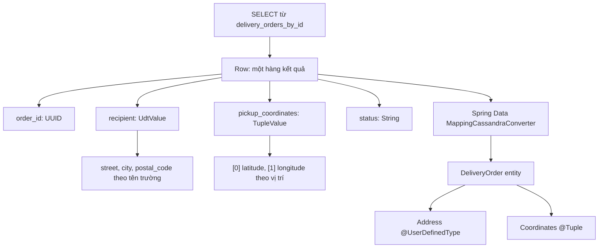
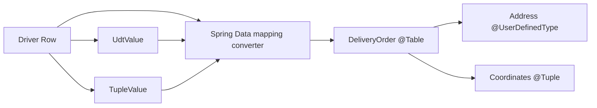

# Chuyển đổi Row, UdtValue và TupleValue

Khi truy vấn Apache Cassandra bằng Java Driver, dữ liệu không xuất hiện ngay dưới dạng entity Java của ứng dụng. Một kết quả CQL thường được đọc qua **`Row`**; nếu một cột chứa **user-defined type (UDT)**, giá trị của cột đó có thể được đọc dưới dạng **`UdtValue`**; còn một cột kiểu **tuple** được đọc dưới dạng **`TupleValue`**. Các lớp này thuộc tầng biểu diễn dữ liệu của **Java Driver**. Trong **Spring Data Cassandra**, bộ chuyển đổi mapping có thể tiếp tục ánh xạ chúng thành object Java thông qua `@Table`, `@UserDefinedType`, `@Tuple` và các annotation tương ứng.

Bài học thuộc chương **Chuyển đổi kiểu** của module **`SPRING_DATA_CASSANDRA`**. Module tập trung truy cập Cassandra với entity mapping, repository, `CassandraTemplate` và truy vấn CQL. Dù chọn tự đọc `Row` hay dùng mapping tự động, ta vẫn cần thiết kế bảng theo truy vấn, cung cấp partition key phù hợp, hiểu consistency level, paging và chi phí của việc truyền/giải mã dữ liệu trên hệ phân tán.

**Mục tiêu sau bài học:**

1. Phân biệt đúng vai trò, phạm vi và cách truy cập dữ liệu của `Row`, `UdtValue`, `TupleValue`.
2. Đọc các kiểu dữ liệu cơ bản và giá trị lồng nhau an toàn, gồm kiểm tra `null` và thứ tự tuple.
3. Tạo `UdtValue`, `TupleValue` rồi bind vào prepared statement để ghi CQL.
4. Dùng Spring Data Cassandra ánh xạ UDT/tuple thành lớp Java và đọc bằng repository hoặc `CassandraTemplate`.
5. Quyết định khi nào nên tự chuyển đổi ở tầng driver và khi nào nên dùng conversion/mapping của Spring Data.
6. Xử lý thay đổi schema, frozen value, paging và giới hạn hiệu năng mà không nhầm chuyển đổi kiểu với khả năng truy vấn.

## 1. Ba đối tượng, ba phạm vi dữ liệu

Hãy bắt đầu từ một bản ghi đặt hàng có địa chỉ nhận và tọa độ điểm lấy hàng. Hàng trong bảng có nhiều **cột CQL**; cột địa chỉ có nhiều **trường UDT**; cột tọa độ có nhiều **phần tử tuple**.



| Kiểu từ Java Driver 4.x | Đại diện cho | Cách truy cập | Không phải |
| --- | --- | --- | --- |
| `Row` | **Một hàng** trả về từ câu lệnh CQL | `getUuid("order_id")`, `getUdtValue("recipient")` | Một entity Java tự động có hành vi nghiệp vụ |
| `UdtValue` | **Một giá trị** của UDT với các trường được đặt tên | `getString("city")`, `getInt("...")` | Một bảng độc lập hay một hàng kết quả |
| `TupleValue` | **Một giá trị** tuple có phần tử theo chỉ số | `getDouble(0)`, `getString(1)` | Một collection có tên trường hoặc nhiều hàng kết quả |

`Row`, `UdtValue` và `TupleValue` đều cung cấp API để đọc giá trị đã được driver giải mã theo **CQL type metadata**. Khi dữ liệu lồng nhau, có thể lấy `UdtValue` hoặc `TupleValue` **từ một cột trong `Row`**, sau đó đọc tiếp các thành phần bên trong.

**Phân biệt rõ:** `Row` không chứa “nhiều row con” chỉ vì một cột có UDT hoặc tuple. Một `SELECT` trả về 100 hàng thì bạn có 100 `Row` để xử lý (theo các trang fetch); mỗi hàng có thể chứa 0, 1 hoặc nhiều cột với giá trị UDT/tuple.

## 2. Chuẩn bị schema CQL nhất quán cho mọi ví dụ

Giả sử môi trường thực hành đã có keyspace `rental_learning`. Đầu tiên tạo UDT địa chỉ, sau đó tạo bảng:

```sql
CREATE TYPE IF NOT EXISTS rental_learning.address_type (
    street text,
    city text,
    postal_code text
);

CREATE TABLE IF NOT EXISTS rental_learning.delivery_orders_by_id (
    order_id uuid PRIMARY KEY,
    recipient frozen<address_type>,
    pickup_coordinates tuple<double, double>,
    status text,
    created_at timestamp
);
```

Ở đây:

- `order_id` là **partition key** duy nhất. Cassandra dùng khóa này để tính token và xác định các replica chịu trách nhiệm lưu bản ghi.
- `recipient` là **một cột UDT** với ba trường có tên: `street`, `city`, `postal_code`. Kiểu `frozen<address_type>` yêu cầu cập nhật như một giá trị nguyên khối.
- `pickup_coordinates` là **một cột tuple** gồm hai vị trí `double`, không có tên phần tử CQL. Ta quy ước vị trí 0 là **vĩ độ**, vị trí 1 là **kinh độ**.
- `status` và `created_at` là các cột dữ liệu thông thường.

Trong CQL, tuple đã có ngữ nghĩa frozen; không cần hình dung nó giống list có thể cập nhật từng phần tử. Với UDT, `frozen` trong DDL ví dụ làm rõ rằng toàn bộ địa chỉ được ghi như **một giá trị**, không sửa từng field độc lập.

Thêm hàng mẫu bằng CQL:

```sql
INSERT INTO rental_learning.delivery_orders_by_id (
    order_id, recipient, pickup_coordinates, status, created_at
) VALUES (
    4fcf49c7-a5df-4cef-b2be-b5114bad6401,
    {street: '12 Le Loi', city: 'Ho Chi Minh', postal_code: '700000'},
    (10.7768, 106.7009),
    'CREATED',
    '2026-11-25T02:00:00Z'
);
```

Truy vấn theo khóa:

```sql
SELECT order_id, recipient, pickup_coordinates, status, created_at
FROM rental_learning.delivery_orders_by_id
WHERE order_id = 4fcf49c7-a5df-4cef-b2be-b5114bad6401;
```

Đây là **truy vấn theo đầy đủ partition key**, phù hợp Cassandra. Tạo một UDT/tuple không tự cho phép bạn tìm nhanh mọi đơn hàng của một thành phố hoặc trong bán kính tọa độ; các nhu cầu đó cần data model, bảng/index hoặc dịch vụ truy vấn được thiết kế riêng.

## 3. Đọc Row bằng Java Driver

`Row` là kiểu kết quả của Java Driver, nằm trong package `com.datastax.oss.driver.api.core.cql` ở driver 4.x. Một câu CQL trả về tập kết quả, còn mỗi phần tử trong tập đó là một `Row`.

```java
import com.datastax.oss.driver.api.core.CqlSession;
import com.datastax.oss.driver.api.core.cql.PreparedStatement;
import com.datastax.oss.driver.api.core.cql.ResultSet;
import com.datastax.oss.driver.api.core.cql.Row;
import java.time.Instant;
import java.util.UUID;

UUID orderId = UUID.fromString(
        "4fcf49c7-a5df-4cef-b2be-b5114bad6401");

PreparedStatement byId = session.prepare("""
    SELECT order_id, recipient, pickup_coordinates, status, created_at
    FROM rental_learning.delivery_orders_by_id
    WHERE order_id = ?
    """);

ResultSet result = session.execute(byId.bind(orderId));
Row row = result.one();

if (row != null) {
    UUID id = row.getUuid("order_id");
    String status = row.getString("status");
    Instant createdAt = row.getInstant("created_at");
}
```

**Đọc đoạn mã:**

1. `session` là **`CqlSession` đã được tạo và quản lý bởi ứng dụng** (thường là bean dùng chung của Spring). Không tạo session mới cho mỗi query.
2. `PreparedStatement` xác định CQL có tham số `?`; `bind(orderId)` truyền giá trị khóa dưới dạng `UUID`.
3. `ResultSet.one()` lấy hàng kế tiếp hoặc trả về `null` khi không có hàng.
4. `Row.getUuid`, `getString` và `getInstant` chuyển giá trị từ CQL sang các kiểu Java được driver hỗ trợ.

Đối với loại dữ liệu cơ bản, một số tương ứng thường gặp:

| CQL | Java Driver getter | Kiểu Java thường dùng |
| --- | --- | --- |
| `uuid` | `row.getUuid("order_id")` | `UUID` |
| `text`/`varchar` | `row.getString("status")` | `String` |
| `timestamp` | `row.getInstant("created_at")` | `Instant` |
| `date` | `row.getLocalDate("event_day")` | `LocalDate` |
| `int` | `row.getInt("quantity")` | `int` |
| `bigint` | `row.getLong("total")` | `long` |
| `double` | `row.getDouble("latitude")` | `double` |
| `boolean` | `row.getBoolean("enabled")` | `boolean` |

Các ví dụ getter cuối bảng áp dụng khi câu CQL thực sự chọn cột có tên và kiểu tương ứng. Không thể gọi `getInt("quantity")` trên `Row` của ví dụ `delivery_orders_by_id` nếu bảng/câu `SELECT` không có cột `quantity`.

### Kiểm tra null và cột không có trong SELECT

Hai tình huống cần phân biệt:

- Cột **có trong kết quả nhưng giá trị null**: kiểm tra `row.isNull("status")` hoặc getter trả về null khi API hỗ trợ.
- Cột **không được chọn** trong câu `SELECT`: không thể giả định getter sẽ trả về null; việc truy cập tên cột không có trong metadata kết quả có thể gây lỗi.

Ví dụ:

```java
if (row != null && !row.isNull("status")) {
    String status = row.getString("status");
}
```

Với getter trả về **primitive** như `getInt`, `getDouble`, cần kiểm tra null trước khi dùng để không đọc sai hoặc gặp lỗi chuyển đổi. Đừng thay null bằng 0 nếu 0 là giá trị nghiệp vụ có ý nghĩa.

## 4. Đọc UdtValue theo tên trường

Một cột kiểu UDT cho phép truy cập các trường theo tên; giá trị ở tầng driver là `UdtValue` thuộc package `com.datastax.oss.driver.api.core.data`.

```java
import com.datastax.oss.driver.api.core.data.UdtValue;

if (row != null) {
    UdtValue recipient = row.getUdtValue("recipient");

    if (recipient != null) {
        String street = recipient.getString("street");
        String city = recipient.getString("city");
        String postalCode = recipient.isNull("postal_code")
                ? null : recipient.getString("postal_code");
    }
}
```

`Row.getUdtValue("recipient")` lấy **giá trị của cột** `recipient`. Sau đó `recipient.getString("city")` lấy **giá trị của trường** `city` trong UDT đó. Hai tầng này khác nhau:

```text
Row                         UdtValue
│
├── order_id                 UUID
├── recipient ──────────────► street       String
│                            city         String
│                            postal_code  String
├── pickup_coordinates       TupleValue
└── status                   String
```

Nếu cột `recipient` là null, `getUdtValue` có thể trả về null. Nếu UDT tồn tại nhưng một trường của UDT là null, `recipient.isNull("postal_code")` phát hiện null **ở trường đó**. Đọc kỹ cả hai trường hợp.

### UDT có field name, tuple không có field name

Trong CQL, `address_type` định nghĩa `street`, `city`, `postal_code`. Tên field thuộc **UDT schema**; do đó khi thay đổi kiểu UDT hoặc field name, code Java dùng `getString("city")` cũng phải tương thích với schema mới.

Một `UdtValue` không đại diện cho một hàng trong bảng `address_type`. UDT được khai báo bằng `CREATE TYPE`, rồi sử dụng làm **kiểu của một cột** trong bảng hoặc trong cấu trúc hỗ trợ khác.

### Cập nhật UDT frozen

Vì cột trong bài khai báo `recipient frozen<address_type>`, không nên kỳ vọng có thể cập nhật riêng `recipient.city` bằng câu CQL:

```sql
-- Không áp dụng cho cột recipient frozen<address_type>:
-- UPDATE rental_learning.delivery_orders_by_id
-- SET recipient.city = 'Da Nang'
-- WHERE order_id = ...;
```

Thay vào đó, cập nhật lại cả giá trị:

```sql
UPDATE rental_learning.delivery_orders_by_id
SET recipient = {
    street: '12 Le Loi',
    city: 'Da Nang',
    postal_code: '550000'
}
WHERE order_id = 4fcf49c7-a5df-4cef-b2be-b5114bad6401;
```

Việc ghi nguyên khối có ý nghĩa về **cập nhật đồng thời**: hai writer cùng đọc địa chỉ cũ rồi ghi các bản thay đổi khác nhau có thể ghi đè thay đổi của nhau theo cơ chế timestamp của Cassandra. Cần áp dụng quy tắc cập nhật phù hợp với nghiệp vụ.

## 5. Đọc TupleValue theo vị trí phần tử

Tuple lưu các phần tử theo thứ tự được khai báo trong `tuple<T1, T2, ..., Tn>`. Ở bảng ví dụ, `pickup_coordinates tuple<double, double>` có:

- `index 0`: vĩ độ, kiểu CQL `double`.
- `index 1`: kinh độ, kiểu CQL `double`.

Trong Java Driver:

```java
import com.datastax.oss.driver.api.core.data.TupleValue;

if (row != null) {
    TupleValue coordinates = row.getTupleValue("pickup_coordinates");

    if (coordinates != null) {
        Double latitude = coordinates.isNull(0)
                ? null : coordinates.getDouble(0);
        Double longitude = coordinates.isNull(1)
                ? null : coordinates.getDouble(1);
    }
}
```

**Tại sao không có `getDouble("latitude")`?** Vì CQL tuple không lưu tên phần tử. Spring Data có thể gắn tên field Java như `latitude` nhờ `@Tuple` và `@Element(0)`, nhưng tên này là **metadata mapping của ứng dụng**, không phải field name của tuple CQL.

| Sai lầm | Hệ quả |
| --- | --- |
| Gọi `getDouble(1)` rồi gán vào `latitude` | Có thể đảo nghĩa tọa độ mà không lỗi kiểu |
| Giả định index bắt đầu từ 1 | Đọc nhầm giá trị hoặc vượt số phần tử |
| Gọi primitive getter khi phần tử null | Có thể gặp lỗi hoặc diễn giải null sai |
| Coi tuple như list có thể append tùy ý | CQL tuple có số phần tử và kiểu cố định |
| Dùng tuple làm khóa truy vấn địa lý | Không tạo chỉ mục/tính toán khoảng cách để truy vấn hiệu quả |

**Tuple là giá trị frozen**. Muốn đổi riêng vĩ độ, câu lệnh ghi phải thay **cả cặp** tọa độ:

```sql
UPDATE rental_learning.delivery_orders_by_id
SET pickup_coordinates = (10.7800, 106.7009)
WHERE order_id = 4fcf49c7-a5df-4cef-b2be-b5114bad6401;
```

Trong Java, cần xây giá trị tuple đủ thành phần tương ứng. Không có API CQL phổ quát để `SET pickup_coordinates[0] = ...` đối với tuple.

## 6. Chuyển cả Row thành DTO thủ công

Khi cần dùng CQL trực tiếp hoặc chỉ lấy một phần dữ liệu không tương ứng trọn vẹn với entity, bạn có thể **tự map `Row` thành DTO**. Ví dụ sử dụng Java record:

```java
import java.util.UUID;
import com.datastax.oss.driver.api.core.cql.Row;
import com.datastax.oss.driver.api.core.data.UdtValue;
import com.datastax.oss.driver.api.core.data.TupleValue;

public record DeliverySummary(
        UUID orderId,
        String city,
        Double latitude,
        Double longitude,
        String status) {
}

static DeliverySummary mapDelivery(Row row) {
    UdtValue address = row.getUdtValue("recipient");
    TupleValue point = row.getTupleValue("pickup_coordinates");

    String city = address == null || address.isNull("city")
            ? null : address.getString("city");

    Double latitude = point == null || point.isNull(0)
            ? null : point.getDouble(0);

    Double longitude = point == null || point.isNull(1)
            ? null : point.getDouble(1);

    return new DeliverySummary(
            row.getUuid("order_id"),
            city,
            latitude,
            longitude,
            row.getString("status"));
}
```

**Lưu ý cấu trúc ví dụ:** trong một file Java hoàn chỉnh, hãy đặt `mapDelivery` vào class tiện ích/service hoặc chuyển thành phương thức của record. Đoạn trích tập trung vào logic mapping; nó chưa phải một compilation unit có thể dán nguyên xi vào bất kỳ vị trí nào. Java record yêu cầu phiên bản Java hỗ trợ record.

Ưu điểm của mapping thủ công:

- Chỉ đọc những cột cần thiết; có thể tạo DTO dành riêng cho API.
- Kiểm soát rõ các quy tắc null, validation, chuẩn hóa dữ liệu.
- Hữu ích khi câu CQL có projection hoặc cấu trúc không khớp trực tiếp với entity.

Đánh đổi:

- Cần tự bảo trì tên cột/field, kiểu Java và index tuple.
- Schema đổi có thể khiến logic mapping bị lỗi hoặc trả kết quả sai nghĩa.
- Nhiều đoạn mã lặp lại dễ tạo sự khác biệt giữa các API.

Nếu mọi repository đều thao tác cùng một bảng/entity, hãy cân nhắc **Spring Data entity mapping** để tránh tự viết các chuyển đổi lặp lại.

## 7. Tạo UdtValue và TupleValue để ghi dữ liệu

Đối với CQL trực tiếp, cần tạo giá trị UDT dựa trên **metadata của type trong keyspace**, còn tuple dựa trên `TupleType` có thứ tự kiểu đúng.

Ví dụ driver 4.x:

```java
import com.datastax.oss.driver.api.core.CqlIdentifier;
import com.datastax.oss.driver.api.core.CqlSession;
import com.datastax.oss.driver.api.core.data.TupleValue;
import com.datastax.oss.driver.api.core.data.UdtValue;
import com.datastax.oss.driver.api.core.cql.PreparedStatement;
import com.datastax.oss.driver.api.core.type.DataTypes;
import com.datastax.oss.driver.api.core.type.TupleType;
import com.datastax.oss.driver.api.core.type.UserDefinedType;
import java.time.Instant;
import java.util.UUID;

UserDefinedType addressType = session.getMetadata()
        .getKeyspace(CqlIdentifier.fromCql("rental_learning"))
        .orElseThrow()
        .getUserDefinedType(CqlIdentifier.fromCql("address_type"))
        .orElseThrow();

UdtValue recipient = addressType.newValue()
        .setString("street", "12 Le Loi")
        .setString("city", "Ho Chi Minh")
        .setString("postal_code", "700000");

TupleType pointType = DataTypes.tupleOf(
        DataTypes.DOUBLE, DataTypes.DOUBLE);

TupleValue coordinates = pointType.newValue()
        .setDouble(0, 10.7768)
        .setDouble(1, 106.7009);

PreparedStatement insert = session.prepare("""
    INSERT INTO rental_learning.delivery_orders_by_id (
        order_id, recipient, pickup_coordinates, status, created_at
    ) VALUES (?, ?, ?, ?, ?)
    """);

session.execute(insert.bind(
        UUID.fromString("4fcf49c7-a5df-4cef-b2be-b5114bad6401"),
        recipient,
        coordinates,
        "CREATED",
        Instant.parse("2026-11-25T02:00:00Z")));
```

**Điều kiện của ví dụ:** `session` là `CqlSession` đã được khởi tạo; schema UDT/bảng tồn tại và metadata driver đã cập nhật; các dependency đúng Java Driver 4.x; database user có quyền ghi. `getKeyspace(...).orElseThrow()` và `getUserDefinedType(...).orElseThrow()` sẽ thất bại rõ ràng nếu schema chưa xuất hiện trong metadata.

Phân biệt:

1. `UserDefinedType` là **mô tả kiểu** UDT, được dùng để tạo `UdtValue`.
2. `TupleType` là **mô tả kiểu** tuple, được dùng để tạo `TupleValue`.
3. `UdtValue`/`TupleValue` là **giá trị cụ thể** để bind vào cột của câu CQL.
4. `PreparedStatement` mang metadata tham số; `bind(...)` tạo statement có giá trị cho một lần thực thi.
5. `CqlSession` là tài nguyên dùng chung, không đóng sau mỗi lần ghi.

### Đảm bảo kiểu UDT/tuple khớp schema

Nếu mã Java tạo `TupleType` là `tuple<float,float>` trong khi cột CQL là `tuple<double,double>`, driver/Cassandra có thể từ chối giá trị do kiểu không tương thích. Nếu UDT được lấy từ **keyspace khác** hoặc metadata cũ, cũng có thể có lỗi type mismatch.

Với hệ thống có nhiều keyspace/cluster, luôn lấy metadata phù hợp với đúng nơi câu CQL được thực thi. Sau migration schema, cần bảo đảm **schema agreement** và metadata driver đủ mới trước khi prepare/ghi dữ liệu theo type mới.

### Có thể lấy type từ metadata cột

Trong các công cụ generic, đôi khi bạn đã có `ColumnDefinitions` hoặc metadata table/column phù hợp và muốn lấy type cột thay vì tự dựng `DataTypes.tupleOf(...)`. Cần kiểm tra type metadata và ép về `TupleType` **chỉ khi** cột thực sự là tuple. Không ép kiểu mù quáng từ một cột `text` hoặc `frozen<address_type>`.

## 8. Spring Data Cassandra tự ánh xạ như thế nào?

Khi dùng entity/repository, Spring Data Cassandra có **mapping converter** dựa trên metadata của entity và các kiểu dữ liệu. Về khái niệm:



Khi đọc một entity, framework có thể:

- Xác định `@Table` để chọn bảng.
- Xác định `@PrimaryKey`/`@Column` để nối cột CQL với property Java.
- Với trường UDT, dùng metadata `@UserDefinedType` và tên trường tương ứng.
- Với tuple, dùng `@Tuple` và ordinal `@Element`.
- Áp dụng chuyển đổi kiểu hỗ trợ sẵn và **custom conversions** khi cần.

Vì vậy trong trường hợp được mapping đầy đủ, service không cần gọi `row.getUdtValue(...)` hoặc `row.getTupleValue(...)` trực tiếp; nó làm việc với **object domain Java**.

### 8.1. Mapped UDT

```java
package example.delivery.data;

import org.springframework.data.cassandra.core.mapping.Field;
import org.springframework.data.cassandra.core.mapping.UserDefinedType;

@UserDefinedType("address_type")
public class Address {
    @Field("street")
    private String street;

    @Field("city")
    private String city;

    @Field("postal_code")
    private String postalCode;

    public Address() {
    }

    public Address(String street, String city, String postalCode) {
        this.street = street;
        this.city = city;
        this.postalCode = postalCode;
    }

    public String getStreet() { return street; }
    public void setStreet(String street) { this.street = street; }
    public String getCity() { return city; }
    public void setCity(String city) { this.city = city; }
    public String getPostalCode() { return postalCode; }
    public void setPostalCode(String postalCode) {
        this.postalCode = postalCode;
    }
}
```

Ở UDT, `@Field("postal_code")` chỉ rõ tên trường CQL, tương ứng Java property `postalCode`. Đây là annotation khác với `@Column` dùng cho cột của một entity bảng. `Address` **không phải một bảng riêng**.

### 8.2. Mapped tuple

```java
package example.delivery.data;

import org.springframework.data.cassandra.core.mapping.Element;
import org.springframework.data.cassandra.core.mapping.Tuple;

@Tuple
public class Coordinates {
    @Element(0)
    private Double latitude;

    @Element(1)
    private Double longitude;

    public Coordinates() {
    }

    public Coordinates(Double latitude, Double longitude) {
        this.latitude = latitude;
        this.longitude = longitude;
    }

    public Double getLatitude() { return latitude; }
    public void setLatitude(Double latitude) {
        this.latitude = latitude;
    }
    public Double getLongitude() { return longitude; }
    public void setLongitude(Double longitude) {
        this.longitude = longitude;
    }
}
```

**Thứ tự `@Element` là hợp đồng dữ liệu.** Chỉ số bắt đầu từ 0, không được đảo tùy tiện vì hai `double` vẫn có thể deserialize thành công nhưng đổi nghĩa vĩ độ/kinh độ.

### 8.3. Entity chứa cả UDT và tuple

```java
package example.delivery.data;

import java.time.Instant;
import java.util.UUID;
import org.springframework.data.cassandra.core.mapping.Column;
import org.springframework.data.cassandra.core.mapping.PrimaryKey;
import org.springframework.data.cassandra.core.mapping.Table;

@Table("delivery_orders_by_id")
public class DeliveryOrder {
    @PrimaryKey("order_id")
    private UUID orderId;

    @Column("recipient")
    private Address recipient;

    @Column("pickup_coordinates")
    private Coordinates pickupCoordinates;

    @Column("status")
    private String status;

    @Column("created_at")
    private Instant createdAt;

    public DeliveryOrder() {
    }

    // Bổ sung constructor, getter và setter cho từng property.
}
```

Đây là đoạn entity **minh họa mapping**, chưa phải toàn bộ lớp triển khai. Khi dùng thực tế, cần constructor/getter/setter hoặc chiến lược materialization phù hợp với phiên bản Spring Data, cùng entity/repository scanning và schema CQL nhất quán.

**Ba cấp annotation cần phân biệt:**

| Cấp độ | Annotation | Đối tượng được ánh xạ |
| --- | --- | --- |
| Bảng/hàng | `@Table`, `@PrimaryKey`, `@Column` | `DeliveryOrder` ↔ bảng `delivery_orders_by_id` |
| Giá trị UDT | `@UserDefinedType`, `@Field` | `Address` ↔ `address_type` |
| Giá trị tuple | `@Tuple`, `@Element` | `Coordinates` ↔ `tuple<double,double>` |

`@UserDefinedType` hoặc `@Tuple` không tạo thêm partition hay bảng riêng. Chúng mô tả **cách đọc/ghi giá trị một cột**.

## 9. Đọc bằng Repository hoặc CassandraTemplate

Repository dựa trên entity:

```java
package example.delivery.data;

import java.util.UUID;
import org.springframework.data.cassandra.repository.CassandraRepository;

public interface DeliveryOrderRepository
        extends CassandraRepository<DeliveryOrder, UUID> {
}
```

Khi mapping đúng, service có thể đọc:

```java
UUID orderId = UUID.fromString(
        "4fcf49c7-a5df-4cef-b2be-b5114bad6401");

DeliveryOrder order = repository.findById(orderId)
        .orElseThrow();

Address recipient = order.getRecipient();
Coordinates pickup = order.getPickupCoordinates();
```

Đoạn sử dụng trên giả định `DeliveryOrder` đã có getter phù hợp như đã lưu ý ở mục 8. Repository sử dụng metadata entity để chuyển **`Row` → `DeliveryOrder`**, đồng thời **`UdtValue` → `Address`** và **`TupleValue` → `Coordinates`** theo mapping.

Với `CassandraTemplate`:

```java
import org.springframework.data.cassandra.core.CassandraTemplate;
import org.springframework.data.cassandra.core.query.Criteria;
import org.springframework.data.cassandra.core.query.Query;

Query byId = Query.query(
        Criteria.where("order_id").is(orderId));

DeliveryOrder order =
        cassandraTemplate.selectOne(byId, DeliveryOrder.class);
```

**Ý nghĩa:** `CassandraTemplate` nhận class entity để tìm tên bảng, cột, khóa và converter. Với truy vấn theo khóa `order_id`, Cassandra có thể định vị partition. Nếu một CQL được gửi qua `CqlSession` và chỉ lấy `Row`, việc ánh xạ sang class domain **không xảy ra tự động chỉ vì class có annotation**; bạn phải tự map hoặc gọi cơ chế mapping tương ứng.

### Cân nhắc DTO/projection

Nếu API chỉ cần `order_id` và `status`, không nhất thiết tải cả cột `recipient` và `pickup_coordinates`. Dùng projection hoặc truy vấn chọn đúng cột giúp giảm dữ liệu truyền từ node và công việc giải mã. Nhưng nếu đọc một **entity đầy đủ**, bảo đảm query cung cấp các cột cần thiết để converter dựng entity đúng.

## 10. Custom conversion: khi mapping mặc định chưa đủ

Các annotation chuẩn xử lý tốt những mô hình UDT/tuple có cấu trúc phù hợp. Tuy nhiên, có hệ thống dùng:

- Giá trị tiền tệ hoặc mã trạng thái cần validation/chuẩn hóa riêng.
- UDT lịch sử có field name không trùng tên Java và conversion đặc thù.
- Các tuple có logic chuyển sang value object bất biến.
- Dữ liệu cũ không đồng nhất mà mã nghiệp vụ cần một kiểu biểu diễn thống nhất.

Spring Data Cassandra cho phép đăng ký **custom converters** thông qua cấu hình chuyển đổi (`CassandraCustomConversions` hoặc customization tương ứng theo phiên bản). Trong custom converter, cần xác định **hướng đọc** và **hướng ghi**:

```text
Đọc:
  Row / UdtValue / TupleValue
      → mapping/converter
      → Java domain value

Ghi:
  Java domain value
      → mapping/converter
      → kiểu dữ liệu được driver chấp nhận
      → CQL mutation
```

### Ví dụ quy tắc chuyển đổi tùy biến

Giả sử DTO hiển thị tọa độ muốn dùng một record có validation. Một hàm Java đơn giản ở tầng ứng dụng có thể chuyển từ `TupleValue`:

```java
public record GeoPoint(double latitude, double longitude) {
    public GeoPoint {
        if (!Double.isFinite(latitude) || latitude < -90 || latitude > 90) {
            throw new IllegalArgumentException("Invalid latitude");
        }
        if (!Double.isFinite(longitude) || longitude < -180 || longitude > 180) {
            throw new IllegalArgumentException("Invalid longitude");
        }
    }
}

static GeoPoint toGeoPoint(TupleValue tuple) {
    if (tuple == null || tuple.isNull(0) || tuple.isNull(1)) {
        throw new IllegalArgumentException("Coordinates are missing");
    }
    return new GeoPoint(tuple.getDouble(0), tuple.getDouble(1));
}
```

Đây là **hàm chuyển đổi ứng dụng**, chưa phải một Spring converter đã đăng ký. Để dùng nó như conversion toàn cục trong Spring Data, cần tạo converter theo đúng interface `Converter<S,T>`, annotation hướng đọc/ghi khi cần và cấu hình đăng ký phù hợp. Không nên đăng ký một converter **`Row → entity` quá rộng** chỉ để xử lý một trường cụ thể; việc đó dễ tác động ngoài ý muốn đến các entity khác.

**Nguyên tắc:** ưu tiên metadata `@UserDefinedType`/`@Tuple` trước. Chỉ thêm custom converter khi có **quy tắc chuyển đổi thực sự khác mặc định**, và kiểm thử round-trip đọc/ghi để bảo đảm không biến đổi dữ liệu âm thầm.

## 11. Null, kiểu dữ liệu và khác biệt giữa “không có cột” với “giá trị rỗng”

Đối với ba lớp, hãy kiểm tra null ở đúng cấp:

| Trường hợp | Kiểm tra phù hợp | Ý nghĩa |
| --- | --- | --- |
| Không có hàng phù hợp | `row == null` sau `result.one()` | Partition/hàng không có kết quả khả kiến |
| Có hàng nhưng cột UDT null | `row.isNull("recipient")` hoặc `getUdtValue(...) == null` | Không có giá trị UDT khả kiến ở cột |
| UDT tồn tại, field null | `udt.isNull("postal_code")` | Field trong giá trị UDT không có nội dung |
| Có hàng nhưng tuple null | `row.isNull("pickup_coordinates")` | Không có giá trị tuple khả kiến |
| Tuple tồn tại, phần tử null | `tuple.isNull(0)` | Phần tử tại index cụ thể thiếu giá trị |
| Cột không được `SELECT` | Không tồn tại trong column definitions của `Row` | Không được phép suy ra là null |

Trong Cassandra, việc ghi `null` hoặc `DELETE` có thể tạo tombstone tương ứng tùy thao tác. **Null trong DTO Java không tự nói lên** thao tác CQL của repository/template sẽ làm gì. Trước khi cập nhật một trường, cần xác định ý nghĩa của việc **bỏ qua field**, **gán null** và **xóa chủ đích** trong API mình dùng.

### Không đổi null thành giá trị hợp lệ

Ví dụ, phần tử tuple vĩ độ null không nên mặc định chuyển thành `0.0`. Vĩ độ bằng 0 là một tọa độ thực, còn null nghĩa là **chưa có dữ liệu**. Với `int` và `double`, hãy dùng Java wrapper `Integer`, `Double` trong domain nếu tình huống thiếu dữ liệu là hợp lệ.

Nếu một UDT chứa field `postal_code` chưa được ghi, dùng null theo domain và kiểm tra dữ liệu đầu vào. Nếu ứng dụng bắt buộc địa chỉ có mã bưu chính, nên từ chối dữ liệu thiếu ngay ở validation; conversion không nên âm thầm sinh chuỗi rỗng để che lỗi.

## 12. Frozen, tính nguyên khối và cập nhật đồng thời

Trong ví dụ CQL:

```sql
recipient frozen<address_type>,
pickup_coordinates tuple<double, double>
```

Cả hai được lưu theo ngữ nghĩa **một giá trị tổng hợp** khi cập nhật:

- `recipient` được khai báo `frozen<address_type>`.
- `pickup_coordinates` là tuple và vốn có ngữ nghĩa frozen.

Giả sử hai request cùng đọc một tuple tọa độ `(10.7768, 106.7009)`:

1. A muốn sửa vĩ độ thành `10.7800`, đọc giá trị cũ và định ghi `(10.7800, 106.7009)`.
2. B muốn sửa kinh độ thành `106.7100`, cũng dựa trên giá trị cũ và định ghi `(10.7768, 106.7100)`.
3. Nếu cả hai ghi nguyên tuple, bản ghi cuối cùng được chọn theo quy tắc timestamp/conflict resolution có thể khiến **một thay đổi bị mất**.

`TupleValue` và `UdtValue` giúp mã hóa đúng dữ liệu, nhưng **không tự bảo đảm merge từng field hoặc giao dịch giữa hai writer**. Nếu nghiệp vụ yêu cầu tránh lost update, cân nhắc:

- Tuần tự hóa update tại tầng ứng dụng khi có thể.
- Thiết kế các cột độc lập nếu chúng thực sự được cập nhật độc lập.
- Dùng điều kiện phù hợp với `IF`/lightweight transaction khi cần kiểm soát cạnh tranh và chấp nhận đánh đổi về hiệu năng.

**Không dùng nhiều session hoặc tăng consistency level như một cách thay thế trực tiếp cho kiểm soát cập nhật đồng thời**. Consistency level quyết định điều kiện replica phản hồi; nó không biến thao tác read-modify-write nguyên tuple thành atomic compare-and-swap.

## 13. Chuyển đổi kiểu phải đi cùng thiết kế truy vấn và paging

Một `Row` được giải mã nhanh không có nghĩa truy vấn Cassandra phía trước hiệu quả. Với bảng theo `order_id`:

```sql
SELECT order_id, status
FROM rental_learning.delivery_orders_by_id
WHERE order_id = 4fcf49c7-a5df-4cef-b2be-b5114bad6401;
```

đã có đủ partition key nên đường đọc rõ ràng. Nhưng câu hỏi “lấy toàn bộ đơn hàng của thành phố Ho Chi Minh” **không được đáp ứng hiệu quả** chỉ vì `recipient.city` có sẵn trong `UdtValue`.

Nếu cần truy vấn theo thành phố và thời gian, một bảng riêng có thể được thiết kế theo yêu cầu, ví dụ `delivery_orders_by_city_day` với partition key dựa trên `(city, day)` và clustering columns phù hợp. Việc duy trì nhiều bảng có chi phí ghi và đồng bộ, nhưng đó là đánh đổi data modeling cần xem xét.

### Đọc nhiều Row và paging

Một `SELECT` trả về nhiều hàng có thể sử dụng paging của driver:

- `setPageSize(n)` đặt kích thước **mỗi trang fetch**, không phải tổng số bản ghi của toàn truy vấn.
- Khi duyệt `ResultSet` đồng bộ, iterator có thể fetch các trang tiếp theo; có thể làm request kéo dài nếu vô tình duyệt toàn bộ kết quả.
- Với `AsyncResultSet`, chương trình chủ động xử lý trang hiện tại và gọi `fetchNextPage()` khi cần.
- Paging state gắn với câu truy vấn và các tham số; không nên hiểu nó là offset số nguyên.

Nếu hàng chứa UDT/tuple lớn, cần tính **bytes/page**, không chỉ `rows/page`. 500 hàng có cột UDT nhiều field hoặc nhiều collection lồng nhau có thể tạo payload và chi phí conversion lớn hơn rất nhiều so với 500 hàng chỉ có `UUID`.

### Consistency và hiệu năng

Chọn `LOCAL_QUORUM`, `ONE` hoặc mức nhất quán khác phải dựa trên replication factor, topology và yêu cầu nghiệp vụ; **không dựa trên việc cột là UDT hay tuple**. Đo p95/p99, throughput, timeout, retry, CPU ứng dụng và node cùng số hàng/bytes trả về. Khi benchmark converter, giữ query shape, page size, consistency, partition key và payload tương đương.

## 14. Thay đổi schema và tương thích chuyển đổi

### 14.1. Khi UDT thêm field

Ban đầu `address_type` có ba trường. Khi cần thêm `country`, có thể có thay đổi schema UDT bằng một quy trình migration phù hợp:

```sql
ALTER TYPE rental_learning.address_type
ADD country text;
```

Sau thay đổi, các giá trị đã lưu có thể không có nội dung ở field mới; code chuyển đổi phải chấp nhận `null` hoặc có quy trình backfill. Cần cập nhật lớp `Address` khi ứng dụng muốn dùng field mới, đồng thời kiểm tra converter và schema agreement giữa node/driver.

### 14.2. Khi tuple đổi số phần tử

Tuple `tuple<double, double>` và `tuple<double, double, double>` là hai kiểu khác nhau. Chỉ thêm `@Element(2)` vào lớp `Coordinates` hoặc gọi `getDouble(2)` trên tuple cũ **không tự đổi schema và dữ liệu**.

Nếu muốn thêm độ cao, giải pháp thường là tạo **cột phiên bản mới** như `pickup_coordinates_v2` hoặc bảng mới, rồi migrate/backfill có kiểm soát. Cần tính cả tương thích người đọc cũ và mới, TTL, write timestamp và dữ liệu thiếu.

### 14.3. Thay đổi tên field hoặc vị trí

| Thay đổi | Rủi ro |
| --- | --- |
| Đổi tên `city` trong UDT | Code `getString("city")` và mapping `@Field("city")` có thể mất tương thích |
| Đảo hai phần tử tuple đều kiểu `double` | Deserialization vẫn có thể chạy nhưng vĩ độ/kinh độ bị đổi nghĩa |
| Đổi kiểu `timestamp` sang kiểu khác | Getter `getInstant` hoặc converter cũ có thể thất bại |
| Đổi keyspace/cluster | Driver metadata cho UDT có thể không còn tương thích với cột mục tiêu |
| Đổi partition key | Không giải quyết bằng converter; cần thiết kế schema/bảng và di chuyển dữ liệu |

Việc conversion đọc thành công **không đủ** để xác nhận dữ liệu đúng nghĩa. Hãy kiểm thử giá trị thực, thứ tự phần tử, độ chính xác số, null và round-trip sau schema migration.

## 15. Những lỗi thường gặp và cách chẩn đoán

| Dấu hiệu | Khả năng | Cách xử lý |
| --- | --- | --- |
| `row == null` | Không có hàng theo khóa, dữ liệu chưa ghi hoặc không còn khả kiến | Xác minh partition key và CQL trước khi đọc field |
| Getter theo tên cột báo lỗi | Cột không nằm trong `SELECT` hoặc sai tên/casing | Kiểm tra column definitions của kết quả và DDL |
| `getUdtValue` thất bại | Cột không phải UDT hoặc type metadata/converter không khớp | Xác minh CQL schema và phiên bản driver |
| `udt.getString("city")` lỗi | Field không tồn tại hoặc khác kiểu | Đối chiếu `CREATE TYPE`/`ALTER TYPE` và tên field |
| `tuple.getDouble(1)` đọc sai dữ liệu | Đảo ordinal hoặc schema bị thay đổi | Xác nhận index `0..n-1` và giá trị mẫu |
| `tuple.getDouble(2)` lỗi | Tuple thực tế chỉ có hai phần tử | Không đọc index ngoài schema; migrate khi cần |
| Lỗi bind `UdtValue` | Lấy UDT từ sai keyspace/metadata cũ hoặc type khác | Lấy type từ metadata cùng keyspace và chờ schema agreement |
| Mapped entity có field null bất ngờ | Sai `@Column`, `@Field`, `@Element` hoặc custom converter | Đối chiếu entity ↔ Row ↔ CQL schema |
| Ghi cả tuple làm mất thay đổi đồng thời | Hai writer cập nhật cùng giá trị frozen | Kiểm soát concurrency hoặc tách cột |
| Truy vấn theo trường UDT/tuple chậm | Partition key không hỗ trợ truy vấn này | Thiết kế bảng/index theo query; tránh quét toàn bảng |
| CPU/memory ứng dụng tăng | Đọc quá nhiều `Row`, dữ liệu lồng nhau lớn, paging không giới hạn | Đo rows/bytes, giới hạn trang, chọn projection |

**Quy trình xác minh từng tầng:**

1. Xem **DDL CQL**: bảng, UDT, kiểu cột và keyspace chính xác.
2. Chạy `SELECT` theo đủ partition key, kiểm tra kết quả có hàng và đúng cột.
3. Đọc thủ công `Row`, sau đó `UdtValue`/`TupleValue` với null checks.
4. Đọc lại bằng repository hoặc `CassandraTemplate`; so sánh property Java với giá trị driver.
5. Nếu chỉ tầng Spring lỗi, kiểm tra annotation, materialization, custom conversions và phiên bản dependency.
6. Nếu chỉ lỗi khi tải lớn, đo paging, concurrency, hot partition, SSTable/tombstone và timeout thay vì tự mở thêm `CqlSession`.

## 16. Bài thực hành kiểm chứng round-trip

**Bước 1 – Tạo schema** trong keyspace thực hành:

```sql
CREATE TYPE IF NOT EXISTS rental_learning.address_type (
    street text,
    city text,
    postal_code text
);

CREATE TABLE IF NOT EXISTS rental_learning.delivery_orders_by_id (
    order_id uuid PRIMARY KEY,
    recipient frozen<address_type>,
    pickup_coordinates tuple<double, double>,
    status text,
    created_at timestamp
);
```

**Bước 2 – Ghi hàng mẫu** như phần `INSERT` ở mục 2.

**Bước 3 – Đọc bằng driver**, quan sát các tầng:

```java
Row row = session.execute(byId.bind(orderId)).one();
if (row == null) {
    throw new IllegalStateException("Order not found");
}

UdtValue address = row.getUdtValue("recipient");
TupleValue coordinates = row.getTupleValue("pickup_coordinates");

System.out.println(row.getUuid("order_id"));
System.out.println(address == null ? null : address.getString("city"));
System.out.println(coordinates == null || coordinates.isNull(0)
        ? null : coordinates.getDouble(0));
```

Đoạn này giả định các biến `byId` và `orderId` từ mục 3, cùng import driver ở các mục trước. Giá trị mong đợi: mã order tương ứng, `Ho Chi Minh` và vĩ độ `10.7768`.

**Bước 4 – Đọc qua Spring Data** sau khi tạo các class `Address`, `Coordinates`, `DeliveryOrder` và repository:

```java
DeliveryOrder order = repository.findById(orderId)
        .orElseThrow();

System.out.println(order.getRecipient().getCity());
System.out.println(order.getPickupCoordinates().getLongitude());
```

Cần bổ sung các getter của entity `DeliveryOrder` và cấu hình Spring như đã nêu ở mục 8. Kết quả mong đợi: `Ho Chi Minh` và `106.7009`.

**Bước 5 – Thử null:** trong một bản ghi kiểm thử riêng, cho `postal_code` bằng null rồi so sánh `udt.isNull("postal_code")` với giá trị Java `Address.postalCode`. Kiểm tra luồng validation của ứng dụng khi nghiệp vụ bắt buộc mã bưu chính.

**Bước 6 – Thử đảo tuple:** ở một class/mapping thí nghiệm, cố tình đảo `@Element(0)` và `@Element(1)`. Nếu cả hai phần tử cùng kiểu `double`, có thể không xuất hiện lỗi serialization nhưng dữ liệu bị đảo nghĩa. Khôi phục mapping và thêm kiểm thử giá trị kỳ vọng.

**Bước 7 – Thử cập nhật:** thay `recipient` hoặc `pickup_coordinates` bằng **giá trị nguyên khối**, đọc lại bằng cả CQL và repository. Xác nhận các field/phần tử không được cập nhật sai hoặc mất dữ liệu do dùng object cũ.

## 17. Tự kiểm tra

**Câu 1.** `Row`, `UdtValue` và `TupleValue` khác nhau ở đâu?

<details>
<summary>Gợi ý trả lời</summary>

`Row` biểu diễn **một hàng kết quả CQL** với các cột. `UdtValue` biểu diễn giá trị UDT, truy cập theo **tên field**. `TupleValue` biểu diễn một tuple, truy cập theo **chỉ số vị trí**.
</details>

**Câu 2.** Một `Row` có cột `recipient` kiểu `frozen<address_type>`. Muốn đọc `city` thì cần thao tác gì?

<details>
<summary>Gợi ý trả lời</summary>

Lấy `UdtValue address = row.getUdtValue("recipient")`, kiểm tra null rồi gọi `address.getString("city")`. Không đọc `row.getString("city")` nếu `city` không phải cột trực tiếp được chọn.
</details>

**Câu 3.** Tuple `tuple<double,double>` lưu `(10.7768,106.7009)`. Tại sao `tuple.getDouble(1)` không phải latitude?

<details>
<summary>Gợi ý trả lời</summary>

Theo quy ước schema của bài, phần tử 0 là vĩ độ và phần tử 1 là kinh độ. Tuple không lưu tên field; index quyết định nghĩa.
</details>

**Câu 4.** Vì sao `UdtValue` tạo từ metadata của keyspace A có thể không dùng được để bind vào cột UDT ở keyspace B?

<details>
<summary>Gợi ý trả lời</summary>

UDT gắn với schema và metadata của keyspace. Type có thể khác tên/field hoặc không cùng định danh dù cấu trúc trông tương tự. Phải dùng type đúng schema và keyspace đích.
</details>

**Câu 5.** Dùng Spring Data entity có `@UserDefinedType` và `@Tuple` thì `CqlSession.execute(...)` tự trả về `DeliveryOrder` không?

<details>
<summary>Gợi ý trả lời</summary>

Không. Driver trả về `ResultSet`/`Row`. Repository và `CassandraTemplate` sử dụng mapping converter để dựng domain object; với CQL driver trực tiếp, cần mapping thủ công hoặc gọi cơ chế converter phù hợp.
</details>

**Câu 6.** Sau khi bổ sung độ cao vào tuple tọa độ, chỉ sửa class Java để thêm `@Element(2)` đã đủ chưa?

<details>
<summary>Gợi ý trả lời</summary>

Chưa đủ. Type CQL và dữ liệu hiện có vẫn theo cấu trúc cũ. Cần schema/migration phù hợp, dữ liệu chuyển đổi và kiểm thử tương thích.
</details>

**Câu 7.** Repository trả về đúng `Address` và `Coordinates` nhưng query tìm mọi đơn hàng của một thành phố rất chậm. Có nên viết thêm converter không?

<details>
<summary>Gợi ý trả lời</summary>

Không phải giải pháp gốc. Converter chỉ thay đổi cách biểu diễn dữ liệu giữa driver và Java. Vấn đề truy vấn nằm ở partition key/bảng/index và cần xem lại data model theo query.
</details>

## 18. Ghi nhớ

- **`Row` là hàng CQL; `UdtValue` là giá trị UDT có tên field; `TupleValue` là giá trị tuple theo index.** Ba đối tượng thuộc các cấp khác nhau.
- Ở tầng driver, kiểm tra **hàng null, cột null, trường UDT null và phần tử tuple null** tại đúng cấp; đừng coi cột không được `SELECT` là cột có giá trị null.
- Khi ghi, tạo `UdtValue` từ **`UserDefinedType` đúng keyspace** và `TupleValue` từ **`TupleType` có các kiểu đúng thứ tự**, rồi bind vào prepared statement.
- Spring Data Cassandra dùng metadata **`@Table`/`@Column`**, **`@UserDefinedType`/`@Field`** và **`@Tuple`/`@Element`** để ánh xạ thành object Java.
- `frozen<UDT>` và tuple có ngữ nghĩa **ghi lại nguyên giá trị**; cần cẩn trọng với cập nhật đồng thời và thay đổi schema.
- Conversion chỉ giải quyết **biểu diễn dữ liệu**. Partition key, consistency level, paging và kích thước payload mới quyết định đường truy vấn có đúng và hiệu quả hay không.
- Với schema thay đổi, hãy kiểm tra **DDL, metadata, converter và round-trip** trước khi đưa mã mới vào vận hành.

### Tài liệu tham khảo

- [Spring Data for Apache Cassandra – Object Mapping](https://docs.spring.io/spring-data/cassandra/reference/object-mapping.html)
- [Spring Data for Apache Cassandra – CassandraTemplate](https://docs.spring.io/spring-data/cassandra/reference/cassandra/template.html)
- [Spring Data for Apache Cassandra – Repositories](https://docs.spring.io/spring-data/cassandra/reference/cassandra/repositories/repositories.html)
- [Apache Cassandra Java Driver 4.x – Core manual](https://docs.datastax.com/en/developer/java-driver/4.17/manual/core/)
- [Apache Cassandra – CQL types](https://cassandra.apache.org/doc/stable/cassandra/developing/cql/types.html)
