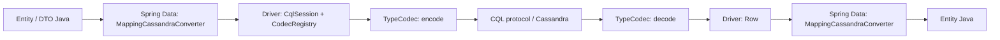

# CodecRegistry và ánh xạ kiểu tại lớp Driver trong Spring Data Cassandra

Khi ứng dụng **Spring Data Cassandra** ghi một entity bằng repository hoặc CassandraTemplate, dữ liệu Java phải được biến đổi thành những giá trị mà **Apache Cassandra Java Driver** có thể mã hóa theo giao thức CQL. Chiều đọc đi ngược lại: driver giải mã dữ liệu trả về thành các kiểu Java được hỗ trợ, rồi Spring Data ánh xạ chúng vào entity. Thành phần trung tâm cho việc tìm codec ở **lớp driver** là `CodecRegistry`.

Bài này thuộc chương **Chuyển đổi kiểu** của `SPRING_DATA_CASSANDRA`, tập trung vào cách driver chọn `TypeCodec`, các ánh xạ mặc định, `ExtraTypeCodecs`, codec tự viết, cách đăng ký codec và sự khác biệt với `CassandraCustomConversions` của Spring Data. Hiểu ranh giới này giúp xử lý lỗi conversion, thiết kế bảng đúng với CQL, dùng paging/consistency hiệu quả và tránh đưa quy tắc dữ liệu nghiệp vụ vào sai tầng.

Các đoạn mã minh họa **Java Driver 4.x** với namespace `com.datastax.oss.driver.api...`; tên class và cách tích hợp Spring Boot có thể khác giữa các dòng phiên bản. Hãy kiểm tra dependency thực tế trước khi sao chép vào dự án.

## 1. CodecRegistry nằm ở đâu trong đường đọc và ghi?

Codec là bộ chuyển đổi giữa **một kiểu CQL** và **một kiểu Java**. Ví dụ, CQL `text` thường tương ứng `String`; `timestamp` thường tương ứng `Instant`. Driver cần biết cách biểu diễn giá trị thành byte trên giao thức Cassandra và ngược lại.



Đường đi trên là **mô hình khái quát**. Với thao tác dùng trực tiếp `CqlSession`, `PreparedStatement` và `Row`, ứng dụng có thể gọi codec **mà không đi qua Spring Data mapping**. Với repository, Spring Data có thể chuyển domain object thành kiểu được driver hỗ trợ trước khi codec xử lý.

Để phân biệt:

| Tầng | Trách nhiệm | Ví dụ |
|---|---|---|
| **Cassandra schema** | Định nghĩa cột, key và CQL type | `status text`, `created_at timestamp` |
| **Java Driver / CodecRegistry** | Chọn `TypeCodec` và encode/decode CQL ↔ Java | `text` ↔ `String`; `text` ↔ enum nếu đăng ký codec |
| **Spring Data Cassandra / MappingCassandraConverter** | Mapping hàng thành entity, property/constructor, Spring converters | `@Column("status")`, `Converter<String, OrderState>` |
| **Ứng dụng** | Quy tắc domain, validate, chuẩn hóa giá trị | Mã `P` có nghĩa “đã thanh toán” |

**Codec không thiết kế lại schema.** Nếu bảng có partition key `(tenant_id, bucket_day)`, việc cài codec mới không cho phép tìm kiếm hiệu quả chỉ bằng `status`. Partition key, clustering key, consistency và paging vẫn tuân theo mô hình dữ liệu phân tán.

## 2. Các ánh xạ mặc định thường gặp

Driver đã tích hợp nhiều codec cho kiểu cơ bản; không cần đăng ký codec cho mọi trường.

| CQL type | Kiểu Java thường dùng ở Driver 4.x | Lưu ý |
|---|---|---|
| `text`, `varchar` | `String` | Dữ liệu ký tự; đừng nhầm với JSON object tự ánh xạ |
| `ascii` | `String` | CQL `ascii` giới hạn bộ ký tự so với `text` |
| `boolean` | `Boolean` / `boolean` | Null cần kiểm tra riêng với primitive |
| `int` | `Integer` / `int` | Số nguyên 32 bit |
| `bigint` | `Long` / `long` | Số nguyên 64 bit; cũng phân biệt với counter semantics |
| `varint` | `BigInteger` | Số nguyên độ dài tùy ý |
| `decimal` | `BigDecimal` | Hợp cho tiền cần giữ phần thập phân, với quy ước độ chính xác |
| `float`, `double` | `Float`, `Double` | Không nên dùng cho số tiền cần chính xác tuyệt đối |
| `uuid`, `timeuuid` | `UUID` | `timeuuid` có ràng buộc giá trị/ý nghĩa riêng |
| `timestamp` | `Instant` | Thời điểm tuyệt đối; không lưu múi giờ gốc |
| `date` | `LocalDate` | Ngày lịch, không chứa giờ |
| `time` | `LocalTime` | Giờ trong ngày, không chứa ngày/múi giờ |
| `blob` | `ByteBuffer` | Cần chú ý `position`, `limit` và dữ liệu nhị phân |
| `inet` | `InetAddress` | IPv4/IPv6 theo kiểu CQL |
| `list<text>` | `List<String>` | Tập hợp có kiểu phần tử rõ ràng |
| `set<uuid>` | `Set<UUID>` | Tính chất set theo CQL |
| `map<text,int>` | `Map<String, Integer>` | Khóa và giá trị có codec phù hợp |
| UDT / tuple | `UdtValue` / `TupleValue` | Muốn domain object trực tiếp thường cần mapping thêm |

Các loại trên là ví dụ phổ biến của driver, không phải lời hứa rằng mọi biến thể Java như `LocalDateTime`, `ZonedDateTime` hay `byte[]` đều có codec mặc định phù hợp cùng một CQL type. Một số ánh xạ thay thế được cung cấp bởi `ExtraTypeCodecs`.

Ví dụ đọc trực tiếp từ `Row`:

```java
UUID orderId = row.getUuid("order_id");
Instant createdAt = row.getInstant("created_at");
String status = row.getString("status");
BigDecimal total = row.getBigDecimal("total_amount");
```

Các giá trị được driver giải mã bằng codec tương ứng. Không cần viết `new MyStringCodec()` để đọc `text` thành `String`.

## 3. CodecRegistry chọn codec bằng cách nào?

Driver lưu các codec có sẵn và codec tùy chỉnh trong `CodecRegistry`. Về mặt khái niệm, một phép tra cứu phải trả lời hai câu hỏi:

1. **CQL type** của giá trị/cột là gì, ví dụ `text`?
2. **Java type** mà caller mong muốn là gì, ví dụ `String`, `OrderStatus` hay `List<OrderStatus>`?

Có thể hình dung:

```text
CQL text + Java String          → codec mặc định
CQL text + Java OrderStatus     → codec tùy chỉnh, nếu đã đăng ký
CQL blob + Java ByteBuffer      → codec mặc định
CQL blob + Java byte[]          → codec thay thế, nếu đã đăng ký
CQL text + Java UnsupportedType → CodecNotFoundException
```

Ví dụ API tra cứu trực tiếp:

```java
import com.datastax.oss.driver.api.core.type.DataTypes;
import com.datastax.oss.driver.api.core.type.codec.TypeCodec;
import com.datastax.oss.driver.api.core.type.codec.registry.CodecRegistry;
import com.datastax.oss.driver.api.core.type.reflect.GenericType;

CodecRegistry codecs = session.getContext().getCodecRegistry();

TypeCodec<String> defaultTextCodec =
    codecs.codecFor(DataTypes.TEXT, GenericType.STRING);
```

Trong thao tác đọc/ghi thông thường, **không cần tự gọi `codecFor`**; driver tìm codec khi dùng các phương thức `get...`, `set...` hoặc khi bind giá trị.

Điểm cần biết: driver ưu tiên **codec tích hợp** rồi mới đến những codec tùy chỉnh. Không nên đăng ký một codec `text` ↔ `String` mới và kỳ vọng nó sẽ thay thế `TypeCodecs.TEXT`. Nếu cần biểu diễn CQL `text` bằng một kiểu domain mới, hãy dùng Java type khác (ví dụ `OrderStatus`) hoặc truyền **codec instance cụ thể** tới `get`/`set` ở nơi driver cho phép.

### Kiểu tham số hóa và GenericType

Java xóa thông tin generic ở runtime trong nhiều trường hợp. Với `List<Price>` hoặc `Optional<UUID>`, `List.class` không đủ để mô tả kiểu phần tử. Driver sử dụng `GenericType<T>`:

```java
import com.datastax.oss.driver.api.core.type.reflect.GenericType;

GenericType<List<String>> namesType = GenericType.listOf(String.class);

// Với nested generic phức tạp:
GenericType<Map<String, List<UUID>>> complicated =
    new GenericType<Map<String, List<UUID>>>() {};
```

Các ví dụ cần import `java.util.List`, `Map`, `UUID` tương ứng. Một số API driver đã có phương thức tiện dụng như `row.getList("tags", String.class)` và `boundStatement.setList(...)`; dùng `GenericType` khi cần mô tả đầy đủ kiểu phức tạp hoặc codec tùy chỉnh.

## 4. Ví dụ CQL: log theo tài khoản và ngày

Giả sử hệ thống lưu sự kiện với mức cảnh báo bằng mã chuỗi. Chọn bảng phục vụ mẫu truy vấn **sự kiện gần đây của một tài khoản trong một ngày**:

```sql
CREATE TABLE events_by_account_day (
    account_id uuid,
    bucket_day date,
    occurred_at timestamp,
    event_id uuid,
    severity text,
    tags list<text>,
    payload blob,
    PRIMARY KEY ((account_id, bucket_day), occurred_at, event_id)
) WITH CLUSTERING ORDER BY (occurred_at DESC, event_id DESC);
```

`(account_id, bucket_day)` là partition key tổng hợp. `occurred_at` và `event_id` là clustering columns. Ví dụ truy vấn:

```sql
SELECT occurred_at, event_id, severity, tags, payload
FROM events_by_account_day
WHERE account_id = ?
  AND bucket_day = ?
LIMIT 20;
```

Dấu `?` là bind parameter trong driver; khi chạy `cqlsh` thủ công cần thay bằng literal CQL. Cột `severity` có kiểu CQL `text`, nhưng ứng dụng muốn làm việc với enum Java để tránh truyền chuỗi tùy ý.

## 5. Dùng ExtraTypeCodecs cho enum: giải pháp có sẵn

Driver 4.x cung cấp một số codec thay thế qua `ExtraTypeCodecs`. Với enum có tên không thay đổi, cách đơn giản là ánh xạ **tên enum ↔ CQL text**:

```java
public enum Severity {
    INFO, WARN, ERROR
}
```

Đăng ký codec khi tạo session:

```java
import java.net.InetSocketAddress;
import com.datastax.oss.driver.api.core.CqlSession;
import com.datastax.oss.driver.extras.codecs.ExtraTypeCodecs;

CqlSession session = CqlSession.builder()
    .addContactPoint(new InetSocketAddress("127.0.0.1", 9042))
    .withLocalDatacenter("dc1")
    .withKeyspace("codec_lab")
    .addTypeCodecs(ExtraTypeCodecs.enumNamesOf(Severity.class))
    .build();
```

Đây là minh họa **session do ứng dụng tự tạo**, giả định Cassandra local đang chạy, `dc1` đúng tên DC và keyspace `codec_lab` đã tồn tại. Với Spring Boot auto-configuration, nên đăng ký codec trên **session builder được Boot quản lý** thay vì tạo session thứ hai không cần thiết.

Sau khi đăng ký, đọc/ghi `severity` bằng kiểu enum:

```java
// Một PreparedStatement đã được tạo từ INSERT phù hợp.
BoundStatement insert = prepared.boundStatementBuilder()
    .setUuid("account_id", accountId)
    .setLocalDate("bucket_day", bucketDay)
    .setInstant("occurred_at", occurredAt)
    .setUuid("event_id", eventId)
    .set("severity", Severity.WARN, Severity.class)
    .setList("tags", tags, String.class)
    .setByteBuffer("payload", payloadBytes)
    .build();

session.execute(insert);

// Từ Row lấy ra sau SELECT tương ứng:
Severity severity = row.get("severity", Severity.class);
String rawSeverity = row.getString("severity"); // "WARN"
```

Các biến `prepared`, `accountId`, `bucketDay`, `occurredAt`, `eventId`, `tags`, `payloadBytes`, `row` được chuẩn bị ở phần code bao quanh. `payloadBytes` có kiểu `ByteBuffer`. Trong dự án thực tế, nên tạo `PreparedStatement` bằng `session.prepare(...)` trước khi bind theo tên cột.

**Lưu ý giới hạn:** `enumNamesOf` lưu `Severity.name()`. Nếu đổi `WARN` thành `WARNING`, dữ liệu cũ lưu chuỗi `WARN` có thể không đọc được thành enum mới. Nếu tên enum có thể đổi, dùng mã lưu trữ ổn định và một codec mapping rõ ràng.

## 6. Khi cần mã lưu trữ ổn định: viết MappingCodec

Giả sử CQL `status text` lưu các mã ngắn `N`, `P`, `C`, còn Java dùng enum có tên dễ hiểu. Có thể viết `MappingCodec<String, OrderStatus>`: lớp này tái sử dụng codec `String` của driver để xử lý byte và chỉ tự định nghĩa phép đổi **String ↔ OrderStatus**.

```java
public enum OrderStatus {
    NEW("N"),
    PAID("P"),
    CANCELLED("C");

    private final String code;

    OrderStatus(String code) {
        this.code = code;
    }

    public String code() {
        return code;
    }

    public static OrderStatus fromCode(String code) {
        for (OrderStatus value : values()) {
            if (value.code.equals(code)) {
                return value;
            }
        }
        throw new IllegalArgumentException("Unknown order status: " + code);
    }
}
```

Codec:

```java
import com.datastax.oss.driver.api.core.type.codec.MappingCodec;
import com.datastax.oss.driver.api.core.type.codec.TypeCodecs;
import com.datastax.oss.driver.api.core.type.reflect.GenericType;

public final class OrderStatusCodec
        extends MappingCodec<String, OrderStatus> {

    public OrderStatusCodec() {
        super(TypeCodecs.TEXT, GenericType.of(OrderStatus.class));
    }

    @Override
    protected OrderStatus innerToOuter(String value) {
        return value == null ? null : OrderStatus.fromCode(value);
    }

    @Override
    protected String outerToInner(OrderStatus value) {
        return value == null ? null : value.code();
    }
}
```

Đăng ký `new OrderStatusCodec()` bằng `addTypeCodecs(...)`. Khi `Row` chứa `status = 'P'`, lệnh `row.get("status", OrderStatus.class)` cho `OrderStatus.PAID`. Khi bind `OrderStatus.CANCELLED` vào cột CQL `text`, codec ghi mã `C`.

Ưu điểm: đổi tên hằng Java `PAID` mà vẫn giữ `code = "P"` sẽ không làm thay đổi định dạng dữ liệu trên đĩa. Nhược điểm: phải có quy tắc xử lý **mã không biết**, dữ liệu cũ, null và compatibility khi thêm trạng thái mới.

`MappingCodec` phù hợp khi có sẵn codec “inner” (ở đây là `TypeCodecs.TEXT`) và một phép chuyển đổi sang kiểu “outer” của domain. Nó giảm rủi ro khi tự thao tác byte hoặc protocol version.

### Khi nào phải triển khai TypeCodec trực tiếp?

Nếu không có codec bên trong phù hợp, có thể triển khai `TypeCodec<T>` để định nghĩa:

- `getCqlType()`: kiểu CQL codec xử lý.
- `getJavaType()`: kiểu Java codec xử lý (dùng `GenericType<T>`).
- `encode(T value, ProtocolVersion version)`: Java → `ByteBuffer` theo protocol.
- `decode(ByteBuffer bytes, ProtocolVersion version)`: `ByteBuffer` → Java.
- `format(T value)`, `parse(String literal)`: biểu diễn dạng literal CQL và ngược lại.

Hãy xử lý null, các giá trị biên, protocol version và tính thread-safe đúng hợp đồng API. Nếu chỉ cần đổi mã chuỗi sang enum hoặc value object, dùng `MappingCodec` thường dễ duy trì hơn tự mã hóa byte.

## 7. Khởi tạo, đăng ký và tra cứu codec

Có hai cách phổ biến trong Java Driver 4.x.

### 7.1. Đăng ký khi tạo session — nên ưu tiên

```java
CqlSession session = CqlSession.builder()
    .addContactPoint(new InetSocketAddress("127.0.0.1", 9042))
    .withLocalDatacenter("dc1")
    .withKeyspace("codec_lab")
    .addTypeCodecs(
        ExtraTypeCodecs.enumNamesOf(Severity.class),
        new OrderStatusCodec()
    )
    .build();
```

Lợi ích: tất cả đường ghi/đọc dùng session này nhìn thấy codec trước khi request đầu tiên được gửi. Với ứng dụng nhiều thread, nên giữ codec **không có trạng thái mutable theo request**, tái sử dụng trong suốt vòng đời session và đóng session đúng lúc.

### 7.2. Đăng ký lúc chạy — chỉ khi có lý do

```java
import com.datastax.oss.driver.api.core.type.codec.registry.MutableCodecRegistry;

MutableCodecRegistry registry =
    (MutableCodecRegistry) session.getContext().getCodecRegistry();

registry.register(new OrderStatusCodec());
```

Driver 4.x có registry mutable, nhưng cách cast này phụ thuộc registry implementation; cần kiểm tra nếu ứng dụng thay thế registry mặc định. Đăng ký runtime sau khi đã có luồng truy vấn có thể làm hành vi chuyển đổi khó dự đoán hơn; nên ưu tiên đăng ký khi tạo session hoặc trước khi phục vụ request.

### 7.3. Truy vấn codec bằng cặp kiểu

```java
CodecRegistry registry = session.getContext().getCodecRegistry();

TypeCodec<OrderStatus> statusCodec =
    registry.codecFor(DataTypes.TEXT, GenericType.of(OrderStatus.class));
```

Nếu chưa đăng ký `OrderStatusCodec` tương ứng hoặc đăng ký sai cặp kiểu, driver có thể ném `CodecNotFoundException`. Đừng chỉ kiểm tra “có codec nào đó cho text” vì mặc định `text` ↔ `String` vẫn tồn tại. Phải kiểm tra **đúng kiểu Java mong muốn**.

## 8. Dùng codec trực tiếp khác gì dùng registry?

Thông thường `Row` và `BoundStatement` tìm codec qua registry bằng kiểu Java:

```java
OrderStatus status = row.get("status", OrderStatus.class);
BoundStatement updated =
    boundStatement.set("status", OrderStatus.PAID, OrderStatus.class);
```

Một số API cũng nhận **codec instance trực tiếp**, bỏ qua tra cứu registry:

```java
OrderStatusCodec explicitCodec = new OrderStatusCodec();

OrderStatus status = row.get("status", explicitCodec);

BoundStatement updated =
    boundStatement.set("status", OrderStatus.PAID, explicitCodec);
```

Cách này hữu ích khi chỉ có một cột muốn áp dụng ánh xạ khác hoặc cần thực nghiệm codec. Nhưng caller phải tự đảm bảo codec có thể xử lý kiểu CQL của cột. Nếu cột thật là `int` trong khi codec khai `text`, truyền codec cụ thể không thể làm hai kiểu tương thích về mặt schema.

Với API trả về immutable statement, `set(...)` thường trả về một `BoundStatement` mới; phải giữ giá trị được trả hoặc dùng `boundStatementBuilder()`. Chỉ gọi setter mà bỏ qua kết quả có thể không tạo statement cuối như mong muốn.

## 9. Collection, UDT, tuple, blob và JSON

CodecRegistry xử lý được nhiều kiểu phức tạp nhờ các codec có sẵn, codec cho phần tử và những ánh xạ được đăng ký.

### Collection và kiểu tham số hóa

Ví dụ CQL:

```sql
CREATE TABLE products_by_id (
    product_id uuid PRIMARY KEY,
    tags set<text>,
    attributes map<text,text>
);
```

Ở driver:

```java
Set<String> tags = row.getSet("tags", String.class);
Map<String, String> attrs =
    row.getMap("attributes", String.class, String.class);
```

Khi dùng custom codec cho kiểu phần tử, cần đảm bảo CQL collection tương ứng và `GenericType`/element type token đúng. Một `List<OrderStatus>` có thông tin kiểu khác `List<String>`; hai kiểu không hoán đổi cho nhau chỉ vì cùng dùng `list<text>`.

**Đừng tự giả định null collection và collection rỗng luôn khác nhau trên giao thức.** Với các phiên bản/giao thức CQL, biểu diễn collection rỗng, unset và null có những giới hạn/ngữ nghĩa riêng. Kiểm tra round-trip với đúng dữ liệu và phiên bản server/driver.

### Blob: ByteBuffer khác byte[]

CQL `blob` được driver ánh xạ mặc định sang `ByteBuffer`. Nếu muốn dùng `byte[]`, driver có `ExtraTypeCodecs.BLOB_TO_ARRAY`:

```java
CqlSession session = CqlSession.builder()
    // Contact points, local DC, keyspace...
    .addTypeCodecs(ExtraTypeCodecs.BLOB_TO_ARRAY)
    .build();

// Cột payload có kiểu blob:
byte[] payload = row.get("payload", byte[].class);
```

Đây là trích đoạn API, cần điền đầy đủ cấu hình kết nối trước khi chạy. Với `ByteBuffer`, nên hiểu `remaining()`, `position()`, `limit()` và liệu thao tác có thay đổi vị trí đọc hay không. Với blob lớn, việc tạo `byte[]` có thể làm phát sinh bản sao dữ liệu trong bộ nhớ; cân nhắc kích thước và giới hạn yêu cầu.

### UDT và tuple

Driver thông thường có thể trả **`UdtValue`** cho user-defined type và **`TupleValue`** cho tuple. Muốn chuyển một UDT sang domain object, có thể:

1. Đọc `UdtValue` bằng driver và tự mapping field.
2. Dùng `MappingCodec<UdtValue, Address>` nếu có codec inner và kiểu UDT đúng.
3. Dùng mapping/converter của Spring Data Cassandra khi thao tác qua entity.

**UDT có tên và schema theo keyspace**, nên codec UDT phải được gắn với metadata `UserDefinedType` thích hợp; không nên dùng một codec của keyspace này để mặc định đọc UDT đồng tên nhưng schema khác trong keyspace khác.

### JSON trong cột text

`ExtraTypeCodecs.json(MyType.class)` có thể serialize object thành JSON lưu trong CQL `text` khi các dependency cần thiết đã có. Điều này tiện cho dữ liệu phụ trợ, nhưng Cassandra **không tự hiểu JSON ấy như những cột có thể partition/filter hiệu quả**. Không dùng một cột JSON khổng lồ để thay cho thiết kế bảng theo truy vấn cần filter, sort, paging và partition key rõ ràng.

## 10. Spring Boot: đưa codec vào CqlSession đúng chỗ

Khi dùng Spring Boot, một `CqlSession` thường được auto-configure và chia sẻ cho CassandraTemplate/repository. Nếu tự tạo một session khác chỉ để đăng ký codec, code dùng session tự tạo có thể chạy nhưng repository vẫn dùng session do Boot quản lý, dẫn đến **hành vi chuyển đổi không nhất quán**.

Với **Spring Boot 3.x** có `CqlSessionBuilderCustomizer`, có thể cấu hình:

```java
import org.springframework.boot.autoconfigure.cassandra.CqlSessionBuilderCustomizer;
import org.springframework.context.annotation.Bean;
import org.springframework.context.annotation.Configuration;
import com.datastax.oss.driver.extras.codecs.ExtraTypeCodecs;

@Configuration
class CassandraCodecConfiguration {

    @Bean
    CqlSessionBuilderCustomizer codecCustomizer() {
        return builder -> builder.addTypeCodecs(
            ExtraTypeCodecs.enumNamesOf(Severity.class),
            new OrderStatusCodec()
        );
    }
}
```

Đây là một điểm mở rộng cho **session builder của Boot**. `application.yml` vẫn cấu hình connection:

```yaml
spring:
  cassandra:
    contact-points: 127.0.0.1
    port: 9042
    local-datacenter: dc1
    keyspace-name: codec_lab
```

**Cần đối chiếu đúng Spring Boot version:** namespace của API auto-configuration có thể thay đổi ở các dòng mới; nếu dự án dùng một cấu hình `CqlSession` thủ công hoặc có nhiều session, phải đăng ký codec trên **đúng session** mà CassandraTemplate/repository dùng. Không chỉ nhìn thấy một bean `OrderStatusCodec` rồi cho rằng driver tự quét và đăng ký nó.

## 11. Driver codec và Spring Data custom converter là hai cơ chế khác nhau

Đây là điểm dễ nhầm nhất trong bài.

**Driver codec** đổi `CQL type ↔ Java type` tại ranh giới giao thức. **Spring Data converter** đổi một Java value/domain object thành một Java value/đối tượng mà mapping layer muốn dùng trước hoặc sau khi giao tiếp với driver.

Ví dụ cùng một cột `status text`:

```text
Hướng A — thao tác trực tiếp với Java Driver:
  status text ↔ CodecRegistry/OrderStatusCodec ↔ OrderStatus

Hướng B — entity qua Spring Data:
  status text ↔ TypeCodecs.TEXT ↔ String
                ↔ Spring @ReadingConverter/@WritingConverter ↔ OrderStatus
```

Không có nghĩa mọi repository luôn đi theo đúng Hướng B; Spring Data có mapping mặc định cho enum và các kiểu domain. Tuy nhiên, **đăng ký driver codec không phải lời bảo đảm Spring Data sẽ truyền enum trực tiếp vào driver để codec đó được chọn**. Spring Data có thể chuyển enum sang `String` trước đó, khiến driver dùng `TypeCodecs.TEXT` mặc định.

Nếu yêu cầu là đổi **mã nghiệp vụ** `N` ↔ `OrderStatus.NEW` trên entity Spring Data, hãy xem `CassandraCustomConversions`:

```java
import org.springframework.core.convert.converter.Converter;
import org.springframework.data.convert.ReadingConverter;
import org.springframework.data.convert.WritingConverter;

@ReadingConverter
public class OrderStatusReadConverter
        implements Converter<String, OrderStatus> {

    @Override
    public OrderStatus convert(String source) {
        return OrderStatus.fromCode(source);
    }
}

@WritingConverter
public class OrderStatusWriteConverter
        implements Converter<OrderStatus, String> {

    @Override
    public String convert(OrderStatus source) {
        return source.code();
    }
}
```

Hai converter chỉ có tác dụng khi được đăng ký vào **`CassandraCustomConversions` / `MappingCassandraConverter`** mà ứng dụng đang dùng. Chúng **không phải TypeCodec** và không tự xuất hiện trong `session.getContext().getCodecRegistry()`.

Ví dụ cấu hình theo API `CassandraCustomConversions.create(...)` ở các dòng Spring Data hỗ trợ:

```java
import org.springframework.context.annotation.Bean;
import org.springframework.context.annotation.Configuration;
import org.springframework.data.cassandra.core.convert.CassandraCustomConversions;

@Configuration
class CassandraConversionConfiguration {

    @Bean
    CassandraCustomConversions cassandraCustomConversions() {
        return CassandraCustomConversions.create(config -> {
            config.registerConverter(new OrderStatusReadConverter());
            config.registerConverter(new OrderStatusWriteConverter());
        });
    }
}
```

Ở một số phiên bản, việc đăng ký custom conversions có thể dùng phương thức/constructor khác; đối chiếu đúng dòng Spring Data và cơ chế auto-configuration. Tránh đăng ký cả driver codec lẫn Spring converters cho **cùng ánh xạ** mà không biết đường nào sẽ chạy, bởi hai cơ chế có thể cho kết quả khác khi mã lỗi hoặc enum đổi tên.

| Khi nào cần | Ưu tiên xem |
|---|---|
| Đọc `Row` trực tiếp thành kiểu tùy chỉnh | `TypeCodec` / `ExtraTypeCodecs` / `CodecRegistry` |
| Bind `BoundStatement` trực tiếp với value object | Driver codec |
| Mapping property của `@Table` theo logic domain | Spring Data custom converter |
| DTO dùng trong API, không gắn Cassandra | Mapping tầng ứng dụng |
| Có UDT và yêu cầu mapping phức tạp | So sánh codec UDT với Spring Data UDT mapping, kiểm thử cả hai chiều |

## 12. Những lỗi chuyển đổi thường gặp

| Triệu chứng | Khả năng nguyên nhân | Hướng kiểm tra |
|---|---|---|
| `CodecNotFoundException` khi `row.get(..., SomeType.class)` | Chưa đăng ký codec hoặc sai cặp CQL/Java type | Kiểm tra registry của đúng session, kiểu cột thực tế, `GenericType` |
| `getString("status")` chạy nhưng `get("status", OrderStatus.class)` lỗi | Có codec `text↔String`, chưa có `text↔OrderStatus` | Đăng ký codec cho enum hoặc dùng converter ở đúng tầng |
| Đăng ký codec nhưng repository vẫn ghi enum name | Spring Data đã convert enum thành `String` trước khi bind | Kiểm tra CQL và mapping converter; cấu hình Spring converter |
| Enum đọc lỗi sau đổi tên hằng | Dữ liệu lưu tên `Enum.name()` cũ | Dùng mã lưu trữ ổn định hoặc migration có kiểm soát |
| Timestamp bị lệch giờ trên UI | Nhầm `Instant` với `LocalDateTime`/timezone | Chuẩn hóa UTC và chuyển timezone ở biên ứng dụng |
| `blob` bị thiếu byte | Xử lý sai `ByteBuffer.position/limit` | Kiểm tra buffer và cách copy byte |
| Lỗi collection hoặc nested generic | Thiếu element codec/type token | Xác định kiểu đầy đủ bằng `GenericType` hoặc `getList` tương ứng |
| `UdtValue` không thành POJO | Chưa có codec/mapping UDT hoặc schema không khớp | Kiểm tra UDT metadata theo keyspace và converter |
| `IllegalArgumentException` với trạng thái lạ | Codec/domain decoder chưa biết mã mới | Định nghĩa chính sách backward compatibility, test dữ liệu cũ |
| Chỉ lỗi ở production | Driver/Spring version hoặc schema khác local | So phiên bản resolved, keyspace, CQL schema và startup config |

Lỗi conversion **khác** lỗi mô hình truy vấn. Nếu Cassandra trả `InvalidQueryException` do thiếu partition key, thêm `TypeCodec` sẽ không giải quyết. Nếu ứng dụng gặp timeout ở consistency level đã chọn, đó cũng không phải dấu hiệu trực tiếp rằng một codec bị lỗi.

## 13. Tính đúng đắn và hiệu năng khi triển khai codec

Một codec lỗi có thể làm **ghi sai dữ liệu bền vững** hoặc đọc sai mà không dễ phát hiện. Vì thế cần các ràng buộc:

1. **Deterministic:** cùng đầu vào phải tạo cùng định dạng lưu trữ. Mã trạng thái không phụ thuộc `Locale.getDefault()` hoặc thứ tự enum.
2. **Backward compatibility:** mã mới phải có chiến lược đọc dữ liệu cũ; đừng tự đổi format mà không có migration.
3. **Null handling:** phân biệt null, chuỗi rỗng, giá trị chưa biết; lỗi domain cần rõ ràng.
4. **Thread safety:** codec đăng ký trên session có thể được nhiều thread dùng đồng thời; tránh lưu trạng thái request vào field mutable.
5. **Memory:** tránh tạo bản sao `byte[]`, `String` hay JSON lớn không cần thiết trên hot path.
6. **Prepared statements:** ưu tiên prepared/bound statements để driver biết kiểu cột khi bind, tái sử dụng truy vấn và tránh ghép literal CQL bằng chuỗi.
7. **Observability:** log lỗi conversion có ngữ cảnh bảng/cột/loại dữ liệu, nhưng không log dữ liệu nhạy cảm hoặc payload đầy đủ.
8. **Deployment:** nâng cấp codec phải cùng kế hoạch rollout với schema và phiên bản ứng dụng khác đang đọc cùng dữ liệu.

Codec nhanh hơn vài microsecond không bù được một truy vấn đọc sai partition hoặc lạm dụng `ALLOW FILTERING`. Với Cassandra phân tán, chi phí thực tế còn nằm ở partition key, replication/consistency, paging state, network, tombstone và compaction.

## 14. Bài lab kiểm tra registry và round-trip

Hãy thực hiện trên **keyspace test riêng**, không dùng keyspace production:

1. Khởi động một Cassandra test node, tạo keyspace `codec_lab` (RF=1) và bảng `events_by_account_day` ở mục 4.
2. Tạo `CqlSession` với `ExtraTypeCodecs.enumNamesOf(Severity.class)`; chuẩn bị `INSERT` bằng `session.prepare(...)`.
3. Ghi `Severity.WARN`, đọc raw bằng `row.getString("severity")` rồi bằng `row.get("severity", Severity.class)`.
4. Kiểm tra giá trị raw bằng `"WARN"`, giá trị enum bằng `Severity.WARN`.
5. Đăng ký thêm `OrderStatusCodec` cho một cột `status text` ở **bảng test khác**; ghi `OrderStatus.PAID`, xác minh raw value là `"P"` và Java value là `OrderStatus.PAID`.
6. Thử đọc dữ liệu `status = 'X'` để xem policy xử lý mã không biết; với ví dụ hiện tại sẽ nhận `IllegalArgumentException`.
7. Thử khi chưa đăng ký codec: `row.getString(...)` vẫn hoạt động, còn `row.get(..., OrderStatus.class)` có thể ném `CodecNotFoundException`.
8. Nếu tích hợp Spring Data, gọi cùng truy vấn qua repository/CassandraTemplate và kiểm tra liệu Spring converter hay driver codec được sử dụng.

Bảng kết quả mong đợi:

| Phép thử | Kết quả mong đợi |
|---|---|
| `text` đọc bằng `getString` | Chuỗi CQL gốc |
| `text` đọc thành `Severity` sau đăng ký enum codec | Enum có tên trùng chuỗi |
| `status='P'` qua `OrderStatusCodec` | `OrderStatus.PAID` |
| `OrderStatus.CANCELLED` được bind qua codec | CQL lưu `'C'` |
| Truy cập custom Java type khi không có codec | `CodecNotFoundException` (nếu không có ánh xạ khác) |
| Mã lạ `'X'` với codec ở mục 6 | Lỗi xác định từ `OrderStatus.fromCode` |
| Spring Data ghi qua entity với converter riêng | Kiểm tra được mã CQL đúng theo converter cấu hình |

**Đừng dùng `schema-action: RECREATE` trên dữ liệu cần giữ** để thử codec; thao tác đó có thể drop/recreate bảng. Lab chỉ yêu cầu schema CQL đã tạo sẵn và một số hàng test.

## 15. Checklist trước khi quyết định thêm codec

1. Cột CQL và Java type mong muốn đã rõ ràng chưa?
2. Driver có `TypeCodecs` mặc định hoặc `ExtraTypeCodecs` phù hợp chưa?
3. Có cần ánh xạ ở **driver** hay chỉ cần converter ở **Spring Data mapping**?
4. Codec đã được đăng ký trên **đúng CqlSession** mà repository/CassandraTemplate dùng chưa?
5. `codecFor(cqlType, javaType)` có tìm được codec đúng không?
6. Kiểu generic, UDT, tuple và collection đã có type token/schema phù hợp chưa?
7. Null, mã lạ, dữ liệu cũ và mã lưu trữ tương lai đã được kiểm thử chưa?
8. Prepared statement, paging, consistency level và access pattern Cassandra vẫn được giữ đúng chưa?
9. Test round-trip có kiểm tra **giá trị CQL thực sự được lưu**, không chỉ so sánh hai object Java chưa?
10. Khi nâng Spring Boot/Spring Data/driver, đã đối chiếu API và chạy lại integration test chưa?

**Điểm cần nhớ:** `CodecRegistry` làm việc ở **lớp Java Driver** và chọn codec theo **cặp CQL type–Java type** để encode/decode. `MappingCassandraConverter` và `CassandraCustomConversions` làm việc ở **lớp Spring Data** để ánh xạ entity/domain. Chọn đúng tầng chuyển đổi giúp mã dễ kiểm chứng và không làm lẫn logic domain với biểu diễn giao thức, trong khi thiết kế bảng theo truy vấn và khóa phân vùng vẫn quyết định hiệu năng đọc/ghi trên Cassandra.

## Tài liệu tham khảo

- [Apache Cassandra Java Driver 4.18.1 — Custom Codecs](https://apache.github.io/cassandra-java-driver/4.18.1/core/custom_codecs/): `TypeCodec`, `MappingCodec`, `ExtraTypeCodecs`, `addTypeCodecs` và `MutableCodecRegistry`.
- [Apache Cassandra Java Driver — CodecRegistry API](https://apache.github.io/cassandra-java-driver/4.18.1/api/com/datastax/oss/driver/api/core/type/codec/registry/CodecRegistry.html): các biến thể `codecFor` theo kiểu CQL/Java.
- [Spring Data Cassandra — Custom Conversions](https://docs.spring.io/spring-data/cassandra/reference/cassandra/converters.html): `@ReadingConverter`, `@WritingConverter`, `CassandraCustomConversions`.
- [Spring Boot — Working with NoSQL Technologies](https://docs.spring.io/spring-boot/reference/data/nosql.html): cấu hình `spring.cassandra.*` và tùy biến `CqlSessionBuilder`.
