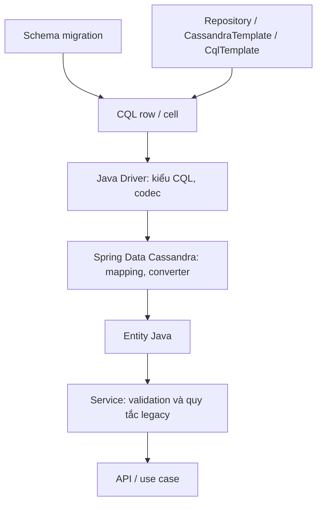
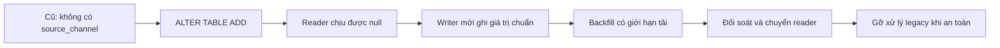

# Giá trị null, lỗi chuyển đổi và dữ liệu phiên bản cũ

Khi dùng **Spring Data Cassandra**, một giá trị đọc từ Apache Cassandra phải đi qua nhiều lớp: dữ liệu CQL, Java Driver, bộ ánh xạ entity và cuối cùng là logic nghiệp vụ. Trong một hệ thống đã vận hành lâu, không phải mọi hàng đều có cấu trúc dữ liệu giống những hàng mới. Cột vừa được thêm có thể chưa có giá trị ở các hàng cũ; mã trạng thái từ phiên bản trước có thể dùng cách viết khác; dữ liệu do một dịch vụ khác ghi có thể không tuân thủ quy ước mà converter Java hiện tại mong đợi.

Bài học thuộc chương **Chuyển đổi kiểu**, tập trung giải quyết ba câu hỏi:

1. **Giá trị `null` có ý nghĩa gì** khi đọc và ghi dữ liệu Cassandra?
2. **Lỗi chuyển đổi xuất hiện ở đâu**, nên phát hiện và phản hồi thế nào?
3. **Làm sao đọc dữ liệu phiên bản cũ** mà vẫn cho phép tiến hóa schema và logic nghiệp vụ?

Những quyết định này ảnh hưởng trực tiếp đến `CassandraRepository`, `CassandraTemplate` và `CqlTemplate`. Chúng không thay thế yêu cầu thiết kế bảng theo truy vấn, cung cấp partition key đầy đủ, xử lý paging và kiểm soát tải trên hệ phân tán.

## 1. Phân biệt bốn trạng thái dễ nhầm lẫn

Không nên xem mọi giá trị “không có gì” là một tình huống duy nhất.

| Tình huống | Ý nghĩa | Hệ quả đối với ứng dụng |
| --- | --- | --- |
| Cột **có trong schema**, hàng cũ chưa từng ghi giá trị | Cell không có giá trị để đọc, thường quan sát thành `null` | Có thể xử lý fallback hoặc backfill |
| Cột **có trong schema**, có thao tác ghi `null` | Trong CQL, ghi `null` thường tương đương xóa giá trị cell, sinh thông tin xóa (*tombstone*) | Không đồng nghĩa với “giữ nguyên giá trị cũ” |
| Ghi bằng **UNSET** cho một tham số của statement | Bỏ qua cột đó trong thao tác ghi đang thực hiện | Phù hợp khi muốn không đụng tới một trường có giá trị hiện hữu |
| Cột **không tồn tại trong schema** của bảng đang truy vấn | Metadata chưa có cột hoặc migration chưa được chạy | CQL tham chiếu cột sẽ lỗi; converter không thể tự tạo cột |

Một hàng không có giá trị của cột mới và một hàng đã chủ động xóa giá trị có thể cùng cho kết quả `null` ở tầng đọc. Nếu nghiệp vụ cần phân biệt hai trạng thái, phải **thiết kế thêm thông tin nghiệp vụ** (ví dụ cờ trạng thái hoặc version), vì chỉ một giá trị `null` không đủ.



**Nguyên tắc:** schema quyết định cột tồn tại; driver quyết định cách đọc giá trị CQL; converter quyết định phép chuyển giữa kiểu dữ liệu; service quyết định một `null` hay giá trị cũ mang ý nghĩa nghiệp vụ gì. Không nên ép một lớp làm thay trách nhiệm của lớp khác.

## 2. Ví dụ xuyên suốt: đơn hàng có nhiều phiên bản dữ liệu

Giả sử hệ thống lưu đơn hàng theo **tenant và ngày** để phục vụ một API liệt kê đơn hàng trong ngày. Bảng CQL:

```sql
CREATE TABLE orders_by_tenant_day (
    tenant_id      text,
    order_day      date,
    order_id       uuid,
    status_code    text,
    total_minor    bigint,
    data_version   int,
    PRIMARY KEY ((tenant_id, order_day), order_id)
);
```

`(tenant_id, order_day)` là partition key ghép; `order_id` là clustering column. Truy vấn của repository phải cung cấp đủ `tenant_id` và `order_day` nếu muốn đọc một partition cụ thể. Ví dụ này phục vụ minh họa về chuyển đổi kiểu; trong hệ thống có tenant lớn, cần đánh giá kích thước partition, cách bucket và lưu lượng thật trước khi sử dụng bảng ở production.

Tưởng tượng ba nhóm dữ liệu đã được ghi:

| Thế hệ bản ghi | `status_code` | `total_minor` | `data_version` | Diễn giải |
| --- | --- | ---: | ---: | --- |
| V1 | `"paid"` | `null` | `null` | Hàng cũ chưa có tiền theo đơn vị nhỏ nhất hoặc version |
| V2 | `"PAID"` | `120000` | `2` | Chuẩn hóa cách viết và bổ sung số tiền |
| V3 | `"REFUNDED"` | `120000` | `3` | Xuất hiện mã trạng thái mới |

Các giá trị trên chỉ là **dữ liệu minh họa**. Không thể suy ra rằng mọi hàng có `data_version = null` chắc chắn thuộc V1: dữ liệu thiếu phiên bản còn có thể do lỗi writer hoặc tác vụ migration. Quy ước phiên bản cần được xác định và đối soát ở cấp hệ thống.

## 3. Null khi đọc: dùng Java reference type khi dữ liệu có thể thiếu

Đối với cột CQL có thể trả `null`, Java entity nên sử dụng kiểu có thể chứa `null`:

| CQL | Kiểu Java phù hợp khi có thể `null` | Kiểu cần thận trọng |
| --- | --- | --- |
| `int` | `Integer` | `int` |
| `bigint` | `Long` | `long` |
| `boolean` | `Boolean` | `boolean` |
| `timestamp` | `Instant` | Giá trị thời gian tự dựng mặc định |
| `text` | `String` hoặc value object qua converter | Enum yêu cầu mọi giá trị phải hợp lệ ngay |

Không nên để giá trị thiếu của `total_minor` âm thầm biến thành `0` chỉ vì entity khai báo `long`. Trong nghiệp vụ thanh toán, “chưa biết số tiền” và “số tiền bằng 0” là hai trạng thái khác nhau.

Ánh xạ entity minh họa:

```java
import java.io.Serializable;
import java.time.LocalDate;
import java.util.UUID;
import org.springframework.data.cassandra.core.mapping.*;

@PrimaryKeyClass
public class OrderKey implements Serializable {
    @PrimaryKeyColumn(name = "tenant_id", ordinal = 0,
            type = PrimaryKeyType.PARTITIONED)
    private String tenantId;

    @PrimaryKeyColumn(name = "order_day", ordinal = 1,
            type = PrimaryKeyType.PARTITIONED)
    private LocalDate orderDay;

    @PrimaryKeyColumn(name = "order_id", ordinal = 2,
            type = PrimaryKeyType.CLUSTERED)
    private UUID orderId;

    public OrderKey() {}
    // Bổ sung constructor, getters/setters, equals() và hashCode().
}

@Table("orders_by_tenant_day")
public class OrderRecord {
    @PrimaryKey
    private OrderKey key;

    @Column("status_code")
    private StatusCode statusCode;

    @Column("total_minor")
    private Long totalMinor;

    @Column("data_version")
    private Integer dataVersion;

    public OrderRecord() {}
    // Bổ sung constructor, getters/setters và getKey().
}
```

`OrderKey` là ID của entity và cần ngữ nghĩa so sánh theo giá trị. `StatusCode` là value object sẽ được định nghĩa ở phần tiếp theo. Các lớp trên là **khung mapping**, cần hoàn thiện phương thức được ghi chú trước khi sử dụng trong dự án thực tế.

Một repository dùng đúng partition key:

```java
import java.time.LocalDate;
import java.util.List;
import org.springframework.data.cassandra.repository.CassandraRepository;
import org.springframework.data.cassandra.repository.Query;

public interface OrderRepository
        extends CassandraRepository<OrderRecord, OrderKey> {

    @Query("SELECT * FROM orders_by_tenant_day " +
           "WHERE tenant_id = ?0 AND order_day = ?1 LIMIT 50")
    List<OrderRecord> findInDay(String tenantId, LocalDate orderDay);
}
```

Phương thức `findInDay` có thể trả hàng với `statusCode = null`, `totalMinor = null` hoặc `dataVersion = null`. Repository không tự suy ra mặc định nghiệp vụ cho các trường hợp này. Hạn chế `LIMIT` không thay thế paging cho dữ liệu dài, và cũng không cho phép lọc tùy ý theo `status_code` nếu bảng chưa có access pattern hỗ trợ.

## 4. Null khi ghi: khác biệt giữa `null` và UNSET

Trong CQL, việc gán một cột thường bằng `null` có ý nghĩa xóa giá trị của cột, ví dụ:

```sql
-- Xóa giá trị status_code trên một hàng cụ thể.
UPDATE orders_by_tenant_day
SET status_code = null
WHERE tenant_id = ?
  AND order_day = ?
  AND order_id = ?;
```

Thao tác xóa được Cassandra theo dõi bằng **tombstone**, cần thiết để replica hội tụ đúng trong hệ phân tán. Quá nhiều lần ghi/xóa kiểu này trên đường đọc nóng có thể làm tăng chi phí quét và compaction.

Trong Java Driver, một **bound statement** có thể phân biệt tham số được gán giá trị, gán `null` hoặc để **UNSET**. Với thao tác `UPDATE` có cột được bỏ qua bằng UNSET, Cassandra không cập nhật cell đó. Đối với câu lệnh chèn/cập nhật cụ thể và phiên bản driver đang dùng, cần xác định rõ cách bind tham số và ngữ nghĩa thực tế trước khi dùng.

Ví dụ nghiệp vụ: một request PATCH chỉ sửa `total_minor` và **không cung cấp** `status_code`. Nếu code dùng object có `statusCode = null` rồi gọi một thao tác ghi toàn entity, có nguy cơ vô tình xóa trạng thái cũ tùy cách Spring Data xây dựng statement và cấu hình ghi. Vì vậy:

- Phân biệt trường **không được gửi** với trường được gửi để **xóa có chủ đích**.
- Dùng truy vấn cập nhật đúng các cột cần đổi, hoặc cơ chế bỏ qua trường null/UNSET được kiểm chứng trong phiên bản thư viện.
- Không xem `save(entity)` như phép hợp nhất từng trường có ngữ nghĩa PATCH của HTTP.
- Với khóa chính, không được dùng `null` để biểu diễn một phần khóa bị thiếu; validation phải kiểm tra đầy đủ partition key và clustering key.

Nếu cần biểu diễn ba trạng thái “không gửi / gửi null / gửi giá trị”, DTO API phải mang thông tin về **sự hiện diện của field**, không chỉ một thuộc tính Java có thể null. `Optional` hoặc wrapper do API định nghĩa có thể hỗ trợ, nhưng cần thiết kế rõ cách serialize/deserialize và mapping.

## 5. Lỗi chuyển đổi có thể xuất hiện ở những tầng nào?

Một bản ghi có thể lỗi trước khi tạo được entity, hoặc chỉ phát hiện khi service diễn giải dữ liệu.

| Tầng | Tình huống | Hướng xử lý |
| --- | --- | --- |
| **Schema/CQL** | Truy vấn cột chưa tồn tại, sai kiểu CQL hoặc thiếu partition key | Kiểm tra migration, tên cột, câu CQL và schema thực tế |
| **Java Driver/codec** | Ứng dụng đọc cột bằng getter sai kiểu hoặc custom codec không phù hợp | Sử dụng getter đúng với CQL type, kiểm tra codec và dữ liệu thô |
| **Spring Data mapping** | Constructor entity thiếu tham số, converter không được đăng ký, không thể chuyển kiểu property | Kiểm tra `@Table`, `@Column`, mapping constructor và custom conversions |
| **Custom converter** | Chuỗi trạng thái không biết, số tiền sai định dạng, giá trị ngoài miền hợp lệ | Có quy tắc strict hoặc tolerant; ghi nhận dữ liệu lỗi |
| **Business validation** | Null ở trường nghiệp vụ bắt buộc, mã trạng thái đã bỏ, số tiền âm | Trả lỗi nghiệp vụ phù hợp, cách ly và sửa dữ liệu |

Tên exception cụ thể thay đổi theo phiên bản Spring Data và driver; có thể gặp lỗi codec, mapping hoặc lỗi chuyển đổi bị bọc trong một exception Spring Data cao hơn. **Chẩn đoán nên dựa trên nguyên nhân gốc (root cause), kiểu CQL, cột và khóa hàng**, thay vì chỉ dựa vào tên class của exception ngoài cùng.

### Không đánh đồng lỗi dữ liệu với dữ liệu hợp lệ bị thiếu

- `status_code = null` ở bản ghi V1 có thể là một **trạng thái thiếu dữ liệu được tài liệu hóa**, cần fallback.
- `status_code = "REFUNDED"` ở bản ghi mới có thể là một **mã hợp lệ của phiên bản cao hơn** mà service cũ chưa hiểu.
- `status_code = "P@!D"` có thể là **dữ liệu bị ghi sai**, cần xử lý như dữ liệu không hợp lệ.

Nếu cùng chuyển tất cả về `PAID` hoặc `UNKNOWN` rồi ghi ngược, ứng dụng có thể làm mất thông tin và che giấu sự cố. Nên tách **giá trị gốc**, **trạng thái đã diễn giải** và **hành động nghiệp vụ được phép**.

## 6. Custom converter có khả năng đọc mã trạng thái cũ

Một cách làm hữu ích là ánh xạ `text` từ Cassandra sang **value object giữ nguyên chuỗi gốc**. Service tự giải thích các giá trị legacy, trong khi dữ liệu chưa biết vẫn được bảo toàn.

```java
public record StatusCode(String raw) {
    public StatusCode {
        if (raw == null || raw.isBlank()) {
            throw new IllegalArgumentException(
                    "Mã trạng thái không được rỗng");
        }
    }
}
```

Các converter tương ứng:

```java
import org.springframework.core.convert.converter.Converter;
import org.springframework.data.convert.ReadingConverter;
import org.springframework.data.convert.WritingConverter;

@ReadingConverter
public final class StringToStatusCode
        implements Converter<String, StatusCode> {

    @Override
    public StatusCode convert(String source) {
        return new StatusCode(source);
    }
}

@WritingConverter
public final class StatusCodeToString
        implements Converter<StatusCode, String> {

    @Override
    public String convert(StatusCode source) {
        return source.raw();
    }
}
```

`@ReadingConverter` và `@WritingConverter` nêu rõ chiều chuyển đổi. `StatusCode` không thay đổi dữ liệu gốc, nên một mã `"refunded_v2"` chưa biết vẫn có thể được đọc thành value object mà không bị ép thành trạng thái khác. Đối với property null, Spring Data thường xử lý null ở tầng mapping; converter trên chỉ nhận **chuỗi không null**, không nên trông chờ nó được gọi để tạo đối tượng mặc định cho cell vắng giá trị.

Đăng ký custom conversions trong cấu hình Spring Data Cassandra, ví dụ với một ứng dụng có auto-configuration tương thích:

```java
import java.util.List;
import org.springframework.context.annotation.Bean;
import org.springframework.context.annotation.Configuration;
import org.springframework.data.cassandra.core.convert.CassandraCustomConversions;

@Configuration
public class CassandraConversionConfig {

    @Bean
    public CassandraCustomConversions cassandraCustomConversions() {
        return new CassandraCustomConversions(List.of(
                new StringToStatusCode(),
                new StatusCodeToString()));
    }
}
```

Đây là một ví dụ về **đăng ký converter**, không phải cấu hình toàn bộ kết nối/session. Tùy phiên bản Spring Boot/Spring Data Cassandra và việc dự án có tự cấu hình `CassandraMappingContext`/`CassandraConverter` hay không, cần bảo đảm bean custom conversions này được thực sự sử dụng bởi mapping converter và không vô tình thay thế các chuyển đổi khác đang cần. Kiểm chứng bằng bài test round-trip qua Cassandra.

### 6.1. Diễn giải legacy ở tầng nghiệp vụ

Ví dụ service chấp nhận `"paid"` của V1 và `"PAID"` của V2 như cùng một trạng thái, nhưng không tự giả định những giá trị mới là `PAID`:

```java
import java.util.Locale;

public enum PaymentState {
    NEW, PAID, REFUNDED, MISSING, UNRECOGNIZED
}

public final class PaymentStateReader {
    private PaymentStateReader() {}

    public static PaymentState interpret(StatusCode code) {
        if (code == null) {
            return PaymentState.MISSING;
        }

        return switch (code.raw().trim()
                .toUpperCase(Locale.ROOT)) {
            case "NEW", "CREATED" -> PaymentState.NEW;
            case "PAID" -> PaymentState.PAID;
            case "REFUNDED" -> PaymentState.REFUNDED;
            default -> PaymentState.UNRECOGNIZED;
        };
    }
}
```

Các trạng thái `MISSING` và `UNRECOGNIZED` có mục đích khác nhau: thiếu giá trị và có giá trị chưa biết. Khi nhận `UNRECOGNIZED`, hệ thống nên giữ `code.raw()` để điều tra, từ chối thao tác nhạy cảm nếu chưa biết semantics và chỉ cho phép chuyển trạng thái sau khi đã hiểu dữ liệu.

**Tránh mất dữ liệu khi đọc rồi lưu lại.** Nếu một instance cũ đọc `"REFUNDED_V2"` rồi tự đổi thành `"UNKNOWN"` trước khi `save`, thông tin ban đầu bị mất. Giữ raw value trong model hoặc tránh ghi lại trường chưa hiểu giúp giảm nguy cơ đó.

### 6.2. Khi nào nên chuyển đổi strict?

Không phải mọi converter đều nên tolerant. Với trường định dạng tiền hoặc ID giao dịch, đọc sai có thể gây sai quyết định tài chính. Khi dữ liệu không đúng cấu trúc, **fail fast với thông tin đủ để điều tra** thường phù hợp hơn việc gán số 0 hoặc ID ngẫu nhiên.

Ví dụ nguyên tắc:

```java
public long requireTotalMinor(OrderRecord record) {
    Long amount = record.getTotalMinor();
    if (amount == null) {
        throw new IllegalStateException(
                "Thiếu total_minor cho đơn hàng " +
                record.getKey().getOrderId());
    }
    if (amount < 0) {
        throw new IllegalStateException(
                "total_minor không hợp lệ");
    }
    return amount;
}
```

Phương thức trên minh họa validation nghiệp vụ và giả định đã hoàn thiện getter của `OrderRecord`/`OrderKey`. Trong production, ghi log cần tuân thủ chính sách bảo mật; chỉ dùng ID cần thiết, không đưa toàn bộ payload nhạy cảm vào log lỗi.

## 7. Kiểm tra dữ liệu thô trước khi quy lỗi cho converter

Khi lỗi xảy ra ở một bản ghi cụ thể, có thể dùng `CqlSession` của Java Driver 4 để kiểm tra giá trị CQL trực tiếp, tách khỏi entity mapping:

```java
import java.time.LocalDate;
import com.datastax.oss.driver.api.core.CqlSession;
import com.datastax.oss.driver.api.core.cql.*;

public void inspectDay(
        CqlSession session, String tenantId, LocalDate day) {

    PreparedStatement ps = session.prepare(
            "SELECT order_id, status_code, total_minor, data_version " +
            "FROM orders_by_tenant_day " +
            "WHERE tenant_id = ? AND order_day = ? LIMIT 50");

    BoundStatement statement = ps.bind(tenantId, day);
    ResultSet result = session.execute(statement);

    for (Row row : result) {
        String rawStatus = row.getString("status_code");
        Long amount = row.isNull("total_minor")
                ? null : row.getLong("total_minor");
        Integer version = row.isNull("data_version")
                ? null : row.getInt("data_version");

        // Kiểm tra/ghi nhận có kiểm soát rawStatus, amount, version.
        // Không ghi dữ liệu nhạy cảm vào log của production.
    }
}
```

Với `Row` của driver, kiểm tra `isNull` **trước khi** dùng getter trả về primitive để không vô tình diễn giải thiếu dữ liệu như một giá trị mặc định. Bản ghi được chọn giới hạn trong một partition; nếu không biết partition key, cần kế hoạch đối soát dữ liệu phù hợp thay vì quét toàn cluster trong request người dùng.

`CqlTemplate` cũng cho phép truy vấn với `RowMapper` để kiểm tra hoặc chuyển dữ liệu ở mức CQL, còn `CassandraTemplate` và Repository sử dụng mapping metadata của entity. Đọc thô là một **bước chẩn đoán**, không phải lý do để chuyển toàn bộ truy cập dữ liệu của ứng dụng xuống tầng driver.

**Phân biệt schema và giá trị null:** ví dụ này giả định các cột đã tồn tại trong bảng. Nếu `data_version` chưa được `ALTER TABLE` thêm vào schema, việc `SELECT data_version` sẽ thất bại; không thể sửa bằng `row.isNull("data_version")`.

## 8. Dữ liệu phiên bản cũ: tiến hóa mà không phá ứng dụng đang chạy

Khi cần thêm `source_channel` cho đơn hàng, một thay đổi theo hướng **expand → migrate → contract** dễ vận hành hơn việc deploy tất cả cùng lúc.

### Giai đoạn 1: mở rộng schema

```sql
ALTER TABLE orders_by_tenant_day
ADD source_channel text;
```

Sau migration, các hàng cũ đọc cột `source_channel` thường trả `null`. Writer cũ tiếp tục không ghi cột mới; reader mới phải chấp nhận trường hợp thiếu trong giai đoạn chuyển tiếp. Trước khi triển khai code tham chiếu cột, cần xác minh schema agreement và metadata trên cluster.

### Giai đoạn 2: reader/writer tương thích

```java
@Column("source_channel")
private String sourceChannel;
```

Nếu API cũ không biết `source_channel`, reader mới có thể hiển thị giá trị `"Chưa xác định"` **mà không tự ghi mặc định này vào Cassandra**. Nếu nghiệp vụ cần phân biệt “không có thông tin” với “khách hàng chủ động chọn Unknown”, phải thêm quy tắc hoặc dữ liệu phân biệt, thay vì gộp hai trạng thái vào một string.

Writer mới bắt đầu ghi `source_channel` theo chuẩn; với event format hoặc giao thức cũ, có thể cần lớp dịch ở biên hệ thống. Trong thời gian rolling deployment, các instance cũ và mới có thể cùng ghi; do đó cần đánh giá tính tương thích cả hai chiều.

### Giai đoạn 3: backfill và kiểm tra

Backfill dữ liệu cũ nên có:

- **Nguồn xác định các partition cần đọc**, ví dụ danh sách tenant/ngày hoặc event log; không mặc định `SELECT *` toàn bảng là đường đọc an toàn.
- **Checkpoint và tốc độ giới hạn**, để có thể dừng/chạy tiếp mà không ảnh hưởng lớn đến p95/p99 của truy vấn sản phẩm.
- **Quy tắc ưu tiên giá trị mới**, tránh backfill chậm ghi đè giá trị do writer mới đã tạo.
- **Chính sách TTL/timestamp**, tránh vô tình kéo dài tuổi thọ bản ghi đã gần hết hạn hoặc làm dữ liệu đã xóa sống lại.
- **Đối soát theo partition/bucket**, lấy mẫu có mục tiêu, ghi nhận tỷ lệ null/unknown và lỗi chuyển đổi.

Khi dữ liệu đạt tiêu chí, reader có thể chuyển sang logic yêu cầu trường mới chặt chẽ hơn. Chỉ loại bỏ xử lý legacy ở một bước riêng sau khi mọi nguồn dữ liệu cũ và các bản ứng dụng cũ đã ngừng hoạt động.



### Dữ liệu có `data_version` không phải lời giải duy nhất

Một trường `data_version` giúp nhận biết định dạng hàng, nhưng phải duy trì **quy ước ghi nhất quán**. Khi đọc hàng không có version, không nên tùy tiện kết luận thuộc V1 nếu không có bằng chứng. Có thể dùng dấu hiệu cấu trúc có kiểm soát, mốc migration, writer version, hoặc bảng đối soát để xác định nguồn gốc.

Hệ thống cần phân biệt **schema version** của bảng Cassandra với **data format version** của từng hàng. Schema V3 không có nghĩa mọi hàng trong bảng đều được backfill sang format V3.

## 9. Phân loại chiến lược chuyển đổi cho production

| Chiến lược | Cách hoạt động | Phù hợp khi | Nguy cơ chính |
| --- | --- | --- | --- |
| **Strict** | Gặp giá trị lạ hoặc thiếu dữ liệu bắt buộc thì báo lỗi | Tiền, phân quyền, trạng thái giao dịch nhạy cảm | Có thể làm API lỗi nếu dữ liệu cũ chưa được xử lý |
| **Tolerant + giữ raw** | Chấp nhận mã chưa biết, lưu giá trị gốc và đánh dấu không nhận diện | Các mã trạng thái phát triển giữa nhiều phiên bản service | Nếu nghiệp vụ dùng UNKNOWN để quyết định tự động thì dễ sai |
| **Fallback khi đọc** | Hiển thị giá trị mặc định mà không ghi ngược | Cột hiển thị tùy chọn mới được bổ sung | Có thể che tỷ lệ dữ liệu thiếu nếu không đo |
| **Backfill** | Chuyển dữ liệu lịch sử sang định dạng mới | Cần chuẩn hóa để phục vụ truy vấn/thống kê | Tăng tải, thay TTL/timestamp hoặc ghi đè dữ liệu mới |
| **Dual-read / dual-write có giai đoạn** | Tạm hỗ trợ định dạng/bảng cũ và mới | Chuyển access pattern hoặc schema lớn | Chi phí vận hành và xử lý lỗi một phần |

Trường hợp lỗi định dạng thật phải được ghi nhận, không nên chuyển tất cả về “giá trị mặc định an toàn”. Mỗi trường cần phân loại rõ: **nullable hợp lệ**, **nullable do legacy**, **không hợp lệ**, hay **giá trị mới chưa được hỗ trợ**.

## 10. Kiểm thử những đường dữ liệu ít gặp

Một bộ integration test với Cassandra/Testcontainers (hoặc cluster thử nghiệm tương đương) nên xác minh những trường hợp có rủi ro thực:

1. **Bản ghi hiện tại:** ghi/đọc một hàng có đủ cột; converter round-trip giữ nguyên `status_code`.
2. **Hàng legacy:** ghi bằng CQL không truyền `data_version`/`total_minor`, sau đó dùng repository đọc và kiểm tra `null` được giữ đúng.
3. **Giá trị chưa biết:** lưu `"REFUNDED_V2"`, đọc thành `StatusCode` vẫn giữ raw; service trả `UNRECOGNIZED` mà không tự đổi raw.
4. **Chuỗi rỗng và dữ liệu sai:** quyết định phải xử lý lỗi tại converter hoặc validation, không âm thầm thay bằng giá trị khác.
5. **Null so với UNSET:** với một hàng đã có `status_code`, thử thao tác cập nhật có tham số null và một thao tác bỏ qua trường; xác nhận hành vi đúng theo driver và câu CQL dùng thực tế.
6. **Schema cũ:** thử ứng dụng mới trước khi có cột; xác nhận lỗi được phát hiện ở giai đoạn migration/deploy thay vì bị hiểu là null.
7. **Backfill và retry:** chạy lại thao tác cập nhật trên cùng khóa, kiểm tra không làm mất dữ liệu mới hoặc thay đổi TTL ngoài dự kiến.
8. **Truy vấn theo khóa:** repository cung cấp đủ partition key và giới hạn kết quả; không lạm dụng `ALLOW FILTERING` để bù cho thiết kế bảng.

Nếu chỉ test một `Converter.convert("PAID")` thì chưa đủ để chứng minh các mapping và codec thực sự được kích hoạt qua Spring Data Cassandra. Cần ít nhất một test **ghi/đọc entity trên Cassandra** để kiểm tra chuỗi chuyển đổi đầy đủ.

## 11. Quan sát và xử lý sự cố thực tế

Trong giai đoạn chuyển phiên bản dữ liệu, nên theo dõi tách biệt:

- Số lượng và tỷ lệ `status_code` bị thiếu, không nhận diện hoặc vi phạm định dạng.
- Số lỗi chuyển đổi/codec/mapping, phân loại theo tên bảng, cột, phiên bản ứng dụng và operation (không ghi payload nhạy cảm).
- Số hàng legacy đã backfill, còn tồn, thất bại và phải retry.
- Số tombstone hoặc dấu hiệu đọc chậm sau các hoạt động xóa/ghi null hàng loạt.
- Latency p95/p99, timeout, mức fan-out, paging và tải partition khi migration đang chạy.

Khi có lỗi hàng loạt, hãy **khoanh vùng bản phát hành và định dạng dữ liệu**, đọc một số hàng ở tầng CQL để xác minh nguyên nhân, rồi tắt feature hoặc chuyển reader về đường tương thích cũ nếu đã có sẵn. Không chạy cập nhật đại trà để “sửa hết null” khi chưa hiểu ngữ nghĩa, vì điều đó có thể ghi đè những trạng thái cần giữ hoặc tạo lượng tombstone lớn.

## 12. Bài tập tình huống

**Tình huống A.** Một hàng V1 chưa có `total_minor`. Entity hiện tại dùng `long totalMinor`; API hiển thị `0` và coi đơn hàng đã miễn phí. Cần chỉnh gì?

**Gợi ý:** Dùng `Long` để giữ thông tin thiếu dữ liệu, kiểm tra ở service, xác định cách tính/đối soát dữ liệu V1. Không tự suy ra `0` khi Cassandra không có giá trị.

**Tình huống B.** Người dùng gửi PATCH chỉ đổi `total_minor`, nhưng service tạo `OrderRecord` với `statusCode = null` rồi lưu toàn entity. Nguy cơ?

**Gợi ý:** Tùy statement và cấu hình ghi, trạng thái cũ có thể bị xóa/tạo tombstone. Phân biệt trường không gửi và trường muốn xóa, rồi cập nhật đúng cột hoặc dùng cơ chế UNSET đã được kiểm chứng.

**Tình huống C.** Service cũ chỉ biết `"NEW"` và `"PAID"`. Service mới bắt đầu ghi `"REFUNDED"`. Có nên để converter của service cũ tự đổi mọi giá trị khác thành `"NEW"`?

**Gợi ý:** Không. Cần giữ raw value, phân biệt `UNRECOGNIZED`, chặn hành động không an toàn hoặc nâng cấp reader trước khi writer tạo mã mới. Ghi lại `"NEW"` sẽ phá hủy trạng thái thực tế.

**Tình huống D.** Vừa thêm cột `source_channel` trong mã Java, nhưng production chưa chạy `ALTER TABLE`. API gặp lỗi khi truy vấn. Đây có phải trường hợp cột trả null?

**Gợi ý:** Không. Cột chưa tồn tại trong schema là lỗi schema/CQL. Chạy migration theo quy trình có kiểm soát, xác minh schema agreement rồi mới sử dụng cột mới; converter không sửa được tình trạng này.

## Kết luận

Trong Spring Data Cassandra, **`null` không chỉ là một giá trị Java**: cần hiểu nó trong mối quan hệ với cell vắng giá trị, thao tác ghi xóa, UNSET, schema và các phiên bản dữ liệu đang đồng tồn tại. Converter nên thực hiện phép chuyển đổi rõ ràng, bảo toàn dữ liệu gốc khi cần và báo lỗi có kiểm soát khi gặp dữ liệu sai; service chịu trách nhiệm quyết định cách diễn giải nghiệp vụ.

Khi nâng cấp hệ thống, hãy triển khai theo thứ tự **mở rộng schema → reader tương thích → writer mới → backfill và đối soát → bỏ đường legacy khi an toàn**. Kiểm thử đủ null, unknown, lỗi codec, retry, TTL và access pattern giúp giữ đúng dữ liệu qua các phiên bản mà vẫn kiểm soát được hiệu năng truy vấn trên Apache Cassandra phân tán.
