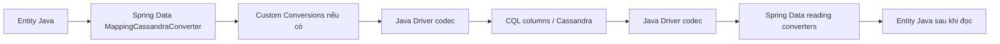

# Kiểm chứng ánh xạ hai chiều mà không mất thông tin

Trong **Spring Data Cassandra**, lưu được một entity bằng repository hoặc `CassandraTemplate` chưa đủ để khẳng định dữ liệu đã được chuyển đổi chính xác. Một giá trị Java có thể đi qua **Spring Data mapping**, **custom converter**, **Cassandra Java Driver**, kiểu dữ liệu **CQL** và đường đọc ngược; tại mỗi bước, dữ liệu có thể bị làm tròn, đổi múi giờ, thay cách biểu diễn, mất thứ tự hoặc bị thay bằng giá trị mặc định.

Bài này thuộc chương **Chuyển đổi kiểu** của module **SPRING_DATA_CASSANDRA**. Mục tiêu là xây dựng và **kiểm chứng hợp đồng ánh xạ hai chiều** giữa entity Java và dữ liệu Cassandra, bao gồm:

- Định nghĩa thế nào là *không mất thông tin* khi các kiểu Java và CQL không hoàn toàn tương đương.
- Chọn kiểu dữ liệu và thiết kế bảng theo truy vấn, partition key và độ chính xác cần bảo toàn.
- Tạo `@WritingConverter`, `@ReadingConverter` và đăng ký `CassandraCustomConversions`.
- Kiểm thử ở ba lớp: converter độc lập, Spring Data mapping và dữ liệu thực qua CQL/driver.
- Nhận diện các tình huống dễ âm thầm mất dữ liệu: `decimal` ↔ `double`, `Instant` nano giây ↔ `timestamp` mili giây, `null`, collection, Unicode và chuyển đổi phiên bản schema.

## 1. "Hai chiều" nghĩa là gì?

Gọi `f` là phép biến đổi **giá trị nghiệp vụ Java → kiểu lưu trữ CQL**, và `g` là phép biến đổi **CQL → Java**. Với mọi giá trị Java hợp lệ `x`, kỳ vọng:

```text
Java domain x
    |
    | f: writing converter + driver codec
    v
CQL value y
    |
    | g: driver codec + reading converter
    v
Java domain x'

Yêu cầu: x' tương đương x theo quy tắc nghiệp vụ đã công bố.
```

Nếu không có chuẩn hóa, mục tiêu chặt là **`g(f(x)) = x`**. Nếu domain cho phép dạng biểu diễn khác nhau, ví dụ số tiền `12.3` và `12.30` cùng nghĩa là **12 đồng 30 xu** với hai chữ số thập phân, kiểm chứng phải dựa trên dạng **canonical**:

```text
canonical(g(f(x))) = canonical(x)
```

Chiều còn lại cũng quan trọng: với giá trị CQL hợp lệ `y` theo hợp đồng dữ liệu, ta muốn `f(g(y))` giữ nguyên ngữ nghĩa của `y`. Điều này giúp phát hiện dữ liệu lịch sử mà một converter mới không còn đọc/ghi bảo toàn được.

### 1.1. Ba mức "không mất thông tin"

| Mức | Ví dụ | Yêu cầu kiểm chứng |
|---|---|---|
| **Bảo toàn chính xác** | `UUID`, `LocalDate`, `BigInteger`, chuỗi UTF-8 | Giá trị trước và sau bằng nhau theo ngữ nghĩa của kiểu |
| **Bảo toàn sau chuẩn hóa công bố** | Giá tiền `12.3 → 12.30`, mã sản phẩm viết hoa | Giá trị canonical không đổi; chuẩn hóa phải có chủ đích |
| **Bảo toàn có giới hạn độ chính xác** | `Instant` nano giây → CQL `timestamp` mili giây | Chỉ nhận dữ liệu có độ chính xác phù hợp, hoặc nói rõ phần nào bị cắt |

**Không gọi một chuyển đổi là lossless nếu đã làm mất thông tin mà nghiệp vụ cần.** Ví dụ, `Instant.parse("2026-11-25T09:00:00.123456789Z")` không thể round-trip nguyên vẹn qua cột CQL `timestamp` vì kiểu này lưu thời điểm với độ chính xác **mili giây**.

## 2. Đường đi thực tế từ entity đến Cassandra



| Lớp | Việc thực hiện | Lỗi có thể gặp |
|---|---|---|
| Mapping Spring Data | `@Table`, `@Column`, `@PrimaryKey`, converter, khởi tạo object | Map sai tên cột, thiếu property, constructor không nhận giá trị |
| Custom conversion | Đổi value object ↔ kiểu Cassandra hỗ trợ | Làm tròn, bỏ field, đổi enum code, đọc/ghi bất đối xứng |
| Java Driver codec | Mã hóa/giải mã kiểu Java ↔ CQL | Không hợp kiểu, giới hạn độ chính xác của `timestamp`, `timeuuid` |
| Cassandra storage | Lưu mutation tại primary key theo schema | Trùng khóa gây upsert, TTL, tombstone, thay đổi song song |
| Repository/template | Truy vấn, bind giá trị và ánh xạ kết quả | Truy vấn nhầm partition hoặc mapping khác với CQL thực tế |

Vì vậy, một **unit test cho converter** chỉ chứng minh logic của converter. Để kiểm chứng dữ liệu đã được lưu **đúng vào Cassandra**, còn cần test với schema thật, đọc ngược bằng Spring Data và kiểm tra độc lập bằng `CqlSession`/CQL.

### 2.1. Các kiểu cơ bản nên biết

| CQL | Java phù hợp trong Java Driver 4 / Spring Data Cassandra | Lưu ý round-trip |
|---|---|---|
| `uuid` | `UUID` | Không thay ID trong retry; không suy ra thời gian từ UUID v4 |
| `timeuuid` | `UUID` phiên bản 1 | UUID v4 không thay thế hợp lệ cho `timeuuid` |
| `text` | `String` | Không tự chuẩn hóa Unicode, trim hoặc đổi case nếu cần bảo toàn byte/ngữ nghĩa |
| `boolean` | `Boolean` | Chọn wrapper nếu cần phân biệt thiếu giá trị và `false` |
| `int`, `bigint` | `Integer`, `Long` | Kiểm tra phạm vi; không ép `long` sang `int` một cách âm thầm |
| `varint` | `BigInteger` | Có độ chính xác nguyên tùy ý trong giới hạn tài nguyên |
| `decimal` | `BigDecimal` | Không vòng qua `double` khi cần số thập phân chính xác |
| `float`, `double` | `Float`, `Double` | Xấp xỉ nhị phân; không dùng mặc định cho giá tiền |
| `date` | `LocalDate` | Chỉ có ngày, **không có múi giờ** |
| `time` | `LocalTime` | Thời gian trong ngày, không phải một instant |
| `timestamp` | `Instant` | Lưu mili giây từ epoch; không giữ zone ID hay nano giây |
| `blob` | `ByteBuffer` | Kiểm tra nội dung byte, `position`/`limit`, không so sánh identity |
| `list/set/map` | `List/Set/Map` | Chọn phép so sánh theo ngữ nghĩa, chú ý thứ tự và phần tử |
| `duration` | `CqlDuration` | Có tháng/ngày/nano giây; không đồng nhất tùy ý với `java.time.Duration` |

Kiểu cụ thể và converter mặc định còn phụ thuộc phiên bản thư viện. Hãy xác minh mapping với dependency của dự án thay vì suy đoán tên kiểu chỉ từ entity.

## 3. Thiết kế bảng kiểm thử và hợp đồng dữ liệu

Giả sử ứng dụng ghi nhận một khoản thu với số tiền cố định **hai chữ số thập phân**, thời điểm xảy ra, ngày nghiệp vụ và một số nhãn. Đường truy vấn chính là **đọc một bản ghi theo ID**:

```sql
CREATE TABLE IF NOT EXISTS conversion_probe_by_id (
    probe_id uuid PRIMARY KEY,
    amount decimal,
    occurred_at timestamp,
    business_date date,
    reference_code text,
    labels set<text>,
    revision bigint
);
```

`probe_id` là partition key, đồng thời là toàn bộ primary key. Ví dụ này cố tình chọn **một hàng theo ID** để kết quả test tập trung vào tính chính xác của chuyển đổi, không bị nhiễu bởi truy vấn nhiều partition hay paging. Bảng phải tồn tại trong **keyspace đã cấu hình** và được tạo bằng migration hoặc fixture test trước khi chạy.

Hợp đồng dữ liệu đề xuất:

| Field | Domain Java | CQL | Bất biến phải giữ |
|---|---|---|---|
| `probeId` | `UUID` | `uuid` | ID không đổi, không `null` |
| `amount` | `MoneyAmount` | `decimal` | Chính xác đến 2 chữ số thập phân, không làm tròn âm thầm |
| `occurredAt` | `Instant` | `timestamp` | Đúng instant với độ chính xác mili giây |
| `businessDate` | `LocalDate` | `date` | Giữ nguyên ngày nghiệp vụ |
| `referenceCode` | `String` | `text` | Giữ Unicode và chữ hoa/thường như đã thỏa thuận |
| `labels` | `Set<String>` | `set<text>` | Giữ đúng các phần tử, không đòi hỏi thứ tự chèn |
| `revision` | `Long` | `bigint` | Không đổi giá trị và không tràn phạm vi |

Với `MoneyAmount`, ta sẽ dùng converter riêng để thực thi bất biến về đơn vị và độ chính xác. Những field khác được ánh xạ theo quy tắc có sẵn.

## 4. Xây value object và converter bảo toàn số tiền

Sai lầm phổ biến là lưu số tiền bằng `double` rồi chuyển sang `BigDecimal`:

```java
// Không dùng kiểu này cho số tiền cần chính xác:
BigDecimal unsafe = new BigDecimal(0.1d);

// Dùng chuỗi hoặc biểu diễn số nguyên đơn vị nhỏ:
BigDecimal exact = new BigDecimal("0.10");
```

Trong ví dụ, domain nhận **hai chữ số thập phân**, và không cho phép làm tròn tự phát:

```java
package example.conversion;

import java.math.BigDecimal;
import java.math.RoundingMode;
import java.util.Objects;

public record MoneyAmount(BigDecimal value) {
    public MoneyAmount {
        Objects.requireNonNull(value, "amount must not be null");
        value = value.setScale(2, RoundingMode.UNNECESSARY);
    }
}
```

`setScale(2, UNNECESSARY)` chuẩn hóa `12.3` thành `12.30`, nhưng **ném lỗi** nếu giá trị có chữ số lẻ khác 0 vượt quá hai chữ số, ví dụ `12.345`. Như vậy, việc mất độ chính xác bị phát hiện **trước lúc ghi**, không bị che bởi một phép làm tròn.

Converter **ghi** Java → kiểu `BigDecimal` của CQL `decimal`:

```java
package example.conversion;

import java.math.BigDecimal;
import org.springframework.core.convert.converter.Converter;
import org.springframework.data.convert.WritingConverter;

@WritingConverter
public final class MoneyAmountWriteConverter
        implements Converter<MoneyAmount, BigDecimal> {

    @Override
    public BigDecimal convert(MoneyAmount source) {
        return source.value();
    }
}
```

Converter **đọc** `BigDecimal` → value object:

```java
package example.conversion;

import java.math.BigDecimal;
import org.springframework.core.convert.converter.Converter;
import org.springframework.data.convert.ReadingConverter;

@ReadingConverter
public final class MoneyAmountReadConverter
        implements Converter<BigDecimal, MoneyAmount> {

    @Override
    public MoneyAmount convert(BigDecimal source) {
        return new MoneyAmount(source);
    }
}
```

Đọc một số tiền cũ có quá nhiều chữ số lẻ (ví dụ `12.345`) sẽ **thất bại có chủ đích**. Nếu dữ liệu lịch sử có quy ước khác, hãy thiết kế kế hoạch migration/versioning thay vì âm thầm làm tròn khi đọc.

### 4.1. Đăng ký cả hai chiều

Một cách khai báo converter trong ứng dụng Spring Boot có Spring Data Cassandra:

```java
package example.conversion;

import java.util.List;
import org.springframework.context.annotation.Bean;
import org.springframework.context.annotation.Configuration;
import org.springframework.data.cassandra.core.convert.CassandraCustomConversions;

@Configuration(proxyBeanMethods = false)
public class CassandraConversionConfiguration {

    @Bean
    CassandraCustomConversions cassandraCustomConversions() {
        return new CassandraCustomConversions(List.of(
                new MoneyAmountWriteConverter(),
                new MoneyAmountReadConverter()
        ));
    }
}
```

Spring Data không tự động lấy mọi `Converter` tìm thấy trên classpath làm Cassandra converter. Cần **đăng ký rõ ràng** với `CassandraCustomConversions`, bảo đảm `MappingCassandraConverter` được cấu hình sử dụng chúng. Trong cấu hình Java thủ công dựa trên `AbstractCassandraConfiguration`, có thể override `customConversions()` thay vì tạo thêm một bean cạnh tranh; chọn **một cách tích hợp** phù hợp với hạ tầng đang chạy.

Annotation `@WritingConverter`/`@ReadingConverter` giúp mô tả hướng chuyển đổi rõ ràng, nhất là khi hai phía đều là kiểu đơn giản mà framework có thể không tự phân biệt được hướng đọc/ghi.

**Lưu ý phạm vi:** converter kiểu `MoneyAmount` ↔ `BigDecimal` có thể được áp dụng cho **mọi property tương ứng** trong mapping context, không chỉ một cột `amount`. Không viết converter biến đổi mọi `String` theo cách thay đổi các field khác ngoài ý muốn; khi chỉ một property cần quy tắc riêng, cân nhắc cơ chế property-specific conversion mà phiên bản Spring Data hỗ trợ.

## 5. Entity mapping với converter tùy chỉnh

Entity Spring Data Cassandra:

```java
package example.conversion;

import java.time.Instant;
import java.time.LocalDate;
import java.util.Set;
import java.util.UUID;

import org.springframework.data.cassandra.core.mapping.Column;
import org.springframework.data.cassandra.core.mapping.PrimaryKey;
import org.springframework.data.cassandra.core.mapping.Table;

@Table("conversion_probe_by_id")
public class ConversionProbe {

    @PrimaryKey("probe_id")
    private UUID probeId;

    @Column("amount")
    private MoneyAmount amount;

    @Column("occurred_at")
    private Instant occurredAt;

    @Column("business_date")
    private LocalDate businessDate;

    @Column("reference_code")
    private String referenceCode;

    @Column("labels")
    private Set<String> labels;

    @Column("revision")
    private Long revision;

    public ConversionProbe() {}

    public ConversionProbe(UUID probeId, MoneyAmount amount,
                           Instant occurredAt, LocalDate businessDate,
                           String referenceCode, Set<String> labels,
                           Long revision) {
        this.probeId = probeId;
        this.amount = amount;
        this.occurredAt = occurredAt;
        this.businessDate = businessDate;
        this.referenceCode = referenceCode;
        this.labels = labels;
        this.revision = revision;
    }

    public UUID getProbeId() { return probeId; }
    public void setProbeId(UUID value) { this.probeId = value; }
    public MoneyAmount getAmount() { return amount; }
    public void setAmount(MoneyAmount value) { this.amount = value; }
    public Instant getOccurredAt() { return occurredAt; }
    public void setOccurredAt(Instant value) { this.occurredAt = value; }
    public LocalDate getBusinessDate() { return businessDate; }
    public void setBusinessDate(LocalDate value) { this.businessDate = value; }
    public String getReferenceCode() { return referenceCode; }
    public void setReferenceCode(String value) { this.referenceCode = value; }
    public Set<String> getLabels() { return labels; }
    public void setLabels(Set<String> value) { this.labels = value; }
    public Long getRevision() { return revision; }
    public void setRevision(Long value) { this.revision = value; }
}
```

`MoneyAmount` là **domain type**, còn cột vật lý `amount` có kiểu **CQL `decimal`**. Việc thay khai báo converter trong mã Java không tự sửa schema CQL; mapping và bảng thật phải được kiểm tra cùng nhau. Trong production, nên quản lý schema bằng migration và không dựa vào việc `schema-action` tự thay đổi kiểu cột đã tồn tại.

Repository dùng khóa `UUID` vì `probe_id` là toàn bộ primary key:

```java
package example.conversion;

import java.util.UUID;
import org.springframework.data.cassandra.repository.CassandraRepository;

public interface ConversionProbeRepository
        extends CassandraRepository<ConversionProbe, UUID> {
}
```

Tương đương ở mức `CassandraTemplate`:

```java
// Trong service đã inject CassandraOperations operations.
operations.insert(entity);
ConversionProbe reloaded =
        operations.selectOneById(entity.getProbeId(), ConversionProbe.class);
```

Hai đường truy cập vẫn cần đúng keyspace và bảng `conversion_probe_by_id`; **converter không sửa được truy vấn sai partition key**.

## 6. Tầng kiểm thử 1: unit test converter hai chiều

Test converter trước khi kết nối database giúp tách lỗi thuật toán khỏi lỗi môi trường:

```java
package example.conversion;

import static org.junit.jupiter.api.Assertions.*;
import java.math.BigDecimal;
import org.junit.jupiter.api.Test;

class MoneyAmountConversionTest {

    private final MoneyAmountWriteConverter writer =
            new MoneyAmountWriteConverter();
    private final MoneyAmountReadConverter reader =
            new MoneyAmountReadConverter();

    @Test
    void javaToCqlToJavaPreservesCanonicalValue() {
        MoneyAmount input = new MoneyAmount(new BigDecimal("12.30"));

        BigDecimal stored = writer.convert(input);
        MoneyAmount output = reader.convert(stored);

        assertEquals(new BigDecimal("12.30"), stored);
        assertEquals(input, output);
        assertEquals(2, output.value().scale());
    }

    @Test
    void acceptsExactCanonicalizationButNeverSilentRounding() {
        assertEquals(
                new MoneyAmount(new BigDecimal("12.30")),
                new MoneyAmount(new BigDecimal("12.3")));
        assertThrows(ArithmeticException.class, () ->
                new MoneyAmount(new BigDecimal("12.345")));
    }

    @Test
    void readsOnlyValuesInTheSupportedDomain() {
        assertEquals(
                new BigDecimal("-9.50"),
                writer.convert(reader.convert(new BigDecimal("-9.50"))));
        assertThrows(ArithmeticException.class, () ->
                reader.convert(new BigDecimal("10.001")));
    }
}
```

Bài test kiểm chứng:

- Đường **Java → CQL → Java** với giá trị hợp lệ.
- Đường **CQL → Java → CQL** trong miền dữ liệu được định nghĩa.
- Chính sách chuẩn hóa **có chủ đích** và việc từ chối giá trị không biểu diễn được chính xác.

Nên mở rộng bằng các trường hợp `0`, `-0.00`, giá trị âm, giá trị lớn trong giới hạn nghiệp vụ, `1.00`, `1.01` và nhiều đầu vào được sinh ngẫu nhiên theo miền hợp lệ. Khi kiểm chứng `BigDecimal`, phân biệt `equals()` (có xét `scale`) và `compareTo()` (so sánh giá trị số).

## 7. Tầng kiểm thử 2: Spring Data ↔ Cassandra thật

Unit test trực tiếp hai converter chưa chứng minh rằng **Spring Data đã đăng ký và dùng** chúng. Cần một **integration test** chạy trên một Cassandra instance dành riêng cho test, chẳng hạn Cassandra được cấp bởi Testcontainers hoặc môi trường CI biệt lập.

**Điều kiện chạy test:** keyspace và bảng `conversion_probe_by_id` phải được tạo trước bằng CQL fixture/migration; không chạy test trên production; bean `CassandraOperations`, `CqlSession` và các converters phải nằm trong application context của test.

```java
package example.conversion;

import static org.junit.jupiter.api.Assertions.*;
import java.math.BigDecimal;
import java.time.Instant;
import java.time.LocalDate;
import java.util.Set;
import java.util.UUID;

import com.datastax.oss.driver.api.core.CqlSession;
import com.datastax.oss.driver.api.core.cql.Row;
import com.datastax.oss.driver.api.core.cql.SimpleStatement;
import org.junit.jupiter.api.Test;
import org.springframework.beans.factory.annotation.Autowired;
import org.springframework.boot.test.context.SpringBootTest;
import org.springframework.data.cassandra.core.CassandraOperations;

@SpringBootTest
class ConversionRoundTripIntegrationTest {

    @Autowired CassandraOperations operations;
    @Autowired CqlSession session;
    @Autowired ConversionProbeRepository repository;

    @Test
    void roundTripsViaTemplateAndRepositoryAndMatchesRawCql() {
        UUID id = UUID.randomUUID();
        Instant instant = Instant.parse("2026-11-25T09:10:11.123Z");

        ConversionProbe before = new ConversionProbe(
                id,
                new MoneyAmount(new BigDecimal("12.30")),
                instant,
                LocalDate.of(2026, 11, 25),
                "ĐƠN-HÀNG-東京-🙂",
                Set.of("mới", "ưu_tiên"),
                7L
        );

        operations.insert(before);

        ConversionProbe viaTemplate =
                operations.selectOneById(id, ConversionProbe.class);
        ConversionProbe viaRepository =
                repository.findById(id).orElseThrow();

        assertNotNull(viaTemplate);
        assertEquals(before.getProbeId(), viaTemplate.getProbeId());
        assertEquals(before.getAmount(), viaTemplate.getAmount());
        assertEquals(before.getOccurredAt(), viaTemplate.getOccurredAt());
        assertEquals(before.getBusinessDate(), viaTemplate.getBusinessDate());
        assertEquals(before.getReferenceCode(), viaTemplate.getReferenceCode());
        assertEquals(before.getLabels(), viaTemplate.getLabels());
        assertEquals(before.getRevision(), viaTemplate.getRevision());
        assertEquals(before.getAmount(), viaRepository.getAmount());

        // Đọc CQL trực tiếp, bỏ qua bước entity mapping.
        Row raw = session.execute(SimpleStatement.newInstance(
                "SELECT amount, occurred_at, reference_code " +
                "FROM conversion_probe_by_id WHERE probe_id = ?",
                id)).one();

        assertNotNull(raw);
        assertEquals(new BigDecimal("12.30"), raw.getBigDecimal("amount"));
        assertEquals(instant, raw.getInstant("occurred_at"));
        assertEquals(
                before.getReferenceCode(), raw.getString("reference_code"));
    }
}
```

Với test này:

1. `operations.insert` kiểm chứng **đường ghi Spring Data**.
2. `selectOneById` kiểm chứng **đường đọc Spring Data**.
3. `repository.findById` kiểm chứng một đường đọc thường dùng khác.
4. `CqlSession` và `Row.getBigDecimal/getInstant/getString` kiểm tra **giá trị CQL độc lập với entity converter**.

Chính bước (4) giúp phát hiện trường hợp **cả converter ghi và đọc đều sai nhưng bù trừ cho nhau**. Ví dụ writer bí mật nhân số tiền với 100 và reader chia lại cho 100: `g(f(x)) = x` vẫn đúng trong unit test, nhưng cột CQL lưu dữ liệu sai hợp đồng. Đọc raw CQL sẽ phát hiện `amount` không phải số tiền decimal đã định nghĩa.

**Ghi chú:** đây là code mẫu để triển khai khi đã có dependency Spring Boot Test, Cassandra và fixture schema. Theo bước soạn nội dung này, chúng ta **không thực thi** bộ test; kỹ thuật chạy/QA thực tế thuộc bước kiểm chứng riêng.

## 8. Tầng kiểm thử 3: đối chiếu độc lập bằng CQL

Kiểm tra schema trước, rồi đối chiếu hàng:

```sql
SELECT column_name, kind, type
FROM system_schema.columns
WHERE keyspace_name = 'learning_data'
  AND table_name = 'conversion_probe_by_id';
```

Thay `learning_data` bằng keyspace test thật. Xác nhận `amount` là `decimal`, `occurred_at` là `timestamp`, `business_date` là `date`, `probe_id` là partition key kiểu `uuid`.

```sql
-- Thay UUID bằng giá trị do test ghi.
SELECT probe_id, amount, occurred_at, business_date,
       reference_code, labels, revision
FROM conversion_probe_by_id
WHERE probe_id = 8f6e37fa-7af2-47e2-b4be-542e83a83848;
```

Nếu muốn test chiều **CQL → Java → CQL** độc lập với Spring Data writer:

1. Insert một hàng bằng `CqlSession` hoặc `cqlsh` với dữ liệu CQL hợp lệ.
2. Đọc qua repository/template và xác minh các field Java.
3. Ghi sang **một primary key mới** hoặc một keyspace test riêng để tránh bị ảnh hưởng bởi upsert/TTL của hàng nguồn.
4. Đọc hai giá trị CQL bằng driver và so sánh theo hợp đồng (ví dụ decimal có scale chuẩn, set có cùng phần tử).

Việc dùng một key mới là quan trọng: nếu ghi lại đúng key cũ, Cassandra có thể upsert và che khuất lỗi do dữ liệu cũ vẫn còn ở các cột chưa được ghi.

## 9. Những vùng mất thông tin thường gặp

### 9.1. `Instant` nano giây và CQL `timestamp` mili giây

CQL `timestamp` biểu diễn số **mili giây tính từ epoch**, không giữ timestamp theo độ chính xác nano giây và cũng không lưu `ZoneId`:

```java
import java.time.Instant;
import java.time.temporal.ChronoUnit;

Instant highPrecision =
        Instant.parse("2026-11-25T09:00:00.123456789Z");

Instant millisecondPrecision =
        highPrecision.truncatedTo(ChronoUnit.MILLIS);

System.out.println(millisecondPrecision);
// 2026-11-25T09:00:00.123Z
```

Nếu hợp đồng yêu cầu **không mất nano giây**, không nên âm thầm ghi sang `timestamp`: phải chọn mô hình lưu giữ khác (ví dụ giây và phần nano riêng theo thiết kế được thống nhất) hoặc thay đổi hợp đồng dữ liệu. Nếu nghiệp vụ chỉ cần mili giây, hãy **kiểm tra và chuẩn hóa ở biên** trước khi tạo entity:

```java
static Instant requireMillisecondPrecision(Instant value) {
    if (!value.equals(value.truncatedTo(ChronoUnit.MILLIS))) {
        throw new IllegalArgumentException(
                "occurredAt must have millisecond precision");
    }
    return value;
}
```

Không dùng `LocalDateTime` → `Instant` theo múi giờ hệ thống mà không nêu rõ zone. `LocalDateTime` chỉ có lịch/ngày giờ địa phương, **không tự xác định một instant**. Test nên bao gồm UTC, múi giờ của sản phẩm, thời điểm chuyển giờ mùa hè (nếu có) và thời điểm trước epoch khi hệ thống xử lý dữ liệu lịch sử.

### 9.2. `decimal` khác `float/double`

`BigDecimal` là biểu diễn thập phân, còn `double` thường là **xấp xỉ nhị phân**. Vòng `BigDecimal → double → BigDecimal` có thể thay đổi giá trị và scale. Với tiền tệ hoặc đại lượng cần chính xác, dùng CQL `decimal` với `BigDecimal` hoặc biểu diễn số nguyên đơn vị nhỏ (ví dụ cents) nếu domain phù hợp.

Thêm test với số rất nhỏ, số rất lớn, `0.1`, `-0.01`, số âm và các giá trị sát giới hạn do nghiệp vụ đặt ra. Nếu chỉ muốn giữ giá trị số, `compareTo() == 0` có thể là phép so sánh thích hợp; nếu **scale** có ý nghĩa, phải kiểm cả `scale()` và cách chuẩn hóa.

### 9.3. `null`, thiếu cột và collection rỗng

Không đồng nhất:

- `null`: giá trị không có, có thể liên quan tới xóa cột/tombstone hoặc mapper không populate property.
- `Set.of()`: tập rỗng có chủ đích.
- `String ""`: chuỗi rỗng, không giống `null`.
- **UNSET** của driver: giá trị được đánh dấu *không cập nhật* trong statement hỗ trợ, khác với gán `NULL`.

Với Cassandra, `INSERT/UPDATE` có `NULL`, cột bị bỏ qua và binding `UNSET` có thể có hành vi khác nhau, nhất là khi cập nhật hàng đã tồn tại. Đừng suy ra chung rằng `repository.save(entity)` sẽ có cùng chính sách `null` trên mọi phiên bản/configuration. Test riêng **insert mới**, **update hàng cũ**, **xóa field** và **đọc lại**, đồng thời quan sát tombstones/TTL nếu liên quan.

Nếu ứng dụng thực sự cần phân biệt *chưa từng cung cấp* với *người dùng cố ý chọn rỗng*, có thể phải lưu thêm cờ trạng thái hoặc một mô hình dữ liệu riêng thay vì dựa vào khác biệt bất định giữa `null` và giá trị rỗng của collection.

### 9.4. Set, list, map không cùng khái niệm "bằng nhau"

| CQL collection | Java | Phép kiểm chứng |
|---|---|---|
| `list<text>` | `List<String>` | Bảo toàn thứ tự, số lượng và phần tử trùng |
| `set<text>` | `Set<String>` | Cùng tập phần tử; **không so sánh thứ tự iteration** |
| `map<text, boolean>` | `Map<String, Boolean>` | Cùng key/value; không dựa vào thứ tự chèn |

Không chuyển `List` thành `Set` trong converter nếu nghiệp vụ cho phép phần tử trùng. Không dùng `List<String>` để bảo toàn lịch sử sự kiện lớn vì collection không có paging từng phần tử như các hàng CQL và list append có thể không idempotent khi retry.

### 9.5. Enum, Unicode và chuỗi định danh

Nếu enum Java được lưu bằng tên hằng, việc đổi `PAID` thành `SETTLED` có thể làm dữ liệu cũ không đọc được. Với dữ liệu cần tồn tại qua nhiều phiên bản, hãy cân nhắc **mã lưu trữ ổn định** (ví dụ `"P"`) và converter đọc/ghi rõ ràng. Mã không nhận biết nên **báo lỗi có chủ đích**, không tự đổi sang `UNKNOWN` trừ khi hợp đồng nghiệp vụ xác định.

Chuỗi Unicode có thể có những cách biểu diễn khác nhau mà giao diện hiển thị giống nhau (ví dụ ký tự tổ hợp và ký tự dựng sẵn). Nếu khóa nghiệp vụ có chính sách chuẩn hóa NFC/trim/case-fold, phải áp dụng **trước khi ghi** và test cả chiều đọc; nếu cần bảo toàn văn bản nguyên bản, **không âm thầm chuẩn hóa** trong converter. Đặc biệt, đổi cách chuẩn hóa một giá trị thuộc partition key có thể khiến ứng dụng không còn tìm được hàng theo khóa cũ.

### 9.6. `blob`, `timeuuid` và `duration`

- Với `blob`, hãy so sánh từng byte thực tế. `ByteBuffer` có `position`, `limit` và có thể dùng chung vùng nhớ; tránh so sánh identity hoặc đọc làm thay đổi vị trí buffer rồi tái sử dụng mà không kiểm soát.
- Với `timeuuid`, Java vẫn dùng `UUID`, nhưng cột CQL này chỉ chấp nhận **UUID version 1**. Việc tự đổi qua lại với UUID v4 là sai hợp đồng.
- Với `duration`, Cassandra hỗ trợ thành phần tháng, ngày, nano giây; `java.time.Duration` không mang thông tin *tháng lịch*. Cần giữ kiểu `CqlDuration` hoặc thiết kế converter chỉ trong **miền dữ liệu đã giới hạn** và từ chối giá trị không biểu diễn được.

## 10. Bảng ca kiểm thử round-trip nên có

| Nhóm | Dữ liệu thử | Kỳ vọng |
|---|---|---|
| Decimal chính xác | `0.00`, `12.30`, `-9.50`, số lớn hợp lệ | Round-trip đúng cả value và scale canonical |
| Decimal không hợp lệ | `12.345` với domain 2 số lẻ | Báo lỗi, không làm tròn âm thầm |
| Timestamp | `.123Z` và `.123456789Z` | Mili giây pass, nano giây bị từ chối/được xử lý công khai |
| Date/timezone | Ngày cuối tháng, leap day, zone khác UTC | Bảo toàn `LocalDate` và instant, không đổi ngày bất ngờ |
| Unicode | Dấu tiếng Việt, emoji, tiếng Nhật, dấu cách cuối | Không mất ký tự; chính sách normalization minh bạch |
| UUID | UUID v4; UUID v1 cho `timeuuid` | Bảo toàn ID; phát hiện không tương thích kiểu cột |
| Collection | List trùng, set không thứ tự, map nhiều key | So sánh đúng đặc trưng collection |
| Missing/null/empty | `null`, `""`, `Set.of()`, cột chưa ghi | Theo đúng chính sách insert/update và contract |
| Compatibility | Dữ liệu do bản ứng dụng cũ ghi | Converter mới đọc được hoặc có migration rõ ràng |
| Concurrency | Hai writer, retry sau timeout | Không đổi định danh/không âm thầm mất cập nhật |
| Raw CQL | Đọc cột bằng driver, không qua entity | Dữ liệu vật lý đúng contract |

Khi bộ test có nhiều biến thể, có thể dùng **parameterized test** hoặc property-based testing để sinh hàng trăm giá trị trong miền hợp lệ. Luôn có vài **known vectors** cố định để phát hiện regression và giúp debug kết quả cụ thể.

## 11. Kiểm chứng qua schema evolution và dữ liệu cũ

Trong production, việc đổi converter không giống đổi một hàm tiện ích. Dữ liệu đã ghi có thể tồn tại lâu hơn phiên bản ứng dụng đang chạy.

Giả sử ban đầu số tiền được lưu ở cột `amount_text text`, sau đó muốn chuyển sang `amount decimal`. Một phương án chuyển đổi có kiểm soát:

1. **Xác định hợp đồng cũ:** ký hiệu tiền tệ, dấu thập phân, khoảng trắng, giá trị không hợp lệ, ngôn ngữ và cách hiển thị.
2. **Thêm cột mới qua migration CQL** (khi schema cho phép), không tự sửa kiểu cột vật lý chỉ bằng annotation Java.
3. **Viết converter/migration** đọc chuỗi cũ, xác thực và chuyển sang decimal; lưu nhật ký các hàng không chuyển được.
4. **Backfill có giới hạn tốc độ**, truy vấn theo khóa và paging phù hợp thay vì quét không kiểm soát.
5. **Dual read/write hoặc chuyển tuyến theo giai đoạn** nếu nhiều phiên bản ứng dụng đồng thời hoạt động.
6. **Đối soát** dữ liệu cũ và mới bằng cả Spring Data lẫn raw CQL, thống kê các trường hợp không biểu diễn được.
7. **Chỉ bỏ cột/đường đọc cũ** sau khi kết quả, độ trễ và yêu cầu rollback đã được xác nhận.

Ví dụ lệnh migration (chỉ khi column chưa tồn tại, được duyệt theo schema thực):

```sql
ALTER TABLE conversion_probe_by_id
ADD legacy_amount_text text;
```

Ví dụ này minh họa việc thêm cột để giữ dữ liệu cũ trong quá trình chuyển đổi; trong hệ thống đang có `amount_text` thì migration sẽ cần **thêm `amount decimal` mới** vào bảng đó. Không chạy lệnh theo ví dụ mà chưa kiểm tra schema thực tế.

Các ghi chú vận hành cần nhớ:

- **Consistency level** (`LOCAL_ONE`, `LOCAL_QUORUM`...) quyết định yêu cầu phản hồi replica của thao tác; nó không sửa sai số do converter.
- **Paging state** phụ thuộc truy vấn và tham số; đọc lại dữ liệu nhiều partition để đối soát cần lưu cursor và giới hạn fan-out phù hợp.
- **Retry** phải giữ nguyên primary key và nội dung nghiệp vụ được xác nhận; nếu mỗi lượt thử sinh UUID khác, test có thể tạo bản ghi trùng dù converter hoàn toàn đúng.
- **TTL/tombstone** có thể khiến một field biến mất sau thời gian hoặc sau xóa; test so sánh phải phân biệt thay đổi vòng đời dữ liệu với lỗi conversion.
- **Performance:** converter nặng (parse JSON, regex, mã hóa) chạy trên mỗi hàng; hãy đo p95/p99, allocations, GC và số hàng được mapping dưới tải thực.

## 12. Những lỗi thiết kế hay gặp

| Sai lầm | Hậu quả | Cách xử lý |
|---|---|---|
| Chỉ test `read(write(x))` bằng hai converter | Hai lỗi ngược nhau có thể bù trừ | Đọc trực tiếp CQL và kiểm tra giá trị vật lý |
| Dùng `double` trung gian cho tiền | Sai số thập phân khó thấy | `BigDecimal` hoặc đơn vị nhỏ dạng số nguyên |
| Cho `Instant` nano giây vào `timestamp` | Mất phần nhỏ hơn mili giây | Ràng buộc độ chính xác hoặc đổi mô hình lưu |
| Chuyển `LocalDateTime` thành instant theo JVM default zone | Kết quả lệch khi chạy ở môi trường khác | Chỉ định `ZoneId` theo hợp đồng |
| Lưu enum bằng tên nhưng đổi tên hằng | Dữ liệu cũ không đọc được | Dùng mã bền vững và migration |
| Gắn converter nhưng quên đăng ký | Mapping không dùng converter mong đợi | Test trong Spring context thật |
| Biến `null` thành `""` mặc định | Mất phân biệt giá trị bị thiếu/rỗng | Chốt chính sách dữ liệu, test insert/update |
| So sánh set theo thứ tự iterator | Test thất bại dù dữ liệu đúng | So sánh như tập hợp |
| Thay converter và nghĩ schema tự đổi | Type mismatch với cột cũ | Migration và dual-read/backfill |
| Dùng ID/partition key được normalize khác nhau | Không đọc lại được hàng | Kiểm tra canonicalization trước khi ghi |
| Chỉ test một bản ghi rất nhỏ | Bỏ sót overflow, phân trang, hot partition | Test boundary + benchmark trên dữ liệu đại diện |

## 13. Bài tập thực hành

Một dịch vụ thanh toán lưu:

```sql
CREATE TABLE payments_by_id (
    payment_id uuid PRIMARY KEY,
    amount decimal,
    settled_at timestamp,
    currency text,
    tags set<text>
);
```

Yêu cầu:

1. Giá trị tiền có **ba** chữ số thập phân vì sản phẩm có đơn vị nhỏ tới 0,001; mọi phép làm tròn phải bị từ chối.
2. `settled_at` phải giữ chính xác **mili giây**, không chấp nhận nano giây vượt mức.
3. `currency` là mã ISO được chuẩn hóa dạng chữ hoa, nhưng API cần báo lỗi khi nhận mã không hợp lệ.
4. `tags` không có thứ tự nhưng không được mất phần tử khi đọc lại.
5. Kiểm tra cả bản ghi do repository ghi và bản ghi do CQL trực tiếp ghi.

**Hướng thực hiện:**

- Tạo `Amount3` chứa `BigDecimal`, dùng `setScale(3, RoundingMode.UNNECESSARY)`; đăng ký cặp `@WritingConverter`/`@ReadingConverter`.
- Với `settled_at`, validate `instant.equals(instant.truncatedTo(MILLIS))` trước khi insert; test `.123Z` thành công và `.123456Z` bị từ chối.
- Kiểm tra mã currency ở biên API, tạo giá trị canonical có chủ đích; nếu cần giữ cách nhập ban đầu thì lưu nó ở field riêng.
- Viết unit test converter, integration test repository/template và kiểm tra `Row.getBigDecimal("amount")`/`Row.getInstant("settled_at")`.
- Với dữ liệu không hợp lệ, test phải **fail rõ ràng**, không làm tròn hoặc thay bằng giá trị mặc định.

### Câu hỏi tự kiểm tra

1. Vì sao chỉ có unit test `read(write(x)) == x` chưa chứng minh dữ liệu CQL đã đúng?
2. `BigDecimal("12.30")` và `BigDecimal("12.3")` khác nhau thế nào khi dùng `equals` và `compareTo`?
3. CQL `timestamp` có giữ được nano giây hoặc `ZoneId` ban đầu không?
4. Vì sao converter `String → String` tự động trim có thể làm ứng dụng không còn tìm được hàng?
5. Với `Set<String>`, có cần assert cùng thứ tự iteration sau khi đọc lại không?
6. Thay đổi converter ở bản phát hành mới có tự chuyển đổi dữ liệu cũ và schema Cassandra không?
7. Nếu một event bị retry bằng ID mới, vấn đề là conversion hay idempotency?

**Đáp án gợi ý:** (1) hai converter có thể cùng sai theo hai chiều bù trừ; (2) `equals` xét cả scale, `compareTo` so giá trị số; (3) không; (4) khóa partition thay đổi; (5) không, so tập phần tử; (6) không, cần migration/backfill; (7) idempotency và thiết kế primary key.

## 14. Checklist trước khi chấp nhận converter

- [ ] Đã ghi rõ miền giá trị hợp lệ và ý nghĩa *lossless* hoặc canonicalization.
- [ ] Kiểu Java/CQL phù hợp; không đổi `decimal` qua `double` nếu yêu cầu chính xác.
- [ ] Với thời gian, đã xác định `Instant` hay local date/time và độ chính xác cần giữ.
- [ ] `@WritingConverter`, `@ReadingConverter` được đăng ký đúng với mapping context.
- [ ] Converter báo lỗi đối với giá trị không thể biểu diễn đúng, không silently truncate/round.
- [ ] Unit test cả `g(f(x))` lẫn `f(g(y))` trên miền dữ liệu đã công bố.
- [ ] Có integration test qua repository và `CassandraTemplate` với Cassandra thật.
- [ ] Có raw CQL/driver readback để phát hiện lỗi đối xứng giữa hai converter.
- [ ] Đã kiểm tra `null`, empty, Unicode, enum cũ, collection và giá trị biên.
- [ ] Schema được kiểm tra độc lập; thay converter không được nhầm là migration.
- [ ] Đã xác định chính sách retry/idempotency, consistency và TTL/tombstone.
- [ ] Khi xử lý nhiều hàng, có partition key/paging hợp lý và đo độ trễ conversion dưới tải.

## Tài liệu tham khảo

- [Spring Data Cassandra — Mapping](https://docs.spring.io/spring-data/cassandra/reference/object-mapping.html).
- [Spring Data Cassandra — Custom Conversions](https://docs.spring.io/spring-data/cassandra/reference/cassandra/converters.html).
- [Spring Data Cassandra — CassandraTemplate](https://docs.spring.io/spring-data/cassandra/reference/cassandra/template.html).
- [Apache Cassandra — CQL Data Types](https://cassandra.apache.org/doc/latest/cassandra/developing/cql/types.html).
- [Apache Cassandra Java Driver — Temporal Types](https://docs.datastax.com/en/developer/java-driver/4.14/manual/core/temporal_types/).
- [Apache Cassandra Java Driver — Custom Codecs](https://docs.datastax.com/en/developer/java-driver/4.13/manual/core/custom_codecs/).
