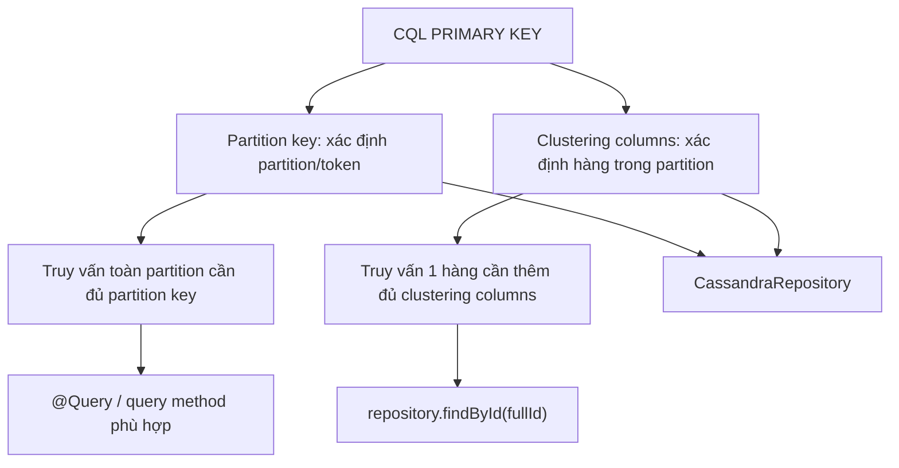
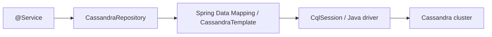

# Định nghĩa CassandraRepository với entity và kiểu khóa

**`CassandraRepository`** là giao diện repository của **Spring Data Cassandra** để thực hiện các thao tác truy cập Apache Cassandra trên những entity đã được ánh xạ. Khi khai báo `CassandraRepository<Entity, Id>`, hai kiểu generic phải tương ứng với **kiểu entity** và **kiểu khóa chính đầy đủ** của entity đó. Chọn sai `Id` thường dẫn đến lỗi mapping hoặc cách sử dụng repository không đúng với mô hình partition của Cassandra.

Bài thuộc chương **Repository** trong module **SPRING_DATA_CASSANDRA**. Chúng ta sẽ khai báo repository cho bảng có khóa đơn và khóa ghép, giải thích `@Table`, `@PrimaryKey`, `@PrimaryKeyClass`, `@PrimaryKeyColumn`, cách thực thi CRUD và truy vấn CQL đúng partition key. Những ví dụ dùng Java, Spring Data Cassandra và một keyspace `commerce` giả định đã tồn tại.

## 1. Hiểu đúng hai tham số của `CassandraRepository<Entity, Id>`

Cú pháp cơ bản:

```java
import org.springframework.data.cassandra.repository.CassandraRepository;

public interface ProductRepository
        extends CassandraRepository<ProductById, UUID> {
}
```

| Thành phần | Ý nghĩa | Ví dụ |
| --- | --- | --- |
| `ProductRepository` | Giao diện do ứng dụng định nghĩa. | Một repository phục vụ bảng sản phẩm. |
| `ProductById` | Entity ánh xạ bằng `@Table` đến một bảng Cassandra. | Bảng `products_by_id`. |
| `UUID` | **Kiểu Java của primary key đầy đủ** trên entity. | Trường khóa `product_id uuid`. |
| Các phương thức kế thừa | Thao tác như `save`, `findById`, `existsById`, `deleteById`. | Làm việc theo định danh hàng. |
| Method query tùy chỉnh | Phương thức bổ sung bằng `@Query` hoặc query derivation phù hợp. | Đọc các hàng trong một partition. |

**Điểm dễ nhầm:** `Id` không phải kiểu của một cột bất kỳ, cũng không nhất thiết là kiểu của *một thành phần partition key*. Với bảng có **composite primary key**, `Id` thường là một **lớp khóa gồm toàn bộ các cột primary key**, kể cả clustering columns.

Một entity có thể dùng partition key đơn nhưng vẫn có full primary key gồm nhiều cột:

```sql
-- Partition key chỉ có customer_id.
PRIMARY KEY (customer_id, created_at, order_id)

-- Partition key ghép gồm tenant_id + event_day.
PRIMARY KEY ((tenant_id, event_day), occurred_at, event_id)
```

Với cả hai trường hợp, nếu full primary key gồm nhiều cột thì kiểu `Id` của repository cần đại diện **đúng full primary key**. Ngược lại, khi `PRIMARY KEY (product_id)` chỉ gồm một cột, dùng trực tiếp `UUID` là hợp lý.

## 2. Bảng khóa đơn: một entity, một kiểu ID đơn giản

Yêu cầu nghiệp vụ: lấy thông tin sản phẩm theo `product_id`. Thiết kế bảng theo truy vấn đó:

```sql
-- Giả định keyspace commerce đã tồn tại.
CREATE TABLE commerce.products_by_id (
    product_id uuid PRIMARY KEY,
    product_name text,
    price decimal,
    status text
);

INSERT INTO commerce.products_by_id (
    product_id, product_name, price, status
) VALUES (
    11111111-1111-1111-1111-111111111111,
    'Mechanical Keyboard',
    1250000.00,
    'active'
);
```

Ở đây `product_id` là toàn bộ primary key và cũng là partition key đơn. Với câu `SELECT ... WHERE product_id = ?`, Cassandra có đủ thông tin để tính token và tìm những replica giữ partition tương ứng.

### 2.1. Định nghĩa entity bằng `@Table` và `@PrimaryKey`

```java
import java.math.BigDecimal;
import java.util.UUID;
import org.springframework.data.cassandra.core.mapping.Column;
import org.springframework.data.cassandra.core.mapping.PrimaryKey;
import org.springframework.data.cassandra.core.mapping.Table;

@Table("products_by_id")
public class ProductById {

    @PrimaryKey("product_id")
    private UUID productId;

    @Column("product_name")
    private String productName;

    @Column("price")
    private BigDecimal price;

    @Column("status")
    private String status;

    public ProductById() {}

    public UUID getProductId() { return productId; }
    public void setProductId(UUID productId) { this.productId = productId; }

    public String getProductName() { return productName; }
    public void setProductName(String productName) {
        this.productName = productName;
    }

    public BigDecimal getPrice() { return price; }
    public void setPrice(BigDecimal price) { this.price = price; }

    public String getStatus() { return status; }
    public void setStatus(String status) { this.status = status; }
}
```

- `@Table("products_by_id")` chọn bảng CQL.
- `@PrimaryKey("product_id")` chỉ định một trường Java vừa là khóa chính đầy đủ vừa là khóa partition.
- `@Column` ánh xạ tên Java kiểu camelCase sang tên cột CQL kiểu snake_case.
- `UUID` khớp cột CQL `uuid`; `BigDecimal` phù hợp với `decimal`.

Spring Data không biến một cột thường thành partition key chỉ vì tên thuộc tính là `id`. **Schema CQL và metadata mapping phải khớp nhau.**

### 2.2. Định nghĩa repository

```java
import java.util.UUID;
import org.springframework.data.cassandra.repository.CassandraRepository;

public interface ProductRepository
        extends CassandraRepository<ProductById, UUID> {
}
```

Không cần tự viết phương thức `findById` hay lớp triển khai cho CRUD cơ bản. Spring Data tạo repository proxy khi cấu hình repository scanning phù hợp.

Ví dụ sử dụng trong service:

```java
import java.math.BigDecimal;
import java.util.Optional;
import java.util.UUID;
import org.springframework.stereotype.Service;

@Service
public class ProductService {
    private final ProductRepository products;

    public ProductService(ProductRepository products) {
        this.products = products;
    }

    public Optional<ProductById> load(UUID productId) {
        return products.findById(productId);
    }

    public ProductById createProduct(String name, BigDecimal price) {
        ProductById product = new ProductById();
        product.setProductId(UUID.randomUUID());
        product.setProductName(name);
        product.setPrice(price);
        product.setStatus("active");
        return products.save(product);
    }

    public void delete(UUID productId) {
        products.deleteById(productId);
    }
}
```

ID được tạo ở tầng ứng dụng với `UUID.randomUUID()`; Cassandra không tự cấp số ID tăng dần kiểu `AUTO_INCREMENT`. Trong production, cần có quy tắc sinh ID, kiểm tra dữ liệu và quyền truy cập phù hợp.

### 2.3. `save` là thao tác upsert theo semantics Cassandra

Một điểm khác với JDBC/JPA là lệnh `INSERT` trong Cassandra thường mang nghĩa **upsert**: ghi dữ liệu vào hàng theo primary key, và có thể cập nhật giá trị nếu khóa đã tồn tại. Không nên mặc định coi `repository.save(entity)` là lệnh “tạo mới hoặc báo lỗi nếu trùng ID”.

| Nhu cầu | Điều cần hiểu |
| --- | --- |
| Lưu sản phẩm theo `product_id` | `save` sử dụng metadata khóa để ghi hàng tương ứng. |
| Chỉ tạo khi ID chưa tồn tại | Cần thao tác điều kiện như `INSERT ... IF NOT EXISTS`/lightweight transaction (LWT) nếu nghiệp vụ thực sự đòi hỏi. |
| Kiểm tra `existsById` rồi `save` | Hai request riêng có thể bị ghi xen giữa; **không tạo bảo đảm nguyên tử**. |
| Ghi một phần entity | Cần hiểu cách mapper xử lý cột không có giá trị, `null`, tombstone và TTL; đừng dựa vào `save` như “PATCH chỉ những field đã đổi”. |

Các hành vi chi tiết của `save`, chiến lược insert/update và ghi giá trị `null` phụ thuộc phiên bản/cấu hình Spring Data. Trước khi xử lý cập nhật một phần hoặc concurrency, hãy xác định CQL thực tế và dùng API phù hợp như `CassandraTemplate` hoặc truy vấn CQL được kiểm soát.

## 3. Khóa ghép: kiểu `Id` phải chứa toàn bộ primary key

Xét bài toán log sự kiện của nhiều tenant. Ứng dụng thường hỏi “20 sự kiện mới nhất của tenant X trong ngày D”. Bảng sau dùng **partition key ghép** `(tenant_id, event_day)` để giới hạn phạm vi đọc, còn `occurred_at` và `event_id` là clustering columns:

```sql
CREATE TABLE commerce.events_by_tenant_day (
    tenant_id text,
    event_day date,
    occurred_at timestamp,
    event_id uuid,
    event_type text,
    payload text,
    PRIMARY KEY ((tenant_id, event_day), occurred_at, event_id)
) WITH CLUSTERING ORDER BY (occurred_at DESC, event_id ASC);
```

Phân tích:

| Cột | Vai trò trong primary key | Cách dùng |
| --- | --- | --- |
| `tenant_id` | Partition key, thành phần 1 | Xác định tenant. |
| `event_day` | Partition key, thành phần 2 | Chia partition theo ngày. |
| `occurred_at` | Clustering column, vị trí 1 | Sắp xếp sự kiện trong partition. |
| `event_id` | Clustering column, vị trí 2 | Phân biệt các sự kiện cùng timestamp. |
| `event_type`, `payload` | Cột thường | Lưu thông tin nghiệp vụ. |

**Full primary key** gồm bốn cột. Do vậy, không khai báo `CassandraRepository<TenantEvent, String>` chỉ vì `tenant_id` là `String`, và cũng không khai báo repository ID là `LocalDate` chỉ vì có `event_day`.

### 3.1. Khai báo `@PrimaryKeyClass`

```java
import java.io.Serializable;
import java.time.Instant;
import java.time.LocalDate;
import java.util.Objects;
import java.util.UUID;
import org.springframework.data.cassandra.core.mapping.PrimaryKeyClass;
import org.springframework.data.cassandra.core.mapping.PrimaryKeyColumn;
import org.springframework.data.cassandra.core.mapping.PrimaryKeyType;

@PrimaryKeyClass
public class TenantEventKey implements Serializable {

    @PrimaryKeyColumn(
        name = "tenant_id", ordinal = 0, type = PrimaryKeyType.PARTITIONED)
    private String tenantId;

    @PrimaryKeyColumn(
        name = "event_day", ordinal = 1, type = PrimaryKeyType.PARTITIONED)
    private LocalDate eventDay;

    @PrimaryKeyColumn(
        name = "occurred_at", ordinal = 2, type = PrimaryKeyType.CLUSTERED)
    private Instant occurredAt;

    @PrimaryKeyColumn(
        name = "event_id", ordinal = 3, type = PrimaryKeyType.CLUSTERED)
    private UUID eventId;

    public TenantEventKey() {}

    public TenantEventKey(String tenantId, LocalDate eventDay,
                          Instant occurredAt, UUID eventId) {
        this.tenantId = tenantId;
        this.eventDay = eventDay;
        this.occurredAt = occurredAt;
        this.eventId = eventId;
    }

    public String getTenantId() { return tenantId; }
    public void setTenantId(String tenantId) { this.tenantId = tenantId; }

    public LocalDate getEventDay() { return eventDay; }
    public void setEventDay(LocalDate eventDay) { this.eventDay = eventDay; }

    public Instant getOccurredAt() { return occurredAt; }
    public void setOccurredAt(Instant occurredAt) {
        this.occurredAt = occurredAt;
    }

    public UUID getEventId() { return eventId; }
    public void setEventId(UUID eventId) { this.eventId = eventId; }

    @Override
    public boolean equals(Object other) {
        if (this == other) return true;
        if (!(other instanceof TenantEventKey)) return false;
        TenantEventKey that = (TenantEventKey) other;
        return Objects.equals(tenantId, that.tenantId)
            && Objects.equals(eventDay, that.eventDay)
            && Objects.equals(occurredAt, that.occurredAt)
            && Objects.equals(eventId, that.eventId);
    }

    @Override
    public int hashCode() {
        return Objects.hash(tenantId, eventDay, occurredAt, eventId);
    }
}
```

`@PrimaryKeyColumn` đánh dấu từng cột là `PARTITIONED` hoặc `CLUSTERED`. `ordinal` xác định thứ tự các cột trong khóa; kiểu Java cần tương thích với `text`, `date`, `timestamp` và `uuid`. Với khóa dạng class, `equals` và `hashCode` dựa trên toàn bộ thành phần giúp các thao tác so sánh định danh trong ứng dụng nhất quán.

CQL ở trên có `CLUSTERING ORDER BY (occurred_at DESC, event_id ASC)`. Nếu dự án dùng cơ chế **tự sinh schema từ annotation** thay vì migration CQL, cần khai báo/kiểm tra thuộc tính thứ tự clustering thích hợp với phiên bản Spring Data. Ví dụ này giả định bảng đã được tạo bằng CQL đúng schema.

### 3.2. Entity chứa một trường `@PrimaryKey`

```java
import org.springframework.data.cassandra.core.mapping.Column;
import org.springframework.data.cassandra.core.mapping.PrimaryKey;
import org.springframework.data.cassandra.core.mapping.Table;

@Table("events_by_tenant_day")
public class TenantEvent {

    @PrimaryKey
    private TenantEventKey key;

    @Column("event_type")
    private String eventType;

    @Column("payload")
    private String payload;

    public TenantEvent() {}

    public TenantEventKey getKey() { return key; }
    public void setKey(TenantEventKey key) { this.key = key; }

    public String getEventType() { return eventType; }
    public void setEventType(String eventType) {
        this.eventType = eventType;
    }

    public String getPayload() { return payload; }
    public void setPayload(String payload) { this.payload = payload; }
}
```

Mặc dù trong Java entity chỉ có **một field tên `key`**, nó chứa đủ bốn thành phần tạo thành full primary key trong Cassandra. Lớp `TenantEventKey` có thể được truyền trực tiếp vào `repository.findById(key)`.

### 3.3. Repository có ID là lớp khóa

```java
import java.time.LocalDate;
import java.util.List;
import org.springframework.data.cassandra.repository.CassandraRepository;
import org.springframework.data.cassandra.repository.Query;

public interface TenantEventRepository
        extends CassandraRepository<TenantEvent, TenantEventKey> {

    @Query("SELECT * FROM events_by_tenant_day " +
           "WHERE tenant_id = ?0 AND event_day = ?1 LIMIT 20")
    List<TenantEvent> findRecentInDay(String tenantId, LocalDate eventDay);
}
```

Hai phương thức phục vụ **hai kiểu truy vấn khác nhau**:

- `findById(fullKey)`: cần đủ **tenant ID, ngày, timestamp và event ID** để định vị một *hàng*.
- `findRecentInDay(tenantId, day)`: chỉ cần đủ **partition key ghép**, có thể trả **nhiều hàng** trong partition theo thứ tự clustering đã khai báo; dùng `LIMIT 20` để giới hạn số hàng.

Ví dụ sử dụng:

```java
import java.time.Instant;
import java.time.LocalDate;
import java.util.List;
import java.util.Optional;
import java.util.UUID;
import org.springframework.stereotype.Service;

@Service
public class TenantEventService {
    private final TenantEventRepository events;

    public TenantEventService(TenantEventRepository events) {
        this.events = events;
    }

    public Optional<TenantEvent> getOne(String tenantId,
                                        LocalDate day,
                                        Instant occurredAt,
                                        UUID eventId) {
        TenantEventKey id =
            new TenantEventKey(tenantId, day, occurredAt, eventId);
        return events.findById(id);
    }

    public List<TenantEvent> latestOfDay(String tenantId, LocalDate day) {
        return events.findRecentInDay(tenantId, day);
    }
}
```

Các class `public` trong ví dụ được trình bày theo từng khối cho dễ đọc; khi triển khai, đặt chúng trong file và package Java phù hợp. Việc khai báo `TenantEventKey` có đầy đủ cột **không** có nghĩa caller phải đưa clustering columns vào mọi truy vấn: truy vấn đọc *cả partition* chỉ cần full **partition key**, còn thao tác repository `findById` định vị *một hàng* cần full **primary key**.

## 4. Phân biệt partition key, full primary key và generic ID

Cách nhìn sau giúp tránh lỗi thiết kế:



| Schema CQL | Kiểu Java phù hợp với `Id` | Ghi chú |
| --- | --- | --- |
| `PRIMARY KEY (product_id)` | `UUID` | Primary key một cột. |
| `PRIMARY KEY (customer_id, created_at)` | Một lớp key có `UUID` và `Instant` | Partition key đơn, nhưng full key có **hai cột**. |
| `PRIMARY KEY ((tenant_id, day))` | Một lớp key có `String` và `LocalDate` | Partition key ghép, không có clustering column. |
| `PRIMARY KEY ((tenant_id, day), ts, event_id)` | Một lớp key có **bốn field** | Full key gồm hai partition columns và hai clustering columns. |

Một phương thức như `findById(UUID)` không thể suy luận “đọc tất cả các hàng có cùng `customer_id`” khi bảng còn clustering columns. Đó là một **query khác**, thường khai báo bằng `@Query` hoặc phương thức truy vấn được suy diễn đúng trên metadata.

Cassandra phân bố dữ liệu theo hash của **toàn bộ partition key**; số lượng replica được quyết định bởi keyspace replication strategy, không phải bởi số cột trong lớp Java ID.

## 5. Kết nối và để Spring tạo repository bean

Với Spring Boot 3.x và dependency Spring Data Cassandra phù hợp, cấu hình cơ bản có thể như sau:

```yaml
spring:
  cassandra:
    contact-points: 127.0.0.1:9042
    local-datacenter: datacenter1
    keyspace-name: commerce
```

`127.0.0.1` và `datacenter1` chỉ dành cho môi trường phát triển minh họa; giá trị `local-datacenter` phải trùng **tên DC thật** mà Cassandra công bố. Hệ triển khai thực tế thường cần thêm xác thực và TLS.

Quy trình hoạt động:

1. Spring Boot tạo `CqlSession`/các thành phần kết nối (khi auto-configuration phù hợp được bật).
2. Spring Data quét các interface repository trong phạm vi package cấu hình.
3. Framework tạo implementation/proxy của `ProductRepository` và `TenantEventRepository`.
4. Service inject repository qua constructor và gọi các method CRUD/query.
5. Repository dùng Spring Data mapping và driver để gửi CQL tới Cassandra.



Trong ứng dụng Spring Boot tiêu chuẩn, repository scanning thường được cấu hình tự động khi package nằm trong phạm vi component scan. Nếu tổ chức package không nằm trong phạm vi quét hoặc dùng cấu hình Spring thủ công, cần cấu hình `@EnableCassandraRepositories` với base package đúng, cùng hạ tầng Cassandra cần thiết.

Đừng tự tạo `new ProductRepository()`: đây là interface; instance repository được Spring tạo. Cũng đừng mở/đóng một `CqlSession` mới cho mỗi lệnh `findById`. Một session được quản lý theo vòng đời `ApplicationContext` có thể phục vụ nhiều repository.

## 6. Khai báo truy vấn repository đúng mô hình Cassandra

Spring Data hỗ trợ **derived query methods** và `@Query`, nhưng Cassandra vẫn thực thi quy tắc CQL về partition key, clustering và index.

Giả sử bảng `events_by_tenant_day`, ví dụ truy vấn đúng:

```sql
SELECT *
FROM commerce.events_by_tenant_day
WHERE tenant_id = 'shop-42'
  AND event_day = '2026-11-25'
LIMIT 20;
```

Ứng dụng đã cung cấp đủ hai thành phần partition key. Ngược lại:

```sql
-- Thiếu event_day: không thể định vị một partition cụ thể.
SELECT *
FROM commerce.events_by_tenant_day
WHERE tenant_id = 'shop-42';

-- Chỉ lọc cột thường, không phải partition key.
SELECT *
FROM commerce.events_by_tenant_day
WHERE event_type = 'ORDER_CREATED';
```

Các câu trên không trở thành truy vấn hiệu quả chỉ vì được gắn `@Query` hoặc đặt tên Java là `findByEventType`. Cassandra có thể từ chối truy vấn nếu không có chỉ mục/mô hình hỗ trợ; cố ép `ALLOW FILTERING` thường dẫn đến quét dữ liệu với chi phí không kiểm soát.

### 6.1. Thêm điều kiện trên clustering column

Vì bảng có `occurred_at` là clustering column đầu tiên, có thể giới hạn khoảng thời gian *trong một partition*:

```java
import java.time.Instant;
import java.time.LocalDate;
import java.util.List;
import org.springframework.data.cassandra.repository.Query;

public interface TenantEventRepository
        extends CassandraRepository<TenantEvent, TenantEventKey> {

    @Query("SELECT * FROM events_by_tenant_day " +
           "WHERE tenant_id = ?0 AND event_day = ?1 " +
           "AND occurred_at >= ?2 LIMIT 50")
    List<TenantEvent> since(String tenantId, LocalDate day,
                            Instant fromInclusive);
}
```

Ví dụ này thay thế/mở rộng khai báo repository phía trên; trong dự án thật, hãy **gộp các method vào cùng một interface** thay vì tạo hai interface trùng tên ở một package.

Dùng `@Query` cần lưu ý tên bảng, tên cột, cấu trúc primary key và cú pháp CQL là do người viết chịu trách nhiệm. Giá trị tham số `?0`, `?1`, `?2` được bind theo vị trí; không nên nối dữ liệu người dùng trực tiếp vào chuỗi truy vấn.

### 6.2. Thêm truy vấn theo nhu cầu, không dựa vào tên method

Cassandra hỗ trợ data modeling theo truy vấn (*query-first*). Nếu product team muốn “lấy sản phẩm theo trạng thái” nhưng bảng chỉ có `PRIMARY KEY (product_id)`, không thể chỉ thêm:

```java
// Minh họa yêu cầu chưa có đường truy vấn hợp lệ:
List<ProductById> findByStatus(String status);
```

Rồi kỳ vọng repository tự tìm sản phẩm hiệu quả. Cần đánh giá một **bảng đọc chuyên biệt**, một secondary index thích hợp cho workload/phiên bản, hoặc giải pháp tìm kiếm/analytics khác. Nếu xây bảng đọc như `products_by_status_bucket`, ứng dụng cũng phải quản lý việc cập nhật trạng thái giữa các partition.

### 6.3. Repository CRUD không tự bảo đảm giao dịch quan hệ

- Một lần `save` tuân theo semantics ghi của Cassandra; việc thay đổi nhiều partition không tự có transaction ACID tổng quát như trong RDBMS.
- `saveAll` không mặc định tạo một transaction nguyên tử trên toàn bộ các entity khác partition.
- `deleteById` hoạt động theo primary key đầy đủ. Nếu muốn xóa tất cả hàng của một partition có clustering columns, cần thiết kế thao tác CQL khác và kiểm tra điều kiện.
- `existsById` có chi phí đọc; nó không phải khóa phân tán và không ngăn một client khác ghi xen giữa.
- Tính nhất quán đọc/ghi phụ thuộc `ConsistencyLevel`, RF, topology và yêu cầu nghiệp vụ, không phụ thuộc tên repository.

Với truy vấn cần conditional write, TTL, custom timestamp, batching hoặc paging state, `CassandraTemplate`/`CqlSession` có thể thích hợp hơn; repository vẫn là tầng thuận tiện cho CRUD và truy vấn ổn định.

## 7. Kết quả nhiều hàng, LIMIT và paging

Một partition sự kiện có thể chứa hàng nghìn đến hàng triệu hàng. Method trả `List<TenantEvent>` với truy vấn không giới hạn có thể tốn bộ nhớ và thời gian. Vì vậy, ví dụ `findRecentInDay` giới hạn 20 hàng, phù hợp giao diện “mới nhất”.

Các tình huống khác cần phân trang:

- Driver Cassandra dùng **paging state** để lấy tiếp dữ liệu theo từng trang; đây không giống phân trang dùng `OFFSET` tùy ý như SQL quan hệ.
- Với Spring Data Cassandra, cân nhắc phương thức repository nhận `Pageable` và trả về `Slice<T>` hoặc API paging tương ứng với phiên bản sử dụng, thay vì mặc định yêu cầu tổng số bản ghi cho mọi trang.
- `LIMIT 20` giới hạn số hàng trả về **trong câu query**, không đồng nghĩa có khả năng đi tới “trang số 100” bằng offset.
- Paging nhiều request không tự tạo **snapshot nhất quán** khi dữ liệu đang tiếp tục thay đổi.
- Không trả toàn bộ `findAll()` của bảng lớn như một đường API mặc định: thao tác này có thể buộc đọc trên phạm vi nhiều partition, trái với mục tiêu thiết kế bảng theo truy vấn.

Với sản phẩm yêu cầu phân trang theo thời gian, một lựa chọn thường rõ ràng hơn là kết hợp **partition key đầy đủ** với điều kiện clustering (ví dụ `occurred_at < lastSeenTimestamp`) và xử lý tie-breaker `event_id`. Cần định nghĩa rõ thứ tự, điều kiện ranh giới và hành vi khi có ghi mới.

## 8. Sai lầm thường gặp khi định nghĩa repository

| Hiện tượng | Nguyên nhân khả dĩ | Hướng xử lý |
| --- | --- | --- |
| `CassandraRepository<TenantEvent, String>` cho khóa bốn cột | `Id` không đại diện full primary key. | Dùng `TenantEventKey` gồm mọi partition/clustering column. |
| `findById` dùng `tenantId` để lấy toàn bộ sự kiện | `findById` định vị một hàng, cần full primary key. | Viết method truy vấn theo full partition key. |
| `@PrimaryKey` trỏ sai tên cột | Java mapping không khớp schema CQL. | Kiểm tra `system_schema`, `@Table`, `@PrimaryKeyColumn` và tên quoted/unquoted. |
| Lỗi query khi lọc theo `event_type` | Cột không nằm trong partition/clustering key hoặc không có index phù hợp. | Thiết kế bảng theo truy vấn hoặc giải pháp index có chủ đích. |
| API chậm khi gọi `findAll()` | Đọc trên toàn bảng, nhiều partition. | Đặt điều kiện partition key và giới hạn/paging phù hợp. |
| `save` cùng ID làm thay đổi bản ghi cũ | Cassandra ghi theo cùng primary key (upsert). | Nếu cần tính duy nhất khi tạo, dùng điều kiện ghi phù hợp; không chỉ `existsById` rồi `save`. |
| Không inject được repository bean | Package chưa được scan, thiếu dependency hoặc cấu hình repository. | Kiểm tra starter, base package, `@EnableCassandraRepositories` và `ApplicationContext`. |
| `InvalidQueryException` dù khai báo repository đúng | CQL chứa thiếu khóa hoặc sai schema/tên bảng. | Ghi nhận câu truy vấn thực, kiểm tra CQL schema và điều kiện khóa. |
| Test thỉnh thoảng lỗi session closed | Service/test đóng `CqlSession` đang dùng chung. | Để Spring quản lý session theo vòng đời context. |

Khi chẩn đoán, nên phân biệt **lỗi khởi tạo bean**, **lỗi entity/ID mapping**, **lỗi cú pháp hoặc quy tắc CQL**, và **lỗi cluster/consistency/timeout**. Đổi generic type của repository không sửa được lỗi topology hay partition quá nóng.

## 9. Checklist thiết kế repository cho một bảng mới

Trước khi khai báo `CassandraRepository`, hãy kiểm tra:

1. **Truy vấn quan trọng nhất** của màn hình/API là gì? Cần biết khóa partition nào, có đọc nhiều hàng trong một partition không?
2. **Schema CQL** đã mô tả chính xác partition key và clustering columns chưa?
3. Entity dùng đúng `@Table`, `@PrimaryKey` hoặc `@PrimaryKeyClass`/`@PrimaryKeyColumn`, đúng kiểu Java và tên cột chưa?
4. `Id` trong `CassandraRepository<Entity, Id>` có khớp **toàn bộ primary key** không?
5. Method `findById` dùng cho một hàng, còn method tùy chỉnh dùng cho truy vấn cả partition đã được phân biệt chưa?
6. Các truy vấn trả nhiều hàng có `LIMIT`, paging hoặc giới hạn nghiệp vụ rõ ràng không?
7. Truy vấn theo cột ngoài khóa có thực sự được Cassandra hỗ trợ hiệu quả, hay cần một bảng đọc khác?
8. Khi ghi, đã hiểu tính chất upsert, cơ chế tạo ID, yêu cầu uniqueness, consistency và retry chưa?
9. Việc tạo repository bean và `CqlSession` đã nằm trong lifecycle của Spring chưa?
10. Đã kiểm tra cả đường ghi/đọc thực tế trên schema phù hợp trước khi đưa vào production chưa?

## 10. Bài tập tự kiểm tra

**Bài 1.** Cho schema:

```sql
CREATE TABLE commerce.readings_by_device (
    device_id uuid,
    measured_at timestamp,
    reading_id uuid,
    temperature decimal,
    PRIMARY KEY (device_id, measured_at, reading_id)
);
```

Một bạn viết:

```java
public interface ReadingRepository
        extends CassandraRepository<Reading, UUID> {
}
```

Có gì cần xem lại nếu `Reading` ánh xạ đầy đủ full primary key? Làm thế nào để lấy 100 mẫu đo gần đây nhất của một thiết bị?

**Bài 2.** Với `events_by_tenant_day`, một bạn tạo `TenantEventKey("shop-42", 2026-11-25, null, null)` rồi truyền vào `findById` để lấy tất cả các sự kiện trong ngày. Vấn đề ở đâu? Hãy chọn method repository phù hợp.

**Bài 3.** Vì sao `save` sau `existsById` vẫn không bảo đảm chống tạo trùng khi hai request chạy đồng thời?

**Bài 4.** Repository có phương thức `findByEventType("ORDER_CREATED")` nhưng Cassandra từ chối query. Tại sao đổi tên phương thức Java không đủ để sửa?

**Bài 5.** Với schema `PRIMARY KEY ((tenant_id, event_day), occurred_at, event_id)`, hãy phân loại những cột nào cần để (a) định vị partition và (b) định vị chính xác một hàng.

**Đáp án gợi ý:**

1. `UUID` chỉ thể hiện `device_id`, trong khi full primary key còn `measured_at` và `reading_id`. Nên dùng lớp khóa chứa đủ ba cột. Để lấy 100 mẫu gần nhất, cần truy vấn theo `device_id` với clustering order và `LIMIT 100`, hoặc điều kiện thời gian phù hợp.
2. `findById` yêu cầu một ID đầy đủ, không phải mẫu truy vấn dùng `null` thay clustering columns. Sử dụng `findRecentInDay("shop-42", day)` hoặc `@Query` có đủ hai thành phần partition key.
3. Hai lần gọi độc lập có race condition; nếu yêu cầu tạo mới có điều kiện, cần giải pháp ghi có điều kiện/LWT phù hợp.
4. Query cần tương thích với partition key và index/schema; tên method không làm Cassandra tự tạo cấu trúc truy vấn khác.
5. (a) `tenant_id` và `event_day`; (b) thêm `occurred_at` và `event_id`.

**Ghi nhớ:** Khi định nghĩa `CassandraRepository<Entity, Id>`, hãy bắt đầu từ **bảng CQL và full primary key**. Với khóa đơn có đúng một cột, `Id` có thể là `UUID`/`String`; với khóa nhiều cột, `Id` cần là lớp khóa đầy đủ. Repository hỗ trợ thao tác thuận tiện trên entity, nhưng hiệu quả, tính nhất quán và paging vẫn bị chi phối bởi **partition key, clustering columns và cơ chế phân tán của Cassandra**.
