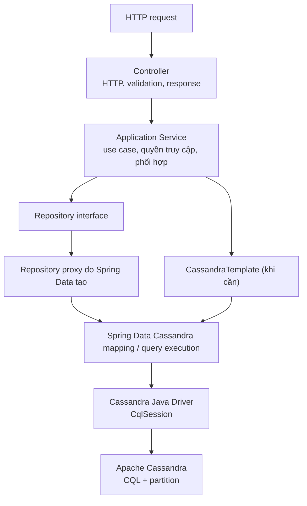
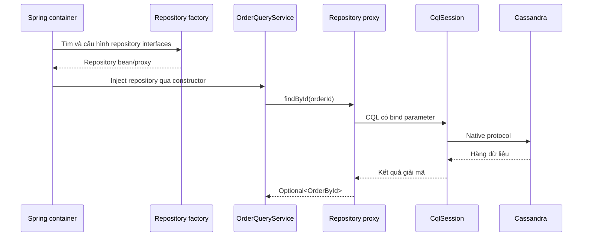

# Repository proxy, dependency injection và ranh giới trách nhiệm

## 1. Repository trong Spring Data Cassandra nằm ở đâu?

Trong **Spring Data Cassandra**, lập trình viên thường khai báo một **interface repository** để thao tác với bảng Apache Cassandra mà không cần tự viết lớp triển khai cho từng phương thức CRUD. Spring Data tạo một đối tượng repository ở thời điểm ứng dụng khởi động, đăng ký nó thành **Spring bean** rồi cho phép các service nhận bean đó thông qua **dependency injection (DI)**.

Repository giúp giảm mã truy cập dữ liệu lặp lại, nhưng **không thay đổi quy tắc phân tán của Cassandra**. Để truy vấn đúng, ứng dụng vẫn phải biết partition key, clustering columns, khả năng truy vấn của CQL, cách phân trang bằng paging state và độ nhất quán cần thiết. Vì vậy, cần hiểu đồng thời ba câu hỏi:

1. Ai triển khai interface repository và gọi CQL thật sự?
2. Spring cung cấp instance repository cho service bằng cách nào?
3. Ranh giới trách nhiệm của repository nằm ở đâu để không đưa nhầm logic nghiệp vụ hoặc điều phối dữ liệu phân tán vào tầng này?



**Kết quả mong muốn:** Controller không biết CQL; service không tự quản lý kết nối; repository không quyết định quyền nghiệp vụ hoặc giao dịch xuyên nhiều bảng. Tầng dữ liệu chỉ chạy những truy vấn được thiết kế phù hợp với Cassandra.

## 2. Repository proxy được tạo như thế nào?

Xét interface:

```java
import java.util.UUID;

import org.springframework.data.cassandra.repository.CassandraRepository;

public interface OrderByIdRepository
        extends CassandraRepository<OrderById, UUID> {
}
```

Trong một ứng dụng Spring Data Cassandra được cấu hình đúng, Spring tạo một **bean thực thi interface này**. Service có thể gọi `findById`, `save`, `deleteById` mà không phải tạo `class OrderByIdRepositoryImpl` cho các thao tác thông thường.

### 2.1. Chuỗi tạo bean

Quy trình khái niệm:

1. **Spring Boot hoặc cấu hình Spring Data** kích hoạt hạ tầng Cassandra repositories, xác định những package cần quét.
2. Hạ tầng tìm các interface repository phù hợp, ví dụ `OrderByIdRepository`.
3. **Repository factory** phân tích domain type (`OrderById`), ID type (`UUID`), mapping metadata và những phương thức mà interface khai báo.
4. Factory tạo **repository proxy**. Proxy chuyển lời gọi phương thức tới triển khai tương ứng: thao tác CRUD cơ bản, query được suy ra từ tên phương thức, `@Query`, hoặc custom repository fragment.
5. Spring đăng ký đối tượng đó thành bean và đưa nó vào constructor của service cần sử dụng.
6. Khi có lời gọi thực tế, hạ tầng repository dùng Spring Data mapping và Cassandra Java Driver để thực thi CQL.



Sơ đồ chỉ thể hiện **luồng trách nhiệm**; bên trong proxy còn có query strategy, mapping và các thành phần thực thi của Spring Data. Không nên suy diễn một lớp proxy cụ thể hoặc một câu CQL cố định cho mọi phiên bản Spring Data.

### 2.2. Proxy không phải entity và không phải kết nối

- **Repository interface** mô tả API truy cập dữ liệu cho một entity/table.
- **Repository proxy bean** là đối tượng ứng dụng nhận qua DI; thường được tái sử dụng, không tạo lại cho từng HTTP request.
- **Entity** là giá trị được ánh xạ đến hàng CQL, không phải nơi sở hữu vòng đời kết nối.
- **`CqlSession`** thuộc Java Driver và quản lý metadata, kết nối, prepared statements và định tuyến request. Không tự tạo một session mới trong từng phương thức repository.
- **`CassandraTemplate`** là API dữ liệu ở mức thấp hơn repository, cũng dựa trên hạ tầng Cassandra mapping/session; nó không phải một cơ sở dữ liệu khác.

Spring Data repository không phải proxy HTTP từ xa hay REST client. Nó là proxy **trong tiến trình Java** để điều phối truy cập Cassandra thông qua driver.

## 3. Dependency injection bằng constructor

**Dependency injection** nghĩa là service chỉ khai báo những dependency cần dùng, còn Spring container chịu trách nhiệm cung cấp bean thích hợp. Đây là cách giữ service độc lập với cách repository được tạo.

### 3.1. Ví dụ cấu hình tối thiểu

Dependency Maven khi sử dụng Spring Boot:

```xml
<dependency>
    <groupId>org.springframework.boot</groupId>
    <artifactId>spring-boot-starter-data-cassandra</artifactId>
</dependency>
```

Không cần chỉ định riêng version Spring Data Cassandra hay Java Driver khi dùng đúng BOM của Spring Boot. Các property kết nối cơ bản, với ví dụ Cassandra local:

```yaml
spring:
  cassandra:
    contact-points: 127.0.0.1:9042
    local-datacenter: datacenter1
    keyspace-name: shop_app
    schema-action: none
```

`shop_app` phải tồn tại; `datacenter1` phải khớp tên DC thực tế. Cấu hình trên chỉ là ví dụ local và không tự tạo bảng. Với production, xác thực, TLS, replication, consistency và các node có thể kết nối phải được thiết lập theo môi trường thật.

Ví dụ bố trí package:

```text
com.example.shop
├── ShopApplication.java
├── api
│   └── OrderController.java
├── application
│   └── OrderQueryService.java
└── persistence
    ├── OrderById.java
    └── OrderByIdRepository.java
```

Nếu lớp cấu hình `@SpringBootApplication` nằm ở `com.example.shop`, Spring Boot thường tìm thấy các component và repository thuộc những package con khi auto-configuration Cassandra được kích hoạt. Nếu bố trí repository ngoài phạm vi quét hoặc ứng dụng cấu hình thủ công, có thể cần chỉ định phạm vi qua `@EnableCassandraRepositories` và entity scanning tương ứng. Không thêm các annotation quét tùy ý khi cấu hình mặc định đã đáp ứng.

### 3.2. Inject repository vào service, không tự khởi tạo

```java
import java.util.Optional;
import java.util.UUID;

import org.springframework.stereotype.Service;

@Service
public class OrderQueryService {

    private final OrderByIdRepository orders;

    public OrderQueryService(OrderByIdRepository orders) {
        this.orders = orders;
    }

    public Optional<OrderById> findById(UUID orderId) {
        return orders.findById(orderId);
    }
}
```

Với một constructor duy nhất, các phiên bản Spring hiện đại không yêu cầu ghi `@Autowired` trên constructor. Cách này có lợi ở ba điểm:

1. **Rõ dependency:** nhìn constructor biết service cần repository nào.
2. **Khó tạo trạng thái thiếu dependency:** dependency được cung cấp khi Spring tạo bean, các field có thể giữ `final`.
3. **Dễ unit test:** khởi tạo service bằng fake/mock repository, không cần dựng Cassandra cluster chỉ để thử quy tắc nghiệp vụ.

**Không làm như sau:**

```java
// Sai về ý tưởng: repository thông thường là interface,
// không phải đối tượng để tự new ở business code.
// OrderByIdRepository orders = new OrderByIdRepository();
```

Tương tự, tránh tự tạo `CqlSession` trong mỗi request hoặc service để “vượt qua” DI. Làm như vậy dễ khiến cấu hình consistency, security, codec, metrics và vòng đời kết nối trở nên không đồng nhất.

### 3.3. Controller chỉ chuyển yêu cầu cho service

```java
import java.math.BigDecimal;
import java.util.UUID;

import org.springframework.http.ResponseEntity;
import org.springframework.web.bind.annotation.GetMapping;
import org.springframework.web.bind.annotation.PathVariable;
import org.springframework.web.bind.annotation.RequestMapping;
import org.springframework.web.bind.annotation.RestController;

record OrderResponse(UUID orderId, String status, BigDecimal totalAmount) {
}

@RestController
@RequestMapping("/orders")
public class OrderController {

    private final OrderQueryService service;

    public OrderController(OrderQueryService service) {
        this.service = service;
    }

    @GetMapping("/{orderId}")
    public ResponseEntity<OrderResponse> getById(
            @PathVariable UUID orderId) {
        return service.findById(orderId)
                .map(order -> ResponseEntity.ok(new OrderResponse(
                    order.getOrderId(),
                    order.getStatus(),
                    order.getTotalAmount()
                )))
                .orElseGet(() -> ResponseEntity.notFound().build());
    }
}
```

Đây là đường đọc tối giản, không bao gồm xác thực/phân quyền. Trong ứng dụng thật, service cần kiểm tra **người gọi có quyền xem đơn**; không coi UUID khó đoán là biện pháp bảo mật. Trả một DTO như `OrderResponse` thay vì expose entity trực tiếp giúp tách hợp đồng HTTP khỏi cấu trúc lưu trữ.

**Định nghĩa một chiều phụ thuộc:** `Controller → Service → Repository`. Không cho repository gọi ngược controller, không đưa `ResponseEntity` hoặc thông tin HTTP vào repository, và không để controller chịu trách nhiệm nhân bản dữ liệu qua nhiều bảng.

## 4. Ví dụ đầy đủ từ CQL đến entity và repository

Trước tiên cần có bảng theo **đường truy cập trực tiếp bằng order ID**:

```sql
-- Chỉ dùng replication factor 1 cho môi trường học đơn node.
CREATE KEYSPACE IF NOT EXISTS shop_app
WITH replication = {
    'class': 'SimpleStrategy',
    'replication_factor': 1
};

CREATE TABLE IF NOT EXISTS shop_app.orders_by_id (
    order_id uuid PRIMARY KEY,
    customer_id uuid,
    created_at timestamp,
    status text,
    total_amount decimal
);
```

Lớp entity tương ứng:

```java
import java.math.BigDecimal;
import java.time.Instant;
import java.util.UUID;

import org.springframework.data.cassandra.core.mapping.Column;
import org.springframework.data.cassandra.core.mapping.PrimaryKey;
import org.springframework.data.cassandra.core.mapping.Table;

@Table("orders_by_id")
public class OrderById {

    @PrimaryKey("order_id")
    private UUID orderId;

    @Column("customer_id")
    private UUID customerId;

    @Column("created_at")
    private Instant createdAt;

    @Column("status")
    private String status;

    @Column("total_amount")
    private BigDecimal totalAmount;

    protected OrderById() {
    }

    public OrderById(UUID orderId, UUID customerId, Instant createdAt,
                     String status, BigDecimal totalAmount) {
        this.orderId = orderId;
        this.customerId = customerId;
        this.createdAt = createdAt;
        this.status = status;
        this.totalAmount = totalAmount;
    }

    public UUID getOrderId() {
        return orderId;
    }

    public UUID getCustomerId() {
        return customerId;
    }

    public Instant getCreatedAt() {
        return createdAt;
    }

    public String getStatus() {
        return status;
    }

    public BigDecimal getTotalAmount() {
        return totalAmount;
    }
}
```

Repository dùng kiểu ID `UUID` vì `@PrimaryKey` nằm trên field kiểu `UUID`:

```java
import java.util.UUID;

import org.springframework.data.cassandra.repository.CassandraRepository;

public interface OrderByIdRepository
        extends CassandraRepository<OrderById, UUID> {
}
```

**Điểm cần nhớ:** `findById(orderId)` phù hợp với bảng `orders_by_id` vì `order_id` là partition key. Nhưng `findAll()` trên một bảng lớn có thể quét phạm vi dữ liệu rộng, và `count()` không nên mặc định coi là thao tác rẻ. Sự tiện lợi của phương thức CRUD không miễn trừ chi phí truy vấn Cassandra.

### Vì sao không thể dùng một repository cho mọi màn hình?

Nếu UI cần hiển thị **20 đơn mới nhất của một khách theo ngày**, bảng lookup `orders_by_id` không hỗ trợ truy vấn đó hiệu quả vì không có partition key là khách và thời gian.

Thiết kế thêm một read model:

```sql
CREATE TABLE IF NOT EXISTS shop_app.orders_by_customer_day (
    customer_id uuid,
    day_bucket date,
    created_at timestamp,
    order_id uuid,
    status text,
    total_amount decimal,
    PRIMARY KEY ((customer_id, day_bucket), created_at, order_id)
) WITH CLUSTERING ORDER BY (created_at DESC, order_id ASC);
```

Ở bảng này, `(customer_id, day_bucket)` là partition key, còn `created_at` và `order_id` là clustering columns. Repository thứ hai biểu diễn **một đường đọc khác** và dùng entity/khóa tương ứng:

```java
import java.io.Serializable;
import java.time.Instant;
import java.time.LocalDate;
import java.util.UUID;

import org.springframework.data.cassandra.core.cql.Ordering;
import org.springframework.data.cassandra.core.mapping.PrimaryKeyClass;
import org.springframework.data.cassandra.core.mapping.PrimaryKeyColumn;
import org.springframework.data.cassandra.core.mapping.PrimaryKeyType;

@PrimaryKeyClass
public class OrderByCustomerDayKey implements Serializable {

    @PrimaryKeyColumn(name = "customer_id", ordinal = 0,
        type = PrimaryKeyType.PARTITIONED)
    private UUID customerId;

    @PrimaryKeyColumn(name = "day_bucket", ordinal = 1,
        type = PrimaryKeyType.PARTITIONED)
    private LocalDate dayBucket;

    @PrimaryKeyColumn(name = "created_at", ordinal = 2,
        type = PrimaryKeyType.CLUSTERED, ordering = Ordering.DESCENDING)
    private Instant createdAt;

    @PrimaryKeyColumn(name = "order_id", ordinal = 3,
        type = PrimaryKeyType.CLUSTERED, ordering = Ordering.ASCENDING)
    private UUID orderId;

    // Ví dụ tập trung vào annotation: bổ sung constructor không tham số,
    // getter/setter, equals() và hashCode() trên toàn bộ khóa.
}
```

```java
import java.math.BigDecimal;

import org.springframework.data.cassandra.core.mapping.Column;
import org.springframework.data.cassandra.core.mapping.PrimaryKey;
import org.springframework.data.cassandra.core.mapping.Table;

@Table("orders_by_customer_day")
public class OrderByCustomerDay {

    @PrimaryKey
    private OrderByCustomerDayKey key;

    @Column("status")
    private String status;

    @Column("total_amount")
    private BigDecimal totalAmount;

    // Bổ sung constructor và accessors theo quy ước dự án.
}
```

Repository cho danh sách giới hạn trong **một partition**:

```java
import java.time.LocalDate;
import java.util.List;
import java.util.UUID;

import org.springframework.data.cassandra.repository.CassandraRepository;
import org.springframework.data.cassandra.repository.Query;

public interface OrderByCustomerDayRepository
        extends CassandraRepository<OrderByCustomerDay, OrderByCustomerDayKey> {

    @Query("""
        SELECT * FROM orders_by_customer_day
        WHERE customer_id = ?0
          AND day_bucket = ?1
        LIMIT 20
        """)
    List<OrderByCustomerDay> findLatestTwenty(
            UUID customerId, LocalDate dayBucket);
}
```

Đoạn code trên là **ví dụ minh họa mapping**: các lớp khóa/entity cần hoàn thiện constructor và accessors để chạy như một ứng dụng độc lập. `LIMIT 20` chỉ giới hạn kết quả trong một partition; nếu API phải duyệt lịch sử nhiều ngày, service cần điều phối các truy vấn theo bucket, sắp xếp/ghép và quản lý cursor cấp API.

## 5. Repository proxy xử lý phương thức thế nào?

Không phải mọi phương thức của repository đều được triển khai cùng một cách.

| Loại phương thức | Ví dụ | Nguồn triển khai hoặc xử lý |
| --- | --- | --- |
| CRUD có sẵn | `findById(id)`, `save(entity)`, `deleteById(id)` | Hạ tầng repository của Spring Data Cassandra |
| Suy diễn từ tên (*query derivation*) | `findByStatus(String status)` | Spring Data phân tích tên và metadata để tạo query; **không bảo đảm CQL hợp lệ/hiệu quả** |
| Khai báo CQL tường minh | `@Query("SELECT ... WHERE ...")` | Spring Data bind tham số, thực thi CQL và ánh xạ kết quả |
| Phương thức tùy biến chuyên biệt | Custom repository fragment | Mã ứng dụng tự triển khai; được hạ tầng repository ghép vào proxy |
| Truy cập thấp hơn repository | `CassandraTemplate`, `CqlSession` | Được gọi từ service hoặc adapter riêng theo thiết kế |

### 5.1. Query derivation không vượt qua giới hạn CQL

Trong cơ sở dữ liệu quan hệ, một phương thức tên `findByStatus("PAID")` có thể được kỳ vọng hoạt động nhờ chỉ mục hoặc bộ tối ưu SQL. Trong Cassandra, nếu bảng có khóa `PRIMARY KEY ((customer_id, day_bucket), created_at, order_id)` và `status` là cột thường, truy vấn chỉ theo `status` **không phù hợp với đường truy cập chính**.

```java
// Không nên thêm tùy tiện khi bảng không có đường truy cập theo status:
// List<OrderByCustomerDay> findByStatus(String status);
```

Dù Spring Data có thể suy ra một câu query từ tên phương thức, Cassandra vẫn áp dụng các hạn chế của `WHERE`, partition key, clustering key và chỉ mục đã khai báo. Kết quả có thể là lỗi truy vấn, hoặc yêu cầu xử lý rộng và tốn tài nguyên. `ALLOW FILTERING` không phải giải pháp tổng quát.

**Hãy bắt đầu từ CQL hợp lệ và ranh giới truy vấn**, rồi mới chọn cách thể hiện nó bằng phương thức repository. Khi bộ lọc mới trở thành use case quan trọng, cân nhắc một bảng đọc khác như `orders_by_customer_status_day`, chi phí ghi nhân bản và quy tắc đồng bộ khi status thay đổi.

### 5.2. `@Query` giúp thể hiện rõ đường đọc

```java
@Query("""
    SELECT * FROM orders_by_customer_day
    WHERE customer_id = ?0 AND day_bucket = ?1
    LIMIT 20
    """)
List<OrderByCustomerDay> findLatestTwenty(
        UUID customerId, LocalDate dayBucket);
```

Hai dấu `?0`, `?1` là tham số được Spring Data liên kết với đối số của phương thức; tránh nối thẳng đầu vào HTTP vào chuỗi CQL. Query tường minh hữu ích khi muốn người đọc code nhận ra partition key bắt buộc và giới hạn kết quả.

Tuy vậy, `@Query` **không tự kiểm tra latency, không tự chọn consistency phù hợp và không tự tạo bảng**. Với câu CQL phức tạp hoặc nhiều tùy chọn driver, cân nhắc `CassandraTemplate` hoặc API `CqlSession` trong một adapter, thay vì tạo phương thức repository dài và khó bảo trì.

## 6. Ranh giới trách nhiệm: ai chịu trách nhiệm điều gì?

Một kiến trúc dễ bảo trì phân chia như sau:

| Tầng | Nên chịu trách nhiệm | Không nên chứa |
| --- | --- | --- |
| Controller / API | Parse tham số, xác thực đầu vào HTTP, gọi use case, chuyển DTO/status | CQL, `CqlSession`, logic sắp xếp đa partition |
| Application service | Quy tắc nghiệp vụ, quyền xem/sửa, idempotency, điều phối nhiều repository, quyết định fallback | Mở session cho mỗi request, chi tiết codec/bind CQL |
| Repository | Truy cập dữ liệu theo bảng và partition key; truy vấn, ánh xạ, CRUD | Quy tắc nghiệp vụ xuyên nhiều aggregate, kiểm tra HTTP header |
| `CassandraTemplate` / adapter | CQL động có kiểm soát, truy vấn chuyên biệt, mapping ở mức thấp hơn repository | Trả `ResponseEntity` hoặc quyết định ai được phép xem đơn |
| Cassandra Java Driver | Session, kết nối, native protocol, thực thi prepared statement, paging state, request options | Quyết định business transaction hay tenant authorization |
| Cassandra schema | Keyspace/replication, bảng theo truy vấn, khóa, clustering, TTL | Validation nghiệp vụ hay orchestration HTTP |

Điểm khó trong Cassandra là **một đối tượng nghiệp vụ thường có nhiều bản sao dữ liệu**, mỗi bản sao dành cho một đường đọc. Ví dụ khi tạo đơn:

```text
OrderCommandService
    ├── validate request + authorize customer
    ├── generate stable orderId / idempotency key
    ├── write orders_by_id
    ├── write orders_by_customer_day
    ├── handle retry and partial failures
    └── return API result
```

**Service hoặc một tầng ứng dụng chuyên trách** phải quy định thứ tự ghi, idempotency, retry, đối soát và kỳ vọng đọc-sau-ghi. Từng repository chỉ biết bảng/đường dữ liệu mình phục vụ. Một `save` qua repository không tự đồng bộ tất cả read model còn lại.

### 6.1. `@Transactional` không biến Cassandra thành database quan hệ

Không thể giả định:

```java
// Không nên suy ra đoạn này có tính chất ACID xuyên hai bảng Cassandra.
// @Transactional
// void createOrder(...) {
//     orderByIdRepository.save(...);
//     orderByCustomerDayRepository.save(...);
// }
```

Là một giao dịch ACID giống Spring Data JPA. Cassandra không cung cấp các giao dịch quan hệ nhiều bảng theo cách đó; annotation `@Transactional` chỉ có ý nghĩa khi một `PlatformTransactionManager` thích hợp thực sự quản lý những thao tác được gọi, và không tạo bảo đảm nguyên tử xuyên nhiều read model Cassandra.

Cassandra có các khả năng ghi theo batch và lightweight transactions trong những phạm vi khác nhau, nhưng **batch không phải phương pháp tăng tốc chung** và không thay thế thiết kế idempotency/đối soát khi nhân bản dữ liệu. Nếu nghiệp vụ đòi hỏi bất biến chặt chẽ xuyên nhiều tập dữ liệu, cần thiết kế kiến trúc phù hợp thay vì chỉ thêm annotation ở service.

### 6.2. Xử lý lỗi ở đúng tầng

- Repository/driver có thể ném ngoại lệ truy cập dữ liệu, timeout hoặc lỗi CQL. Hạ tầng Spring Data thường chuyển các lỗi được hỗ trợ về hệ ngoại lệ truy cập dữ liệu của Spring.
- Service phân loại lỗi có thể retry theo chính sách, lỗi nghiệp vụ hoặc lỗi cần cảnh báo; không retry vô hạn.
- Controller chuyển kết quả hoặc ngoại lệ đã được xử lý thành HTTP response thích hợp. Tránh trả trực tiếp stack trace, thông tin contact points hoặc credential cho client.

Một request bị timeout **không luôn chứng minh ghi đã thất bại hoàn toàn**. Nếu service retry ghi đơn, cần dùng ID ổn định và cơ chế idempotency để không tạo bản ghi nghiệp vụ khác ngoài ý muốn.

## 7. Dependency injection giúp kiểm thử như thế nào?

### 7.1. Unit test service: không cần Cassandra

Nếu service nhận `OrderByIdRepository` qua constructor, có thể thay bằng mock để chỉ thử điều phối hoặc quyết định nghiệp vụ:

```java
import static org.junit.jupiter.api.Assertions.assertTrue;
import static org.mockito.Mockito.when;

import java.util.Optional;
import java.util.UUID;

import org.junit.jupiter.api.Test;
import org.mockito.Mockito;

class OrderQueryServiceTest {

    @Test
    void returnsEmptyWhenOrderDoesNotExist() {
        OrderByIdRepository repo =
                Mockito.mock(OrderByIdRepository.class);
        OrderQueryService service = new OrderQueryService(repo);

        UUID id = UUID.randomUUID();
        when(repo.findById(id)).thenReturn(Optional.empty());

        assertTrue(service.findById(id).isEmpty());
    }
}
```

Bài test này xác nhận service gọi dependency đúng, **không chứng minh CQL hợp lệ hoặc mapping Cassandra đúng**. Khi service chứa nhiều bước nghiệp vụ, unit test kiểm tra thứ tự xử lý, idempotency hoặc hành vi khi dependency báo lỗi có giá trị lớn hơn kiểm thử một phương thức chỉ chuyển tiếp.

### 7.2. Integration test repository: phải có Cassandra thật

Để kiểm tra proxy, bean wiring, mapping và truy vấn, cần một Cassandra test instance (hoặc cụm thử nghiệm đại diện) với **keyspace và schema được tạo đúng**:

1. Khởi tạo Spring context với Spring Data Cassandra starter, cấu hình contact points, local DC và keyspace.
2. Kiểm tra repository interface được đăng ký thành bean, service nhận được dependency.
3. Chèn một `OrderById` có UUID cố định, đọc lại bằng `findById` và đối chiếu dữ liệu.
4. Với bảng theo khách/ngày, ghi hai đơn cùng partition nhưng khác clustering key; gọi `findLatestTwenty` và xác nhận thứ tự.
5. Kiểm tra các trường hợp khóa không tồn tại, entity null/thiếu khóa, lỗi mạng hoặc timeout theo khả năng của môi trường thử.
6. Với API nhiều bucket, kiểm thử paging state, cursor, dữ liệu cập nhật đồng thời và chi phí truy vấn.

Testcontainers có thể giúp khởi động Cassandra phục vụ test tích hợp; cần ghép dependency, phiên bản image và cách tạo schema tương thích với Spring Boot/Java Driver thực tế. Không nên coi unit test bằng mock là bằng chứng repository query đã được Cassandra chấp nhận.

### 7.3. Rủi ro của mock quá sâu

Không nên cố mock mọi phương thức của `CqlSession`, session builder, codec, `CassandraTemplate` và proxy chỉ để chứng minh một query trả dữ liệu đúng. Khi kiểm thử hạ tầng persistence, integration test với Cassandra sẽ đáng tin cậy hơn. Mock đặc biệt hữu ích **ở ranh giới service** để kiểm tra quyết định nghiệp vụ, không thay thế phép thử schema thật.

## 8. Phân trang, consistency và hiệu năng: repository không làm thay ứng dụng

### 8.1. Dùng đúng cơ chế paging

Repository có thể hỗ trợ kết quả phân trang như `Slice`, tùy phương thức và API Spring Data Cassandra được sử dụng. Nhưng Cassandra không có offset paging rẻ như nhiều database quan hệ; paging state gắn với **query cụ thể và tham số thực thi**.

Với endpoint:

```http
GET /customers/{customerId}/orders?day=2026-11-25&limit=20&cursor=...
```

Service nên:

- Bắt buộc có `customerId` và `day` để xác định partition.
- Giới hạn page size và khoảng thời gian có thể duyệt.
- Đóng gói paging state thành cursor opaque, kiểm tra nó gắn với đúng customer, ngày, bộ lọc và quyền truy cập.
- Trả `nextCursor` thay vì hứa `totalPages` hoặc random access bằng offset nếu việc đó đòi hỏi đếm/quét lượng dữ liệu lớn.
- Khi duyệt nhiều ngày, quản lý cursor ở tầng service cho **nhiều partition**, không mặc định một paging state đơn lẻ có thể duyệt toàn bộ lịch sử.

### 8.2. Consistency level thuộc chính sách truy cập dữ liệu

Java Driver/Cassandra hỗ trợ nhiều consistency level, ví dụ `LOCAL_ONE`, `LOCAL_QUORUM`, và tùy chỉnh trên từng request khi cần. Lựa chọn cụ thể phụ thuộc replication factor, topology, khả năng chịu lỗi và yêu cầu nghiệp vụ.

Không nên cho rằng dùng repository mặc định thì thao tác luôn “đọc dữ liệu mới nhất”, cũng không giả định đổi consistency là đủ để hai bảng denormalized nhất quán tại mọi thời điểm. Service phải diễn đạt rõ hợp đồng đọc-sau-ghi và quy trình đồng bộ giữa các bảng.

### 8.3. Các phương thức tiện lợi có thể nguy hiểm ở dữ liệu lớn

| Phương thức hoặc cách dùng | Rủi ro khi bảng lớn | Lựa chọn phù hợp hơn |
| --- | --- | --- |
| `findAll()` trên bảng sự kiện lớn | Đọc rất nhiều partition và hàng | Query theo partition key và giới hạn dữ liệu |
| `count()` để trả `totalPages` | Đếm nhiều dữ liệu, không nhất thiết rẻ | `Slice`/cursor và chỉ báo còn dữ liệu |
| `deleteAll()` cho thao tác nghiệp vụ | Phạm vi xóa quá rộng, tombstone/chi phí vận hành | Xóa theo khóa xác định, retention/TTL có kế hoạch |
| Derived query chỉ theo cột thường | Không khớp CQL schema, có thể lỗi hoặc scan rộng | Bảng đọc theo truy vấn hoặc chỉ mục phù hợp đã đo |
| Đọc một khách có hàng triệu đơn trong một partition | Hot partition, độ trễ p99 và tăng kích thước | Time bucketing nếu workload cần |
| Tăng timeout để chữa truy vấn kém | Che điểm nghẽn và làm tăng tải tích tụ | Đo CQL, partition, fan-out, tombstone và p95/p99 |

**Repository là công cụ biểu đạt truy cập dữ liệu**, không phải bộ tối ưu tự động cho Cassandra. Cả repository, `CassandraTemplate` và CQL trực tiếp đều cần cùng kỷ luật thiết kế bảng theo truy vấn.

## 9. Những sai lầm thường gặp với proxy và DI

| Triệu chứng | Nguyên nhân có thể | Hướng kiểm tra |
| --- | --- | --- |
| `No qualifying bean of type OrderByIdRepository` | Chưa có starter, repository ngoài package scanning hoặc cấu hình repositories chưa kích hoạt | Kiểm tra dependency, root package, auto-configuration, `@EnableCassandraRepositories` nếu dùng thủ công |
| Tạo repository bằng `new` bị lỗi | Repository là interface, bean do Spring Data factory tạo | Inject qua constructor |
| Service inject repository nhưng session khởi tạo thất bại | Sai contact points, local DC, keyspace, auth, TLS | Kiểm tra cấu hình `spring.cassandra.*` và cluster |
| Entity map sai bảng hoặc ID | `@Table`/`@PrimaryKey` không khớp CQL | Đối chiếu schema thật, type và generic ID |
| Derived query lỗi dù method name đúng | Thiếu partition key hoặc dùng cột không hỗ trợ lọc | Viết/kiểm tra CQL theo khóa, thiết kế read model |
| Unit test mock pass, integration query fail | Mock không chạy CQL thật | Bổ sung integration test với Cassandra |
| Tin `save` là “insert nếu chưa tồn tại” | Cassandra dùng upsert theo primary key | Dùng điều kiện nghiệp vụ và LWT khi cần |
| Tin `@Transactional` bao trùm nhiều bảng | Không có giao dịch ACID xuyên các read model | Thiết kế idempotency, retry, reconciliation |
| Controller gọi repository trực tiếp khắp nơi | Logic quyền truy cập, DTO, use case bị phân tán | Đưa vào application service và thiết lập boundary rõ |
| Tạo `CqlSession` cho mỗi request | Phí kết nối, khó quản lý tài nguyên/config | Tái sử dụng session do container quản lý |

## 10. Quy trình thiết kế và checklist

Với một endpoint mới, có thể dùng quy trình sau:

1. **Xác định use case:** ai gọi, cần lọc/sắp xếp/phân trang gì, độ trễ chấp nhận được là bao nhiêu.
2. **Thiết kế CQL trước:** xác định partition key và clustering columns; chứng minh query theo khóa có phạm vi rõ ràng.
3. **Tạo entity phù hợp schema:** `@Table`, `@PrimaryKey`, `@PrimaryKeyClass` nếu khóa ghép, kiểu dữ liệu và tên cột đúng.
4. **Định nghĩa interface repository:** generic entity/ID đúng, chỉ đặt các phương thức truy vấn thực sự được bảng hỗ trợ.
5. **Inject vào service bằng constructor:** service sở hữu use case, quyền truy cập, nhân bản read models và xử lý lỗi.
6. **Controller chuyển input thành yêu cầu nghiệp vụ:** không để lớp HTTP tự tạo query, quản lý paging state thô hay truy cập driver.
7. **Kiểm thử riêng hai tầng:** unit test service với mock, integration test repository/proxy/query với Cassandra.
8. **Đo trong điều kiện tải thực tế:** latency p95/p99, số partition chạm tới, kết quả paging, tombstone, hot key và chi phí ghi.

### Bài tập thực hành

**Bài 1 — Proxy:** Tạo `BookRepository extends CassandraRepository<Book, UUID>` nhưng không viết lớp `BookRepositoryImpl`. Giải thích ai tạo đối tượng triển khai lúc chạy, cách Spring đăng ký bean và vì sao service có thể nhận nó qua constructor.

**Bài 2 — Đường đọc không phù hợp:** Bảng `orders_by_customer_day` có khóa `((customer_id, day_bucket), created_at, order_id)`. Một người thêm `findByStatus("PAID")` vào repository. Phân tích vì sao tên phương thức đúng Java vẫn chưa đủ để CQL hợp lệ hoặc chạy nhanh, rồi đề xuất schema/endpoint thay thế.

**Bài 3 — Phân chia trách nhiệm:** API tạo đơn phải ghi đồng thời vào `orders_by_id` và `orders_by_customer_day`. Thiết kế interface repository cho từng bảng, một application service chịu trách nhiệm idempotency/retry và controller trả DTO. Giải thích vì sao không nên giao quy trình này cho một repository đơn lẻ hoặc chỉ thêm `@Transactional`.

**Bài 4 — Test:** Viết unit test service dùng mock repository và một integration test với Cassandra thật để xác nhận query `@Query` cùng mapping khóa ghép. Nêu rõ mỗi loại test phát hiện những lỗi nào và bỏ sót những lỗi nào.

**Bài 5 — Paging:** Một endpoint cần xem 20 đơn mới nhất của khách, duyệt qua nhiều ngày. Giải thích vì sao `findAll()` rồi `stream().filter(...)` là lựa chọn kém; đề xuất API cursor, quy tắc giới hạn bucket và cách đo số partition/request.

### Câu hỏi tự kiểm tra

1. Repository proxy được tạo bởi ai và khác gì so với entity hoặc `CqlSession`?
2. Vì sao constructor injection phù hợp hơn việc service tự khởi tạo repository?
3. Khi nào nên khai báo `@Query`, khi nào query derivation có thể chấp nhận?
4. Vì sao Spring Data có thể tạo một phương thức repository nhưng Cassandra vẫn từ chối câu query?
5. Logic idempotency và đồng bộ giữa hai bảng denormalized nên thuộc tầng nào?
6. Tại sao `@Transactional` không tự biến hai thao tác repository Cassandra thành transaction quan hệ?
7. Unit test service với mock khác integration test repository với Cassandra ở điểm nào?
8. Vì sao `findAll()`, `count()` và paging theo offset cần thận trọng trên dữ liệu Cassandra lớn?

## Kết luận

**Repository proxy** của Spring Data Cassandra là bean do hạ tầng Spring Data tạo từ interface; **dependency injection** cho phép service sử dụng bean đó mà không tự quản lý cách triển khai hoặc kết nối. Repository chịu trách nhiệm biểu đạt **đường truy cập dữ liệu phù hợp CQL**, còn service chịu trách nhiệm **use case, quyền truy cập, điều phối nhiều read model, idempotency và xử lý lỗi**. Controller chỉ nên quản lý giao tiếp HTTP, và `CassandraTemplate`/Java Driver được dùng khi cần mức điều khiển truy vấn thấp hơn. Dù lựa chọn công cụ nào, partition key, clustering columns, consistency, paging và số đo hiệu năng vẫn quyết định chất lượng thực tế của hệ thống Cassandra phân tán.
