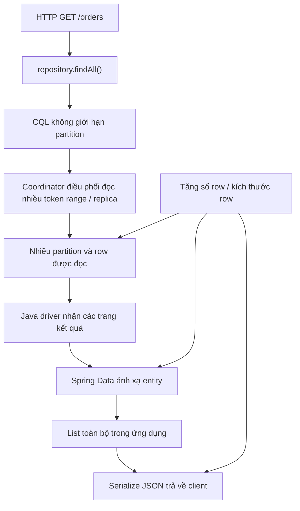

# findAll, count và nguy cơ quét dữ liệu rộng

Trong **Spring Data Cassandra**, hai lời gọi `repository.findAll()` và `repository.count()` trông giống các phương thức CRUD quen thuộc ở Spring Data JPA. Tuy nhiên, chúng có thể trở thành thao tác rất tốn kém khi bảng Apache Cassandra chứa nhiều partition, phân bố trên nhiều replica và có hàng triệu dòng dữ liệu.

Lý do nằm ở mô hình lưu trữ: **Cassandra tối ưu truy vấn theo partition key và clustering columns**, không vận hành như một cơ sở dữ liệu quan hệ có thể tùy ý duyệt và đếm toàn bảng ở chi phí thấp. `findAll()` thường tương ứng một truy vấn lấy tất cả các hàng mà không có điều kiện partition; `count()` thường phải thực hiện phép đếm trên phạm vi toàn bảng. Các API này **hợp lệ**, nhưng độ rộng của thao tác phụ thuộc dữ liệu và câu CQL mà chúng tạo ra.

Bài thuộc chương **Repository** của module **SPRING_DATA_CASSANDRA**. Mục tiêu là hiểu chi phí của các thao tác rộng, phân biệt `LIMIT` và paging với định tuyến partition, thay bằng truy vấn phù hợp, đồng thời biết khi nào cần bảng tổng hợp hoặc quy trình thống kê riêng.

## 1. Mục tiêu học tập

Sau bài này, bạn có thể:

1. Giải thích vì sao `findAll()` trên bảng lớn làm tăng I/O, lưu lượng mạng và bộ nhớ ứng dụng.
2. Phân biệt `SELECT * FROM table`, `SELECT COUNT(*) FROM table` và các truy vấn có `WHERE` giới hạn đủ partition key.
3. Nêu rõ `CassandraRepository.findAll(Pageable)` trả về **`Slice<T>`** và dùng **paging state** để duyệt tuần tự.
4. Phân biệt **page size**, `LIMIT`, **tổng số hàng** và **số partition bị truy cập**.
5. Thiết kế API truy vấn có mục tiêu theo partition key, clustering columns và nhu cầu nghiệp vụ.
6. Xây dựng chiến lược đếm cho dashboard/endpoint mà không gọi `count()` toàn bảng trên mỗi request.
7. Quan sát và chẩn đoán câu truy vấn rộng qua metrics, tracing, query log và khối lượng dữ liệu thật.

## 2. Repository API che giấu chi phí CQL như thế nào?

Giả sử ứng dụng có entity `OrderByCustomerMonth` và repository:

```java
import org.springframework.data.cassandra.repository.CassandraRepository;

public interface OrderRepository
        extends CassandraRepository<OrderByCustomerMonth, OrderKey> {
}
```

Ba lời gọi khác nhau:

```java
List<OrderByCustomerMonth> all = repository.findAll();

long total = repository.count();

Optional<OrderByCustomerMonth> one = repository.findById(orderKey);
```

Các thao tác có ý nghĩa rất khác nhau:

| API | Ý tưởng truy vấn CQL | Phạm vi công việc |
|---|---|---|
| `findAll()` | `SELECT ... FROM orders_by_customer_month`, không `WHERE` | Có thể đọc **mọi partition** trong bảng |
| `count()` | `SELECT COUNT(*) FROM orders_by_customer_month` | Có thể phải **đếm qua toàn bảng** |
| `findById(orderKey)` | `SELECT ... WHERE` đủ primary key | Đọc có mục tiêu một hàng trong một partition |
| `findAll(CassandraPageRequest.first(20))` | Đọc từng slice của tập kết quả, có paging state | Chỉ giới hạn **lượng dữ liệu trả mỗi lượt**; phạm vi vẫn rộng nếu query không có `WHERE` |

Bảng trên mô tả **ý nghĩa thực thi**, không khẳng định nguyên văn một câu CQL duy nhất được tạo ở mọi phiên bản. Câu lệnh thực còn phụ thuộc Spring Data, mapping, options và phiên bản Java driver.

Theo API **Spring Data Cassandra 4.5**, `CassandraRepository` có `findAll(Pageable)` trả về `Slice<T>`; `findAll()` và `count()` được kế thừa từ repository CRUD. Điều này giúp lập trình thuận tiện, nhưng các method được cung cấp sẵn **không đồng nghĩa chúng phù hợp cho mọi endpoint production**.

### 2.1. Vì sao findAll vẫn chạy dù không có partition key?

Một câu như:

```sql
SELECT * FROM shop.orders_by_customer_month;
```

là truy vấn CQL **hợp lệ**: nó yêu cầu toàn bộ các hàng của bảng. Cassandra phải xử lý các partition trên phạm vi token của bảng và tập hợp các kết quả để gửi về client. Số lượng node, SSTable, tombstone, kích thước row và số hàng đều có thể góp phần làm tăng tổng tài nguyên.

Ngược lại, truy vấn lọc theo một cột thường không có index có thể bị từ chối:

```sql
-- Giả sử status không có index và không thuộc primary key.
SELECT * FROM shop.orders_by_customer_month
WHERE status = 'PAID';
```

Đây là hai vấn đề khác nhau:

- **Không có `WHERE`**: Cassandra hiểu yêu cầu đọc toàn bảng và cho phép thực hiện, nhưng có thể rất tốn kém.
- **Có `WHERE` không phù hợp với khóa/index**: Cassandra có thể từ chối để tránh truy vấn cần quét dữ liệu khó kiểm soát.

`ALLOW FILTERING` không phải lựa chọn để chữa các lệnh trên. Nó cho phép Cassandra thực hiện kiểu lọc vốn có thể cần scan rộng; không xây dựng đường truy cập hiệu quả từ một regular column.

### 2.2. Sơ đồ luồng đọc rộng



`findAll()` còn có chi phí **sau Cassandra**: Java driver giải mã kết quả, converter tạo entity, ứng dụng giữ danh sách và web framework serialize JSON. Một endpoint có thể hết bộ nhớ hoặc timeout ngay cả khi Cassandra vẫn phục vụ được nhiều trang dữ liệu.

**Hệ quả:** số row tăng từ 1.000 lên 10 triệu có thể làm cùng một lời gọi `findAll()` trở nên không khả thi. Không nên xem `findAll()` là câu lệnh “hiển thị tất cả” an toàn mặc định trên bảng sản xuất.

## 3. Thực hành với bảng thiết kế theo truy vấn

### 3.1. Schema theo khách hàng và tháng

Hệ thống cần lấy **20 đơn hàng mới nhất của một khách trong một tháng**. Vì request biết cả `customer_id` và `order_month`, chúng ta thiết kế:

```sql
-- Giả sử keyspace shop đã tồn tại.
CREATE TABLE IF NOT EXISTS shop.orders_by_customer_month (
    customer_id uuid,
    order_month text,
    created_at timestamp,
    order_id uuid,
    status text,
    amount decimal,
    PRIMARY KEY ((customer_id, order_month), created_at, order_id)
) WITH CLUSTERING ORDER BY (created_at DESC, order_id ASC);
```

Trong đó:

- `(customer_id, order_month)` là **composite partition key**; cả hai giá trị cùng xác định một partition.
- `created_at` và `order_id` là **clustering columns**; các hàng trong partition được sắp theo thứ tự khai báo.
- `status` và `amount` là **regular columns**; không tự cung cấp đường truy cập theo trạng thái hoặc số tiền.

### 3.2. Nạp dữ liệu mẫu để so sánh

```sql
INSERT INTO shop.orders_by_customer_month
(customer_id, order_month, created_at, order_id, status, amount)
VALUES (
    11111111-1111-1111-1111-111111111111, '2026-11',
    '2026-11-25T03:00:00Z', 00000000-0000-0000-0000-000000000001,
    'PAID', 120000.00
);

INSERT INTO shop.orders_by_customer_month
(customer_id, order_month, created_at, order_id, status, amount)
VALUES (
    11111111-1111-1111-1111-111111111111, '2026-11',
    '2026-11-24T03:00:00Z', 00000000-0000-0000-0000-000000000002,
    'CREATED', 85000.00
);

INSERT INTO shop.orders_by_customer_month
(customer_id, order_month, created_at, order_id, status, amount)
VALUES (
    11111111-1111-1111-1111-111111111111, '2026-11',
    '2026-11-20T03:00:00Z', 00000000-0000-0000-0000-000000000003,
    'SHIPPED', 250000.00
);

INSERT INTO shop.orders_by_customer_month
(customer_id, order_month, created_at, order_id, status, amount)
VALUES (
    11111111-1111-1111-1111-111111111111, '2026-10',
    '2026-10-15T03:00:00Z', 00000000-0000-0000-0000-000000000004,
    'PAID', 200000.00
);

INSERT INTO shop.orders_by_customer_month
(customer_id, order_month, created_at, order_id, status, amount)
VALUES (
    22222222-2222-2222-2222-222222222222, '2026-11',
    '2026-11-25T05:00:00Z', 00000000-0000-0000-0000-000000000005,
    'PAID', 99000.00
);

INSERT INTO shop.orders_by_customer_month
(customer_id, order_month, created_at, order_id, status, amount)
VALUES (
    22222222-2222-2222-2222-222222222222, '2026-11',
    '2026-11-18T05:00:00Z', 00000000-0000-0000-0000-000000000006,
    'CREATED', 65000.00
);
```

Có **sáu row thuộc ba partition logic**:

| Khách | Tháng | Số row | Phạm vi |
|---|---|---:|---|
| `1111…` | `2026-11` | 3 | Partition A |
| `1111…` | `2026-10` | 1 | Partition B |
| `2222…` | `2026-11` | 2 | Partition C |

Các UUID và giá tiền là dữ liệu mô phỏng. Trong cluster thật, mỗi partition sẽ được định tuyến theo token và replication strategy; không giả định ba partition tương đương ba node vật lý.

### 3.3. So sánh ba truy vấn

**Toàn bảng:**

```sql
SELECT customer_id, order_month, created_at, order_id, status
FROM shop.orders_by_customer_month;
```

Kỳ vọng sáu row của dữ liệu mẫu. CQL không cam kết **thứ tự toàn cục theo `created_at`** khi truy vấn nhiều partition, dù trong mỗi partition có clustering order.

**Đếm toàn bảng:**

```sql
SELECT COUNT(*)
FROM shop.orders_by_customer_month;
```

Kỳ vọng `6` nếu chỉ có các dữ liệu trên và không có mutation khác. Cassandra phải thực hiện phép đếm các row phù hợp; đây không phải đọc một trường metadata “total_rows” có sẵn, chính xác và cập nhật tức thời.

**Đọc có mục tiêu:**

```sql
SELECT customer_id, order_month, created_at, order_id, status, amount
FROM shop.orders_by_customer_month
WHERE customer_id = 11111111-1111-1111-1111-111111111111
  AND order_month = '2026-11'
LIMIT 20;
```

Kỳ vọng ba row trong partition A, mới nhất theo `created_at` trước. Đây mới là **mẫu truy vấn mà bảng được thiết kế để phục vụ**.

### 3.4. Khi bảng phát triển lên hàng trăm triệu hàng

Với sáu row, đọc/đếm toàn bảng hầu như không gây vấn đề. Nhưng cùng câu CQL trên tập dữ liệu lớn có thể:

- Huy động nhiều token range, partition và replica.
- Đọc nhiều SSTable, xử lý tombstone/TTL và dữ liệu chồng lấn.
- Phát sinh tải CPU/I/O, network giữa coordinator và các replica.
- Kéo dài vòng đời request, chiếm connection và tài nguyên driver.
- Tạo áp lực heap, GC, serialization hoặc bộ nhớ khi kết quả được gom thành `List`.
- Làm tăng độ trễ của các request khác chia sẻ cluster.

Do đó, **nguy cơ chính nằm ở giới hạn dữ liệu cần duyệt**, không nằm ở độ dài câu CQL hay số dòng Java.

## 4. count(): phép đếm chính xác có thể rất đắt

### 4.1. Không giả định COUNT(*) là O(1)

Trong một số cơ sở dữ liệu khác, người dùng quen với metadata hoặc index hỗ trợ đếm nhanh. Với Cassandra, `SELECT COUNT(*)` tính số row được trả trong **phạm vi truy vấn** và thông thường phải duyệt dữ liệu thuộc phạm vi đó.

Ví dụ:

```sql
-- Phạm vi rộng: bảng có bao nhiêu row?
SELECT COUNT(*) FROM shop.orders_by_customer_month;

-- Phạm vi hẹp hơn: một khách trong một tháng có bao nhiêu row?
SELECT COUNT(*) FROM shop.orders_by_customer_month
WHERE customer_id = 11111111-1111-1111-1111-111111111111
  AND order_month = '2026-11';
```

Câu đầu có thể đọc rộng trên cluster. Câu sau chỉ tập trung vào một partition nên **thường rẻ hơn đáng kể**, nhưng vẫn phải kiểm đếm số row trong partition đó; nếu partition cực lớn hoặc nhiều tombstone, nó vẫn có thể tốn tài nguyên. Không coi câu có `WHERE` là thao tác hằng số thời gian.

### 4.2. Repository.count() gây chi phí ở đâu?

Ví dụ một endpoint dashboard:

```java
@GetMapping("/admin/orders/total")
public long countOrders() {
    return repository.count();
}
```

Dù code chỉ có một dòng, nếu mỗi request gọi một lần và bảng có hàng triệu row, nhiều request đồng thời sẽ làm lặp lại phép đếm rộng. Tăng số instance của ứng dụng cũng có thể **nhân tải đọc lên cluster**.

Để tránh nhầm, bảng dưới phân loại câu hỏi nghiệp vụ:

| Câu hỏi | Phương án khuyến nghị ban đầu |
|---|---|
| “Đơn của khách này trong tháng?” | Đọc/đếm trong đúng partition `(customer_id, order_month)` |
| “Có đơn mã X không?” | Bảng `orders_by_id`, `findById` theo partition key |
| “Tổng đơn hôm nay cho dashboard?” | Bảng tổng hợp theo ngày, cập nhật bởi luồng xử lý phù hợp |
| “Tổng đơn từ ngày đầu hệ thống?” | Job thống kê hoặc aggregate/read model; xác định độ mới cần thiết |
| “Xuất tất cả đơn để phân tích?” | Batch/export riêng, quét có kiểm soát, không dùng HTTP request đồng bộ |

### 4.3. COUNT(*) không phải nguồn số liệu “miễn phí”

Số liệu “tổng đơn” còn phụ thuộc định nghĩa nghiệp vụ: đếm **row trong bảng** khác đếm **đơn duy nhất** nếu hệ thống phi chuẩn hóa mỗi đơn vào nhiều read model. Với bảng `orders_by_customer_month`, mỗi đơn có thể xuất hiện một row nếu ứng dụng bảo đảm uniqueness theo khóa, nhưng bản sao dữ liệu ở bảng khác không được cộng thêm như đơn mới.

Đếm cũng chịu ảnh hưởng của TTL, xóa, dữ liệu ghi mới và consistency level. Muốn có số liệu cho báo cáo tài chính, đối soát hoặc kiểm toán, cần xác định **thời điểm chốt**, chiến lược hòa giải và nguồn dữ liệu chuẩn; không nên chỉ đặt lịch gọi `repository.count()` rồi coi kết quả là một snapshot giao dịch toàn cluster.

### 4.4. COUNT và LIMIT là hai ý niệm khác nhau

`LIMIT 20` trên `SELECT` trả tối đa 20 row kết quả, còn `COUNT(*)` dùng phép tổng hợp. Tránh đặt `LIMIT` vào phép đếm toàn bảng rồi nghĩ nó là phép đếm đầy đủ được tối ưu. Nếu chỉ cần trả lời “có ít nhất một row không?”, sử dụng query tồn tại hoặc truy vấn theo key với `LIMIT 1` thay vì cố đếm toàn bộ.

Ví dụ:

```sql
SELECT order_id
FROM shop.orders_by_customer_month
WHERE customer_id = 11111111-1111-1111-1111-111111111111
  AND order_month = '2026-11'
LIMIT 1;
```

Câu này hỏi “có row nào trong **partition này** không?”, không tính chính xác tổng row của partition.

## 5. LIMIT, fetch size và paging state: ba khái niệm độc lập

### 5.1. LIMIT giới hạn kết quả, không tự giới hạn số partition

```sql
SELECT *
FROM shop.orders_by_customer_month
LIMIT 20;
```

Câu này trả tối đa 20 row; nó **không chỉ định khách hàng nào** và không định nghĩa “20 đơn mới nhất toàn hệ thống”. Khi quét qua nhiều partition, thứ tự chung không bảo đảm ổn định hay theo `created_at`.

Nếu cần “20 đơn mới nhất trên toàn nền tảng”, cần một **read model riêng** theo thời gian/bucket và chiến lược tránh partition nóng. Không thể thay bằng `findAll().stream().sorted(...).limit(20)`: câu đó kéo toàn bộ dữ liệu về Java mới sắp xếp, trái mục tiêu giảm I/O.

### 5.2. Fetch size/Page size chỉ giới hạn mỗi lượt truyền

Java driver dùng paging để lấy kết quả thành các trang mạng; `fetch size` kiểm soát số row mục tiêu trong một lần fetch (có các giới hạn thực tế theo kích thước dữ liệu/protocol). Ví dụ 100 row mỗi trang **không có nghĩa query chỉ đọc 100 row trong toàn bộ vòng đời**.

Nếu code gọi `repository.findAll()` rồi materialize toàn bộ `List`, driver vẫn có thể tiếp tục lấy các trang cho tới khi hết dữ liệu, bất kể fetch size nhỏ. Lợi ích paging ở lớp network không tự loại bỏ tổng chi phí đọc hoặc chi phí giữ dữ liệu trong ứng dụng.

### 5.3. Spring Data Cassandra hỗ trợ Slice để duyệt tiến

Theo tài liệu Spring Data Cassandra 4.5, `CassandraRepository` có:

```java
Slice<T> findAll(Pageable pageable);
```

Cách dùng:

```java
import org.springframework.data.cassandra.core.query.CassandraPageRequest;
import org.springframework.data.domain.Slice;

Slice<OrderByCustomerMonth> first =
    repository.findAll(CassandraPageRequest.first(20));

if (first.hasNext()) {
    Slice<OrderByCustomerMonth> next =
        repository.findAll(first.nextPageable());
}
```

**Ý nghĩa:**

- `CassandraPageRequest.first(20)` yêu cầu trang đầu tiên.
- `Slice` chứa các entity hiện có và khả năng tiếp tục, **không bắt buộc tính tổng số row** để tạo “total pages”.
- `first.nextPageable()` mang thông tin cần thiết để tiếp tục bằng **paging state**.
- Cassandra paging là **forward-only**: không truy cập trực tiếp “trang số 1.000” chỉ bằng offset như SQL quan hệ.
- Đây vẫn là một truy vấn toàn bảng nếu không có `WHERE`. Paging giúp chia nhỏ khối lượng, **không làm biến mất fan-out hoặc tổng số dữ liệu phải đọc**.

Chỉ dùng `findAll(Pageable)` cho quá trình quản trị/batch thực sự cần duyệt rộng, có quyền truy cập và điều tiết tải. Đối với API người dùng, ưu tiên paging **bên trong partition** đã xác định, thông qua query method có `WHERE` phù hợp.

### 5.4. Vì sao không chọn Page để lấy tổng số trang?

Spring Data Commons phân biệt:

| Kết quả | Biết tổng số phần tử/trang? | Chi phí bổ sung |
|---|---|---|
| `List<T>` | Không | Phụ thuộc tổng dữ liệu được yêu cầu/materialize |
| `Slice<T>` | Không cần | Có thể biết còn trang sau mà không đếm toàn bộ |
| `Page<T>` | Có | Thường phải có **count query** để lấy tổng số |

Cassandra Repository có `findAll(Pageable)` trả về **`Slice`**, không phải cơ chế `PageRequest.of(page, size)` dựa trên `OFFSET` truyền thống. Tránh chuyển model API “trang N/tổng số trang” từ JPA sang Cassandra mà không đổi thiết kế.

### 5.5. Paging state có những giới hạn vận hành nào?

Paging state gắn với truy vấn và quá trình duyệt. Khi dùng cursor trong API:

- Không coi paging state là một số trang hay offset.
- Giữ nguyên câu CQL, bind parameters, giới hạn và ý nghĩa filter giữa các lượt trang; không tái sử dụng state cho một truy vấn khác.
- Xử lý an toàn cursor do client gửi về (opaque token), giới hạn kích thước và không log dữ liệu nhạy cảm tùy chính sách.
- Các mutation đồng thời có thể làm dữ liệu giữa các trang thay đổi; paging không phải ảnh chụp bất biến của toàn bảng.
- Khi client không cần trang tiếp theo, dừng; đừng đọc nốt mọi trang chỉ để tính tổng.

## 6. Thiết kế bảng đáp ứng câu hỏi nghiệp vụ

### 6.1. Ví dụ: hai access pattern khác nhau

Một đơn hàng có thể cần được truy cập theo:

1. **Danh sách** 20 đơn gần nhất của một khách trong một tháng.
2. **Chi tiết** của một đơn từ `order_id` bất kỳ.

Một bảng duy nhất `orders_by_customer_month` không đáp ứng thuận lợi cả hai theo cùng khóa. Vì vậy, Cassandra thường sử dụng **denormalization**: ghi cùng dữ liệu nghiệp vụ vào nhiều read model.

Bảng thứ nhất như ở mục 3. Bảng thứ hai:

```sql
CREATE TABLE IF NOT EXISTS shop.orders_by_id (
    order_id uuid PRIMARY KEY,
    customer_id uuid,
    order_month text,
    created_at timestamp,
    status text,
    amount decimal
);
```

Hai truy vấn tương ứng:

```sql
-- Access pattern 1: một partition của khách trong tháng.
SELECT * FROM shop.orders_by_customer_month
WHERE customer_id = 11111111-1111-1111-1111-111111111111
  AND order_month = '2026-11'
LIMIT 20;

-- Access pattern 2: một đơn theo ID.
SELECT * FROM shop.orders_by_id
WHERE order_id = 00000000-0000-0000-0000-000000000001;
```

Đánh đổi: ứng dụng/luồng xử lý phải quản lý việc ghi các read model liên quan, retry, sửa/xóa và tính nhất quán cuối cùng. Không suy ra các bảng phi chuẩn hóa tự đồng bộ như foreign key hoặc transaction đa bảng ở RDBMS.

### 6.2. Partition key và clustering quyết định hiệu năng

| Nhu cầu | Thiết kế khởi đầu |
|---|---|
| Lấy đơn theo ID | Partition key `order_id` |
| Lấy đơn gần nhất của khách trong tháng | Partition key `(customer_id, order_month)`, clustering `created_at DESC` |
| Xem sự kiện một thiết bị trong ngày | Partition key `(device_id, event_day)`, clustering `event_time` |
| Xem thống kê tổng theo ngày | Bảng aggregate có key `(tenant_id, event_day)` hoặc thiết kế tương ứng |
| Lọc toàn bộ đơn theo status tùy ý | Read model theo status/bucket hoặc index có kế hoạch, không mặc định quét toàn bảng |

**Bucketing** giới hạn kích thước và độ nóng của partition, nhưng tăng số partition nếu truy vấn qua nhiều tháng. Chọn bucket phù hợp tăng trưởng và cách người dùng duyệt dữ liệu; không đặt `customer_id` và `order_month` vào partition key chỉ vì ví dụ dùng như vậy.

### 6.3. Tránh dùng CassandraRepository.findAll() cho API người dùng

Một endpoint như:

```java
@GetMapping("/orders")
public List<OrderByCustomerMonth> orders() {
    return repository.findAll();
}
```

là thiết kế kém khi dữ liệu tăng. Thay API để nhận đúng tham số truy cập:

```text
GET /customers/{customerId}/orders?month=2026-11&limit=20
```

Sau đó repository truy vấn đúng partition. Với yêu cầu lấy nhiều tháng, ứng dụng cần truy vấn từng bucket cần thiết, dừng theo giới hạn hiển thị và gộp có thứ tự rõ ràng. Không coi `ORDER BY created_at` trên nhiều partition là sắp xếp toàn cục sẵn có.

## 7. Ví dụ Java: repository truy vấn theo partition

Các ví dụ sau dùng kiểu API phổ biến trong **Spring Data Cassandra 4.5**. Giả sử `CqlSession` đã cấu hình keyspace `shop`, table đã được tạo qua migration, và các file Java thuộc cùng package để giảm import không cần thiết.

### 7.1. Khóa tổng hợp

```java
import java.io.Serializable;
import java.time.Instant;
import java.util.Objects;
import java.util.UUID;

import org.springframework.data.cassandra.core.cql.Ordering;
import org.springframework.data.cassandra.core.cql.PrimaryKeyType;
import org.springframework.data.cassandra.core.mapping.PrimaryKeyClass;
import org.springframework.data.cassandra.core.mapping.PrimaryKeyColumn;

@PrimaryKeyClass
public class OrderKey implements Serializable {

    @PrimaryKeyColumn(
        name = "customer_id", ordinal = 0, type = PrimaryKeyType.PARTITIONED)
    private UUID customerId;

    @PrimaryKeyColumn(
        name = "order_month", ordinal = 1, type = PrimaryKeyType.PARTITIONED)
    private String orderMonth;

    @PrimaryKeyColumn(
        name = "created_at", ordinal = 2,
        type = PrimaryKeyType.CLUSTERED, ordering = Ordering.DESCENDING)
    private Instant createdAt;

    @PrimaryKeyColumn(
        name = "order_id", ordinal = 3,
        type = PrimaryKeyType.CLUSTERED, ordering = Ordering.ASCENDING)
    private UUID orderId;

    public OrderKey() {}

    public OrderKey(
        UUID customerId, String orderMonth, Instant createdAt, UUID orderId
    ) {
        this.customerId = customerId;
        this.orderMonth = orderMonth;
        this.createdAt = createdAt;
        this.orderId = orderId;
    }

    public UUID getCustomerId() { return customerId; }
    public void setCustomerId(UUID value) { customerId = value; }

    public String getOrderMonth() { return orderMonth; }
    public void setOrderMonth(String value) { orderMonth = value; }

    public Instant getCreatedAt() { return createdAt; }
    public void setCreatedAt(Instant value) { createdAt = value; }

    public UUID getOrderId() { return orderId; }
    public void setOrderId(UUID value) { orderId = value; }

    @Override
    public boolean equals(Object object) {
        if (this == object) return true;
        if (!(object instanceof OrderKey other)) return false;
        return Objects.equals(customerId, other.customerId)
            && Objects.equals(orderMonth, other.orderMonth)
            && Objects.equals(createdAt, other.createdAt)
            && Objects.equals(orderId, other.orderId);
    }

    @Override
    public int hashCode() {
        return Objects.hash(customerId, orderMonth, createdAt, orderId);
    }
}
```

Entity:

```java
import java.math.BigDecimal;

import org.springframework.data.cassandra.core.mapping.Column;
import org.springframework.data.cassandra.core.mapping.PrimaryKey;
import org.springframework.data.cassandra.core.mapping.Table;

@Table("orders_by_customer_month")
public class OrderByCustomerMonth {

    @PrimaryKey
    private OrderKey key;

    @Column("status")
    private String status;

    @Column("amount")
    private BigDecimal amount;

    public OrderByCustomerMonth() {}

    public OrderKey getKey() { return key; }
    public void setKey(OrderKey key) { this.key = key; }

    public String getStatus() { return status; }
    public void setStatus(String status) { this.status = status; }

    public BigDecimal getAmount() { return amount; }
    public void setAmount(BigDecimal amount) { this.amount = amount; }
}
```

`@PrimaryKeyColumn(type = PARTITIONED)` biểu diễn hai thành phần partition key, còn `type = CLUSTERED` biểu diễn hai clustering columns. Kiểu ID repository là **`OrderKey`**, không phải chỉ `UUID` của customer.

### 7.2. Định nghĩa phương thức có giới hạn khóa và số row

```java
import java.util.List;
import java.util.UUID;

import org.springframework.data.cassandra.repository.CassandraRepository;
import org.springframework.data.cassandra.repository.Query;

public interface OrderRepository
        extends CassandraRepository<OrderByCustomerMonth, OrderKey> {

    @Query("""
        SELECT * FROM orders_by_customer_month
        WHERE customer_id = ?0 AND order_month = ?1
        LIMIT 20
        """)
    List<OrderByCustomerMonth> latestInMonth(
        UUID customerId, String orderMonth
    );
}
```

`latestInMonth` đọc tối đa 20 row từ **một partition**, theo clustering order đã định nghĩa. `LIMIT 20` được cố định trong ví dụ để tránh user input không kiểm soát. Với ứng dụng thật, giới hạn có thể được cấu hình nhưng phải có **ngưỡng tối đa** rõ ràng; muốn paging trong partition, dùng query method/`CassandraTemplate` và paging state phù hợp.

**Không cần gọi `findAll()` trước rồi lọc theo Java**:

```java
// Tránh: toàn bảng được materialize trước khi lọc ở Java.
repository.findAll().stream()
    .filter(row -> row.getKey().getCustomerId().equals(customerId))
    .limit(20)
    .toList();
```

Phép `filter` trên Java chỉ chạy **sau** khi dữ liệu đã đi từ Cassandra qua mạng và mapper; nó không đẩy ràng buộc partition key xuống CQL.

## 8. Dùng CassandraTemplate khi cần điều khiển Query

`CassandraTemplate` cho phép xây query có `Criteria`, giới hạn row và phép đếm có điều kiện. Ví dụ:

```java
import java.util.List;
import java.util.UUID;

import org.springframework.data.cassandra.core.CassandraTemplate;
import org.springframework.data.cassandra.core.query.Criteria;
import org.springframework.data.cassandra.core.query.Query;
import org.springframework.stereotype.Service;

@Service
public class MonthlyOrderQueryService {

    private final CassandraTemplate template;

    public MonthlyOrderQueryService(CassandraTemplate template) {
        this.template = template;
    }

    private Query partition(UUID customerId, String month) {
        return Query.query(
            Criteria.where("customer_id").is(customerId),
            Criteria.where("order_month").is(month)
        );
    }

    public List<OrderByCustomerMonth> latest(
        UUID customerId, String month
    ) {
        return template.select(
            partition(customerId, month).limit(20),
            OrderByCustomerMonth.class
        );
    }

    public long countInMonth(UUID customerId, String month) {
        return template.count(
            partition(customerId, month),
            OrderByCustomerMonth.class
        );
    }
}
```

Lưu ý:

- `Query.query(...)` nhận các `CriteriaDefinition`; `Query.limit(20)` trả một query có giới hạn.
- `template.select(...)` trả những entity đáp ứng đủ partition key; nó không biến bộ lọc Java thành query.
- `template.count(Query, Entity.class)` cho phép đếm một partition, **vẫn phải đọc đủ dữ liệu thuộc phạm vi cần đếm**.
- Nếu thay `partition(...)` bằng `Query.empty()` cho phép đếm/đọc toàn bảng, nguy cơ tải rộng quay lại.

Việc chọn `CassandraTemplate` thay repository chỉ thay API Java; **hiệu năng phụ thuộc CQL, schema và dữ liệu thực**, không phụ thuộc tên abstraction.

## 9. Nếu thật sự cần tổng số: thiết kế read model cho thống kê

### 9.1. Phân loại “tổng số” trước khi chọn cách tính

Một yêu cầu như “hiển thị tổng số đơn” có thể mang nhiều ý nghĩa:

- Tổng đơn của một khách trong tháng đang xem.
- Tổng đơn của tất cả khách hôm nay.
- Tổng đơn đã thanh toán trong một ngày.
- Tổng đơn chưa bị xóa, không tính đơn hết TTL.
- Tổng số được chốt tại một thời điểm với yêu cầu kiểm toán.

Các định nghĩa này đòi **mẫu dữ liệu và mức độ chính xác khác nhau**. Hãy xác định độ mới chấp nhận được (ví dụ trễ vài giây/phút) và có cần số liệu chính xác tức thì hay không.

### 9.2. Bảng aggregate/read model

Có thể lưu số liệu đã được tổng hợp theo ngày và trạng thái:

```sql
CREATE TABLE shop.order_daily_totals (
    report_day date,
    status text,
    total_orders bigint,
    PRIMARY KEY (report_day, status)
);
```

Đọc dashboard:

```sql
SELECT total_orders
FROM shop.order_daily_totals
WHERE report_day = '2026-11-25'
  AND status = 'PAID';
```

Truy vấn này có **toàn bộ primary key**, nên đọc một row có mục tiêu. Tuy nhiên, bảng không tự cập nhật: cần một **luồng tính toán aggregate** từ sự kiện đơn hàng hoặc batch có kiểm soát. Nếu công việc aggregate dùng xử lý bất đồng bộ, con số có thể bị trễ; cần thể hiện thời điểm cập nhật trong API.

**Quan trọng:** Với cột `bigint` thông thường, không được mặc định thực hiện `UPDATE total_orders = total_orders + 1` như một phép tăng nguyên tử của Cassandra. Cập nhật/ghi lại tổng số phải được tổ chức theo quy trình nhất quán (ví dụ một tác vụ tổng hợp có phân quyền ghi, dedup sự kiện, snapshot).

### 9.3. Cassandra counter: nhanh để đọc nhưng khó để đảm bảo chính xác

Cassandra hỗ trợ loại `counter` riêng:

```sql
CREATE TABLE shop.order_counts_by_month (
    customer_id uuid,
    order_month text,
    order_total counter,
    PRIMARY KEY ((customer_id, order_month))
);
```

Tăng counter:

```sql
UPDATE shop.order_counts_by_month
SET order_total = order_total + 1
WHERE customer_id = 11111111-1111-1111-1111-111111111111
  AND order_month = '2026-11';
```

Đọc một count theo khóa:

```sql
SELECT order_total
FROM shop.order_counts_by_month
WHERE customer_id = 11111111-1111-1111-1111-111111111111
  AND order_month = '2026-11';
```

Đây là **bảng counter chuyên dụng**, không trộn regular column với counter theo cách tùy ý. Counter mutation **không idempotent**: retry sau timeout khi lần ghi trước đã được áp dụng có thể tăng trùng. Xóa đơn, chuyển trạng thái, TTL và xử lý sự kiện phát lại làm bài toán khó hơn.

Vì vậy, không thay một `repository.count()` chậm bằng counter rồi tự khẳng định kết quả **chính xác tuyệt đối**. Muốn đếm đáng tin cậy, phải có cơ chế dedup/idempotency, đối soát và chính sách nhất quán phù hợp; đôi khi bảng aggregate được tái tính theo batch sẽ thích hợp hơn.

### 9.4. Kết hợp số liệu gần đúng và số liệu chốt

Một dashboard hoạt động theo phút có thể hiển thị aggregate gần thời gian thực, có ghi rõ “cập nhật lúc…”. Một báo cáo chốt cuối ngày có thể chạy batch/analytics tách khỏi đường phục vụ API rồi ghi kết quả vào bảng thống kê.

Không nên dùng `SELECT COUNT(*)` rộng trên mỗi request để vừa muốn thời gian thực, vừa muốn chính xác tuyệt đối mà không đánh giá giới hạn phân tán và chi phí.

## 10. Có lúc nào findAll() hoặc count() toàn bảng là phù hợp?

Không phải mọi lệnh rộng đều sai. Có những trường hợp hợp lệ:

- Bảng cấu hình có **vài chục row** và kích thước được ràng buộc rõ.
- Công cụ vận hành có quyền riêng, chạy thưa, chủ động theo dõi tài nguyên.
- Script migration/export/batch được điều tiết, chia theo token range hoặc phương án quét phù hợp, có khả năng checkpoint và retry.
- Kiểm tra dữ liệu mẫu trong local lab, nơi biết chắc chỉ có ít row.

Điều kiện để chấp nhận phải **có thể kiểm chứng**: bảng nhỏ tới mức nào, tốc độ tăng ra sao, có SLA nào, công việc chạy khi nào và giới hạn số lượt đồng thời.

Không dùng `findAll()` để làm một tác vụ batch khối lượng lớn nếu nó gom toàn bộ vào một `List` rồi mới xử lý. Đối với job đọc rộng, cần thiết kế phân đoạn, cơ chế checkpoint, truy vấn và concurrency riêng; kể cả `findAll(Pageable)` vẫn có tổng I/O lớn nếu đi qua mọi trang.

### 10.1. Quy tắc hạn chế tải cho job toàn bảng

Một job đọc dữ liệu rộng nên có:

1. Phạm vi dữ liệu đã xác định: khoảng ngày, tenant, token range hay read model.
2. Kế hoạch giới hạn tốc độ, concurrency và thời gian thực thi.
3. Cursor/checkpoint để tiếp tục nếu job thất bại.
4. Cảnh báo độ trễ của các request trực tuyến trong khi job chạy.
5. Kết quả idempotent hoặc có cơ chế chống xử lý trùng khi retry.

Mô hình này khác endpoint HTTP người dùng cần trả kết quả trong vài trăm mili giây.

## 11. Chẩn đoán truy vấn rộng trước khi tối ưu

### 11.1. Những chỉ số nên quan sát

| Nhóm quan sát | Câu hỏi |
|---|---|
| Số request và endpoint | Có endpoint gọi `findAll()`/`count()` quá thường xuyên không? |
| Latency p50/p95/p99 | Có tương quan với kích thước bảng, giờ cao điểm hay background job không? |
| Driver metrics | Request latency, timeout, in-flight requests, connection pool và số trang kết quả |
| Node metrics | Local read latency, SSTable count, tombstone scans, CPU, disk I/O và network |
| JVM ứng dụng | Heap occupancy, GC pause, `OutOfMemoryError` khi nhận/serialize `List` |
| Topology/replication | Node/replica nào chậm; coordinator có phải liên hệ nhiều nguồn không? |
| Data skew | Có partition quá lớn hoặc tenant đặc biệt nóng không? |

Lưu ý: **Cassandra không có một query planner/EXPLAIN giống nhiều RDBMS**. Dùng schema CQL, metadata, metrics và tracing để hiểu đường đọc. Tracing có overhead, chỉ bật có chọn lọc với truy vấn đại diện.

### 11.2. Kiểm tra bằng cqlsh

Ở môi trường được phép thử:

```sql
DESCRIBE TABLE shop.orders_by_customer_month;

TRACING ON;

SELECT customer_id, order_month, created_at, order_id
FROM shop.orders_by_customer_month
WHERE customer_id = 11111111-1111-1111-1111-111111111111
  AND order_month = '2026-11'
LIMIT 20;

TRACING OFF;
```

Một truy vấn có partition key đầy đủ nên là điểm bắt đầu để đo độ trễ ổn định. Đừng bật tracing cho `SELECT * FROM table` cực lớn trên production chỉ để xác nhận điều đã rõ: nó cần đọc rộng.

Lệnh quan sát ở node có quyền tương ứng:

```bash
nodetool tablestats shop.orders_by_customer_month
```

Đọc số lượng SSTable, local read latency, các chỉ số tombstone và kích thước partition. Giá trị thống kê theo node khác với tổng row đếm chính xác trên toàn cluster; **không coi `tablestats` như API lấy `COUNT(*)` chuẩn để trả người dùng**.

### 11.3. Hướng điều tra khi endpoint tăng chậm dần

1. Xác định method Spring Data nào được gọi thực sự (`findAll`, `count`, query derivation hay `@Query`).
2. Ghi lại CQL/statement và bind values **không lộ dữ liệu nhạy cảm**.
3. Xem có đủ partition key không, có `LIMIT` thực sự không, và có đang phân trang theo đúng cursor không.
4. So sánh số row trả về với số row **cần trả cho nghiệp vụ**.
5. Đối chiếu latency ở driver, node và thời gian convert/serialize trong JVM.
6. Chọn thay đổi đúng nguyên nhân: query theo partition, read model, bảng aggregate, giới hạn concurrency hoặc job export riêng.
7. Kiểm thử với dữ liệu/tải tương tự production, rồi đo p95/p99 trước và sau.

**Cảnh báo thực hành:** giảm fetch size có thể giúp giới hạn mỗi lần truyền hoặc áp lực bộ nhớ của một luồng duyệt, nhưng nếu endpoint vẫn gọi `findAll()` để gom 10 triệu entity, vấn đề nền tảng chưa được sửa.

## 12. Những hiểu nhầm thường gặp

| Nhận định | Thực tế |
|---|---|
| “`findAll()` chỉ là một câu CQL nên chắc nhanh.” | Một câu CQL có thể đọc rất nhiều partition, row và SSTable. |
| “Không có `WHERE` thì Cassandra từ chối.” | `SELECT * FROM table` hợp lệ; **phạm vi lớn** mới là rủi ro chính. |
| “`count()` lấy số row từ metadata, O(1).” | `COUNT(*)` thường phải duyệt dữ liệu trong phạm vi cần đếm. |
| “Thêm `LIMIT 20` là có 20 row mới nhất toàn bảng.” | Truy vấn nhiều partition không có thứ tự toàn cục như vậy. |
| “`fetch size = 100` nghĩa là chỉ đọc 100 row.” | Chỉ giới hạn mỗi trang/lượt fetch; duyệt hết các trang vẫn đọc hết kết quả. |
| “`Slice` giúp tránh mọi scan.” | `Slice` tránh phụ thuộc tổng số trang, nhưng query gốc vẫn có thể rộng. |
| “`PageRequest.of(100, 20)` nhảy thẳng đến trang 100.” | Cassandra dùng paging state để đi tiếp, không hỗ trợ offset tùy ý theo kiểu RDBMS. |
| “Tăng consistency level sẽ làm count nhanh hơn.” | Consistency level là quy tắc phản hồi replica, không tạo index/tổng số row sẵn có. |
| “Đổi Repository sang CassandraTemplate sẽ tự tối ưu.” | CQL và schema mới quyết định đường đọc; API Java không tự sửa phân vùng. |
| “Counter luôn cho tổng chính xác dù request retry.” | Mutation counter không idempotent; retry có thể làm tăng trùng. |

## 13. Bài tập thực hành

### Bài 1 — Phân loại truy vấn

Với bảng `orders_by_customer_month`, hãy phân loại các lệnh sau là **đọc mục tiêu một partition**, **đọc rộng**, hay **không phù hợp khóa**:

```sql
-- A
SELECT * FROM shop.orders_by_customer_month;

-- B
SELECT * FROM shop.orders_by_customer_month
WHERE customer_id = 11111111-1111-1111-1111-111111111111
  AND order_month = '2026-11'
LIMIT 20;

-- C
SELECT * FROM shop.orders_by_customer_month
WHERE status = 'PAID';

-- D
SELECT COUNT(*) FROM shop.orders_by_customer_month;

-- E
SELECT COUNT(*) FROM shop.orders_by_customer_month
WHERE customer_id = 11111111-1111-1111-1111-111111111111
  AND order_month = '2026-11';
```

**Đáp án:** A và D đọc rộng; B đọc mục tiêu; C không phù hợp khóa hiện có nếu không có index; E đếm một partition nhưng có thể vẫn tốn kém nếu partition lớn.

### Bài 2 — Sửa endpoint

Endpoint hiện có:

```java
@GetMapping("/orders")
public List<OrderByCustomerMonth> allOrders() {
    return repository.findAll();
}
```

Hãy đề xuất URL nhận `customerId`, `orderMonth` và giới hạn kết quả. Đổi logic đọc sang `latestInMonth(customerId, month)`. Giải thích vì sao `repository.findAll().stream().limit(20)` vẫn không đạt mục tiêu.

### Bài 3 — Phân biệt Slice và Page

Viết code dùng `CassandraPageRequest.first(20)` rồi `nextPageable()`. Trả lời:

1. Tại sao `Slice` không cần gọi `repository.count()`?
2. Vì sao dùng `findAll(Pageable)` vẫn có thể duyệt toàn bảng?
3. Khi nào nên dừng lấy trang?

### Bài 4 — Đếm toàn bảng và đếm partition

Tạo dữ liệu sáu row ở mục 3. Chạy `COUNT(*)` toàn bảng và `COUNT(*)` trong partition A. Đưa ra giá trị mong đợi, sau đó giải thích tại sao tỷ lệ chi phí không thể suy ra trực tiếp từ 6/3 row khi có replication, SSTable hoặc tombstone.

### Bài 5 — Bảng số liệu thống kê

Thiết kế bảng hiển thị “số đơn `PAID` theo ngày”. Chọn primary key, nguồn sự kiện cập nhật, quy tắc xử lý ghi trùng và chiến lược đối soát. Nêu sự khác biệt giữa bảng `bigint` aggregate và Cassandra `counter`.

### Bài 6 — Đọc rộng có kiểm soát

Một công việc xuất tất cả đơn hàng mỗi tuần phải xử lý hàng chục triệu row. Lập kế hoạch quét theo phạm vi đã định nghĩa, có cursor/checkpoint, giới hạn concurrency và giám sát p95 của request trực tuyến. Giải thích vì sao không sử dụng `findAll()` để gom toàn bộ entity vào heap.

## 14. Câu hỏi tự kiểm tra

1. **`findAll()` có luôn lỗi khi bảng lớn không?** Không. Nó hợp lệ, nhưng có thể rất tốn I/O, mạng và bộ nhớ, nên cần kiểm soát phạm vi.
2. **`count()` có đọc một số tổng đã lưu sẵn trên Cassandra node không?** Không nên giả định; phép `COUNT(*)` thông thường cần xử lý các row thuộc phạm vi.
3. **`SELECT * FROM table LIMIT 20` có tạo danh sách 20 đơn mới nhất trên toàn cluster không?** Không; không có thứ tự toàn cục nếu chưa thiết kế bảng/truy vấn phù hợp.
4. **`fetch size` nhỏ có sửa được `findAll()` materialize hàng triệu entity không?** Không. Nó chỉ chia trang kết quả, tổng dữ liệu vẫn lớn.
5. **`findAll(Pageable)` của CassandraRepository trả về gì?** `Slice<T>` trong Spring Data Cassandra 4.5, với paging state để duyệt tiếp.
6. **Vì sao không thể nhảy thẳng tới trang thứ 500?** Vì Cassandra paging là tuần tự theo state, không có offset tùy ý tương đương.
7. **Tại sao `COUNT(*) WHERE customer_id = ... AND order_month = ...` thường tốt hơn count toàn bảng?** Vì phạm vi được giới hạn vào một partition, nhưng vẫn cần đếm row trong partition.
8. **Khi nào nên dùng bảng aggregate?** Khi hệ thống phải trả tổng số nhanh/lặp lại, có thể định nghĩa quy tắc cập nhật, mức độ mới và đối soát.
9. **Counter update có idempotent không?** Không. Retry có thể làm tăng trùng nếu lần ghi trước đã được áp dụng.
10. **Nguyên tắc đầu tiên khi tối ưu repository Cassandra là gì?** Bắt đầu từ **access pattern, partition key và CQL thực tế**, sau đó mới chọn API Java và điều chỉnh paging.

## Tài liệu tham khảo

- [Spring Data Cassandra — Cassandra Repositories](https://docs.spring.io/spring-data/cassandra/reference/cassandra/repositories/repositories.html): `findAll()`, `Slice`, `CassandraPageRequest` và đặc điểm paging tuần tự.
- [Spring Data Cassandra 4.5 — CassandraRepository API](https://docs.spring.io/spring-data/cassandra/docs/4.5.x/api/org/springframework/data/cassandra/repository/CassandraRepository.html): `findAll(Pageable)`, `findAll()` và `count()` từ CRUD.
- [Spring Data Cassandra 4.5 — CassandraPageRequest API](https://docs.spring.io/spring-data/cassandra/docs/4.5.x/api/org/springframework/data/cassandra/core/query/CassandraPageRequest.html): tạo trang đầu, paging state và giới hạn forward-only.
- [Spring Data Cassandra 4.5 — Query API](https://docs.spring.io/spring-data/cassandra/docs/4.5.x/api/org/springframework/data/cassandra/core/query/Query.html): `Query.query`, `and`, `limit` và `pageRequest`.
- [Spring Data Cassandra — CassandraTemplate API](https://docs.spring.io/spring-data/cassandra/docs/current/api/org/springframework/data/cassandra/core/CassandraTemplate.html): `select` và `count(Query, Class<?>)`.
- [Spring Data — Defining Query Methods](https://docs.spring.io/spring-data/cassandra/reference/repositories/query-methods-details.html): `Page`, `Slice`, `Limit` và chi phí count query.
- [Apache Cassandra — CQL Data Manipulation](https://cassandra.apache.org/doc/stable/cassandra/developing/cql/dml.html): `SELECT`, `COUNT(*)`, `LIMIT`, `PER PARTITION LIMIT`, `ORDER BY` và `ALLOW FILTERING`.
- [Apache Cassandra — Data Modeling](https://cassandra.apache.org/doc/stable/cassandra/developing/data-modeling/): thiết kế bảng theo truy vấn và partition key.
- [Apache Cassandra — Counters](https://cassandra.apache.org/doc/stable/cassandra/developing/cql/dml.html#counters): cú pháp tăng/giảm counter và giới hạn CQL.
- [Apache Cassandra — nodetool tablestats](https://cassandra.apache.org/doc/stable/cassandra/managing/tools/nodetool/tablestats.html): quan sát số liệu đọc theo bảng.
