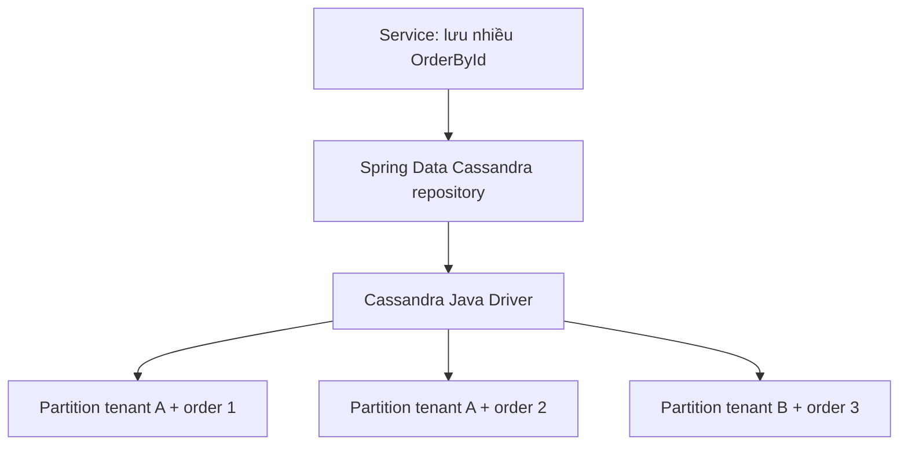
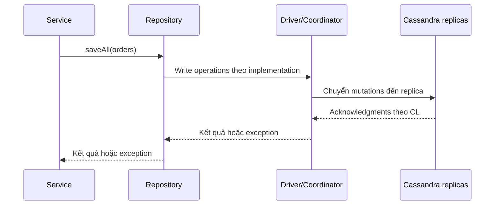
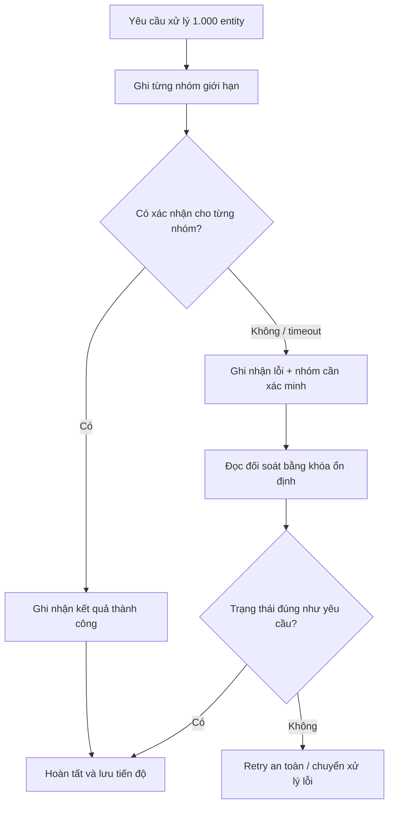
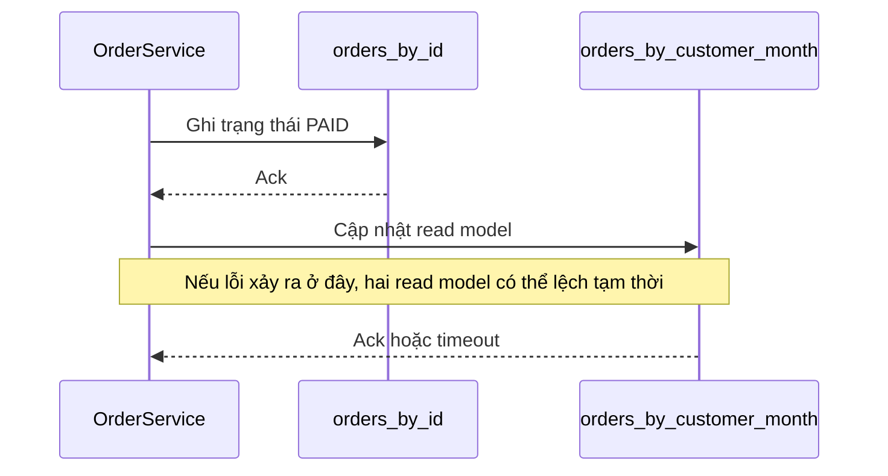

# Đọc và ghi nhiều entity: vòng đời thao tác và phạm vi bảo đảm

Trong **Spring Data Cassandra**, các thao tác như `saveAll(...)`, `findAllById(...)` và `deleteAll(...)` giúp xử lý nhiều entity qua repository. Cú pháp trông giống các phương thức trong Spring Data dành cho cơ sở dữ liệu quan hệ, nhưng cách **Apache Cassandra** thực thi, phân phối và xác nhận dữ liệu khác đáng kể.

Một lời gọi repository nhận 100 entity **không tự tạo ra một giao dịch ACID gồm 100 hàng**. Các hàng có thể thuộc nhiều partition và nằm trên những nhóm replica khác nhau. Khi kết nối mất, coordinator timeout hoặc ứng dụng khởi động lại giữa quá trình, một số thao tác có thể đã thành công trước khi có lỗi. Khi đọc nhiều entity, không mặc định mọi hàng được chụp tại cùng một thời điểm, được trả theo thứ tự đầu vào hoặc có thể sắp xếp toàn cục.

Bài thuộc chương **Repository** và tập trung vào ba câu hỏi:

1. Vòng đời **đọc, ghi, xóa nhiều entity** bằng Spring Data Cassandra diễn ra như thế nào?
2. Repository và CQL **bảo đảm điều gì**, đặc biệt về thứ tự, batch, tính nguyên tử, nhất quán và lỗi một phần?
3. Thiết kế API, dữ liệu, paging và xử lý retry ra sao để chạy an toàn trên hệ thống phân tán?

Nội dung áp dụng cho lớp repository, `CassandraTemplate` và các thao tác CQL liên quan. Các tên method và chi tiết tối ưu thực thi có thể khác theo phiên bản Spring Data Cassandra/Java Driver; vì vậy cần dựa vào **hợp đồng API, CQL được phát và kiểm thử tích hợp** thay vì tự suy một lời gọi Java bằng một transaction.

## 1. Từ một entity đến một tập entity: bản chất thay đổi

Xét ứng dụng bán hàng phục vụ nhiều tenant. Mỗi đơn có `tenant_id`, `order_id`, `customer_id`, `status` và thời điểm tạo.

Để tra cứu đơn qua ID, một bảng ứng viên:

```sql
CREATE TABLE IF NOT EXISTS orders_ks.orders_by_id (
    tenant_id uuid,
    order_id uuid,
    customer_id uuid,
    status text,
    created_at timestamp,
    PRIMARY KEY ((tenant_id, order_id))
);
```

Ở đây **`(tenant_id, order_id)` là composite partition key**. Hai đơn khác ID nhìn chung thuộc hai partition logic khác nhau và có thể được Cassandra ánh xạ tới các tập replica khác nhau.

Để liệt kê đơn mới nhất của một khách theo tháng, ta thường có read model khác:

```sql
CREATE TABLE IF NOT EXISTS orders_ks.orders_by_customer_month (
    tenant_id uuid,
    customer_id uuid,
    bucket_month text,
    created_at timestamp,
    order_id uuid,
    status text,
    PRIMARY KEY (
        (tenant_id, customer_id, bucket_month),
        created_at,
        order_id
    )
) WITH CLUSTERING ORDER BY (
    created_at DESC,
    order_id DESC
);
```

Nhiều hàng của cùng khách trong một tháng nằm **cùng partition** ở bảng thứ hai. Hai bảng phục vụ **hai mẫu đọc** khác nhau và cần chiến lược đồng bộ dữ liệu nếu cùng biểu diễn một đơn hàng.

### Một lời gọi có nhiều entity có thể chạm nhiều partition



Hình minh họa **đường dữ liệu logic**; nó không khẳng định `saveAll` nhất thiết phát ba request riêng, thực thi song song hay dùng CQL `BATCH`. Chiến lược cụ thể phụ thuộc phiên bản và implementation. Điều chắc chắn là **mỗi partition có placement và điều kiện replica riêng**.

## 2. Nhận diện API dành cho nhiều entity

Một repository cơ bản:

```java
import org.springframework.data.cassandra.repository.CassandraRepository;

public interface OrderRepository
        extends CassandraRepository<OrderById, OrderKey> {
}
```

Những API thường gặp trong họ Spring Data CRUD:

| API | Mục đích logic | Điều không nên tự giả định |
| --- | --- | --- |
| `save(entity)` | Lưu một entity theo khóa | Không phải “insert only”; có thể tương ứng upsert |
| `saveAll(entities)` | Yêu cầu lưu các entity được cung cấp | Không mặc định là một transaction hoặc một CQL batch nguyên khối |
| `findById(id)` | Đọc một entity bằng khóa | Không khóa hàng cho thao tác cập nhật tiếp theo |
| `findAllById(ids)` | Đọc những entity tương ứng các ID | Không bảo đảm thứ tự trả về giống đầu vào hoặc một snapshot |
| `findAll()` | Đọc các entity toàn repository | Không phải truy vấn danh sách lớn an toàn hay phân trang mặc định |
| `delete(entity)` / `deleteById(id)` | Xóa theo entity/ID | Xóa trong Cassandra có thể sinh tombstone |
| `deleteAll(entities)` | Xóa các entity được chỉ định | Không đồng nghĩa xóa đồng thời tất cả hoặc rollback nếu lỗi |
| `deleteAll()` | Xóa mọi entity theo semantics implementation | Rất rủi ro về phạm vi và tải; không dùng làm cleanup tùy tiện |

`deleteAllById(...)` và các biến thể trả `List`/`Iterable` hoặc hỗ trợ reactive có thể khác theo **họ interface và phiên bản Spring Data** đang dùng. Khi viết code thực tế, kiểm tra chữ ký API trong dependency của dự án.

**Phân biệt ý nghĩa “All”:** `saveAll` nghĩa là *mọi phần tử của tập đầu vào*, còn `findAll` nghĩa là *mọi entity của repository*. Chúng là hai dạng workload rất khác nhau.

## 3. Entity và primary key cho ví dụ repository

Ví dụ dưới đây dùng mapping bất biến để nhấn mạnh rằng danh tính hàng Cassandra nằm ở key, không phụ thuộc vị trí phần tử trong `List`.

```java
import java.io.Serializable;
import java.util.Objects;
import java.util.UUID;

import org.springframework.data.annotation.PersistenceCreator;
import org.springframework.data.cassandra.core.cql.PrimaryKeyType;
import org.springframework.data.cassandra.core.mapping.PrimaryKeyClass;
import org.springframework.data.cassandra.core.mapping.PrimaryKeyColumn;

@PrimaryKeyClass
public final class OrderKey implements Serializable {

    @PrimaryKeyColumn(
        name = "tenant_id",
        ordinal = 0,
        type = PrimaryKeyType.PARTITIONED
    )
    private final UUID tenantId;

    @PrimaryKeyColumn(
        name = "order_id",
        ordinal = 1,
        type = PrimaryKeyType.PARTITIONED
    )
    private final UUID orderId;

    @PersistenceCreator
    public OrderKey(UUID tenantId, UUID orderId) {
        this.tenantId = Objects.requireNonNull(tenantId);
        this.orderId = Objects.requireNonNull(orderId);
    }

    public UUID getTenantId() { return tenantId; }
    public UUID getOrderId() { return orderId; }

    @Override
    public boolean equals(Object other) {
        if (this == other) return true;
        if (!(other instanceof OrderKey that)) return false;
        return tenantId.equals(that.tenantId)
            && orderId.equals(that.orderId);
    }

    @Override
    public int hashCode() {
        return Objects.hash(tenantId, orderId);
    }
}
```

Entity:

```java
import java.time.Instant;
import java.util.Objects;
import java.util.UUID;

import org.springframework.data.annotation.PersistenceCreator;
import org.springframework.data.cassandra.core.mapping.Column;
import org.springframework.data.cassandra.core.mapping.PrimaryKey;
import org.springframework.data.cassandra.core.mapping.Table;

@Table("orders_by_id")
public final class OrderById {

    @PrimaryKey
    private final OrderKey key;

    @Column("customer_id")
    private final UUID customerId;

    @Column("status")
    private final String status;

    @Column("created_at")
    private final Instant createdAt;

    @PersistenceCreator
    public OrderById(
        OrderKey key,
        UUID customerId,
        String status,
        Instant createdAt
    ) {
        this.key = Objects.requireNonNull(key);
        this.customerId = Objects.requireNonNull(customerId);
        this.status = Objects.requireNonNull(status);
        this.createdAt = Objects.requireNonNull(createdAt);
    }

    public OrderKey getKey() { return key; }
    public UUID getCustomerId() { return customerId; }
    public String getStatus() { return status; }
    public Instant getCreatedAt() { return createdAt; }

    public OrderById withStatus(String newStatus) {
        return new OrderById(key, customerId, newStatus, createdAt);
    }
}
```

Với kiểu immutable, `withStatus(...)` tạo object khác nhưng giữ nguyên primary key. Việc thay đổi reference Java **không ghi gì vào Cassandra** cho tới khi repository/template thực hiện thao tác lưu. Để bind tham số constructor, cần metadata tên tham số phù hợp (chẳng hạn bật `-parameters`) và mapping đúng schema.

Các class minh họa có thể cần bổ sung quy ước equals/hashCode cho entity, validation miền nghiệp vụ và cấu hình Spring Data theo phiên bản dự án. Với bảng production, không nên tự bật tạo schema ở mỗi lần application startup; DDL nên được quản lý riêng.

## 4. Vòng đời `saveAll(...)`

Ví dụ service cần lưu ba đơn:

```java
List<OrderById> orders = List.of(
    new OrderById(
        new OrderKey(tenantId, orderId1),
        customerId, "NEW", createdAt1
    ),
    new OrderById(
        new OrderKey(tenantId, orderId2),
        customerId, "NEW", createdAt2
    ),
    new OrderById(
        new OrderKey(tenantId, orderId3),
        customerId, "NEW", createdAt3
    )
);

Iterable<OrderById> saved = repository.saveAll(orders);
```

Đây là ví dụ cho hợp đồng CRUD. Tùy phiên bản, kết quả có thể mang kiểu cụ thể hơn `Iterable`; dùng interface chung giúp không gắn ví dụ vào một implementation duy nhất.

Một vòng đời khái quát:

1. **Ứng dụng chuẩn bị tập entity** và bảo đảm mỗi entity có primary key hợp lệ.
2. **Repository nhận tập đầu vào**, sử dụng mapping/converter để lấy cột và giá trị tương ứng.
3. **Spring Data/driver thực thi các thao tác ghi** theo implementation hiện tại và request options.
4. **Coordinator xử lý các mutation** liên quan tới partition/replica, theo consistency level của từng request.
5. **Repository trả kết quả hoặc ném lỗi** tùy những thao tác đã thực hiện và hành vi API.
6. **Ứng dụng ghi nhận trạng thái nghiệp vụ**, xử lý retry hoặc đối soát khi kết quả mơ hồ.



**Điều không được suy ra từ `saveAll`:**

- Không bảo đảm *mọi entity cùng thành công hoặc cùng thất bại*.
- Không bảo đảm có một CQL `BEGIN BATCH ... APPLY BATCH`.
- Không bảo đảm thực thi song song hay theo thứ tự đầu vào.
- Không bảo đảm thứ tự hoàn tất của các write.
- Không bảo đảm read-after-write tức thời từ DC khác, đặc biệt khi ứng dụng dùng `LOCAL_QUORUM` ở mỗi DC.
- Không cung cấp isolation, rollback hoặc conflict detection của giao dịch SQL nhiều hàng.

Nếu ứng dụng cần biết số entity thực sự đã lưu sau lỗi, không nên chỉ đọc exception rồi suy ra “0 thành công”. Cần kế hoạch **đối soát trên khóa ổn định** và ghi nhận yêu cầu nghiệp vụ có định danh.

### Upsert: lưu nhiều entity không giống insert-only

Với Cassandra, ghi bằng primary key đã tồn tại thường mang tính **upsert** theo semantics của thao tác. Do đó:

```java
repository.save(new OrderById(
    existingKey, customerId, "PAID", createdAt
));
```

có thể cập nhật những cột tương ứng của hàng hiện hữu. Lời gọi không tự đảm bảo “tạo mới nếu chưa tồn tại, nếu tồn tại phải báo lỗi”.

Để thực hiện điều kiện `IF NOT EXISTS` hoặc điều kiện trạng thái cũ, cần cơ chế **LWT/CAS** và cách truy cập được API/phiên bản hỗ trợ, hoặc một workflow kiểm soát cạnh tranh khác.

Ví dụ CQL điều kiện:

```sql
INSERT INTO orders_ks.orders_by_id (
    tenant_id, order_id, customer_id, status, created_at
) VALUES (
    11111111-1111-1111-1111-111111111111,
    22222222-2222-2222-2222-222222222222,
    33333333-3333-3333-3333-333333333333,
    'NEW',
    '2026-11-25T03:00:00Z'
) IF NOT EXISTS;
```

Đây là **một** conditional mutation với scope/chi phí riêng, không có nghĩa `saveAll` tự động chuyển thành nhiều LWT hoặc thành một transaction bao trùm các đơn.

## 5. `findAllById(...)`: đọc nhiều khóa nhưng không có snapshot chung

Ví dụ:

```java
List<OrderKey> keys = List.of(
    new OrderKey(tenantId, orderId1),
    new OrderKey(tenantId, orderId2),
    new OrderKey(tenantId, orderId3)
);

Iterable<OrderById> found = repository.findAllById(keys);
```

Kỳ vọng đúng:

- Repository tìm những entity có ID tương ứng với tập khóa.
- Khóa không tồn tại có thể **không có entity** trong kết quả; không nên tự coi kết quả thiếu là lỗi database.
- Không được giả định thứ tự kết quả khớp chính xác `keys`.
- Không được giả định mọi hàng được đọc từ cùng một thời điểm logic.
- Tên method không tự bảo đảm một chuyến mạng duy nhất hoặc một query `IN` tối ưu.

Ví dụ, trong lúc request đọc ba khóa:

```text
t0: Service gọi findAllById(k1, k2, k3)
t1: k1 được đọc với status = NEW
t2: Service khác cập nhật k2 thành PAID
t3: k2 được đọc với status = PAID
t4: k3 được đọc với status = NEW
```

Tập kết quả có thể phản ánh **nhiều thời điểm**. Cassandra không cung cấp snapshot isolation nhiều partition thông qua một lời gọi CRUD collection.

### Ánh xạ lại kết quả theo ID nếu cần thứ tự của client

Giả sử API cần trả về theo thứ tự ID đầu vào. Hãy xây map theo khóa:

```java
Map<OrderKey, OrderById> foundByKey = new HashMap<>();

for (OrderById order : repository.findAllById(keys)) {
    foundByKey.put(order.getKey(), order);
}

List<OrderById> ordered = keys.stream()
    .map(foundByKey::get)
    .filter(Objects::nonNull)
    .toList();
```

Đoạn mã giả định đã import `Map`, `HashMap`, `List`, `Objects` và sử dụng Java hiện đại. Nó **không biến các read thành snapshot**, chỉ sắp xếp lại tập object theo ID đã yêu cầu. Nếu API cần phân biệt khóa thiếu, hãy giữ danh sách khóa và trạng thái `FOUND`/`NOT_FOUND` rõ ràng, thay vì âm thầm bỏ đi.

Không đưa một danh sách hàng triệu ID vào `findAllById` rồi mong hệ thống tự phân tán hợp lý. Chia request có giới hạn, đo latency/tải, và cân nhắc mẫu bảng khác nếu thực chất yêu cầu là **list theo khách, trạng thái hoặc thời gian**.

## 6. `findAll()` và vì sao không nên dùng làm API danh sách chính

`findAll()` thoạt nhìn rất tiện:

```java
Iterable<OrderById> allOrders = repository.findAll();
```

Nhưng với bảng `orders_by_id`, điều này không có điều kiện partition key để khoanh vùng. Trong môi trường nhiều tenant và hàng triệu bản ghi, một thao tác “đọc tất cả” có thể rất tốn kém hoặc không phù hợp với hợp đồng latency của endpoint.

Cần phân biệt:

| Nhu cầu | Hướng tốt hơn |
| --- | --- |
| Đọc một đơn theo key | `findById(key)` |
| Đọc tập nhỏ ID đã biết | `findAllById(keys)`, có giới hạn rõ |
| Xem 20 đơn mới nhất của khách trong tháng | Bảng `orders_by_customer_month` và query theo partition key |
| Xem đơn theo status/ngày | Read model theo status/ngày |
| Thống kê tổng đơn nhiều năm | Dữ liệu tổng hợp/analytics được thiết kế riêng |
| Xuất dữ liệu khối lượng lớn | Pipeline export/scan có kiểm soát, paging và giới hạn tải |

`count()` trên một tập dữ liệu Cassandra lớn cũng không nên được coi là phép đếm O(1) có sẵn. Nếu giao diện cần tổng số bản ghi cập nhật thường xuyên, phải thiết kế read model/counter/aggregation có chính sách độ chính xác và cập nhật rõ ràng.

### Query theo partition tốt hơn read-all

Ví dụ:

```sql
SELECT created_at, order_id, status
FROM orders_ks.orders_by_customer_month
WHERE tenant_id = 11111111-1111-1111-1111-111111111111
  AND customer_id = 33333333-3333-3333-3333-333333333333
  AND bucket_month = '2026-11'
LIMIT 20;
```

Cassandra có thể định vị đúng partition và khai thác clustering order `created_at DESC, order_id DESC`. Để tải tiếp, dùng paging state hoặc cursor được thiết kế cho đúng query. `LIMIT 20` tự nó chưa phải cơ chế “trang 2”.

## 7. `deleteAll(entities)`: xóa nhiều hàng và tombstone

Ví dụ xóa một tập đơn đã xác định:

```java
List<OrderById> candidates = List.of(order1, order2);

repository.deleteAll(candidates);
```

Phải phân biệt **xóa tập được truyền vào** với xóa toàn bộ repository bằng `deleteAll()` không tham số.

Với Cassandra, `DELETE` thường ghi dấu xóa (tombstone) để replica hội tụ theo mô hình phân tán. Dữ liệu không nhất thiết bị loại vật lý ngay lập tức; quá trình compaction, repair và các điều kiện thời gian ảnh hưởng vòng đời tombstone.

Từ một lời gọi xóa nhiều entity, không được suy ra:

- Mọi hàng biến mất ngay trên mọi replica/DC.
- Các xóa sẽ rollback đồng thời khi một thao tác lỗi.
- Gọi lại xóa luôn không có chi phí.
- Xóa một tập lớn có thể thực hiện an toàn trong một transaction.

Đối với nghiệp vụ lưu trữ lịch sử, nên cân nhắc TTL hoặc retention policy phù hợp **ngay ở thiết kế bảng**. Nhưng TTL cũng tạo ra thời điểm dữ liệu hết hạn và có thể liên quan đến tombstone/compaction; không phải cách miễn phí để xử lý dữ liệu vô hạn.

### Xóa và ghi đồng thời có thể cạnh tranh

Ví dụ: Worker A xóa đơn cũ trong khi Worker B viết trạng thái mới cho cùng khóa. Kết quả phụ thuộc timestamp, loại mutation, logic retry và thứ tự xử lý phân tán. Repository không tự giải quyết xung đột nghiệp vụ. Nếu dữ liệu phải được giữ hoặc xóa theo điều kiện, cần chính sách domain và kỹ thuật phù hợp.

## 8. Phân biệt `saveAll` với CQL `BATCH`

Hai khái niệm thường bị gọi chung là “batch”, nhưng không được đồng nhất:

1. **Repository bulk API:** `saveAll(entities)` biểu diễn một tập đối tượng cần lưu ở cấp Java.
2. **CQL batch statement:** `BEGIN [UNLOGGED] BATCH ... APPLY BATCH` gom những mutation CQL vào một request theo cơ chế Cassandra.

**Một lời gọi `saveAll` không phải bằng chứng framework phát một CQL BATCH.** Thực thi có thể phụ thuộc version/implementation. Muốn biết chính xác, quan sát câu lệnh thực tế trong integration test hoặc kiểm tra API/implementation của phiên bản đã khóa dependency.

### Ví dụ CQL batch trên cùng partition

Ở bảng `orders_by_customer_month`, hai đơn cùng khách và cùng tháng có composite partition key giống nhau. Có thể biểu diễn một batch nhỏ:

```sql
BEGIN UNLOGGED BATCH
  INSERT INTO orders_ks.orders_by_customer_month (
      tenant_id, customer_id, bucket_month,
      created_at, order_id, status
  ) VALUES (
      11111111-1111-1111-1111-111111111111,
      33333333-3333-3333-3333-333333333333,
      '2026-11',
      '2026-11-25T03:00:00Z',
      22222222-2222-2222-2222-222222222222,
      'NEW'
  );
  INSERT INTO orders_ks.orders_by_customer_month (
      tenant_id, customer_id, bucket_month,
      created_at, order_id, status
  ) VALUES (
      11111111-1111-1111-1111-111111111111,
      33333333-3333-3333-3333-333333333333,
      '2026-11',
      '2026-11-25T03:02:00Z',
      44444444-4444-4444-4444-444444444444,
      'NEW'
  );
APPLY BATCH;
```

Đây là **bài minh họa cách viết CQL**, không phải khuyến nghị gom mọi ghi vào batch. Nhóm mutation nhỏ của cùng partition có thể có đặc tính khác đáng kể so với một batch lớn gồm hàng trăm partition.

### Logged, unlogged và counter batch

| Kiểu | Mục tiêu chính | Điều cần cân nhắc |
| --- | --- | --- |
| **Logged batch** | Cung cấp cơ chế batch log để tăng bảo đảm eventual application của các mutation khi có lỗi phù hợp | Có overhead batchlog; không cung cấp isolation của SQL transaction |
| **Unlogged batch** | Gom mutation mà không qua cơ chế batchlog thông thường | Không có cùng bảo đảm failure atomicity khi nhiều partition; vẫn có giới hạn tải |
| **Counter batch** | Dùng cho các thao tác counter phù hợp | Counter có semantics và giới hạn riêng; không trộn tùy tiện với mutation thông thường |

Cassandra cung cấp **atomicity ở một số ngữ cảnh batch**, nhưng không nên diễn dịch điều đó thành **rollback transaction nhiều hàng theo nghĩa RDBMS**. Với logged batch, batchlog hỗ trợ bảo đảm các mutation cuối cùng được thực thi khi coordinator đã nhận trách nhiệm phù hợp; trong lúc lỗi, người đọc có thể quan sát trạng thái trung gian và timeout không đủ để xác định chính xác mọi kết quả. Batch không cung cấp snapshot isolation nhiều partition và không cho phép tùy ý cập nhật nhiều bảng rồi coi chúng thành một aggregate transaction.

**Nguyên tắc hiệu năng:** batch không phải phép thay thế cho bulk insert SQL. Khi gộp nhiều partition, coordinator có thể tăng fan-out và chi phí mạng/memory; batch quá lớn có thể gây cảnh báo hoặc bị từ chối theo cấu hình cluster. Dùng batch khi có lý do đúng về semantics, giới hạn nhỏ và đo bằng workload thật.

## 9. Phạm vi bảo đảm: theo request, partition, replica và nhóm entity

Để suy luận về thao tác nhiều entity, luôn tự hỏi “đang nói đến bảo đảm ở **phạm vi nào**?”.

| Phạm vi | Có thể nói gì | Không thể mặc định |
| --- | --- | --- |
| **Một Java object** | Constructor tạo trạng thái hợp lệ nếu validation đầy đủ | Database chưa chắc được ghi |
| **Một entity lưu theo primary key** | Một mutation được coordinator xử lý theo CQL và CL | Không có optimistic locking tự động |
| **Một partition** | Cassandra tổ chức dữ liệu theo partition và áp dụng semantics mutation/batch phù hợp | Không tự có transaction giữa nhiều partition |
| **Một request với CL** | Trả thành công khi đạt số/phạm vi xác nhận theo CL | Mọi replica/DC đã có dữ liệu cùng thời điểm |
| **Một tập entity** | Framework yêu cầu xử lý những phần tử được truyền vào | Không mặc định all-or-nothing hay snapshot chung |
| **Một CQL logged batch** | Có bảo đảm batchlog/atomicity theo cơ chế Cassandra | Không có isolation và rollback SQL transaction |
| **Một quy trình nghiệp vụ** | Có thể thêm idempotency, outbox/queue, đối soát và trạng thái xử lý | Không được framework tự quản lý thay |

Phạm vi Cassandra hỗ trợ cần gắn với partition key thực. Hai entity trong cùng một `List` Java **không đồng nghĩa** chúng nằm cùng partition. Ngược lại, hai hàng ở cùng partition nhưng thuộc hai bảng khác nhau cần được xem xét riêng về semantics và chiến lược nhất quán.

## 10. Consistency level ảnh hưởng gì khi ghi/đọc nhiều entity?

Giả sử keyspace dùng `NetworkTopologyStrategy` với RF = 3 trong datacenter `dc_hcm`. Với request tại local DC:

\[
\text{LOCAL\_QUORUM} = \left\lfloor \frac{3}{2} \right\rfloor + 1 = 2
\]

Khi ghi một partition ở `LOCAL_QUORUM`, coordinator cần đủ xác nhận từ replica cục bộ theo quy tắc CL. Khi đọc một partition bằng `LOCAL_QUORUM`, cũng cần đủ phản hồi theo quy tắc đó.

**Nhưng một tập 100 entity có thể gồm 100 partition**. Mỗi partition có nhóm replica và trạng thái thực thi riêng. Không có “quorum chung cho List 100 object” chỉ vì service gọi `saveAll` một lần.

| Tình huống | Điều có thể xảy ra |
| --- | --- |
| DC HCM có RF=3, một replica của partition không phản hồi | `LOCAL_QUORUM` vẫn có thể đạt khi đủ hai replica |
| HCM chỉ có một replica của partition khả dụng | Request `LOCAL_QUORUM` thường `Unavailable` hoặc không thể đủ ack |
| Ghi `LOCAL_QUORUM` thành công tại HCM, ngay sau đó đọc ở HN | DC HN có thể chưa nhận đủ dữ liệu mới |
| Một phần các partition đáp ứng CL, phần khác không | Tập multi-entity có thể ghi/đọc một phần, tùy cách thực thi và lỗi |
| Query riêng lẻ trả thành công | Không có nghĩa mọi entity trong batch/list ở thời điểm khác đã hội tụ |

Trong cùng một DC, `LOCAL_QUORUM` cho cả read/write tạo điều kiện giao nhau giữa tập replica xác nhận của một partition khi RF phù hợp. Tuy nhiên, Cassandra có conflict resolution bằng timestamp, không tự cung cấp linearizable multi-row transactions. Nếu có ghi đồng thời, stale reads hoặc tranh chấp giữa DC, thiết kế nghiệp vụ vẫn rất quan trọng.

### Chọn CL là quyết định nghiệp vụ

- Dữ liệu thông báo có thể chấp nhận thời gian hội tụ.
- Trạng thái thanh toán cần quy tắc chặt hơn về idempotency, thứ tự sự kiện và chống cập nhật xung đột.
- Báo cáo tổng hợp có thể được xây bất đồng bộ thay vì đòi đọc mọi đơn bằng CL cao nhất.
- Tăng CL thường ảnh hưởng độ trễ/khả dụng; không làm các operation nhiều entity biến thành một transaction.

## 11. Lỗi một phần và kết quả không rõ ràng sau timeout

Hãy xét một tác vụ nhập 1.000 đơn. Service gửi nhiều thao tác ghi, sau đó nhận timeout ở phần cuối.

Có ít nhất ba trạng thái cần phân biệt:

1. **Đã xác nhận:** hệ thống có phản hồi thành công cho những yêu cầu cụ thể.
2. **Đã báo lỗi:** một hoặc vài request bị lỗi; không nên suy mọi mutation liên quan đều không được áp dụng.
3. **Chưa rõ:** mất kết nối/timeout xảy ra sau khi coordinator hoặc replica đã thực hiện một phần công việc; client không có kết quả chắc chắn.



Sơ đồ là **thiết kế quy trình nghiệp vụ** ở tầng ứng dụng. Không có nghĩa repository tự lưu checkpoint hay tự cung cấp cơ chế exactly-once.

### Idempotency: điều kiện để retry có thể kiểm soát

Một thao tác idempotent là thao tác có thể lặp lại mà không làm trạng thái nghiệp vụ thay đổi thêm ngoài kết quả mong muốn. Ví dụ ghi lại **cùng giá trị vào cùng primary key** thường dễ kiểm soát hơn thao tác tăng biến đếm hoặc phát thêm sự kiện mỗi lần retry.

Nhưng phải đánh giá cả:

- Primary key có được tạo một lần và giữ ổn định không?
- Có timestamp ghi riêng, TTL hay chuyển trạng thái có phụ thuộc thời gian không?
- Có trigger/luồng xử lý ngoài database sẽ gửi email, thu tiền, ghi event mỗi lần chạy không?
- Có write đồng thời từ process khác có thể bị retry cũ ghi đè không?
- Có dữ liệu ở nhiều bảng read model cần cập nhật cùng nhau không?

Không nên dùng lời gọi `repository.saveAll(orders)` như cơ chế chống ghi trùng. **Idempotency key** hoặc định danh nghiệp vụ ổn định và cách kiểm soát cập nhật phải do hệ thống định nghĩa.

### Retry bừa bãi có thể làm tình huống nặng hơn

- Retry không giới hạn gây thêm tải khi cluster đang chậm.
- Retry những request không idempotent có thể lặp hành vi nghiệp vụ.
- Retry cùng một mutation sau khi phiên bản mới đã được ghi có thể tạo conflict.
- Timeout có thể là tín hiệu đĩa, network, RF/CL, hot partition hoặc request quá lớn; tăng timeout không chữa nguyên nhân.

Dùng retry có **giới hạn, backoff, jitter, quan sát** và chiến lược xác minh kết quả trước khi tiếp tục.

## 12. Đọc/ghi nhiều read model của cùng một thực thể

Một đơn hàng có thể xuất hiện trong hai bảng:

- `orders_by_id`: đọc chi tiết qua ID.
- `orders_by_customer_month`: đọc danh sách của khách theo thời gian.

Từ góc nhìn nghiệp vụ đây là **một đơn hàng**, nhưng Cassandra coi đó là các hàng ở những bảng/partition khác nhau.



Nếu viết ở hai bảng riêng biệt bằng repository, không có bảo đảm rằng hai write sẽ hoàn tất đồng thời hoặc rollback lẫn nhau. Ngay cả nếu dùng CQL logged batch phù hợp, vẫn không có isolation toàn cục cho người đọc hoặc mô hình transaction nghiệp vụ kiểu SQL.

Các lựa chọn thiết kế:

1. **Ghi trực tiếp nhiều read model có đối soát:** đơn giản với trường hợp ít bảng, nhưng phải có retry và giám sát lệch dữ liệu.
2. **Ghi model chính rồi phát sự kiện cập nhật read model:** cần xử lý event delivery, idempotency, thứ tự và dead-letter/replay.
3. **Dùng cùng partition khi bài toán cho phép:** có thể đơn giản hóa một số thao tác, nhưng phải xuất phát từ truy vấn và cardinality, không ép mọi dữ liệu vào một partition lớn.
4. **LWT/CAS cho trạng thái cần điều kiện:** có thể xử lý xung đột ở phạm vi được Cassandra hỗ trợ, nhưng không thay thế điều phối nhiều bảng/partition.

Nếu ứng dụng yêu cầu một giao dịch duy nhất cập nhật tài khoản, đơn hàng, tồn kho và thanh toán với isolation mạnh, phải đánh giá lại **kiến trúc và nguồn dữ liệu có thẩm quyền**. Repository Cassandra không nên bị dùng như một ORM quan hệ chỉ vì phương thức đặt tên giống nhau.

## 13. Phân trang và đọc nhiều entity: chọn hướng phù hợp

Dữ liệu lớn cần paging để hạn chế bộ nhớ, lưu lượng mạng và tải cluster.

### Truy vấn theo mẫu đọc

Ví dụ lấy đơn trong một partition khách-tháng:

```sql
SELECT created_at, order_id, status
FROM orders_ks.orders_by_customer_month
WHERE tenant_id = 11111111-1111-1111-1111-111111111111
  AND customer_id = 33333333-3333-3333-3333-333333333333
  AND bucket_month = '2026-11'
LIMIT 20;
```

Bảng này đã khai báo `CLUSTERING ORDER BY (created_at DESC, order_id DESC)`. Vì thế Cassandra đọc hàng theo clustering order trong partition.

**`LIMIT 20` không phải là trang số 1 trong hệ phân trang có `OFFSET`.** Cassandra Java Driver hỗ trợ **paging state** để tiếp tục truy vấn; Spring Data Cassandra có các API paging, `Slice`/request abstraction tùy phiên bản. Khi chuyển paging state đến frontend, cần buộc nó với user, tenant, query và filter tương ứng, và không dùng lại cho truy vấn khác.

### So sánh cách đọc nhiều dữ liệu

| Phương án | Phù hợp khi | Cần tránh |
| --- | --- | --- |
| `findAllById(keys)` | Có một tập **khóa chính nhỏ** đã biết | Dùng thay cho tìm kiếm theo filter/time |
| Truy vấn theo partition với page size | Hiển thị list theo customer/day/month/status đã thiết kế | Đọc toàn bộ partition khổng lồ trong một lần |
| `findAll()` | Công cụ admin/test nhỏ, có giới hạn và kiểm soát | Endpoint phục vụ người dùng trên dataset lớn |
| Batch job đọc theo bucket | Xử lý dữ liệu lịch sử có checkpoint | Quét vô hạn không có tiến độ |
| Reactive streaming | Pipeline cần backpressure và có thể xử lý từng item | Hiểu nhầm reactive thành transaction/atomicity |

Không cần tạo một entity `List` lớn trong memory rồi mới lọc/sắp tại service nếu truy vấn có thể thiết kế thành partition và clustering order hợp lý. Khi phải đọc nhiều bucket, ứng dụng cần điều phối và ghép kết quả theo thứ tự, không tự giả định Cassandra sắp xếp toàn cục.

## 14. Đọc kết quả thành công không đồng nghĩa dữ liệu đầy đủ tuyệt đối

Ngay cả khi repository trả về một `Iterable` không có exception:

- `findAllById` có thể không trả các ID không tồn tại.
- Dữ liệu có thể đang được cập nhật ở DC khác và chưa hội tụ tới DC được đọc.
- Các hàng đã có thể được xóa/hết TTL trước khi client đọc.
- Một batch lớn trong ứng dụng có thể bị chia thành nhiều request, và giữa chúng xảy ra ghi đồng thời.
- Truy vấn một partition bằng CL phù hợp vẫn không biến tập nhiều partition thành một snapshot.
- Một kết quả từ `findAll()` trên workload lớn không nên được dùng làm số liệu “toàn bộ đơn tính tới cùng thời điểm”.

Nếu nghiệp vụ cần báo cáo ở thời điểm đóng sổ, phải thiết kế **cutoff time, event watermark, aggregate snapshot hoặc pipeline** riêng, cùng quy trình đối soát, thay vì dựa vào một lần gọi repository tổng quát.

## 15. Reactive repository: khác cách điều phối, không đổi bảo đảm Cassandra

Với **Reactive Spring Data Cassandra**, repository có thể cung cấp API `Publisher`/`Flux`/`Mono` phù hợp thay vì `Iterable` hoặc object blocking.

Ví dụ minh họa với interface tương ứng:

```java
import org.springframework.data.cassandra.repository.ReactiveCassandraRepository;

public interface ReactiveOrderRepository
        extends ReactiveCassandraRepository<OrderById, OrderKey> {
}
```

Một luồng ghi:

```java
Flux<OrderById> source = Flux.fromIterable(orders);

Flux<OrderById> saved = reactiveOrderRepository.saveAll(source);
```

Đoạn mã dùng Reactor `Flux` và cần dependency reactive tương thích. Lưu ý:

- Một pipeline reactive thường **không được thực thi** cho tới khi có subscription theo semantics reactive; khai báo biến `saved` chưa chứng minh đã ghi xong.
- Backpressure và concurrency cần được thiết kế, không nên phát hàng chục nghìn write không giới hạn.
- Completion của stream phản ánh completion theo hợp đồng publisher/operation; không tự cung cấp all-or-nothing transaction.
- Nếu luồng bị hủy hoặc lỗi, một số thao tác có thể đã được gửi tới cluster.
- Chuyển blocking repository sang reactive không thay đổi partition key, CL hay khả năng hội tụ replica.

Nếu cần đảm bảo hoàn thành một import, phải quản lý progress/checkpoint khi publisher hoàn tất, có chiến lược retry và đối soát. Không lạm dụng `subscribe()` bên trong service rồi trả HTTP thành công ngay như thể mọi mutation đã hoàn tất.

## 16. Kiểm soát kích thước lô và tải hệ thống

Trong Cassandra, tối ưu thao tác nhiều entity thường là bài toán **số request, mức song song và phân phối partition** hơn là chỉ ghép mọi write vào một câu CQL batch.

Các thông số cần đo:

| Thông số | Rủi ro nếu không kiểm soát |
| --- | --- |
| Số entity mỗi lô nhập | Bộ nhớ service, payload và quá tải driver/coordinator |
| Kích thước payload trung bình/mutation | Lô nhỏ theo số hàng vẫn có thể lớn theo byte |
| Số partition trong một nhóm | Fan-out và mất cân bằng giữa replica/coordinator |
| Mức song song / in-flight requests | Timeout, queue tăng, áp lực CPU/mạng |
| Consistency level | Trade-off giữa latency, availability và ack của replica |
| Số bảng read model phải ghi | Write amplification và đối soát nhiều nơi |
| TTL/tombstone | Ảnh hưởng compaction và độ trễ đọc |
| P95/P99 và retry count | Phát hiện hệ thống bị nghẽn hoặc có lỗi lặp |

### Chunk ở tầng ứng dụng

Đây là **pseudocode Java ở mức quy trình** cho import khối lượng lớn, tránh ngầm khẳng định `saveAll` tự chunk:

```java
for (List<OrderById> chunk : partitionIntoChunks(orders, 100)) {
    try {
        repository.saveAll(chunk);
        recordChunkCompleted(chunk);
    } catch (RuntimeException ex) {
        markChunkForReconciliation(chunk, ex);
    }
}
```

`partitionIntoChunks`, `recordChunkCompleted` và `markChunkForReconciliation` là hàm nghiệp vụ **chưa được định nghĩa** trong đoạn minh họa. Giá trị `100` chỉ là ví dụ để diễn đạt ý tưởng, **không phải khuyến nghị batch size Cassandra cố định**. Cỡ lô, concurrency, timeout, checkpoint và khả năng retry phải được đo/điều chỉnh theo dữ liệu thực.

**Cảnh báo về checkpoint:** Dấu “chunk completed” ở cấp ứng dụng chỉ có ý nghĩa nếu hợp đồng `saveAll` và cơ chế lưu tiến độ đã được xác minh. Nếu xảy ra exception, không được tự coi mọi entity trong chunk là thất bại; hãy đối soát theo key/operation ID.

## 17. Khác biệt giữa transaction annotation và đảm bảo của Cassandra

Một phương thức service có thể được gắn annotation:

```java
@Transactional
public void importOrders(List<OrderById> orders) {
    repository.saveAll(orders);
}
```

Nhưng **`@Transactional` không tự tạo transaction ACID nhiều partition trong Cassandra**. Tác dụng thực tế phụ thuộc transaction manager được cấu hình và mức hỗ trợ của datastore. Không thể sao chép một mẫu dùng với JPA rồi suy rằng Cassandra có commit/rollback nhiều hàng giống PostgreSQL.

Nếu không có transaction manager tương ứng, code có thể không có hành vi mà lập trình viên mong đợi hoặc gặp lỗi cấu hình. Nếu có loại transaction/conditional operation khác được hỗ trợ, **phạm vi và điều kiện của nó phải được xác minh riêng**.

### LWT dành cho tình huống nào?

**Lightweight transaction (LWT)** sử dụng Paxos/CAS để hỗ trợ cập nhật có điều kiện, ví dụ `IF NOT EXISTS` hoặc `UPDATE ... IF status = 'NEW'`, trong phạm vi và giới hạn Cassandra cho phép. Nó có chi phí cao hơn thao tác ghi thông thường và không mặc định được áp dụng cho mọi phần tử của `saveAll`.

Nếu yêu cầu là “chỉ chuyển đơn từ NEW sang PAID nếu trạng thái hiện tại vẫn NEW”, ta cần **conditional mutation** và kiểm tra applied result. Nếu yêu cầu là “hoặc tất cả 100 đơn cùng PAID, hoặc không đơn nào thay đổi”, đó là điều kiện **khác** và không được giải quyết đơn giản bằng lặp 100 LWT độc lập.

## 18. Vòng đời một tác vụ nhập liệu có thể kiểm soát

Thiết kế một import theo trạng thái rõ ràng:

| Trạng thái | Ý nghĩa |
| --- | --- |
| `RECEIVED` | Đã nhận yêu cầu kèm operation/import ID ổn định |
| `VALIDATED` | Khóa chính, tenant scope và dữ liệu đã kiểm tra |
| `PROCESSING` | Đang ghi từng nhóm có giới hạn |
| `RECONCILING` | Có lỗi hoặc timeout, cần xác minh các khóa chưa rõ |
| `COMPLETED` | Đã xác nhận điều kiện hoàn thành nghiệp vụ |
| `FAILED` | Không thể hoàn thành theo policy; cần khắc phục hoặc xử lý thủ công |

Một lộ trình:

1. Xác định **import ID** để lặp lại yêu cầu không tạo lô nghiệp vụ mới ngoài ý muốn.
2. Validation tại biên: không có khóa rỗng, không lấy tenant từ client một cách thiếu kiểm soát, không có duplicate ID bất ngờ.
3. Chia lô hợp lý, giới hạn đồng thời và cấp timeout.
4. Ghi các entity/read model cần thiết theo kế hoạch.
5. Ghi nhận nhóm đã xác nhận, nhóm chưa rõ sau lỗi.
6. Đối soát các khóa chưa rõ, retry có điều kiện và ghi metric.
7. Chỉ công bố `COMPLETED` khi **điều kiện nghiệp vụ** đã đạt.

Bảng tiến độ có thể cần thiết kế riêng theo truy vấn và độ tin cậy yêu cầu. Nếu lưu trạng thái import vào cùng Cassandra, hãy đánh giá sự cố Cassandra ảnh hưởng đồng thời đến thao tác chính và thao tác ghi tiến độ như thế nào; có thể cần durable queue hoặc nguồn lưu tiến độ độc lập tùy SLA.

## 19. Testing: kiểm tra cả API và các trạng thái lỗi

Unit test một service mock repository chỉ chứng minh code gọi `saveAll`. Nó **không chứng minh** cách Cassandra thực hiện nhiều mutation, không xác minh consistency hoặc schema.

### Kiểm thử tích hợp cơ bản

Trên một keyspace test có schema phù hợp:

```java
OrderById one = new OrderById(
    new OrderKey(tenantId, orderId1),
    customerId, "NEW", createdAt1
);
OrderById two = new OrderById(
    new OrderKey(tenantId, orderId2),
    customerId, "NEW", createdAt2
);

repository.saveAll(List.of(one, two));

Map<OrderKey, OrderById> found = new HashMap<>();
for (OrderById order : repository.findAllById(
        List.of(one.getKey(), two.getKey()))) {
    found.put(order.getKey(), order);
}

assertEquals("NEW", found.get(one.getKey()).getStatus());
assertEquals("NEW", found.get(two.getKey()).getStatus());
```

Ví dụ chỉ là phần thân test JUnit, giả định có imports, schema và repository injection. Với Cassandra test, phải cấu hình RF/CL phù hợp topology; test một node **không chứng minh khả năng chịu lỗi multi-DC**.

### Các tình huống nên kiểm tra

| Nhóm | Tình huống | Kỳ vọng phải làm rõ |
| --- | --- | --- |
| Lưu nhiều | Hai entity cùng khóa nhưng khác status | Có quy tắc loại trùng hoặc giải quyết cạnh tranh |
| Lưu nhiều | Một entity thiếu primary key | Validation lỗi trước khi phát một phần thao tác nếu nghiệp vụ yêu cầu |
| Lưu nhiều | Timeout giữa quá trình | Không suy tất cả rollback; thử reconciliation |
| Đọc nhiều | Một ID không tồn tại | Trả đủ thông tin xác định missing ID |
| Đọc nhiều | Request ID không theo thứ tự lưu | Không phụ thuộc thứ tự iterable |
| Đọc nhiều | Ghi đồng thời giữa các read | Chấp nhận hoặc xử lý việc không có snapshot |
| Xóa nhiều | Xóa rồi đọc lại | Hiểu CL và độ trễ hội tụ |
| Paging | Nhiều trang trong một partition | Cursor/paging state đúng query |
| Multi-DC | Đọc ở DC khác ngay sau ghi | Kiểm tra yêu cầu nhất quán xuyên DC |
| Đổi bảng đọc | Ghi bảng chính thành công, bảng phụ lỗi | Có retry/đối soát read model |
| Tải lớn | Thử nhiều mức concurrency, payload | Đo latency, retry, timeout, hàng đợi |

Nếu kiểm thử lỗi bằng fault injection hay ngắt node, cần thực hiện trên **môi trường test cô lập**, không dùng dữ liệu khách hàng hoặc môi trường production không được phê duyệt.

### Theo dõi CQL thực tế thay vì suy từ tên API

Với implementation cụ thể, hãy quan sát log/tracing/driver metrics để xác nhận:

- `saveAll` có tạo bao nhiêu request/batch?
- Request có dùng prepared statement, CL và timeout dự kiến?
- Có nhiều partition trong cùng batch không?
- `findAllById` được triển khai bằng những câu truy vấn nào?
- `deleteAll(entities)` phát những mutation gì?
- Khi lỗi, ứng dụng có còn những request in-flight không?

Không bật log toàn bộ dữ liệu nhạy cảm hoặc bind parameters trong production chỉ để nghiên cứu implementation. Dùng dữ liệu test và instrumentation có kiểm soát.

## 20. Các sai lầm thường gặp

| Hiểu sai | Vì sao sai | Hướng đúng |
| --- | --- | --- |
| “`saveAll` là một transaction.” | Repository bulk API không bảo đảm all-or-nothing nhiều partition | Thiết kế từng thao tác, idempotency và reconciliation |
| “Exception từ `saveAll` nghĩa là không bản ghi nào được lưu.” | Có thể đã có mutation thành công hoặc ack bị mất | Xác minh từng khóa/operation |
| “`findAllById` trả cùng thứ tự danh sách input.” | Không có hợp đồng thứ tự chung cho tập nhiều ID | Sắp lại theo key ở ứng dụng |
| “`findAllById` đọc snapshot tại cùng thời điểm.” | Nhiều partition có thể được đọc khi có cập nhật đồng thời | Định nghĩa SLA về freshness/snapshot riêng |
| “`findAll()` phù hợp cho API list không giới hạn.” | Có thể quét rộng và tiêu tốn tài nguyên | Bảng theo query + paging |
| “CQL `BATCH` luôn giúp ghi nhanh hơn.” | Batch đa partition có thể tăng overhead | Chỉ batch khi có lý do và đo thực tế |
| “`@Transactional` tự rollback mọi ghi Cassandra.” | Hạn chế transaction datastore khác ORM quan hệ | Xác minh transaction manager và semantics thực |
| “`LOCAL_QUORUM` đảm bảo mọi DC có dữ liệu tức thời.” | Quorum chỉ thuộc DC cục bộ | Hiểu replication và lag giữa DC |
| “Xóa nhiều entity là xóa vật lý lập tức.” | Tombstone và compaction có vòng đời riêng | Retention, repair, monitoring |
| “Reactive stream hoàn thành nghĩa là exactly-once.” | Reactive không thay đổi lỗi mạng hoặc idempotency | Checkpoint, đối soát và xử lý subscription |
| “Một read model cập nhật thì bảng khác tự cập nhật.” | Denormalization cần luồng đồng bộ rõ ràng | Ghi/cập nhật từng model có đối soát |
| “Tăng batch size sẽ giải quyết timeout.” | Có thể làm coordinator và replica quá tải hơn | Giới hạn lô, concurrency, theo dõi metrics |

## 21. Bài tập thực hành

### Bài 1 — đọc nhiều khóa

`findAllById` nhận ba khóa `[k1, k2, k3]`. Cassandra chỉ có `k1` và `k3`; repository trả hai entity theo thứ tự `[k3, k1]`.

**Câu hỏi:** Kết quả có nhất thiết sai không? Cần xử lý gì nếu API phải trả lời từng ID đúng thứ tự yêu cầu?

<details>
<summary>Đáp án gợi ý</summary>

Không thể kết luận sai chỉ vì thứ tự khác và thiếu ID không tồn tại. Hãy dựng map theo primary key, sau đó duyệt đầu vào để tạo kết quả có thứ tự; với `k2` trả trạng thái `NOT_FOUND` nếu API cần phân biệt missing ID. Không mặc định có snapshot nhiều khóa.

</details>

### Bài 2 — ghi một phần

Service nhận 100 đơn, gọi `saveAll` và gặp timeout. 60 đơn kiểm tra lại đã có, 40 đơn chưa thấy ở lần đọc đầu tiên.

**Câu hỏi:** Có thể tuyên bố 40 đơn chắc chắn chưa bao giờ được ghi không?

<details>
<summary>Đáp án gợi ý</summary>

Không. Timeout/lỗi mạng và tính nhất quán giữa replica khiến trạng thái có thể chưa rõ. Phải xét CL, thời điểm đọc, ID, dữ liệu đã ghi, độ trễ hội tụ và thao tác đang in-flight. Cần đối soát có giới hạn và retry idempotent theo quy trình, không tự động phát lại mọi thao tác không điều kiện.

</details>

### Bài 3 — chọn CQL batch

Một lô có 500 mutation trải trên 500 partition. Developer đề xuất gom vào một `BEGIN LOGGED BATCH` để “tăng throughput”.

**Câu hỏi:** Có nên mặc định chấp nhận không?

<details>
<summary>Đáp án gợi ý</summary>

Không. Batch đa partition lớn có overhead/fan-out và có thể tạo cảnh báo hoặc quá tải. Cần xác định **lý do semantics** bắt buộc phải dùng batch, giới hạn kích thước, đo latency và xem lại cách ghi song song có kiểm soát. Logged batch không trở thành transaction SQL và không mặc định tăng throughput.

</details>

### Bài 4 — đồng bộ hai bảng đọc

Một order được cập nhật thành `PAID` ở `orders_by_id`, nhưng service crash trước khi cập nhật `orders_by_customer_month`. Màn hình chi tiết và danh sách hiển thị hai trạng thái khác nhau.

**Câu hỏi:** Lỗi nào trong thiết kế và xử lý ra sao?

<details>
<summary>Đáp án gợi ý</summary>

Đây là trường hợp read model bị lệch do hai write độc lập. Cần thiết kế đồng bộ sự kiện/retry/đối soát có idempotency, xác định bảng hoặc nguồn dữ liệu có thẩm quyền và mức chấp nhận trễ. Không giả định hai repository.save tự trở thành một transaction.

</details>

### Bài 5 — tính LOCAL_QUORUM

Keyspace có RF = 3 ở `dc_hcm`. Ứng dụng thực hiện nhiều ghi với `LOCAL_QUORUM`.

**Câu hỏi:** Mỗi partition cần ít nhất bao nhiêu replica cục bộ xác nhận và điều đó có nghĩa toàn bộ tập 100 entity đã atomic không?

<details>
<summary>Đáp án gợi ý</summary>

`LOCAL_QUORUM = floor(3/2) + 1 = 2` replica của **từng partition** được request yêu cầu. Nó không tạo atomicity cho tập 100 entity; những partition khác nhau có trạng thái xử lý riêng, và timeout có thể khiến một phần kết quả chưa rõ.

</details>

### Bài 6 — tìm API đọc phù hợp

Giao diện muốn 20 đơn mới nhất của một khách trong tháng và nút “Xem thêm”.

**Câu hỏi:** Nên dùng `findAll()`, `findAllById(...)` hay query theo partition của bảng `orders_by_customer_month`?

<details>
<summary>Đáp án gợi ý</summary>

Dùng query theo đầy đủ partition key trên bảng `orders_by_customer_month`, kết hợp clustering order và paging state/cursor. `findAll()` có thể quét rộng, còn `findAllById` phù hợp khi đã biết một tập ID nhỏ, không phải danh sách động theo thời gian.

</details>

## 22. Checklist trước khi đưa tác vụ multi-entity vào production

- [ ] Đã phân biệt `saveAll`/`findAllById`/`deleteAll(entities)` và `findAll()`/`deleteAll()` không tham số.
- [ ] Đã biết primary key của từng entity và **các entity cùng hay khác partition**.
- [ ] Đã xác minh CQL thực tế và hành vi của Spring Data Cassandra phiên bản đang dùng.
- [ ] Không mặc định `saveAll` là một transaction, một CQL batch hoặc một request đơn.
- [ ] Đã thiết kế retry idempotent hoặc reconciliation cho lỗi một phần và timeout.
- [ ] Đã quy định kết quả missing ID và thứ tự trả dữ liệu cho `findAllById`.
- [ ] Đã hiểu không có snapshot chung cho nhiều partition nếu không có thiết kế bổ sung.
- [ ] Đã chọn CL phù hợp RF, local DC, mức nhất quán và availability của nghiệp vụ.
- [ ] Đã biết khi nào cần LWT/CAS cho cập nhật trạng thái có điều kiện.
- [ ] Không dùng `@Transactional` để giả định có ACID nhiều partition Cassandra.
- [ ] Đã dùng bảng theo truy vấn và paging cho danh sách lớn, tránh `findAll()` không giới hạn.
- [ ] Đã xác định dữ liệu đọc ở nhiều read model được đồng bộ/đối soát thế nào.
- [ ] Đã giới hạn kích thước lô, mức song song, payload, timeout và số retry.
- [ ] Đã tính tác động của xóa, TTL, tombstone và retention policy.
- [ ] Với reactive, đã hiểu subscription, cancellation, completion và backpressure.
- [ ] Đã thử integration test cho thứ tự, missing IDs, retry, ghi một phần và tải đại diện.
- [ ] Đã có observability: số request, timeout, unavailable, P95/P99, hàng đợi, batch warning và tỷ lệ đối soát lỗi.

**Ghi nhớ:** Repository giúp **diễn đạt** thao tác trên nhiều entity, còn Apache Cassandra **thực thi** các mutation và query theo partition, replica, CQL và consistency level. `saveAll` là lời gọi thuận tiện, không tự bảo đảm all-or-nothing; `findAllById` đọc tập khóa, không cung cấp snapshot chung; `deleteAll` cần hiểu tombstone và lỗi một phần. Khi triển khai hệ thống Spring Data Cassandra phân tán, hãy thiết kế dữ liệu theo truy vấn, giữ khóa ổn định, giới hạn tải, theo dõi từng thao tác và có cơ chế retry/đối soát cho những kết quả chưa rõ.
