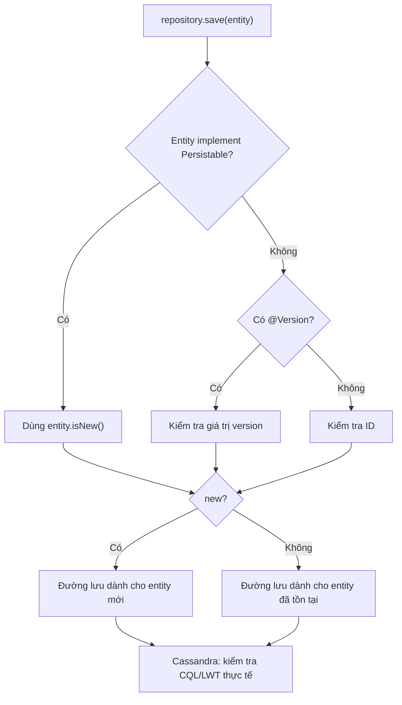
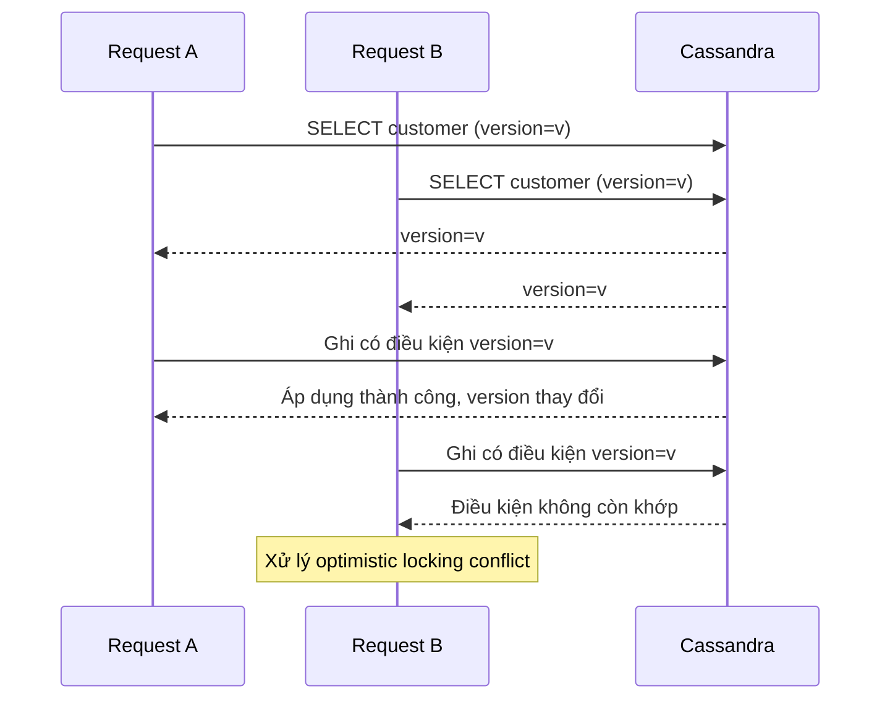
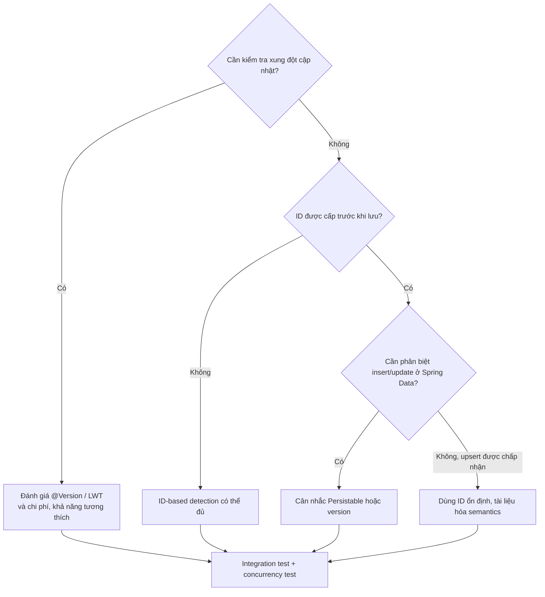

# Nhận biết entity mới bằng khóa, @Version hoặc Persistable

## 1. Vì sao repository phải biết entity là “mới” hay “đã tồn tại”?

Trong **Spring Data Cassandra**, một lời gọi `repository.save(entity)` nhìn bề ngoài chỉ là thao tác lưu đối tượng Java. Nhưng trước khi chọn cách thực hiện ghi, hạ tầng persistence cần xác định entity đang được coi là **mới (new)** hay **đã tồn tại (not new)** theo quy tắc của Spring Data. Quyết định này có thể ảnh hưởng đường `insert`/`update`, cách xử lý version và hành vi khi có nhiều request đồng thời.

Điểm đặc biệt: **trạng thái “mới” mà Spring Data suy ra không đồng nhất với việc hàng chắc chắn chưa tồn tại trên Cassandra**.

Cassandra là cơ sở dữ liệu phân tán được thiết kế theo truy vấn, sử dụng primary key gồm partition key và có thể thêm clustering columns. Một `INSERT` CQL thông thường có ngữ nghĩa **upsert**: nếu hàng với cùng primary key đã tồn tại, các giá trị được ghi sẽ tham gia cập nhật theo quy tắc timestamp/last-write-wins và ngữ nghĩa của từng cột. Vì vậy, không thể suy luận:

- “Spring Data nhận định entity mới” ⇒ hàng chắc chắn chưa có.
- “Spring Data nhận định entity cũ” ⇒ hàng chắc chắn đang có.
- “Repository `save` thành công” ⇒ mọi thao tác khác trên bảng đã được khóa độc quyền hoặc trở thành transaction ACID toàn cục.
- “Khóa chính có UUID ngẫu nhiên” ⇒ loại bỏ được mọi rủi ro trùng ID hoặc retry tạo bản ghi lặp.

Bài này thuộc chương **Repository** của module `SPRING_DATA_CASSANDRA`. Chúng ta sẽ tìm hiểu ba cơ chế nhận biết entity mới: **khóa định danh**, **`@Version`**, và **`Persistable.isNew()`**; sau đó liên hệ đến entity mapping, repository, `CassandraTemplate`, truy vấn CQL, consistency level (CL), retry và xử lý đồng thời.

### Kết quả cần đạt

Sau bài học, bạn có thể:

1. Giải thích quy tắc newness trong Spring Data và thứ tự ưu tiên của các chiến lược.
2. Xác định hệ quả của một `UUID` đã được cấp trước khi `save`.
3. Dùng `@Version` khi cần optimistic locking trên các thao tác được hỗ trợ.
4. Dùng `Persistable` khi trạng thái “mới” phụ thuộc vòng đời nghiệp vụ, không thể suy ra chỉ từ ID.
5. Nhận diện sự khác nhau giữa **phân nhánh insert/update** và **bảo đảm tạo duy nhất bằng điều kiện CQL/LWT**.
6. Thiết kế kiểm thử cho trạng thái mới, ghi đồng thời, retry, entity vừa nạp và bản ghi đã tồn tại.

> Các ví dụ minh họa Spring Data Cassandra hiện đại dùng Java Driver 4.x, thường gặp trong hệ Spring Data Cassandra 4.x/Spring Boot 3.x. Chữ ký API, cơ chế callback và chi tiết câu lệnh phát sinh cần được xác nhận bằng integration test trên đúng phiên bản của dự án. Bài tập tập trung giải thích hành vi, không thay cho vòng QA chuyên môn hoặc kiểm thử production.

## 2. Chuẩn bị bảng mẫu và hiểu primary key

Giả sử ứng dụng quản lý hồ sơ khách hàng và muốn lưu tên hiển thị theo `customer_id`. Trên một môi trường học tập có một node tại DC `dc1`, có thể tạo:

```sql
-- Ví dụ một node: RF=1 chỉ phục vụ lab.
CREATE KEYSPACE IF NOT EXISTS learning
WITH replication = {
  'class': 'NetworkTopologyStrategy',
  'dc1': 1
};

CREATE TABLE IF NOT EXISTS learning.customer_by_id (
  customer_id uuid PRIMARY KEY,
  display_name text,
  version bigint
);
```

Bảng dùng `customer_id` làm **partition key** và cũng là toàn bộ primary key; truy vấn theo ID đi thẳng tới partition tương ứng. Cột `version` để dùng trong ví dụ `@Version`; nó là **cột dữ liệu phục vụ kiểm soát phiên bản**, không phải thành phần primary key.

Có thể thêm dữ liệu bằng CQL:

```sql
INSERT INTO learning.customer_by_id
    (customer_id, display_name)
VALUES (
    11111111-1111-1111-1111-111111111111,
    'Khách hàng A'
);

SELECT customer_id, display_name, version
FROM learning.customer_by_id
WHERE customer_id = 11111111-1111-1111-1111-111111111111;
```

Do lệnh INSERT mẫu không ghi `version`, giá trị cột này có thể là `null`. Đây là **dữ liệu minh họa CQL**, không phải hàng được tạo qua cơ chế quản lý `@Version` của Spring Data. Nếu một hàng có `version=null` nhưng được ánh xạ sang entity có `@Version`, cần đặc biệt thận trọng: Spring Data có thể coi entity là mới, làm thay đổi đường ghi dự kiến. Vì vậy, khi đưa `@Version` vào bảng đã có dữ liệu, cần một kế hoạch migration/kiểm thử, không chỉ thêm annotation Java.

Để tập trung vào sự khác biệt giữa ba chiến lược, các đoạn mã tiếp theo dùng cùng cấu trúc bảng nhưng trình bày **các entity mapping thay thế**. Không khai báo đồng thời cả ba thành cùng một repository trong ví dụ ứng dụng thực mà chưa kiểm soát rõ loại entity, converter và hành vi persistence.

## 3. Bức tranh tổng quát về nhận biết trạng thái mới

Spring Data Commons cung cấp cơ chế nhận biết newness cho entity. Với entity phù hợp và cấu hình mặc định, thứ tự thường áp dụng là:

1. **Entity triển khai `Persistable`:** dùng giá trị `isNew()` do entity trả về.
2. **Entity không dùng `Persistable` nhưng có `@Version`:** dùng giá trị của thuộc tính version để suy ra newness.
3. **Không có hai cơ chế trên:** kiểm tra **ID**; thường `null` nghĩa là mới, có ID nghĩa là không mới.

Chi tiết cách xử lý version primitive/non-primitive hoặc các quy ước ID đặc thù phụ thuộc Spring Data Commons trong phiên bản dùng thực tế. Nguyên tắc quan trọng là: **không thể chỉ nhìn ID để kết luận newness nếu entity có `@Version` hoặc `Persistable`**.



### Ma trận nhanh

| Trạng thái Java | Kết quả thường được suy ra | Giải thích |
| --- | --- | --- |
| Không `@Version`, không `Persistable`, ID `null` | **New** | Spring Data chưa thấy định danh. |
| Không `@Version`, không `Persistable`, ID khác `null` | **Not new** | Có định danh, nhưng không chứng minh hàng đang tồn tại. |
| Có `@Version Long` và version `null` | **New** | Version dạng wrapper chưa được thiết lập; ID có thể đã có giá trị. |
| Có `@Version Long` và version khác `null` | **Not new** | Đã có thông tin version. |
| Có `@Version long` nguyên thủy, version bằng `0` | Thường **new** | Quy ước primitive version dùng giá trị 0 để biểu thị chưa được gán. |
| Entity `Persistable`, `isNew() == true` | **New** | Entity chủ động công bố trạng thái. |
| Entity `Persistable`, `isNew() == false` | **Not new** | Entity chủ động công bố trạng thái, dù ID có thể khác `null`. |

**“Not new” không có nghĩa là hàng đang tồn tại trong cluster.** Ví dụ, một ID vừa được ứng dụng tạo bằng `UUID.randomUUID()` là giá trị hợp lệ nhưng chưa có CQL INSERT nào tương ứng. Đó chính là tình huống phải cân nhắc chọn chiến lược newness.

## 4. Chiến lược mặc định dựa trên ID

### 4.1. Entity với một khóa UUID

Nếu chưa dùng version, ta có thể biểu diễn bảng bằng entity sau:

```java
package com.example.customer.domain;

import java.util.UUID;
import org.springframework.data.cassandra.core.mapping.Column;
import org.springframework.data.cassandra.core.mapping.PrimaryKey;
import org.springframework.data.cassandra.core.mapping.Table;

@Table("customer_by_id")
public class CustomerBasic {

    @PrimaryKey("customer_id")
    private UUID id;

    @Column("display_name")
    private String displayName;

    public CustomerBasic() {
    }

    public CustomerBasic(UUID id, String displayName) {
        this.id = id;
        this.displayName = displayName;
    }

    public UUID getId() {
        return id;
    }

    public String getDisplayName() {
        return displayName;
    }

    public void setDisplayName(String displayName) {
        this.displayName = displayName;
    }
}
```

Repository:

```java
package com.example.customer.repository;

import java.util.UUID;
import org.springframework.data.cassandra.repository.CassandraRepository;
import com.example.customer.domain.CustomerBasic;

public interface CustomerBasicRepository
        extends CassandraRepository<CustomerBasic, UUID> {
}
```

Nếu tạo entity như sau:

```java
CustomerBasic customer = new CustomerBasic(
    UUID.randomUUID(), "Lan"
);

CustomerBasic saved = repository.save(customer);
```

`customer.getId()` đã có giá trị ngay trước khi gọi `save`. Nếu không có `@Version` và không triển khai `Persistable`, hạ tầng Spring Data có thể suy ra **not new** dù về mặt nghiệp vụ đây là lần lưu đầu tiên.

**Điều này không nhất thiết làm thao tác thất bại trong Cassandra:** một ghi không điều kiện trên primary key có thể tạo hàng mới theo ngữ nghĩa upsert. Tuy nhiên, không nên dựa vào hiện tượng đó để khẳng định Spring Data đã chọn đúng “insert” về ý nghĩa lifecycle, hoặc để xây dựng logic chỉ được tạo một lần.

### 4.2. Vì sao không dùng ID=null để ép “new” cho khóa bắt buộc?

Cassandra không giống một bảng quan hệ có cột ID tự tăng do server cấp mặc định. Với ví dụ `uuid PRIMARY KEY`, ứng dụng hoặc một cơ chế tạo ID được cấu hình rõ ràng phải cung cấp UUID hợp lệ khi ghi.

Nếu để `id=null` chỉ để `isNew` trả true, thao tác insert có thể thất bại vì primary key thiếu giá trị. Một bộ sinh ID tự động chỉ là giải pháp khi đã biết chính xác cách và thời điểm Spring Data Cassandra/ứng dụng sinh khóa.

**Cách làm tốt hơn:** tạo ID ổn định ở tầng nghiệp vụ, sau đó chọn chiến lược newness phù hợp (`@Version` hoặc `Persistable` nếu thật sự cần phân biệt new/existing). Không coi việc có ID là bằng chứng hàng đã tồn tại.

### 4.3. Composite primary key cũng có vấn đề tương tự

Ví dụ primary key gồm `((tenant_id, bucket_yyyymm), occurred_at, event_id)`. Khi Java đã tạo đủ các thành phần khóa để ghi một sự kiện mới, composite ID **không còn null**. Từ quan điểm mặc định dựa trên ID, entity có thể bị coi là **not new**.

Vì thế, chiến lược nhận biết newness phải được xem xét cùng entity mapping của `@PrimaryKeyClass`/`@PrimaryKeyColumn` và không nên bị lẫn với việc Cassandra **định tuyến theo partition key**. Một ID đầy đủ giúp xác định đúng hàng; nó không chứng minh hàng đã được lưu.

## 5. Chiến lược `@Version`: newness và optimistic locking

### 5.1. Lựa chọn khi nào?

`@Version` là annotation của **Spring Data** (`org.springframework.data.annotation.Version`), được dùng để lưu thông tin phiên bản cho entity. Một thuộc tính version được quản lý phù hợp giúp:

- Phân biệt entity **chưa có version** với entity được đọc/saved với version đã gán.
- Phát hiện một số tình huống hai luồng cùng đọc một phiên bản rồi đồng thời ghi thay đổi.
- Biểu diễn **optimistic locking** cho các thao tác được Spring Data Cassandra và phiên bản đang dùng hỗ trợ, thay vì khóa pessimistic kéo dài.

Cassandra thực hiện kiểm soát ghi có điều kiện bằng **lightweight transactions (LWT)**, không phải transaction lock kiểu RDBMS. Với những API/version có hỗ trợ optimistic locking qua `@Version`, thao tác tạo/cập nhật có thể phát sinh điều kiện CQL và thất bại khi điều kiện version không còn khớp.

> `@Version` không biến mọi câu `INSERT` hoặc mọi lệnh CQL chạy trực tiếp bằng `CqlSession` thành thao tác optimistic locking. Bảo đảm này phụ thuộc **đường ghi thực tế** và phiên bản Spring Data/driver. Khi cần hành vi điều kiện như `IF NOT EXISTS`, hãy kiểm chứng bằng test truy cập Cassandra thật; đừng suy luận chỉ từ annotation.

### 5.2. Entity có version dạng wrapper

```java
package com.example.customer.domain;

import java.util.UUID;

import org.springframework.data.annotation.Version;
import org.springframework.data.cassandra.core.mapping.Column;
import org.springframework.data.cassandra.core.mapping.PrimaryKey;
import org.springframework.data.cassandra.core.mapping.Table;

@Table("customer_by_id")
public class CustomerVersioned {

    @PrimaryKey("customer_id")
    private UUID id;

    @Column("display_name")
    private String displayName;

    @Version
    private Long version;

    protected CustomerVersioned() {
    }

    public CustomerVersioned(UUID id, String displayName) {
        this.id = id;
        this.displayName = displayName;
    }

    public UUID getId() {
        return id;
    }

    public String getDisplayName() {
        return displayName;
    }

    public Long getVersion() {
        return version;
    }

    public void rename(String name) {
        this.displayName = name;
    }
}
```

Cột `version bigint` đã có trong bảng CQL phần 2. Khi tạo:

```java
CustomerVersioned candidate = new CustomerVersioned(
    UUID.randomUUID(), "Bình"
);

// candidate.getId() != null, nhưng candidate.getVersion() == null.
CustomerVersioned stored = versionedRepository.save(candidate);
```

Với `@Version Long`, Spring Data có thể coi `version == null` là **new** dù ID đã được cấp. Sau khi ghi qua đường API có hỗ trợ version, trạng thái version được quản lý theo cơ chế của Spring Data; không tự đặt số version ban đầu hay tăng thủ công nếu framework đang sở hữu cột này.

Khi nạp lại:

```java
CustomerVersioned current = versionedRepository
    .findById(stored.getId())
    .orElseThrow();

current.rename("Bình đã cập nhật");
CustomerVersioned updated = versionedRepository.save(current);
```

Các thao tác `save` của repository ở đây là ví dụ về **vòng đời managed-by-Spring-Data**, không phải lời hứa rằng bất kỳ ghi CQL khác vào bảng đều tham gia cùng cơ chế version.

### 5.3. Vì sao nên ưu tiên Long thay vì long trong ví dụ?

Với `Long`, `null` biểu diễn **chưa có version** rõ ràng. Với `long` nguyên thủy, giá trị mặc định là `0`; một số quy tắc newness coi `0` là mới. Điều đó cần được cân nhắc khi dữ liệu cũ có version bằng 0 hoặc khi Java cấp giá trị mặc định không đúng ý nghĩa nghiệp vụ.

| Kiểu field | Trạng thái lúc tạo entity | Cách phân biệt ban đầu |
| --- | --- | --- |
| `Long version` | `null` | Chưa thiết lập version; dễ phân biệt với giá trị số thực. |
| `long version` | `0` | Dựa vào quy ước 0 là chưa có; phải hiểu đặc tả Spring Data của phiên bản đang dùng. |

**Không dùng version như timestamp nghiệp vụ.** `@Version` phục vụ optimistic locking/newness, còn `created_at`/`updated_at` hoặc event time phải có cột độc lập và chính sách timestamp rõ ràng.

### 5.4. Hai người cùng cập nhật một hàng

Giả sử hai request cùng đọc customer với version `v`:



Đây là mô hình lý giải optimistic locking, **không phải trace CQL chính xác cho mọi phiên bản driver**. Khi nhận exception đồng thời, ứng dụng nên quyết định theo nghiệp vụ: thông báo xung đột, đọc lại và yêu cầu người dùng xác nhận, hoặc thử lại có giới hạn nếu thao tác an toàn.

Ví dụ xử lý tại service:

```java
import org.springframework.dao.OptimisticLockingFailureException;

try {
    versionedRepository.save(current);
} catch (OptimisticLockingFailureException conflict) {
    // Trả thông báo xung đột hoặc đọc lại trạng thái hiện tại.
    // Không tự động ghi đè không điều kiện.
    throw conflict;
}
```

Chi phí: LWT thường cần nhiều lượt phối hợp giữa replica hơn ghi thông thường, nên **latency và khả năng chịu tải** có thể khác biệt đáng kể. Không bật optimistic locking một cách máy móc cho mọi bản ghi có tần suất ghi rất cao.

### 5.5. Trường hợp version null trên dữ liệu cũ

Nếu bảng đã có hàng tạo trước khi code dùng `@Version`, cột `version` có thể là `null`. Khi repository đọc một hàng có ID rõ ràng nhưng version trống, logic state detection có thể coi entity là **new**, gây đường ghi không giống kỳ vọng hoặc làm thao tác điều kiện thất bại.

Cần:

1. Kiểm kê các hàng cũ và cách chúng được ghi.
2. Xác định việc bổ sung version có hỗ trợ an toàn với phiên bản Spring Data đang chạy.
3. Thiết kế migration/backfill version với quy trình và kiểm thử riêng; tránh `UPDATE` đại trà không giới hạn.
4. Triển khai từng bước để writer cũ và writer mới không phá vỡ giả định version của nhau.
5. Kiểm tra thao tác tạo, cập nhật, concurrent write và dữ liệu legacy sau rollout.

**Không chỉ thêm field `@Version` rồi giả định optimistic locking đã hoạt động trên toàn bộ dữ liệu cũ.**

## 6. Chiến lược `Persistable`: entity tự quyết định trạng thái mới

### 6.1. Khi nào nên dùng?

Giao diện `org.springframework.data.domain.Persistable<ID>` gồm hai ý tưởng quan trọng:

- `getId()`: trả về ID của entity.
- `isNew()`: tự xác định entity có đang được coi là mới hay không.

`Persistable` hữu ích khi:

- Ứng dụng **cấp ID trước** khi tạo hàng; do đó `id != null` không phản ánh đã lưu hay chưa.
- Không thể hoặc không muốn dựa vào một cột `@Version`.
- Quy trình tạo/nạp entity có khái niệm lifecycle rõ ràng và cần điều khiển chính xác newness cho các đường repository.

Nhưng giao diện này đặt ra trách nhiệm mới: **`isNew()` phải đúng cả với entity mới tạo, entity đã lưu thành công và entity được đọc từ Cassandra**. Một cờ `isNew=true` được khởi tạo mặc định cho mọi object có thể khiến entity đọc từ database vẫn bị coi là mới khi gọi `save` tiếp.

### 6.2. Một cách triển khai với cờ @Transient

Ví dụ dùng bảng riêng theo khóa tenant:

```sql
CREATE TABLE IF NOT EXISTS learning.tenant_preferences_by_id (
    tenant_id uuid PRIMARY KEY,
    theme text
);
```

Entity:

```java
package com.example.customer.domain;

import java.util.UUID;

import org.springframework.data.annotation.Transient;
import org.springframework.data.cassandra.core.mapping.PrimaryKey;
import org.springframework.data.cassandra.core.mapping.Table;
import org.springframework.data.domain.Persistable;

@Table("tenant_preferences_by_id")
public class TenantPreferences implements Persistable<UUID> {

    @PrimaryKey("tenant_id")
    private UUID tenantId;

    private String theme;

    // Không lưu cờ lifecycle vào bảng Cassandra.
    @Transient
    private boolean newEntity;

    // Đường mapping đối tượng đã được nạp: mặc định NOT NEW.
    protected TenantPreferences() {
        this.newEntity = false;
    }

    private TenantPreferences(UUID tenantId, String theme) {
        this.tenantId = tenantId;
        this.theme = theme;
        this.newEntity = true;
    }

    public static TenantPreferences create(UUID tenantId, String theme) {
        return new TenantPreferences(tenantId, theme);
    }

    @Override
    public UUID getId() {
        return tenantId;
    }

    @Override
    public boolean isNew() {
        return newEntity;
    }

    public void markPersisted() {
        this.newEntity = false;
    }

    public String getTheme() {
        return theme;
    }

    public void setTheme(String theme) {
        this.theme = theme;
    }
}
```

Ý tưởng của ví dụ:

- Factory `create` cấp ID **khác null** và đánh dấu `newEntity=true`.
- Constructor rỗng được dành cho quá trình materialization; cờ mặc định `false` cho đối tượng **được nạp từ DB** nếu framework sử dụng constructor này.
- `@Transient` đánh dấu cờ là trạng thái ứng dụng, **không phải cột CQL**.
- `getId()` trả đúng khóa `tenant_id`; `isNew()` không đọc state từ database mà dựa vào vòng đời object.

**Điểm cần kiểm tra khi áp dụng thực tế:** Hành vi constructor/property access, callback và materialization phụ thuộc cấu hình mapping. Nếu bạn chuyển sang constructor binding, immutable entity hoặc dùng Lombok/record, hãy kiểm thử rằng object tải từ Cassandra có `isNew()==false`; có thể cần callback hoặc factory nạp riêng. Đừng chỉ test factory tạo mới rồi kết luận tất cả đường đọc đều đúng.

Repository:

```java
package com.example.customer.repository;

import java.util.UUID;
import org.springframework.data.cassandra.repository.CassandraRepository;
import com.example.customer.domain.TenantPreferences;

public interface TenantPreferencesRepository
        extends CassandraRepository<TenantPreferences, UUID> {
}
```

Service xử lý cờ sau khi ghi **thành công**:

```java
import java.util.UUID;

public TenantPreferences createPreferences(
        UUID tenantId, String initialTheme) {

    TenantPreferences candidate =
        TenantPreferences.create(tenantId, initialTheme);

    TenantPreferences saved = preferencesRepository.save(candidate);
    saved.markPersisted();
    return saved;
}
```

Không đánh dấu `markPersisted()` trước khi `save` thành công. Nếu `save` ném exception hoặc timeout, **trạng thái của ghi có thể không xác định** đối với client Cassandra; không tự suy luận “không ghi gì” để retry vô hạn. Cờ trong RAM chỉ điều khiển **đường thao tác tại tầng Spring Data**, không phản ánh chính xác trạng thái của mọi replica sau sự cố mạng.

Lưu ý thêm: repository có thể trả về một instance khác instance được truyền vào, đặc biệt với immutable mapping. Vì vậy code dùng **object `saved` được trả về** khi chuyển cờ; điều này vẫn cần integration test phù hợp với entity cụ thể.

### 6.3. Vì sao không gắn cờ isNew vào bảng?

Nếu persist cờ `newEntity` như một cột của Cassandra, một instance khác nạp cùng hàng có thể thấy giá trị cũ do cách cập nhật cờ hoặc consistency, rồi hiểu sai lifecycle. Newness là quyết định về **trạng thái của entity trong ứng dụng**, không phải thuộc tính nghiệp vụ cần truy vấn.

Cần phân biệt:

- `isNew=true`: service muốn xử lý đối tượng như một entity chưa lưu trong vòng đời hiện tại.
- `INSERT IF NOT EXISTS`: Cassandra kiểm tra **điều kiện hàng chưa tồn tại** và trả kết quả có áp dụng hay không.
- `@Version`: một cơ chế kiểm tra optimistic locking/version trên đường persistence được hỗ trợ.

**`Persistable.isNew()` tự thân không tạo ra conditional insert hoặc ràng buộc unique.** Nếu yêu cầu “chỉ một bản ghi được tạo cho mỗi ID” ngay cả dưới concurrency, phải thiết kế ghi có điều kiện/LWT và xử lý xung đột rõ ràng.

## 7. So sánh ba chiến lược và thứ tự ưu tiên

| Tiêu chí | ID mặc định | `@Version` | `Persistable` |
| --- | --- | --- | --- |
| Dấu hiệu newness | `id == null` là tín hiệu chính | Version chưa có (wrapper `null`, primitive theo quy ước) | Giá trị `isNew()` do entity cung cấp |
| Hợp với ID cấp trước | Dễ bị coi là “not new” | Hợp nếu quản lý version | Hợp nếu quản lý lifecycle đúng |
| Cần field dữ liệu bổ sung | Không | Có cột version | Không bắt buộc; cờ có thể `@Transient` |
| Bảo vệ optimistic locking | Không, chỉ riêng ID không đủ | Có thể hỗ trợ trên đường Spring Data Cassandra phù hợp | Không tự cung cấp |
| Rủi ro chính | Có ID nhưng hàng chưa tồn tại | Legacy row null version, concurrent update, chi phí LWT | Cờ sai trên entity tải từ DB, retry, callback/materialization |
| Khi dùng | CRUD đơn giản, ID semantics rõ và upsert có thể chấp nhận | Thay đổi cần phát hiện cạnh tranh ghi | ID có sẵn nhưng không dùng version và cần chủ động newness |

**Thứ tự ưu tiên trong quyết định newness là điều cần nhớ:** entity triển khai `Persistable` sẽ dùng `isNew()` thay vì chỉ suy ra từ ID. Đừng kết hợp `Persistable` và `@Version` mà không kiểm tra cụ thể cách phiên bản framework quyết định `isNew` và quản lý version; có thể có hai cơ chế cùng tác động đến persistence nhưng với vai trò khác nhau.

Một quy tắc lựa chọn thực tế:



## 8. Cassandra INSERT/UPDATE, upsert và LWT: phân biệt đúng

### 8.1. “New” trong Spring Data không phải “chưa tồn tại” ở Cassandra

Với cùng một primary key:

```sql
INSERT INTO learning.customer_by_id
    (customer_id, display_name)
VALUES (
    11111111-1111-1111-1111-111111111111,
    'Lan'
);

-- Ghi thông thường vào cùng ID.
INSERT INTO learning.customer_by_id
    (customer_id, display_name)
VALUES (
    11111111-1111-1111-1111-111111111111,
    'Lan đã đổi tên'
);
```

Đây là thao tác **ghi không điều kiện**; câu INSERT thứ hai không mặc định báo “duplicate key” như nhiều hệ quản trị quan hệ. Các cập nhật được hòa giải theo timestamp và quy tắc của Cassandra. Với ghi đồng thời, không nên mô tả đơn giản rằng “lệnh đến sau luôn thắng”: thời điểm CQL và timestamp của từng ô dữ liệu mới là yếu tố quyết định.

Tương tự, `UPDATE` CQL có thể tạo giá trị/hàng theo primary key chưa tồn tại trong các trường hợp ghi thông thường. Vì thế, khác biệt insert/update ở tầng Spring Data **không thay thế** một yêu cầu tạo duy nhất mang tính nghiệp vụ.

### 8.2. Khi yêu cầu phải tạo duy nhất: INSERT IF NOT EXISTS

Nếu khách hàng chỉ được phép tạo một bản ghi cấu hình theo `tenant_id`, CQL hỗ trợ ghi điều kiện:

```sql
INSERT INTO learning.tenant_preferences_by_id (
    tenant_id, theme
) VALUES (
    11111111-1111-1111-1111-111111111111,
    'dark'
) IF NOT EXISTS;
```

Cassandra đánh giá điều kiện theo **LWT** và trả kết quả có áp dụng hay không (thường có trường `[applied]`). Cần kiểm tra response để phân biệt “đã tạo mới” với “hàng đã tồn tại”; không chỉ dựa trên việc câu CQL không ném exception.

Ví dụ Java Driver 4.x:

```java
import java.util.UUID;

import com.datastax.oss.driver.api.core.CqlSession;
import com.datastax.oss.driver.api.core.cql.PreparedStatement;
import com.datastax.oss.driver.api.core.cql.Row;

public class PreferenceCreateOnlyService {

    private final CqlSession session;
    private final PreparedStatement insertOnce;

    public PreferenceCreateOnlyService(CqlSession session) {
        this.session = session;
        this.insertOnce = session.prepare(
            "INSERT INTO learning.tenant_preferences_by_id " +
            "(tenant_id, theme) VALUES (?, ?) IF NOT EXISTS"
        );
    }

    public boolean createIfAbsent(UUID tenantId, String theme) {
        Row row = session.execute(
            insertOnce.bind(tenantId, theme)
        ).one();

        return row != null && row.getBoolean("[applied]");
    }
}
```

Đây là một **đường CQL điều kiện rõ ràng**. Nó không phải chức năng tự động của `Persistable.isNew()`. LWT giúp đạt semantics điều kiện trên phạm vi dữ liệu mà Cassandra hỗ trợ, nhưng có latency cao hơn ghi bình thường, cần chính sách timeout/retry và thiết kế phân tán phù hợp.

### 8.3. UPDATE IF version = ...

Nếu muốn cập nhật có kiểm tra giá trị version, CQL minh họa:

```sql
UPDATE learning.customer_by_id
SET display_name = 'Tên mới', version = 2
WHERE customer_id = 11111111-1111-1111-1111-111111111111
IF version = 1;
```

Hai câu `INSERT IF NOT EXISTS` và `UPDATE ... IF` đều minh họa logic điều kiện. Khi sử dụng `@Version` qua repository, không nên viết thêm một cơ chế tự tăng version thủ công song song mà không có thiết kế rõ: điều đó dễ làm hai đường ghi xung đột hoặc bỏ qua bảo vệ optimistic locking của nhau.

**CQL LWT không tạo transaction nhiều bảng kiểu RDBMS.** Các API/đường ghi dùng điều kiện phải được hiểu theo khóa/partition và semantics của Cassandra, không áp dụng suy luận transaction liên bảng.

## 9. Dùng repository và CassandraTemplate nhất quán

Spring Data Cassandra cung cấp nhiều cách truy cập cùng cluster:

```text
Service / Controller
  |
  +-- CassandraRepository<T, ID>  -> CRUD, save, findById
  |
  +-- CassandraTemplate           -> insert/update/select, mapping linh hoạt
  |
  +-- CqlSession / Java Driver    -> CQL, prepared statement, LWT, paging
  |
  v
Coordinator Cassandra -> Replica theo partition key và CL
```

**Repository** có thể sử dụng entity state detection để chọn đường lưu thích hợp. **CassandraTemplate** có các API explicit như `insert` hoặc `update` cho trường hợp muốn chủ động chỉ ra thao tác. **`CqlSession`** gửi statement CQL và không tự xem `Persistable.isNew()` của một đối tượng entity Java để quyết định; đó là trách nhiệm của code gọi driver.

| Mục tiêu | Cách tiếp cận phù hợp | Lưu ý |
| --- | --- | --- |
| CRUD đơn giản với ID ổn định | Repository `save/findById` | Phân biệt newness với upsert; test schema và state detection. |
| Tối ưu tương tranh ghi | `@Version` ở đường Spring Data được hỗ trợ hoặc LWT rõ ràng | Kiểm tra conflict, latency và giá trị version thực tế. |
| Tự chọn insert hay update | `CassandraTemplate` | Đọc hợp đồng của API/phiên bản, không coi insert/update thông thường là unique constraint. |
| Bắt buộc chỉ tạo khi chưa có | Prepared CQL `INSERT ... IF NOT EXISTS` hoặc API có điều kiện tương đương | Xử lý kết quả `[applied]`; timeout có thể để lại trạng thái không chắc chắn. |
| Truy vấn danh sách | Repository query hoặc template với `WHERE` theo partition key | Không dùng `findById` để quét partition, cần paging/`LIMIT`. |

**Quy tắc thiết kế:** Khi một bảng được thao tác vừa bằng repository có `@Version` vừa bằng các CQL update trực tiếp bỏ qua version, các đường ghi **không còn cùng mức bảo vệ tương tranh**. Hãy quản lý thống nhất đường ghi hoặc đặt chính sách cho từng thao tác.

## 10. Vòng đời entity, retry và tình huống dễ sai

### 10.1. Entity mới được cấp UUID trước khi lưu

`UUID.randomUUID()` tạo một định danh có thể dùng làm partition key. Không có cơ sở để khẳng định hàng đã tồn tại chỉ vì ID khác null.

- Nếu chỉ cần lưu/upsert theo định danh, có thể chấp nhận hành vi ghi thông thường, miễn đã thiết kế idempotency và đảm bảo tên bảng/partition key đúng.
- Nếu nghiệp vụ cần “chỉ tạo một lần”, dùng cơ chế ghi có điều kiện/LWT với kết quả được kiểm tra.
- Nếu cần phát hiện lost update giữa hai luồng, đánh giá `@Version` hoặc CAS phù hợp.

### 10.2. Entity vừa tải lên có cờ isNew sai

Giả sử factory tạo mới gán `newEntity=true` và object do mapper load từ Cassandra cũng gọi cùng factory. Kết quả: một hàng đã có trong DB lại bị xử lý như entity mới khi service gọi `save`.

Giải pháp: phân biệt đường **create** và đường **load**, dùng constructor/callback phù hợp và integration test cho `isNew()` sau `findById`. Với ví dụ `TenantPreferences` ở phần 6, constructor rỗng mặc định cờ `false`; nếu thay đổi cách materialize phải kiểm tra lại.

### 10.3. Request timeout ở thời điểm ghi

`WriteTimeout` có thể xảy ra sau khi một hoặc nhiều replica đã áp dụng mutation, mặc dù client chưa nhận đủ phản hồi theo CL. Với ghi condition/LWT, kết quả có thể cần được làm rõ bằng đọc lại và chính sách retry theo loại statement.

Không làm:

```text
try save -> timeout -> cấp UUID mới -> save lại -> mặc định chắc chắn an toàn
```

Làm tốt hơn:

- Giữ một **idempotency key/ID nghiệp vụ ổn định** cho một yêu cầu tạo bản ghi.
- Định nghĩa rõ endpoint được phép retry trong trường hợp nào và tối đa bao nhiêu lần.
- Khi trạng thái chưa chắc chắn, dùng readback hoặc một cơ chế đối soát theo hợp đồng nghiệp vụ.
- Theo dõi request ID, lỗi, CL, partition key đã được ẩn hoặc băm ở log nếu nhạy cảm.
- Không dùng retry làm thay thế cho thiết kế conditional write hoặc optimistic locking.

### 10.4. Thay đổi primary key khi đang cập nhật

Ở Cassandra, nếu service đổi `customer_id` hoặc một phần composite primary key rồi `save`, thao tác thường nhắm tới **hàng/partition khác** thay vì cập nhật cùng một định danh. Newness dựa trên ID không giải quyết điều này. Muốn chuyển khóa, cần quy trình tạo bản ghi mới, xử lý bản cũ và đối soát dữ liệu.

### 10.5. Đọc/ghi theo nhiều partition

`saveAll` không ngầm đảm bảo transaction ACID xuyên nhiều partition. Một số hàng có thể ghi thành công trước khi thao tác khác lỗi. Nếu nghiệp vụ cần tính đúng đắn liên bảng/liên partition, thiết kế idempotency, process trạng thái, event-driven reconciliation hoặc giới hạn thao tác theo partition có quy tắc rõ ràng.

## 11. Hiệu năng và đặc tính phân tán không phụ thuộc newness

`isNew()` là một quyết định trong **mapping/repository layer**; nó không thay đổi các yếu tố nền tảng của Cassandra:

| Chủ đề | Cần thiết kế độc lập với state detection |
| --- | --- |
| **Partition key** | Chọn theo query pattern, phân bố tải và kích thước partition; không dùng UUID/random ID như giải pháp chung cho mọi truy vấn. |
| **Replication factor** | RF phụ thuộc cấu hình keyspace/DC; một giá trị `isNew()` không điều khiển số replica. |
| **Consistency level** | `ONE`/`LOCAL_QUORUM`/`ALL` xác định số phản hồi, không chứng minh hàng có tồn tại. |
| **Paging** | Truy vấn danh sách cần fetch page size/paging state và giới hạn dữ liệu; tìm một hàng theo ID không thay thế query danh sách. |
| **Optimistic locking / LWT** | Kiểm tra điều kiện có giá latency và coordination; nên đo p95/p99 và tần suất conflict. |
| **Tombstones** | Delete/TTL có thể tạo tombstone; retry và cập nhật thường xuyên cần quan sát hiệu năng đọc. |
| **Timeout/retry** | Phải xem trạng thái mutation có thể không chắc chắn, idempotency và chính sách retry. |
| **Schema migration** | Bổ sung `@Version` hoặc thay đổi primary key đòi hỏi đánh giá dữ liệu đã tồn tại, không chỉ sửa entity Java. |

Một chiến lược state detection đúng giúp code Spring Data lựa chọn đường thao tác có chủ đích, nhưng **không chữa được** query thiếu partition key, bảng có partition quá lớn hoặc CL không khớp mục tiêu nghiệp vụ.

## 12. Ma trận kiểm thử cần có

Bộ kiểm thử nên bao gồm **unit test suy luận trạng thái** và **integration test với Cassandra thật**. Unit test không thể chứng minh CQL phát sinh hay hành vi LWT trên cluster.

| Ca kiểm thử | Đầu vào / thao tác | Kết quả mong đợi |
| --- | --- | --- |
| ID-based, ID null | Entity không `@Version`/`Persistable` với `id=null` | Spring Data coi entity mới; lưu thực tế cần ID hợp lệ trước khi ghi. |
| ID-based, UUID cấp trước | Entity không `@Version`/`Persistable` với UUID mới tạo | Có thể bị coi là không mới; kiểm tra ghi thực tế theo repository. |
| Version wrapper null | `@Version Long version=null`, ID khác null | Entity được coi là mới theo version strategy. |
| Version wrapper non-null | Entity nạp có version hợp lệ | Entity được coi là không mới. |
| Primitive version 0 | `@Version long version=0` | Kiểm tra quy ước của framework, thông thường coi là mới. |
| Persistable new | Factory `create(...)` trả `isNew()==true` | Repository đi đường được chọn cho entity mới. |
| Persistable loaded | `findById` nạp entity, `isNew()==false` | Không lặp lại đường insert vì materialization sai. |
| Persistable after save | `save` thành công, cờ chuyển false | Tái sử dụng entity trong request tiếp theo không bị phân loại sai. |
| Insert cùng key lần hai | Hai lệnh CQL INSERT không điều kiện | Không chờ duplicate-key exception theo kiểu RDBMS; quan sát upsert. |
| Conditional insert | Hai request `INSERT IF NOT EXISTS` cùng ID | Kiểm tra kết quả `[applied]`; chỉ một yêu cầu thỏa điều kiện tạo. |
| Optimistic conflict | Hai request đọc cùng version rồi cập nhật cạnh tranh | Một yêu cầu có thể bị từ chối khi version không còn khớp; kiểm tra exception/response. |
| Legacy row version null | Hàng CQL đã có, version trống | Phát hiện rủi ro phân loại new và kế hoạch migration. |
| Timeout/retry | Giả lập timeout sau một phần ghi | Không tự tạo UUID mới hoặc retry vô hạn; xác minh trạng thái. |
| Composite ID | Entity có partition + clustering key | Tạo/đọc đúng hàng; đổi thành phần khóa nghĩa là một định danh khác. |

### Ví dụ kiểm tra theo kịch bản

1. Tạo `customer_by_id` bằng CQL trong keyspace `learning`.
2. Với `CustomerBasic`, cấp UUID trước khi gọi `save`; ghi nhận state detection không dựa vào việc DB có hàng hay không.
3. Với `CustomerVersioned`, tạo entity có `version=null` và thực hiện `save` qua repository phù hợp, sau đó đọc lại version.
4. Nạp hai bản sao của cùng ID/version, đổi hai `displayName` khác nhau và thử cập nhật đồng thời. Ghi nhận exception, trạng thái cuối và chi phí.
5. Với `TenantPreferences`, kiểm tra factory trả `isNew=true`; sau `save` và sau `findById` đều phải có vòng đời đúng.
6. Gửi lại `INSERT ... IF NOT EXISTS` cùng tenant ID và quan sát `[applied]`.
7. Thử đọc danh sách tenant với mẫu truy vấn riêng để thấy `findById` không giúp quét tất cả tenant hoặc tìm theo `theme`.
8. Kiểm tra startup khi keyspace chưa được tạo, mapper sai tên cột hoặc ứng dụng trỏ sai local DC; xử lý lỗi hạ tầng riêng với lỗi newness.

**Lưu ý phạm vi:** Với lab một node RF=1, bạn có thể kiểm tra mapping và LWT ở mức chức năng, nhưng không đủ để kết luận hiệu năng/khả năng chịu lỗi của một cluster RF=3 hoặc nhiều data center.

## 13. Câu hỏi phỏng vấn và câu trả lời gợi ý

**1. Vì sao entity có UUID khác null vẫn có thể là mới?**
Vì UUID có thể được ứng dụng cấp trước khi lưu. Khi không có version hay Persistable, Spring Data có thể xếp entity đó là **not new** theo ID; đó là suy luận của tầng Java, không phải kiểm tra tồn tại trong Cassandra.

**2. Dùng `@Version` có tác dụng gì ngoài việc nhận biết mới?**
Nó cung cấp thông tin phiên bản để optimistic locking trên những đường Spring Data Cassandra hỗ trợ. Cần xác minh hành vi tạo/update có điều kiện và xử lý conflict; không áp dụng tự động cho mọi CQL trực tiếp.

**3. Khi nào dùng `Persistable`?**
Khi newness cần do entity điều khiển, ví dụ ID đã cấp từ trước nhưng muốn coi entity là chưa lưu. Phải bảo đảm `isNew()` đúng cho entity đã nạp và sau thao tác save thành công.

**4. Tại sao `Persistable.isNew() == true` không bảo đảm unique?**
Vì nó không tự phát biểu điều kiện Cassandra “chỉ ghi nếu chưa có hàng”. Muốn kiểm tra duy nhất dưới concurrency, dùng conditional CQL/LWT hoặc cơ chế tương đương và kiểm tra kết quả.

**5. INSERT khác UPDATE thế nào trong Cassandra?**
Cả hai có thể mang ngữ nghĩa upsert đối với dữ liệu thông thường. Không thể suy luận theo duplicate-key exception và transaction của RDBMS; hành vi conditional write phải chỉ định rõ.

**6. Vì sao khi thêm `@Version` cho một bảng cũ phải có migration?**
Vì dữ liệu legacy có thể có `version=null` và bị nhận diện như entity mới; code cũ có thể ghi bỏ qua version, làm mất giả định optimistic locking.

**7. Tại sao cần quan tâm CL khi đã có `@Version`?**
Vì request vẫn đi qua coordinator và replica, consistency và availability vẫn ảnh hưởng latency/error. LWT còn có semantics và các mức serial consistency riêng, không biến toàn cluster thành transaction RDBMS.

## 14. Checklist thiết kế repository

- [ ] Biết rõ primary key của bảng, partition key và các clustering columns nếu có.
- [ ] Chọn rõ chiến lược newness: ID mặc định, `@Version` hoặc `Persistable`.
- [ ] Không suy luận “có ID” đồng nghĩa “hàng đã tồn tại”; không dựa vào Cassandra upsert để thực hiện unique constraint.
- [ ] Nếu dùng `@Version`, field version thuộc kiểu phù hợp, migration cho dữ liệu cũ được thiết kế và đã test concurrent updates.
- [ ] Nếu dùng `Persistable`, `isNew()` đúng sau factory, sau read và sau save; state flag không bị persist ngoài ý muốn.
- [ ] Có sự phân biệt rõ giữa `repository.save`, `CassandraTemplate.insert/update` và CQL/LWT chạy trực tiếp.
- [ ] Mọi đường ghi vào entity cần optimistic locking đều áp dụng cùng quy tắc, không có lối update bỏ qua version ngoài kế hoạch.
- [ ] Ghi có điều kiện kiểm tra kết quả `[applied]` hoặc exception tương ứng, không chỉ kiểm tra không có exception.
- [ ] Retry sử dụng ID/idempotency key ổn định; xử lý timeout với trạng thái có thể không chắc chắn.
- [ ] Truy vấn danh sách dùng schema theo partition key, giới hạn dữ liệu và paging; không đánh đồng với lookup theo ID.
- [ ] Đã kiểm thử trên Cassandra thật ở phiên bản ứng dụng đang dùng, theo dõi CL, latency và các trường hợp xung đột.

**Kết luận:** Nhận biết entity mới trong Spring Data Cassandra là **quyết định của tầng persistence**: dựa vào ID khi không có cơ chế khác, dựa vào `@Version` khi quản lý version, hoặc để `Persistable.isNew()` quyết định. Nhưng Cassandra có ngữ nghĩa ghi phân tán và upsert; muốn tạo duy nhất hoặc bảo vệ cập nhật đồng thời phải thiết kế **điều kiện ghi, version và xử lý xung đột** một cách rõ ràng, đồng thời tôn trọng partition key, consistency level, paging và hiệu năng của mô hình dữ liệu phân tán.
