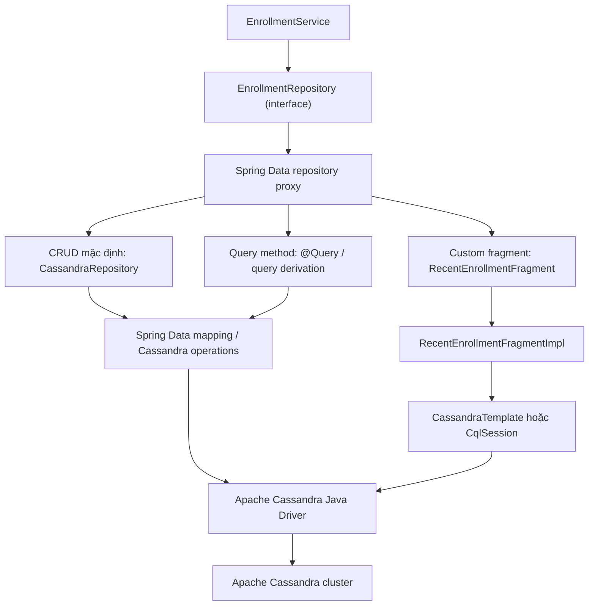

# Repository fragment và cài đặt hành vi riêng

Trong **Spring Data Cassandra**, `CassandraRepository` giúp ứng dụng Java thực hiện các thao tác dữ liệu quen thuộc như `save`, `findById` và `deleteById`. Với truy vấn cố định, có thể khai báo method truy vấn hoặc `@Query` trực tiếp trên repository. Tuy nhiên, có những nhu cầu không phù hợp để diễn đạt chỉ bằng một method được suy diễn từ tên: giới hạn truy vấn động, thực thi CQL có kiểm soát, ánh xạ về DTO chuyên biệt, xử lý paging state, áp dụng execution profile hoặc phối hợp nhiều bước có quy tắc nghiệp vụ.

**Repository fragment** là cơ chế mở rộng repository bằng **một interface mô tả hành vi riêng và một class triển khai hành vi đó**. Spring Data kết hợp fragment với triển khai repository mặc định để service chỉ cần sử dụng **một repository interface**.

Trong module **SPRING_DATA_CASSANDRA**, fragment vẫn phải tôn trọng CQL, partition key, clustering order và ngữ nghĩa phân tán của Apache Cassandra. Viết custom implementation không giúp một query thiếu partition key tự trở nên nhanh; nó chỉ cho phép ta kiểm soát cách thực hiện query và tổ chức code rõ ràng hơn.

Bài này sẽ xây dựng một fragment cho API **liệt kê các khóa học mà một học viên đăng ký gần đây**, từ schema CQL, entity, interface repository, class fragment implementation đến service và integration test.

Sau bài học, bạn có thể:

- Phân biệt method truy vấn suy diễn, `@Query`, repository fragment, `CassandraTemplate` và `CqlSession` trực tiếp.
- Tạo fragment interface, class `...Impl` và gắn chúng vào `CassandraRepository` đúng quy ước.
- Giải thích cách Spring Data tổng hợp repository từ nhiều fragment và nhận diện lỗi không tìm thấy implementation.
- Viết custom query đúng partition key, dùng prepared statement và ánh xạ kết quả vào DTO.
- Chọn nơi đặt paging, consistency, retry và validation, đồng thời hiểu giới hạn transaction đa bảng.
- Kiểm chứng custom fragment bằng integration test và các tình huống lỗi thực tế.

## 1. Khi nào cần repository fragment?

Giả sử có interface:

```java
public interface CourseRepository
        extends CassandraRepository<Course, UUID> {
}
```

Phần CRUD thông thường đã được Spring Data Cassandra cung cấp. Khi cần truy vấn đơn giản có điều kiện hợp lệ với Cassandra, Spring Data có thể tạo truy vấn từ tên method; khi cần chỉ định CQL tĩnh, `@Query` thường đủ.

Ví dụ truy vấn theo đầy đủ partition key:

```java
import java.util.List;
import java.util.UUID;
import org.springframework.data.cassandra.repository.CassandraRepository;
import org.springframework.data.cassandra.repository.Query;

public interface ProgressRepository
        extends CassandraRepository<Progress, ProgressKey> {

    @Query("SELECT * FROM progress_by_student " +
           "WHERE tenant_id = ?0 AND student_id = ?1")
    List<Progress> findProgressForStudent(UUID tenantId, UUID studentId);
}
```

Ở đây không nhất thiết phải tạo fragment: câu CQL cố định, trả entity và đã đúng đường truy cập của bảng. Trong ví dụ, bảng `progress_by_student` được giả định có partition key `(tenant_id, student_id)`.

Fragment có ích khi **hành vi không còn là một câu CQL tĩnh đơn giản**:

| Nhu cầu | Lựa chọn thường phù hợp | Lý do |
| --- | --- | --- |
| CRUD theo primary key | `CassandraRepository` | Ít code lặp, mapping rõ |
| CQL cố định, được hỗ trợ bởi schema | `@Query` trên repository | Dễ đọc, không cần lớp triển khai |
| Tạo điều kiện truy vấn hợp lệ từ các tham số, trả entity | `CassandraTemplate` / `CassandraOperations` | Tận dụng mapping và Query API |
| Hành vi truy cập tùy biến, muốn public qua repository | **Repository fragment** | Tách interface và implementation; kết hợp với CRUD mặc định |
| Đặt option statement đặc thù, dùng paging state hoặc row projection thủ công | `CqlSession` trong fragment | Kiểm soát Java Driver và CQL |
| Thao tác bất đồng bộ trong ứng dụng reactive | Reactive repository/template và API async phù hợp | Tránh blocking ở event loop |

**Repository fragment là cách tổ chức và kết hợp hành vi, không phải một API thay thế `CassandraTemplate` hay Java Driver.** Bên trong fragment, implementation có thể dùng template, driver hoặc dependency khác tùy bài toán.

## 2. Kiến trúc: repository là tổ hợp các fragment

Spring Data tạo một proxy cho repository interface. Proxy cung cấp các method cơ bản, method truy vấn và những method đến từ custom fragments.



Trong ví dụ sắp xây dựng, service gọi `repository.findRecentForStudent(...)` giống một method repository bình thường. Nhưng logic của method đó do `RecentEnrollmentFragmentImpl` cung cấp, **không phải Spring Data tự suy diễn câu truy vấn từ tên method**.

Một fragment thường gồm:

1. **Fragment interface**: mô tả các method cần bổ sung cho repository.
2. **Implementation class**: thực thi interface, có thể inject `CassandraTemplate` hoặc `CqlSession`.
3. **Repository interface**: extends cả `CassandraRepository` lẫn fragment interface.
4. **Spring configuration/repository scanning**: nhận diện implementation theo quy ước tên và phạm vi package hoặc bean cấu hình rõ ràng.

Phần nghiệp vụ chỉ phụ thuộc repository interface, không cần gọi trực tiếp implementation class.

## 3. Thiết kế bảng theo truy vấn trước khi viết fragment

API yêu cầu:

```text
GET /tenants/{tenantId}/students/{studentId}/enrollments?limit=20
```

Nó cần trả danh sách đăng ký của **một học viên trong một tenant**, mới nhất trước. Mô hình Cassandra phải phù hợp với hướng đọc này.

Giả sử keyspace `learning` đã tồn tại:

```sql
CREATE TABLE IF NOT EXISTS learning.enrollments_by_student (
    tenant_id uuid,
    student_id uuid,
    enrolled_at timestamp,
    course_id uuid,
    enrollment_status text,
    PRIMARY KEY ((tenant_id, student_id), enrolled_at, course_id)
) WITH CLUSTERING ORDER BY (enrolled_at DESC, course_id ASC);
```

| Thành phần | Ý nghĩa |
| --- | --- |
| `(tenant_id, student_id)` | **Partition key ghép**: định vị đăng ký của một học viên trong một tenant |
| `enrolled_at` | Clustering column thứ nhất, có thứ tự giảm dần |
| `course_id` | Clustering column thứ hai, giúp phân biệt các đăng ký có timestamp bằng nhau |
| `enrollment_status` | Regular column, ví dụ `ACTIVE`/`CANCELLED` |

CQL chính mà fragment cần gửi:

```sql
SELECT course_id, enrolled_at, enrollment_status
FROM learning.enrollments_by_student
WHERE tenant_id = ? AND student_id = ?
LIMIT ?;
```

Điều kiện `WHERE` có **đầy đủ partition key**. Cassandra có thể truy vấn partition tương ứng mà không quét mọi học viên. Thứ tự “mới nhất trước” đến từ clustering order của bảng.

**Không dùng** một fragment để cố làm việc này trên bảng chỉ có partition key `course_id`, rồi thêm `ALLOW FILTERING` khi query bị từ chối. Thiết kế sai đường truy cập cần được sửa ở schema/projection, không phải ở Java wrapper.

### 3.1. Những gì bảng này không giải quyết

Nếu API khác yêu cầu “tất cả học viên đăng ký một khóa học” thì truy vấn đó có hướng ngược lại, thường cần bảng như `students_by_course` với partition key `(tenant_id, course_id)`. Fragment có thể giúp tổ chức cách ghi/đọc nhưng **không tự đồng bộ hai bảng** hoặc tạo transaction đa partition.

Nếu lượng đăng ký của một học viên có thể tăng không giới hạn, cần đánh giá kích thước partition, retention và chiến lược bucket. Fragment không tự khắc phục hot/large partition.

## 4. Mapping entity và khóa ghép

Trước tiên, ánh xạ bảng Cassandra để dùng các chức năng `CassandraRepository` cơ bản. Các ví dụ Java theo cú pháp Java hiện đại; tách các class public thành file riêng trong dự án.

### 4.1. Primary key

```java
import java.io.Serializable;
import java.time.Instant;
import java.util.UUID;

import org.springframework.data.cassandra.core.cql.PrimaryKeyType;
import org.springframework.data.cassandra.core.mapping.PrimaryKeyClass;
import org.springframework.data.cassandra.core.mapping.PrimaryKeyColumn;

@PrimaryKeyClass
public class StudentEnrollmentKey implements Serializable {

    @PrimaryKeyColumn(name = "tenant_id", ordinal = 0,
                      type = PrimaryKeyType.PARTITIONED)
    private UUID tenantId;

    @PrimaryKeyColumn(name = "student_id", ordinal = 1,
                      type = PrimaryKeyType.PARTITIONED)
    private UUID studentId;

    @PrimaryKeyColumn(name = "enrolled_at", ordinal = 2,
                      type = PrimaryKeyType.CLUSTERED)
    private Instant enrolledAt;

    @PrimaryKeyColumn(name = "course_id", ordinal = 3,
                      type = PrimaryKeyType.CLUSTERED)
    private UUID courseId;

    protected StudentEnrollmentKey() {}

    public StudentEnrollmentKey(
            UUID tenantId, UUID studentId,
            Instant enrolledAt, UUID courseId) {
        this.tenantId = tenantId;
        this.studentId = studentId;
        this.enrolledAt = enrolledAt;
        this.courseId = courseId;
    }

    // Getters, setters, equals và hashCode theo tất cả thành phần khóa.
}
```

`@PrimaryKeyClass` và `@PrimaryKeyColumn` phân biệt partition key với clustering columns. `enrolledAt` và `courseId` phải ổn định cho cùng một đăng ký; nếu retry với timestamp mới, ứng dụng có thể tạo thêm hàng thay vì ghi vào cùng khóa.

### 4.2. Entity

```java
import org.springframework.data.cassandra.core.mapping.Column;
import org.springframework.data.cassandra.core.mapping.PrimaryKey;
import org.springframework.data.cassandra.core.mapping.Table;

@Table("enrollments_by_student")
public class EnrollmentByStudent {

    @PrimaryKey
    private StudentEnrollmentKey key;

    @Column("enrollment_status")
    private String enrollmentStatus;

    protected EnrollmentByStudent() {}

    public EnrollmentByStudent(
            StudentEnrollmentKey key, String enrollmentStatus) {
        this.key = key;
        this.enrollmentStatus = enrollmentStatus;
    }

    public StudentEnrollmentKey getKey() { return key; }
    public String getEnrollmentStatus() { return enrollmentStatus; }

    // Setters hoặc constructor mapping phù hợp dự án.
}
```

Entity chỉ gồm cột cần cho mô hình đọc này. Trong ứng dụng thực, đảm bảo mapping constructor/getters/setters đáp ứng quy tắc của phiên bản Spring Data Cassandra và bổ sung validation nghiệp vụ.

### 4.3. DTO trả về từ fragment

Fragment có thể chỉ trả các cột phục vụ API, thay vì buộc caller nhận entity đầy đủ:

```java
import java.time.Instant;
import java.util.UUID;

public record EnrollmentSummary(
        UUID courseId,
        Instant enrolledAt,
        String status) {
}
```

DTO là kiểu kết quả của method custom; nó không phải entity và không cần `@Table`. Khi dùng Java cũ chưa có record, có thể thay bằng class bất biến.

## 5. Tạo fragment interface

Tên interface mô tả **hành vi bổ sung**, không mô tả một bảng Cassandra:

```java
import java.util.List;
import java.util.UUID;

public interface RecentEnrollmentFragment {

    List<EnrollmentSummary> findRecentForStudent(
        UUID tenantId, UUID studentId, int limit);
}
```

Method nhận đầy đủ `tenantId` và `studentId` vì đó là partition key của bảng. Tham số `limit` giúp API kiểm soát số hàng trả về.

Phương thức này là **custom contract**. Không cần đặt tên `findByTenantIdAndStudentIdOrderBy...` theo cú pháp query derivation vì phần thực thi do fragment implementation chịu trách nhiệm.

### Tránh một interface quá lớn

Một fragment nên gói nhóm hành vi có ý nghĩa, ví dụ đọc danh sách đăng ký có tùy chọn đặc thù. Đừng tạo `CustomEverythingRepository` chứa tìm kiếm, xác thực người dùng, gửi email, gọi REST và cập nhật hóa đơn. Business workflows nên nằm ở service; fragment là lớp **truy cập dữ liệu chuyên biệt**.

## 6. Cài đặt fragment bằng Java Driver

Tên implementation cần khớp tên interface cộng với postfix mặc định **`Impl`**:

- Interface: `RecentEnrollmentFragment`
- Implementation: `RecentEnrollmentFragmentImpl`

Ví dụ dưới đây dùng `CqlSession` được Spring Boot quản lý. Truy vấn được chuẩn bị một lần để tái sử dụng, tham số được bind thay vì nối chuỗi từ input.

```java
import java.util.ArrayList;
import java.util.List;
import java.util.Objects;
import java.util.UUID;

import com.datastax.oss.driver.api.core.CqlSession;
import com.datastax.oss.driver.api.core.cql.BoundStatement;
import com.datastax.oss.driver.api.core.cql.PreparedStatement;
import com.datastax.oss.driver.api.core.cql.ResultSet;
import com.datastax.oss.driver.api.core.cql.Row;
import org.springframework.stereotype.Repository;

@Repository
public class RecentEnrollmentFragmentImpl
        implements RecentEnrollmentFragment {

    private final CqlSession session;
    private final PreparedStatement findRecent;

    public RecentEnrollmentFragmentImpl(CqlSession session) {
        this.session = session;
        this.findRecent = session.prepare("""
            SELECT course_id, enrolled_at, enrollment_status
            FROM learning.enrollments_by_student
            WHERE tenant_id = ? AND student_id = ?
            LIMIT ?
            """);
    }

    @Override
    public List<EnrollmentSummary> findRecentForStudent(
            UUID tenantId, UUID studentId, int limit) {

        Objects.requireNonNull(tenantId, "tenantId");
        Objects.requireNonNull(studentId, "studentId");

        if (limit < 1 || limit > 100) {
            throw new IllegalArgumentException(
                "limit must be between 1 and 100");
        }

        BoundStatement statement =
            findRecent.bind(tenantId, studentId, limit);

        ResultSet resultSet = session.execute(statement);
        List<EnrollmentSummary> summaries = new ArrayList<>();

        for (Row row : resultSet) {
            summaries.add(new EnrollmentSummary(
                row.getUuid("course_id"),
                row.getInstant("enrolled_at"),
                row.getString("enrollment_status")
            ));
        }
        return List.copyOf(summaries);
    }
}
```

Giải thích từng quyết định:

1. **Inject `CqlSession`, không tự mở session cho mỗi request.** Session quản lý connection pooling, metadata cluster và tài nguyên của driver; dùng một session phù hợp với lifecycle ứng dụng.
2. **`PreparedStatement` được chuẩn bị một lần** khi bean khởi tạo. Đầu vào `tenantId`, `studentId` và `limit` được bind đúng vị trí; không nối vào chuỗi CQL.
3. **Giới hạn từ 1 đến 100** tránh một request vô tình tải hàng chục nghìn hàng về Java heap. Khoảng giới hạn chỉ là quy tắc ví dụ; production cần chọn theo SLA/tải.
4. **`ResultSet` được chuyển thành `EnrollmentSummary`** bằng tay. Khi đi qua `CqlSession` trực tiếp, Spring Data không tự mapping `Row` bằng `MappingCassandraConverter`.
5. **`List.copyOf(...)`** trả kết quả không cho sửa list từ bên ngoài; nó không làm dữ liệu Cassandra trở thành snapshot bất biến giữa các request.
6. **Constructor chuẩn bị truy vấn yêu cầu schema đã tồn tại**. Với `schema-action: none`, triển khai CQL trước khi khởi động ứng dụng; nếu không, việc chuẩn bị statement có thể làm ứng dụng lỗi khi startup.

Trong ví dụ, CQL có `LIMIT ?` nên vòng lặp tối đa đọc theo số hàng yêu cầu. Với một truy vấn **không có LIMIT**, việc duyệt `ResultSet` có thể tự lấy các page tiếp theo và làm ứng dụng tiêu thụ nhiều dữ liệu hơn dự kiến.

### Một method custom có thể có tên giống method query-derived không?

Có. Nếu method được khai báo bởi fragment interface và implementation được tìm thấy, repository proxy có thể chuyển lời gọi tới fragment thay vì suy diễn query từ tên method.

Tuy vậy, khi tên trùng method của base repository hoặc nhiều fragments, việc xác định method được gọi có thể khó theo dõi. Nên dùng **tên hành vi rõ ràng, tránh trùng chữ ký không cần thiết**, và viết test thực sự gọi qua repository interface.

### Vì sao không tạo `CqlSession` bên trong method?

Mỗi `CqlSession` có chi phí khởi tạo và quản lý nhiều kết nối. Nếu mỗi request tạo/đóng session, latency và số kết nối tăng mạnh. Constructor-injected session do Spring Boot quản lý là lựa chọn an toàn hơn cho trường hợp tiêu chuẩn.

## 7. Gắn fragment vào CassandraRepository

Repository interface extends **hai interface**: repository cơ bản và custom fragment.

```java
import org.springframework.data.cassandra.repository.CassandraRepository;

public interface EnrollmentRepository
        extends CassandraRepository<
            EnrollmentByStudent, StudentEnrollmentKey>,
                RecentEnrollmentFragment {
}
```

Spring Data sẽ cung cấp các method như `findById`, `save` và `deleteById`, đồng thời gắn phần implementation cho `findRecentForStudent`.

Service sử dụng repository thống nhất:

```java
import java.util.List;
import java.util.UUID;
import org.springframework.stereotype.Service;

@Service
public class EnrollmentQueryService {
    private final EnrollmentRepository repository;

    public EnrollmentQueryService(EnrollmentRepository repository) {
        this.repository = repository;
    }

    public List<EnrollmentSummary> recentForStudent(
            UUID tenantId, UUID studentId, int limit) {
        // Kiểm tra quyền truy cập tenant/student ở tầng bảo mật/nghiệp vụ.
        return repository.findRecentForStudent(
            tenantId, studentId, limit);
    }
}
```

Service không inject `RecentEnrollmentFragmentImpl`; nó chỉ cần contract của repository. Cũng không cần tạo subclass `SimpleCassandraRepository` chỉ để có một method truy vấn chuyên biệt.

### Bố cục package

Một bố cục minh họa:

```text
com.example.learning.enrollment/
  EnrollmentByStudent.java
  StudentEnrollmentKey.java
  EnrollmentSummary.java
  RecentEnrollmentFragment.java
  RecentEnrollmentFragmentImpl.java
  EnrollmentRepository.java
  EnrollmentQueryService.java
```

Theo cơ chế nhận diện thông thường của Spring Data, implementation cần được tìm thấy trong phạm vi package được scan cùng repository, với **tên interface fragment + postfix `Impl`**. Cấu trúc package ở trên giúp việc này dễ theo dõi.

**Không bắt buộc fragment implementation luôn phải có `@Repository`** nếu Spring Data nhận diện trực tiếp theo convention và tạo bean tương ứng, nhưng annotation có thể làm ý định bean rõ ràng trong cấu hình ví dụ. Khi cấu hình thủ công hoặc có nhiều implementation cùng tên, cần tránh tạo các bean mơ hồ.

### Điều kiện Spring Boot

Khi sử dụng `spring-boot-starter-data-cassandra`, ứng dụng thường được tự động cấu hình repository scanning ở package ứng dụng. Nếu repository nằm ngoài phạm vi scan, cần cấu hình `@EnableCassandraRepositories` với base packages phù hợp. Không nên dùng annotation đó chỉ để che giấu một đường dẫn package sai.

Một cấu hình kết nối ví dụ:

```yaml
spring:
  cassandra:
    contact-points: 127.0.0.1
    port: 9042
    local-datacenter: datacenter1
    keyspace-name: learning
    schema-action: none
```

Tên datacenter phải khớp với cluster thực tế. Production cần credentials/TLS/secrets tùy hạ tầng và nên quản lý schema qua migration riêng.

## 8. Có thể cài đặt fragment bằng CassandraTemplate không?

**Có.** Khi hành vi vẫn làm việc với **entity Java** và chỉ cần tạo query theo điều kiện hợp lệ của Cassandra, `CassandraTemplate` hoặc `CassandraOperations` là lựa chọn phù hợp, vì chúng sử dụng mapping metadata để ánh xạ kết quả.

Ví dụ phần thân logic thay thế trong một fragment implementation khác, giả định đã inject `CassandraTemplate template`:

```java
import java.util.List;
import java.util.UUID;

import org.springframework.data.cassandra.core.CassandraTemplate;
import org.springframework.data.cassandra.core.query.Criteria;
import org.springframework.data.cassandra.core.query.Query;

public List<EnrollmentByStudent> findRowsForStudent(
        UUID tenantId, UUID studentId, int limit) {

    if (limit < 1 || limit > 100) {
        throw new IllegalArgumentException("Invalid limit");
    }

    Query query = Query.query(
            Criteria.where("tenant_id").is(tenantId))
        .and(Criteria.where("student_id").is(studentId))
        .limit(limit);

    return template.select(query, EnrollmentByStudent.class);
}
```

Đây là **đoạn minh họa đặt trong một class đã có field `template`**, không phải class Java hoàn chỉnh. API Query/Criteria cần đối chiếu với phiên bản Spring Data Cassandra của dự án.

So sánh:

| Tiêu chí | `CassandraTemplate` trong fragment | `CqlSession` trong fragment |
| --- | --- | --- |
| Kết quả | Ánh xạ entity bằng Spring Data | Tự đọc `Row` hoặc dùng mapper/codec do lập trình viên chọn |
| Truy vấn | Spring Data Query API hoặc thao tác hỗ trợ | Tự xây CQL, prepared/bound statements |
| Cấu hình statement chuyên sâu | Tùy API Spring Data hỗ trợ | Truy cập trực tiếp tùy chọn của Java Driver |
| Custom conversions | Dùng trong đường mapping Spring Data | Không tự dùng `CassandraCustomConversions` |
| Độ linh hoạt CQL | Tiện cho truy vấn theo entity | Phù hợp khi cần CQL/driver options đặc thù |
| Chi phí lập trình | Thường ít mã ánh xạ hơn | Phải chịu trách nhiệm binding/mapping/giới hạn kết quả |

Hai cách đều hợp lệ nếu câu CQL **khớp partition key và clustering restrictions**. Chọn phương án theo nhu cầu thật, không theo thói quen “custom thì phải bỏ Spring Data”.

### Không tạo hai implementation cho cùng một fragment trong ứng dụng thật

Ví dụ chính dùng `RecentEnrollmentFragmentImpl` với `CqlSession`. Đoạn template ở trên là **phương án thay thế để học**, không phải yêu cầu thêm một bean cùng chức năng. Nếu nhiều implementation cùng thỏa một fragment mà không cấu hình rõ ràng, việc chọn bean sẽ mơ hồ và có thể làm ứng dụng khởi động thất bại.

## 9. Fragment khác Custom Base Repository như thế nào?

Một số dự án muốn mọi repository có một hành vi chung, ví dụ policy kiểm toán truy cập dữ liệu. Khi đó có thể cân nhắc **custom repository base class** được cấu hình qua `repositoryBaseClass` hoặc factory phù hợp. Nhưng đó là một nhu cầu khác với fragment.

| Repository fragment | Custom base repository |
| --- | --- |
| Chỉ repository nào **extends fragment interface** mới nhận hành vi | Có thể ảnh hưởng nhiều repository trong phạm vi cấu hình |
| Tổ chức theo chức năng nhỏ, có thể ghép nhiều fragment | Thay đổi/lồng ghép phần base implementation dùng chung |
| Dễ kiểm thử theo một hành vi | Cần đánh giá tác động tới nhiều repository |
| Thường đủ cho truy vấn tùy biến, DTO, paging/driver custom | Chỉ cân nhắc khi thật sự cần thay đổi cơ chế cơ bản toàn hệ |

Đừng kế thừa `SimpleCassandraRepository` để bổ sung một method `findRecentForStudent`. Điều đó khiến code phụ thuộc sâu hơn vào triển khai nội bộ mà không cần thiết.

### Có thể tái sử dụng fragment?

Có thể tạo một fragment có hợp đồng và implementation dùng được cho nhiều repository, miễn rằng entity/schema/API thực sự tương thích. Tuy nhiên, cùng tên method không đảm bảo các bảng có cùng partition key; tránh viết fragment generic rồi áp dụng cho tất cả entity mà không xác định kiểu khóa và cách truy vấn.

### Khi repository có nhiều fragment

Ví dụ:

```java
public interface EnrollmentRepository
        extends CassandraRepository<EnrollmentByStudent, StudentEnrollmentKey>,
                RecentEnrollmentFragment,
                EnrollmentMaintenanceFragment {
}
```

`EnrollmentMaintenanceFragment` cần interface/implementation riêng theo convention tương ứng. Nên tránh cho hai fragment cùng công bố **chữ ký method trùng nhau**, vì precedence có thể phụ thuộc thứ tự khai báo/cách composition được xây dựng và gây bất ngờ trong bảo trì.

Spring Data coi custom fragments là thành phần có thể ưu tiên hơn các phương thức base repository khi chữ ký trùng. Quyết định override một method cơ bản như `save` phải có lý do rõ ràng, test kỹ và ghi chép về semantics.

## 10. Paging, LIMIT và hiệu năng bên trong fragment

### 10.1. LIMIT không phải phân trang offset

Trong ví dụ `LIMIT ?`, câu CQL **giới hạn tổng số hàng** mà request lấy, ví dụ 20 hàng đầu tiên. Nó không cung cấp “trang 2” hoặc khả năng nhảy tới trang số 100 theo offset.

Cassandra phân trang bằng **paging state**: driver lấy page tiếp theo của **cùng query và bind parameters**. Ở Spring Data có các abstraction paging tương ứng; ở Java Driver có API quản lý page size và paging state. Cần dùng đúng API theo chế độ đồng bộ, bất đồng bộ hoặc reactive.

Phân biệt:

| Khái niệm | Tác dụng | Không có nghĩa |
| --- | --- | --- |
| `LIMIT 50` | Giới hạn tối đa tổng số hàng trả về | Không phải `OFFSET 0..50` |
| Page size = 50 | Mục tiêu số hàng server trả cho một page theo cơ chế driver | Không đảm bảo iterator chỉ đọc 50 hàng tổng cộng |
| Paging state | Token tiếp tục đọc kết quả từ cùng query/bind values | Không phải số trang bất kỳ |
| Clustering order | Thứ tự hàng **trong partition** | Không phải sort dữ liệu tùy ý toàn cluster |

Nếu cần API “Xem thêm”, hãy thêm một contract như `RecentEnrollmentPage` gồm `items` và `nextPageToken`; implementation sử dụng paging state/tùy chọn driver hoặc Spring Data đúng cách. Đừng trả `Page<T>` có ý nghĩa tổng số trang nếu chưa xác định cách đếm dữ liệu và chi phí của nó.

### 10.2. Paging state có ràng buộc ngữ cảnh

Token paging cần được dùng với cùng CQL và tham số bind, bao gồm partition key và các điều kiện liên quan. Không nên:

- Dùng token của học viên A để đọc dữ liệu học viên B.
- Dùng token sau khi thay đổi câu `SELECT` hoặc điều kiện lọc.
- Giải mã/để lộ token không có kiểm soát nếu API công khai.
- Giả định dữ liệu được giữ bất biến giữa hai lần lấy page.

Token trả ra API nên có kiểm soát về phiên bản, scope người dùng, quyền truy cập và tính hợp lệ. Khi dữ liệu thay đổi trong lúc phân trang, cần chấp nhận hoặc xử lý khả năng dữ liệu xuất hiện/mất đi giữa các page theo hợp đồng sản phẩm.

### 10.3. Đừng biến fragment thành “query mọi thứ”

Một method fragment nhận nhiều bộ lọc tùy chọn không có nghĩa Cassandra có thể query tùy ý các cột regular trên mọi partition. Những trường hợp như:

```text
findRecent(status=?, titleContains=?, from=?, tenant=?)
```

cần được thiết kế từ **các truy vấn được phép**. Nếu chỉ biết `tenant_id` mà thiếu `student_id`, bảng `enrollments_by_student` không định tuyến trực tiếp đến một partition. Cân nhắc bảng phù hợp theo hướng đọc, indexing có chủ đích hoặc công cụ tìm kiếm chuyên dụng.

`ALLOW FILTERING` không phải giải pháp mặc định cho thiết kế thiếu partition key.

## 11. Nhất quán, transaction, retry và giới hạn fragment

Repository fragment có thể thực hiện nhiều câu lệnh liên tiếp, nhưng **gói nhiều câu lệnh vào một method Java không biến chúng thành transaction ACID tổng quát**.

Giả sử cần cập nhật một sự kiện đăng ký ở hai bảng:

```text
EnrollmentService
  -> repository fragment method
       -> INSERT enrollments_by_student
       -> INSERT students_by_course
```

Nếu lệnh đầu thành công và lệnh thứ hai timeout, ứng dụng phải xử lý tình trạng có một projection chưa được cập nhật. `@Transactional` không nên bị hiểu mặc nhiên là rollback trên nhiều partition/bảng Cassandra giống transaction của một RDBMS.

Các lựa chọn cần đánh giá:

- Dùng nguồn sự thật và sự kiện bền vững để cập nhật các bảng đọc, có retry và đối soát.
- Đặt giá trị primary key ổn định để một retry không sinh bản ghi khác.
- Phân biệt timeout với chắc chắn chưa ghi: Cassandra có thể đã áp dụng mutation dù phía client nhận timeout.
- Dùng LWT/conditional update nếu có yêu cầu compare-and-set thực sự, hiểu chi phí và phạm vi ngữ nghĩa.
- Chỉ dùng batch Cassandra khi ngữ nghĩa và giới hạn phù hợp; không coi logged batch nhiều partition là transaction SQL có isolation đầy đủ hoặc mẹo tăng tốc.

### Consistency level đặt ở đâu?

Có thể cấu hình consistency qua driver execution profile hoặc statement, và một số tùy chọn ở tầng Spring Data. Fragment dùng `CqlSession` có quyền kiểm soát statement-level options nhưng **không nên hardcode `LOCAL_ONE` hoặc `LOCAL_QUORUM` bừa bãi**.

Lựa chọn consistency phải dựa vào replication factor, datacenter, yêu cầu đọc/ghi và SLA. Thay đổi consistency không thay đổi partition key và không tự đồng bộ hai bảng projection.

### Reactive không được gọi driver blocking

Nếu ứng dụng dùng `ReactiveCassandraRepository`/`ReactiveCassandraTemplate`, đừng gọi `CqlSession.execute(...)` đồng bộ ngay trong một pipeline reactive nhạy với blocking. Một fragment reactive cần contract và implementation phù hợp với driver async/reactive, ví dụ trả `Mono`/`Flux`, cùng xử lý backpressure và paging.

## 12. Kiểm thử repository fragment

**Unit test fragment implementation** kiểm tra validation, mapping và các nhánh logic. Nhưng để biết Spring Data thật sự ghép fragment vào repository proxy, cần **integration test** trên Cassandra test riêng (ví dụ Testcontainers) cùng Spring context thực.

### 12.1. Test theo đường đi thật

Một test quan trọng:

1. Khởi động Cassandra test độc lập và tạo `learning.enrollments_by_student` bằng script CQL.
2. Khởi động Spring Boot context có `EnrollmentRepository` và `RecentEnrollmentFragmentImpl`.
3. Seed hai hàng trong **cùng partition `(tenantId, studentId)`** có `enrolled_at` khác nhau.
4. Gọi qua **`EnrollmentRepository.findRecentForStudent(...)`**, không gọi trực tiếp implementation.
5. Kiểm tra thứ tự mới nhất trước, số hàng theo limit và DTO mapping.
6. Kiểm tra một học viên khác không đọc lẫn dữ liệu của học viên thứ nhất.
7. Xóa đúng partition test đã tạo, không quét/xóa dữ liệu của người khác.

Ví dụ phần thân test, giả định `repository` và `session` đã được inject, schema đã khởi tạo và test dùng keyspace riêng:

```java
import java.time.Instant;
import java.util.List;
import java.util.UUID;
import com.datastax.oss.driver.api.core.cql.SimpleStatement;
import static org.assertj.core.api.Assertions.assertThat;

UUID tenantId = UUID.randomUUID();
UUID studentId = UUID.randomUUID();
UUID oldCourseId = UUID.randomUUID();
UUID newCourseId = UUID.randomUUID();

String insertCql = """
    INSERT INTO learning.enrollments_by_student
       (tenant_id, student_id, enrolled_at, course_id, enrollment_status)
    VALUES (?, ?, ?, ?, ?)
    """;

try {
    session.execute(SimpleStatement.newInstance(
        insertCql,
        tenantId, studentId, Instant.parse("2026-11-01T09:00:00Z"),
        oldCourseId, "ACTIVE"));

    session.execute(SimpleStatement.newInstance(
        insertCql,
        tenantId, studentId, Instant.parse("2026-11-24T09:00:00Z"),
        newCourseId, "ACTIVE"));

    List<EnrollmentSummary> latest =
        repository.findRecentForStudent(tenantId, studentId, 1);

    assertThat(latest)
        .extracting(EnrollmentSummary::courseId)
        .containsExactly(newCourseId);
} finally {
    session.execute(SimpleStatement.newInstance(
        "DELETE FROM learning.enrollments_by_student " +
        "WHERE tenant_id = ? AND student_id = ?",
        tenantId, studentId));
}
```

Đây là **đoạn test được đặt trong một integration test đã cấu hình**, không phải một class test Java đầy đủ. Các câu lệnh `INSERT` dùng cùng partition key và khác clustering timestamp. Test kiểm tra qua repository proxy nên đồng thời phát hiện vấn đề composition và mapping kết quả.

Bộ test cần tự dựng keyspace/table trước khi bean fragment chuẩn bị statement; khi dùng Testcontainers có thể chọn init CQL phù hợp. Đừng trỏ test vào cluster production hoặc hardcode một UUID dùng chung khiến test song song đụng nhau.

### 12.2. Những trường hợp test nên có

| Ca test | Kết quả cần xác minh |
| --- | --- |
| Repository proxy khởi tạo | Spring tìm thấy fragment implementation, không cố suy diễn method custom |
| Không có đăng ký | Trả danh sách rỗng, không làm lỗi vì `Row` không tồn tại |
| Nhiều hàng cùng partition | Thứ tự clustering chính xác |
| Limit = 1, 20, 100 | Số lượng phù hợp và input hợp lệ |
| Limit = 0 hoặc 101 | Từ chối theo contract của fragment |
| `tenantId` hoặc `studentId` null | Từ chối trước khi gửi CQL |
| Hai học viên khác nhau | Không rò dữ liệu giữa các partition |
| Status null | DTO biểu diễn thiếu giá trị đúng theo nghiệp vụ |
| Truy vấn trong tải lớn | Không vô tình duyệt toàn partition |
| Paging nhiều trang (nếu hỗ trợ) | Giữ cùng CQL/bind parameters và token phù hợp |
| Lỗi timeout/retry | Hành vi được định nghĩa, không mặc định retry vô hạn |
| Query theo bảng mới | CQL đúng schema/migration hiện có |

### 12.3. Unit test chưa chứng minh wiring

Ngay cả khi unit test gọi trực tiếp:

```java
new RecentEnrollmentFragmentImpl(session)
    .findRecentForStudent(tenantId, studentId, 20);
```

và method chạy đúng, Spring Data vẫn có thể **không nhận ra** implementation khi khởi tạo repository: ví dụ class sai tên, package không nằm trong scan hoặc repository quên extends fragment interface.

Integration test gọi **`EnrollmentRepository`** mới kiểm tra được cả phần wiring lẫn CQL. Với Java Driver, hãy dùng Cassandra thật trong integration test; mock toàn bộ `CqlSession` và `Row` không phản ánh đầy đủ syntax/semantics CQL.

## 13. Các lỗi thường gặp và cách sửa

| Triệu chứng | Nguyên nhân thường gặp | Hướng xử lý |
| --- | --- | --- |
| Spring không tạo được repository vì method `findRecentForStudent` | Fragment implementation không được tìm thấy; method bị xem như query derived | Kiểm tra interface repository có extends fragment, tên `...Impl` và package scanning |
| Lời gọi qua repository chạy implementation không mong muốn | Có nhiều fragment/bean cùng chữ ký hoặc collision | Tránh trùng chữ ký; làm rõ thứ tự và bean registration |
| `No qualifying bean of type CqlSession` | Hạ tầng Boot Cassandra chưa cấu hình, auto-configuration bị thay | Kiểm tra starter, cấu hình kết nối và bean được tạo |
| `InvalidQueryException`, thiếu bảng/keyspace | Migration chưa chạy hoặc trỏ sai keyspace | Xác minh schema, keyspace và thứ tự triển khai |
| Query thiếu partition key | Fragment dùng CQL không phù hợp schema | Thiết kế bảng theo truy vấn; không tự thêm `ALLOW FILTERING` |
| Kết quả không đúng thứ tự | Clustering order không khớp API hoặc query dùng thứ tự khác | Kiểm tra `PRIMARY KEY` và `CLUSTERING ORDER BY` |
| Entity mapping lỗi nhưng driver trực tiếp chạy | `CqlSession` không dùng mapping converter của Spring Data | Kiểm tra entity annotation, converter và chọn đường mapping phù hợp |
| Một số request trả quá nhiều hàng | Thiếu giới hạn, duyệt `ResultSet` tự tải nhiều page | Đặt LIMIT/page size và giới hạn API |
| Trang sau không đúng | Paging state dùng với query/parameters khác | Giữ nguyên ngữ cảnh và validate token |
| Thay consistency không làm hai bảng đồng nhất | Consistency xử lý replica của từng thao tác, không phải hai projection | Thiết kế retry, reconciliation và nguồn sự thật |
| Gọi reactive repository nhưng fragment blocking | Dùng `CqlSession.execute` đồng bộ trong reactive path | Chuyển sang API async/reactive phù hợp |
| Custom method bị cho vào service thay vì fragment | Không chia rõ quyền truy cập dữ liệu và nghiệp vụ | Đưa CQL/mapping truy cập vào fragment, orchestration vào service |
| Dùng `findAll` để “lọc trong Java” | Quét toàn bộ bảng/partition không cần thiết | Xây mô hình query-driven theo partition key |

### Quy trình debug ngắn

1. **Xem repository interface:** có extends đúng fragment interface không?
2. **Xem implementation:** class có implement đúng interface, method signature khớp và hậu tố tên đúng không?
3. **Xem package/bean:** repository scanning có bao phủ implementation không, có bean trùng không?
4. **Xem schema:** keyspace, bảng, partition key và clustering order có giống code không?
5. **Xem CQL thực tế:** query có đầy đủ partition key, bind đúng kiểu và giới hạn hợp lý không?
6. **Xem driver và cluster:** timeout, consistency, page size, connection/metrics và tải node.
7. **Viết integration test qua repository proxy** để khóa lại hành vi mong muốn.

## 14. Tình huống mở rộng: thêm fragment ghi có điều kiện

Giả sử cần thao tác nghiệp vụ “hủy đăng ký” chỉ khi trạng thái hiện tại là `ACTIVE`. Có thể khai báo fragment khác:

```java
public interface EnrollmentCommandFragment {
    boolean cancelIfActive(StudentEnrollmentKey key);
}
```

Một implementation có thể dùng CQL conditional update với `IF`, ví dụ:

```sql
UPDATE learning.enrollments_by_student
SET enrollment_status = 'CANCELLED'
WHERE tenant_id = ? AND student_id = ?
  AND enrolled_at = ? AND course_id = ?
IF enrollment_status = 'ACTIVE';
```

Conditional statement sử dụng cơ chế LWT/compare-and-set của Cassandra. Nó có chi phí và ngữ nghĩa khác cập nhật thường; phải kiểm tra kết quả **`[applied]`** thay vì chỉ dựa vào việc method execute không ném exception.

Nếu còn bảng `students_by_course` cần đồng bộ trạng thái, một LWT ở bảng thứ nhất **không tự tạo transaction ACID toàn bộ các bảng**. Service vẫn cần quy trình cập nhật projection và xử lý lỗi. Fragment chỉ đóng gói hành vi truy cập dữ liệu; tính nhất quán ở cấp nghiệp vụ phải được thiết kế riêng.

Mỗi fragment có thể khai báo API với tên rõ ràng, ví dụ `cancelIfActive`, thay vì override `save` và thay đổi toàn bộ semantics lưu dữ liệu cho những màn hình khác.

## 15. Checklist khi thiết kế repository fragment

- [ ] Đã xác nhận query không thể diễn đạt tốt bằng một method `@Query` đơn giản.
- [ ] Có **fragment interface** chỉ chứa các method thuộc cùng nhóm hành vi.
- [ ] Có **implementation `<FragmentInterface>Impl`** trong phạm vi package/bean được Spring Data nhận diện.
- [ ] Repository interface **extends fragment** và `CassandraRepository`.
- [ ] Service gọi repository interface, không gắn chặt vào implementation class.
- [ ] CQL dùng đúng partition key và clustering restrictions của bảng.
- [ ] Parameters được bind, không ghép input trực tiếp vào chuỗi CQL.
- [ ] Có giới hạn kết quả/page size; phân trang nếu API cần.
- [ ] Nếu dùng `CqlSession`, có mapping `Row` rõ ràng; nếu dùng template, converter/mapping được cấu hình thống nhất.
- [ ] Đã tính đến upsert, timeout, retry, consistency, LWT và đồng bộ nhiều bảng khi cần.
- [ ] Có test gọi qua **repository proxy** trên Cassandra thật, không chỉ unit test class implementation.
- [ ] Schema CQL được quản lý trước startup; không tạo/đổi bảng tùy tiện trong fragment.
- [ ] Đã đánh giá quyền truy cập tenant, logging dữ liệu nhạy cảm và giới hạn tải cho API.
- [ ] Không giả định `@Transactional` biến nhiều Cassandra statements thành transaction quan hệ.
- [ ] Không chèn blocking driver call vào reactive pipeline.

## 16. Bài tập thực hành

Một hệ thống học tập có bảng:

```sql
CREATE TABLE learning.progress_by_student (
    tenant_id uuid,
    student_id uuid,
    course_id uuid,
    completed_lessons int,
    updated_at timestamp,
    PRIMARY KEY ((tenant_id, student_id), course_id)
);
```

Team muốn bổ sung method tùy biến:

```text
findProgressForStudent(tenantId, studentId, onlyStarted, maxRows)
```

Với `onlyStarted = true`, API chỉ hiển thị các khóa học đã hoàn thành ít nhất một bài; với `onlyStarted = false`, trả các khóa học của học viên.

Hãy trả lời:

1. Khi `onlyStarted = false`, partition key của câu CQL là gì?
2. Có nên viết `SELECT ... WHERE tenant_id=? AND student_id=? AND completed_lessons > 0` trực tiếp trên bảng này mà không có index/schema khác không?
3. Trường hợp lọc `completed_lessons > 0` có tải nhỏ trong một partition, ứng dụng có thể cân nhắc cách đọc/lọc nào? Với tải lớn, cần mô hình khác ra sao?
4. Interface fragment và class implementation nên được đặt tên theo quy ước nào?
5. Repository interface phải extends những interface nào để service gọi được method?
6. Nếu chỉ có một CQL cố định theo partition key, tại sao `@Query` có thể đơn giản hơn fragment?
7. Nếu dùng `CqlSession`, fragment có tự nhận `CassandraCustomConversions` của Spring Data không?
8. `maxRows` có tự cung cấp trang tiếp theo không? Nếu không, API cần thêm hợp đồng nào?
9. Nếu service gọi hai fragment để cập nhật hai bảng, có được transaction ACID nhiều bảng chỉ vì nằm trong một method Java không?
10. Test nào phát hiện việc Spring Data không tìm được `...Impl` dù unit test implementation vẫn chạy?

**Gợi ý:** khi truy vấn `progress_by_student` phải dùng đầy đủ `(tenant_id, student_id)`. Không mặc định Cassandra hỗ trợ hiệu quả lọc `completed_lessons > 0` vì đây là regular column; nếu partition nhỏ, có thể đọc dữ liệu của một học viên có giới hạn rồi lọc khi phù hợp. Nếu yêu cầu tải lớn và lọc thường xuyên, thiết kế bảng theo hướng đọc hoặc cơ chế index phù hợp. Fragment gồm interface + implementation theo postfix `Impl` và repository extends fragment; test phải gọi thông qua repository proxy. LIMIT không thay paging state; transaction đa bảng cần xử lý riêng.

## Ghi nhớ

**Repository fragment giúp mở rộng `CassandraRepository` bằng hành vi truy cập dữ liệu được tổ chức thành interface và implementation riêng.** Spring Data kết hợp fragment với CRUD/query methods qua repository proxy, để service dùng một contract rõ ràng.

**Fragment không thay thế CassandraTemplate hay Java Driver; nó là nơi đặt cách dùng những công cụ đó.** Hãy chọn template khi cần entity mapping thuận tiện, hoặc `CqlSession` khi cần điều khiển CQL/statement và chấp nhận tự ánh xạ `Row`.

Quan trọng nhất, **CQL trong fragment vẫn phải đi theo mô hình dữ liệu phân tán**: partition key đầy đủ, clustering hợp lý, paging có trạng thái, giới hạn tải, consistency phù hợp và xử lý ghi nhiều projection có chủ đích. Tạo một class `...Impl` không làm truy vấn sai thiết kế trở nên nhanh hoặc tự mang lại transaction ACID.

### Tài liệu tham khảo

- [Spring Data Commons — Custom Repository Implementations](https://docs.spring.io/spring-data/commons/reference/repositories/custom-implementations.html)
- [Spring Data Cassandra — Repositories](https://docs.spring.io/spring-data/cassandra/reference/repositories.html)
- [Spring Data Cassandra — CassandraTemplate](https://docs.spring.io/spring-data/cassandra/reference/cassandra/template.html)
- [Spring Data Cassandra — Object Mapping](https://docs.spring.io/spring-data/cassandra/reference/object-mapping.html)
- [Apache Cassandra Java Driver — Prepared Statements](https://docs.datastax.com/en/developer/java-driver/4.17/manual/core/statements/prepared/)
- [Apache Cassandra — CQL](https://cassandra.apache.org/doc/stable/cassandra/developing/cql/)
