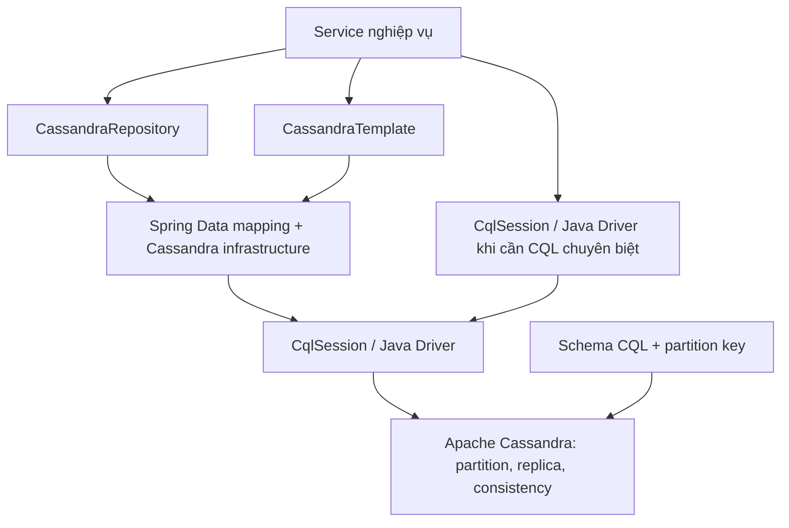

# Giới hạn của Repository và tiêu chí sử dụng Template

Spring Data Cassandra cung cấp hai cách phổ biến để truy cập Apache Cassandra: **Repository** và **`CassandraTemplate`**. Repository giúp viết các thao tác CRUD và truy vấn đã biết với ít mã, trong khi Template trao quyền kiểm soát trực tiếp hơn đối với cách xây dựng và thực thi truy vấn, lựa chọn điều kiện, giới hạn kết quả và tùy chọn ghi. Không có API nào tự khắc phục được bảng thiết kế sai partition key hoặc biến Cassandra thành cơ sở dữ liệu quan hệ có JOIN, giao dịch đa bảng và phân trang bằng offset tùy ý.

Bài học thuộc chương **Repository** của module **`SPRING_DATA_CASSANDRA`**. Mục tiêu của module là truy cập Cassandra bằng entity mapping, repository, `CassandraTemplate` và truy vấn CQL, đồng thời làm việc đúng với **mô hình dữ liệu phân tán**: thiết kế bảng theo truy vấn, partition key, consistency level, paging và kiểm soát hiệu năng.

**Sau bài này, bạn sẽ biết:**

1. Repository làm tốt những việc gì và giới hạn của derived query, `@Query`, CRUD.
2. Khi nào chuyển sang `CassandraTemplate` và khi nào cần xuống Java Driver/`CqlSession`.
3. Vì sao “chuyển API” không sửa được truy vấn thiếu partition key, hot partition hoặc quét quá nhiều dữ liệu.
4. Cách xây dựng một repository và một template service trên cùng bảng CQL.
5. Cách lựa chọn theo **độ rõ ràng của code, tính linh hoạt, yêu cầu CQL, paging, nhất quán và chi phí vận hành**.

## 1. Bốn lớp trách nhiệm: schema, mapping, repository và template



Trong hình:

- **Schema CQL** quyết định bảng, primary key, partition key, clustering order, kiểu cột và replication của keyspace. Nó xác định các truy vấn hiệu quả có thể thực hiện.
- **Entity mapping** dùng `@Table`, `@PrimaryKey`/`@PrimaryKeyClass` và `@Column` để liên kết Java object với bảng, cột và khóa trong CQL.
- **Repository** cung cấp giao diện kiểu dữ liệu, các phương thức CRUD, query method và `@Query` cho những đường truy vấn đã biết.
- **`CassandraTemplate`** là API thao tác dữ liệu ở mức thấp hơn repository, có thể xây query bằng `Query`/`Criteria`, dùng thông tin entity mapping và chỉ định tùy chọn cho thao tác.
- **`CqlSession`** là Java Driver API trực tiếp. Khi chức năng đặc biệt chưa được abstraction phía trên biểu diễn đầy đủ, đây là điểm đi xuống để viết CQL và kiểm soát statement/driver.

**Repository và Template không phải hai hệ kết nối độc lập.** Trong ứng dụng Spring cấu hình đúng, cả hai đều dùng hạ tầng Spring Data Cassandra và `CqlSession` do application context quản lý. Không mở thêm một session cho mỗi repository hoặc mỗi request.

## 2. Repository mạnh ở đâu?

Repository phù hợp khi nghiệp vụ dùng **những truy vấn ổn định, gắn chặt với một entity** và số lựa chọn truy vấn không quá biến động.

| Nhu cầu | Lợi ích khi dùng Repository |
| --- | --- |
| Tìm entity theo khóa đầy đủ | Có `findById`, `existsById` và phương thức CRUD quen thuộc |
| Ghi hoặc xóa theo entity/key | `save`, `delete`, `deleteById` giúp code ngắn, type-safe |
| Truy vấn cố định | Query method hoặc `@Query` thể hiện ý định ngay trên interface |
| Service nghiệp vụ đơn giản | Dễ mock repository, dễ đọc luồng code, ít lặp boilerplate |
| Cần nhất quán kiến trúc với hệ Spring Data | Dùng cùng entity mapping và quy tắc chuyển đổi |

Ví dụ repository cơ bản:

```java
public interface CustomerProfileRepository
        extends CassandraRepository<CustomerProfile, UUID> {
}
```

Trong ví dụ này, `CustomerProfile` phải có `@Table`, khóa `UUID` và mapping khớp với bảng CQL. Việc repository có sẵn `findById` là tiện ích lớn, nhưng thao tác ấy **chỉ thực sự có ý nghĩa** khi kiểu ID tương ứng khóa đầy đủ và đã được ánh xạ đúng.

### Repository không có nghĩa “mọi tên phương thức đều là một truy vấn tốt”

Một method như `findByStatus(String status)` có thể trông hợp lý theo cách nghĩ SQL, nhưng với Cassandra, **nó chỉ hợp lệ/hiệu quả** nếu schema và cơ chế truy vấn hỗ trợ lọc theo `status`. Nếu `status` chỉ là cột thường còn partition key là `customer_id`, Repository không thể tự quét toàn cluster hiệu quả để tìm mọi khách theo trạng thái.

**Quy tắc:** bắt đầu từ câu hỏi “bảng CQL nào phục vụ query này?”, sau đó mới quyết định viết method repository hay template.

## 3. Ví dụ xuyên suốt: danh sách booking theo khách và ngày

Giả sử ứng dụng đặt chỗ cần hai loại thao tác:

1. Xem **50 booking mới nhất** của một khách trong một ngày.
2. Với màn hình vận hành, chọn **giới hạn linh hoạt** và có thể lọc khoảng thời gian **bên trong cùng partition**.

Ta thiết kế bảng theo truy vấn:

```sql
CREATE TABLE IF NOT EXISTS bookings_by_customer_day (
    customer_id uuid,
    booking_day date,
    created_at timestamp,
    booking_id uuid,
    status text,
    total_amount_cents bigint,
    PRIMARY KEY ((customer_id, booking_day), created_at, booking_id)
) WITH CLUSTERING ORDER BY (created_at DESC, booking_id ASC);
```

| Thành phần khóa | Vai trò |
| --- | --- |
| `customer_id` | Phần 1 của partition key |
| `booking_day` | Phần 2 của partition key |
| `created_at` | Clustering column, sắp xếp giảm dần trong partition |
| `booking_id` | Clustering column để phân biệt các booking cùng timestamp |

Truy vấn phù hợp:

```sql
SELECT customer_id, booking_day, created_at,
       booking_id, status, total_amount_cents
FROM bookings_by_customer_day
WHERE customer_id = 8c24c965-4762-4c1f-bdcf-05e0c5e5d2ae
  AND booking_day = '2026-11-25'
LIMIT 50;
```

Cassandra tìm đúng partition và duyệt các hàng theo clustering order. Không phải chạy quét toàn bảng. Dùng cùng dữ liệu, một truy vấn chỉ có `WHERE status = 'CONFIRMED'` **không được đảm bảo hoạt động** chỉ vì ta có repository hoặc template.

## 4. Entity mapping chuẩn bị cho cả Repository lẫn Template

Khóa tổng hợp nên được mô tả tường minh trong Spring Data Cassandra:

```java
import java.io.Serializable;
import java.time.Instant;
import java.time.LocalDate;
import java.util.UUID;

import org.springframework.data.cassandra.core.cql.Ordering;
import org.springframework.data.cassandra.core.mapping.PrimaryKeyClass;
import org.springframework.data.cassandra.core.mapping.PrimaryKeyColumn;
import org.springframework.data.cassandra.core.mapping.PrimaryKeyType;

@PrimaryKeyClass
public class BookingKey implements Serializable {

    @PrimaryKeyColumn(name = "customer_id", ordinal = 0,
            type = PrimaryKeyType.PARTITIONED)
    private UUID customerId;

    @PrimaryKeyColumn(name = "booking_day", ordinal = 1,
            type = PrimaryKeyType.PARTITIONED)
    private LocalDate bookingDay;

    @PrimaryKeyColumn(name = "created_at", ordinal = 2,
            type = PrimaryKeyType.CLUSTERED,
            ordering = Ordering.DESCENDING)
    private Instant createdAt;

    @PrimaryKeyColumn(name = "booking_id", ordinal = 3,
            type = PrimaryKeyType.CLUSTERED,
            ordering = Ordering.ASCENDING)
    private UUID bookingId;

    // Bổ sung constructor, getter/setter, equals và hashCode.
}
```

Entity:

```java
import org.springframework.data.cassandra.core.mapping.Column;
import org.springframework.data.cassandra.core.mapping.PrimaryKey;
import org.springframework.data.cassandra.core.mapping.Table;

@Table("bookings_by_customer_day")
public class BookingByCustomerDay {

    @PrimaryKey
    private BookingKey key;

    @Column("status")
    private String status;

    @Column("total_amount_cents")
    private Long totalAmountCents;

    // Bổ sung constructor và getter/setter.
}
```

Đây là **đoạn mã mapping minh họa**, không phải hai lớp Java hoàn chỉnh: cần bổ sung các hàm, `equals`/`hashCode` phù hợp cho `BookingKey` và cấu hình entity scanning. Schema CQL và annotation phải thống nhất về **tên cột, thứ tự khóa, partition/clustering type và clustering order**.

**Điểm cốt lõi:** cùng một entity được cả repository và template sử dụng. Chuyển API từ repository sang template **không đổi partition key**, không đổi cách replica giữ dữ liệu và cũng không thay schema.

## 5. Repository cho truy vấn cố định: rõ ràng và ít mã

Một đường truy vấn cố định có thể khai báo bằng `@Query`:

```java
import java.time.LocalDate;
import java.util.List;
import java.util.UUID;
import org.springframework.data.cassandra.repository.CassandraRepository;
import org.springframework.data.cassandra.repository.Query;

public interface BookingRepository
        extends CassandraRepository<BookingByCustomerDay, BookingKey> {

    @Query("""
        SELECT customer_id, booking_day, created_at, booking_id,
               status, total_amount_cents
        FROM bookings_by_customer_day
        WHERE customer_id = ?0 AND booking_day = ?1
        LIMIT 50
        """)
    List<BookingByCustomerDay> latestFifty(
            UUID customerId, LocalDate bookingDay);
}
```

Đây là **query cố định**:

- Method `latestFifty` diễn đạt ý định và contract của ứng dụng.
- CQL chỉ đọc một partition vì có đủ `customer_id` và `booking_day`.
- `LIMIT 50` giới hạn số hàng có thể trả về trong truy vấn này.
- Phần ánh xạ kết quả sang `BookingByCustomerDay` do Spring Data đảm nhiệm.

Khi nghiệp vụ luôn cần “50 booking mới nhất trong ngày”, repository là lựa chọn rõ ràng. Không có lý do chuyển sang template chỉ để viết lại đúng câu CQL ấy bằng nhiều dòng Java.

### Có thể dùng derived query thay @Query không?

Spring Data hỗ trợ query methods được suy ra từ tên phương thức đối với những hình dạng truy vấn phù hợp. Tuy nhiên với **khóa tổng hợp**, các property lồng nhau (`key.customerId`, `key.bookingDay`) và quy tắc Cassandra về điều kiện khóa, method name dài có thể làm việc đọc/kiểm tra CQL khó hơn.

Với đường truy vấn quan trọng, `@Query` tường minh thường giúp reviewer thấy rõ **đủ partition key hay chưa**, có `LIMIT` và giới hạn nào. Nếu dùng derived query, phải kiểm thử câu CQL thực tế và chỉ dựa vào những query shapes Cassandra hỗ trợ; **không coi việc Spring phân tích được tên method là bằng chứng truy vấn hiệu quả**.

## 6. Giới hạn thứ nhất: Repository không thay thế mô hình dữ liệu Cassandra

**Repository là abstraction của code, không phải một query planner có thể bỏ qua luật partition key.**

Giả sử sản phẩm yêu cầu “lấy mọi booking có `status = 'CONFIRMED'` của tất cả khách trong tháng này”. Bảng `bookings_by_customer_day` không có partition key theo `status` hoặc tháng; câu truy vấn dưới đây không phải đường đọc được thiết kế cho bảng:

```sql
-- Không phải truy vấn được tối ưu cho schema ví dụ:
SELECT * FROM bookings_by_customer_day
WHERE status = 'CONFIRMED';
```

Viết repository method tên `findByStatus`, viết `@Query` hay dùng `CassandraTemplate` đều **không khiến câu truy vấn này tự hiệu quả**. Cassandra có thể từ chối yêu cầu thiếu khóa hoặc đòi hỏi cơ chế index/filtering phù hợp; việc ép `ALLOW FILTERING` có thể dẫn đến quét nhiều dữ liệu khó dự báo.

Nếu đây là query quan trọng, cần cân nhắc:

1. Bảng riêng theo query, ví dụ `bookings_by_status_day` với partition key/bucket phù hợp và quy trình đồng bộ.
2. Secondary index/SAI khi phiên bản Cassandra và workload cho phép, sau khi đánh giá khả năng lọc, cardinality và chi phí vận hành.
3. Hệ thống tìm kiếm/analytics riêng nếu yêu cầu tìm kiếm/phân tích linh hoạt xuyên nhiều partition.

**Lựa chọn repository hay template đến sau khi thiết kế đường truy vấn**, không trước.

## 7. Giới hạn thứ hai: dynamic query làm Repository dài và khó bảo trì

Một màn hình vận hành có các tham số tùy chọn:

- `customerId` và `bookingDay`: bắt buộc.
- `before`: tùy chọn, chỉ lấy booking trước một mốc timestamp.
- `limit`: giới hạn số hàng trả về, được kiểm soát trong khoảng an toàn.
- `status`: chỉ dùng để hiển thị hoặc lọc sau khi đã chọn chiến lược dữ liệu phù hợp, không tự thêm vào `WHERE` nếu không có đường truy vấn hỗ trợ.

Nếu tạo nhiều repository method cho mọi tổ hợp:

```text
findByCustomerAndDay(...)
findByCustomerAndDayBefore(...)
findByCustomerAndDayLimit(...)
findByCustomerAndDayBeforeLimit(...)
findByCustomerAndDayAndStatus(...)
...
```

thì interface trở nên phức tạp và có thể che giấu những tổ hợp **CQL không hợp lệ**. Đây là lúc `CassandraTemplate` với `Query`/`Criteria` được cân nhắc: phần logic xây câu lệnh theo input nằm trong một service/DAO có thể kiểm thử.

### Ví dụ Template: giới hạn và điều kiện clustering linh hoạt

```java
import java.time.Instant;
import java.time.LocalDate;
import java.util.List;
import java.util.UUID;

import org.springframework.data.cassandra.core.CassandraTemplate;
import org.springframework.data.cassandra.core.query.Criteria;
import org.springframework.data.cassandra.core.query.Query;

public class BookingLookup {
    private final CassandraTemplate template;

    public BookingLookup(CassandraTemplate template) {
        this.template = template;
    }

    public List<BookingByCustomerDay> list(
            UUID customerId, LocalDate bookingDay,
            Instant before, int requestedLimit) {

        int limit = Math.max(1, Math.min(requestedLimit, 100));

        Query query = Query.query(
            Criteria.where("customer_id").is(customerId),
            Criteria.where("booking_day").is(bookingDay)
        );

        if (before != null) {
            query = query.and(
                Criteria.where("created_at").lt(before)
            );
        }

        return template.select(query.limit(limit),
                BookingByCustomerDay.class);
    }
}
```

Ý nghĩa:

- Hai điều kiện `customer_id` và `booking_day` **luôn hiện diện**, định vị một partition.
- `before` áp dụng lên clustering column `created_at` **bên trong partition đó**, phù hợp cách sắp xếp đã thiết kế.
- `limit` được giới hạn ở mức tối đa 100 theo **chính sách ví dụ**; mức thực tế phải dựa trên payload và SLA.
- Template dùng mapping của `BookingByCustomerDay` để xác định bảng và chuyển `Row` sang entity.
- Dữ liệu vẫn được trả theo clustering order của bảng khi query không yêu cầu cách sắp xếp khác.

Đoạn mã minh họa xây `Query` động với API Spring Data Cassandra phổ biến. Khi áp dụng cần đối chiếu phiên bản Spring Data đang sử dụng và viết integration test trên schema thật. **Dynamic query không có nghĩa được tự do thêm mọi `Criteria`**: các điều kiện vẫn phải tuân thủ CQL, partition key, clustering restrictions và cách index của Cassandra.

### Khi Template không cải thiện điều gì?

Nếu API chỉ thực thi một truy vấn cố định đã khai báo rõ trong repository, dùng template có thể khiến code dài hơn, phân tán logic CQL ra service và tăng gánh nặng kiểm thử mà không tạo lợi ích đo được.

**Dùng Template khi sự linh hoạt có giá trị thực**, không phải vì “template luôn nhanh hơn repository”.

## 8. Giới hạn thứ ba: CRUD tiện lợi không đồng nghĩa transaction quan hệ

Repository cung cấp `save`, `deleteById`, `findById`, nhưng Cassandra có những ngữ nghĩa khác cơ sở dữ liệu quan hệ:

| Thao tác qua Repository | Cần hiểu đúng ở Cassandra |
| --- | --- |
| `save(entity)` | Thường biểu diễn upsert theo khóa; không mặc định đảm bảo “chỉ insert nếu chưa có” |
| `deleteById(id)` | Tạo mutation xóa/tombstone; không xóa vật lý ngay khỏi SSTable |
| `findById(id)` | Đọc theo khóa và consistency level của thao tác; không bảo đảm mọi replica đã đồng bộ tức thì |
| `saveAll(entities)` | Không phải giao dịch ACID đa partition tự động |
| `count()` hoặc `findAll()` trên bảng lớn | Có thể phải xử lý lượng dữ liệu rất lớn; không xem là thao tác nhẹ |

**Đừng suy diễn từ tên API của Spring Data rằng Cassandra cung cấp cùng hành vi locking, JOIN, foreign key hoặc transaction như một RDBMS.**

Ví dụ yêu cầu “đặt chỗ chỉ khi chưa có booking cùng ID” cần đánh giá conditional write/LWT với `IF NOT EXISTS`:

```sql
INSERT INTO bookings_by_customer_day (
    customer_id, booking_day, created_at, booking_id,
    status, total_amount_cents
) VALUES (
    8c24c965-4762-4c1f-bdcf-05e0c5e5d2ae,
    '2026-11-25',
    '2026-11-25T04:00:00Z',
    4200b4ee-6a52-45fa-9530-44c85bd6268f,
    'NEW',
    250000
) IF NOT EXISTS;
```

Câu lệnh LWT có chi phí nhất quán/đồng thuận và cần kiểm tra kết quả `[applied]`. Không mặc định `repository.save(...)` sẽ thực hiện `IF NOT EXISTS` hay trả về một kết quả conditional write tương đương.

Đối với những thao tác CQL đặc thù, `CassandraTemplate`, custom repository implementation hoặc `CqlSession` có thể diễn đạt rõ hơn; chọn cấp API dựa trên **semantics cần kiểm soát** và mức hỗ trợ thực tế của phiên bản Spring Data.

## 9. Giới hạn thứ tư: giới hạn kết quả và paging không giống OFFSET

Cassandra không hỗ trợ phân trang offset lớn theo cách SQL quan hệ thông thường. Với nhiều hàng, Driver sử dụng **paging state** để tiếp tục đọc trang tiếp theo.

### LIMIT và page size có ý nghĩa khác nhau

| Cơ chế | Ý nghĩa |
| --- | --- |
| `LIMIT 50` trong CQL | Truy vấn chỉ trả về tối đa 50 hàng phù hợp |
| `page size = 50` của driver | Một lần fetch trả về khoảng một trang dữ liệu; truy vấn có thể còn trang tiếp |
| `paging state` | Trạng thái opaque do driver/Cassandra dùng để tiếp tục cùng đường truy vấn |
| `OFFSET 50` theo tư duy SQL | Không phải mô hình paging tự nhiên cho Cassandra |

Với repository, Spring Data Cassandra hỗ trợ những hình thức paging như `Slice`/`Pageable` theo API và phiên bản, nhưng việc lấy trang tiếp vẫn cần xử lý **paging state** và đường truy vấn. Không nên xây API “đến trang thứ 10.000 ngay lập tức” bằng cách bỏ qua toàn bộ các trang trước.

Với `CassandraTemplate` hoặc Java Driver, bạn có thể kiểm soát cụ thể truy vấn, page size và cách lưu/tiếp tục paging state. Tuy nhiên Template **không xóa bỏ hạn chế paging của Cassandra**.

### Kịch bản đọc nhiều partition

Giả sử muốn “lấy 50 booking mới nhất trong 7 ngày”. Nếu bảng bucket theo `(customer_id, booking_day)`, ứng dụng phải đọc nhiều partition ngày rồi hợp nhất theo thời gian. Một paging state của **một truy vấn partition ngày** không tự biến thành cursor toàn cục của bảy ngày.

Việc này có thể được thực hiện trong một service dùng repository/template cho từng bucket, nhưng cần:

1. Định nghĩa số bucket tối đa có thể đọc một lần.
2. Kiểm soát concurrency và số CQL request tạo ra.
3. Giữ trạng thái phân trang của từng bucket khi cần.
4. Merge kết quả theo một thứ tự ổn định (`created_at` và khóa phân biệt).
5. Giới hạn memory và tổng byte trả về.

**Tiêu chí lựa chọn API:** nếu mỗi màn hình chỉ đọc một partition với truy vấn cố định, repository đơn giản. Nếu phải điều phối nhiều query shapes/bucket và quản lý cursor, hãy cân nhắc một **query service/DAO** dùng template hoặc driver, không nhồi toàn bộ cơ chế phân trang vào tên repository method.

## 10. Giới hạn thứ năm: tùy chọn CQL theo thao tác

Với Cassandra, nhiều thao tác cần tùy chọn khác nhau:

- **TTL** cho dữ liệu chỉ giữ trong một khoảng thời gian.
- **Consistency level** phù hợp topology, replication factor và mục tiêu đọc/ghi.
- **Write timestamp** khi hệ thống có lý do cụ thể để kiểm soát timestamp.
- **Conditional statements**/LWT khi cần bảo đảm điều kiện cập nhật.
- **Page size, execution profile, timeout** cho những luồng truy vấn có đặc điểm riêng.

Một phương thức CRUD tổng quát không phải lúc nào cũng phơi bày rõ tất cả các tùy chọn đó. Với template hoặc driver, bạn có thể chọn API có các **options theo thao tác**, nhưng phải kiểm tra khả năng hỗ trợ của phiên bản cụ thể.

Ví dụ ghi một entity với TTL thông qua Template:

```java
import java.time.Duration;
import org.springframework.data.cassandra.core.InsertOptions;

InsertOptions options = InsertOptions.builder()
        .ttl(Duration.ofDays(7))
        .build();

cassandraTemplate.insert(booking, options);
```

Đoạn mã minh họa API `CassandraTemplate.insert` với `InsertOptions` và giả định biến `booking` đã được tạo đúng mapping. TTL ảnh hưởng thời gian tồn tại logic của các giá trị được ghi; Cassandra vẫn cần tombstone/compaction để thu hồi vật lý khi hết hạn. Không dùng TTL như cách đảm bảo ổ đĩa sẽ giảm ngay khi hết thời gian.

### Không tự động nâng cấp consistency bằng cách đổi API

Nếu ứng dụng đang dùng `LOCAL_QUORUM`, chuyển `repository.findById` sang `template.selectOne` không tự thay replication factor hoặc ràng buộc consistency. Phải xem cấu hình `CqlSession`/driver, execution profile và override trên statement. Chọn nhất quán dựa vào yêu cầu dữ liệu, không theo sở thích API.

## 11. Repository + @Query vẫn có giá trị khi cần CQL tường minh

Một quan niệm sai là “cứ cần viết CQL thì phải dùng Template”. Thực ra Repository có thể dùng `@Query` để thực thi **truy vấn tĩnh** với tham số.

Hãy so:

**Repository + `@Query`:**

```java
@Query("""
    SELECT customer_id, booking_day, created_at, booking_id,
           status, total_amount_cents
    FROM bookings_by_customer_day
    WHERE customer_id = ?0 AND booking_day = ?1
    LIMIT 50
    """)
List<BookingByCustomerDay> latestFifty(
        UUID customerId, LocalDate bookingDay);
```

**`CassandraTemplate`:**

```java
Query query = Query.query(
        Criteria.where("customer_id").is(customerId),
        Criteria.where("booking_day").is(bookingDay)
).limit(50);

List<BookingByCustomerDay> bookings =
        cassandraTemplate.select(query, BookingByCustomerDay.class);
```

Hai cách có thể tạo đường truy vấn tương đương. Trong trường hợp thứ nhất, Repository **ngắn và tự mô tả hơn**. Trong trường hợp thứ hai, service có thể thêm điều kiện clustering hợp lệ, thay giới hạn hoặc tái sử dụng query builder theo input. Chọn theo nhu cầu thực và khả năng kiểm thử.

### Phân biệt ba cấp mở rộng

| Cấp | Công cụ | Khi thích hợp |
| --- | --- | --- |
| 1 | Repository CRUD / derived method | Truy vấn đơn giản, cố định, map với entity |
| 2 | Repository + `@Query` | CQL cố định cần thể hiện tường minh, tham số hóa |
| 3 | Custom Repository / service dùng `CassandraTemplate` | Xây điều kiện linh hoạt, thao tác options, gom logic truy vấn có kiểm soát |
| 4 | `CqlSession` / driver API | Statement/CQL đặc biệt, driver-specific features hoặc quyền kiểm soát không được abstraction trên hỗ trợ đầy đủ |

Không cần chọn **duy nhất một cấp** cho toàn bộ ứng dụng. Một dự án có thể dùng repository cho CRUD, template cho truy vấn động và driver trực tiếp cho vài thao tác cần khả năng chuyên biệt.

## 12. Tách custom repository implementation khỏi service nghiệp vụ

Nếu tính năng động được nhiều service sử dụng, không nên copy cùng logic `Query`/`Criteria` vào mỗi service. Một cách tổ chức là tạo **custom repository fragment** hoặc query gateway:

```text
BookingController
    |
BookingService (quy tắc nghiệp vụ)
    |
    +-- BookingRepository (CRUD, truy vấn cố định)
    |
    +-- BookingSearchGateway (truy vấn linh hoạt)
            |
            +-- CassandraTemplate
            +-- Quy tắc partition key / limit / paging
```

Một interface mô tả contract:

```java
public interface BookingSearchGateway {
    List<BookingByCustomerDay> list(
            UUID customerId,
            LocalDate bookingDay,
            Instant before,
            int limit);
}
```

Implementation có thể dùng `CassandraTemplate` như trong mục 7. Nếu muốn tích hợp vào repository interface bằng **repository fragment**, cần tuân theo quy tắc đặt tên/đăng ký implementation của Spring Data tương ứng; không có chuyện viết một lớp cùng tên tùy ý là Spring tự tìm được trong mọi cấu hình.

**Lợi ích của việc tách:**

- Business service không chứa logic cấu trúc CQL.
- Có một điểm kiểm tra đầy đủ partition key và giới hạn kết quả.
- Test được query builder với những input đặc biệt và có/không có điều kiện tùy chọn.
- Khi cần đổi từ template xuống driver, chỉ thay implementation của gateway.

Tránh biến gateway thành một hàm `execute(String cql)` nhận CQL bất kỳ từ người dùng. Cần cố định các query shapes có chủ đích; **giá trị dữ liệu** được bind tham số, tên bảng/cột chỉ lấy từ danh sách được kiểm soát.

## 13. Khi Template vẫn chưa đủ: dùng CqlSession đúng mục đích

`CassandraTemplate` và entity mapping giúp giảm boilerplate, nhưng không phải mọi tính năng driver/CQL đều có abstraction tương đương ở mức cao. Ví dụ:

- Cần kiểm soát `PreparedStatement` và `BoundStatement` ở mức chi tiết.
- Cần làm việc trực tiếp với `AsyncResultSet`, paging state hoặc tùy chọn driver cụ thể.
- Cần đọc `Row`, `UdtValue` hoặc `TupleValue` theo metadata đặc thù.
- Cần đánh giá response của một CQL conditional statement/LWT bằng thông tin chi tiết mà phương thức abstraction hiện tại không trả về.
- Có thao tác quản trị, schema hoặc CQL đặc thù không phù hợp với entity CRUD.

Ví dụ driver trực tiếp:

```java
import com.datastax.oss.driver.api.core.CqlSession;
import com.datastax.oss.driver.api.core.cql.PreparedStatement;
import com.datastax.oss.driver.api.core.cql.ResultSet;

PreparedStatement statement = session.prepare("""
    SELECT customer_id, booking_day, created_at, booking_id,
           status, total_amount_cents
    FROM bookings_by_customer_day
    WHERE customer_id = ? AND booking_day = ?
    LIMIT 50
    """);

ResultSet result = session.execute(
        statement.bind(customerId, bookingDay));
```

Khi dùng driver:

1. **Dùng lại `CqlSession`** do Spring quản lý; không tạo/đóng session trong mỗi request.
2. Chuẩn bị và dùng lại `PreparedStatement` cho những câu CQL lặp lại.
3. Bind giá trị thay vì nối chuỗi dữ liệu đầu vào.
4. Tự kiểm soát chuyển đổi `Row` sang DTO, lỗi request, paging và observability phù hợp.
5. Không cho rằng driver là con đường nhanh hơn một cách mặc định; phải **benchmark cùng query shape, consistency, page size và dữ liệu**.

Nên đánh giá theo nguyên tắc **mức trừu tượng thấp nhất cần thiết**, không hạ xuống CQL thủ công chỉ vì muốn điều khiển một truy vấn vốn đã được repository diễn đạt rõ ràng.

## 14. Bảng quyết định: chọn Repository, Template hay Driver?

| Câu hỏi | Repository | CassandraTemplate | CqlSession / Driver |
| --- | --- | --- | --- |
| CRUD theo ID đầy đủ | **Ưu tiên** | Dùng được, thường không cần thiết | Thường quá nhiều boilerplate |
| Truy vấn cố định, dễ tham số hóa | **Ưu tiên**, nhất là với `@Query` | Hợp lý nếu cần tập trung query builder | Không cần nếu abstraction trên đủ |
| Điều kiện clustering tùy chọn nhưng vẫn đúng partition key | Có thể phải nhiều method | **Phù hợp** | Cân nhắc nếu yêu cầu statement đặc thù |
| TTL/options theo từng thao tác | Một số cơ chế, tùy API | **Phù hợp** với API options | Phù hợp cho quyền kiểm soát đầy đủ |
| Kết quả projection/DTO | Có hỗ trợ theo query method/projection | Phù hợp với mapping/query mong muốn | Linh hoạt nhưng tự map |
| Paging theo cơ chế Cassandra | Có API `Slice`/paging theo phiên bản | Có thể xây query và xử lý qua API hỗ trợ | **Kiểm soát trực tiếp** paging state |
| Batch/LWT/CQL chuyên biệt | Có thể dùng `@Query` nếu contract phù hợp | Tùy tính năng/version | **Phù hợp** khi cần semantics/response đặc thù |
| Truy vấn thiếu partition key | **Không sửa được** | **Không sửa được** | **Không sửa được** |
| Quản lý topology/replica/consistency | Dựa trên driver/session | Dựa trên driver/session | Tùy chỉnh trực tiếp hơn nhưng vẫn theo Cassandra |
| Khả năng test và bảo trì CRUD | Rất thuận tiện | Tốt nếu đặt sau gateway/DAO | Cần nhiều test về mapping và statement |

**Công thức ra quyết định:**

- Chọn **Repository** nếu query shape ổn định, mapping đúng và thao tác có thể biểu đạt rõ bằng interface.
- Chọn **Repository + `@Query`** nếu muốn CQL cố định, đọc được ngay trong repository.
- Chọn **`CassandraTemplate`** nếu có động lực rõ như điều kiện linh hoạt, options per-operation hoặc một query gateway cần tái sử dụng.
- Chọn **`CqlSession`** khi cần quyền điều khiển driver/CQL mà repository/template chưa diễn đạt đầy đủ và chấp nhận trách nhiệm mapping/paging/observability lớn hơn.
- Nếu query cần quét rộng hoặc truy vấn theo khóa khác, **quay lại thiết kế bảng**, không chỉ chuyển API.

## 15. Hiệu năng: chọn API nào không quan trọng bằng query shape

Hãy hình dung API đọc 50 booking của một khách/ngày. Ba implementation có thể đều thực thi cùng CQL. Độ trễ thực tế thường chịu tác động lớn hơn từ:

| Yếu tố | Vì sao quan trọng |
| --- | --- |
| Partition key | Có định vị được dữ liệu hay phải đọc nhiều partition? |
| Kích thước/hotness của partition | Một partition lớn hoặc bị đọc/ghi liên tục gây tải trên tập replica |
| Clustering order và `LIMIT` | Có đọc ít hàng cần thiết theo thứ tự phù hợp không? |
| Tombstone/TTL | Có phải quét nhiều phiên bản/dấu xóa trước khi trả hàng sống không? |
| Consistency level/RF | Cần bao nhiêu replica đáp ứng; network/replica health ra sao? |
| Prepared statements và routing | Driver có xác định được routing key và tái sử dụng statement không? |
| Page size/payload | Mỗi request tải bao nhiêu dữ liệu/bao nhiêu vòng network? |
| Retry và concurrency | Tải có bị nhân lên khi cluster chậm hoặc node lỗi không? |
| Mapping/conversion | Giải mã nhiều cột/UDT/tuple lớn có tiêu tốn CPU ứng dụng không? |

Một benchmark công bằng phải **giữ nguyên CQL, kết quả, dữ liệu, RF, consistency, page size và tải đồng thời** khi so sánh repository và template. Đừng kết luận template nhanh hơn nếu vô tình bỏ một điều kiện, chọn ít cột hơn hoặc chạy trên dataset khác.

Các chỉ số nên theo dõi: p50/p95/p99 phía client, throughput, timeout/retry, số hàng và bytes mỗi response, CPU/heap phía ứng dụng, CPU/I/O/compaction của node và các thống kê partition/tombstone liên quan. Đo riêng **thời gian truy vấn Cassandra** với **thời gian serialize response** ở tầng web để biết bottleneck thực.

### Tránh “tối ưu” bằng findAll và count trên dữ liệu lớn

Trong mô hình Cassandra phân tán, `findAll()` hoặc `count()` trên bảng rất lớn có thể tiêu tốn nhiều tài nguyên và không phù hợp với request trực tuyến. Nếu cần thống kê tổng theo ngày/tenant, hãy cân nhắc bảng tổng hợp, luồng xử lý riêng hoặc kết quả precomputed phù hợp. Dù dùng repository hay template, phép quét toàn bảng vẫn là phép quét rộng.

## 16. Những ngộ nhận thường gặp

| Nhận định | Thực tế |
| --- | --- |
| “Template nhanh hơn Repository trong mọi tình huống.” | Không. Nếu CQL và điều kiện giống nhau, không có lý do mặc định Template nhanh hơn đáng kể. |
| “Repository không viết được CQL.” | Sai. Có thể dùng `@Query` cho câu CQL cố định. |
| “Derived method theo cột bất kỳ sẽ tự tạo đường đọc tốt.” | Sai. Cassandra vẫn cần partition key/index/query shape phù hợp. |
| “Thấy method `save` nghĩa là luôn insert-only.” | Sai. Semantics thường là upsert theo khóa; cần thao tác có điều kiện nếu muốn insert-if-absent. |
| “Xóa xong là dữ liệu biến mất khỏi đĩa.” | Sai. Cassandra dùng tombstone và compaction. |
| “`Pageable` cho phép nhảy offset ngẫu nhiên ở mọi trang.” | Không. Cassandra paging dựa vào paging state, có giới hạn khác SQL OFFSET. |
| “Đổi từ Repository sang Template giúp join được bảng.” | Sai. API không thay đổi khả năng JOIN/data model của Cassandra. |
| “Dùng nhiều CqlSession để phân tán một hot partition.” | Sai. Partition key quyết định token/replica; session mới không chia nhỏ partition. |
| “`ALLOW FILTERING` là cách nhanh sửa method query thất bại.” | Sai. Nó có thể tạo quét rộng, tốn chi phí và không ổn định theo dữ liệu. |
| “Tăng consistency level khiến read-modify-write thành giao dịch.” | Sai. Consistency và conditional update/LWT là hai cơ chế khác nhau. |

## 17. Tình huống thực tế: chọn công cụ cho ba API

### API A: xem một booking theo ID đầy đủ

Ứng dụng có một bảng được thiết kế để tra cứu theo `booking_id` và entity với đúng khóa. Đây là thao tác CRUD kinh điển: **dùng Repository** với `findById`, trừ khi có yêu cầu driver-specific rõ ràng.

### API B: xem booking của một khách/ngày, tùy chọn mốc thời gian

Bảng `bookings_by_customer_day` cho phép đọc theo `customer_id`, `booking_day` và range trên `created_at`. Nếu chỉ có một truy vấn cố định “50 bản ghi mới nhất”, **Repository + `@Query`** đủ rõ.

Nếu API cho thay đổi `before`, `limit` và một số tùy chọn hợp lệ khác, có thể dùng **`CassandraTemplate` trong query gateway** để điều kiện hóa `Query`. Luôn giữ partition key bắt buộc và giới hạn số hàng.

### API C: cập nhật nếu trạng thái chưa thay đổi

Đây là nghiệp vụ cần **semantics cạnh tranh ghi**, không chỉ CRUD. Có thể cân nhắc một conditional write/LWT:

```sql
UPDATE bookings_by_customer_day
SET status = 'CANCELLED'
WHERE customer_id = 8c24c965-4762-4c1f-bdcf-05e0c5e5d2ae
  AND booking_day = '2026-11-25'
  AND created_at = '2026-11-25T04:00:00Z'
  AND booking_id = 4200b4ee-6a52-45fa-9530-44c85bd6268f
IF status = 'CONFIRMED';
```

Nếu repository/template đang dùng không biểu diễn đủ kết quả conditional update, dùng **custom implementation hoặc driver** để kiểm tra phản hồi `[applied]`. Tính đúng của nghiệp vụ quan trọng hơn việc giữ mọi thao tác trong một repository interface.

### Kết luận từ ba API

Không nên chọn API theo sở thích cá nhân rồi ép mọi thao tác phải phù hợp với nó. **Phân loại query shapes và semantics trước**, sau đó dùng mức abstraction đơn giản nhất còn diễn đạt đúng hành vi:

- CRUD theo ID đầy đủ → Repository.
- Query cố định hợp lệ → Repository/`@Query`.
- Truy vấn linh hoạt có giới hạn → Template qua gateway.
- Conditional write hoặc driver-specific control → custom DAO/`CqlSession` khi cần.

## 18. Checklist khi review một truy vấn Cassandra trong Spring

Trước khi chọn Repository hay Template, hãy xác minh:

1. **Bảng CQL có được thiết kế theo câu truy vấn này không?** Đủ partition key chưa?
2. Điều kiện trên clustering columns có tuân thứ tự và giới hạn của CQL không?
3. Có dùng `ALLOW FILTERING`, `findAll` hoặc query chéo nhiều partition mà chưa định mức chi phí không?
4. Kích thước partition, tốc độ đọc/ghi và tỷ lệ tombstone có thể tăng tới đâu?
5. Kết quả cần **một trang** hay nhiều trang? Có yêu cầu paging state không?
6. Câu lệnh phải có TTL, consistency level, write timestamp hoặc conditional semantics gì?
7. Một method repository có thể mô tả rõ contract không, hay phải tạo nhiều tổ hợp method?
8. Template có giúp tập trung logic/giới hạn truy vấn hay chỉ làm code dài thêm?
9. Có thực sự cần xuống `CqlSession` để dùng driver API đặc thù không?
10. Có integration test trên schema thực và dữ liệu đại diện không?
11. Có thống kê latency/timeout/retry và đo ở peak load không?
12. Nếu thêm một query shape mới, đã đánh giá nhu cầu **bảng theo truy vấn khác** chưa?

## 19. Bài thực hành so sánh Repository và Template

**Bước 1 — Chuẩn bị schema:** tạo bảng `bookings_by_customer_day` ở mục 3 trong keyspace thực hành và xác nhận schema đúng. Đừng chạy thử trên dữ liệu production.

**Bước 2 — Mapping:** tạo `BookingKey`, `BookingByCustomerDay` như mục 4, bổ sung constructor/getter/setter/`equals`/`hashCode`.

**Bước 3 — Repository:** chạy `latestFifty(customerId, day)` trong mục 5. Kiểm tra số hàng tối đa 50 và thứ tự `created_at` giảm dần theo bảng.

**Bước 4 — Template:** chạy `BookingLookup.list(customerId, day, null, 50)` và đối chiếu kết quả. Sau đó truyền `before` để lấy các hàng trước một thời điểm và `requestedLimit = 1000` để xác minh code đã giới hạn về 100.

**Bước 5 — Quan sát:** bật các metric cần thiết ở tầng driver/app; đo p95/p99 và số bytes trả về khi cùng query shape. Không so sánh hiệu năng nếu một bên trả 50 hàng còn bên kia trả 500 hàng.

**Bước 6 — Thử lỗi query shape có kiểm soát:** trên môi trường thực hành, cố viết truy vấn chỉ theo `status` mà không có partition key. Quan sát kết quả lỗi/ràng buộc CQL; **không** chuyển sang `ALLOW FILTERING` hoặc quét bảng lớn chỉ để ép chạy.

**Bước 7 — Đưa ra quyết định:** xác định API nào giúp đọc/kiểm thử code tốt hơn khi truy vấn cố định và khi tùy chọn `before` thay đổi; ghi rõ việc **khác API không thay đổi phân phối dữ liệu**.

## 20. Câu hỏi tự kiểm tra

**Câu 1.** Một API chỉ cần `findById` với primary key hợp lệ. Có cần dùng Template để tối ưu hiệu năng không?

<details>
<summary>Gợi ý trả lời</summary>

Thông thường không. Repository là abstraction phù hợp, ngắn và rõ. Chỉ chuyển nếu có yêu cầu cụ thể mà repository không đáp ứng, sau khi đo và kiểm tra query thực tế.
</details>

**Câu 2.** Repository có method `findByStatus`, nhưng bảng partition theo `customer_id`. Vì sao method có thể thất bại hoặc không hiệu quả?

<details>
<summary>Gợi ý trả lời</summary>

Vì Cassandra không tự hỗ trợ truy vấn theo một cột thường trên toàn cluster chỉ nhờ tên method. Cần thiết kế bảng/index theo đường truy vấn hoặc một hệ tìm kiếm phù hợp.
</details>

**Câu 3.** Khi nào `CassandraTemplate` đem lại lợi ích rõ hơn repository?

<details>
<summary>Gợi ý trả lời</summary>

Khi cần xây điều kiện động **nhưng vẫn hợp lệ theo partition/clustering**, giới hạn kết quả và tùy chọn per-operation, hoặc tập trung logic truy vấn trong query gateway có thể kiểm thử.
</details>

**Câu 4.** `repository.save(entity)` có đảm bảo bản ghi chỉ được tạo nếu chưa tồn tại không?

<details>
<summary>Gợi ý trả lời</summary>

Không mặc định. Cassandra thường thực hiện upsert. Khi cần insert-if-absent phải thiết kế conditional write như `IF NOT EXISTS` và xử lý kết quả ứng dụng.
</details>

**Câu 5.** Chuyển từ Repository sang Template có cho phép nhảy đến page số 10.000 bằng offset không?

<details>
<summary>Gợi ý trả lời</summary>

Không. Cassandra paging dựa trên paging state, không phải offset ngẫu nhiên. Cần thiết kế API theo cursor/next page và giữ query state phù hợp.
</details>

**Câu 6.** API truy vấn cố định dùng `@Query`. Đó có phải dấu hiệu nên chuyển sang template?

<details>
<summary>Gợi ý trả lời</summary>

Không. `@Query` là cách hợp lệ để repository biểu đạt CQL cố định. Chuyển khi yêu cầu truy vấn động hoặc semantics/driver control vượt contract phù hợp của repository.
</details>

**Câu 7.** Một truy vấn theo city chậm vì phải đọc nhiều partition. Viết converter mới cho entity hay dùng `CqlSession` trực tiếp có giải quyết được không?

<details>
<summary>Gợi ý trả lời</summary>

Không giải quyết được nguyên nhân. Cần đánh giá data model, partition key/index và bảng theo truy vấn city; converter và session chỉ thay mức truy cập/ánh xạ.
</details>

## 21. Ghi nhớ

- **Repository là lựa chọn mặc định tốt cho CRUD và truy vấn cố định**, đặc biệt khi `@Query` làm CQL rõ ràng.
- **`CassandraTemplate` hữu ích khi cần điều kiện động hoặc tùy chọn thao tác chi tiết**, nhưng không làm Cassandra quên các quy tắc partition key, clustering và paging.
- **`CqlSession` là lựa chọn mức driver** cho những trường hợp cần kiểm soát CQL/statement/response ngoài abstraction của Spring Data; đi kèm trách nhiệm mapping và observability lớn hơn.
- **`save` thường mang nghĩa upsert, `delete` tạo tombstone**, không mặc nhiên có giao dịch đa partition như SQL quan hệ.
- **LIMIT, page size và paging state khác nhau**. Không dùng tư duy OFFSET lớn khi thiết kế API Cassandra.
- **Độ đúng của data model và query shape quan trọng hơn tên API**. Hãy đo latency, retry, partition size, tombstone và tải replica dưới dữ liệu đại diện.
- **Kiến trúc kết hợp là bình thường:** repository cho thao tác chuẩn, template cho query gateway linh hoạt và driver cho những CQL chuyên biệt.

### Tài liệu tham khảo

- [Spring Data for Apache Cassandra – Repository support](https://docs.spring.io/spring-data/cassandra/reference/cassandra/repositories/repositories.html)
- [Spring Data for Apache Cassandra – Query methods](https://docs.spring.io/spring-data/cassandra/reference/cassandra/repositories/query-methods.html)
- [Spring Data for Apache Cassandra – CassandraTemplate](https://docs.spring.io/spring-data/cassandra/reference/cassandra/template.html)
- [Spring Data for Apache Cassandra – Object mapping](https://docs.spring.io/spring-data/cassandra/reference/object-mapping.html)
- [Apache Cassandra – Data modeling](https://cassandra.apache.org/doc/stable/cassandra/developing/data-modeling/intro.html)
- [Apache Cassandra – CQL](https://cassandra.apache.org/doc/stable/cassandra/developing/cql/index.html)
