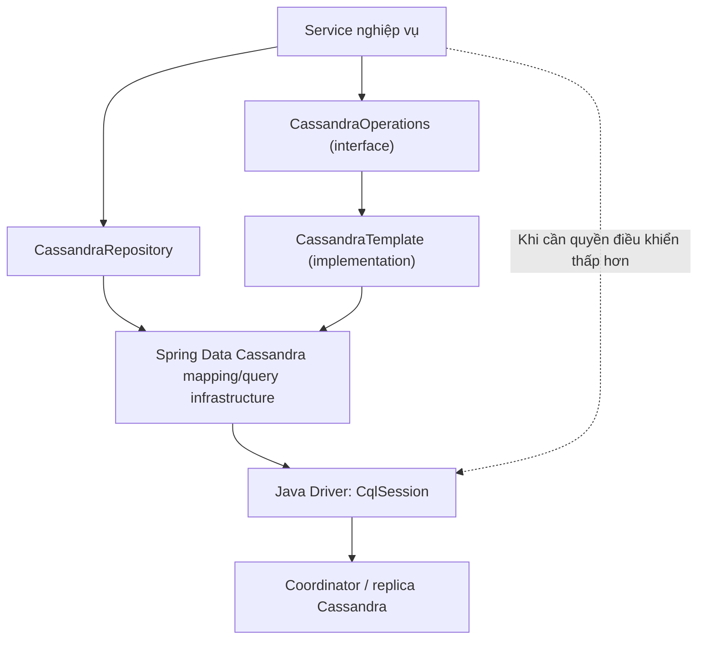
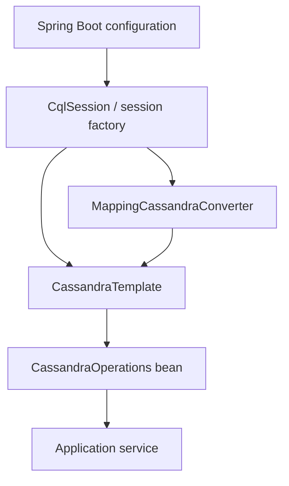

# CassandraTemplate và giao diện CassandraOperations

Trong **Spring Data Cassandra**, `CassandraTemplate` cung cấp một cách thao tác với Apache Cassandra bằng Java mà không phải tự viết toàn bộ bước ánh xạ `Row` sang entity. Thay vì chỉ dựa vào các phương thức có sẵn của `CassandraRepository`, ứng dụng có thể sử dụng template để dựng truy vấn CQL theo điều kiện cụ thể, ghi/cập nhật/xóa entity, kiểm tra sự tồn tại của dữ liệu và phối hợp những thao tác cần kiểm soát rõ đường truy cập.

Điểm nền tảng của bài là phân biệt **`CassandraOperations` — giao diện mô tả hợp đồng thao tác** — với **`CassandraTemplate` — lớp thực thi hợp đồng đó**. Việc chọn template hay repository không làm thay đổi kiến trúc phân tán của Cassandra: vẫn phải thiết kế bảng theo truy vấn, chọn partition key, tuân thủ clustering key, kiểm soát consistency, paging và hiệu năng.

Bài thuộc chương **CassandraTemplate** của module `SPRING_DATA_CASSANDRA`. Những ví dụ Java sử dụng tên package phổ biến trong các dòng Spring Data Cassandra hiện đại (đặc biệt 4.x), không giả định đã chạy với một phiên bản cụ thể của dự án. Khi áp dụng, hãy kiểm tra chữ ký API trong dependency đã được resolve.

## 1. CassandraOperations và CassandraTemplate: khác nhau ở vai trò

`CassandraOperations` là **interface** mô tả các thao tác dữ liệu cấp cao theo object mapping, chẳng hạn đọc entity, thêm/sửa/xóa và thực hiện truy vấn. `CassandraTemplate` là **implementation đồng bộ (imperative)** thường dùng của interface này. Cả hai nằm trong package `org.springframework.data.cassandra.core`.

| Thành phần | Vai trò | Khi nào chọn |
|---|---|---|
| `CassandraOperations` | Hợp đồng thao tác với Cassandra ở mức entity/query | Kiểu phụ thuộc trong service, dễ thay implementation hoặc test |
| `CassandraTemplate` | Lớp triển khai đồng bộ của `CassandraOperations` | Sử dụng trực tiếp khi cần API/chi tiết thuộc implementation |
| `CassandraRepository<T, ID>` | Repository abstraction cho entity, truy vấn CRUD và phương thức truy vấn khai báo | CRUD lặp lại, truy vấn đơn giản ổn định |
| `CqlOperations` | API ở mức CQL thấp hơn, thao tác statement và row | Muốn kiểm soát CQL/row mapping theo mục đích cụ thể |
| `CqlSession` (Java Driver) | Session quản lý kết nối/topology và thực thi statement | Prepared statement, driver options, codec/paging hoặc đường CQL chuyên biệt |
| `ReactiveCassandraOperations` / `ReactiveCassandraTemplate` | Nhánh API **reactive** | Ứng dụng dùng reactive stack thay vì lời gọi imperative |

**`CassandraTemplate` không phải một Cassandra server hoặc connection vật lý.** Nó dựa trên các thành phần được cấu hình để tương tác với driver, thực thi lệnh và chuyển đổi dữ liệu. Một ứng dụng có thể dùng repository và template đồng thời trên **cùng session/keyspace**.

Sơ đồ khái quát:



Sơ đồ thể hiện quan hệ ở mức khái niệm. Chi tiết nội bộ của repository factory hoặc template phụ thuộc vào phiên bản Spring Data và cấu hình ứng dụng; không nên xem sơ đồ là tên các bean chắc chắn sẽ xuất hiện giống nhau trong mọi release.

## 2. Vì sao service nên phụ thuộc vào interface?

Một nguyên tắc thiết kế thông thường là **phụ thuộc vào hợp đồng, không phụ thuộc vào implementation**, trừ khi cần tính năng riêng của implementation.

```java
import java.util.Optional;
import java.util.UUID;

import org.springframework.data.cassandra.core.CassandraOperations;
import org.springframework.stereotype.Service;

@Service
public class OrderLookupService {

    private final CassandraOperations operations;

    public OrderLookupService(CassandraOperations operations) {
        this.operations = operations;
    }

    public Optional<OrderById> findById(UUID orderId) {
        return Optional.ofNullable(
            operations.selectOneById(orderId, OrderById.class)
        );
    }

    public void save(OrderById order) {
        operations.insert(order);
    }
}
```

Trong ví dụ này, service **không cần biết cách `CassandraTemplate` được khởi tạo**. Khi dùng cấu hình Spring Boot Spring Data Cassandra phù hợp, infrastructure tạo hoặc cung cấp bean thực thi `CassandraOperations`; dependency injection có thể đưa implementation đó vào constructor. Nếu ứng dụng có nhiều session/template, phải chỉ rõ bean cần inject, ví dụ bằng qualifier hoặc cấu hình riêng.

Có thể inject trực tiếp `CassandraTemplate` khi cần một API đặc trưng của class ấy, nhưng dùng interface là điểm bắt đầu hợp lý cho phần lớn business service.

**Một khác biệt với JPA:** object trả về không được xem là entity đang “được quản lý và dirty-check” như trong một persistence context của Hibernate. Thay đổi field trên Java object không tự tạo lệnh CQL; cần gọi thao tác ghi một cách rõ ràng.

## 3. Thiết kế ví dụ CQL dựa trên mẫu truy vấn

Giả sử dịch vụ có hai mẫu truy vấn:

- **Q1:** xem chi tiết một đơn hàng bằng `order_id`.
- **Q2:** lấy 20 đơn gần nhất của một khách trong một tháng.

Nếu chỉ có một bảng `orders_by_id`, việc đọc tất cả đơn của khách theo tháng sẽ không có đường truy cập partition phù hợp. Vì Cassandra ưu tiên *query-driven design*, ta dùng hai bảng:

```sql
CREATE TABLE orders_by_id (
    order_id uuid PRIMARY KEY,
    customer_id uuid,
    placed_at timestamp,
    state text,
    total_minor bigint
);

CREATE TABLE orders_by_customer_month (
    customer_id uuid,
    bucket_month date,
    placed_at timestamp,
    order_id uuid,
    state text,
    total_minor bigint,
    PRIMARY KEY ((customer_id, bucket_month), placed_at, order_id)
) WITH CLUSTERING ORDER BY (placed_at DESC, order_id DESC);
```

Ở Q1, `order_id` là partition key đơn. Ở Q2, `(customer_id, bucket_month)` là **composite partition key**; `placed_at` và `order_id` là **clustering columns**. `bucket_month` được ứng dụng quy định là ngày đầu tiên của tháng theo múi giờ nghiệp vụ thống nhất.

Các truy vấn đúng thiết kế:

```sql
-- Q1: một partition theo ID
SELECT *
FROM orders_by_id
WHERE order_id = ?;

-- Q2: một partition theo khách và tháng
SELECT order_id, placed_at, state, total_minor
FROM orders_by_customer_month
WHERE customer_id = ?
  AND bucket_month = ?
LIMIT 20;
```

Không dùng `ALLOW FILTERING` để biến bảng `orders_by_id` thành bảng tra cứu danh sách theo khách. Dữ liệu trong hai bảng có thể trùng lặp có chủ đích; **template không tự đồng bộ hai projection** khi ta chỉ ghi một entity vào một bảng.

Ở môi trường thật, keyspace và replication factor cần được cấu hình trước, chẳng hạn `NetworkTopologyStrategy` theo datacenter. Các lệnh `CREATE TABLE` trên giả định session đã chọn đúng keyspace.

## 4. Ánh xạ một bảng thành entity Java

Để `CassandraTemplate` đọc hàng `orders_by_id` thành object, Spring Data cần metadata mapping.

```java
import java.time.Instant;
import java.util.UUID;

import org.springframework.data.cassandra.core.mapping.Column;
import org.springframework.data.cassandra.core.mapping.PrimaryKey;
import org.springframework.data.cassandra.core.mapping.Table;

@Table("orders_by_id")
public class OrderById {

    @PrimaryKey("order_id")
    private UUID orderId;

    @Column("customer_id")
    private UUID customerId;

    @Column("placed_at")
    private Instant placedAt;

    @Column("state")
    private String state;

    @Column("total_minor")
    private Long totalMinor;

    public OrderById() {}

    public OrderById(
            UUID orderId,
            UUID customerId,
            Instant placedAt,
            String state,
            Long totalMinor) {
        this.orderId = orderId;
        this.customerId = customerId;
        this.placedAt = placedAt;
        this.state = state;
        this.totalMinor = totalMinor;
    }

    public UUID getOrderId() { return orderId; }
    public void setOrderId(UUID orderId) { this.orderId = orderId; }

    public UUID getCustomerId() { return customerId; }
    public void setCustomerId(UUID customerId) { this.customerId = customerId; }

    public Instant getPlacedAt() { return placedAt; }
    public void setPlacedAt(Instant placedAt) { this.placedAt = placedAt; }

    public String getState() { return state; }
    public void setState(String state) { this.state = state; }

    public Long getTotalMinor() { return totalMinor; }
    public void setTotalMinor(Long totalMinor) { this.totalMinor = totalMinor; }
}
```

Lớp này phục vụ ví dụ trong bài. Những annotation sau có ý nghĩa:

| Annotation | Công dụng |
|---|---|
| `@Table("orders_by_id")` | Gắn entity với bảng CQL |
| `@PrimaryKey("order_id")` | Định danh primary key đơn của bảng |
| `@Column("customer_id")` | Đổi tên property Java thành cột CQL |
| `@Column("placed_at")` | Ánh xạ `Instant` với CQL `timestamp` nhờ converter/driver |
| `@Column("total_minor")` | Số tiền ở đơn vị nhỏ nhất, lưu bằng `bigint`; tránh sai số kiểu floating-point |

`Long` thay cho `long` nếu domain cho phép một giá trị chưa có/nullable; nếu nghiệp vụ bắt buộc có tổng tiền, hãy kiểm tra trước khi ghi. Java object, kiểu CQL và codec/converter phải nhất quán.

Với bảng Q2, có thể dùng `@PrimaryKeyClass` và `@PrimaryKeyColumn` để ánh xạ composite key, hoặc một kiểu entity tương thích với bản Spring Data đang chạy. Ví dụ rút gọn:

```java
import java.io.Serializable;
import java.time.Instant;
import java.time.LocalDate;
import java.util.UUID;

import org.springframework.data.cassandra.core.cql.Ordering;
import org.springframework.data.cassandra.core.mapping.PrimaryKeyClass;
import org.springframework.data.cassandra.core.mapping.PrimaryKeyColumn;
import org.springframework.data.cassandra.core.mapping.PrimaryKeyType;

@PrimaryKeyClass
public class CustomerMonthOrderKey implements Serializable {

    @PrimaryKeyColumn(name = "customer_id", ordinal = 0,
            type = PrimaryKeyType.PARTITIONED)
    private UUID customerId;

    @PrimaryKeyColumn(name = "bucket_month", ordinal = 1,
            type = PrimaryKeyType.PARTITIONED)
    private LocalDate bucketMonth;

    @PrimaryKeyColumn(name = "placed_at", ordinal = 2,
            type = PrimaryKeyType.CLUSTERED, ordering = Ordering.DESCENDING)
    private Instant placedAt;

    @PrimaryKeyColumn(name = "order_id", ordinal = 3,
            type = PrimaryKeyType.CLUSTERED, ordering = Ordering.DESCENDING)
    private UUID orderId;

    // Bổ sung constructor, getter/setter và equals/hashCode.
}
```

Entity cho projection:

```java
import org.springframework.data.cassandra.core.mapping.Column;
import org.springframework.data.cassandra.core.mapping.PrimaryKey;
import org.springframework.data.cassandra.core.mapping.Table;

@Table("orders_by_customer_month")
public class OrderByCustomerMonth {

    @PrimaryKey
    private CustomerMonthOrderKey key;

    @Column("state")
    private String state;

    @Column("total_minor")
    private Long totalMinor;

    // Bổ sung constructor, getter/setter.
}
```

Khi ứng dụng cần Q2, `customerId` và `bucketMonth` trong key class giúp định vị partition; `placedAt` và `orderId` định danh từng hàng trong đó. **Không** dùng riêng `UUID orderId` làm ID của repository nếu primary key CQL là composite key. Các class Java được đặt ở file riêng; key class cần có `equals/hashCode` nhất quán.

## 5. Cấu hình Spring Boot và vòng đời của template

Trong Spring Boot 3.x với starter Cassandra tương ứng, các thuộc tính thường có dạng:

```yaml
spring:
  cassandra:
    contact-points: 127.0.0.1
    port: 9042
    local-datacenter: dc1
    keyspace-name: shop_dev
    schema-action: NONE
```

Các tên `shop_dev`, `dc1` và IP là **ví dụ**, không phải thông tin môi trường đang được chạy. `local-datacenter` phải khớp DC của Cassandra; keyspace phải có schema cần thiết. `schema-action: NONE` là lựa chọn an toàn khi lược đồ được tạo bởi migration CQL và dữ liệu cần được giữ lại.

Ở các dòng Spring Boot cũ hơn có thể gặp tiền tố `spring.data.cassandra.*`. Khi dùng dependency thực tế, nên đối chiếu property metadata của dòng Boot đang chạy; không sao chép cấu hình giữa release mà không kiểm tra.

Các thành phần thường liên quan:



Sơ đồ diễn giải **vai trò cấu hình và injection**, không phản ánh chính xác mọi phụ thuộc constructor hoặc tên bean trong từng phiên bản. Nếu ứng dụng có nhiều keyspace, nhiều session hoặc template tùy chỉnh, cần xác định rõ bean nào gắn với schema nào, tránh vô tình ghi vào nhầm keyspace.

Cấu hình mặc định không đồng nghĩa Spring tự tạo keyspace cho mọi dự án. Không bật `RECREATE` hoặc `RECREATE_DROP_UNUSED` trên keyspace có dữ liệu chỉ để chạy thử template: đây là các chế độ có thể **xóa bảng và dữ liệu**.

## 6. Các thao tác đọc và ghi cơ bản qua CassandraOperations

Một số phương thức thường dùng của interface:

| Nhu cầu | Ví dụ API ở mức khái niệm | Chú ý |
|---|---|---|
| Đọc theo ID | `selectOneById(id, Entity.class)` | ID phải phản ánh toàn bộ primary key |
| Đọc theo truy vấn | `select(query, Entity.class)` | Query cần đúng partition/clustering key |
| Đọc một kết quả | `selectOne(query, Entity.class)` | Không tự bảo đảm truy vấn chỉ trả một hàng nếu thiết kế sai |
| Ghi entity | `insert(entity)` | Không tự đồng bộ những bảng projection khác |
| Cập nhật entity | `update(entity)` | CQL update chịu ngữ nghĩa timestamp/upsert của Cassandra |
| Xóa entity | `delete(entity)` | Tạo thông tin xóa/tombstone theo cơ chế Cassandra |
| Kiểm tra tồn tại | `exists(query, Entity.class)` | Cần query có khóa xác định, tránh scan |
| Đếm | `count(query, Entity.class)` | Phải cân nhắc chi phí; không phải aggregation miễn phí trên cluster |

Tên, overload và kiểu trả về chính xác có thể thay đổi theo phiên bản Spring Data Cassandra. Các ví dụ thực thi sau tập trung vào những API thông dụng; cần kiểm tra signature trong dependency đã resolve, đặc biệt nếu muốn nhận metadata hoặc cấu hình tùy chọn từng statement.

### 6.1. Insert và đọc theo primary key

```java
import java.time.Instant;
import java.util.UUID;
import org.springframework.data.cassandra.core.CassandraOperations;

UUID orderId = UUID.randomUUID();
UUID customerId = UUID.randomUUID();

OrderById order = new OrderById(
    orderId,
    customerId,
    Instant.parse("2026-11-25T09:30:00Z"),
    "NEW",
    125000L
);

operations.insert(order);

OrderById loaded =
    operations.selectOneById(orderId, OrderById.class);
```

Ở đây `operations` là một `CassandraOperations` đã được inject. Khi thực tế hóa ví dụ, đặt đoạn mã vào service/method có khai báo biến và kết nối Cassandra phù hợp.

Lệnh đọc theo `orderId` hợp lệ vì bảng `orders_by_id` dùng chính nó làm partition key. Khi không tìm thấy hàng, `selectOneById` có thể trả `null` (tùy overload/contract), nên tầng nghiệp vụ cần biểu diễn trường hợp vắng dữ liệu một cách rõ ràng, chẳng hạn `Optional.ofNullable(...)`.

### 6.2. Đọc bằng Query và Criteria

Spring Data cung cấp `Query` và `Criteria` để mô tả điều kiện truy vấn bằng Java:

```java
import java.util.UUID;

import org.springframework.data.cassandra.core.query.Criteria;
import org.springframework.data.cassandra.core.query.Query;

UUID id = orderId;

Query query = Query.query(
    Criteria.where("order_id").is(id)
);

OrderById selected =
    operations.selectOne(query, OrderById.class);
```

Đây là một điểm cân bằng: ứng dụng không tự nối chuỗi CQL, nhưng vẫn **nhìn được** điều kiện `order_id = ?`. Spring Data dựng CQL và mapping kết quả theo metadata. Khi điều kiện trở nên động, có thể xây dựng `Query` từng bước theo API của phiên bản đang dùng, song không được bỏ các thành phần partition key bắt buộc.

Với bảng Q2, mẫu CQL đúng vẫn là:

```sql
SELECT order_id, placed_at, state, total_minor
FROM orders_by_customer_month
WHERE customer_id = ?
  AND bucket_month = ?
LIMIT 20;
```

Để xây `Query` cho Q2, mọi điều kiện phải cung cấp `customer_id` **và** `bucket_month`. Chỉ truyền `customer_id` không phải là truy vấn một partition đầy đủ, bởi `bucket_month` là thành phần thứ hai của partition key. Không nên kỳ vọng template tự chọn bucket hoặc phân trang qua nhiều partition hộ ứng dụng.

### 6.3. Cập nhật và xóa

```java
// Ví dụ: đã đọc được entity cần cập nhật.
loaded.setState("PAID");
operations.update(loaded);

// Xóa chính entity đó khi nghiệp vụ yêu cầu.
operations.delete(loaded);
```

Trong Cassandra, `INSERT` và `UPDATE` thường có tính chất **upsert** đối với cùng primary key; khác với kỳ vọng “UPDATE chỉ thành công khi hàng đã tồn tại” trong nhiều hệ quan hệ. Một lệnh ghi có điều kiện, ví dụ `IF state = 'NEW'`, cần cơ chế CQL/LWT phù hợp; không tự xuất hiện chỉ vì gọi `update(entity)`.

Xóa dữ liệu không đồng nghĩa giải phóng SSTable ngay tức thì: Cassandra dùng **tombstone**, và việc thu hồi dữ liệu phụ thuộc compaction cùng điều kiện an toàn liên quan replication/repair.

## 7. Insert hay update: không nên áp tư duy JPA

CassandraTemplate cung cấp API tạo CQL, **không có mô hình persistence context/dirty checking như JPA EntityManager**.

| Chủ đề | Tư duy JPA phổ biến | Spring Data Cassandra |
|---|---|---|
| Trạng thái entity Java | Có thể được quản lý trong persistence context | Object thông thường; ghi bằng lời gọi rõ ràng |
| Insert/update | Có thể phụ thuộc trạng thái managed/new entity | Thao tác CQL theo API; Cassandra có upsert semantics |
| `flush()` | Đẩy SQL từ persistence context | Cassandra tự flush memtable thành SSTable, không phải bước tương đương JPA flush |
| Transaction | Thường có transaction ACID giữa nhiều row/bảng | Không có transaction quan hệ đa bảng/đa partition mặc định |
| Join | Có SQL JOIN ở database | Thiết kế bảng theo mẫu truy vấn; dữ liệu có thể phi chuẩn hóa |
| Khóa chính | Có thể được DB tự sinh theo sequence/identity | Cassandra thường nhận khóa do ứng dụng tạo |
| Kiểm soát đồng thời | Có các cơ chế lock và versioning của ORM | Cần hiểu timestamp, consistency và LWT khi có điều kiện |

Ví dụ, nếu hai request cùng cập nhật trạng thái đơn hàng, việc ghi `PAID` hoặc `CANCELLED` không tự được CassandraTemplate khóa bằng một transaction. Thiết kế nghiệp vụ cần trả lời: trạng thái nào được phép chuyển đổi, làm sao phát hiện ghi trùng, retry có idempotent không, và khi nào cần LWT với chi phí đồng thuận cao hơn.

Ngoài ra, thao tác toàn entity có thể có ngữ nghĩa với field null khác thao tác cập nhật một số cột. Cần kiểm tra CQL được tạo ra và quy tắc `null`/unset theo phiên bản mapping nếu muốn **giữ nguyên những field không được cung cấp**. Với cập nhật từng cột, dùng API query/update phù hợp hoặc prepared statement thay vì giả định save một entity thiếu dữ liệu sẽ an toàn.

## 8. CassandraTemplate hay CassandraRepository?

Cả hai cùng dựa trên mapping metadata nhưng phục vụ cách tổ chức mã khác nhau.

### Repository: khi truy vấn ổn định và đơn giản

```java
import java.util.UUID;
import org.springframework.data.cassandra.repository.CassandraRepository;

public interface OrderByIdRepository
        extends CassandraRepository<OrderById, UUID> {
}
```

Các phương thức như `findById`, `save`, `deleteById` thuận tiện cho thao tác CRUD lặp lại. Repository cũng hỗ trợ query methods và `@Query` ở các phiên bản phù hợp.

### CassandraOperations: khi cần truy vấn/luồng thao tác linh hoạt

```java
import java.util.UUID;
import org.springframework.data.cassandra.core.CassandraOperations;
import org.springframework.data.cassandra.core.query.Criteria;
import org.springframework.data.cassandra.core.query.Query;

public class OrderReadService {
    private final CassandraOperations operations;

    public OrderReadService(CassandraOperations operations) {
        this.operations = operations;
    }

    public OrderById lookup(UUID orderId) {
        Query query = Query.query(
            Criteria.where("order_id").is(orderId)
        );
        return operations.selectOne(query, OrderById.class);
    }
}
```

Cách này thường hợp lý khi service xây điều kiện theo đầu vào có kiểm soát, cần phối hợp nhiều truy vấn, hoặc muốn giữ logic đọc ở một lớp dịch vụ mà không tạo quá nhiều repository methods.

**Không có nguyên tắc “template luôn nhanh hơn repository”.** Nếu hai cách sinh ra CQL tương đương và cùng driver/session/CL, chi phí lớn nhất thường vẫn nằm ở **partition cần đọc, mạng, replica, SSTable/tombstone và kích thước kết quả**. Chọn API để tăng tính rõ ràng và kiểm soát, sau đó đo hiệu năng bằng workload thật.

## 9. CassandraOperations, CqlOperations và CqlSession: ba mức trừu tượng

Có lúc ứng dụng muốn dùng một CQL statement đặc thù hoặc tính năng driver chưa được biểu diễn tiện bằng mapping API. Khi đó cần hiểu ranh giới:

```text
Business code
  ├─ CassandraRepository         CRUD + query methods
  ├─ CassandraOperations         Mapped entity/query operations
  │     └─ CassandraTemplate     Implementation thông dụng
  ├─ CqlOperations               CQL operations, ít entity mapping hơn
  └─ CqlSession                  Driver: statement, metadata, paging, codec
```

**CqlOperations** có thể thuận tiện cho CQL thủ công, callbacks và row mapping khi cần. **CqlSession** cho phép truy cập trực tiếp driver như `PreparedStatement`, `BoundStatement`, `SimpleStatement` và session metadata.

Ví dụ CqlSession (không cần mapper) cho Q1:

```java
import java.util.UUID;

import com.datastax.oss.driver.api.core.CqlSession;
import com.datastax.oss.driver.api.core.cql.PreparedStatement;
import com.datastax.oss.driver.api.core.cql.Row;

public class RawOrderLookup {
    private final CqlSession session;
    private final PreparedStatement findById;

    public RawOrderLookup(CqlSession session) {
        this.session = session;
        this.findById = session.prepare(
            "SELECT order_id, customer_id, placed_at, state, total_minor " +
            "FROM orders_by_id WHERE order_id = ?"
        );
    }

    public String findState(UUID id) {
        Row row = session.execute(findById.bind(id)).one();
        return row == null ? null : row.getString("state");
    }
}
```

Đường này phải tự kiểm soát mapping, null, column names và lựa chọn cột. Nó có ích nếu cần tính năng driver cụ thể hoặc chỉ đọc một cột nhỏ, nhưng làm tăng mã và nguy cơ gắn logic CQL vào service.

**Không tạo một session mới cho mỗi request.** Driver quản lý kết nối, topology và prepared statement metadata; nên dùng session được cấu hình/quản lý vòng đời phù hợp. Trong Spring Boot, inject session đang phục vụ ứng dụng và tránh tạo session thứ hai khác contact point, keyspace hoặc codec registry mà không có lý do.

## 10. Truy vấn theo partition key vẫn là điều kiện đầu tiên

Template là tầng tiện ích, không phải bộ tối ưu có thể “sửa” schema Cassandra.

Giả sử màn hình cần lấy tất cả đơn hàng ở trạng thái `PAID` của toàn bộ hệ thống. Bảng `orders_by_id` chỉ được tổ chức theo `order_id`. Query kiểu:

```sql
SELECT *
FROM orders_by_id
WHERE state = 'PAID'
ALLOW FILTERING;
```

có thể khiến Cassandra lọc nhiều dữ liệu và chịu chi phí tăng mạnh khi số hàng lớn. Dùng `CassandraOperations.select(query, ...) ` không biến tình huống đó thành một đường truy cập hiệu quả. Với truy vấn quan trọng, hãy thiết kế thêm một bảng theo mẫu truy vấn — ví dụ partition theo **trạng thái + bucket thời gian + shard** — cùng quy trình ghi/đồng bộ projection.

Trên bảng `orders_by_customer_month`, `placed_at` chỉ hữu ích cho truy vấn khoảng khi đã biết **đầy đủ `customer_id` và `bucket_month`**. Quy tắc clustering prefix cũng vẫn áp dụng: nếu nhiều clustering columns, cột đứng trước thường cần ràng buộc bằng đẳng thức trước khi lọc khoảng cột tiếp theo.

Các quyết định cần được xem trước khi viết template query:

1. **Partition key:** điều kiện đầu vào xác định được một partition hay nhiều partition?
2. **Clustering key:** thứ tự và điều kiện khoảng có hợp với schema?
3. **Kích thước partition:** có cần bucketing theo ngày/tháng để tránh partition quá lớn?
4. **Số hàng/trang:** query có giới hạn và cơ chế paging thích hợp?
5. **Tính nhất quán:** RF/CL phù hợp SLA và rủi ro khi một replica không sẵn sàng?
6. **Tải và tombstone:** truy vấn có bị nhiều TTL/delete, compaction hoặc hot partition làm chậm?

## 11. Paging: LIMIT không phải toàn bộ câu chuyện

Cassandra hỗ trợ **paging state** ở driver. Trang dữ liệu được lấy theo trạng thái truy vấn, không giống phép `OFFSET` tăng dần trong SQL quan hệ.

Đối với Q2:

```sql
SELECT order_id, placed_at, state, total_minor
FROM orders_by_customer_month
WHERE customer_id = ?
  AND bucket_month = ?;
```

Nếu có hàng chục nghìn đơn trong một partition, không nên lấy hết vào một `List` trên một request web. Cần cấu hình page size phù hợp và nhận/lưu con trỏ trang tiếp theo bằng cơ chế của Spring Data/driver được sử dụng.

Ví dụ với Java Driver để thấy khác biệt giữa page size và LIMIT:

```java
import com.datastax.oss.driver.api.core.cql.SimpleStatement;

SimpleStatement statement = SimpleStatement.builder(
        "SELECT order_id, placed_at, state, total_minor " +
        "FROM orders_by_customer_month " +
        "WHERE customer_id = ? AND bucket_month = ?")
    .addPositionalValues(customerId, bucketMonth)
    .setPageSize(50)
    .build();
```

`setPageSize(50)` đặt kích thước trang fetch **không phải tổng số hàng của toàn truy vấn**. `LIMIT 50` là giới hạn tổng số hàng từ CQL. Nếu truy cập paging qua template, hãy kiểm tra API của phiên bản Spring Data Cassandra cụ thể; đừng giả định mọi overload của `select` trả ra paging state giống Java Driver.

Paging state là **opaque**, gắn với ngữ cảnh statement/parameter; không tự biến thành “số trang 7”. Khi sang tháng khác, `bucket_month` là partition key khác nên phải chạy truy vấn riêng và quản lý trạng thái/merge kết quả phía ứng dụng. Với dữ liệu cập nhật đồng thời, không mặc định mọi trang là một snapshot bất biến.

## 12. Consistency level, timeout và retry khi dùng template

`CassandraOperations` giúp thao tác mapped entity, còn **consistency level** quyết định số replica cần xác nhận ở mỗi request. Cấu hình số contact point không trực tiếp đặt CL hoặc replication factor.

Ví dụ keyspace RF=3 trong một DC:

| CL | Điều kiện ghi minh họa | Khi mất một replica |
|---|---|---|
| `LOCAL_ONE` | Cần một replica cục bộ xác nhận | Thường vẫn có thể ghi nếu có replica còn sống |
| `LOCAL_QUORUM` | Cần đa số: hai trên ba | Có thể ghi nếu còn hai replica phù hợp |
| `ALL` | Cần cả ba | Không thể hoàn thành khi thiếu một replica cần thiết |

Các con số tùy **RF, topology và trạng thái replica thực tế**. Một lần gọi `operations.insert(order)` trả về thành công không bảo đảm dữ liệu đã flush thành SSTable; mỗi replica trước hết ghi theo commit log/memtable và cơ chế durability được cấu hình.

Tùy phiên bản, Spring Data Cassandra có các option cho insert/update/delete/query; Java Driver còn cho phép đặt consistency và timeout trên statement. Điều quan trọng là xác minh **statement thực tế** và cấu hình mặc định của driver, thay vì cho rằng template luôn dùng một CL cố định.

**Timeout không đồng nghĩa chắc chắn chưa ghi:** coordinator hoặc một số replica có thể đã nhận mutation trước khi client hết thời gian chờ. Nếu retry tạo một `order_id` mới mỗi lần, ứng dụng có thể tạo bản ghi trùng nghiệp vụ. Nên dùng ID ổn định theo request nghiệp vụ, retry có kiểm soát, và LWT hoặc các quy tắc idempotency khi cần.

Các lệnh ghi vào hai bảng denormalized **không tự trở thành một giao dịch đa bảng** nhờ dùng cùng CassandraTemplate. Cần quy trình đồng bộ projection và xử lý ghi một phần thất bại.

## 13. Xử lý lỗi và khả năng quan sát

Khi dùng template qua Spring, lỗi truy vấn có thể được chuyển thành các exception trong hệ thống **Spring DataAccessException**; đường CqlSession trực tiếp có các exception của driver. Cần kiểm tra loại lỗi cụ thể theo phiên bản.

| Triệu chứng | Nguyên nhân đáng kiểm tra | Hướng xử lý |
|---|---|---|
| Không kết nối được khi khởi động | Contact point, `local-datacenter`, xác thực/TLS, keyspace | Kiểm tra driver startup log, topology và mạng |
| `selectOneById` luôn rỗng | ID không đúng, keyspace/table khác, dữ liệu chưa tồn tại | Xác minh primary key và CQL bằng cùng session |
| Query bị Cassandra từ chối | Thiếu partition key, lọc sai clustering prefix, schema mismatch | Sửa schema/query; không lạm dụng `ALLOW FILTERING` |
| Entity đọc ra sai hoặc null | Annotation `@Column`, converter, kiểu Java/CQL không khớp | Kiểm tra mapping metadata và row gốc |
| WriteTimeout/ReadTimeout | Replica chậm, CL cao, network hoặc compaction | Xem latency, topology, tài nguyên, retry policy |
| Tìm theo status trên bảng by_id rất chậm | Truy vấn không theo partition key | Thiết kế bảng đọc phù hợp access pattern |
| Đọc nhiều hàng gây hết RAM | Dùng template lấy tất cả kết quả mà không paging | Truy vấn theo bucket, giới hạn page size |
| `delete` xong nhưng đĩa chưa giảm | Tombstone và compaction chưa thu hồi được | Kiểm tra TTL, tombstone, repair, compaction |
| Ghi một bảng nhưng màn hình khác không đổi | Projection khác chưa được cập nhật | Viết luồng cập nhật nhiều bảng và reconciliation |

Có thể dùng logging của Spring Data, driver metrics, tracing Cassandra, node metrics và kiểm tra trực tiếp CQL để phân biệt lỗi ở **mapping layer** với lỗi **mô hình dữ liệu phân tán**. Tránh bật log chứa payload nhạy cảm hoặc bind parameter chứa thông tin người dùng ở production.

## 14. Một bài lab từ schema tới CassandraOperations

Thực hành trên Cassandra test dùng riêng, không sửa schema production:

1. Tạo keyspace `shop_dev` với `NetworkTopologyStrategy` và RF phù hợp số node lab.
2. Tạo bảng `orders_by_id` và `orders_by_customer_month` theo mục 3.
3. Cấu hình `spring.cassandra.*`, giữ `schema-action: NONE`.
4. Khai báo `OrderById` như mục 4, inject `CassandraOperations` vào service.
5. Tạo UUID ổn định, gọi `operations.insert(order)`.
6. Đọc lại bằng `operations.selectOneById(orderId, OrderById.class)`; xác minh các trường `customerId`, `placedAt`, `state`, `totalMinor`.
7. Đọc cùng hàng bằng `Query.query(Criteria.where("order_id").is(orderId))` để hiểu template dựng query.
8. Thử sửa `state` bằng `operations.update(order)`, đọc lại; thử xóa trong môi trường lab.
9. Viết một mutation riêng cho bảng `orders_by_customer_month`. Quan sát rằng **ghi bảng by_id không tự tạo hàng ở bảng by_customer_month**.
10. Thử truy vấn Q2 bằng CQL chuẩn và kiểm tra ứng dụng truyền đủ `customer_id`, `bucket_month`; quan sát giới hạn kết quả, paging và thứ tự clustering.
11. Dùng dữ liệu giả đủ lớn để kiểm tra kích thước partition, không kết luận hiệu năng từ vài bản ghi.
12. Đối chiếu nếu dùng repository: cùng khóa và CQL tương đương phải cho kết quả nghiệp vụ tương đương.

Mục tiêu lab là hiểu **vai trò template trong mapping/query**, không phải chứng minh khả năng failover đa node hay đo hiệu năng production. Những vấn đề consistency, repair, tombstone và hot partition cần bài kiểm thử riêng trong cluster có topology đại diện.

### Minh họa một integration test tối giản

```java
import static org.junit.jupiter.api.Assertions.*;

import java.time.Instant;
import java.util.UUID;
import org.junit.jupiter.api.Test;
import org.springframework.beans.factory.annotation.Autowired;
import org.springframework.boot.test.context.SpringBootTest;
import org.springframework.data.cassandra.core.CassandraOperations;

@SpringBootTest
class CassandraOperationsIntegrationTest {

    @Autowired
    CassandraOperations operations;

    @Test
    void insertThenSelectById() {
        UUID id = UUID.randomUUID();

        OrderById input = new OrderById(
            id,
            UUID.randomUUID(),
            Instant.parse("2026-11-25T09:30:00Z"),
            "NEW",
            12345L
        );

        operations.insert(input);

        OrderById loaded =
            operations.selectOneById(id, OrderById.class);

        assertNotNull(loaded);
        assertEquals(id, loaded.getOrderId());
        assertEquals("NEW", loaded.getState());
        assertEquals(Long.valueOf(12345L), loaded.getTotalMinor());

        // Chỉ xóa dữ liệu test đã tạo trong keyspace lab.
        operations.delete(loaded);
    }
}
```

Đây là **khung integration test**: phải có dependency JUnit/Spring Boot Test, Cassandra test đang chạy, keyspace, bảng và entity mapping phù hợp. Không chạy trực tiếp trên dữ liệu đang được người dùng sử dụng. Các thao tác xóa ở phần cuối có thể gây tombstone; trong test cần cân nhắc môi trường cô lập để tránh ảnh hưởng phép đo khác.

## 15. Những ngộ nhận dễ gặp

| Nhận định | Đánh giá |
|---|---|
| “`CassandraTemplate` và `CassandraOperations` là hai cách kết nối riêng.” | **Sai.** Một bên là implementation, một bên là interface hợp đồng. |
| “`CassandraTemplate` thay thế mọi phần của Java Driver.” | **Sai.** Template xây trên driver/infrastructure; một số trường hợp vẫn cần CqlSession. |
| “Dùng template thì không cần thiết kế partition key.” | **Sai.** CQL vẫn tuân theo partition/clustering key. |
| “`insert` chỉ thành công khi bản ghi chưa tồn tại.” | **Sai.** Cassandra có upsert semantics, trừ khi dùng điều kiện phù hợp. |
| “Gọi `update` tự khóa hàng.” | **Sai.** Cần hiểu timestamp, CL và LWT nếu có điều kiện cạnh tranh. |
| “Template có cơ chế dirty checking của JPA.” | **Sai.** Object Java không tự được theo dõi để ghi ngầm. |
| “`LIMIT 20` giải quyết mọi vấn đề paging.” | **Sai.** LIMIT và driver paging state là hai khái niệm khác nhau. |
| “Một session có ba contact point nghĩa là RF=3.” | **Sai.** RF thuộc cấu hình keyspace. |
| “Repository luôn nhanh hơn template.” | **Không có căn cứ chung.** Cần so CQL, CL và workload thực tế. |

## 16. Checklist trước khi chọn CassandraTemplate trong một tính năng

1. **Yêu cầu đọc là gì?** Có đầy đủ partition key, clustering, giới hạn thời gian và thứ tự kết quả không?
2. **Có thể dùng repository không?** Nếu CRUD rất đơn giản, repository thường gọn hơn.
3. **Có cần Query/Criteria động?** CassandraOperations phù hợp khi điều kiện được xây có kiểm soát.
4. **Entity mapping đúng chưa?** `@Table`, `@PrimaryKey`, `@Column`, Java/CQL types và composite keys khớp schema.
5. **Đã inject đúng bean?** Session, keyspace, local DC và converter phù hợp profile môi trường.
6. **Có hiểu upsert/null semantics không?** Không nhầm insert/update của Cassandra với transaction/dirty checking JPA.
7. **Tính nhất quán nào cần?** RF, CL, timeout và retry đáp ứng yêu cầu của tính năng.
8. **Có cần paging không?** Tránh trả toàn bộ partition lớn; dùng page size/paging state đúng ngữ cảnh.
9. **Có bảng projection không?** Xác định cơ chế ghi, cập nhật, delete, retry và reconciliation riêng.
10. **Đã thử với Cassandra thật chưa?** Kiểm tra query CQL, mapping round-trip, lỗi node và latency khi có dữ liệu đại diện.

Tóm lại, **`CassandraOperations` định nghĩa cách ứng dụng yêu cầu thao tác dữ liệu, còn `CassandraTemplate` triển khai các thao tác ấy bằng hệ thống mapping/query của Spring Data Cassandra**. Hai công cụ giúp giảm mã lặp và cấu trúc logic persistence rõ hơn, nhưng hiệu năng và tính đúng đắn của hệ thống vẫn phụ thuộc **thiết kế bảng theo truy vấn, partition key, consistency, paging và vận hành cluster**.

## Tài liệu tham khảo

- [Spring Data Cassandra — Template API](https://docs.spring.io/spring-data/cassandra/reference/cassandra/template.html): tổng quan CassandraTemplate, CassandraOperations và các thao tác đọc/ghi.
- [Spring Data Cassandra — CassandraOperations API](https://docs.spring.io/spring-data/cassandra/docs/current/api/org/springframework/data/cassandra/core/CassandraOperations.html): interface và chữ ký phương thức trong dòng hiện hành.
- [Spring Data Cassandra — Mapping](https://docs.spring.io/spring-data/cassandra/reference/object-mapping.html): object mapping, primary key và constructor/property binding.
- [Spring Data Cassandra — Repositories](https://docs.spring.io/spring-data/cassandra/reference/cassandra/repositories.html): repository abstraction và query methods.
