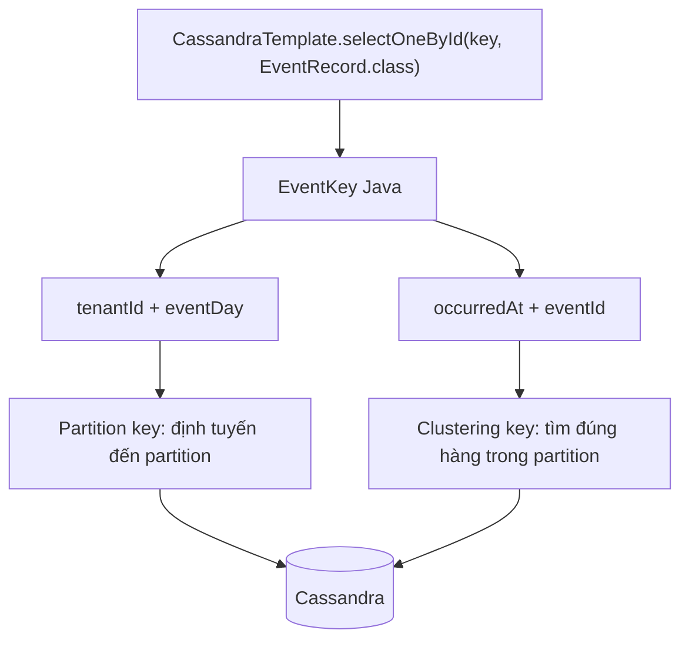

# selectOneById và truy cập bằng khóa ghép

Trong **Spring Data Cassandra**, `CassandraTemplate` giúp đọc và ghi entity thông qua thông tin ánh xạ Java, đồng thời cho phép lập truy vấn khi cần kiểm soát điều kiện CQL. Với một hàng có khóa chính đơn, thao tác tìm theo ID khá trực quan. Nhưng khi bảng Apache Cassandra dùng **partition key ghép và clustering key**, khái niệm “ID” không còn là một trường đơn lẻ: nó có thể là một đối tượng Java chứa **toàn bộ các thành phần của primary key**.

Bài học thuộc chương **CassandraTemplate**, tập trung vào `selectOneById` và cách truy cập đúng bảng có **khóa ghép**. Sau bài này, bạn cần phân biệt được truy vấn tìm **đúng một hàng** với truy vấn đọc **nhiều hàng trong một partition**, ánh xạ khóa ghép bằng `@PrimaryKeyClass`, xử lý kết quả không tồn tại và tránh những truy vấn thiếu partition key trên mô hình dữ liệu phân tán.

## 1. Đi từ truy vấn nghiệp vụ tới primary key

Giả sử một dịch vụ lưu sự kiện kiểm toán. Hai yêu cầu chính là:

1. Đọc **một sự kiện cụ thể** khi đã biết tenant, ngày UTC, thời điểm phát sinh và ID sự kiện.
2. Lấy **50 sự kiện mới nhất** của một tenant trong một ngày.

Một bảng được thiết kế theo hai hướng đọc đó:

```sql
CREATE TABLE events_by_tenant_day (
    tenant_id   text,
    event_day   date,
    occurred_at timestamp,
    event_id    uuid,
    event_type  text,
    payload     text,
    PRIMARY KEY ((tenant_id, event_day), occurred_at, event_id)
) WITH CLUSTERING ORDER BY (occurred_at DESC, event_id DESC);
```

Khóa chính gồm hai phần:

| Thành phần | Vai trò trong Cassandra | Ảnh hưởng đến truy vấn |
| --- | --- | --- |
| `tenant_id` | Thành phần đầu của partition key | Giới hạn dữ liệu theo tenant |
| `event_day` | Thành phần thứ hai của partition key | Phân chia dữ liệu theo ngày UTC |
| `occurred_at` | Clustering column thứ nhất | Sắp xếp thời gian trong partition, mới trước |
| `event_id` | Clustering column thứ hai | Phân biệt các sự kiện có cùng millisecond, tạo thứ tự phụ |

Lưu ý cú pháp `PRIMARY KEY ((tenant_id, event_day), occurred_at, event_id)`: **hai cặp ngoặc** quanh `tenant_id, event_day` chỉ một **partition key ghép**. Hai cột còn lại là **clustering columns**, không nằm trong partition key. Cassandra băm cả cặp `(tenant_id, event_day)` để xác định partition; các cột clustering dùng để xác định hàng bên trong partition.



Một truy vấn CQL tìm đúng hàng phải định danh được partition và toàn bộ clustering key:

```sql
SELECT *
FROM events_by_tenant_day
WHERE tenant_id = ?
  AND event_day = ?
  AND occurred_at = ?
  AND event_id = ?;
```

Ngược lại, truy vấn lấy danh sách trong ngày chỉ cần biết **toàn bộ partition key**, rồi có thể lấy các hàng theo thứ tự clustering:

```sql
SELECT *
FROM events_by_tenant_day
WHERE tenant_id = ? AND event_day = ?
LIMIT 50;
```

Hai truy vấn này sử dụng **cùng bảng** nhưng khác phạm vi kết quả. Chọn `selectOneById` hay `select(Query, ...)` phải dựa vào phạm vi mà nghiệp vụ yêu cầu, không dựa vào việc kết quả UI chỉ hiển thị một đối tượng.

## 2. Ánh xạ khóa ghép bằng `@PrimaryKeyClass`

Trong Spring Data Cassandra, hãy biểu diễn composite primary key bằng một Java class được đánh dấu `@PrimaryKeyClass`. Mỗi trường khóa được đánh dấu `@PrimaryKeyColumn` kèm loại `PARTITIONED` hoặc `CLUSTERED` và thứ tự `ordinal`.

```java
import java.io.Serializable;
import java.time.Instant;
import java.time.LocalDate;
import java.util.Objects;
import java.util.UUID;
import org.springframework.data.cassandra.core.cql.Ordering;
import org.springframework.data.cassandra.core.mapping.PrimaryKeyClass;
import org.springframework.data.cassandra.core.mapping.PrimaryKeyColumn;
import org.springframework.data.cassandra.core.mapping.PrimaryKeyType;

@PrimaryKeyClass
public class EventKey implements Serializable {

    @PrimaryKeyColumn(name = "tenant_id", ordinal = 0,
            type = PrimaryKeyType.PARTITIONED)
    private String tenantId;

    @PrimaryKeyColumn(name = "event_day", ordinal = 1,
            type = PrimaryKeyType.PARTITIONED)
    private LocalDate eventDay;

    @PrimaryKeyColumn(name = "occurred_at", ordinal = 2,
            type = PrimaryKeyType.CLUSTERED,
            ordering = Ordering.DESCENDING)
    private Instant occurredAt;

    @PrimaryKeyColumn(name = "event_id", ordinal = 3,
            type = PrimaryKeyType.CLUSTERED,
            ordering = Ordering.DESCENDING)
    private UUID eventId;

    public EventKey() {}

    public EventKey(String tenantId, LocalDate eventDay,
                    Instant occurredAt, UUID eventId) {
        this.tenantId = tenantId;
        this.eventDay = eventDay;
        this.occurredAt = occurredAt;
        this.eventId = eventId;
    }

    public String getTenantId() { return tenantId; }
    public LocalDate getEventDay() { return eventDay; }
    public Instant getOccurredAt() { return occurredAt; }
    public UUID getEventId() { return eventId; }

    public void setTenantId(String tenantId) { this.tenantId = tenantId; }
    public void setEventDay(LocalDate eventDay) { this.eventDay = eventDay; }
    public void setOccurredAt(Instant occurredAt) {
        this.occurredAt = occurredAt;
    }
    public void setEventId(UUID eventId) { this.eventId = eventId; }

    @Override
    public boolean equals(Object other) {
        if (this == other) return true;
        if (!(other instanceof EventKey that)) return false;
        return Objects.equals(tenantId, that.tenantId)
                && Objects.equals(eventDay, that.eventDay)
                && Objects.equals(occurredAt, that.occurredAt)
                && Objects.equals(eventId, that.eventId);
    }

    @Override
    public int hashCode() {
        return Objects.hash(tenantId, eventDay, occurredAt, eventId);
    }
}
```

Điểm cần ghi nhớ:

- `ordinal` và `type` của từng cột phải khớp định nghĩa khóa trong CQL. `event_day` được khai báo `PARTITIONED` chứ không phải clustering column.
- `LocalDate` biểu diễn cột CQL `date`; `Instant` biểu diễn `timestamp`; `UUID` biểu diễn `uuid`.
- `equals()` và `hashCode()` so sánh đủ bốn thành phần theo giá trị. Không tự coi `eventId` là toàn bộ khóa của bảng này.
- Trong ví dụ dùng `timestamp`, Cassandra lưu độ chính xác **millisecond**. Giá trị `Instant` dùng trong khóa phải được chuẩn hóa nhất quán ở lúc ghi và khi đọc lại.

Đối tượng khóa có thể được xây dựng từ request, nhưng trước khi truy vấn cần kiểm tra tenant được phép truy cập và bảo đảm **không có thành phần khóa nào bị null**. Một khóa ghép thiếu `eventDay` hoặc `occurredAt` không trở thành một yêu cầu tìm “gần đúng” qua `selectOneById`.

## 3. Entity có `@PrimaryKey` là đối tượng khóa ghép

```java
import org.springframework.data.cassandra.core.mapping.Column;
import org.springframework.data.cassandra.core.mapping.PrimaryKey;
import org.springframework.data.cassandra.core.mapping.Table;

@Table("events_by_tenant_day")
public class EventRecord {

    @PrimaryKey
    private EventKey key;

    @Column("event_type")
    private String eventType;

    @Column("payload")
    private String payload;

    public EventRecord() {}

    public EventRecord(EventKey key, String eventType, String payload) {
        this.key = key;
        this.eventType = eventType;
        this.payload = payload;
    }

    public EventKey getKey() { return key; }
    public String getEventType() { return eventType; }
    public String getPayload() { return payload; }

    public void setKey(EventKey key) { this.key = key; }
    public void setEventType(String eventType) { this.eventType = eventType; }
    public void setPayload(String payload) { this.payload = payload; }
}
```

`@PrimaryKey` được đặt lên field `EventKey`. Spring Data Cassandra dùng metadata trong `EventKey` để ánh xạ các cột khóa, còn `event_type` và `payload` là cột dữ liệu thông thường. Entity không phải Spring bean được inject trực tiếp; Spring Data tạo object entity khi đọc hàng.

Không dùng `@Id` đơn giản trên riêng `eventId` nếu schema thực tế có cả partition key và nhiều clustering column. Mapping phải mô tả **đúng khóa chính mà Cassandra sử dụng**, nếu không việc tìm theo ID và tạo câu lệnh ghi/đọc có thể không khớp bảng.

## 4. `CassandraTemplate.selectOneById`: tìm đúng một hàng

`CassandraTemplate` là API thao tác entity của Spring Data Cassandra. Sau khi ứng dụng đã cấu hình `CqlSession` và mapping, một service có thể inject template:

```java
import java.util.Objects;
import java.util.Optional;
import org.springframework.data.cassandra.core.CassandraTemplate;
import org.springframework.stereotype.Service;

@Service
public class EventLookupService {
    private final CassandraTemplate template;

    public EventLookupService(CassandraTemplate template) {
        this.template = template;
    }

    public Optional<EventRecord> findByKey(EventKey key) {
        Objects.requireNonNull(key, "key");
        if (key.getTenantId() == null || key.getTenantId().isBlank()
                || key.getEventDay() == null
                || key.getOccurredAt() == null
                || key.getEventId() == null) {
            throw new IllegalArgumentException("Thiếu thành phần khóa");
        }

        EventRecord event = template.selectOneById(
                key, EventRecord.class);
        return Optional.ofNullable(event);
    }
}
```

**Chữ ký cốt lõi:** `selectOneById(Object id, Class<T> entityClass)`. Với entity ở trên, đối số `id` chính là một `EventKey` chứa **đầy đủ khóa chính**, không phải chỉ `UUID eventId`.

Hành vi cần hiểu:

1. Template sử dụng entity metadata để biết bảng và các thành phần primary key.
2. Nó tạo/thực thi thao tác đọc theo khóa và ánh xạ hàng kết quả thành `EventRecord`.
3. Nếu không có hàng tương ứng, API đồng bộ này trả `null`; service có thể dùng `Optional.ofNullable(...)` để diễn đạt trường hợp không tìm thấy.
4. Nếu truy vấn kết nối/driver/CQL/mapping thất bại, đó là **lỗi truy cập dữ liệu**, không phải trường hợp “không tìm thấy”; không nên biến mọi exception thành `Optional.empty()`.

Ví dụ tạo khóa ở phía gọi service:

```java
import java.time.Instant;
import java.time.LocalDate;
import java.time.ZoneOffset;
import java.util.UUID;

Instant occurredAt = Instant.parse("2026-11-25T02:30:12.123Z");
LocalDate eventDay = occurredAt.atZone(ZoneOffset.UTC).toLocalDate();
UUID eventId = UUID.fromString(
        "550e8400-e29b-41d4-a716-446655440000");

EventKey key = new EventKey(
        "tenant-a", eventDay, occurredAt, eventId);

// Khi đã inject EventLookupService:
// Optional<EventRecord> result = lookup.findByKey(key);
```

Nếu writer dùng bucket theo UTC, reader cũng phải suy ra `eventDay` theo UTC. Việc lấy ngày theo timezone trình duyệt khi writer đã bucket theo UTC có thể làm request đọc nhầm partition. Đối với `timestamp`, cần thống nhất làm tròn về millisecond trước khi tạo khóa; hai `Instant` chỉ khác phần dưới một millisecond có thể biểu diễn cùng giá trị `timestamp` trong Cassandra.

### 4.1. Ghi một hàng rồi truy vấn lại theo khóa

Với entity có dữ liệu hợp lệ:

```java
EventRecord record = new EventRecord(
        key, "LOGIN", "{\"ok\":true}");

template.insert(record);

EventRecord fetched = template.selectOneById(
        record.getKey(), EventRecord.class);
```

`insert` là thao tác ghi do template thực hiện dựa trên entity mapping. Cassandra có ngữ nghĩa upsert trong nhiều câu lệnh ghi: không nên mặc định `insert` đồng nghĩa với ràng buộc “bản ghi chưa tồn tại” giống một số hệ cơ sở dữ liệu quan hệ. Nếu nghiệp vụ cần chặn tạo trùng, phải xem xét **conditional write/LWT** và chi phí tương ứng.

Trong hệ phân tán, khả năng đọc ngay sau ghi còn phụ thuộc consistency level, replication factor, topology và đường thực thi. Ví dụ trên mô tả API ở tầng Java, không cam kết một SLA read-after-write cho mọi cấu hình cluster.

## 5. Đủ khóa chính và đủ partition key là hai chuyện khác nhau

Có hai khái niệm dễ nhầm:

**Full primary key** = tất cả cột `tenant_id`, `event_day`, `occurred_at`, `event_id`. Nó xác định **một hàng** và phù hợp cho `selectOneById(EventKey, EventRecord.class)`.

**Full partition key** = chỉ `tenant_id`, `event_day`. Nó xác định **một partition**, nhưng partition đó có thể chứa nhiều hàng; khi truy vấn danh sách, cần dùng `Query`/`Criteria`, limit và cách phân trang phù hợp.

| Input đã biết | Kết quả có thể định danh | API nên cân nhắc |
| --- | --- | --- |
| `tenantId + eventDay + occurredAt + eventId` | Một hàng cụ thể | `selectOneById(EventKey, EventRecord.class)` |
| `tenantId + eventDay` | Nhiều hàng của một partition | `select(Query, EventRecord.class)` |
| `tenantId + eventDay + occurredAt` | Có thể nhiều hàng tại cùng millisecond | `select(Query, EventRecord.class)` |
| Chỉ `eventId` | Chưa biết partition và khóa đầy đủ | Cần bảng tra cứu/access pattern khác |
| Chỉ `tenantId` | Không xác định một partition khi `eventDay` cũng thuộc partition key | Thiết kế truy vấn theo ngày hoặc bảng khác |

Vì `eventId` chỉ là một clustering column, một `UUID` riêng lẻ không đủ để định vị hàng trong bảng này. Đặt tên method `findByEventId` hoặc truyền riêng UUID vào `selectOneById` không làm Cassandra tự tìm được dữ liệu nằm ở partition nào.

## 6. Đọc nhiều hàng trong một partition bằng `Query` và `Criteria`

Để đọc 50 sự kiện mới nhất trong ngày, dùng `select(Query, Class<T>)`:

```java
import java.time.LocalDate;
import java.util.List;
import org.springframework.data.cassandra.core.CassandraTemplate;
import org.springframework.data.cassandra.core.query.Criteria;
import org.springframework.data.cassandra.core.query.Query;

public List<EventRecord> latestInDay(
        CassandraTemplate template,
        String tenantId, LocalDate eventDay, int limit) {

    if (tenantId == null || tenantId.isBlank()
            || eventDay == null || limit < 1 || limit > 100) {
        throw new IllegalArgumentException("Tham số truy vấn không hợp lệ");
    }

    Query query = Query.query(Criteria.where("tenant_id").is(tenantId))
            .and(Criteria.where("event_day").is(eventDay))
            .limit(limit);

    return template.select(query, EventRecord.class);
}
```

Mặc định, bảng ví dụ đã khai báo clustering order `occurred_at DESC, event_id DESC`, phù hợp với yêu cầu lấy các sự kiện mới trước. Nếu cần lọc khoảng thời gian trong cùng ngày, có thể bổ sung `Criteria` cho clustering column `occurred_at`:

```java
Query rangeQuery = Query
        .query(Criteria.where("tenant_id").is(tenantId))
        .and(Criteria.where("event_day").is(eventDay))
        .and(Criteria.where("occurred_at").gte(fromInclusive))
        .and(Criteria.where("occurred_at").lt(toExclusive))
        .limit(50);

List<EventRecord> rows = template.select(
        rangeQuery, EventRecord.class);
```

`fromInclusive` và `toExclusive` là các `Instant` được xác định và kiểm tra trước đó. Điều kiện `[fromInclusive, toExclusive)` tránh chồng lấn ở ranh giới thời gian. Nếu khoảng thời gian trải nhiều ngày UTC, truy vấn một `eventDay` **không tự bao phủ các partition ngày khác**; service cần truy vấn các bucket liên quan và kiểm soát fan-out.

### Vì sao không dùng `selectOne` thay cho truy vấn danh sách?

`CassandraTemplate` còn có `selectOne(Query, Class<T>)` khi một câu truy vấn được kỳ vọng trả **một** entity. Nhưng nếu điều kiện chỉ giới hạn một partition chứa nhiều hàng, đó về bản chất là truy vấn **nhiều hàng**. Đừng dựa vào `selectOne` để âm thầm chọn “hàng đầu tiên” của một tập không giới hạn hoặc không được sắp xếp theo hợp đồng.

Khi muốn bản ghi mới nhất, hãy định nghĩa rõ clustering order, giới hạn truy vấn và lý do chọn một hàng. Khi muốn đọc một hàng có ID đầy đủ, `selectOneById` rõ nghĩa hơn và tránh xây dựng thủ công điều kiện cho mọi cột khóa.

## 7. So sánh các tầng truy cập khi dùng khóa ghép

Trong một ứng dụng có thể sử dụng nhiều API truy cập Cassandra, nhưng chúng không thay đổi quy tắc key:

| API | Cách biểu diễn truy cập | Dùng với khóa ghép |
| --- | --- | --- |
| `CassandraTemplate.selectOneById` | Đối tượng ID + class entity | Truyền `EventKey` đủ bốn thành phần |
| `CassandraTemplate.select` | `Query`/`Criteria` + class entity | Truy vấn một partition hoặc range hợp lệ |
| `CassandraRepository.findById` | Interface repository, trả `Optional<Entity>` | `CassandraRepository<EventRecord, EventKey>` |
| `CqlTemplate` | CQL và `RowMapper` | Bind từng cột khóa, tự map `Row` |
| `CqlSession` của Java Driver | Prepared/bound statement, `Row` | Kiểm soát statement, paging và execution options |

Ví dụ repository tương đương về mục tiêu đọc theo khóa đầy đủ:

```java
import org.springframework.data.cassandra.repository.CassandraRepository;

public interface EventRepository
        extends CassandraRepository<EventRecord, EventKey> {
}
```

```java
// Repository trả Optional; template đồng bộ trả entity hoặc null.
Optional<EventRecord> fromRepository = repository.findById(key);
Optional<EventRecord> fromTemplate = Optional.ofNullable(
        template.selectOneById(key, EventRecord.class));
```

Không cần tự khai báo một `findById` trùng với API repository mặc định. Khi service có nhiều truy vấn động hợp lệ theo partition key, `CassandraTemplate` giúp điều khiển `Query` trực tiếp mà vẫn giữ entity mapping. Khi cần câu CQL đặc biệt, `CqlTemplate` hoặc `CqlSession` cho phép can thiệp sâu hơn ở tầng statement/driver.

## 8. Truy cập khi chỉ biết `eventId`: cần access pattern khác

Một hệ thống thường có URL như `/events/{eventId}`, nhưng bảng `events_by_tenant_day` **không hỗ trợ point read chỉ bằng `event_id`**. Đây là vấn đề của thiết kế dữ liệu, không phải giới hạn có thể khắc phục bằng một overload của `selectOneById`.

Một lựa chọn là bảng **tra cứu vị trí** của sự kiện:

```sql
CREATE TABLE event_location_by_id (
    event_id    uuid PRIMARY KEY,
    tenant_id   text,
    event_day   date,
    occurred_at timestamp
);
```

Luồng đọc:

1. Tìm `eventId` trong `event_location_by_id` để lấy tenant/ngày/thời điểm (một partition có khóa đơn).
2. Kiểm tra tenant và quyền truy cập dựa trên ngữ cảnh xác thực.
3. Tạo `EventKey(tenantId, eventDay, occurredAt, eventId)`.
4. Gọi `CassandraTemplate.selectOneById(key, EventRecord.class)` trên bảng sự kiện chính.

Đây là **hai lần đọc** với hai access pattern được thiết kế rõ ràng. Bảng tra cứu cần được ghi và cập nhật đồng bộ ở mức nghiệp vụ; nếu một trong hai bảng ghi thất bại, cần retry/idempotency và cơ chế đối soát. Không giả định một lời gọi repository sẽ tự join hai bảng giống cơ sở dữ liệu quan hệ.

Nếu ứng dụng luôn biết `tenantId` khi đọc theo ID, có thể thiết kế bảng tra cứu theo `(tenant_id, event_id)` để giữ phạm vi tenant ngay trong khóa. Lựa chọn phụ thuộc query contract, yêu cầu phân quyền và kích thước dữ liệu.

## 9. Độ chính xác của khóa và truy vấn không tìm thấy

Một lỗi khó phát hiện: người gọi tin rằng mình đã có “cùng thời điểm”, nhưng `Instant` lại khác độ chính xác so với giá trị thực lưu vào Cassandra.

```java
import java.time.Instant;

Instant input = Instant.parse("2026-11-25T02:30:12.123456789Z");
Instant normalized = Instant.ofEpochMilli(input.toEpochMilli());

// normalized = 2026-11-25T02:30:12.123Z
```

CQL `timestamp` biểu diễn millisecond, trong khi `Instant` có thể giữ nanosecond. Nếu khóa được tạo từ `input` trước khi ghi nhưng sau đó request tìm kiếm xây dựng lại khóa bằng một giá trị khác, truy vấn có thể không tìm thấy hàng mong muốn. Hãy dùng một quy tắc chuẩn hóa duy nhất **trước khi ghi và khi tái dựng khóa**, đồng thời không tính lại thời điểm mới bằng `Instant.now()` khi tra cứu sự kiện đã tồn tại.

Các nguyên nhân khác khiến `selectOneById` không có kết quả:

- `eventDay` được tính theo ngày địa phương thay vì UTC.
- `tenantId` không đúng tenant của hàng.
- `eventId` khác với ID thực của hàng, hoặc dùng nhầm ID nghiệp vụ với clustering key.
- Hàng chưa được ghi thành công, đã hết TTL, bị xóa hoặc chưa hiển thị theo cấu hình consistency hiện tại.
- Bảng/keyspace được cấu hình cho `CassandraTemplate` không phải nơi dữ liệu thực sự được ghi.

**Không tìm thấy** cần được báo là “không có hàng khớp với khóa này” ở tầng ứng dụng. Lỗi driver, timeout hay truy vấn/schema sai phải được xử lý theo nhóm lỗi riêng, không trả về `Optional.empty()` để che giấu sự cố vận hành.

## 10. Consistency, hiệu năng và phân trang

`selectOneById` với full primary key là một **point lookup** theo đường truy cập đã được định nghĩa rõ. Nó thường có phạm vi đọc dự đoán tốt hơn so với truy vấn không có partition key, nhưng thời gian phản hồi vẫn phụ thuộc kích thước hàng, hoạt động replica, topology và consistency level.

### 10.1. Consistency không phải tính chất của method Java

Các mức như `LOCAL_ONE` và `LOCAL_QUORUM` là **tùy chọn thực thi Cassandra**, có thể được cấu hình ở driver, template hoặc statement tùy phiên bản và cách thiết lập ứng dụng. Chỉ vì dùng `selectOneById` không có nghĩa mọi lần đọc đều được bảo đảm cùng một mức nhất quán. Chọn mức phù hợp với replication factor, data center, yêu cầu đọc sau ghi và mục tiêu độ trễ.

Đọc bằng full key không tự sửa lỗi ghi một phần giữa các bảng phụ trợ. Nếu đã thiết kế thêm bảng `event_location_by_id`, cần có quy trình đồng bộ và đối soát giữa hai bảng.

### 10.2. Phân trang chỉ dành cho đường đọc nhiều hàng

`selectOneById` định danh một hàng nên **không cần paging**. Truy vấn `latestInDay` có thể trả nhiều hàng, vì vậy cần giới hạn kết quả và thiết kế trang tiếp theo nếu UI cho phép xem lịch sử dài. Cassandra sử dụng cơ chế **paging state** và truy vấn theo clustering key; không có mô hình `OFFSET` tùy ý giống SQL truyền thống.

Với clustering order `occurred_at DESC, event_id DESC`, cursor đọc trang tiếp theo cần có thông tin khóa cuối trang (bao gồm cả `occurred_at` và `event_id` khi dùng keyset paging), không nên chỉ giữ timestamp vì nhiều hàng có thể trùng millisecond. Nếu truy vấn qua nhiều ngày, phải điều phối nhiều partition và gộp kết quả; `selectOneById` không làm việc đó tự động.

### 10.3. Quan sát chi phí truy cập

Đối với point lookup và các API liên quan, nên quan sát:

- P95/P99 latency, timeout, retry và consistency thực tế của truy vấn.
- Số partition và số hàng được yêu cầu, đặc biệt ở các truy vấn danh sách.
- Kích thước row/partition, TTL/tombstone và truy vấn có `ALLOW FILTERING`.
- Tỷ lệ không tìm thấy phân theo nguyên nhân nghiệp vụ, sai key/bucket hoặc lỗi đồng bộ dữ liệu.

Không thay thế mô hình dữ liệu theo truy vấn bằng cách chuyển từ `CassandraTemplate` sang một API thấp hơn. Tính hợp lệ và chi phí CQL vẫn do khóa bảng và cluster quyết định.

## 11. Lỗi thường gặp khi làm việc với khóa ghép

| Sai lầm | Vì sao gây lỗi hoặc sai kết quả | Cách xử lý |
| --- | --- | --- |
| Gọi `selectOneById(eventId, EventRecord.class)` | `eventId` chỉ là một phần của khóa chính | Truyền `EventKey` đầy đủ hoặc thiết kế bảng tra cứu theo ID |
| Nhầm partition key với toàn bộ primary key | Chỉ biết tenant và ngày chưa định danh một hàng | Dùng `select(Query, ...)` để đọc danh sách trong partition |
| Đảo `ordinal` hoặc khai báo `PARTITIONED`/`CLUSTERED` sai | Mapping không khớp schema CQL | Đối chiếu `PRIMARY KEY` và `CLUSTERING ORDER` |
| Tự động lấy ngày theo timezone server | Reader tính partition khác writer | Định nghĩa quy tắc bucket UTC hoặc vùng nghiệp vụ nhất quán |
| Dùng `Instant` chưa chuẩn hóa khi làm khóa timestamp | Sai độ chính xác millisecond | Chuẩn hóa và tái sử dụng chính xác ID đã ghi |
| Trả `Optional.empty()` cho cả exception | Che giấu lỗi CQL/driver/mapping | Phân biệt not found và data access error |
| Dùng `selectOne(Query)` với điều kiện có thể khớp nhiều hàng | Không thể khẳng định row nào đúng nếu query contract không rõ | Truy vấn bằng full key hoặc định nghĩa limit/order rõ ràng |
| Truy vấn chỉ có `tenantId` trên partition key ghép | Không định vị được một partition theo access pattern hiện tại | Bổ sung ngày hoặc thiết kế bảng khác |
| Dùng `ALLOW FILTERING` để “sửa” thiếu khóa | Có thể dẫn tới scan đắt và latency khó dự đoán | Thiết kế bảng theo query pattern và khóa phù hợp |
| Dùng `COUNT(*)` để phân trang danh sách dài | Có thể quét dữ liệu trên nhiều partition | Dùng LIMIT, cursor/paging state và giới hạn phạm vi |

## 12. Checklist triển khai

1. **Chốt câu truy vấn trước:** point lookup theo full key hay danh sách theo partition?
2. **Đọc CQL schema:** nắm chính xác partition key, clustering key, kiểu cột và thứ tự.
3. **Ánh xạ entity:** `@PrimaryKeyClass` và `@PrimaryKeyColumn` khớp schema, `@PrimaryKey` chứa đối tượng khóa.
4. **Xác nhận kiểu dữ liệu:** `LocalDate` cho `date`, `Instant` cho `timestamp`, `UUID` cho `uuid`; nhất quán UTC và độ chính xác.
5. **Kiểm tra khóa đầu vào:** đủ thành phần, không null, đã xác thực tenant và phạm vi quyền truy cập.
6. **Chọn API phù hợp:** `selectOneById` cho full ID, `select(Query, ...)` cho nhiều hàng trong partition.
7. **Định nghĩa xử lý lỗi:** `null` nghĩa là không tìm thấy; exception phải được giám sát và phân loại.
8. **Xác định đường tra cứu khi thiếu khóa:** có bảng lookup khác hay API buộc client gửi đủ partition?
9. **Thử trên Cassandra thực:** đọc/ghi round-trip, các thời điểm trùng millisecond, sai bucket, timeout và consistency.
10. **Quan sát hiệu năng:** latency, paging, fan-out, partition size và số request tới cluster.

## 13. Tự luyện tập

**Tình huống A.** Bảng có `PRIMARY KEY ((tenant_id, event_day), occurred_at, event_id)`. API nhận `tenantId`, `eventDay`, `eventId`, nhưng không có `occurredAt`. Có thể gọi `selectOneById` trực tiếp không?

**Gợi ý:** Không đủ full primary key. Cần thêm thời điểm chính xác hoặc bảng tra cứu theo ID; đừng giả định Cassandra tự tìm trong tất cả hàng của partition bằng clustering column phía sau khi thiếu cột đứng trước.

**Tình huống B.** Muốn lấy 50 sự kiện mới nhất trong một ngày, đã biết `tenantId` và `eventDay`. Nên gọi `selectOneById` 50 lần?

**Gợi ý:** Không có 50 ID sẵn, và truy vấn bản chất là đọc nhiều hàng cùng partition. Dùng `Query` trên đủ partition key với `limit(50)`, tận dụng clustering order của bảng.

**Tình huống C.** Writer tạo `Instant.parse("2026-11-25T02:30:12.123456789Z")` làm clustering key `timestamp`. Reader chỉ giữ nanosecond ban đầu trong token. Cần chú ý điều gì?

**Gợi ý:** `timestamp` Cassandra có độ chính xác millisecond, nên chuẩn hóa và trao đổi lại giá trị khóa đã lưu. Tránh giả định giữ nguyên phần nano giây khi round-trip.

**Tình huống D.** Truy vấn `selectOneById` thỉnh thoảng timeout. Developer bắt mọi exception rồi trả `Optional.empty()` để API không lỗi. Điều đó đúng không?

**Gợi ý:** Không. Timeout là lỗi truy cập dữ liệu, không phải bằng chứng hàng không tồn tại. Cần xử lý retry theo chính sách, quan sát consistency và trả lỗi phù hợp.

## Kết luận

`CassandraTemplate.selectOneById` là cách ngắn gọn để tìm **một entity khi đã có đúng full primary key**. Với khóa ghép, ID trong Java là đối tượng `@PrimaryKeyClass` chứa cả partition key lẫn clustering key. Khi chỉ biết đủ **partition key** và muốn đọc nhiều hàng, hãy dùng `select(Query, Entity.class)` với các điều kiện CQL hợp lệ, giới hạn kết quả và phân trang phù hợp.

Trong Spring Data Cassandra, sự tiện lợi của API ánh xạ không xóa bỏ mô hình dữ liệu phân tán. **Thiết kế access pattern → định nghĩa partition/clustering key → ánh xạ composite ID → chọn selectOneById hoặc truy vấn theo partition → kiểm soát consistency và hiệu năng** là trình tự giúp truy cập Cassandra đúng và có thể dự đoán.
