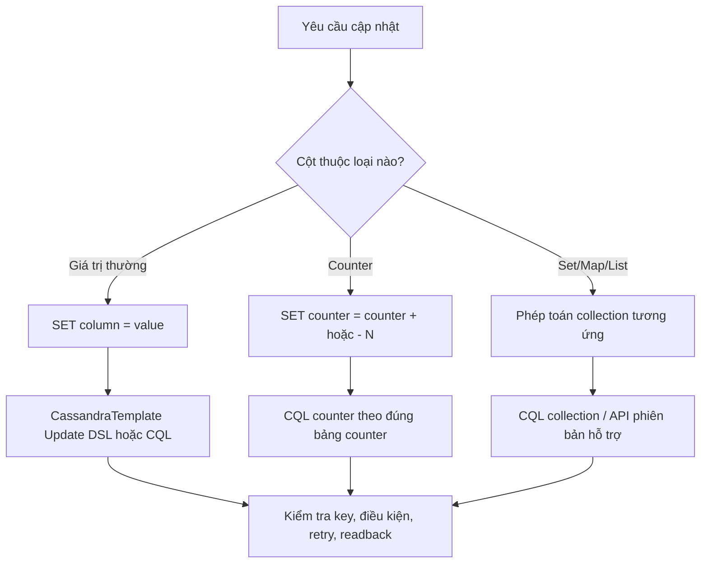

# Update và các phép gán, tăng, giảm hoặc sửa collection

## 1. Vì sao cần hiểu `UPDATE` khi làm việc với `CassandraTemplate`?

Trong **Spring Data Cassandra**, các thao tác ghi không chỉ là lưu nguyên một entity bằng repository. Nhiều use case cần thay đổi **một vài cột**: đổi trạng thái đơn hàng, thêm một nhãn, cập nhật một phần của map, hoặc tăng bộ đếm lượt xem. `CassandraTemplate` cung cấp API truy cập dữ liệu gắn với metadata entity và câu truy vấn CQL; khi thao tác cần cú pháp CQL chuyên biệt, ứng dụng có thể sử dụng `CqlSession` hoặc `CqlTemplate` với câu lệnh được bind tham số.

Khác với cơ sở dữ liệu quan hệ, Cassandra có những đặc điểm cần nắm trước khi cập nhật:

- `UPDATE` thông thường là **upsert**: nếu hàng chưa tồn tại, thao tác có thể tạo hàng với những cột được ghi; nó không tự bảo đảm "chỉ sửa hàng đã tồn tại".
- **Partition key và clustering columns không được sửa như cột thường.** Muốn chuyển một hàng sang khóa khác, phải ghi hàng với khóa mới và xử lý hàng cũ.
- Các giá trị thường được giải quyết xung đột theo **timestamp của lần ghi** và quy tắc hòa giải dữ liệu Cassandra, không phải theo một transaction ACID xuyên bảng.
- Cú pháp và tính chất của **gán**, **counter**, **set**, **map** và **list** không giống nhau. Đặc biệt, tăng/giảm counter không phải phép gán tuyệt đối và không an toàn khi retry vô điều kiện.
- Consistency level, paging và thiết kế **partition key theo truy vấn** vẫn ảnh hưởng đến hiệu năng. `CassandraTemplate` không làm cho một truy vấn thiếu khóa trở nên hiệu quả.

Mục tiêu bài học là biết **chọn thao tác cập nhật đúng theo kiểu cột**, quyết định khi nào dùng `CassandraTemplate` và khi nào dùng CQL trực tiếp, rồi thiết kế retry, điều kiện và kiểm thử phù hợp với một hệ phân tán.

## 2. Ví dụ dữ liệu và bảng CQL

Giả sử API quản lý đơn hàng cần cập nhật trạng thái, số tiền, nhãn và metadata:

```sql
-- Keyspace này chỉ minh họa cho một Cassandra node khi thực hành.
CREATE KEYSPACE IF NOT EXISTS shop_demo
WITH replication = {
  'class': 'SimpleStrategy',
  'replication_factor': 1
};

CREATE TABLE IF NOT EXISTS shop_demo.orders_by_id (
    order_id uuid PRIMARY KEY,
    customer_id uuid,
    status text,
    total_amount decimal,
    note text,
    tags set<text>,
    attributes map<text, text>,
    audit_messages list<text>
);
```

Bảng `orders_by_id` phục vụ truy vấn tra cứu bằng `order_id`: một giá trị `order_id` xác định một partition. Các cột `status`, `total_amount`, `note`, `tags`, `attributes`, `audit_messages` là **cột thường**, có thể được cập nhật mà không đổi khóa.

Để minh họa counter, cần **một bảng khác**:

```sql
CREATE TABLE IF NOT EXISTS shop_demo.order_counters_by_id (
    order_id uuid PRIMARY KEY,
    view_count counter,
    retry_count counter
);
```

Counter column **không được trộn tùy ý với cột thường không thuộc primary key** trong cùng một bảng. Do đó, không thêm `view_count counter` trực tiếp vào bảng `orders_by_id` đang có `status text`, `tags set<text>` và `total_amount decimal`.

Từ đây, phân biệt hai nhánh cập nhật:



**Lưu ý:** `SimpleStrategy` và replication factor 1 ở ví dụ chỉ dùng cho local; trong production phải chọn replication phù hợp topology, thường là `NetworkTopologyStrategy` với các datacenter thật.

## 3. Cập nhật giá trị thường bằng phép gán `SET`

### 3.1. CQL cập nhật một hoặc nhiều cột

```sql
UPDATE shop_demo.orders_by_id
SET status = 'PAID',
    note = 'Đã nhận thanh toán'
WHERE order_id = 11111111-1111-4111-8111-111111111111;
```

Câu `WHERE` chứa toàn bộ khóa chính của bảng, ở đây là `order_id`. Với bảng có khóa ghép, một thao tác thay đổi cột của **một hàng cụ thể** phải chỉ rõ các thành phần khóa cần thiết. Không nên dùng một thao tác update theo customer ID nếu bảng thực tế được phân vùng theo order ID.

Ví dụ gán tiền:

```sql
UPDATE shop_demo.orders_by_id
SET total_amount = 199000.00
WHERE order_id = 11111111-1111-4111-8111-111111111111;
```

`total_amount` là `decimal`, vì vậy Java thường dùng `BigDecimal` để tránh sai số biểu diễn số thực. Việc gán một cột **không yêu cầu đọc lại toàn bộ entity** chỉ để lưu một field khác đi.

### 3.2. Entity dùng trong ví dụ

```java
import java.math.BigDecimal;
import java.util.List;
import java.util.Map;
import java.util.Set;
import java.util.UUID;

import org.springframework.data.cassandra.core.mapping.Column;
import org.springframework.data.cassandra.core.mapping.PrimaryKey;
import org.springframework.data.cassandra.core.mapping.Table;

@Table("orders_by_id")
public class OrderById {

    @PrimaryKey("order_id")
    private UUID orderId;

    @Column("customer_id")
    private UUID customerId;

    @Column("status")
    private String status;

    @Column("total_amount")
    private BigDecimal totalAmount;

    @Column("note")
    private String note;

    @Column("tags")
    private Set<String> tags;

    @Column("attributes")
    private Map<String, String> attributes;

    @Column("audit_messages")
    private List<String> auditMessages;

    // Thêm constructor, getters/setters hoặc constructor mapping
    // phù hợp với phiên bản Spring Data Cassandra của dự án.
}
```

Thao tác cập nhật dưới đây không phụ thuộc `OrderById` có đủ giá trị tất cả cột hay không: chỉ sửa `status` của hàng có khóa đã biết.

### 3.3. `CassandraTemplate` với `Query` và `Update`

Spring Data Cassandra cung cấp `org.springframework.data.cassandra.core.query.Query`, `Criteria` và `Update` để diễn đạt một số cập nhật qua mapping của entity.

```java
import java.util.UUID;

import org.springframework.data.cassandra.core.CassandraTemplate;
import org.springframework.data.cassandra.core.query.Criteria;
import org.springframework.data.cassandra.core.query.Query;
import org.springframework.data.cassandra.core.query.Update;
import org.springframework.stereotype.Service;

@Service
public class OrderStatusWriter {

    private final CassandraTemplate template;

    public OrderStatusWriter(CassandraTemplate template) {
        this.template = template;
    }

    public void markPaid(UUID orderId) {
        Query query = Query.query(
            Criteria.where("orderId").is(orderId)
        );

        Update update = Update.empty()
            .set("status", "PAID");

        template.update(query, update, OrderById.class);
    }
}
```

Với mapping `@PrimaryKey("order_id")`, điều kiện trên **tên property Java** `orderId` được hệ thống mapping dịch sang cột CQL tương ứng. Điều kiện chỉ mang định danh nên có đường truy cập hẹp. Tùy phiên bản Spring Data Cassandra, API cụ thể cho phương thức `Update` và kiểu kết quả của `template.update(...)` cần được đối chiếu với tài liệu API của phiên bản đã chọn. Đoạn trên thể hiện **ý tưởng cập nhật một phần bằng mapping**, không thay thế integration test trên Cassandra thật.

Khi chỉ muốn sửa vài cột, một thao tác `Update` có chủ đích thường rõ hơn việc đọc entity không đầy đủ rồi gọi `save(entity)`. Nếu entity bị thiếu các cột khác, thao tác `save` có thể phát sinh nhiều thay đổi hơn người viết mong muốn, tùy chiến lược ghi của mapping.

### 3.4. `SET` khác `IF`

Một lệnh `UPDATE ... SET status = 'PAID'` **không tự kiểm tra** trạng thái trước đó. Nếu hai tiến trình cùng cập nhật trạng thái, thứ tự nhận request tại API không nhất thiết đồng nhất với thứ tự timestamp được Cassandra dùng để quyết định giá trị cuối cùng.

Khi nghiệp vụ yêu cầu chuyển **chỉ từ `PENDING` sang `PAID`**, có thể cân nhắc **lightweight transaction (LWT)**:

```sql
UPDATE shop_demo.orders_by_id
SET status = 'PAID'
WHERE order_id = 11111111-1111-4111-8111-111111111111
IF status = 'PENDING';
```

Kết quả conditional update có thông tin `[applied]` để phân biệt thao tác có được áp dụng hay không. LWT có chi phí nhất quán/độ trễ cao hơn ghi thông thường; không áp dụng vô điều kiện cho mọi cột. Nếu cần chắc chắn hàng đã tồn tại trước đó, phải định nghĩa điều kiện phù hợp thay vì nghĩ mọi `UPDATE` đều tự kiểm tra tồn tại.

## 4. Counter: tăng và giảm không phải phép gán

### 4.1. Đặc điểm của cột `counter`

Một counter trong Cassandra dùng cho **giá trị đếm được cộng/trừ**, khác cột `int` hoặc `bigint` thông thường. Lệnh CQL không gán một giá trị tuyệt đối cho counter đang sử dụng:

```sql
-- Tăng 1 lượt xem.
UPDATE shop_demo.order_counters_by_id
SET view_count = view_count + 1
WHERE order_id = 11111111-1111-4111-8111-111111111111;

-- Giảm 2.
UPDATE shop_demo.order_counters_by_id
SET view_count = view_count - 2
WHERE order_id = 11111111-1111-4111-8111-111111111111;
```

Với bảng counter, khi cần giá trị hiện tại:

```sql
SELECT view_count, retry_count
FROM shop_demo.order_counters_by_id
WHERE order_id = 11111111-1111-4111-8111-111111111111;
```

So sánh:

| Thao tác | Cột thường `bigint` | Cột `counter` |
| --- | --- | --- |
| Gán trực tiếp `= 100` | Có thể gán nếu kiểu hợp lệ | **Không dùng** `SET counter = 100` |
| `counter = counter + 1` | Không phải update số học tổng quát cho cột thường | Hợp lệ với counter |
| `counter = counter - 1` | Không phải update số học tổng quát cho cột thường | Hợp lệ với counter |
| `INSERT` giá trị | Có thể INSERT cột thường | Counter cập nhật bằng `UPDATE` riêng |
| `TTL` trên giá trị | Có thể tùy cột và câu lệnh | **Không áp TTL cho counter** |
| LWT `IF ...` | Có thể áp dụng trong những trường hợp được hỗ trợ | Không dùng thao tác counter trong conditional update |

Lưu ý phân biệt **tăng bộ đếm** với **tính một giá trị nghiệp vụ mới**. Cassandra không hỗ trợ phép `SET total_amount = total_amount + 10` cho một cột `decimal` thường theo cùng cơ chế counter. Khi cần thay đổi tiền theo quy tắc chặt chẽ, hãy chọn thiết kế ghi phù hợp (event, phép gán dựa trên nguồn sự thật, LWT ở phạm vi cho phép, hoặc hệ lưu trữ có giao dịch phù hợp), không tùy tiện đổi sang counter.

### 4.2. Retry và tính idempotent của counter

Counter increment **không idempotent**. Nếu request tăng 1 đã được server áp dụng nhưng response bị mất, client retry lệnh có thể làm bộ đếm tăng thành 2. Tình huống này rất quan trọng trong hệ thống phân tán:

```text
Client       Cassandra
  |   UPDATE views = views + 1  |
  |---------------------------->|
  |        Đã cộng 1            |
  |        response bị mất      X
  |   retry + 1                 |
  |---------------------------->|
  |        Có thể cộng tiếp 1   |
```

Do đó:

- Không đánh đồng câu `UPDATE` counter với ghi idempotent chỉ vì cùng khóa.
- Không retry vô hạn hoặc mặc nhiên retry sau timeout mà không đánh giá rủi ro ghi trùng.
- Với số liệu dùng cho báo cáo/analytics có thể chấp nhận sai số nhỏ, counter có thể phù hợp; với số dư tiền, giới hạn tồn kho hay nghiệp vụ đòi hỏi đúng tuyệt đối, cần xem xét cơ chế khác.
- Một counter không tự cung cấp giao dịch ACID xuyên nhiều bảng hoặc cơ chế chống double-count của một sự kiện.
- Không dùng counter làm cách thay thế mọi phép cập nhật cộng/trừ của domain.

### 4.3. Dùng `CassandraTemplate` hay driver khi cập nhật counter?

Với cú pháp chuyên biệt như cộng/trừ counter, **CQL tường minh** có thể giúp người đọc dễ kiểm tra hành vi. Có thể đưa phần này vào một adapter được Spring quản lý, dùng `CqlSession` **đã được auto-configure**, thay vì tạo session mới cho từng lần gọi:

```java
import java.util.UUID;

import com.datastax.oss.driver.api.core.CqlSession;
import com.datastax.oss.driver.api.core.cql.PreparedStatement;
import org.springframework.stereotype.Repository;

@Repository
public class OrderCounterWriter {

    private final CqlSession session;
    private final PreparedStatement addView;

    public OrderCounterWriter(CqlSession session) {
        this.session = session;
        this.addView = session.prepare(
            "UPDATE shop_demo.order_counters_by_id " +
            "SET view_count = view_count + ? " +
            "WHERE order_id = ?"
        );
    }

    public void addViews(UUID orderId, long delta) {
        if (delta <= 0) {
            throw new IllegalArgumentException("delta phải dương");
        }
        session.execute(addView.bind(delta, orderId));
    }
}
```

Đoạn này minh họa **CQL counter và prepared statement**, không nói rằng `CassandraTemplate` không dùng được cho counter. Khi phiên bản Spring Data Cassandra có thao tác `Update.increment(...)` hoặc `decrement(...)` phù hợp, có thể dùng thông qua API mapping và kiểm tra CQL thực sự được tạo trên đúng phiên bản. Quan trọng nhất là không nhầm `counter` với phép cộng trên cột thường và **kiểm soát retry**.

## 5. Collection trong Cassandra: Set, Map và List

Các collection CQL thường được ánh xạ sang `Set`, `Map`, `List` của Java. Cassandra có phép toán cập nhật từng phần, nhưng ngữ nghĩa và chi phí khác nhau.

| Kiểu CQL | Ví dụ | Phép toán thường dùng | Nguy cơ chính |
| --- | --- | --- | --- |
| `set<text>` | Nhãn đơn hàng | Thêm/bớt phần tử | Tombstone khi xóa, set phình lớn |
| `map<text,text>` | Thuộc tính đơn hàng | Gán key, thêm map nhỏ, xóa key | Key không giới hạn, thay thế toàn map |
| `list<text>` | Danh sách thông điệp ngắn | Append/prepend, xóa giá trị | Thứ tự, index update, concurrency và chi phí |

**Collection không nên dùng để lưu lịch sử không giới hạn.** Nếu một đơn có hàng chục nghìn sự kiện/audit messages, nên dùng một bảng riêng như `order_events_by_order` có clustering column theo thời gian. Từng phần tử collection vẫn phải được lưu, cập nhật và đọc qua partition; kích thước lớn làm tăng memory, network và tombstones.

### 5.1. Set: thêm và bớt phần tử

```sql
-- Thêm một nhãn (phép hợp tập hợp).
UPDATE shop_demo.orders_by_id
SET tags = tags + {'vip'}
WHERE order_id = 11111111-1111-4111-8111-111111111111;

-- Bỏ một nhãn (phép trừ tập hợp).
UPDATE shop_demo.orders_by_id
SET tags = tags - {'obsolete'}
WHERE order_id = 11111111-1111-4111-8111-111111111111;

-- Thay thế toàn bộ set bằng giá trị được đưa ra.
UPDATE shop_demo.orders_by_id
SET tags = {'vip', 'paid'}
WHERE order_id = 11111111-1111-4111-8111-111111111111;
```

`tags + {'vip'}` có ngữ nghĩa **thêm phần tử** theo tính chất set, không phải nối chuỗi hay thay mọi nhãn. Thêm một phần tử đã tồn tại thường không làm tăng số phần tử của set. Nhưng thao tác vẫn tạo thay đổi ở tầng lưu trữ và không thay thế cơ chế điều kiện nghiệp vụ. Phép **thay toàn bộ set** có thể xóa những thay đổi do request khác vừa thêm nếu không có điều phối.

### 5.2. Map: gán một key, thêm cặp và xóa key

```sql
-- Gán một entry, không cần tự viết lại toàn map.
UPDATE shop_demo.orders_by_id
SET attributes['channel'] = 'mobile'
WHERE order_id = 11111111-1111-4111-8111-111111111111;

-- Thêm/cập nhật một số cặp key-value.
UPDATE shop_demo.orders_by_id
SET attributes = attributes + {'source': 'campaign-a'}
WHERE order_id = 11111111-1111-4111-8111-111111111111;

-- Xóa riêng entry theo key.
DELETE attributes['source']
FROM shop_demo.orders_by_id
WHERE order_id = 11111111-1111-4111-8111-111111111111;
```

Đây là các thao tác trên map **không frozen**. Với `frozen<map<...>>`, Cassandra xem collection như một giá trị nguyên khối: không thể dùng cùng kiểu cập nhật từng phần tử như map không frozen; phải thay toàn bộ giá trị theo quy tắc của kiểu frozen.

Với map rất lớn hoặc key thay đổi liên tục, cân nhắc mô hình **mỗi thuộc tính là một hàng** trong bảng chuyên dụng. Điều này giúp truy vấn và cập nhật có giới hạn tốt hơn thay vì để một collection phình to.

### 5.3. List: append, prepend, loại phần tử và truy cập index

```sql
-- Nối một phần tử vào cuối list.
UPDATE shop_demo.orders_by_id
SET audit_messages = audit_messages + ['Đã xác nhận đơn']
WHERE order_id = 11111111-1111-4111-8111-111111111111;

-- Thêm vào đầu list.
UPDATE shop_demo.orders_by_id
SET audit_messages = ['Ưu tiên kiểm tra'] + audit_messages
WHERE order_id = 11111111-1111-4111-8111-111111111111;

-- Loại các phần tử có giá trị khớp.
UPDATE shop_demo.orders_by_id
SET audit_messages = audit_messages - ['Thông báo cũ']
WHERE order_id = 11111111-1111-4111-8111-111111111111;
```

Một số phiên bản Cassandra cho phép cập nhật hoặc xóa phần tử theo **index**, nhưng đó không phải thao tác “truy cập mảng ngẫu nhiên rẻ và ổn định” như trong bộ nhớ Java. Hệ thống có thể phải đọc trạng thái list để xác định vị trí phần tử, và cạnh tranh ghi có thể làm cách hiểu index thay đổi. **Không dùng list trong một cột để thay cho bảng audit log tăng liên tục**, nhất là khi yêu cầu thứ tự chính xác, paging hoặc xử lý hàng triệu sự kiện.

So sánh lựa chọn cho lịch sử đơn hàng:

```sql
CREATE TABLE IF NOT EXISTS shop_demo.order_events_by_order (
    order_id uuid,
    created_at timestamp,
    event_id uuid,
    message text,
    PRIMARY KEY ((order_id), created_at, event_id)
) WITH CLUSTERING ORDER BY (created_at DESC, event_id ASC);
```

Khi đó, mỗi sự kiện là **một hàng**, có clustering key theo thời gian. API có thể lấy `LIMIT 20` sự kiện mới nhất và tiếp tục bằng paging state. Tuy nhiên, vẫn phải theo dõi kích thước partition `order_id`, dùng time bucketing nếu một đơn có lịch sử tăng quá lớn.

## 6. Cập nhật qua `CassandraTemplate`: nhận biết phạm vi API

Với các cập nhật **gán cột thường**, `Query` + `Update` là cách gần với Spring Data mapping:

```java
Query query = Query.query(Criteria.where("orderId").is(orderId));

Update update = Update.empty()
    .set("status", "SHIPPED")
    .set("note", "Bàn giao vận chuyển");

template.update(query, update, OrderById.class);
```

Với các phép collection chuyên biệt, cách khai báo chính xác trong `Update` DSL có thể phụ thuộc phiên bản Spring Data Cassandra. Nên **tra API của phiên bản đang chạy** thay vì đoán rằng DSL của Spring Data MongoDB hoặc Spring Data JPA sẽ được Cassandra chấp nhận nguyên xi. Nếu cần thao tác `tags + ...`, `attributes['key'] = ...` hoặc counter mà DSL hiện tại không hỗ trợ rõ ràng, sử dụng prepared CQL bằng `CqlSession`/`CqlTemplate` trong một persistence adapter.

Ví dụ cập nhật set qua Java Driver mà không nối trực tiếp input thành chuỗi CQL:

```java
import java.util.Set;
import java.util.UUID;

import com.datastax.oss.driver.api.core.CqlSession;
import com.datastax.oss.driver.api.core.cql.PreparedStatement;

public final class OrderTagUpdater {

    private final CqlSession session;
    private final PreparedStatement addTag;

    public OrderTagUpdater(CqlSession session) {
        this.session = session;
        this.addTag = session.prepare(
            "UPDATE shop_demo.orders_by_id " +
            "SET tags = tags + ? WHERE order_id = ?"
        );
    }

    public void add(UUID orderId, String tag) {
        if (tag == null || tag.isBlank()) {
            throw new IllegalArgumentException("tag không hợp lệ");
        }
        session.execute(addTag.bind(Set.of(tag), orderId));
    }
}
```

Prepared statement bind giá trị động vào CQL để tránh ghép dữ liệu người dùng vào tên cột, literal hoặc cú pháp. Trong môi trường production, nên có quy tắc **cấp phép thao tác**, kiểm soát kích thước collection và giám sát tỷ lệ lỗi, không chỉ dựa vào việc query chạy thành công.

### Update entity toàn phần khác update cột riêng lẻ

| Cách ghi | Ưu điểm | Cần thận trọng |
| --- | --- | --- |
| `repository.save(entity)` hoặc `template.update(entity)` theo API phiên bản | Tự nhiên khi entity đã có trạng thái hoàn chỉnh | Có thể ảnh hưởng nhiều cột hơn mong muốn; phải kiểm tra null và mapping |
| `template.update(Query, Update, EntityClass)` | Chỉ định những cột cần gán theo điều kiện khóa | Đường query vẫn phải hợp lệ với primary key Cassandra |
| Prepared CQL qua `CqlSession`/`CqlTemplate` | Trực tiếp thể hiện counter, collection, TTL, LWT và tùy chọn CQL | Tự chịu trách nhiệm tên cột, bind type, mapping kết quả và chính sách truy cập |

**Không tạo `CqlSession` mới cho mỗi lần ghi.** Sử dụng bean session do Spring Boot cấu hình hoặc một session được quản lý vòng đời chung. Không nên để controller HTTP tự viết CQL; service/adapter persistence là nơi phù hợp để bảo đảm boundary.

## 7. TTL, gán `null` và tombstone

### 7.1. TTL có phạm vi theo giá trị được ghi

Với cột thường, Cassandra có thể đặt time-to-live cho những giá trị được cập nhật:

```sql
UPDATE shop_demo.orders_by_id
USING TTL 3600
SET note = 'Ghi chú tạm thời'
WHERE order_id = 11111111-1111-4111-8111-111111111111;
```

Trong ví dụ, giá trị `note` hết TTL sau khoảng một giờ theo cơ chế server. Nó không làm cho **tất cả cột** trong hàng đều tự hết hạn. Không sử dụng cùng cú pháp TTL cho counter. Thiết kế retention cần xét tombstone, compaction, thời gian hết hạn và các bảng đọc khác của cùng đối tượng nghiệp vụ.

### 7.2. `SET column = null` không giống bỏ qua cột

```sql
-- Xóa logic giá trị cột note.
UPDATE shop_demo.orders_by_id
SET note = null
WHERE order_id = 11111111-1111-4111-8111-111111111111;

-- Hoặc xóa riêng cột note.
DELETE note
FROM shop_demo.orders_by_id
WHERE order_id = 11111111-1111-4111-8111-111111111111;
```

Thao tác xóa/đặt null có thể tạo **tombstone**. Việc **không đề cập `note` trong một lệnh `UPDATE SET status = ...`** khác với chủ động gán `note = null`. Vì vậy, nếu API PATCH chỉ muốn sửa `status`, nên dùng partial update để tránh vô tình thay đổi các cột khác khi mapping một object thiếu dữ liệu.

Với collection, xóa phần tử hoặc thay toàn collection cũng có tác động đến tombstone và chi phí đọc; một collection tăng/xóa liên tục có thể là tín hiệu cần tạo bảng theo hàng thay vì nhét dữ liệu vào một cột.

## 8. Điều kiện ghi và tính nhất quán khi cập nhật nhiều bảng

### 8.1. Upsert và kiểm tra tồn tại

Một `UPDATE` thông thường có thể tạo hàng mới nếu primary key chưa tồn tại:

```sql
UPDATE shop_demo.orders_by_id
SET status = 'PAID'
WHERE order_id = 22222222-2222-4222-8222-222222222222;
```

Đây có thể là hành vi mong muốn của một hệ thống event-driven **idempotent theo khóa**, nhưng không phù hợp nếu nghiệp vụ muốn chắc chắn đơn đã được tạo trước khi cập nhật. Khi đó cần thiết kế điều kiện, nguồn dữ liệu chuẩn hoặc bước xác nhận tồn tại. Đọc trước rồi ghi sau **không tự bảo đảm an toàn trước cạnh tranh**.

### 8.2. Phi chuẩn hóa buộc service điều phối

Nếu cùng một đơn tồn tại trong `orders_by_id` và `orders_by_customer_day`, đổi trạng thái từ `PENDING` sang `PAID` đòi hỏi cập nhật **cả hai read model** hoặc một luồng đồng bộ có thể chịu độ trễ:

```text
OrderStatusService
  -> kiểm tra yêu cầu và idempotency
  -> cập nhật orders_by_id
  -> cập nhật orders_by_customer_day
  -> retry/đối soát khi ghi thiếu
  -> công bố trạng thái/độ mới phù hợp cho API
```

`CassandraTemplate.update(...)` trên bảng A **không tự tìm và cập nhật** bảng B. LWT có thể bảo vệ điều kiện cụ thể trên một đường ghi, nhưng không biến các read model thành một giao dịch ACID xuyên bảng. Một Cassandra batch cũng không phải giải pháp tổng quát cho giao dịch nghiệp vụ nhiều bảng, và batch lớn xuyên nhiều partition có thể gây thêm tải.

### 8.3. Consistency level không thay thế điều kiện nghiệp vụ

Với replication phù hợp, `LOCAL_QUORUM` thường giúp đạt mức nhất quán giữa các replica trong DC local cao hơn `LOCAL_ONE`, nhưng nó **không ngăn một request ghi trạng thái cũ đè trạng thái mới** nếu ứng dụng không kiểm soát thứ tự/điều kiện. Tương tự, nâng mức nhất quán trên bảng A không bảo đảm bảng B đã đồng bộ.

Với nghiệp vụ quan trọng, hãy xác định:

1. Ai là nguồn sự thật cho trạng thái?
2. Có cần LWT và điều kiện chuyển trạng thái không?
3. Nếu timeout sau ghi, retry như thế nào để idempotent?
4. Nếu chỉ một read model được cập nhật, phát hiện và sửa lệch ra sao?
5. API chấp nhận thời gian đồng bộ hóa dữ liệu bao lâu?

## 9. Lỗi thường gặp và cách xử lý

| Lỗi | Hệ quả | Cách xử lý |
| --- | --- | --- |
| Cập nhật một hàng nhưng thiếu phần khóa | Cassandra từ chối hoặc đường truy cập không hợp lệ | Dùng đầy đủ primary key theo schema |
| Cố `SET` lại partition key | Không đổi được khóa hàng bằng UPDATE | Ghi hàng ở khóa mới và xử lý hàng cũ |
| Nghĩ `UPDATE` luôn yêu cầu hàng tồn tại | Có thể tạo hàng chưa đầy đủ | Xác định rõ upsert hay conditional update |
| Dùng `SET amount = amount + 1` với `decimal` thường | Không phải phép cộng counter hợp lệ | Thiết kế lại cách tính hoặc dùng counter đúng use case |
| Trộn `counter` với cột thường không thuộc khóa | Schema không hợp lệ | Tách bảng counter |
| Retry phép tăng counter khi timeout | Có thể đếm hai lần | Chính sách retry theo nghiệp vụ, cân nhắc nguồn sự kiện idempotent |
| Dùng map/list/set phình to như bảng lịch sử | Memory/network/tombstone cao | Mô hình mỗi sự kiện là hàng có clustering key |
| Thay toàn bộ set khi chỉ muốn thêm tag | Có thể mất tag từ request đồng thời | Dùng phép thêm phần tử nếu phù hợp |
| Cập nhật list theo index trong luồng nhiều writer | Kết quả không ổn định theo thứ tự | Chuyển thành bảng event theo timestamp/ID |
| Coi TTL trên một cột là TTL của cả hàng | Dữ liệu khác vẫn tồn tại | Thiết kế retention cho từng cột/bảng |
| Đưa null khi ý định là không cập nhật | Tombstone, mất giá trị cũ | Partial update chỉ cột được phép sửa |
| Dùng LWT cho mọi UPDATE | Tăng chi phí và độ trễ không cần thiết | Chỉ dùng khi thực sự cần điều kiện cạnh tranh |
| Gọi repository/template rồi cho rằng các bảng đã đồng bộ | Read model trả trạng thái không thống nhất | Service điều phối retry, idempotency và đối soát |
| Tăng timeout thay vì sửa CQL | Che điểm nghẽn, tăng tải cụm | Đo partition, tombstone, request rate và p95/p99 |

## 10. Kế hoạch kiểm thử một chức năng cập nhật

### 10.1. Test CQL và schema

Trên một Cassandra instance dùng cho integration test, chuẩn bị bảng, sau đó kiểm tra:

```sql
-- Seed hàng trước khi test thao tác cập nhật.
INSERT INTO shop_demo.orders_by_id
  (order_id, customer_id, status, tags, attributes)
VALUES (
  11111111-1111-4111-8111-111111111111,
  33333333-3333-4333-8333-333333333333,
  'PENDING',
  {'new'},
  {'channel': 'web'}
);

-- Gán cột thường.
UPDATE shop_demo.orders_by_id
SET status = 'PAID'
WHERE order_id = 11111111-1111-4111-8111-111111111111;

-- Thêm nhãn và sửa một entry map.
UPDATE shop_demo.orders_by_id
SET tags = tags + {'vip'},
    attributes['channel'] = 'mobile'
WHERE order_id = 11111111-1111-4111-8111-111111111111;

SELECT status, tags, attributes
FROM shop_demo.orders_by_id
WHERE order_id = 11111111-1111-4111-8111-111111111111;
```

Kỳ vọng: `status` là `PAID`; set chứa `new`, `vip`; map có `channel = mobile`. Kiểm tra tiếp thao tác bỏ nhãn, xóa entry và thay collection toàn bộ trong môi trường thử để hiểu chính xác ngữ nghĩa.

### 10.2. Test Spring Data mapping

Nếu dùng `CassandraTemplate.update(Query, Update, OrderById.class)`:

1. Inject cùng `CassandraTemplate` mà ứng dụng production dùng.
2. Xác nhận query ánh xạ `orderId` sang CQL `order_id`.
3. Gọi partial update và đọc lại qua repository hoặc `CassandraTemplate`, bảo đảm **chỉ những cột được chỉ định** thay đổi.
4. Chạy test với khóa không tồn tại để quan sát **upsert** và đối chiếu quy tắc nghiệp vụ.
5. Test thay đổi trạng thái có điều kiện qua CQL `IF`, kiểm tra `[applied] = false` khi trạng thái đã khác.

Nếu dùng Java Driver cho collection/counter, integration test **phải chạy qua chính `CqlSession` được cấu hình codec, auth, consistency giống ứng dụng**, thay vì chỉ mock câu CQL.

### 10.3. Test concurrency và failure mode

| Kịch bản | Cần quan sát |
| --- | --- |
| Hai request cùng gán `status` khác nhau | Giá trị cuối, timestamp, điều kiện nghiệp vụ |
| Một request thêm tag, một request thay toàn set | Có mất cập nhật không? |
| Gửi lại lệnh cộng counter sau timeout | Có double-count không? |
| Ghi bảng A thành công, bảng B lỗi | Retry/đối soát có phục hồi không? |
| Collection lớn và nhiều xóa | Tombstones, kích thước partition, p95/p99 |
| Một phần replica mất kết nối | Consistency level và timeout đáp ứng yêu cầu không? |

Với Cassandra, kết quả unit test thuần mock không thay thế được phép thử hành vi CQL thực tế, nhất là counter, collections, LWT và conflict resolution.

## 11. Bài tập thực hành

**Bài 1 – Gán một phần:** Bảng `customers_by_id` có `customer_id uuid PRIMARY KEY`, `name text`, `phone text`. Viết `CassandraTemplate` query chỉ sửa `phone` theo `customerId`. Vì sao không nên nạp một entity thiếu `name` rồi gọi `save` nếu ý định chỉ sửa điện thoại?

**Bài 2 – Counter:** Xây bảng đếm lượt mở bài viết theo `article_id`, thêm phép tăng 1 và giảm 1. Giải thích vì sao không dùng `INSERT count = 0`, không trộn `counter` với `title text`, và vì sao retry khi timeout có thể làm tăng hai lần.

**Bài 3 – Set và map:** Một đơn có `tags set<text>` và `attributes map<text,text>`. Viết CQL thêm `priority` vào tags, gỡ `old`, đặt `attributes['channel']='app'` và xóa `attributes['campaign']`. So sánh với việc thay thế toàn bộ set/map trong một lượt ghi.

**Bài 4 – Audit log:** Một hệ thống muốn nối thêm sự kiện vào `list<text>` của một cột cho đến khi có vài triệu phần tử. Phân tích vấn đề về kích thước collection, đọc, concurrency và tombstone; thiết kế bảng sự kiện theo `((order_id), created_at, event_id)` thay thế.

**Bài 5 – Trạng thái có điều kiện:** Chỉ cho phép `PENDING -> PAID` nếu trạng thái hiện tại đang `PENDING`. Viết CQL với `IF`, kiểm tra kết quả `[applied]`, xác định các tình huống retry và cách cập nhật bảng read model thứ hai nếu thao tác thành công.

**Bài 6 – TTL:** Đặt TTL một giờ cho `note` nhưng giữ `status` lâu dài. Giải thích vì sao TTL áp lên giá trị được ghi, lúc xóa/TTL có thể phát sinh tombstone, và điều gì xảy ra nếu client liên tục ghi lại `note` với TTL mới.

### Tự kiểm tra

1. Vì sao `UPDATE` Cassandra có thể tạo hàng khi key chưa tồn tại?
2. `CassandraTemplate.update(Query, Update, EntityClass)` hữu ích hơn `save(entity)` khi nào?
3. Counter khác cột `bigint` thông thường ở những phép toán, retry và TTL nào?
4. Khi nào `SET tags = tags + {'x'}` khác `SET tags = {'x'}`?
5. Dùng `DELETE attributes['k']` khác gì với xóa toàn map?
6. Vì sao list theo index không phù hợp cho lịch sử lớn, nhiều writer?
7. Khi nào cần LWT `IF`, và nó có bảo đảm giao dịch nhiều bảng không?
8. Consistency level có đảm bảo hai bảng phi chuẩn hóa cùng trạng thái không?
9. Vì sao gán `null` khác với không đưa cột vào câu lệnh UPDATE?
10. Cần đo những chỉ số nào khi cập nhật collection lớn gây tăng p99 latency?

## Kết luận

**`CassandraTemplate`** cung cấp cách cập nhật có nhận biết entity và truy vấn trong Spring Data Cassandra; **CQL** cung cấp những phép thay đổi cụ thể theo kiểu dữ liệu: gán cột thường, cộng/trừ counter, thêm/bớt phần tử set, sửa entry map và thao tác list. Chọn đúng phép toán không chỉ để tránh lỗi cú pháp, mà còn để kiểm soát **upsert, idempotency, tombstone, concurrency, TTL và khả năng retry** trong hệ thống phân tán. Với mọi cập nhật, xác định rõ primary key, giới hạn dữ liệu và điều kiện nghiệp vụ; ưu tiên partial update khi chỉ cần sửa vài cột, tách bảng counter và tránh collection không giới hạn. Khi cập nhật nhiều read model, service phải chịu trách nhiệm đồng bộ, đối soát và thông báo độ mới dữ liệu; không một lệnh `template.update(...)` nào tự cung cấp giao dịch ACID xuyên các bảng Cassandra.
