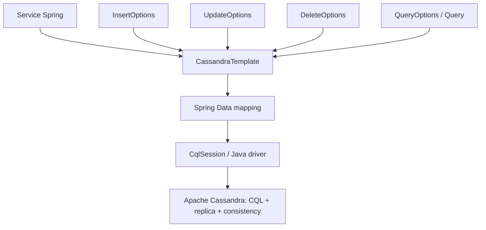

# InsertOptions, UpdateOptions, DeleteOptions và QueryOptions trong Spring Data Cassandra

Khi dùng **Spring Data Cassandra**, phương thức `CassandraTemplate.insert(...)`, `update(...)`, `delete(...)` hay `select(...)` cho phép ứng dụng thao tác với entity và truy vấn CQL mà không phải tự quản lý từng kết nối. Nhưng một yêu cầu thực tế thường cần nhiều hơn việc “ghi” hoặc “đọc”: **ghi tồn tại bao lâu, cần chờ bao nhiêu replica, có dùng timestamp cụ thể không, mỗi lần đọc lấy bao nhiêu hàng?**

Nhóm cấu hình **`InsertOptions`, `UpdateOptions`, `DeleteOptions` và `QueryOptions`** giúp thể hiện các lựa chọn theo thao tác. Bài học thuộc chương **CassandraTemplate** giải thích vai trò, hành vi ở Cassandra, ví dụ Java/CQL, tác động tới tính nhất quán và hiệu năng, cùng các sai lầm cần tránh khi làm việc với mô hình dữ liệu phân tán.

> **Phạm vi:** Các ví dụ minh họa Spring Data Cassandra hiện đại, Java driver 4.x và Cassandra thông dụng. Những phương thức builder/overload cụ thể có thể khác giữa các phiên bản Spring Data; cần đối chiếu API của phiên bản đang chạy trước khi sao chép vào dự án. Các quy tắc CQL về partition key, TTL, timestamp và consistency vẫn là cơ sở để đánh giá hành vi.

## 1. Vì sao cần options nếu đã có CassandraTemplate?

`CassandraTemplate` thực hiện thao tác theo mapping của entity; **options** mô tả các yêu cầu bổ sung của từng câu lệnh. Ví dụ:

- Thông báo chỉ cần tồn tại 12 giờ → ghi với **time to live (TTL)**.
- Trạng thái đơn hàng cần ghi ở mức `LOCAL_QUORUM` → yêu cầu **consistency level** tương ứng.
- Một đợt nhập dữ liệu cần bảo toàn timestamp gốc → cân nhắc **write timestamp**, với đầy đủ rủi ro cạnh tranh phiên bản.
- API đọc 50 sự kiện mỗi lần → giới hạn câu truy vấn và điều chỉnh **page size** phù hợp.

Các lớp options **không thay thế schema CQL** và cũng không biến truy vấn thiếu partition key thành truy vấn tối ưu. Chúng thay đổi cách một câu lệnh được gửi hoặc thực thi trong phạm vi Cassandra hỗ trợ.

| Nhóm options | Loại thao tác | Mục đích chính | Không tự giải quyết |
| --- | --- | --- | --- |
| `InsertOptions` | Ghi entity bằng `insert` | Thuộc tính ghi, ví dụ TTL, consistency hoặc timestamp khi API hỗ trợ | Uniqueness và kiểm tra dữ liệu nghiệp vụ |
| `UpdateOptions` | Cập nhật entity | Thuộc tính ghi, ví dụ TTL/timestamp/consistency | Transaction nhiều partition, khóa cạnh tranh tự động |
| `DeleteOptions` | Xóa dữ liệu | Thuộc tính thao tác xóa, ví dụ consistency/timestamp | Dọn SSTable ngay lập tức hoặc phục hồi dữ liệu |
| `QueryOptions` | Truy vấn/đọc CQL | Thuộc tính truy vấn, ví dụ consistency, kích thước trang, timeout theo API | Điều kiện `WHERE`, phân trang `OFFSET` kiểu RDBMS |

`InsertOptions`, `UpdateOptions`, `DeleteOptions` biểu đạt **ngữ nghĩa khác nhau của từng câu lệnh ghi**; không nên hoán đổi chúng chỉ vì cùng có một số lựa chọn như consistency. `QueryOptions` không phải câu `SELECT` hoàn chỉnh: muốn đọc đúng dữ liệu vẫn cần `Query`/`Criteria` hoặc CQL có partition key hợp lệ.



## 2. Chuẩn bị bảng và entity để thực hành

Giả sử keyspace `commerce` đã tồn tại với replication strategy phù hợp. Ứng dụng muốn lưu thông báo theo ID; mỗi thông báo có thể hết hạn sau một khoảng thời gian:

```sql
CREATE TABLE commerce.notifications_by_id (
    notification_id uuid PRIMARY KEY,
    recipient_id uuid,
    message text,
    state text,
    created_at timestamp
);
```

Bảng dùng `notification_id` làm **partition key đơn** và full primary key. Mọi thao tác theo `notification_id` được định tuyến tới các replica chịu trách nhiệm cho partition đó.

Entity minh họa:

```java
import java.time.Instant;
import java.util.UUID;
import org.springframework.data.cassandra.core.mapping.Column;
import org.springframework.data.cassandra.core.mapping.PrimaryKey;
import org.springframework.data.cassandra.core.mapping.Table;

@Table("notifications_by_id")
public class NotificationRow {

    @PrimaryKey("notification_id")
    private UUID notificationId;

    @Column("recipient_id")
    private UUID recipientId;

    @Column("message")
    private String message;

    @Column("state")
    private String state;

    @Column("created_at")
    private Instant createdAt;

    public NotificationRow() {}

    public UUID getNotificationId() { return notificationId; }
    public void setNotificationId(UUID value) { notificationId = value; }

    public UUID getRecipientId() { return recipientId; }
    public void setRecipientId(UUID value) { recipientId = value; }

    public String getMessage() { return message; }
    public void setMessage(String value) { message = value; }

    public String getState() { return state; }
    public void setState(String value) { state = value; }

    public Instant getCreatedAt() { return createdAt; }
    public void setCreatedAt(Instant value) { createdAt = value; }
}
```

Một service Spring nhận `CassandraTemplate` bằng constructor injection:

```java
import org.springframework.data.cassandra.core.CassandraTemplate;
import org.springframework.stereotype.Service;

@Service
public class NotificationStore {
    private final CassandraTemplate template;

    public NotificationStore(CassandraTemplate template) {
        this.template = template;
    }

    // Các thao tác trong bài sẽ được đặt tại đây.
}
```

Tùy dự án, có thể khai báo dependency bằng interface `CassandraOperations` thay cho implementation `CassandraTemplate`. Session phía dưới được Spring quản lý; không nên tạo hoặc đóng `CqlSession` cho từng lời gọi của template.

## 3. InsertOptions: điều khiển lúc ghi dữ liệu mới

`InsertOptions` dùng với thao tác `insert` để cung cấp tùy chọn của câu lệnh ghi. Trong Cassandra, `INSERT` thông thường mang tính chất **upsert**: nếu full primary key đã tồn tại, Cassandra có thể ghi/cập nhật các cột của hàng tương ứng. Vì vậy, từ “insert” **không có nghĩa tự động từ chối ID trùng**.

### 3.1. Ghi thông báo có TTL

Giả sử thông báo chỉ có giá trị trong 12 giờ kể từ lúc ghi:

```java
import java.time.Duration;
import org.springframework.data.cassandra.core.InsertOptions;

// notification là NotificationRow có notificationId hợp lệ.
InsertOptions options = InsertOptions.builder()
    .ttl(Duration.ofHours(12))
    .build();

template.insert(notification, options);
```

Ý nghĩa CQL tương đương về TTL:

```sql
INSERT INTO commerce.notifications_by_id (
    notification_id, recipient_id, message, state, created_at
) VALUES (
    11111111-1111-1111-1111-111111111111,
    22222222-2222-2222-2222-222222222222,
    'Đơn hàng đã giao',
    'NEW',
    '2026-11-25T09:00:00Z'
) USING TTL 43200;
```

**TTL là thời gian sống của dữ liệu**, đo bằng giây ở CQL; khi hết hạn, giá trị liên quan được coi là đã bị xóa. Trong Cassandra, TTL hoạt động trên các giá trị ô được ghi, không phải một bộ hẹn giờ tự xóa ngay toàn bộ SSTable. TTL hết hạn sinh ra tình trạng dữ liệu phải được dọn khi compaction phù hợp; việc xóa vật lý không xảy ra tức thời.

Đừng dựa vào “hàng sẽ chắc chắn biến mất khỏi mọi truy vấn đúng sau 12 giờ đến từng mili giây” như một bộ lập lịch nghiệp vụ. Độ trễ, consistency, độ phân tán replica và thời điểm đọc cần được đánh giá riêng. Nếu yêu cầu hết hạn tuyệt đối ở tầng API, cân nhắc kiểm tra thêm thời điểm hết hạn trong nghiệp vụ.

### 3.2. TTL không đồng nghĩa thay đổi partition key

TTL không giúp dữ liệu tự phân tán đều. Nếu bảng có partition key ít giá trị và lượng ghi lớn, thêm TTL có thể giới hạn vòng đời lưu trữ nhưng **không bảo đảm tránh hot partition**.

Với `PRIMARY KEY (notification_id)`, mỗi ID định vị một partition. Nhưng nếu dùng bảng lưu thông báo theo `recipient_id` kèm clustering columns và một khách nhận quá nhiều thông báo, cần cân nhắc bucket/thời gian khi thiết kế bảng. `InsertOptions` không sửa được schema chọn sai khóa.

### 3.3. Consistency level khi insert

Tùy version API, options ghi có thể cho phép chỉ định consistency, chẳng hạn `LOCAL_QUORUM` cho một thao tác quan trọng:

```java
import com.datastax.oss.driver.api.core.DefaultConsistencyLevel;
import org.springframework.data.cassandra.core.InsertOptions;

InsertOptions options = InsertOptions.builder()
    .consistencyLevel(DefaultConsistencyLevel.LOCAL_QUORUM)
    .build();

template.insert(notification, options);
```

Ví dụ với RF = 3 tại local DC, một yêu cầu ghi `LOCAL_QUORUM` thường cần hai replica trong DC đó xác nhận. **Không bảo đảm cả ba replica, hoặc mọi datacenter khác, đều đã cập nhật tại thời điểm trả kết quả**.

Các giá trị consistency phù hợp phụ thuộc loại request, số replica và topology của cluster. Chỉ định consistency theo request có thể ghi đè cấu hình mặc định của driver; cần quy định rõ ở tầng ứng dụng để tránh mỗi code path dùng một mức khác nhau vô tình.

### 3.4. “Chỉ tạo nếu chưa tồn tại” cần ghi điều kiện

Nếu nghiệp vụ yêu cầu chống tạo trùng, CQL hỗ trợ:

```sql
INSERT INTO commerce.notifications_by_id (
    notification_id, recipient_id, message, state, created_at
) VALUES (
    11111111-1111-1111-1111-111111111111,
    22222222-2222-2222-2222-222222222222,
    'Đơn hàng đã giao',
    'NEW',
    '2026-11-25T09:00:00Z'
) IF NOT EXISTS;
```

`IF NOT EXISTS` dùng **lightweight transaction (LWT)**; không tương đương một `INSERT` thường. Nó có thêm phối hợp giữa replica và thường tốn độ trễ hơn. Một số phiên bản Spring Data cung cấp khả năng thể hiện conditional insert trong options hoặc API tương ứng; cần kiểm tra **cách đọc kết quả [applied]** thay vì mặc định không ném exception thì chắc chắn đã tạo mới.

**Không làm `existsById(id)` rồi `insert` để mô phỏng điều kiện tạo duy nhất**: giữa hai request đó, một client khác có thể ghi cùng ID.

## 4. UpdateOptions: kiểm soát cập nhật dữ liệu

`UpdateOptions` dùng cùng thao tác `update`. Một thao tác cập nhật ở Cassandra thường mang nghĩa **ghi mutation lên những cột được chỉ định theo khóa**; nó không tự đọc bản ghi, kiểm tra version rồi khóa hàng như nhiều ORM quan hệ.

Ví dụ cập nhật trạng thái của một thông báo:

```java
import org.springframework.data.cassandra.core.UpdateOptions;

notification.setState("READ");

UpdateOptions options = UpdateOptions.builder().build();
template.update(notification, options);
```

CQL biểu diễn cập nhật một cột:

```sql
UPDATE commerce.notifications_by_id
SET state = 'READ'
WHERE notification_id = 11111111-1111-1111-1111-111111111111;
```

**Khác biệt quan trọng:** `template.update(entity, options)` là thao tác dựa trên mapping của entity. CQL chính xác và cách xử lý trường `null` phụ thuộc Spring Data version và conversion settings. Nếu chỉ muốn cập nhật duy nhất `state` mà tuyệt đối không đụng các cột khác, nên dùng API update theo field hoặc CQL có `SET state = ...` rõ ràng, rồi kiểm chứng CQL thực tế.

### 4.1. TTL của giá trị được cập nhật

Với cột chỉ cần tồn tại thêm 30 phút, có thể dùng TTL khi phiên bản API hỗ trợ:

```java
import java.time.Duration;
import org.springframework.data.cassandra.core.UpdateOptions;

UpdateOptions options = UpdateOptions.builder()
    .ttl(Duration.ofMinutes(30))
    .build();

template.update(notification, options);
```

CQL tương ứng cho **một cột cụ thể**:

```sql
UPDATE commerce.notifications_by_id USING TTL 1800
SET state = 'READ'
WHERE notification_id = 11111111-1111-1111-1111-111111111111;
```

TTL được áp dụng cho các giá trị được viết bởi mutation, **không có nghĩa toàn bộ hàng có một bộ đếm thời gian chung**, và không tự cộng 30 phút vào mọi dữ liệu chưa được cập nhật. Nếu cần thời điểm hết hạn nghiệp vụ của cả đối tượng, hãy mô hình hóa rõ các trường có TTL và tác động của mỗi lần ghi lại.

Ví dụ một hàng có `message` không TTL, sau đó chỉ `state` được cập nhật với TTL: khi hết TTL, `state` có thể vắng mặt trong khi `message` còn đó. Đừng dùng TTL của một cột để suy ra toàn bộ đối tượng đã bị xóa.

### 4.2. Timestamp và xung đột ghi

Cassandra áp dụng cơ chế hòa giải phiên bản dựa trên **timestamp của mutation/ô**. CQL cho phép chỉ định timestamp khi ghi:

```sql
UPDATE commerce.notifications_by_id
USING TIMESTAMP 1795597200000000
SET state = 'READ'
WHERE notification_id = 11111111-1111-1111-1111-111111111111;
```

Đối với CQL, timestamp được tính theo **microseconds kể từ Unix epoch** (không phải milliseconds). Giá trị trên chỉ minh họa định dạng số. Với `InsertOptions`/`UpdateOptions`, nếu API cho truyền timestamp thì cần dùng đúng đơn vị và version tương ứng.

**Không tự gán timestamp trong tương lai** để “ưu tiên bản ghi”: một giá trị timestamp lớn bất thường có thể làm những lần ghi sau với timestamp bình thường không thể thắng phiên bản cũ. Nếu nhiều writer hoặc nhiều region cùng ghi một key, cần định nghĩa chiến lược đồng bộ thời gian, tránh ghi đè ngoài ý muốn.

### 4.3. Conditional update không phải update thông thường

CQL cho phép ghi có điều kiện:

```sql
UPDATE commerce.notifications_by_id
SET state = 'READ'
WHERE notification_id = 11111111-1111-1111-1111-111111111111
IF state = 'NEW';
```

Đây là LWT với điều kiện dựa trên giá trị hiện tại. Nếu điều kiện không đúng, Cassandra trả kết quả cho biết mutation **không được áp dụng**. Tùy Spring Data/driver, có thể dùng options hoặc API CQL chuyên biệt để thể hiện điều kiện; cần đọc trạng thái áp dụng và xử lý nhánh từ chối.

Một lần `update` thông thường không tự tạo optimistic locking nghiệp vụ. Không nên đưa giả định “chỉ trạng thái NEW mới được đổi thành READ” vào code Java mà không có cơ chế concurrency thực thi được.

## 5. DeleteOptions: cấu hình xóa và hiểu tombstone

`DeleteOptions` áp dụng cho lệnh xóa. Một lần xóa ở Cassandra ghi **tombstone** để các replica hiểu giá trị đã bị loại bỏ; nó không nhất thiết xóa ngay dữ liệu vật lý khỏi mọi SSTable.

```java
import org.springframework.data.cassandra.core.DeleteOptions;

DeleteOptions options = DeleteOptions.builder().build();
template.delete(notification, options);
```

Với ví dụ bảng `notifications_by_id`, thao tác xóa theo full primary key tương ứng:

```sql
DELETE FROM commerce.notifications_by_id
WHERE notification_id = 11111111-1111-1111-1111-111111111111;
```

Cần phân biệt:

| Khái niệm | Hành vi |
| --- | --- |
| `DeleteOptions` | Tùy chọn cho yêu cầu xóa (ví dụ consistency và timestamp theo API). |
| `WHERE`/primary key | Chọn hàng hoặc partition được xóa; không thể bỏ điều kiện khóa tùy ý. |
| **Tombstone** | Dấu đánh dấu dữ liệu đã xóa để replica đồng bộ đúng. |
| **Compaction/repair** | Cơ chế xử lý dữ liệu và xóa vật lý về sau, theo điều kiện phù hợp. |
| **TTL** | Quy tắc hết hạn của dữ liệu **được ghi**; không phải một option có ý nghĩa thông thường cho lệnh `DELETE`. |

**Không đặt TTL cho `DeleteOptions`** như thể nó là “đợi 30 phút rồi mới xóa”. Nếu muốn thông báo tự hết hạn sau 30 phút, đặt TTL trên giá trị được ghi hoặc có chiến lược dọn dữ liệu nghiệp vụ độc lập.

### 5.1. Consistency cho delete

Việc xóa cũng là một mutation phân tán; mức consistency ảnh hưởng đến số replica cần phản hồi. Ví dụ:

```java
import com.datastax.oss.driver.api.core.DefaultConsistencyLevel;
import org.springframework.data.cassandra.core.DeleteOptions;

DeleteOptions options = DeleteOptions.builder()
    .consistencyLevel(DefaultConsistencyLevel.LOCAL_QUORUM)
    .build();

template.delete(notification, options);
```

Nếu một replica tạm thời không nhận được tombstone, **anti-entropy repair** và cơ chế đồng bộ thích hợp vẫn cần vận hành để tránh các replica sai lệch. Không xem một request `DELETE` thành công ở `LOCAL_QUORUM` là bằng chứng dữ liệu đã biến mất khỏi tất cả replica ngay tức khắc.

Vì Cassandra giữ tombstone trong khoảng grace period và chỉ loại bỏ vật lý khi đủ điều kiện, một cluster có nhiều xóa/TTL có thể bị tăng chi phí đọc và compaction. Cần thiết kế số lượng bản ghi, TTL, lịch repair và kích thước partition một cách tổng thể.

### 5.2. Định danh hàng khi xóa

`template.delete(entity, options)` dựa trên primary key của entity. Với **composite primary key**, phải xác định đầy đủ những thành phần cần thiết cho thao tác. Nếu yêu cầu xóa tất cả sự kiện của một tenant trong một ngày, đây là thao tác **xóa partition/range theo điều kiện CQL thích hợp**, không thể thay bằng việc tạo entity giả với clustering columns bằng `null` rồi gọi `delete`.

Tương tự, muốn xóa thông báo của một recipient khi chỉ có `recipient_id` thì bảng `notifications_by_id` không hỗ trợ định vị thông báo bằng khóa đó. Không cố xóa “theo một trường thường” nếu chưa có bảng/đường truy cập đáp ứng truy vấn.

## 6. QueryOptions: tùy chọn khi truy vấn và đọc dữ liệu

`QueryOptions` biểu diễn những tham số của request đọc, thường liên quan đến **consistency**, **page size** và các thiết lập request được phiên bản framework hỗ trợ. Nó **không thay thế** `Query` hoặc CQL.

Có ba thành phần cần tách:

| Thành phần | Câu hỏi nó trả lời |
| --- | --- |
| `Query`/`Criteria` hoặc CQL `SELECT` | **Đọc gì?** Bảng nào, cột nào, điều kiện `WHERE`, thứ tự, `LIMIT`. |
| `QueryOptions` hoặc cấu hình request driver | **Đọc như thế nào?** Consistency, quy mô mỗi trang truyền dữ liệu, giới hạn thời gian khi API hỗ trợ. |
| Schema keyspace/bảng | **Đọc ở đâu, có hiệu quả không?** Partition key, clustering, index và replica placement. |

Ví dụ truy vấn theo ID bằng `CassandraTemplate`:

```java
import java.util.UUID;
import org.springframework.data.cassandra.core.query.Criteria;
import org.springframework.data.cassandra.core.query.Query;

UUID id = UUID.fromString("11111111-1111-1111-1111-111111111111");

Query query = Query.query(
    Criteria.where("notification_id").is(id)
);

NotificationRow row = template.selectOne(query, NotificationRow.class);
```

Ở ví dụ trên, `Criteria.where(...)` tạo điều kiện theo partition key, vì thế câu truy vấn có thể được định tuyến hiệu quả. Khi cần điều chỉnh request-level options, tạo `QueryOptions` theo API của phiên bản Spring Data đang dùng và **gắn vào request/truy vấn thông qua phương thức được phiên bản đó cung cấp**; không nhầm việc tạo object options với việc đã tự động áp dụng nó lên mọi truy vấn.

Cách nhìn tương đương ở tầng **Java driver 4.x** cho một truy vấn đọc cụ thể:

```java
import com.datastax.oss.driver.api.core.CqlSession;
import com.datastax.oss.driver.api.core.DefaultConsistencyLevel;
import com.datastax.oss.driver.api.core.cql.SimpleStatement;
import java.util.UUID;

// session được Spring quản lý trong ứng dụng thực tế.
SimpleStatement statement = SimpleStatement.builder(
    "SELECT notification_id, message, state " +
    "FROM commerce.notifications_by_id WHERE notification_id = ?")
    .addPositionalValue(
        UUID.fromString("11111111-1111-1111-1111-111111111111"))
    .setConsistencyLevel(DefaultConsistencyLevel.LOCAL_QUORUM)
    .setPageSize(50)
    .build();

session.execute(statement);
```

Đoạn này minh họa **hành vi statement**: `LOCAL_QUORUM` xác định điều kiện đọc, `pageSize(50)` là số hàng mục tiêu được fetch trong một page ở driver. Đây là API của **Java driver**, không phải cách truyền `QueryOptions` trực tiếp vào `CassandraTemplate`; tránh nhầm hai tầng API khi đọc ví dụ.

### 6.1. Page size không phải LIMIT

Một truy vấn có `LIMIT 50` yêu cầu Cassandra trả về tối đa 50 hàng trong kết quả; **page size = 50** là kích thước trang trao đổi dự kiến giữa driver và server. Hai khái niệm khác nhau:

- Truy vấn có thể có hàng nghìn kết quả nhưng driver fetch từng page để giới hạn bộ nhớ mỗi đợt.
- `LIMIT 50` chặn tổng số hàng được trả về của truy vấn, còn page size không nhất thiết chặn tổng kết quả.
- Cassandra dùng **paging state** để tiếp tục truy vấn; không có `OFFSET` dạng tùy ý như nhiều hệ SQL quan hệ.
- Phân trang nhiều request **không tự tạo snapshot nhất quán** nếu dữ liệu đang thay đổi.
- Page size quá lớn có thể gây áp lực bộ nhớ/mạng/latency; quá nhỏ tăng số round-trip. Cần đo trên tập dữ liệu thực.

Đừng mặc định một method `template.select(query, Entity.class)` trả về `List` lớn sẽ tiết kiệm bộ nhớ chỉ vì driver có page size nhỏ: nếu toàn bộ kết quả được thu thập về `List`, ứng dụng vẫn có thể giữ nhiều dữ liệu trong bộ nhớ. Khi cần tải lớn, dùng API streaming/paging thích hợp và giới hạn phạm vi truy vấn.

### 6.2. QueryOptions không cứu được truy vấn thiếu partition key

Bảng `notifications_by_id` có primary key là `notification_id`. Truy vấn sau **không** phải đường đọc một partition:

```sql
-- Không có bảng/index chuyên biệt phù hợp:
SELECT * FROM commerce.notifications_by_id
WHERE recipient_id = 22222222-2222-2222-2222-222222222222;
```

Dù request đặt `LOCAL_QUORUM`, tăng page size hay timeout, Cassandra vẫn thiếu đường định tuyến theo `recipient_id`, và có thể từ chối truy vấn. Muốn lấy thông báo theo người nhận, nên thiết kế bảng **`notifications_by_recipient_day`** hoặc access pattern phù hợp, với partition key gồm recipient và bucket ngày nếu cần.

## 7. TTL, timestamp, consistency và LWT: bốn khái niệm không thể hoán đổi

| Khái niệm | Thuộc request/đối tượng nào? | Ý nghĩa | Ví dụ |
| --- | --- | --- | --- |
| **TTL** | Các giá trị được ghi | Thời gian tồn tại của dữ liệu theo CQL; thường dùng cho insert/update | `USING TTL 43200` |
| **Write timestamp** | Mutation ghi/xóa | Cơ chế ưu tiên phiên bản trong reconciliation | `USING TIMESTAMP ...` |
| **Consistency level** | Request đọc hoặc ghi | Số replica cần xác nhận để request được coi là thành công | `LOCAL_QUORUM` |
| **LWT condition** | Ghi có điều kiện | Chỉ áp dụng mutation nếu điều kiện nhất quán được thỏa | `IF NOT EXISTS` hoặc `IF state = ...` |

Một số điểm phải nhớ:

1. **TTL không bảo đảm uniqueness** và không phải thời gian chờ trước khi xử lý câu lệnh.
2. **Timestamp không phải optimistic lock**; tăng timestamp không thay cho `IF` điều kiện.
3. **Consistency không đồng nghĩa isolation/transaction**; `LOCAL_QUORUM` là quy tắc xác nhận request, không bảo đảm thao tác nhiều partition là ACID.
4. **LWT không miễn phí**; cần đánh giá chi phí điều phối và xử lý kết quả điều kiện không thỏa.
5. **Delete dùng tombstone**, không phải “ngay lập tức xóa vật lý trên mọi replica”.
6. **Page size không phải LIMIT**; cả hai không tạo snapshot khi đọc các trang trong thời gian dài.

### Một ví dụ tránh hiểu sai về consistency

Với RF = 3 tại `dc1`, giả sử ứng dụng ghi `state = 'READ'` ở `LOCAL_QUORUM` và nhận hai ACK. Một đọc `LOCAL_ONE` ngay sau đó vẫn có thể gặp replica chưa nhận được mutation và trả giá trị cũ. Nếu nghiệp vụ cần đọc ngay sau ghi trong cùng DC, cân nhắc quorum cho cả đọc và ghi, hiểu cách driver chọn local DC và cách Cassandra xử lý timestamp/xung đột.

Quorum của Cassandra **không mặc nhiên cung cấp linearizability cho mọi trường hợp ghi đồng thời**. Yêu cầu có điều kiện nên dùng LWT khi đúng bài toán.

## 8. Tổ chức options trong ứng dụng cho dễ bảo trì

Đừng rải các timeout/TTL/CL tùy ý trong controller. Hãy định nghĩa chính sách dữ liệu theo use case:

| Use case | Tùy chọn cần xem xét | Câu hỏi thiết kế |
| --- | --- | --- |
| Thông báo tự hết hạn | TTL khi insert | Hết hạn có chấp nhận mất cả nội dung không, có cần lưu audit riêng không? |
| Cập nhật trạng thái | Consistency khi update | Có đọc lại ngay, có nhiều writer tranh chấp, có cần LWT? |
| Xóa thông báo | Consistency/timestamp khi delete | Có cần lưu sự kiện audit, repair đã được vận hành đúng chưa? |
| Danh sách thông báo | QueryOptions/page size, `LIMIT`, partition key | Đọc theo recipient và ngày nào; cần paging state ra sao? |
| Backfill/migration | Timestamp, batch size, retry | Có nguy cơ ghi cũ đè dữ liệu mới, cần bảo toàn nguyên timestamp không? |

### Ví dụ phương pháp đóng gói

```java
import java.time.Duration;
import org.springframework.data.cassandra.core.InsertOptions;
import org.springframework.data.cassandra.core.CassandraTemplate;
import org.springframework.stereotype.Service;

@Service
public class ExpiringNotificationWriter {
    private final CassandraTemplate template;

    public ExpiringNotificationWriter(CassandraTemplate template) {
        this.template = template;
    }

    public void create(NotificationRow value) {
        InsertOptions options = InsertOptions.builder()
            .ttl(Duration.ofHours(12))
            .build();

        template.insert(value, options);
    }
}
```

Lớp service thể hiện chính sách **12 giờ** ở một nơi dễ tìm, thay vì để controller quyết định ngẫu nhiên. Trong dự án lớn có thể tạo factory/options policy dùng chung nhưng không cần phức tạp hóa sớm. Cần document rõ nơi cấu hình CL mặc định nếu option không chỉ định.

### Khi nào nên dùng trực tiếp CqlSession?

`CassandraTemplate` tốt cho thao tác theo mapping entity. Với yêu cầu CQL nâng cao như conditional writes phức tạp, thao tác CAS, truy vấn đặc biệt hoặc kiểm soát statement-level attributes không được API template ở phiên bản đang dùng phơi bày, có thể sử dụng **CqlSession/driver** được Spring quản lý:

- Bind giá trị đúng kiểu, không nối input vào CQL.
- Đặt consistency, timeout, page size ở statement khi cần.
- Xử lý kết quả và trạng thái `[applied]` cho LWT.
- Không tạo `CqlSession` mới cho mỗi request và không đóng session đang được nhiều repository/template dùng chung.

Đây là hai tầng API bổ trợ nhau, không phải yêu cầu chuyển toàn bộ dự án sang viết CQL tay.

## 9. Các lỗi thường gặp

| Triệu chứng | Khả năng gây lỗi | Hướng kiểm tra |
| --- | --- | --- |
| Thông báo “biến mất” sau một thời gian | Insert/update đã đặt TTL lên các cột được ghi | Kiểm tra TTL, dữ liệu nào được ghi lại, yêu cầu lưu audit. |
| Một số cột còn, một số cột hết hạn | TTL theo ô được ghi, không theo toàn bộ object | Kiểm tra CQL cụ thể của từng mutation. |
| Gọi `insert` hai lần cùng ID nhưng không báo trùng | Cassandra insert thông thường là upsert | Nếu cần create-only, dùng `IF NOT EXISTS`/LWT phù hợp. |
| Update vô tình ảnh hưởng cột khác | Ghi cả entity hoặc mapping xử lý `null` khác mong đợi | Dùng update theo field/CQL tường minh và kiểm chứng request. |
| Một bản ghi mới không thắng dữ liệu cũ | Timestamp thủ công sai đơn vị/quá lớn | So sánh write timestamp và clock của các writer. |
| Xóa thành công nhưng tài nguyên chưa được giải phóng | Cassandra tạo tombstone và dọn vật lý theo compaction | Theo dõi tombstone, repair, compaction và retention. |
| Read-after-write đôi lúc thấy giá trị cũ | CL đọc thấp hơn kỳ vọng, replica chưa bắt kịp | Kiểm tra RF, local DC, write CL và read CL. |
| Đọc 50 hàng mỗi trang nhưng API trả hàng nghìn | Nhầm page size với `LIMIT` | Giới hạn kết quả hoặc dùng API paging/streaming. |
| Truy vấn quá chậm dù tăng timeout | Thiếu partition key hoặc hot partition | Thiết kế bảng theo truy vấn và đánh giá token distribution. |
| LWT không áp dụng nhưng code vẫn báo thành công | Không kiểm tra kết quả điều kiện `[applied]` | Đọc trạng thái apply và xử lý nhánh không thỏa. |

## 10. Quy trình kiểm tra options trước khi đưa lên production

1. **Xác minh version:** ứng dụng đang dùng Spring Data Cassandra/Java driver nào? Builder/overload nào được hỗ trợ?
2. **Xác minh schema:** partition key, clustering, kiểu cột, TTL trên bảng và replication strategy đã đúng với truy vấn chưa?
3. **Xác minh hành vi ghi:** `insert`/`update` thực tế sinh mutation như thế nào; có cột `null`, TTL hoặc timestamp bất ngờ không?
4. **Xác minh quyền và auth:** role kết nối có `SELECT`/`MODIFY` đúng bảng không; có TLS và secret phù hợp không?
5. **Xác minh consistency:** CL mặc định của driver và CL override từ options có nhất quán với SLA không?
6. **Xác minh điều kiện nghiệp vụ:** có yêu cầu tạo mới duy nhất, CAS hoặc đọc ngay sau ghi không? Nếu có, cần chứng minh cơ chế đáp ứng.
7. **Xác minh pagination:** `LIMIT`, page size và paging state có phù hợp với API, bộ nhớ và lưu lượng không?
8. **Đo trong môi trường tích hợp:** ghi/đọc/xóa với dữ liệu đại diện; kiểm tra TTL qua thời gian, latency và lỗi retry.
9. **Quan sát vận hành:** ghi nhận timeout, failed reads/writes, tombstone, compaction, repair, request throughput theo use case.
10. **Kiểm tra tài liệu bảo trì:** option nào thuộc logic nghiệp vụ, option nào là driver policy, khi nào có quyền thay đổi.

Không nên chỉ kiểm tra một đoạn code “compile được”. Đúng API mà sai partition key, sai timestamp hoặc sai consistency vẫn có thể tạo lỗi nghiệp vụ khó phát hiện.

## 11. Bài tập tình huống

**Bài 1 — TTL:** Một app gọi `insert(notification, options)` với TTL 10 phút. Sau 5 phút, app chỉ cập nhật `state` bằng CQL không TTL. Sau phút thứ 10, trạng thái và nội dung có nhất thiết biến mất đồng thời không? Vì sao?

**Bài 2 — CL:** Keyspace có RF = 3 trong local DC. App ghi ở `LOCAL_QUORUM` nhưng đọc ở `LOCAL_ONE` ngay sau ghi và thỉnh thoảng thấy dữ liệu cũ. Đây có nhất thiết là lỗi repository không? Nên cân nhắc gì?

**Bài 3 — Uniqueness:** Hai request đồng thời cùng tạo một thông báo với ID cố định. Một developer dùng `existsById` rồi `insert`; tại sao cách này vẫn có race condition? CQL nào có thể xử lý yêu cầu create-only?

**Bài 4 — Paging:** API muốn trả chính xác 30 thông báo trong mỗi response. Có thể chỉ tăng `pageSize(30)` rồi trả kết quả `select` không giới hạn không? Cần phân biệt điều gì?

**Bài 5 — Delete:** Vì sao `DELETE` thành công không đồng nghĩa dữ liệu đã biến mất khỏi SSTable và mọi replica ngay lập tức? Những cơ chế Cassandra nào liên quan?

**Bài 6 — Timestamp:** Một nhóm muốn đặt write timestamp cho mọi update bằng `System.currentTimeMillis()`, không chuyển đơn vị. Sai ở đâu? Hệ quả có thể là gì khi các writer khác dùng timestamp chuẩn?

**Đáp án gợi ý:**

1. Không. TTL áp dụng lên các giá trị được ghi; update `state` mới có thể có timestamp/TTL riêng và sống khác với `message`.
2. Không nhất thiết. `LOCAL_ONE` có thể đọc replica chưa cập nhật. Đánh giá quorum đọc/ghi cùng DC, độ trễ và semantics mong muốn.
3. Hai lần kiểm tra/ghi không nguyên tử. Dùng `INSERT ... IF NOT EXISTS`/LWT khi cần chống trùng thực sự.
4. Không. Page size là kích thước trao đổi trang của driver; dùng `LIMIT`/query và paging API đúng để giới hạn response.
5. Cassandra ghi tombstone, và dữ liệu được đối soát/dọn trong repair/compaction theo điều kiện phù hợp.
6. CQL timestamp dùng microseconds, còn `currentTimeMillis()` trả milliseconds. Sai đơn vị có thể dẫn tới thứ tự phiên bản bất thường và ghi không thắng các mutation khác.

**Ghi nhớ:** `InsertOptions`, `UpdateOptions`, `DeleteOptions` và `QueryOptions` giúp mô tả **cách thực hiện** một thao tác Cassandra, nhưng không quyết định thay **mô hình dữ liệu và điều kiện CQL**. Hãy dùng TTL đúng phạm vi, timestamp đúng đơn vị, consistency theo SLA, LWT khi cần điều kiện thực sự, và paging phù hợp. Khi dùng Spring Data Cassandra, luôn kiểm chứng các options theo phiên bản framework, schema và cách driver xử lý request.
