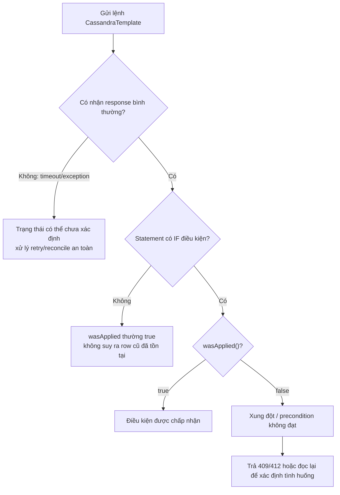

# Lấy WriteResult và kiểm tra thao tác có được áp dụng

Trong **Spring Data Cassandra**, một lệnh `INSERT`, `UPDATE` hay `DELETE` không có cùng ý nghĩa với thao tác “thêm/sửa/xóa đúng một bản ghi” của nhiều hệ quản trị quan hệ. Cassandra thường dùng **upsert**: ghi cùng primary key có thể cập nhật dữ liệu đã tồn tại; `UPDATE` có thể tạo dữ liệu nếu khóa chưa có; `DELETE` gửi mutation xóa ngay cả khi hàng cần xóa vốn không tồn tại.

Khi ứng dụng cần biết **điều kiện ghi có được đáp ứng hay không**, chẳng hạn “chỉ tạo đơn nếu chưa có” hoặc “chỉ sửa đơn nếu phiên bản vẫn là 3”, Spring Data Cassandra cung cấp kiểu **`WriteResult`**, lớp con **`EntityWriteResult<T>`** và phương thức **`wasApplied()`**. Cơ chế này đặc biệt hữu ích khi dùng **lightweight transaction (LWT)** với CQL `IF NOT EXISTS`, `IF EXISTS` hoặc `IF column = value`.

Điểm quan trọng nhất của bài: **`wasApplied() == true` ở một lệnh ghi không có điều kiện không chứng minh hàng vừa được tạo mới, nội dung đã thay đổi, hoặc hàng cũ từng tồn tại**. Với driver Cassandra 4.x, kết quả `wasApplied()` của câu lệnh **không có điều kiện** mặc định là `true`. Chỉ khi truy vấn thực sự sử dụng điều kiện CQL, giá trị này mới phản ánh việc điều kiện được chấp nhận hay từ chối.

Bài thuộc chương **CassandraTemplate** trong module **SPRING_DATA_CASSANDRA**. Ví dụ tập trung vào API đồng bộ của Spring Data Cassandra 4.5.x và Apache Cassandra với CQL hỗ trợ LWT; khi dùng Spring Boot/Spring Data phiên bản khác, hãy đối chiếu JavaDoc đúng bản đang triển khai.

## 1. Mục tiêu học tập

Sau bài này, bạn có thể:

1. Phân biệt giá trị trả về của `CassandraTemplate.insert(entity)` với `insert(entity, InsertOptions)`.
2. Nhận biết khi nào nhận `WriteResult`, khi nào nhận `EntityWriteResult<T>`, `boolean` hoặc entity.
3. Dùng `InsertOptions`, `UpdateOptions` và `DeleteOptions` để kích hoạt các điều kiện CQL.
4. Dùng `wasApplied()` diễn giải đúng kết quả **có điều kiện** và tránh kết luận sai với ghi thường.
5. Đọc `getRows()`, `getExecutionInfo()` và `getEntity()` đúng mục đích.
6. Thiết kế nhánh xử lý **thành công / điều kiện không đạt / lỗi hoặc kết quả chưa xác định**.
7. Hiểu chi phí LWT, các rủi ro retry và cách xác minh kết quả trong môi trường phân tán.

## 2. WriteResult là gì và lấy từ đâu?

`WriteResult` nằm trong package:

```java
import org.springframework.data.cassandra.core.WriteResult;
```

Theo API Spring Data Cassandra 4.5, các phương thức quan trọng là:

| Phương thức | Giá trị trả về | Ý nghĩa |
|---|---|---|
| `wasApplied()` | `boolean` | Kết quả applied do driver/CQL trả; có ý nghĩa quyết định đối với **conditional mutation** |
| `getRows()` | `List<Row>` | Các hàng thông tin trả về từ kết quả ghi, đặc biệt hữu ích khi LWT không đạt điều kiện |
| `getExecutionInfo()` | `List<ExecutionInfo>` | Metadata thực thi từ Java driver, hỗ trợ quan sát/troubleshooting |
| `WriteResult.of(ResultSet)` | `WriteResult` | Chuyển `ResultSet` của Java driver sang kiểu kết quả của Spring Data |

`EntityWriteResult<T>` **kế thừa** `WriteResult` và bổ sung:

```java
T getEntity();
```

`getEntity()` là đối tượng entity gắn với thao tác ghi (đối tượng đã được truyền qua mapping), **không phải bảo đảm rằng Spring Data vừa thực hiện SELECT để tải lại row mới nhất từ Cassandra**. Khi điều kiện `IF NOT EXISTS` không đạt, đừng dùng `getEntity()` để suy ra dữ liệu nào đang được lưu trên server.

### 2.1. Không phải mọi overload đều trả WriteResult

Trong API `CassandraOperations` của Spring Data Cassandra 4.5:

| Lời gọi | Kiểu trả về | Khi nào dùng |
|---|---|---|
| `insert(entity)` | `T` | Ghi entity theo semantics mặc định; không có `wasApplied()` để kiểm tra |
| `insert(entity, InsertOptions)` | `EntityWriteResult<T>` | Cần options, conditional insert hoặc metadata ghi |
| `update(entity)` | `T` | Ghi các field của entity với semantics mặc định |
| `update(entity, UpdateOptions)` | `EntityWriteResult<T>` | Conditional update, TTL/consistency hoặc metadata |
| `delete(entity)` | `void` | Xóa entity với semantics mặc định |
| `delete(entity, DeleteOptions)` | `WriteResult` | Conditional delete hoặc cần metadata |
| `update(Query, Update, Class<?>)` | `boolean` | Cập nhật theo `Query`/`Update`, phản ánh applied của statement |
| `delete(Query, Class<?>)` | `boolean` | Xóa theo `Query`, phản ánh applied của statement |
| `execute(Statement<?>)` | Driver `ResultSet` | Khi cần chạy prepared/CQL statement và tự xử lý kết quả |

Vì vậy, đoạn mã sau **không đúng kiểu**:

```java
// SAI: insert(entity) trả entity, không trả WriteResult.
WriteResult result = template.insert(order);
```

Muốn lấy kết quả chi tiết, chọn overload có options:

```java
EntityWriteResult<OrderStatus> result =
    template.insert(order, InsertOptions.empty());
```

Tuy nhiên, `InsertOptions.empty()` **không bật điều kiện**. Nếu muốn kiểm tra “chỉ tạo nếu chưa tồn tại”, phải bật `IF NOT EXISTS` rõ ràng. Đây là khác biệt giữa **có thông tin kết quả** và **có kiểm tra điều kiện nghiệp vụ**.

## 3. Cassandra trả thông tin [applied] khi nào?

Xem một bảng đơn giản:

```sql
CREATE KEYSPACE IF NOT EXISTS sdc_write_lab
WITH replication = {
    'class': 'SimpleStrategy',
    'replication_factor': 1
};

CREATE TABLE IF NOT EXISTS sdc_write_lab.order_status_by_id (
    order_id uuid PRIMARY KEY,
    status text,
    version int,
    updated_at timestamp
);
```

Cấu hình `SimpleStrategy`, replication factor 1 ở đây **chỉ dành cho lab một node**. Trong production nhiều datacenter, cần replication strategy, consistency và vận hành LWT phù hợp.

`order_id` là partition key duy nhất. Mọi ví dụ ghi/đọc theo khóa này đều có đường truy cập có mục tiêu; không cần `ALLOW FILTERING`. `status` và `version` là các regular column.

### 3.1. Ghi thường: không có điều kiện

```sql
INSERT INTO sdc_write_lab.order_status_by_id (
    order_id, status, version, updated_at
) VALUES (
    11111111-1111-1111-1111-111111111111,
    'CREATED', 1, '2026-11-25T10:00:00Z'
);
```

Nếu chạy lại cùng primary key với `status = 'PAID'`, Cassandra không tạo thêm row thứ hai. Nó thực hiện mutation/upsert trên cùng khóa.

Một lệnh `UPDATE` không có `IF` cũng có thể áp dụng vào khóa chưa tồn tại:

```sql
UPDATE sdc_write_lab.order_status_by_id
SET status = 'CREATED', version = 1
WHERE order_id = 22222222-2222-2222-2222-222222222222;
```

Dù không có hàng trước đó, Cassandra có thể tạo dữ liệu mới trong partition tương ứng. Tương tự, xóa một khóa không tồn tại không mặc nhiên là lỗi. Vì thế, **ghi thường thành công không đồng nghĩa “đã sửa/xóa một row có sẵn”**.

### 3.2. Ghi có điều kiện: LWT và [applied]

```sql
INSERT INTO sdc_write_lab.order_status_by_id (
    order_id, status, version
) VALUES (
    33333333-3333-3333-3333-333333333333,
    'CREATED', 1
) IF NOT EXISTS;
```

Khi cqlsh thực thi lệnh này:

- Nếu hàng với `order_id` trên **chưa tồn tại**, kết quả có `[applied] = true` và mutation được chấp nhận.
- Nếu hàng **đã tồn tại**, kết quả có `[applied] = false`; Cassandra từ chối ghi có điều kiện và có thể trả thêm thông tin giá trị hiện tại theo dạng kết quả CQL.

Chạy lại cùng `INSERT ... IF NOT EXISTS` sẽ cho `[applied] = false` nếu lần đầu đã tạo hàng và không có xóa xen giữa.

So sánh:

| Statement | `wasApplied()` | Có thể kết luận |
|---|---|---|
| `INSERT ...` không `IF` | Thông thường `true` | Statement không bị từ chối do LWT; **không biết trước đó có row chưa** |
| `UPDATE ...` không `IF` | Thông thường `true` | Mutation đã được xử lý theo write path; **không biết dữ liệu cũ có khác không** |
| `DELETE ...` không `IF` | Thông thường `true` | Không chứng minh row tồn tại trước lệnh |
| `INSERT ... IF NOT EXISTS` | `true` | Điều kiện chưa tồn tại được thỏa; ghi được chấp nhận |
| `INSERT ... IF NOT EXISTS` | `false` | Điều kiện không thỏa; không tạo row bởi lần ghi này |
| `UPDATE ... IF EXISTS` | `true` | Row được xem là tồn tại và điều kiện được thỏa |
| `UPDATE ... IF version = 3` | `false` | Điều kiện phiên bản không thỏa; mutation có điều kiện không được áp dụng |

**Không dùng `wasApplied()` như công cụ kiểm tra tính mới nhất hoặc durability tuyệt đối trên mọi replica.** Đây là phản hồi của thao tác theo consistency/protocol đã chọn, không phải bản sao trạng thái toàn cluster tại mọi thời điểm.

### 3.3. Luồng phân nhánh kết quả



Một lỗi network/timeout **không tương đương** `wasApplied() == false`. Ở thời điểm timeout, server có thể đã hoàn tất thao tác nhưng phản hồi không tới client; cần quy trình khôi phục hoặc đối soát.

## 4. Ánh xạ bảng thành entity Java

Ví dụ file `OrderStatus.java`:

```java
import java.time.Instant;
import java.util.UUID;

import org.springframework.data.cassandra.core.mapping.Column;
import org.springframework.data.cassandra.core.mapping.PrimaryKey;
import org.springframework.data.cassandra.core.mapping.Table;

@Table("order_status_by_id")
public class OrderStatus {

    @PrimaryKey("order_id")
    private UUID orderId;

    @Column("status")
    private String status;

    @Column("version")
    private Integer version;

    @Column("updated_at")
    private Instant updatedAt;

    public OrderStatus() {
    }

    public OrderStatus(UUID orderId, String status,
                       Integer version, Instant updatedAt) {
        this.orderId = orderId;
        this.status = status;
        this.version = version;
        this.updatedAt = updatedAt;
    }

    public UUID getOrderId() {
        return orderId;
    }

    public void setOrderId(UUID orderId) {
        this.orderId = orderId;
    }

    public String getStatus() {
        return status;
    }

    public void setStatus(String status) {
        this.status = status;
    }

    public Integer getVersion() {
        return version;
    }

    public void setVersion(Integer version) {
        this.version = version;
    }

    public Instant getUpdatedAt() {
        return updatedAt;
    }

    public void setUpdatedAt(Instant updatedAt) {
        this.updatedAt = updatedAt;
    }
}
```

Giả định cấu hình `CqlSession`/Spring Boot có keyspace mặc định `sdc_write_lab`. Nếu ứng dụng dùng keyspace khác, phải cấu hình session/mapping hoặc chọn keyspace phù hợp; `@Table("order_status_by_id")` không tự tạo keyspace.

**Lưu ý:** trường `version` ở đây là một **regular column do ứng dụng quản lý**, không mặc nhiên có cơ chế optimistic locking. Chỉ khi câu ghi **thật sự chứa điều kiện `IF version = oldVersion`** mới thực hiện kiểm tra phiên bản ở Cassandra.

## 5. INSERT IF NOT EXISTS: tạo một hàng nếu chưa có

### 5.1. Bật điều kiện bằng InsertOptions

Spring Data Cassandra 4.5 có builder:

```java
InsertOptions.builder()
    .withIfNotExists()
    .build();
```

Ví dụ service đầy đủ:

```java
import java.time.Instant;
import java.util.UUID;

import org.springframework.data.cassandra.core.CassandraTemplate;
import org.springframework.data.cassandra.core.EntityWriteResult;
import org.springframework.data.cassandra.core.InsertOptions;
import org.springframework.stereotype.Service;

@Service
public class OrderCreateService {

    private final CassandraTemplate template;

    public OrderCreateService(CassandraTemplate template) {
        this.template = template;
    }

    public boolean createIfAbsent(UUID orderId) {
        OrderStatus entity = new OrderStatus(
            orderId, "CREATED", 1, Instant.now()
        );

        InsertOptions options = InsertOptions.builder()
            .withIfNotExists()
            .build();

        EntityWriteResult<OrderStatus> result =
            template.insert(entity, options);

        return result.wasApplied();
    }
}
```

Khi gọi `createIfAbsent(id)` hai lần liên tiếp trong môi trường không có thao tác xóa/ghi cạnh tranh:

- Lần đầu: `true` nếu hàng chưa có.
- Lần hai: `false` vì hàng đã tồn tại.

Điều kiện giúp thực hiện **create-if-absent** ở tầng Cassandra. Nếu chỉ gọi `template.insert(entity)`, không có `IF NOT EXISTS` và Cassandra có thể upsert hàng cũ. Phân biệt rõ hai trường hợp.

### 5.2. Phân loại kết quả ở tầng API

Một dịch vụ HTTP có thể quy ước:

| Kết quả | Xử lý nghiệp vụ thường gặp |
|---|---|
| `wasApplied() == true` | Tạo mới thành công; trả `201 Created` nếu phù hợp với API |
| `wasApplied() == false` | Khóa đã tồn tại theo điều kiện; cân nhắc `409 Conflict` |
| Timeout hoặc exception khác | Chưa thể kết luận bằng `wasApplied`; ghi log/correlation ID và đối soát |

**Nếu API có idempotency key:** `wasApplied() == false` ở lần retry có thể nghĩa **chính request đó đã tạo dữ liệu trước khi client timeout**, không nhất thiết là một request khác đang xung đột. Thiết kế luồng retry/idempotency riêng để phân biệt, thay vì trả `409` vô điều kiện.

LWT giúp kiểm tra điều kiện theo khóa liên quan, nhưng **không tạo một transaction đa bảng/đa partition kiểu SQL**. Nếu tạo đơn còn cần ghi bảng `orders_by_customer`, bảng thống kê và phát event, ứng dụng vẫn phải thiết kế idempotency, retry và đối soát.

## 6. UPDATE IF EXISTS: chỉ cập nhật hàng đã tồn tại

### 6.1. Bật điều kiện tồn tại

`UpdateOptions` có `withIfExists()`:

```java
import java.time.Instant;
import java.util.UUID;

import org.springframework.data.cassandra.core.CassandraTemplate;
import org.springframework.data.cassandra.core.EntityWriteResult;
import org.springframework.data.cassandra.core.UpdateOptions;

public class OrderExistenceUpdater {

    private final CassandraTemplate template;

    public OrderExistenceUpdater(CassandraTemplate template) {
        this.template = template;
    }

    public boolean updateIfPresent(UUID orderId) {
        OrderStatus entity = new OrderStatus(
            orderId, "PAID", 2, Instant.now()
        );

        UpdateOptions options = UpdateOptions.builder()
            .withIfExists()
            .build();

        EntityWriteResult<OrderStatus> result =
            template.update(entity, options);

        return result.wasApplied();
    }
}
```

Ý nghĩa:

- `true`: kiểm tra `IF EXISTS` thỏa và mutation được chấp nhận.
- `false`: hàng cần cập nhật không tồn tại theo điều kiện CQL, nên cập nhật bị từ chối.
- **Không có `IF EXISTS`:** `UPDATE` có thể tạo row mới tại khóa đó theo semantics upsert. `wasApplied()` sẽ không giúp phân biệt “row đã tồn tại” với “row mới sinh ra”.

`IF EXISTS` **không ngăn lost update**. Nếu hai request đọc `status = CREATED` rồi cùng ghi trạng thái khác nhau, cả hai có thể đáp ứng “row tồn tại” và lần ghi sau có thể ghi đè giá trị trước theo quy tắc timestamp. Để kiểm soát xung đột cập nhật, cần điều kiện dựa trên giá trị hiện tại, ví dụ `IF version = ?`.

### 6.2. UPDATE theo phiên bản: compare-and-set

Giả sử hàng có `version = 1`, hai tác vụ cùng muốn thay đổi:

```sql
UPDATE sdc_write_lab.order_status_by_id
SET status = 'PAID',
    version = 2,
    updated_at = '2026-11-25T10:10:00Z'
WHERE order_id = 11111111-1111-1111-1111-111111111111
IF version = 1;
```

Một tác vụ đáp ứng điều kiện và được áp dụng; tác vụ còn lại khi kiểm tra phiên bản cũ sau khi mutation đầu hoàn tất sẽ nhận `[applied] = false` (giả sử không có ghi khác thay đổi phiên bản ngược lại). Điều này giúp phát hiện **stale write** trên cùng row.

Trong Spring Data Cassandra 4.5, `UpdateOptions` có `ifCondition(CriteriaDefinition)`. Ví dụ:

```java
import java.time.Instant;
import java.util.UUID;

import org.springframework.data.cassandra.core.CassandraTemplate;
import org.springframework.data.cassandra.core.EntityWriteResult;
import org.springframework.data.cassandra.core.UpdateOptions;
import org.springframework.data.cassandra.core.query.Criteria;

public class OrderVersionUpdater {

    private final CassandraTemplate template;

    public OrderVersionUpdater(CassandraTemplate template) {
        this.template = template;
    }

    public boolean changeStatus(
        UUID orderId, int expectedVersion, String nextStatus
    ) {
        OrderStatus next = new OrderStatus(
            orderId,
            nextStatus,
            expectedVersion + 1,
            Instant.now()
        );

        UpdateOptions options = UpdateOptions.builder()
            .ifCondition(Criteria.where("version").is(expectedVersion))
            .build();

        EntityWriteResult<OrderStatus> result =
            template.update(next, options);

        return result.wasApplied();
    }
}
```

Khi điều kiện `version = expectedVersion` không thỏa, không áp dụng mutation. Khi thỏa, Cassandra ghi giá trị `version = expectedVersion + 1` cùng những trường được map từ entity. Đảm bảo việc tăng version và thay trạng thái nằm trong **cùng một conditional mutation**.

**Điều quan trọng:** Ví dụ giả định `version` luôn được khởi tạo khi tạo hàng và mỗi đường cập nhật hợp lệ đều tuân thủ quy tắc tăng version. Nếu còn những đường ghi không điều kiện bên ngoài, cơ chế CAS có thể bị phá vỡ về mặt nghiệp vụ.

### 6.3. Phân biệt IF EXISTS và IF version = ...

| Điều kiện | Kiểm tra | Không bảo đảm |
|---|---|---|
| `IF EXISTS` | Row đang tồn tại theo điều kiện | Không có tác vụ khác thay đổi giá trị từ lúc ứng dụng đọc |
| `IF version = 1` | Giá trị `version` hiện tại khớp 1 | Logic nghiệp vụ ngoài row, side effects ở bảng khác |
| Không có `IF` | Không kiểm tra precondition | Row đã tồn tại hoặc đã thật sự đổi giá trị |

Một dịch vụ có thể quyết định trả `409 Conflict` khi CAS thất bại và cung cấp cơ chế client đọc lại state trước khi thử lần nữa. Với cập nhật thanh toán hoặc nghiệp vụ nhạy cảm, cần quy tắc xử lý riêng thay vì tự động ghi đè dữ liệu chỉ để “thử lại cho thành công”.

## 7. DELETE IF EXISTS: không nhầm với xóa thường

`CassandraTemplate.delete(entity)` trả `void`; không thể gọi `wasApplied()` trên kết quả đó. Muốn lấy `WriteResult` và kiểm tra điều kiện, dùng overload có `DeleteOptions`:

```java
import org.springframework.data.cassandra.core.CassandraTemplate;
import org.springframework.data.cassandra.core.DeleteOptions;
import org.springframework.data.cassandra.core.WriteResult;

public class OrderDeleteService {

    private final CassandraTemplate template;

    public OrderDeleteService(CassandraTemplate template) {
        this.template = template;
    }

    public boolean deleteIfPresent(OrderStatus entity) {
        DeleteOptions options = DeleteOptions.builder()
            .withIfExists()
            .build();

        WriteResult result = template.delete(entity, options);

        return result.wasApplied();
    }
}
```

- `true`: điều kiện tồn tại được đáp ứng và thao tác xóa được chấp nhận.
- `false`: không đáp ứng điều kiện; thao tác có điều kiện không áp dụng.
- `template.delete(entity, DeleteOptions.empty())` vẫn trả `WriteResult` nhưng là xóa **không có điều kiện**; `wasApplied()` thông thường là `true` kể cả khi row chưa có.

Khi cần tránh xóa nhầm một phiên bản mới hơn, có thể dùng `DeleteOptions.builder().ifCondition(Criteria.where("version").is(expectedVersion))` theo API tương ứng; không nên chỉ kiểm tra `IF EXISTS` nếu mục tiêu là optimistic concurrency control.

Cassandra lưu dấu xóa (**tombstone**) và giải quyết việc xóa theo mô hình phân tán/compaction, không có nghĩa dữ liệu biến mất vật lý khỏi mọi SSTable ngay khi nhận `wasApplied() == true`.

## 8. getRows(), getExecutionInfo() và getEntity(): đọc đúng thông tin

### 8.1. getRows() khi LWT không được áp dụng

Với câu `INSERT ... IF NOT EXISTS` bị từ chối, CQL có thể trả về một hàng gồm `[applied] = false` và các giá trị hiện có liên quan. `WriteResult.getRows()` cho phép tiếp cận danh sách hàng mà driver trả về:

```java
EntityWriteResult<OrderStatus> result =
    template.insert(order, InsertOptions.builder()
        .withIfNotExists()
        .build());

if (!result.wasApplied()) {
    // Có thể xem các row metadata/current values được server trả về.
    int rowCount = result.getRows().size();

    // Không giả định mọi CQL/phiên bản đều trả đủ cột như entity.
    // Nếu cần trạng thái mới nhất để quyết định nghiệp vụ,
    // hãy đọc lại theo primary key với consistency phù hợp.
}
```

**Không suy luận** rằng `getRows().get(0)` luôn chứa nguyên một entity có đầy đủ cột `status`, `version` và `updated_at`, hoặc thứ tự cột cố định. Hình dạng dữ liệu trả về tùy loại conditional statement và server; kiểm tra column definitions nếu cần xử lý sâu.

Khi mutation thông thường thành công, `getRows()` thường không mang dữ liệu hàng đã ghi. Nó không thay cho `SELECT` hay confirmation chuyên dụng.

### 8.2. getExecutionInfo() dùng để quan sát

`getExecutionInfo()` cung cấp metadata từ Java driver về execution, có thể hỗ trợ điều tra coordinator, cảnh báo, truy vấn/phân trang và thông tin liên quan tùy driver.

```java
WriteResult result = template.delete(
    entity, DeleteOptions.builder().withIfExists().build()
);

int executionInfoCount = result.getExecutionInfo().size();
boolean applied = result.wasApplied();
```

`ExecutionInfo` không phải bằng chứng “nhiều replica đều đã lưu vĩnh viễn giá trị này”. Muốn kiểm tra điều kiện, đọc `wasApplied()`; muốn xác minh dữ liệu sau ghi, thực hiện một truy vấn đọc có chủ đích với consistency phù hợp.

Khi ghi log trong production, không in giá trị CQL, secret hoặc nội dung row nhạy cảm chỉ để debug LWT. Ưu tiên correlation ID, loại thao tác, key đã được che/mã hóa theo chính sách, latency và trạng thái applied.

### 8.3. getEntity() không phải kết quả read-after-write

`EntityWriteResult<T>.getEntity()` trả đối tượng entity liên quan đến thao tác. Nó có thể hữu ích để giữ liên kết với dữ liệu đầu vào, nhưng:

- Không chứng minh giá trị được **ghi thành công**, nhất là khi `wasApplied() == false`.
- Không phải kết quả `SELECT` từ server sau mutation.
- Không chứa mọi giá trị do phía server sinh ra hoặc thay đổi ngoài converter một cách đáng tin cậy nếu không được tải lại.

Nếu API cần trả trạng thái chuẩn sau một CAS thành công, xác định rõ việc có cần `SELECT` tiếp theo hay không. Trong hệ phân tán, một lần đọc sau ghi cũng cần cân nhắc consistency, TTL và ghi đồng thời.

## 9. Lấy WriteResult khi cần CQL/driver trực tiếp

Không phải thao tác nào cũng dễ mô tả bằng entity update. Với CQL đặc thù, dùng Java driver để nhận `ResultSet` rồi chuyển thành `WriteResult`:

```java
import java.util.UUID;

import com.datastax.oss.driver.api.core.CqlSession;
import com.datastax.oss.driver.api.core.cql.PreparedStatement;
import com.datastax.oss.driver.api.core.cql.ResultSet;

import org.springframework.data.cassandra.core.WriteResult;

public class ConditionalOrderWriter {

    private final CqlSession session;
    private final PreparedStatement insertIfAbsent;

    public ConditionalOrderWriter(CqlSession session) {
        this.session = session;
        this.insertIfAbsent = session.prepare("""
            INSERT INTO sdc_write_lab.order_status_by_id
                (order_id, status, version)
            VALUES (?, ?, ?) IF NOT EXISTS
            """);
    }

    public boolean create(UUID orderId, String status) {
        ResultSet raw = session.execute(
            insertIfAbsent.bind(orderId, status, 1)
        );

        WriteResult result = WriteResult.of(raw);
        return result.wasApplied();
    }
}
```

Phương pháp này hữu ích khi cần kiểm soát CQL, bind marker và conditional statement một cách tường minh. **Prepared statement** tránh ghép trực tiếp dữ liệu người dùng vào chuỗi CQL, đồng thời tái sử dụng metadata/statement ở phía driver.

Nếu đã có `CassandraTemplate`, có thể dùng `template.execute(Statement<?>)` để lấy `ResultSet` phù hợp, nhưng điều đó **không tự bổ sung điều kiện**. Muốn `wasApplied()` phản ánh business precondition thì CQL phải chứa `IF ...`.

Trong hệ thống Spring Boot, `CqlSession` thường được framework cấu hình và quản lý vòng đời. Không tạo `CqlSession` mới trên mỗi request chỉ để gọi `wasApplied()`.

## 10. LWT giúp điều kiện đúng nhưng có đánh đổi

LWT trong Cassandra là cơ chế compare-and-set dựa trên một giao thức đồng thuận (thường được mô tả dựa trên Paxos), bổ sung phối hợp giữa các replica trước khi chấp nhận ghi có điều kiện. Vì vậy, nó thường có **độ trễ và chi phí phối hợp cao hơn ghi thường**.

| Tình huống | Nên cân nhắc LWT? | Lý do |
|---|---|---|
| Tạo một khóa duy nhất mà không được ghi đè | Có: `INSERT IF NOT EXISTS` | Hai request tranh chấp cùng khóa cần biết ai được chấp nhận |
| Chuyển trạng thái có guard phiên bản | Có: `IF version = expected` | Cần phát hiện stale write trên cùng row |
| Ghi log/sự kiện với ID đã duy nhất và idempotency do ứng dụng quản lý | Có thể không | Ghi thường thường có chi phí thấp hơn |
| Cập nhật hàng loạt mỗi giây với throughput cực cao | Cần cân nhắc kỹ | LWT tăng độ trễ và contention |
| Transaction qua nhiều partition/bảng | Không đủ | LWT của một câu ghi không thay cho giao dịch đa bảng tùy ý |

### 10.1. Consistency level và serial consistency

Một write Cassandra có thể có **regular consistency level** như `LOCAL_QUORUM`. Conditional mutation còn liên quan đến **serial consistency** (`SERIAL` hoặc `LOCAL_SERIAL` trong cấu hình hợp lệ). Spring Data `InsertOptions`, `UpdateOptions` và `DeleteOptions` có builder hỗ trợ tùy chọn consistency tương ứng.

Không tự chép `LOCAL_SERIAL` vào mọi môi trường. Cần hiểu replication strategy, datacenter cục bộ, số replica và hành vi mong đợi khi datacenter/replica gặp lỗi. Thiết lập consistency có thể ảnh hưởng khả dụng và độ trễ của cả LWT và việc đọc lại trạng thái.

### 10.2. Contention trên cùng partition key

Nếu nhiều request dùng LWT để cập nhật cùng `order_id` liên tục, việc tranh chấp trên cùng khóa có thể làm tăng retry, latency hoặc timeout. Cassandra phân tán partition theo token, nhưng một **partition/hàng quá nóng** không tự trở nên vô hạn thông lượng khi thêm node.

Chọn LWT cho invariant cần thiết, đo p95/p99 và tỷ lệ điều kiện thất bại, rồi cân nhắc kiến trúc nghiệp vụ nếu mức contention quá cao.

### 10.3. Không đánh dấu mọi lệnh LWT là idempotent

Một CAS có điều kiện có thể chịu ảnh hưởng khác nhau khi được **thực thi lại**. Ví dụ:

1. Client gửi `INSERT ... IF NOT EXISTS`, server chấp nhận nhưng phản hồi bị mất.
2. Client tự retry cùng lệnh.
3. Server trả `[applied] = false` vì row đã tồn tại.

`false` ở lần hai không chứng minh lần đầu **không** thành công. Vì vậy, nếu API hứa “gửi lại request vẫn nhận cùng kết quả”, cần idempotency key/operation ID và cơ chế kiểm tra dữ liệu đã ghi, không chỉ nhìn `wasApplied()` của lần cuối.

Tương tự, `UPDATE ... IF version = 1` thành công một lần sẽ làm version thành 2; retry có thể trả false. Phải phân biệt điều kiện thất bại do request khác với trường hợp đã hoàn thành trước timeout.

## 11. Thiết kế luồng lỗi đúng cho ứng dụng

### 11.1. Ba trạng thái cần xử lý

Nên phân biệt:

- **APPLIED:** server phản hồi `wasApplied() == true` cho conditional mutation.
- **NOT_APPLIED:** server phản hồi `wasApplied() == false`, nghĩa điều kiện không thỏa.
- **UNKNOWN/ERROR:** lệnh gặp timeout, mất kết nối hoặc exception khác trước khi có kết quả xác định; mutation có thể đã hoặc chưa được áp dụng.

Không gom tất cả vào `boolean false`. Việc làm đó khiến hệ thống dễ retry sai, trả lỗi mơ hồ và tạo side effect trùng lặp.

Một đoạn mã có nhánh nghiệp vụ rõ ràng:

```java
import org.springframework.dao.DataAccessException;
import org.springframework.data.cassandra.core.CassandraTemplate;
import org.springframework.data.cassandra.core.EntityWriteResult;
import org.springframework.data.cassandra.core.InsertOptions;

public class OrderOutcomeService {

    public enum CreateOutcome {
        CREATED, ALREADY_EXISTS, UNKNOWN
    }

    private final CassandraTemplate template;

    public OrderOutcomeService(CassandraTemplate template) {
        this.template = template;
    }

    public CreateOutcome tryCreateOrder(OrderStatus order) {
        InsertOptions options = InsertOptions.builder()
            .withIfNotExists()
            .build();

        try {
            EntityWriteResult<OrderStatus> result =
                template.insert(order, options);

            return result.wasApplied()
                ? CreateOutcome.CREATED
                : CreateOutcome.ALREADY_EXISTS;

        } catch (DataAccessException exception) {
            // Chỉ minh họa trạng thái; cần phân loại lỗi cụ thể.
            // Không tự động retry nếu chưa rõ mutation đã xảy ra.
            return CreateOutcome.UNKNOWN;
        }
    }
}
```

**Đoạn trên chỉ minh họa phân loại trạng thái**, không phải cách xử lý lỗi hoàn chỉnh: có loại exception được biết chắc là không thể thực thi (ví dụ mapping/schema sai), không nên coi tất cả lỗi là chưa xác định rồi tự động retry. Trong production hãy phân loại exception, log có kiểm soát, theo dõi timeout và quyết định retry theo tính chất idempotency của câu ghi.

Đối với write API dựa trên HTTP, có thể dùng:

| Tình huống | HTTP response gợi ý |
|---|---|
| Conditional create được áp dụng | `201 Created` |
| Khóa đã tồn tại / phiên bản không khớp | `409 Conflict` hoặc `412 Precondition Failed` tùy giao kèo API |
| Lỗi mạng/timeout chưa xác định kết quả | `503 Service Unavailable`/`504 Gateway Timeout` hoặc cơ chế phản hồi xử lý chưa chắc chắn, kèm operation ID |
| Lỗi schema/mapping/validation của request | Lỗi tương ứng, **không** tự gắn nhãn conflict LWT |

Không cố đặt một HTTP status cố định cho mọi trường hợp; hãy giữ ý nghĩa điều kiện nghiệp vụ và khả năng retry rõ ràng.

### 11.2. Nên đọc lại khi nào?

Đọc lại là hữu ích khi:

- CAS thất bại và cần trả trạng thái hiện tại cho client.
- Cần phân biệt request retry của chính mình với request khác đã tạo cùng ID.
- Sau timeout cần đối soát dữ liệu từ coordinator/replica phù hợp.
- Cần xác nhận dữ liệu được ánh xạ từ server, không chỉ object đầu vào.

Tuy nhiên, đọc lại cũng có race: một request khác có thể ghi tiếp **sau** khi đọc. Nếu cần invariant tránh stale write, đừng thay điều kiện CAS bằng chuỗi “`SELECT` rồi `UPDATE` không điều kiện”; giữa hai câu lệnh có thể xảy ra concurrent update.

## 12. Trường hợp nào không cần WriteResult?

Không phải CRUD nào cũng cần kiểm tra `wasApplied()`.

- **Ghi upsert có chủ đích**, nơi cùng primary key là idempotent theo dữ liệu/timestamp phù hợp: có thể dùng `template.insert(entity)` hoặc `repository.save(entity)`; nhưng cần hiểu chính sách retry.
- **Xóa idempotent** với mục tiêu “sau cùng không còn row”: một lệnh `DELETE` không điều kiện có thể đáp ứng ý định mà không cần biết row từng tồn tại.
- **Truy vấn chỉ đọc**: dùng `select`, `selectOneById`, repository query; `WriteResult` không áp dụng.
- **Job ghi batch**: kết quả `WriteResult` của batch không tự chứng minh từng mutation thỏa precondition riêng; Cassandra batch không phải transaction SQL đa bảng có isolation tùy ý.

Khi thật sự cần điều kiện như “không được tạo trùng” hoặc “chỉ sửa bản hiện tại”, API kết quả áp dụng giúp biểu diễn ngữ nghĩa chính xác.

### 12.1. Không nhầm WriteResult với số row bị ảnh hưởng

Trong JDBC/RDBMS, `UPDATE ... WHERE ...` có thể báo số hàng bị ảnh hưởng. Trong Cassandra:

- `wasApplied()` là trạng thái **statement/điều kiện CQL**, không phải row count.
- `getRows().size()` không phải số row đã ghi.
- `getEntity()` không phải số row được cập nhật hoặc bản copy sau ghi.
- `getExecutionInfo()` không phải số replica đã xác nhận lưu vĩnh viễn.

Nếu nghiệp vụ muốn đếm số lần chuyển trạng thái thành công, hãy tăng chỉ số hoặc phát sự kiện **sau khi đã biết LWT được áp dụng**, với xử lý idempotency để tránh đếm trùng khi retry. Không lấy kích thước danh sách row kết quả làm số mutation.

## 13. Thực hành kiểm tra bằng cqlsh

Để kiểm chứng không phụ thuộc vào mapping Java, có thể chạy tuần tự các câu sau ở **môi trường lab**:

### 13.1. Bước 1: tạo row có điều kiện

```sql
INSERT INTO sdc_write_lab.order_status_by_id
(order_id, status, version)
VALUES (
    99999999-9999-9999-9999-999999999999,
    'CREATED', 1
) IF NOT EXISTS;
```

**Kỳ vọng:** `[applied] = true` nếu hàng chưa tồn tại.

### 13.2. Bước 2: lặp lại cùng lệnh

Chạy lại nguyên `INSERT ... IF NOT EXISTS`.

**Kỳ vọng:** `[applied] = false` vì primary key đã có row. Kiểm tra dữ liệu hiện tại:

```sql
SELECT order_id, status, version
FROM sdc_write_lab.order_status_by_id
WHERE order_id = 99999999-9999-9999-9999-999999999999;
```

### 13.3. Bước 3: cập nhật bằng phiên bản đúng

```sql
UPDATE sdc_write_lab.order_status_by_id
SET status = 'PAID', version = 2
WHERE order_id = 99999999-9999-9999-9999-999999999999
IF version = 1;
```

**Kỳ vọng:** `[applied] = true`; row giờ có `version = 2`.

### 13.4. Bước 4: thử cập nhật bằng phiên bản cũ

```sql
UPDATE sdc_write_lab.order_status_by_id
SET status = 'CANCELLED', version = 2
WHERE order_id = 99999999-9999-9999-9999-999999999999
IF version = 1;
```

**Kỳ vọng:** `[applied] = false`; dữ liệu không bị thay đổi bởi câu lệnh vừa thất bại điều kiện.

### 13.5. Bước 5: xóa có điều kiện

```sql
DELETE FROM sdc_write_lab.order_status_by_id
WHERE order_id = 99999999-9999-9999-9999-999999999999
IF EXISTS;
```

**Kỳ vọng:** `[applied] = true` ở lần đầu; lặp lại câu lệnh sẽ cho `false` nếu không có ghi cạnh tranh tái tạo row.

### 13.6. Bước 6: phân biệt xóa thường

```sql
DELETE FROM sdc_write_lab.order_status_by_id
WHERE order_id = 99999999-9999-9999-9999-999999999999;
```

Lệnh xóa không điều kiện có thể trả thành công dù row đã không tồn tại. Điều đó giúp hiểu tại sao `wasApplied()` của write thường không thể thay cho `IF EXISTS`.

**Lưu ý:** Nếu đã có dữ liệu từ lượt thực hành trước, kết quả bước 1 có thể là `false`. Đừng xóa dữ liệu thật để đạt đáp án; dùng một UUID thử mới trong keyspace riêng của bạn.

## 14. Hiệu năng và quan sát WriteResult trong production

### 14.1. Đo cả thành công và thất bại điều kiện

Các chỉ số nên có:

| Chỉ số | Ý nghĩa |
|---|---|
| `conditional_write_applied_total` | Số mutation LWT đã được phản hồi áp dụng |
| `conditional_write_rejected_total` | Số mutation nhận `wasApplied() == false` |
| `conditional_write_unknown_total` | Timeout/lỗi chưa thể xác định kết quả |
| `conditional_write_latency_ms` | p50/p95/p99 của LWT |
| `conditional_write_contention` | Dấu hiệu nhiều request tranh chấp cùng key |
| `retry/reconciliation_total` | Số lần hệ thống retry/đối soát sau lỗi |

Đây là **tên chỉ số gợi ý tự thiết kế** ở ứng dụng, không phải cam kết Cassandra/Spring Data tự phát các metric có đúng những tên trên.

### 14.2. Không lạm dụng LWT

LWT làm tăng số vòng phối hợp giữa các replica, vì vậy dùng `IF EXISTS` chỉ để “biết có hàng không” trong mọi thao tác ghi sẽ tăng tải không cần thiết. Hãy đặt câu hỏi:

- Invariant nào cần bảo vệ? Trùng khóa, xung đột phiên bản hay chỉ muốn audit?
- Có thể thiết kế thao tác ghi thường **idempotent** mà vẫn đáp ứng nghiệp vụ không?
- Có tranh chấp thường xuyên trên cùng partition key không?
- Khi timeout, hệ thống có operation ID để đối soát không?
- Tỷ lệ LWT bị từ chối có phải do client gửi state cũ nhiều lần không?

Không đổi consistency level hoặc tăng timeout một cách tùy tiện khi gặp cạnh tranh LWT. Đo và tìm nguyên nhân ở access pattern/partition key trước.

### 14.3. Đừng dùng conditional write để thay thế mô hình dữ liệu đúng

Nếu một request cần thay trạng thái đơn theo `order_id`, bảng `order_status_by_id` có partition key `order_id` phù hợp. Nếu ứng dụng lại muốn thay trạng thái hàng triệu đơn theo `status` trong một lệnh, thêm `IF EXISTS` không biến regular column thành đường truy vấn có mục tiêu. Phải thiết kế bảng/query và công việc batch riêng.

`WriteResult` không sửa được những vấn đề của Cassandra như partition quá lớn, quét dữ liệu rộng, paging không có cursor, TTL/tombstone hoặc dữ liệu phân tán thiếu nhất quán giữa nhiều read model.

## 15. Những sai lầm thường gặp

| Hiểu nhầm | Cách hiểu đúng |
|---|---|
| “`insert(entity)` trả về `WriteResult`.” | Nó trả `T`; muốn kết quả chi tiết, dùng `insert(entity, InsertOptions)`. |
| “Có `WriteResult` thì `wasApplied` kiểm tra được row có mới không.” | Phải dùng conditional CQL. Ghi thường mặc định báo applied true. |
| “`UPDATE` thành công nghĩa row cũ tồn tại.” | Cassandra thường upsert; cần `IF EXISTS` nếu đó là invariant. |
| “`IF EXISTS` tránh được lost update.” | Nó chỉ kiểm tra tồn tại; cần `IF version = ...` hoặc điều kiện tương ứng để bảo vệ phiên bản. |
| “`getEntity()` là row sau khi server lưu.” | Nó là entity liên quan đến request, không phải readback mặc định. |
| “`getRows().size()` là số hàng bị ảnh hưởng.” | Không. Đây là dữ liệu phản hồi của statement (đặc biệt khi LWT không áp dụng). |
| “`wasApplied == false` và timeout có cùng ý nghĩa.” | Không. False là phản hồi điều kiện không đạt; timeout có thể khiến trạng thái chưa xác định. |
| “LWT là transaction SQL đa bảng.” | Không. Một conditional mutation không mang lại isolation/atomicity tùy ý cho nhiều read model. |
| “Retry `IF NOT EXISTS` mà nhận false nghĩa lần đầu thất bại.” | Lần đầu có thể đã thành công, sau đó retry thấy row tồn tại. |
| “Cần LWT cho mọi INSERT để an toàn.” | LWT có chi phí; chỉ dùng khi invariant thực sự cần kiểm tra có điều kiện. |

## 16. Bài tập và tự kiểm tra

### Bài tập 1: phân loại return type

Cho các lệnh:

```java
template.insert(entity);
template.insert(entity, InsertOptions.empty());
template.update(entity, UpdateOptions.empty());
template.delete(entity);
template.delete(entity, DeleteOptions.empty());
```

Hãy xác định lời gọi nào trả `T`, lời gọi nào trả `EntityWriteResult<T>`, `WriteResult` hoặc `void`.

**Đáp án:** Tương ứng `T`, `EntityWriteResult<T>`, `EntityWriteResult<T>`, `void` và `WriteResult`.

### Bài tập 2: diễn giải applied trong ghi thường

Gọi `template.insert(entity, InsertOptions.empty())` hai lần với cùng primary key; cả hai phản hồi `wasApplied() == true`. Có thể kết luận đã tạo hai row khác nhau không?

**Đáp án:** Không. Cassandra có semantics upsert. Một key chỉ định danh một row logic; `true` của ghi thường không cho biết hàng đã tồn tại.

### Bài tập 3: tạo đơn duy nhất

Viết service dùng `InsertOptions.builder().withIfNotExists().build()`. Lần đầu `wasApplied() == true`, lần hai `false`.

**Câu hỏi:** Nếu lần đầu timeout nhưng thực ra server đã ghi, bạn nên xử lý lần hai thế nào?

**Gợi ý:** Đối soát theo operation ID/idempotency key và đọc lại theo primary key trước khi kết luận xung đột.

### Bài tập 4: cập nhật theo phiên bản

Hàng có `status = 'CREATED'` và `version = 3`. Hai request đồng thời cùng muốn đổi trạng thái nhưng đều mang `expectedVersion = 3`. Sử dụng `UpdateOptions.ifCondition(Criteria.where("version").is(3))` và tăng version thành 4.

**Đáp án định hướng:** Chỉ conditional mutation đáp ứng điều kiện trước mới được chấp nhận; request còn lại nhận false nếu không có ghi khác làm version trở lại 3.

### Bài tập 5: kiểm tra xoá

Với `DeleteOptions.builder().withIfExists().build()`, xóa một row có thật rồi xóa lại. So sánh kết quả `wasApplied()` với xóa **không có điều kiện**.

**Đáp án:** Lần xóa có điều kiện đầu thường true và lần sau false; xóa không điều kiện có thể báo true dù row đã vắng mặt.

### Bài tập 6: chẩn đoán nhánh lỗi

Ứng dụng gặp `WriteTimeoutException` sau `INSERT IF NOT EXISTS`. Team muốn coi đó là `wasApplied == false` và retry liên tục.

**Câu hỏi:** Sai ở đâu?

**Đáp án:** Không nhận được response applied thì kết quả chưa rõ; retry thiếu kiểm soát có thể khiến request đã hoàn thành bị hiểu là conflict hoặc phát sinh side effect trùng. Cần phân loại timeout và đối soát.

### Câu hỏi nhanh

1. **`WriteResult` ở package nào?** `org.springframework.data.cassandra.core`.
2. **Lấy `EntityWriteResult<T>` của INSERT bằng cách nào?** `CassandraTemplate.insert(entity, InsertOptions)`.
3. **Khi nào `wasApplied()` kiểm tra precondition?** Khi câu CQL thực tế có điều kiện `IF NOT EXISTS`, `IF EXISTS` hoặc `IF ...`.
4. **Tại sao `withIfExists()` không bảo vệ against lost update?** Vì nó không kiểm tra phiên bản/giá trị đã đọc trước đó.
5. **`getEntity()` có phải luôn là row vừa đọc từ server?** Không.
6. **`getRows()` có chứa số hàng bị thay đổi không?** Không; nó chứa rows của kết quả statement.
7. **False khác timeout thế nào?** False là phản hồi điều kiện thất bại; timeout có thể không xác định mutation đã xảy ra.
8. **LWT có thay thế thiết kế partition key tốt không?** Không.
9. **Điều gì nên đo khi LWT chậm?** Latency, contention theo key, tỷ lệ applied/rejected, timeout, replication và consistency.
10. **Khi nào không cần LWT?** Khi upsert/xóa idempotent theo nghiệp vụ và không có điều kiện cần bảo vệ.

## Tài liệu tham khảo

- [Spring Data Cassandra 4.5 — CassandraOperations API](https://docs.spring.io/spring-data/cassandra/docs/4.5.x/api/org/springframework/data/cassandra/core/CassandraOperations.html): các overload `insert`, `update`, `delete` và kiểu trả về.
- [Spring Data Cassandra 4.5 — WriteResult API](https://docs.spring.io/spring-data/cassandra/docs/4.5.x/api/org/springframework/data/cassandra/core/WriteResult.html): `wasApplied`, `getRows`, `getExecutionInfo` và `of(ResultSet)`.
- [Spring Data Cassandra 4.5 — EntityWriteResult API](https://docs.spring.io/spring-data/cassandra/docs/4.5.x/api/org/springframework/data/cassandra/core/EntityWriteResult.html): `getEntity` và kế thừa `WriteResult`.
- [Spring Data Cassandra 4.5 — InsertOptions Builder](https://docs.spring.io/spring-data/cassandra/docs/4.5.x/api/org/springframework/data/cassandra/core/InsertOptions.InsertOptionsBuilder.html): `withIfNotExists` và các tùy chọn ghi.
- [Spring Data Cassandra 4.5 — UpdateOptions Builder](https://docs.spring.io/spring-data/cassandra/docs/4.5.x/api/org/springframework/data/cassandra/core/UpdateOptions.UpdateOptionsBuilder.html): `withIfExists` và `ifCondition`.
- [Spring Data Cassandra 4.5 — DeleteOptions Builder](https://docs.spring.io/spring-data/cassandra/docs/4.5.x/api/org/springframework/data/cassandra/core/DeleteOptions.DeleteOptionsBuilder.html): `withIfExists` và điều kiện xóa.
- [Spring Data Cassandra — Persisting Entities](https://docs.spring.io/spring-data/cassandra/reference/cassandra/template.html): dùng `CassandraTemplate`, options và thao tác ghi.
- [Java Driver 4.17 — ResultSet.wasApplied](https://docs.datastax.com/en/latest-java-driver-api/com/datastax/oss/driver/api/core/cql/ResultSet.html): semantics đối với conditional và non-conditional statements.
- [Apache Cassandra — CQL Data Manipulation](https://cassandra.apache.org/doc/stable/cassandra/developing/cql/dml.html): `INSERT IF NOT EXISTS`, conditional `UPDATE`/`DELETE` và cách Cassandra xử lý mutation.
- [Apache Cassandra — Lightweight Transactions](https://cassandra.apache.org/doc/stable/cassandra/developing/cql/dml.html#lightweight-transactions): các điều kiện `IF` và đặc điểm LWT.
