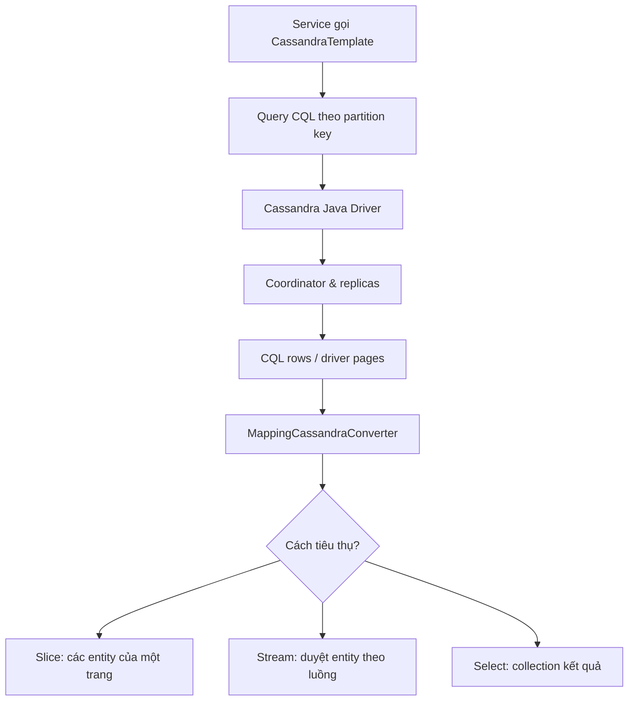
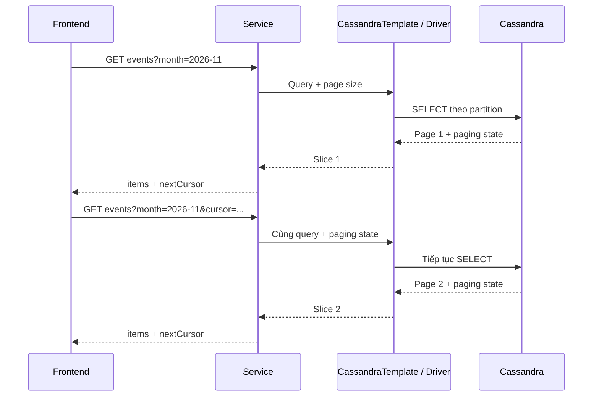
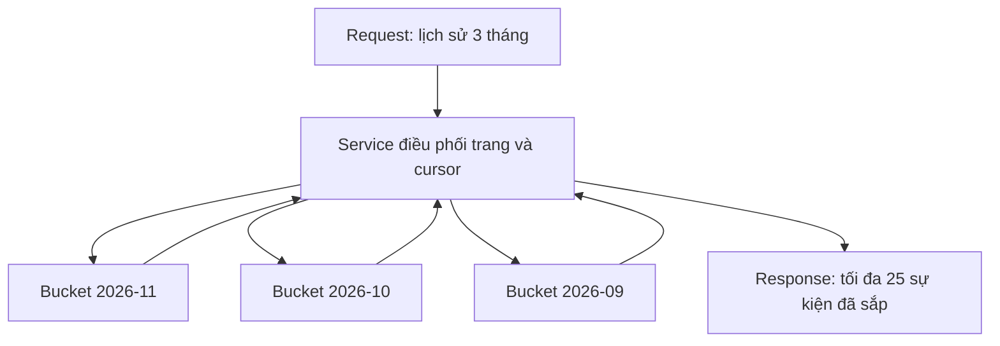

# slice, stream và xử lý tập kết quả theo từng phần

Khi ứng dụng **Spring Data Cassandra** cần hiển thị một danh sách đơn hàng hoặc xử lý một lượng lớn sự kiện, lựa chọn đơn giản nhất là gọi `CassandraTemplate.select(...)` và nhận một `List<T>`. Cách đó phù hợp nếu kết quả chắc chắn nhỏ. Nhưng nếu một partition có hàng nghìn hoặc hàng triệu bản ghi, việc cố lấy toàn bộ rồi giữ trong bộ nhớ sẽ làm tăng độ trễ, tiêu tốn RAM và gây tải không cần thiết cho Cassandra.

**`slice`** và **`stream`** giúp tổ chức việc đọc kết quả theo từng phần ở tầng ứng dụng. Chúng không làm Cassandra trở thành cơ sở dữ liệu có phân trang bằng `OFFSET` rẻ như SQL truyền thống. Cassandra vẫn đọc theo **partition key**, duyệt **clustering columns**, chuyển dữ liệu theo các trang mà Java Driver quản lý và xác nhận kết quả theo **consistency level** của request.

Bài thuộc chương **CassandraTemplate**. Trọng tâm là hiểu sự khác nhau giữa `Slice<T>`, `Stream<T>`, driver paging và `LIMIT`; cách viết query phù hợp; cách xử lý từng trang hoặc từng entity mà không làm cạn tài nguyên; cùng các rủi ro khi dữ liệu thay đổi giữa những lần đọc.

> **Mục tiêu:** Chọn `slice` khi muốn trả một trang kèm khả năng tải trang tiếp; chọn `stream` khi cần xử lý tuần tự các entity từ một query; chỉ dùng `select` để lấy toàn bộ khi tập kết quả đã được giới hạn an toàn.

## 1. Vì sao cần xử lý tập kết quả theo từng phần?

Giả sử service có hai yêu cầu:

1. Màn hình lịch sử đơn hàng hiển thị **25 đơn mới nhất**, người dùng bấm “Xem thêm” để tải tiếp.
2. Một job nội bộ xử lý các đơn trong **một tháng** để đối soát, không cần giữ tất cả đơn trong bộ nhớ cùng lúc.

Nếu hai chức năng đều chạy:

```java
List<OrderEvent> events =
    cassandraTemplate.select(query, OrderEvent.class);
```

thì chương trình có nguy cơ materialize cả kết quả thành collection, đặc biệt nếu query không giới hạn hoặc không có chiến lược paging thích hợp.

Với yêu cầu thứ nhất, ta cần **`Slice<OrderEvent>`**: tập nhỏ entity và thông tin liệu có thể đọc tiếp.

Với yêu cầu thứ hai, ta có thể cân nhắc **`Stream<OrderEvent>`**: xử lý lần lượt các entity từ query, tránh phải tập hợp toàn bộ vào `List`, đồng thời luôn giới hạn phạm vi đọc và tài nguyên.

| Khái niệm | Trả về | Mục tiêu | Điều không tự bảo đảm |
| --- | --- | --- | --- |
| `select(...)` | Thường là `List<T>` với API template tương ứng | Đọc tập kết quả nhỏ, xác định | Không tự bảo đảm tiết kiệm bộ nhớ cho tập rất lớn |
| `slice(...)` | `Slice<T>` | Trả một trang kết quả và tiến tới trang kế tiếp | Không có tổng số trang chính xác hoặc khả năng nhảy trang tùy ý |
| `stream(...)` | `Stream<T>` | Xử lý entity tuần tự/lười theo luồng | Không làm query vô hạn an toàn; không tự có checkpoint |
| Driver paging | Các trang dữ liệu được fetch khi cần | Kiểm soát lượng dữ liệu trả mỗi lần network fetch | Không thay đổi partition key hay tạo snapshot toàn bộ |
| `LIMIT N` | Giới hạn số hàng trả bởi query | Khống chế số hàng logic trong một truy vấn | Không phải cú pháp “trang N” và không tương đương page size |

Tùy phiên bản Spring Data Cassandra, chữ ký cụ thể của các phương thức template/query có thể khác. Trong bài, ví dụ Spring dùng phong cách API phổ biến; trước khi đưa vào code production, hãy đối chiếu chính xác với dependency đang dùng và chạy integration test trên Cassandra thật.

## 2. Đường đi của kết quả từ Cassandra tới Java



Từ đây có ba tầng cần phân biệt:

- **Storage / CQL:** Cassandra xác định partition và hàng phù hợp với `WHERE`, clustering order và khả năng của schema.
- **Driver:** Quản lý request, fetch page, mapping giá trị cơ bản và trạng thái tiếp tục đọc; đồng thời áp dụng timeout, retry và routing policy.
- **Spring Data:** `CassandraTemplate` chuyển row thành entity Java, trình bày dưới dạng `List`, `Slice` hoặc `Stream` tùy API.

Mọi kết quả ở tầng ứng dụng đều chịu ảnh hưởng của schema thật. Việc tạo một `Slice` không giúp lọc tùy ý trên regular column mà Cassandra không hỗ trợ hiệu quả; việc tạo một `Stream` không giúp sắp xếp toàn cục nhiều partition.

### Ba từ “phần” dễ bị nhầm

| Thuật ngữ | Mức độ | Diễn giải |
| --- | --- | --- |
| **Partition** | Mô hình lưu trữ | Nhóm hàng cùng partition key; được sao chép tới các replica |
| **Driver page** | Truyền dữ liệu | Số row driver yêu cầu/fetch trong từng lần trao đổi |
| **Slice** | API ứng dụng | Phần kết quả được Spring Data trả cho một lần xem/xử lý |

Một partition có thể chứa **nhiều driver pages**. Một API slice thường trình bày **một trang nghiệp vụ**. Driver page size, `LIMIT` và kích thước slice có thể liên quan, nhưng **không phải cùng một khái niệm**.

## 3. Thiết kế bảng theo truy vấn trước khi phân trang

Ví dụ tính năng: “Khách hàng xem sự kiện đơn hàng gần nhất trong một tháng, sắp theo thời gian mới nhất”.

Một bảng phục vụ đúng truy vấn:

```sql
CREATE TABLE IF NOT EXISTS orders_ks.order_events_by_customer_month (
    tenant_id uuid,
    customer_id uuid,
    bucket_month text,
    event_time timestamp,
    event_id uuid,
    order_id uuid,
    event_type text,
    description text,
    PRIMARY KEY (
        (tenant_id, customer_id, bucket_month),
        event_time,
        event_id
    )
) WITH CLUSTERING ORDER BY (
    event_time DESC,
    event_id DESC
);
```

Giải thích:

1. `(tenant_id, customer_id, bucket_month)` là **composite partition key**. Đây là phạm vi đọc của mỗi request.
2. `event_time` và `event_id` là **clustering columns**; Cassandra giữ thứ tự trên các hàng **trong cùng partition**.
3. `event_id` làm khóa phân biệt khi nhiều sự kiện có cùng `event_time`.
4. `order_id`, `event_type` và `description` là các cột dữ liệu, không phải điều kiện lọc/sắp xếp tự do.
5. `bucket_month` giúp tránh tích lũy lịch sử nhiều năm vào một partition, nhưng phải đánh giá kích thước/hot partition theo dữ liệu thực.

Query mẫu:

```sql
SELECT tenant_id, customer_id, bucket_month,
       event_time, event_id, order_id, event_type, description
FROM orders_ks.order_events_by_customer_month
WHERE tenant_id = 11111111-1111-1111-1111-111111111111
  AND customer_id = 22222222-2222-2222-2222-222222222222
  AND bucket_month = '2026-11'
LIMIT 25;
```

Cassandra có thể đọc các sự kiện mới nhất **trong partition được chỉ định** dựa trên clustering order mặc định. Với dữ liệu có nhiều tháng, đây không phải truy vấn “25 sự kiện mới nhất toàn bộ lịch sử” trên nhiều partition.

**Chú ý:** `LIMIT 25` giới hạn tổng số hàng của query. Với CQL phân trang, muốn truy cập tiếp những hàng sau vị trí đã đọc phải dùng **paging state/cursor và cách thiết kế query phù hợp**, không chạy lại cùng query với một số `OFFSET` không tồn tại.

## 4. Ánh xạ entity cho CassandraTemplate

Các ví dụ Java phía dưới giả định có entity `OrderEvent` ánh xạ bảng trên. Một cấu trúc khóa minh họa:

```java
import java.io.Serializable;
import java.time.Instant;
import java.util.UUID;

import org.springframework.data.cassandra.core.cql.Ordering;
import org.springframework.data.cassandra.core.cql.PrimaryKeyType;
import org.springframework.data.cassandra.core.mapping.PrimaryKeyClass;
import org.springframework.data.cassandra.core.mapping.PrimaryKeyColumn;

@PrimaryKeyClass
public class OrderEventKey implements Serializable {

    @PrimaryKeyColumn(
        name = "tenant_id",
        ordinal = 0,
        type = PrimaryKeyType.PARTITIONED
    )
    private UUID tenantId;

    @PrimaryKeyColumn(
        name = "customer_id",
        ordinal = 1,
        type = PrimaryKeyType.PARTITIONED
    )
    private UUID customerId;

    @PrimaryKeyColumn(
        name = "bucket_month",
        ordinal = 2,
        type = PrimaryKeyType.PARTITIONED
    )
    private String bucketMonth;

    @PrimaryKeyColumn(
        name = "event_time",
        ordinal = 3,
        type = PrimaryKeyType.CLUSTERED,
        ordering = Ordering.DESCENDING
    )
    private Instant eventTime;

    @PrimaryKeyColumn(
        name = "event_id",
        ordinal = 4,
        type = PrimaryKeyType.CLUSTERED,
        ordering = Ordering.DESCENDING
    )
    private UUID eventId;

    // Constructor, accessor, equals/hashCode theo dự án.
}
```

Entity minh họa:

```java
import java.util.UUID;

import org.springframework.data.cassandra.core.mapping.Column;
import org.springframework.data.cassandra.core.mapping.PrimaryKey;
import org.springframework.data.cassandra.core.mapping.Table;

@Table("order_events_by_customer_month")
public class OrderEvent {

    @PrimaryKey
    private OrderEventKey key;

    @Column("order_id")
    private UUID orderId;

    @Column("event_type")
    private String eventType;

    @Column("description")
    private String description;

    // Constructor và getter/setter theo dự án.
}
```

Đoạn mapping cố ý rút gọn để tập trung vào đọc từng phần; cần bổ sung accessor/constructor và cấu hình phù hợp với phiên bản Spring Data Cassandra thực tế. Nếu entity bất biến, thay bằng persistence constructor và `@PersistenceCreator`, cung cấp đầy đủ các property cần đọc.

**Mapping quan trọng cho slice/stream:** tất cả những row được fetch phải materialize đúng entity. Lỗi một cột, converter hay constructor trên một hàng có thể làm cả thao tác tải trang hoặc duyệt stream phát sinh exception. Việc dùng `Stream` không bỏ qua lỗi mapping.

## 5. CassandraTemplate.select: khi nào đủ tốt?

Một truy vấn ngắn, biết chắc ít hàng:

```java
import org.springframework.data.cassandra.core.CassandraTemplate;
import org.springframework.data.cassandra.core.query.Criteria;
import org.springframework.data.cassandra.core.query.Query;

Query query = Query.query(
    Criteria.where("tenant_id").is(tenantId)
        .and("customer_id").is(customerId)
        .and("bucket_month").is("2026-11")
).limit(25);

List<OrderEvent> events =
    cassandraTemplate.select(query, OrderEvent.class);
```

Ví dụ này dùng tên cột CQL để xây criteria, khóa đầy đủ và giới hạn rõ. Dạng chain của `Query` và chữ ký API cần kiểm tra theo version, nhưng **ý nghĩa** là lấy tối đa 25 hàng trong đúng partition.

`select` là lựa chọn đơn giản khi:

- Dữ liệu đã bị giới hạn bằng điều kiện và `LIMIT` thực tế.
- API chỉ cần một tập nhỏ và không có yêu cầu tải trang tiếp.
- Service muốn một `List` đã materialize để chuyển tiếp ở cùng request.
- Không có nhu cầu giữ trạng thái paging.

Tránh dùng `select` không giới hạn để đọc lịch sử nhiều năm hoặc export dữ liệu lớn. Dù driver có fetch theo page ở tầng mạng, việc xây một collection cuối cùng vẫn có thể chiếm bộ nhớ theo tổng số entity.

## 6. Slice là gì và khác Page thế nào?

Trong Spring Data Commons, `Slice<T>` biểu diễn **một phần nội dung** và thông tin điều hướng cơ bản, đặc biệt là khả năng có trang tiếp theo.

`Page<T>` thường được liên hệ với **tổng số phần tử** và **tổng số trang**. Với Cassandra, muốn biết chính xác tổng số hàng trong tập truy vấn lớn có thể rất đắt hoặc không có đường truy vấn hiệu quả. Vì vậy, đối với màn hình “Xem thêm”, `Slice<T>` thường phù hợp hơn nhu cầu “trang 1 trên tổng 4.382 trang”.

| Ý tưởng | `Slice<T>` | `Page<T>` |
| --- | --- | --- |
| Danh sách entity của phần hiện tại | Có | Có |
| Khả năng điều hướng sang phần kế tiếp | Có thể có qua `hasNext`/`nextPageable` | Có tùy implementation |
| Tổng số hàng chính xác | **Không phải hợp đồng của Slice** | Thường là thuộc tính của Page |
| Nhảy thẳng tới trang N | Không được Cassandra bảo đảm rẻ | Không nên mặc định với Cassandra |
| “Infinite scroll”/“Xem thêm” | Phù hợp | Thường dư nhu cầu |
| Cần `COUNT(*)` cho mọi request | Không | Có thể phải tính hoặc có dữ liệu tổng hợp riêng |

**Điểm then chốt:** `Slice` không phải “một danh sách Java bị cắt bằng `subList(...)` sau khi đã load hết”. API slicing có ý nghĩa khi **query chỉ lấy dữ liệu cần thiết** và giữ được thông tin tiếp tục đọc từ Cassandra/driver.

## 7. Đọc một Slice bằng CassandraTemplate

Ví dụ ý tưởng với API template hỗ trợ `slice(Query, Class<T>)` và `CassandraPageRequest` của phiên bản tương ứng:

```java
import org.springframework.data.cassandra.core.query.CassandraPageRequest;
import org.springframework.data.cassandra.core.query.Criteria;
import org.springframework.data.cassandra.core.query.Query;
import org.springframework.data.domain.Slice;

CassandraPageRequest firstPage =
    CassandraPageRequest.first(25);

Query query = Query.query(
    Criteria.where("tenant_id").is(tenantId)
        .and("customer_id").is(customerId)
        .and("bucket_month").is("2026-11")
).pageRequest(firstPage);

Slice<OrderEvent> slice =
    cassandraTemplate.slice(query, OrderEvent.class);
```

*Đây là mẫu sử dụng API theo phong cách Spring Data Cassandra có hỗ trợ `CassandraPageRequest` và `Query.pageRequest(...)`. Tên method, package, kiểu page request và cách cấu hình trạng thái trang có thể khác theo release; trước khi đưa vào dự án, hãy đối chiếu javadoc/IDE của version đang dùng và chạy integration test. Không nên sao chép không kiểm tra vào dự án khác version.*

Sau khi nhận `Slice`, xử lý một phần:

```java
List<OrderEvent> content = slice.getContent();

boolean hasNext = slice.hasNext();

// Nếu phiên bản API trả về Pageable cho trang tiếp:
if (hasNext) {
    var nextPageable = slice.nextPageable();
    // Dùng nextPageable cho lần query tiếp theo với cùng bộ filter.
}
```

Trong API frontend, thường trả nội dung và một **cursor** cho trang kế. Không nên trả nguyên đối tượng `Slice` của Spring Data trực tiếp thành JSON nếu nó có cấu trúc không ổn định với client hoặc lộ thông tin kỹ thuật không cần thiết.

### Phần tiếp theo phải giữ đúng query

Muốn tải trang kế, các thành phần sau phải thống nhất:

1. Keyspace/bảng.
2. Partition key và các giá trị `WHERE`.
3. Clustering order và cách sort.
4. Tham số query, phạm vi thời gian và mọi filter bổ sung.
5. Cơ chế page size/trạng thái paging tương ứng.
6. Ngữ cảnh người dùng/tenant được phép truy cập.

Nếu người dùng đổi tháng, đổi sort hoặc đổi filter, phải bắt đầu **trang đầu của query mới**; không tái sử dụng paging state cũ.

## 8. Paging state: token tiếp tục, không phải số trang

Cassandra Java Driver hỗ trợ paging bằng **paging state**. Đây là một trạng thái mờ (opaque) giúp driver tiếp tục đọc kết quả của một query từ vị trí đã dừng.



Sơ đồ mô tả **giao thức ở mức khái niệm**. Cách Spring Data phơi bày paging state qua `CassandraPageRequest` hoặc `Slice.nextPageable()` tùy version. Không mặc định mọi đối tượng `Pageable` thông thường của SQL có thể nhảy tới offset bất kỳ trên Cassandra.

### Vì sao không dùng OFFSET?

Trong SQL, một số ứng dụng dùng:

```sql
-- Cú pháp mang tính SQL quan hệ, không dành cho bảng Cassandra ví dụ:
SELECT *
FROM orders
ORDER BY created_at DESC
OFFSET 50000
LIMIT 25;
```

CQL **không có pagination kiểu `OFFSET N` tổng quát** như truy vấn quan hệ ở trên. Nếu muốn “trang 2”, ta dùng paging state hoặc một cursor nghiệp vụ theo clustering key. Nếu muốn “trang 2.000”, không nên tự động đọc bỏ 1.999 trang chỉ để đạt giao diện có số trang.

### Bảo vệ cursor ở API

Paging state có thể chứa thông tin trạng thái nội bộ của driver/query và **không phải token phân quyền**. Khi đưa ra frontend:

- Không tin cursor do client gửi có quyền truy cập tenant bất kỳ.
- Gắn cursor với user/tenant, loại query, filter, sort và hạn sử dụng theo thiết kế dịch vụ.
- Không giải mã hoặc tự sửa nội dung opaque token để tìm offset.
- Không log cursor/raw query chứa thông tin nhạy cảm vào hệ thống công khai.
- Cân nhắc mã hóa/ký hoặc lưu tham chiếu server-side; cách làm phụ thuộc cơ chế API và threat model.
- Xử lý cursor sai hoặc hết hiệu lực như một lỗi request có kiểm soát, không để lộ exception nội bộ.

Một API có thể trả `nextCursor: null` khi không còn trang, nhưng phải xác nhận logic `hasNext` của API phiên bản đang dùng.

## 9. Limit, page size và số entity thực nhận

Ba đại lượng khác nhau:

| Thuật ngữ | Ví dụ | Ý nghĩa |
| --- | --- | --- |
| **`LIMIT` trong CQL** | `LIMIT 100` | Giới hạn tổng số row của **truy vấn logic đó** |
| **Driver page size** | 25 row/lần fetch (mục tiêu) | Kích thước trang driver yêu cầu khi tải kết quả |
| **Slice content size** | 25 entity | Số entity được trả về cho một phần ở tầng Spring Data |

Không nên dùng `LIMIT 25` rồi kỳ vọng có thể lấy trang thứ hai của **toàn bộ lịch sử** bằng paging state: query đã giới hạn tổng 25 hàng. Thay vào đó, dùng một query có phạm vi an toàn, page size phù hợp và phương thức slice/paging của phiên bản đang dùng. Có thể áp một giới hạn tổng số hàng lớn hơn theo nghiệp vụ, nhưng phải hiểu nó sẽ giới hạn toàn bộ tập được đọc qua các trang.

**Page size là một gợi ý/kích thước mục tiêu của fetch, không phải cam kết mọi page đều có đúng số hàng**: partition kết thúc, giới hạn query, lỗi hoặc các cơ chế driver có thể làm số hàng thực tế khác. Trong trường hợp có hàng bị xóa/hết TTL hoặc filtering, kết quả cũng cần được kiểm tra trên phiên bản Cassandra.

### Câu hỏi thường gặp: LIMIT và PageRequest có cộng dồn không?

Nếu một `Query` vừa có `limit(...)` vừa có cấu hình paging, semantics kết hợp phụ thuộc cách Spring Data sinh statement và driver xử lý. Không nên gắn cả hai theo cảm tính rồi suy rằng `limit` chỉ áp cho từng trang. Hãy xem CQL được phát ra và test tình huống tải nhiều trang để tránh kết thúc sớm.

## 10. Stream là gì và khi nào nên chọn?

`Stream<T>` trong Java giúp xử lý tuần tự các phần tử mà không nhất thiết phải giữ toàn bộ chúng trong một `List<T>`. Trong một số API Spring Data Cassandra, `CassandraTemplate.stream(Query, Class<T>)` cung cấp một luồng entity được ánh xạ từ kết quả query.

Ví dụ xử lý các sự kiện của một khách trong một tháng:

```java
import java.util.stream.Stream;

import org.springframework.data.cassandra.core.query.Criteria;
import org.springframework.data.cassandra.core.query.Query;

Query query = Query.query(
    Criteria.where("tenant_id").is(tenantId)
        .and("customer_id").is(customerId)
        .and("bucket_month").is("2026-11")
);

try (Stream<OrderEvent> events =
         cassandraTemplate.stream(query, OrderEvent.class)) {

    events.forEach(this::processEvent);
}
```

*Ví dụ thể hiện vòng đời `Stream` của template trên phiên bản hỗ trợ phương thức này. Hãy đối chiếu chữ ký và khả năng cấu hình fetch size của release đang chạy. `processEvent` là hàm service do ứng dụng định nghĩa; code chưa hoàn chỉnh nếu chưa khai báo hàm đó.*

Các điểm cần chú ý:

- Stream là **cơ chế tiêu thụ ở tầng Java**, không bảo đảm server đẩy toàn bộ kết quả theo một kết nối chuyên dụng hoặc giữ snapshot dữ liệu.
- Driver thường fetch các page khi cần; quá trình duyệt có thể chờ I/O. Đừng suy đây là xử lý bất đồng bộ/non-blocking chỉ từ tên `Stream`.
- Mỗi entity vẫn cần mapping và chuyển kiểu. Một hàng lỗi có thể ném exception khi stream được tiêu thụ.
- **Đóng stream** theo quy ước API; dùng `try-with-resources` khi phương thức trả Java `Stream` có thể có resource gắn kèm.
- Không sử dụng stream để giữ một truy vấn Cassandra mở vô hạn qua nhiều request HTTP.
- Nếu cần pipeline không blocking/backpressure theo Reactive Streams, xem API **ReactiveCassandraTemplate** hoặc reactive repository thích hợp, không nhầm với Java `Stream<T>`.

### Stream không tự giới hạn số row

Lệnh:

```java
events.forEach(this::processEvent);
```

có thể duyệt toàn bộ kết quả phù hợp với query. Nếu partition rất lớn, job có thể chạy lâu, tạo nhiều page fetch, CPU/memory pressure và tác động tới cluster. Phải xác định giới hạn nghiệp vụ, thời gian, batch checkpoint và khả năng chia partition.

Java `stream.limit(100)` chỉ hạn chế số phần tử **được ứng dụng tiêu thụ từ stream**, không thay thế `LIMIT`/page size/range trong CQL hoặc đảm bảo chi phí đọc của server luôn tương đương 100 hàng. Hãy ưu tiên query có partition key và clustering range rõ ràng.

## 11. Slice và Stream khác nhau thế nào trong API thực tế?

| Tiêu chí | `slice` | `stream` |
| --- | --- | --- |
| Đơn vị xử lý ở service | Một **phần** kết quả, thường chuyển thành response | Từng entity trong cùng một lần duyệt |
| Có thông tin để tải trang kế | Có thể có `hasNext`/`nextPageable` | Không tự cung cấp cursor nghiệp vụ cho request tiếp |
| Hợp với HTTP “Xem thêm” | **Có** | Thường không phải lựa chọn chính |
| Hợp với job duyệt trong một lần chạy | Có, nếu job tự lặp từng trang | Có, nếu biết rõ giới hạn và vòng đời |
| Bộ nhớ Java | Tỷ lệ với phần hiện tại và mapping | Có thể nhỏ hơn `List` lớn, nhưng vẫn có driver buffers |
| Khả năng checkpoint/restart | Có thể ghi lại trạng thái từng trang | Phải thiết kế checkpoint riêng |
| Resource lifecycle | Theo thao tác lấy slice | Cần đóng/giải phóng stream khi dùng xong |
| Lỗi giữa quá trình | Lỗi ở lần tải phần hiện tại | Lỗi có thể xuất hiện sau khi đã xử lý một số phần tử |
| Snapshot nhiều trang | Không mặc định | Không mặc định |
| Transaction/atomicity | Không | Không |

**Quy tắc lựa chọn:** UI có nút tải tiếp → ưu tiên Slice/cursor. Job xử lý tuần tự trong một lần chạy → cân nhắc Stream. Job lớn phải restart an toàn → thường nên dùng **vòng lặp theo page/bucket có checkpoint** thay vì một stream sống rất lâu.

## 12. Xử lý từng trang có checkpoint

Ví dụ một job phải tính toán hoặc gửi dữ liệu từ nhiều trang cho hệ thống khác. Không nên chỉ viết `stream.forEach(...)` nếu job có thể bị hủy và cần tiếp tục từ vị trí cũ.

Một thiết kế khái quát:

```text
1. Xác định tenant_id, customer_id, bucket_month và query version.
2. Đọc Slice đầu tiên.
3. Xử lý từng entity của Slice, có idempotency key cho side effect.
4. Chỉ sau khi xử lý thành công, ghi checkpoint cho phần tiếp theo.
5. Đọc Slice kế tiếp với đúng query + paging state.
6. Lặp tới khi không còn trang hoặc đạt giới hạn công việc.
7. Đánh dấu job COMPLETED, ghi metric và log an toàn.
```

Pseudocode:

```java
Pageable request = firstPageable();
while (true) {
    Slice<OrderEvent> slice = loadSlice(
        tenantId, customerId, month, request
    );

    for (OrderEvent event : slice.getContent()) {
        processIdempotently(event);
    }

    if (!slice.hasNext()) {
        markJobComplete();
        break;
    }

    request = slice.nextPageable();
    saveCheckpoint(request);
}
```

Các hàm `firstPageable`, `loadSlice`, `processIdempotently`, `saveCheckpoint`, `markJobComplete` là **abstraction nghiệp vụ**, không phải method tự có của Spring Data Cassandra. Phần thực thi cần bảo đảm checkpoint tương thích với paging state của thư viện và cùng các filter/phiên bản query.

### Checkpoint trước hay sau side effect?

- Checkpoint **trước** khi gửi side effect có thể bỏ sót một entity nếu job crash sau checkpoint nhưng trước xử lý.
- Checkpoint **sau** side effect có thể xử lý lặp khi crash sau side effect nhưng trước checkpoint.
- Vì vậy cần **idempotency key** hoặc cơ chế xử lý trùng ở hệ thống nhận, không chỉ một cursor.

Một ví dụ idempotency key có thể là tổ hợp `tenant_id + event_id + operation_version`. Khóa cần ổn định và tương ứng hành động nghiệp vụ, không phải số thứ tự tạm thời của một page.

## 13. Xử lý phần kết quả ở nhiều bucket/partition

Mẫu schema ở đầu bài chia theo `bucket_month`. Nếu màn hình cần lịch sử ba tháng, không thể dùng một `Slice` với partition key `bucket_month = '2026-11'` để trả cả dữ liệu tháng 10 và tháng 9.

Hai hướng:

1. **Theo thứ tự bucket:** Đọc hết tháng mới nhất, sau đó chuyển sang tháng trước. Phù hợp khi clustering order là thời gian giảm dần và buckets không chồng thời gian.
2. **Merge nhiều nguồn:** Nếu các partition/bucket có dải thời gian chồng nhau, phải giữ cursor riêng và ghép kết quả theo khóa sắp xếp.



Sơ đồ không có nghĩa phải đọc đồng thời cả ba bucket trong mọi request; nên chọn **ít request nhất** đủ đáp ứng trang yêu cầu.

Khi chuyển giữa các partition, không được tái sử dụng paging state của partition trước cho partition sau. Cursor nghiệp vụ lúc này có thể bao gồm **bucket hiện tại + paging state của query bucket ấy**, với xác thực scope và version.

### Không có thứ tự toàn cục miễn phí

Cassandra sắp xếp theo clustering columns **trong một partition**. Việc gọi `ORDER BY` không tự hợp nhất thứ tự của mọi partition trên cluster. Nếu yêu cầu “sắp đơn của tất cả khách theo ngày” là lõi sản phẩm, cần thiết kế read model/index/analytics phù hợp thay vì chỉ đổi `slice` thành `stream`.

## 14. Dữ liệu thay đổi giữa các trang: có snapshot không?

Giả sử ở thời điểm T1, người dùng tải trang đầu gồm 25 sự kiện mới nhất. Trước khi tải trang thứ hai ở T2, một event mới được ghi vào cùng partition hoặc một event cũ bị xóa.

**Không có cam kết rằng hai lần đọc hợp thành một snapshot bất biến**. Paging state theo vị trí kết quả không tự chuyển Cassandra thành MVCC snapshot qua nhiều request.

Các hiện tượng cần tính đến:

- Sự kiện mới được chèn trước vị trí đã đọc có thể không xuất hiện trong các trang tiếp theo của phiên duyệt đó.
- Các hàng bị xóa/TTL hết hạn có thể không còn xuất hiện khi chuyển trang.
- Nếu clustering key hoặc dữ liệu sắp xếp được thay đổi thông qua ghi hàng mới/xóa hàng cũ, có thể phát sinh khó khăn tránh trùng/sót.
- Dữ liệu đọc từ các replica/DC có thể chưa hội tụ tùy consistency level và tình trạng mạng.

Với UI timeline, có thể chấp nhận “danh sách đang thay đổi”. Nếu nghiệp vụ cần snapshot kiểm toán cố định, phải thiết kế **mốc dữ liệu, workflow đóng sổ, bản ghi bất biến hoặc nguồn tổng hợp có snapshot** riêng.

### Cursor theo clustering key là lựa chọn khác

Ngoài driver paging state, ứng dụng có thể định nghĩa cursor chứa `event_time` và `event_id` cuối cùng đã trả, rồi dùng điều kiện CQL tương thích với schema để đọc tiếp.

Ưu điểm:

- Cursor phản ánh **vị trí nghiệp vụ**, có thể dễ giải thích hơn paging token nội bộ.
- Có thể chọn cách xử lý khi có insert mới trước/ sau cursor.

Nhưng với hai clustering columns và chiều `DESC`, điều kiện CQL cần tuân đúng quy tắc tuple/range của Cassandra; không thể đơn giản hóa thành `event_time < lastTime` nếu có nhiều event trùng timestamp, vì sẽ bỏ sót một phần. Phải thiết kế câu query đúng theo phiên bản CQL và kiểm thử với dữ liệu trùng timestamp.

## 15. Consistency level và paging: hai trục khác nhau

Cassandra dùng replication factor và consistency level để xác định số replica phải xác nhận request. Paging điều khiển việc trả dữ liệu **theo từng phần**.

Giả sử keyspace có RF = 3 trong `dc_hcm`, service dùng `LOCAL_QUORUM`:

\[
\text{LOCAL\_QUORUM} = \left\lfloor \frac{3}{2} \right\rfloor + 1 = 2
\]

Điều này nói rằng coordinator cần đủ xác nhận cục bộ theo policy. Nó **không** nói rằng mỗi page có 2 replica hay rằng mọi page được đọc từ cùng một snapshot.

| Câu hỏi | Quyết định liên quan |
| --- | --- |
| Một partition nằm ở đâu? | Partition key + token + replication strategy |
| Cần mấy replica xác nhận? | Consistency level |
| Dữ liệu sắp theo trục nào? | Clustering key/order trong partition |
| Đọc bao nhiêu row mỗi page? | Driver page size/`CassandraPageRequest` |
| Có tải tiếp không? | Paging state/`Slice.hasNext()` |
| Có giữ cả kết quả trong Java RAM không? | `select` vs `slice` vs `stream` |
| Có snapshot hoặc exactly-once không? | **Không tự có**; cần thiết kế nghiệp vụ |

Một page đầu thành công không bảo đảm page sau không timeout: node có thể lỗi, tải cluster thay đổi, token bị di chuyển, hoặc request mới gặp điều kiện replica khác. Service cần chính sách retry/đối soát và phản hồi lỗi phù hợp.

## 16. Timeout và lỗi giữa quá trình xử lý

### Slice: lỗi ở trang kế

Ví dụ:

1. Trang đầu trả 25 entity thành công.
2. Người dùng nhấn “Xem thêm”.
3. Truy vấn trang hai gặp `ReadTimeout`.
4. Trang đầu vẫn đã được hiển thị; trang hai chưa hoàn tất.

Nên:

- Giữ trạng thái UI trước đó, không xóa danh sách đã nhận chỉ vì một trang lỗi.
- Cho phép thử lại có giới hạn khi phù hợp, gắn với cùng query/cursor.
- Phân biệt lỗi cursor không hợp lệ với lỗi Cassandra tạm thời.
- Không mặc định một read retry sẽ trả đúng cùng dữ liệu nếu source đã thay đổi.

### Stream: lỗi sau một phần side effect

Ví dụ job dùng `Stream<OrderEvent>` để gửi email, ghi log audit hoặc cập nhật read model:

```java
try (Stream<OrderEvent> events =
         cassandraTemplate.stream(query, OrderEvent.class)) {
    events.forEach(this::publishEvent);
}
```

Nếu xảy ra lỗi sau 700 sự kiện:

- 700 side effect trước đó có thể đã thực sự xảy ra.
- Stream không tự rollback các side effect.
- Restart từ đầu có thể gửi trùng nếu không có idempotency.
- Chỉ nhìn exception không đủ xác định trạng thái của lời gọi cuối cùng.

Với công việc có side effect quan trọng, **lặp theo page có checkpoint** thường dễ kiểm soát hơn một stream đơn kéo dài. Khi buộc dùng stream, nên có operation ID ổn định và xử lý idempotent.

### Không retry vô hạn

Retry cần phân loại lỗi:

| Loại lỗi | Gợi ý xử lý |
| --- | --- |
| Mất kết nối/timeout thoáng qua | Retry có giới hạn, backoff và theo dõi |
| Sai schema/cột/partition key | Sửa query hoặc migration; retry không giải quyết |
| `Unauthorized` | Sửa quyền hoặc cấu hình; không retry vô hạn |
| Paging state không đúng query | Tạo phiên paging mới hoặc trả lỗi cursor |
| Dữ liệu domain làm mapping exception | Kiểm tra converter/constructor và bản ghi cụ thể |
| Cluster quá tải | Giảm concurrency/page size hoặc tạm dừng job |
| Lỗi khi đã gửi side effect | Đối soát/idempotency trước khi retry |

## 17. Stream và tài nguyên: làm sao tránh leak?

Một Java `Stream` có thể mang resource từ cơ chế đọc dữ liệu bên dưới. Khi API cho phép đóng, hãy dùng `try-with-resources`.

Tránh mô hình:

```java
// Ví dụ KHÔNG khuyến khích:
public Stream<OrderEvent> getEvents() {
    return cassandraTemplate.stream(query, OrderEvent.class);
}
// Caller có thể quên đóng và giữ luồng quá lâu.
```

Thay vào đó, giới hạn vòng đời trong một service method:

```java
public long countMatchingInBoundedPartition(Query query) {
    try (Stream<OrderEvent> events =
             cassandraTemplate.stream(query, OrderEvent.class)) {
        return events.filter(this::matchesRule).count();
    }
}
```

*`matchesRule` là business predicate, chưa được định nghĩa trong ví dụ. Tên hàm “bounded” nhấn mạnh query phải có phạm vi đọc đã giới hạn; đây không phải cách được khuyến nghị để đếm mọi hàng Cassandra ở quy mô lớn.*

Cần hiểu:

- **Stream pipeline thường lazy**: một số xử lý chỉ thực hiện khi có terminal operation như `forEach`, `count` hoặc `collect`.
- Khi có terminal operation, nó có thể tiêu thụ **nhiều driver pages**.
- Không dùng `parallel()` trên một stream gắn với request/driver rồi mặc định mapping, I/O và exception sẽ tăng tốc an toàn.
- Không giữ stream để render response HTTP trong thời gian không giới hạn hoặc sau khi context/session bị đóng.
- Không tự ý biến mọi query thành stream nếu workload chỉ vài row; `selectOne`/`select` đơn giản có thể dễ bảo trì hơn.

### Stream không phải Reactive Streams

| Java Stream | Reactive `Flux`/`Publisher` |
| --- | --- |
| Pipeline theo API Java Stream | Pipeline theo Reactive Streams |
| Thường tiêu thụ đồng bộ khi terminal operation chạy | Có subscription, backpressure và non-blocking API phù hợp |
| Không tự có backpressure theo giao thức reactive | Có khái niệm backpressure |
| `try-with-resources` khi giữ resource | Có lifecycle/cancellation/disposal riêng |
| Không tự đổi bảo đảm Cassandra | Cũng không tự đổi bảo đảm Cassandra |

Nếu service cần hàng nghìn request đồng thời với I/O không blocking, hãy xem khả năng **ReactiveCassandraTemplate** và cấu hình reactive driver tương thích; nhưng đó là quyết định kiến trúc khác, không phải chức năng bổ sung tự động cho Java `Stream`.

## 18. Dùng CassandraTemplate để tránh N+1 và hạn chế over-fetching

Một vấn đề thường gặp là query danh sách trả 25 ID rồi với mỗi ID chạy thêm một query để lấy chi tiết. Với 25 event có thể thành **26 request** hoặc hơn.

Các hướng cân nhắc:

- Thiết kế read model theo query để chứa những cột cần hiển thị trong một lần đọc.
- Chỉ `SELECT` các cột thật sự cần; nhưng nếu materialize immutable entity qua constructor, phải bảo đảm mọi cột bắt buộc có trong result.
- Đừng tạo read model chứa hàng trăm KB dữ liệu trên mỗi hàng nếu UI chỉ cần một tiêu đề; chia cấu trúc hợp lý theo nhu cầu.
- Nếu phải tra nhiều ID, dùng API truy cập đã biết khóa, giới hạn số ID/đồng thời và quan sát số request.
- Không dùng `ALLOW FILTERING` để thay cho đường truy cập thích hợp.

### Projection và bộ nhớ

Giả sử `description` của mỗi event rất dài, nhưng màn hình chỉ cần `event_time`, `event_id` và `event_type`. Một DTO/projection được thiết kế đúng có thể giảm network và chi phí mapping.

Tuy nhiên, không nên viết `SELECT event_time, event_type` rồi yêu cầu framework dựng `OrderEvent` đầy đủ nếu entity còn cần partition key hoặc trường trong constructor. Hãy dùng projection/DTO được phiên bản Spring Data Cassandra hỗ trợ hoặc ánh xạ kết quả thủ công với contract rõ ràng.

## 19. Quan sát và tối ưu page size

Page size phù hợp phụ thuộc kích thước row và mục tiêu latency, không chỉ số lượng entity. 25 bản ghi nhỏ khác 25 bản ghi chứa collection lớn.

Các metric cần xem:

| Metric | Ý nghĩa |
| --- | --- |
| Page size và số row/page | Mức dữ liệu mỗi lần fetch |
| Row size/payload bytes | Bộ nhớ và băng thông thực tế |
| Driver request latency / p95-p99 | Độ trễ tới Cassandra |
| Số page mỗi request/job | Khối lượng đọc tổng |
| CPU và GC khi mapping entity | Chi phí `MappingCassandraConverter` và xử lý Java |
| Read timeout / unavailable | Sự cố replica, CL, mạng hoặc query |
| In-flight requests / pool pressure | Áp lực đồng thời trên driver |
| Hot partition / partition size | Đường đọc mất cân bằng |
| Tỷ lệ retry và cursor lỗi | Tính ổn định của pagination |
| Job checkpoint lag | Khả năng khôi phục công việc |

### Quy trình đo page size

1. Bắt đầu từ truy vấn có **đúng partition key** và kích thước dữ liệu thực tế.
2. Chọn một page size vừa phải theo nhu cầu màn hình/job; không coi số ví dụ là chuẩn.
3. Thử với các trường hợp ít hàng, vừa đủ một trang, nhiều trang và partition lớn.
4. Đo latency, payload, memory và số request qua driver.
5. Thay đổi page size có kiểm soát, so sánh p95/p99 và tải cluster.
6. Kiểm tra khi node lỗi hoặc DC có độ trễ cao theo CL của ứng dụng.
7. Giữ giới hạn lượng dữ liệu được xử lý cho mỗi request; job lớn phải có checkpoint.

Nếu trang quá lớn, API có thể giữ nhiều object và response chậm. Nếu quá nhỏ, số lần round trip tăng. Điểm tối ưu phụ thuộc SLA và dữ liệu thật.

## 20. Những mẫu thực hành cần tránh

| Sai lầm | Vì sao nguy hiểm | Cách làm phù hợp hơn |
| --- | --- | --- |
| Dùng `select` đọc cả lịch sử nhiều năm rồi cắt `subList` | Tải và materialize dữ liệu thừa | Slice/driver paging và query theo bucket |
| Nghĩ `LIMIT 25` cho phép tải “trang 2 của tất cả dữ liệu” | `LIMIT` giới hạn tổng số hàng query | Phân biệt LIMIT và page size |
| Sử dụng `PageRequest.of(2000, 25)` như SQL OFFSET | Cassandra không có offset pagination rẻ | Paging state/cursor tuần tự |
| Dùng lại paging state sau khi đổi tháng/filter | Token gắn với query cụ thể | Khởi tạo page đầu cho query mới |
| Dùng `Stream` để giữ kết nối suốt phiên đăng nhập | Stream không dành để sống lâu qua HTTP requests | Mỗi request riêng và cursor |
| Không đóng Stream | Có thể giữ tài nguyên lâu hơn cần thiết | `try-with-resources` |
| Stream lớn rồi gọi `collect(toList())` | Lại giữ toàn bộ entity trong RAM | Xử lý từng phần hoặc chunk |
| Duyệt stream và phát side effect không checkpoint | Crash giữa chừng gây trùng/sót | Page-based checkpoint + idempotency |
| Gọi `parallel()` không kiểm soát | Mức đồng thời/memory khó dự đoán | Concurrency rõ ràng và benchmark |
| Lấy `Slice` rồi suy ra tổng số trang | Slice không chứa tổng chính xác | UI “Xem thêm” hoặc aggregation riêng |
| Giả định paging là snapshot | Dữ liệu có thể đổi giữa các lần fetch | Xác định semantics freshness/cutoff |
| Quét mọi partition để tạo feed mới nhất | Clustering order không toàn cục | Thiết kế read model theo query |
| Cho client dùng cursor của tenant khác | Rủi ro lộ dữ liệu | Xác thực scope và bảo vệ cursor |
| Cố sửa timeout bằng tăng page size | Page lớn có thể tăng tải hơn | Tìm bottleneck thực và đo lại |

## 21. Kiểm thử tích hợp cho Slice và Stream

**Unit test** của service có thể kiểm tra logic gắn cursor hoặc xử lý từng entity, nhưng **integration test** mới xác nhận Spring Data/Driver/Cassandra làm việc cùng nhau.

Chuẩn bị keyspace test, tạo bảng `order_events_by_customer_month`, insert nhiều hàng vào **cùng partition** và thêm vài hàng ở partition khác để kiểm tra không đọc lẫn.

### Các ca kiểm thử tối thiểu

1. Partition rỗng: slice trả danh sách rỗng, không có trang kế.
2. Partition có ít hơn page size: trả đúng tất cả hàng và không có trang tiếp.
3. Partition có đúng page size: xác minh `hasNext` theo behavior API/version thực.
4. Partition có nhiều hơn một page: tải đủ, không thiếu/trùng khi dữ liệu không đổi.
5. Hai hàng có cùng `event_time`: thứ tự theo `event_id` ổn định.
6. Đổi `bucket_month`: paging state cũ không được sử dụng.
7. Stream đọc nhiều page: xử lý đúng số hàng trong phạm vi query và resource được đóng.
8. Một row có conversion lỗi: kiểm tra exception và partial processing.
9. Data thay đổi trong khi tải trang tiếp: kiểm tra semantics đã cam kết ở API.
10. Có timeout hoặc node lỗi: service không bỏ thông tin/trạng thái đã xử lý và retry theo policy.

### Ví dụ kiểm chứng Slice ở mức logic

```java
Slice<OrderEvent> first = loadFirstSlice(
    tenantId, customerId, "2026-11", 25
);

assertFalse(first.getContent().isEmpty());

if (first.hasNext()) {
    Slice<OrderEvent> second = loadNextSlice(
        tenantId, customerId, "2026-11",
        first.nextPageable()
    );

    // So sánh các khóa EventKey để phát hiện trùng/sót
    // trên dữ liệu test cố định không có concurrent writes.
}
```

`loadFirstSlice` và `loadNextSlice` là hàm trợ giúp **minh họa** mà test/service phải định nghĩa phù hợp version, không phải tên API có sẵn.

### Ví dụ kiểm chứng Stream

```java
List<UUID> processed = new ArrayList<>();

try (Stream<OrderEvent> stream =
         cassandraTemplate.stream(query, OrderEvent.class)) {

    stream.forEach(event ->
        processed.add(event.getKey().getEventId()));
}

assertEquals(expectedCount, processed.size());
```

Ví dụ yêu cầu hoàn thiện accessor trên entity, nhập `List`/`ArrayList`/`UUID`/`Stream` và chuẩn bị dữ liệu test. Đây là một phép test **trên partition có số hàng biết trước**, không phải khuyến nghị thu thập tất cả ID của job production vào RAM.

Nếu cần kiểm tra tiết kiệm bộ nhớ, profile với dataset đủ lớn và giám sát heap/GC; việc dùng `Stream` trong code **không tự chứng minh** memory consumption hằng số.

## 22. Thiết kế API trả trang cho frontend

Một endpoint giả định:

```text
GET /customers/{customerId}/order-events
    ?month=2026-11
    &limit=25
    &cursor=...
```

Hợp đồng trả về:

```json
{
  "items": [
    {
      "eventId": "aaaaaaaa-aaaa-aaaa-aaaa-aaaaaaaaaaaa",
      "eventTime": "2026-11-25T03:00:00Z",
      "eventType": "PAID"
    }
  ],
  "nextCursor": "opaque-token-or-null"
}
```

Các giá trị JSON là dữ liệu minh họa. Mục đích của hợp đồng:

- `items` chỉ gồm entity/DTO đã được xác thực thuộc tenant, khách và bucket được yêu cầu.
- `nextCursor` cho phép đọc tiếp **cùng query**.
- `limit` bị giới hạn ở server, không tin con số do client truyền tùy ý.
- Thứ tự hiển thị là clustering order được thiết kế, không dùng sort trường tự do.
- Chỉ công bố những thông tin frontend thực sự cần; không gửi metadata nội bộ của driver nếu không cần.

Nếu không còn trang, `nextCursor = null`. Nếu cursor không hợp lệ hoặc sai scope, server trả lỗi có kiểm soát; không âm thầm dùng cursor đó trên query khác.

## 23. Khi nào nên dùng giải pháp khác?

`slice` và `stream` rất hữu ích, nhưng không giải quyết mọi nhu cầu:

| Nhu cầu | Hướng đánh giá |
| --- | --- |
| Lấy top 25 trong một partition theo clustering | `CassandraTemplate.slice` hoặc query giới hạn |
| Đọc tuần tự vài nghìn hàng thuộc phạm vi xác định | `stream` hoặc loop theo slice |
| Job lớn cần resume chính xác sau crash | Loop page/bucket + checkpoint + idempotency |
| Feed toàn hệ thống từ nhiều partition | Read model riêng, phân vùng theo yêu cầu feed hoặc hệ search/analytics |
| Đếm tổng số bản ghi cho UI | Counter/aggregate được thiết kế riêng; không gọi count vô hạn |
| Đọc nhiều trường ít dùng của row lớn | Projection/DTO theo yêu cầu |
| Gửi side effects cần exactly-once | Cơ chế nghiệp vụ/idempotency ngoài Slice/Stream |
| Nhiều request I/O đồng thời kiểu reactive | ReactiveCassandraTemplate/ReactiveRepository phù hợp |
| Snapshot cố định để báo cáo | Pipeline snapshot/cutoff/watermark độc lập |

Đừng đánh đổi correctness của phân trang chỉ để dùng một API ngắn gọn. Nếu sản phẩm yêu cầu nhảy trang bất kỳ, sắp nhiều trường động hoặc tổng số trang tuyệt đối, phải thảo luận lại mô hình dữ liệu và UX thay vì ép Cassandra mô phỏng SQL offset pagination.

## 24. Bài tập áp dụng

### Bài 1 — chọn select, slice hay stream

Một API hiển thị 25 hoạt động mới nhất của một tài khoản trong ngày và có nút “Xem thêm”. Một job kiểm tra từng hoạt động trong tháng và có thể chạy lâu.

**Câu hỏi:** Chọn hướng đọc nào cho mỗi trường hợp?

<details>
<summary>Đáp án gợi ý</summary>

API nên dùng **Slice** và cơ chế next cursor của cùng query. Job có thể dùng **Stream** nếu phạm vi đủ giới hạn và xử lý được ngay trong một lần chạy; nếu job có thể crash và cần resume, nên cân nhắc **lặp theo Slice, bucket và checkpoint**, không dựa vào một Stream sống rất lâu.

</details>

### Bài 2 — phân biệt LIMIT với page size

Developer viết `SELECT ... LIMIT 25` và đặt driver page size 25. Sau khi tải 25 hàng, người dùng muốn 25 hàng tiếp.

**Câu hỏi:** Vì sao cần xem lại query?

<details>
<summary>Đáp án gợi ý</summary>

`LIMIT 25` giới hạn **toàn bộ kết quả của query**. Paging state không tạo thêm hàng vượt giới hạn ấy. Cần thiết kế cách tải nhiều page trong phạm vi query an toàn: dùng page size/cursor phù hợp và tránh nhầm `LIMIT` là giới hạn riêng từng page.

</details>

### Bài 3 — dữ liệu hai tháng

Bảng có `PRIMARY KEY ((tenant_id, customer_id, bucket_month), event_time, event_id)`. UI muốn 25 sự kiện mới nhất của cả tháng 11 và tháng 10.

**Câu hỏi:** Có thể dùng một `ORDER BY event_time DESC` trên hai bucket và mong có thứ tự chung không?

<details>
<summary>Đáp án gợi ý</summary>

Không nên. Clustering order chỉ được bảo đảm trong từng partition. Service cần điều phối việc đọc bucket tháng 11 rồi tháng 10, hoặc có thuật toán merge các nguồn nếu thời gian chồng nhau. Cursor nghiệp vụ phải ghi nhớ bucket hiện tại, không dùng paging state của tháng 11 để truy vấn tháng 10.

</details>

### Bài 4 — stream phát sự kiện

Một job gọi `stream.forEach(this::sendNotification)`. Sau 700 bản ghi, Cassandra timeout.

**Câu hỏi:** Nếu chạy lại job từ đầu thì có rủi ro gì?

<details>
<summary>Đáp án gợi ý</summary>

Những thông báo đã gửi có thể bị gửi trùng. Stream không tự rollback side effects. Cần idempotency key, giới hạn retry và cơ chế checkpoint/reconciliation. Với job quan trọng, vòng lặp theo page có checkpoint thường dễ xử lý lỗi hơn.

</details>

### Bài 5 — cùng query, khác cursor

Client A có cursor cho tenant X. Client B cố gửi cursor đó với tenant Y.

**Câu hỏi:** Service nên làm gì?

<details>
<summary>Đáp án gợi ý</summary>

Không dùng cursor của tenant X để truy cập tenant Y. Server phải kiểm tra authorization độc lập và ràng buộc cursor với user/tenant, filter, sort, query/version tương ứng. Sai scope thì từ chối hoặc yêu cầu bắt đầu phiên paging mới tùy hợp đồng API.

</details>

### Bài 6 — consistency và snapshot

Service đọc page 1 với `LOCAL_QUORUM`, sau đó page 2 cùng partition. Một ghi mới xảy ra giữa hai lần đọc.

**Câu hỏi:** Có bảo đảm hai page là snapshot cùng thời điểm không?

<details>
<summary>Đáp án gợi ý</summary>

Không. `LOCAL_QUORUM` xác định điều kiện replica phản hồi, không biến nhiều request paging thành một snapshot transaction. Nếu cần dữ liệu cố định, phải thiết kế cutoff/snapshot hoặc pipeline phù hợp với nghiệp vụ.

</details>

## 25. Checklist trước khi triển khai xử lý từng phần

- [ ] Đã xác định rõ API cần **Slice** để tải tiếp hay job cần **Stream** để xử lý tuần tự.
- [ ] Query có **partition key đầy đủ** hoặc một chiến lược đọc nhiều partition được thiết kế rõ ràng.
- [ ] Clustering order đúng thứ tự UI/job; có khóa phụ khi giá trị thời gian có thể trùng.
- [ ] Đã phân biệt `LIMIT`, driver page size và số entity trong `Slice`.
- [ ] Không dùng SQL-style `OFFSET` hoặc giả định nhảy tới trang N rẻ.
- [ ] Paging state/cursor luôn gắn với đúng query, filter, sort, tenant và quyền truy cập.
- [ ] Đã quy định hành vi khi đổi filter/bucket hoặc khi cursor không hợp lệ.
- [ ] Không công bố paging state thô thiếu bảo vệ nếu API có rủi ro.
- [ ] Stream được tiêu thụ và đóng trong vòng đời hữu hạn; không giữ qua nhiều HTTP request.
- [ ] Không `collect` toàn bộ Stream lớn thành `List` vô hạn.
- [ ] Job có checkpoint/idempotency nếu side effect và có yêu cầu resume.
- [ ] Đã quy định semantics khi dữ liệu bị thêm/xóa trong quá trình paging.
- [ ] Đã kiểm tra RF, CL, timeout và hành vi khi replica/driver gặp lỗi.
- [ ] Đã giới hạn page size, payload và mức song song theo latency/memory thực.
- [ ] Entity mapping/converter/constructor xử lý đúng mọi hàng được query trả về.
- [ ] Có integration test rỗng/ít hàng/đúng page size/nhiều page, dữ liệu trùng timestamp và lỗi giữa chừng.
- [ ] Có metric số page, row size, p95/p99, timeout, heap/GC, retry và tiến độ job.
- [ ] Với nhiều partition/bucket, service biết cách ghép kết quả và giữ cursor riêng cho từng nguồn khi cần.

**Ghi nhớ:** `CassandraTemplate.slice(...)` giúp trả **từng phần có khả năng tải tiếp**, còn `CassandraTemplate.stream(...)` giúp **tiêu thụ entity lần lượt trong một vòng đời xử lý**. Driver paging quản lý việc fetch các row từ Cassandra, nhưng **không thay thế thiết kế partition key, không tạo thứ tự toàn cluster, không có OFFSET và không cung cấp snapshot/transaction nhiều trang**. Chọn đúng API, giới hạn lượng dữ liệu, đóng tài nguyên, bảo vệ cursor và có checkpoint khi cần xử lý công việc lớn mới là cách sử dụng Cassandra hiệu quả trong ứng dụng phân tán.
