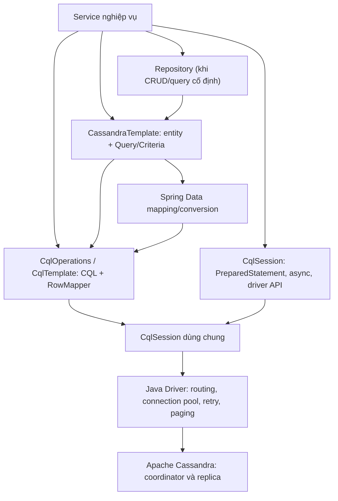

# Kết hợp Template với CqlTemplate hoặc Java Driver khi cần

Trong một ứng dụng **Spring Data Cassandra**, không nhất thiết mọi thao tác dữ liệu đều phải đi qua cùng một API. **`CassandraTemplate`** phù hợp khi bạn muốn làm việc với entity và metadata ánh xạ; **`CqlTemplate`** phù hợp khi câu CQL đã được xác định nhưng kết quả cần ánh xạ thủ công bằng `RowMapper` hoặc callback; còn **Java Driver với `CqlSession`** phù hợp khi cần kiểm soát chi tiết statement, paging bất đồng bộ hoặc phản hồi đặc biệt của Cassandra.

Bài học thuộc chương **CassandraTemplate** của module **`SPRING_DATA_CASSANDRA`**. Mục tiêu của module là truy cập Apache Cassandra qua entity mapping, repository, `CassandraTemplate` và CQL, đồng thời hiểu thiết kế bảng theo truy vấn, partition key, consistency level, paging và chi phí hiệu năng trong mô hình dữ liệu phân tán. Chọn công cụ đúng giúp code rõ ràng hơn, nhưng **không công cụ nào có thể bỏ qua ràng buộc partition key hoặc tự biến một truy vấn quét rộng thành truy vấn tốt**.

**Sau bài học, bạn có thể:**

1. Phân biệt chính xác trách nhiệm của `CassandraTemplate`, `CqlOperations`/`CqlTemplate` và `CqlSession`.
2. Sử dụng `CassandraTemplate.getCqlOperations()` để chạy CQL mức thấp và map projection mà **không tạo kết nối mới**.
3. Chuyển có chủ đích từ entity mapping sang `RowMapper`, rồi xuống prepared statement/driver khi cần.
4. Xử lý paging, consistency, LWT, lỗi và timeout theo đúng ngữ nghĩa Cassandra.
5. Tổ chức code và kiểm thử để nhiều mức API cùng tồn tại mà không trùng lặp hoặc gây mất nhất quán dữ liệu.

## 1. Ba mức truy cập, một hạ tầng kết nối

Spring Data Cassandra đặt nhiều abstraction lên Java Driver:



Sơ đồ biểu diễn **trách nhiệm**, không bắt buộc mọi phương thức chạy qua đúng từng ô theo chuỗi này. Trong triển khai Spring Data Cassandra hiện đại, `CassandraTemplate` sử dụng `CqlOperations` bên dưới để thực thi các câu lệnh CQL và bộ converter để ánh xạ entity. `CqlOperations` là interface; `CqlTemplate` là implementation phổ biến của interface đó. `CqlSession` là đối tượng **cấp ứng dụng** của Java Driver, không phải kết nối mở mới cho từng câu truy vấn.

| Thành phần | Đầu vào thường gặp | Kết quả thường gặp | Có tự map entity không? |
| --- | --- | --- | --- |
| `CassandraTemplate` | `Query`, `Criteria`, `InsertOptions`, entity class | Entity hoặc kết quả thao tác mapping | **Có**, theo `@Table` và converter |
| `CqlOperations` / `CqlTemplate` | Chuỗi CQL, bind arguments, `RowMapper`/callback | DTO, scalar, danh sách tùy mapper | **Không tự suy entity** nếu chỉ truyền CQL |
| `CqlSession` | `SimpleStatement`, `PreparedStatement`, `BoundStatement` | `ResultSet`, `AsyncResultSet`, `Row` | **Không**, phải dùng driver API hoặc tự chuyển đổi |

**Điểm mấu chốt:** dùng template nào cũng vẫn dựa trên **schema, partition key, replication factor và consistency level** của Cassandra. Thay API là thay mức trừu tượng và quyền kiểm soát, không phải thay cách dữ liệu được phân phối.

## 2. Một bảng CQL xuyên suốt bài học

Giả sử nền tảng đặt chỗ ghi sự kiện của từng khách thuê theo ngày. Màn hình cần lấy 20 sự kiện gần nhất của một khách/ngày; bộ phận vận hành đôi khi chỉ cần một DTO gồm thời điểm, mã sự kiện và trạng thái.

```sql
CREATE TABLE IF NOT EXISTS booking_events_by_tenant_day (
    tenant_id uuid,
    event_day date,
    occurred_at timestamp,
    event_id uuid,
    status text,
    source text,
    payload text,
    PRIMARY KEY ((tenant_id, event_day), occurred_at, event_id)
) WITH CLUSTERING ORDER BY (occurred_at DESC, event_id ASC);
```

**Phân tích khóa:**

- **Partition key:** `(tenant_id, event_day)`. Cả hai cột cần được cung cấp để định vị chính xác một partition.
- **Clustering columns:** `occurred_at` giảm dần rồi `event_id` tăng dần. Chúng sắp xếp các hàng bên trong partition.
- **Cột thường:** `status`, `source` và `payload`. Chúng không tự trở thành điều kiện tìm kiếm hiệu quả trên toàn cluster.

Truy vấn đã thiết kế:

```sql
SELECT tenant_id, event_day, occurred_at,
       event_id, status, source, payload
FROM booking_events_by_tenant_day
WHERE tenant_id = 75c1f641-ec55-4e44-834d-a3808c913214
  AND event_day = '2026-11-25'
LIMIT 20;
```

Nếu API muốn “mọi event có `status = 'FAILED'` của tất cả tenant”, bảng này **không hỗ trợ trực tiếp** chỉ bởi vì code sử dụng `CqlTemplate` hay driver. Cần thiết kế bảng/index/hệ truy vấn khác cho yêu cầu đó.

## 3. Khai báo entity cho CassandraTemplate

Để Spring Data Cassandra ánh xạ bảng trên, cần mô tả primary key tổng hợp:

```java
import java.io.Serializable;
import java.time.Instant;
import java.time.LocalDate;
import java.util.UUID;
import org.springframework.data.cassandra.core.cql.Ordering;
import org.springframework.data.cassandra.core.mapping.PrimaryKeyClass;
import org.springframework.data.cassandra.core.mapping.PrimaryKeyColumn;
import org.springframework.data.cassandra.core.mapping.PrimaryKeyType;

@PrimaryKeyClass
public class BookingEventKey implements Serializable {
    @PrimaryKeyColumn(name = "tenant_id", ordinal = 0,
                      type = PrimaryKeyType.PARTITIONED)
    private UUID tenantId;

    @PrimaryKeyColumn(name = "event_day", ordinal = 1,
                      type = PrimaryKeyType.PARTITIONED)
    private LocalDate eventDay;

    @PrimaryKeyColumn(name = "occurred_at", ordinal = 2,
                      type = PrimaryKeyType.CLUSTERED,
                      ordering = Ordering.DESCENDING)
    private Instant occurredAt;

    @PrimaryKeyColumn(name = "event_id", ordinal = 3,
                      type = PrimaryKeyType.CLUSTERED,
                      ordering = Ordering.ASCENDING)
    private UUID eventId;

    // Cần constructor, getter/setter, equals và hashCode.
}
```

Và entity:

```java
import org.springframework.data.cassandra.core.mapping.Column;
import org.springframework.data.cassandra.core.mapping.PrimaryKey;
import org.springframework.data.cassandra.core.mapping.Table;

@Table("booking_events_by_tenant_day")
public class BookingEvent {
    @PrimaryKey
    private BookingEventKey key;

    @Column("status")
    private String status;

    @Column("source")
    private String source;

    @Column("payload")
    private String payload;

    // Cần constructor và getter/setter.
}
```

Các đoạn mã này tập trung vào **metadata mapping**, chưa phải lớp Java hoàn chỉnh. Trước khi chạy dự án cần bổ sung các thành viên Java, kiểm tra import, mapping converter và schema đang dùng. Thứ tự `ordinal` phải trùng CQL; tên bảng và cột phải nhất quán.

**Vì sao bắt đầu từ entity?** Với một tập truy vấn ổn định và bảng rõ ràng, mapping cho phép phần lớn code nghiệp vụ không phụ thuộc cấu trúc `Row` của driver. Khi cần một đường đọc đặc thù, ta có thể chuyển riêng đường đó sang `CqlOperations` mà không làm mọi phần khác trở thành CQL thủ công.

## 4. Mức 1: dùng CassandraTemplate cho entity

`CassandraTemplate` sử dụng metadata từ entity để dựng truy vấn và chuyển dữ liệu giữa Java và Cassandra.

```java
import java.time.LocalDate;
import java.util.List;
import java.util.UUID;
import org.springframework.data.cassandra.core.CassandraTemplate;
import org.springframework.data.cassandra.core.query.Criteria;
import org.springframework.data.cassandra.core.query.Query;

public class BookingEventLookup {
    private final CassandraTemplate template;

    public BookingEventLookup(CassandraTemplate template) {
        this.template = template;
    }

    public List<BookingEvent> latest(UUID tenantId, LocalDate day) {
        Query query = Query.query(
                Criteria.where("tenant_id").is(tenantId),
                Criteria.where("event_day").is(day)
        ).limit(20);

        return template.select(query, BookingEvent.class);
    }
}
```

Ở đây `Query` có đủ partition key. `template.select(...)` dùng `@Table` và khóa tổng hợp để chọn bảng/ánh xạ hàng sang `BookingEvent`. Nhờ đó service có thể thao tác `BookingEvent` thay vì viết một `RowMapper` cho mọi API.

### Khi CassandraTemplate là lựa chọn hợp lý

1. **Đọc/ghi entity** theo primary key hoặc clustering restrictions hợp lệ.
2. Thao tác cần conversion cho `UDT`, tuple, enum hay kiểu Java của domain.
3. Có điều kiện linh hoạt nhưng vẫn theo những query shape Cassandra cho phép.
4. Cần giữ logic dữ liệu gần entity mapping và tái sử dụng trong nhiều service.
5. Cần options cho insert/update/delete qua API được Spring Data hỗ trợ.

Ví dụ chỉ thay `status` bằng `Update` thay vì ghi lại toàn entity:

```java
import org.springframework.data.cassandra.core.query.Update;

Query oneEvent = Query.query(
    Criteria.where("tenant_id").is(tenantId),
    Criteria.where("event_day").is(day),
    Criteria.where("occurred_at").is(occurredAt),
    Criteria.where("event_id").is(eventId)
);

template.update(
    oneEvent,
    Update.update("status", "PROCESSED"),
    BookingEvent.class
);
```

Ví dụ trên có **đầy đủ primary key** để định vị đúng một hàng. Ngữ nghĩa ghi của Cassandra là mutation theo timestamp; phần cập nhật và xóa vẫn phải tính đến consistency, TTL và tombstone. Không coi thao tác `update(...)` là transaction read-modify-write có khóa như ở RDBMS.

## 5. Vì sao đôi lúc cần CqlTemplate?

Giả sử API chỉ cần danh sách **mã sự kiện, thời điểm và trạng thái**, không cần `payload` lớn và không cần cả entity:

```sql
SELECT occurred_at, event_id, status
FROM booking_events_by_tenant_day
WHERE tenant_id = ? AND event_day = ?
LIMIT 20;
```

Bạn có thể viết template query chọn một projection, nhưng cũng có thể sử dụng `CqlTemplate` để biểu diễn **một câu CQL tường minh** và tự ánh xạ các cột đã chọn sang DTO. Lợi ích:

- **Dễ nhìn thấy câu CQL thực sự chạy** trong một DAO hoặc query gateway.
- **`RowMapper`** tạo object nhỏ theo đúng contract API, không cần materialize toàn entity.
- Dùng callback để xử lý `ResultSet` và ngoại lệ qua abstraction `DataAccessException` của Spring.
- Có thể sử dụng các truy vấn đặc thù không thuận tiện để dựng bằng `Query`/`Criteria`.

`CqlTemplate` là implementation của **`CqlOperations`** và là một thành phần nền tảng được `CassandraTemplate` sử dụng. Vì thế **không nhất thiết khai báo thêm bean hay tạo thêm session** chỉ để dùng CQL mức thấp.

## 6. Lấy CqlOperations trực tiếp từ CassandraTemplate

Một đường chuyển đơn giản và ít gây trùng cấu hình là:

```java
import org.springframework.data.cassandra.core.CassandraTemplate;
import org.springframework.data.cassandra.core.cql.CqlOperations;

CqlOperations cql = cassandraTemplate.getCqlOperations();
```

`getCqlOperations()` **trả về interface `CqlOperations`**, không buộc code phải ép kiểu sang `CqlTemplate`. Interface phù hợp để dependency injection và mock trong unit test.

### Ví dụ DTO với RowMapper

```java
import java.time.Instant;
import java.time.LocalDate;
import java.util.List;
import java.util.UUID;
import org.springframework.data.cassandra.core.CassandraTemplate;
import org.springframework.data.cassandra.core.cql.CqlOperations;

public record EventSummary(
        Instant occurredAt,
        UUID eventId,
        String status) {
}

public class EventSummaryQueries {
    private final CqlOperations cql;

    public EventSummaryQueries(CassandraTemplate template) {
        this.cql = template.getCqlOperations();
    }

    public List<EventSummary> latest(UUID tenantId, LocalDate day) {
        String statement = """
            SELECT occurred_at, event_id, status
            FROM booking_events_by_tenant_day
            WHERE tenant_id = ? AND event_day = ?
            LIMIT 20
            """;

        return cql.query(
                statement,
                (row, rowNumber) -> new EventSummary(
                        row.getInstant("occurred_at"),
                        row.getUuid("event_id"),
                        row.getString("status")),
                tenantId, day);
    }
}
```

Đoạn ví dụ hướng tới Java hỗ trợ `record` và text block; các class cần đặt trong những file/vị trí Java phù hợp trước khi biên dịch. Ở phiên bản Spring Data Cassandra hỗ trợ overload `CqlOperations.query(String, RowMapper, Object...)`, các `Object...` được bind vào placeholder `?` của câu CQL.

**So với `template.select(...)`:**

- `CqlOperations` không tự suy ra `EventSummary` từ `@Table`; mapper do code định nghĩa.
- Query **không lấy `payload`**, giảm số byte truyền/giải mã khi API chỉ cần summary.
- Câu lệnh dùng bind markers, không nối tham số của người dùng thành chuỗi CQL.
- Vẫn có đủ `tenant_id` và `event_day` để định vị partition.

Đây là lý do tiêu biểu để **kết hợp hai API**: phần lớn chức năng dùng `CassandraTemplate`, một số projection chuyên biệt dùng `CqlOperations`.

## 7. CqlTemplate không phải wrapper có entity mapping đầy đủ

`CqlTemplate` xử lý phần **thực thi CQL** và cho phép chọn cách chuyển kết quả qua callback. Nó **không thay thế `MappingCassandraConverter`** của `CassandraTemplate` khi bạn cần dựng entity với khóa tổng hợp, UDT và tuple phức tạp.

| Chức năng | CassandraTemplate | CqlOperations / CqlTemplate |
| --- | --- | --- |
| Chọn bảng qua `@Table` | Có | Thông thường CQL chỉ rõ bảng |
| Ánh xạ `@Column`/`@PrimaryKey` | Có | Không tự động qua một `RowMapper` tùy ý |
| Dựng `Query`, `Criteria` | Có | Thường dùng chuỗi CQL hoặc statement |
| `RowMapper` thành DTO nhỏ | Có thể dùng projection/mapping phù hợp | **Trực tiếp, rõ ràng** |
| Dùng `ResultSetExtractor`/callback | Không phải mục tiêu chính | **Có** |
| Dịch lỗi sang exception hierarchy của Spring | Có | Có |
| Quản lý network session | Dựa vào driver | Dựa vào driver, **không tạo một cluster khác** |

**Đừng nhầm `CqlTemplate` với `JdbcTemplate` hoàn toàn tương đương.** Dù cùng phong cách callback và tên method, Cassandra không hỗ trợ JOIN SQL quan hệ và không có chi phí/semantics paging/transaction giống RDBMS.

### Query scalar và dữ liệu một hàng

Nếu truy vấn thực sự trả về **một hàng và một cột**, `queryForObject` có thể phù hợp:

```java
String status = cql.queryForObject(
    """
    SELECT status
    FROM booking_events_by_tenant_day
    WHERE tenant_id = ? AND event_day = ?
      AND occurred_at = ? AND event_id = ?
    """,
    String.class,
    tenantId, day, occurredAt, eventId);
```

Ví dụ xác định **đầy đủ primary key của một event**. Nếu không có hàng, có giá trị null hoặc số hàng không đúng kỳ vọng, xử lý theo contract của API Spring Data phiên bản đang dùng; không thiết kế `queryForObject` cho truy vấn danh sách nhiều hàng rồi kỳ vọng nhận hàng đầu tiên một cách an toàn.

### Dùng ResultSetExtractor khi cần xử lý kết quả đặc biệt

`CqlOperations` có overload nhận `ResultSetExtractor<T>`. Nó phù hợp khi logic cần **kiểm tra metadata hoặc tổng hợp trong một đường query** thay vì map từng hàng độc lập.

Lưu ý: dù callback có thể đọc kết quả ở mức thấp, một câu `SELECT` được paging vẫn có thể fetch thêm trang nếu bạn duyệt hết tập kết quả. Giới hạn số dòng/byte và độ phức tạp của callback, đặc biệt với API trực tuyến.

## 8. Khi nào nên khai báo CqlTemplate riêng?

Nếu ứng dụng đã có `CassandraTemplate`, **`getCqlOperations()` thường là đường đơn giản nhất**. Tuy nhiên, một DAO có thể cần bean `CqlOperations` độc lập, ví dụ muốn dùng policy/monitoring riêng hoặc một module không sử dụng entity mapping.

Khi đó:

1. Dùng **`CqlSession` hoặc `SessionFactory` đã được Spring quản lý**, không mở session mới cho mỗi method.
2. Tạo/configure `CqlTemplate` theo constructor và cách khởi tạo được hỗ trợ bởi phiên bản Spring Data đang dùng.
3. Quản lý bean/lifecycle rõ ràng; nếu đã tự cấu hình một `CqlOperations` riêng, xác định `CassandraTemplate` nào sẽ sử dụng instance đó.
4. Tránh hai cấu hình inconsistency trong timeout, retry, consistency level hoặc tracing mà không có lý do.

**Khuyến nghị thiết kế:** ở tầng sử dụng, phụ thuộc `CqlOperations` thay vì implementation cụ thể khi có thể. Điều đó giữ test và thay đổi cấu hình đơn giản hơn.

## 9. Khi cả hai Template chưa đủ: đi xuống CqlSession

Java Driver giúp thao tác trực tiếp với `PreparedStatement`, `BoundStatement`, `ResultSet`, `AsyncResultSet` và các tùy chọn statement. Một số tình huống cần cấp độ này:

- **Conditional write** yêu cầu đọc phản hồi `[applied]` từ CQL `IF`.
- **Asynchronous paging** và xử lý page theo cách được driver hỗ trợ.
- **Execution profile**, timeout, idempotence, routing key hoặc các lựa chọn driver chuyên biệt cần điều khiển rõ.
- Dữ liệu trả về với schema động, driver `Row`/`UdtValue`/`TupleValue` cần đọc trực tiếp.
- Truy vấn quản trị, metadata, prepared statement được reuse theo lifecycle riêng.

Đây là **đường mở rộng có chủ đích**, không phải khuyến nghị viết mọi CRUD bằng Java Driver.

### Một prepared statement theo partition key

```java
import java.time.LocalDate;
import java.util.UUID;
import com.datastax.oss.driver.api.core.CqlSession;
import com.datastax.oss.driver.api.core.DefaultConsistencyLevel;
import com.datastax.oss.driver.api.core.cql.BoundStatement;
import com.datastax.oss.driver.api.core.cql.PreparedStatement;
import com.datastax.oss.driver.api.core.cql.ResultSet;
import com.datastax.oss.driver.api.core.cql.Row;

public class DriverEventQueries {
    private final CqlSession session;
    private final PreparedStatement latest;

    public DriverEventQueries(CqlSession session) {
        this.session = session;
        this.latest = session.prepare("""
            SELECT occurred_at, event_id, status
            FROM booking_events_by_tenant_day
            WHERE tenant_id = ? AND event_day = ?
            LIMIT 20
            """);
    }

    public ResultSet fetch(UUID tenantId, LocalDate day) {
        BoundStatement statement = latest.bind(tenantId, day)
                .setConsistencyLevel(DefaultConsistencyLevel.LOCAL_QUORUM)
                .setPageSize(20);
        return session.execute(statement);
    }
}
```

Trong ứng dụng thực, hãy quản lý bean này đúng lifecycle để quá trình prepare không gây khó khăn lúc khởi động và khi Cassandra gián đoạn. `CqlSession` được **tiêm từ Spring**, không được `close()` trong từng request. `PreparedStatement` được tái sử dụng; `BoundStatement` mang giá trị và options cho một lần gọi.

**Hai ý cần nhớ:**

1. `LOCAL_QUORUM` chỉ là ví dụ. Consistency level thực tế cần xét replication factor, topology và SLA. Nó không làm partition key “phân tán đều” hơn.
2. `setPageSize(20)` là số hàng mục tiêu của **một trang fetch**; `LIMIT 20` là giới hạn **tổng số hàng của câu truy vấn**. Hai khái niệm khác nhau và không thể thay thế nhau.

Nếu mục tiêu chỉ là `SELECT` đơn giản và ánh xạ DTO, `CqlOperations` ở mục 6 thường ít code hơn.

## 10. Ví dụ Java Driver cho conditional write (LWT)

Giả sử nghiệp vụ chỉ cho chuyển trạng thái event từ `RECEIVED` sang `PROCESSED` nếu trạng thái hiện tại vẫn là `RECEIVED`.

```sql
UPDATE booking_events_by_tenant_day
SET status = 'PROCESSED'
WHERE tenant_id = 75c1f641-ec55-4e44-834d-a3808c913214
  AND event_day = '2026-11-25'
  AND occurred_at = '2026-11-25T09:00:00Z'
  AND event_id = e85a098a-3de0-4635-b1a9-a0d417339d46
IF status = 'RECEIVED';
```

Đây là một **lightweight transaction/conditional mutation**. Nó có chi phí phối hợp lớn hơn ghi thông thường và kết quả cần được kiểm tra. Ở tầng driver:

```java
PreparedStatement updateIfReceived = session.prepare("""
    UPDATE booking_events_by_tenant_day
    SET status = ?
    WHERE tenant_id = ? AND event_day = ?
      AND occurred_at = ? AND event_id = ?
    IF status = ?
    """);

ResultSet outcome = session.execute(updateIfReceived.bind(
    "PROCESSED", tenantId, day, occurredAt, eventId, "RECEIVED"
));

Row appliedRow = outcome.one();
boolean applied = appliedRow != null
        && appliedRow.getBoolean("[applied]");
```

**Tại sao chọn Driver ở đây?** Câu trả lời `[applied]` quyết định nghiệp vụ có thành công hay không. Một API convenience chỉ trả về số hàng hoặc boolean “lệnh đã được gửi” không nhất thiết mang cùng ngữ nghĩa với **điều kiện CAS đã áp dụng**. Nếu abstraction Spring Data phiên bản đang dùng hỗ trợ phản hồi LWT đầy đủ, có thể dùng nó; nếu không, driver là lựa chọn minh bạch.

Không nhầm **consistency level** với điều kiện `IF`: một request được ghi thành công theo `LOCAL_QUORUM` không tự chứng minh “chỉ ghi khi trạng thái cũ phù hợp” nếu câu CQL không có ràng buộc điều kiện.

## 11. Paging: khi nào cần quyền kiểm soát cấp Driver?

Trong Cassandra, **LIMIT**, **page size** và **paging state** là ba khái niệm khác nhau:

| Khái niệm | Ý nghĩa | Lưu ý |
| --- | --- | --- |
| `LIMIT 100` | Tối đa 100 hàng phù hợp được trả cho toàn câu CQL | Không đảm bảo chỉ đọc đúng 100 mục vật lý khi có tombstone |
| `page size = 25` | Số hàng mục tiêu một lần fetch qua giao thức | Truy vấn có thể còn trang sau |
| `paging state` | Trạng thái opaque để lấy trang tiếp theo | Phải gắn với cùng truy vấn và tham số; không phải OFFSET |

`CassandraTemplate` và Spring Data có API lấy trang/phân đoạn phù hợp từng phiên bản. Khi API cần **xử lý trực tiếp token trạng thái, số trang và điều phối bất đồng bộ**, driver có thể tiện hơn.

Ví dụ **trang đầu tiên** với Java Driver bất đồng bộ:

```java
import java.util.concurrent.CompletionStage;
import com.datastax.oss.driver.api.core.cql.AsyncResultSet;

CompletionStage<AsyncResultSet> firstPage = session.executeAsync(
    latest.bind(tenantId, day).setPageSize(10)
);

firstPage.thenAccept(page -> {
    for (Row row : page.currentPage()) {
        // Ánh xạ các hàng hiện có trong trang đầu.
    }
    if (page.hasMorePages()) {
        // Tùy API, chủ động gọi fetchNextPage() có giới hạn,
        // không tải hết mọi trang một cách vô tình.
    }
});
```

Ví dụ này giả định biến `latest` là prepared statement đã khai báo, với `LIMIT` phù hợp nhu cầu. Muốn **thực sự lấy trang kế tiếp**, chương trình cần dùng `page.fetchNextPage()` và quản lý completion stage, số trang tối đa, timeouts và backpressure. Phần comment trên chủ ý không tự fetch để tránh vô tình tải không giới hạn.

**Điểm khác nhau:**

- `ResultSet` đồng bộ có thể tự fetch trang tiếp khi iterator được duyệt.
- `AsyncResultSet` buộc code điều phối lấy trang tiếp theo.
- Một API “trang kế tiếp” qua nhiều HTTP request có thể cần lưu/trao paging state; driver hỗ trợ, nhưng ứng dụng phải quản lý token một cách an toàn và giữ query tương thích.
- Nếu truy vấn phải đi qua nhiều partition ngày, mỗi câu CQL có thể có paging state riêng. Chưa có một token tự động biểu diễn vị trí toàn cục sau khi merge nhiều partition.

**Không chọn Java Driver chỉ vì muốn `OFFSET 1_000_000`.** Cassandra paging tự nhiên là duyệt tiến qua cursor, không phải truy cập trang bất kỳ với chi phí hằng số.

## 12. Lựa chọn blocking, async hoặc reactive

Các API được nhắc đến có các mô hình thực thi khác nhau:

| Mô hình | Công cụ thường gặp | Dùng khi nào? |
| --- | --- | --- |
| **Blocking** | `CassandraTemplate`, `CqlTemplate`, `CqlSession.execute` | Service đồng bộ, xử lý từng request với concurrency đã định mức |
| **Asynchronous** | `AsyncCqlTemplate`/API tương ứng, `CqlSession.executeAsync` | Cần tích hợp với `CompletionStage`, điều phối nhiều I/O không chặn thread chờ |
| **Reactive** | `ReactiveCassandraTemplate`, `ReactiveCqlTemplate`, reactive repositories | Ứng dụng dùng Reactor/reactive end-to-end, cần backpressure theo pipeline |

**Không trộn mô hình một cách tùy tiện:**

- Gọi `execute(...)` đồng bộ trong event loop reactive có thể chặn thread quan trọng.
- Gọi `executeAsync(...)` nhưng ngay sau đó `join()` một cách tràn lan có thể làm mất lợi ích async.
- Một reactive pipeline vẫn chịu giới hạn cluster, request in-flight, network và kích thước partition.
- Mỗi execution model có lifecycle và API tương ứng; kiểm tra đúng phiên bản Spring Data khi sử dụng các biến thể.

Điều quan trọng là **tính nhất quán từ controller/service đến data access** và một chính sách concurrency rõ ràng, không phải chỉ cần đổi tên class.

## 13. Bảo toàn conversion khi đi xuống API thấp hơn

`CassandraTemplate` đã biết mapping `@Table`, `@Column`, `@PrimaryKey`, `@UserDefinedType`, `@Tuple` và những custom converters được đăng ký. Nếu đi xuống `CqlOperations` hoặc `CqlSession`, code có thể phải tự thực hiện những bước này.

| Trường hợp | CassandraTemplate | CqlOperations | CqlSession |
| --- | --- | --- | --- |
| Ánh xạ hàng đầy đủ sang entity | Thường tự động qua converter | Cần `RowMapper` hoặc converter gọi rõ | Tự đọc `Row`/dùng converter |
| Cột UDT | Mapping domain object nếu cấu hình đúng | `RowMapper` xử lý giá trị UDT | `row.getUdtValue(...)` |
| Cột tuple | Mapping `@Tuple`/`@Element` nếu cấu hình đúng | Mapper theo index/đối tượng | `row.getTupleValue(...)` |
| Quy tắc null/validation nghiệp vụ | Domain layer vẫn cần kiểm tra | Người viết mapper chịu trách nhiệm | Người viết decoder chịu trách nhiệm |
| Chọn đúng partition key | **Vẫn bắt buộc** | **Vẫn bắt buộc** | **Vẫn bắt buộc** |

**Ví dụ rủi ro:** tuple `(latitude, longitude)` có hai số `double`; nếu mapper đọc `getDouble(1)` vào latitude, dữ liệu có thể bị đảo nghĩa mà không ném exception. Khi chuyển đường truy cập từ template xuống driver, nên có integration test đọc/ghi **cùng một hàng** và so sánh object ở cả hai đường.

### Ranh giới nên giữ

Nên để repository/template xử lý các entity nghiệp vụ chính, CqlOperations tạo **DTO projection nhỏ**, còn driver chỉ dùng khi cần metadata/statement/async đặc thù. Không nên tự dựng ba bộ quy tắc chuyển đổi cùng một UDT/tuple ở ba tầng chỉ vì có ba API để sử dụng.

## 14. Quản lý CqlSession và tài nguyên đúng vòng đời

`CqlSession` là **đối tượng chia sẻ, thread-safe** của Java Driver, quản lý metadata, kết nối và routing tới nhiều node. Khi đã cấu hình Spring Boot/Spring Data Cassandra, thường nên để application context **sở hữu** session.

**Nên làm:**

```java
@Service
public class EventGateway {
    private final CassandraTemplate template;
    private final CqlSession session;

    public EventGateway(CassandraTemplate template, CqlSession session) {
        this.template = template;
        this.session = session;
    }
    // Dùng template.getCqlOperations() hoặc session khi cần.
}
```

**Không nên làm trong mỗi HTTP request:**

```java
// Anti-pattern: xây một session mới cho mỗi query.
try (CqlSession temporary = CqlSession.builder()
        // ... contact points, datacenter, credentials ...
        .build()) {
    temporary.execute("SELECT release_version FROM system.local");
}
```

Mở nhiều session làm tăng số kết nối, thread, thao tác bootstrap/metadata và khó kiểm soát shutdown. Nếu bean session đang được Spring quản lý, **không gọi `session.close()`** trong một method service sau khi query xong, vì các consumer khác vẫn cần session đó.

Nếu chủ động khai báo thêm một `CqlTemplate` hoặc nhiều session cho nhiều cluster, cần thiết kế bean ownership, `@Qualifier`, thứ tự shutdown và các thuộc tính driver rõ ràng. **Tùy chỉnh CqlTemplate không mặc nhiên yêu cầu session riêng**.

## 15. Consistency, timeout, retry và idempotence

Tham số cấp driver vẫn quan trọng dù bạn gọi API qua Template:

1. **Consistency level** xác định điều kiện replica phải phản hồi cho từng thao tác. `LOCAL_QUORUM` yêu cầu quorum trong DC cục bộ theo RF ở DC đó; không phải cơ chế “khóa” hay CAS.
2. **Request timeout** giới hạn thời gian chờ phía client/driver. Tăng timeout có thể che một hot partition hoặc backlog, không tự giảm tải.
3. **Retry policy** cần thận trọng vì nhiều retry có thể khuếch đại traffic trong lúc node chậm; idempotence của statement ảnh hưởng an toàn khi thử lại.
4. **Execution profile** và override per-statement cho phép xử lý một số query shapes khác nhau mà không cần tạo nhiều session.
5. **Token-aware routing** hữu ích khi driver xác định đủ partition key, nhưng không thể “chia nhỏ” một partition nóng.

Đổi từ `CassandraTemplate` sang `CqlTemplate` hoặc `CqlSession` **không tự thay đổi các mặc định** trên. Muốn so sánh hiệu năng công bằng, giữ cùng CQL, consistency level, RF, topology, page size, số byte kết quả và tải đồng thời.

### Trường hợp consistency và LWT

LWT dùng `IF` để kiểm tra điều kiện cập nhật; consistency level thông thường kiểm soát điều kiện phản hồi replica. Không coi mức `QUORUM`/`LOCAL_QUORUM` là thay thế cho conditional statement. Với một `UPDATE` không có `IF`, hai writer vẫn có thể ghi đè logic của nhau theo write timestamp.

## 16. Truy vấn an toàn: bind values, không ghép CQL bừa bãi

Với `CqlTemplate` và driver, bạn thường viết CQL bằng tay. Vì thế phải phân biệt:

- **Giá trị dữ liệu** như `tenant_id`, `event_day`, `status`: dùng bind marker `?` và prepared statements.
- **Tên bảng/cột, sort, điều kiện cấu trúc**: không thể bind như giá trị thông thường; chỉ được chọn từ các hằng/allowlist đã kiểm soát.
- **Query shape**: phải phù hợp partition key và clustering columns; không dùng `ALLOW FILTERING` chỉ để làm một CQL thiếu khóa chạy được.

Sai:

```java
// Không nối trực tiếp giá trị người dùng vào CQL:
String cql = "SELECT * FROM booking_events_by_tenant_day WHERE tenant_id = "
        + userInput;
```

Đúng về nguyên tắc:

```java
String cql = """
    SELECT occurred_at, event_id, status
    FROM booking_events_by_tenant_day
    WHERE tenant_id = ? AND event_day = ?
    LIMIT 20
    """;
List<EventSummary> result = cqlOperations.query(
    cql, (row, i) -> new EventSummary(
        row.getInstant("occurred_at"),
        row.getUuid("event_id"),
        row.getString("status")),
    tenantId, day);
```

Truy vấn trên giả định có biến `cqlOperations` đã được cấu hình. Khi câu CQL được prepare, driver có cơ sở suy ra thông tin routing key từ bind values và metadata. Không nên coi thao tác `session.prepare` là việc cần làm **mỗi request** cho cùng câu lệnh; chuẩn bị/tái sử dụng theo lifecycle phù hợp.

## 17. Quan sát hiệu năng sau khi phối hợp nhiều API

Một request có thể:

1. Dùng repository để lấy entity chính.
2. Dùng `CqlOperations` để lấy projection nhỏ.
3. Dùng driver xử lý một conditional mutation.

Điều này hợp lệ về kiến trúc, nhưng dễ tạo **nhiều CQL request** mà team không nhận ra. Nên đo:

| Chỉ số | Câu hỏi |
| --- | --- |
| Request/CQL mỗi API | Một request HTTP đang phát bao nhiêu truy vấn Cassandra? |
| Latency p50/p95/p99 | Độ trễ do server, network, mapper hay merge nhiều query? |
| Result rows/bytes | Có chọn quá nhiều cột, payload hoặc quá nhiều trang? |
| Timeout/retry | Retry có làm khuếch đại tải lên replica nóng không? |
| Partition size/hot keys | Có một partition khách/ngày bị truy vấn quá nhiều không? |
| Tombstones scanned | CQL `LIMIT 20` có phải quét rất nhiều dấu xóa không? |
| In-flight/pool/CPU | Ứng dụng/driver có vượt giới hạn concurrency không? |
| Compaction/I/O | Thay đổi TTL/update có tạo áp lực nền đáng kể không? |

Đừng kết luận “Java Driver luôn nhanh hơn Template”: nếu cùng câu CQL, cùng page size, cùng consistency và cùng payload thì chi phí mạng/replica có thể lớn hơn nhiều so với sự khác biệt của phần mapping Java. Ngược lại, **chọn ít cột hơn** bằng projection và giảm công việc giải mã có thể cải thiện end-to-end latency; khi đó lợi ích đến từ **query shape và dữ liệu trả về**, không phải chỉ từ tên API.

### Giảm phân tán logic bằng query gateway

Một cách tổ chức:

```text
EventController
  └─ EventService
      ├─ BookingEventRepository  : CRUD / query cố định
      └─ EventQueryGateway       : contract đọc/ghi chuyên biệt
          ├─ CassandraTemplate   : entity / query builder
          ├─ CqlOperations       : projection RowMapper
          └─ CqlSession          : LWT / async / driver detail
```

Gateway giữ **cùng quy tắc partition key, giới hạn page size, consistency policy và handling lỗi**, tránh mỗi controller ghép một câu CQL khác nhau. Các API ở mức thấp nên nằm trong **một số DAO được kiểm soát**, không lan khắp business service.

## 18. Xử lý lỗi theo tầng và không tự tái tạo session

| Tình huống | Cấp cần kiểm tra | Cách xử lý phù hợp |
| --- | --- | --- |
| `@Table` hoặc `@Column` sai | CassandraTemplate / entity mapping | Đối chiếu metadata và DDL, sửa mapping |
| `RowMapper` đọc cột không được `SELECT` | CqlOperations | Sửa projection và mapper, kiểm tra null |
| Bind giá trị sai kiểu CQL | CqlTemplate/Driver | Đối chiếu schema và kiểu Java trước khi bind |
| Câu query thiếu partition key | **Schema/query shape** | Thiết kế lại bảng/điều kiện; không đổi API để né lỗi |
| LWT không được áp dụng | CQL response `[applied]` | Xử lý conflict theo nghiệp vụ, không coi là transport failure |
| Timeout/overload | Driver/cluster/partition | Đo retry, concurrency, replica health, hot partition |
| Paging trả trùng hoặc thiếu khi dữ liệu đổi | CQL + ứng dụng cursor | Kiểm tra tính ổn định của query và paging state |
| Session đã đóng | Lifecycle Spring/driver | Không đóng session dùng chung trong service |
| Lỗi conversion UDT/tuple | Mapping/driver type | Đối chiếu schema, ordinal, field name và custom converters |

`CqlTemplate` giúp **dịch ngoại lệ** vào hệ exception của Spring Data khi thực thi qua nó. `CqlSession` trực tiếp trả lỗi theo **driver exception hierarchy**; nếu DAO của bạn cần contract thống nhất, hãy chuyển lỗi tại ranh giới DAO thay vì làm business service phụ thuộc mọi lớp exception của driver.

### Không tự động retry mọi lỗi

Thất bại do CQL không hợp lệ, sai schema hoặc LWT điều kiện không đạt **không được chữa bằng retry vô hạn**. Với timeout, cần xét idempotence và khả năng thao tác **đã được áp dụng trên server nhưng client chưa nhận phản hồi**. Hệ thống phải có chính sách retry/backoff, giới hạn concurrency và idempotency theo nghiệp vụ.

## 19. Ma trận chọn mức abstraction

| Nhu cầu thực tế | Ưu tiên | Lý do |
| --- | --- | --- |
| CRUD theo primary key, ánh xạ entity rõ | Repository hoặc CassandraTemplate | Ít boilerplate, dùng converter |
| Truy vấn entity linh hoạt theo clustering restrictions hợp lệ | **CassandraTemplate** | `Query`/`Criteria`, mapping entity |
| CQL cố định trả DTO nhỏ | **CqlOperations / CqlTemplate** | CQL và `RowMapper` tường minh |
| Một scalar hoặc tổng hợp được giới hạn rõ | CqlOperations | `queryForObject`/`ResultSetExtractor` nếu contract phù hợp |
| LWT cần đọc `[applied]` hoặc metadata response đặc biệt | Driver, hoặc abstraction có hỗ trợ đầy đủ | Kiểm soát response chính xác |
| Async paging điều phối từng trang | Java Driver hoặc API async/reactive tương ứng | Chủ động quản lý `AsyncResultSet` |
| Cần đổi consistency/timeout per query | API hỗ trợ options hoặc BoundStatement | Không cần session mới |
| Thao tác trên UDT/tuple qua entity | CassandraTemplate | Mapping/conversion giảm code thủ công |
| Truy vấn theo cột không được partition/index hỗ trợ | **Thiết kế bảng lại trước** | Không abstraction nào sửa được |
| Chỉ vì muốn code “nhanh hơn” nhưng CQL y hệt | Đo trước khi đổi | Tránh tối ưu cảm tính |

**Quy tắc lựa chọn:** dùng **mức trừu tượng cao nhất vẫn biểu đạt đúng semantics và hiệu năng cần thiết**. Chỉ đi xuống một lớp khi có nhu cầu thực sự không được API trên đáp ứng thuận tiện.

## 20. Tình huống thực tế: service có ba luồng dữ liệu

Một hệ thống quản lý booking có:

- **Luồng A – xem chi tiết event:** cần entity đủ thông tin để phục vụ nghiệp vụ.
- **Luồng B – timeline:** chỉ cần 20 event gần nhất và vài trường nhỏ, API gọi rất nhiều.
- **Luồng C – xử lý event:** chỉ đổi trạng thái nếu chưa được xử lý bởi worker khác.

Thiết kế:

1. **Luồng A:** `CassandraTemplate` hoặc repository, tận dụng entity mapping khi đọc theo đầy đủ primary key.
2. **Luồng B:** `CqlOperations.query(...)` với `RowMapper<EventSummary>`, chọn đúng cột và đầy đủ `(tenant_id, event_day)` để giảm payload.
3. **Luồng C:** prepared conditional `UPDATE ... IF status = ?` qua `CqlSession` nếu cần đọc chính xác `[applied]`.

Tất cả dùng **một `CqlSession` được Spring quản lý**, không tạo ba cluster connection manager độc lập. Từng luồng có metrics, retry policy và giới hạn concurrency rõ.

### Vì sao cách này tốt hơn “mọi thứ đều dùng driver”?

Entity có thể phức tạp, kèm UDT và tuple. Viết tay toàn bộ mapping ở mỗi request tăng rủi ro sai schema, thiếu null checks, nhầm ordinal. Giữ entity mapping ở luồng A giảm công sức.

### Vì sao không “mọi thứ đều dùng CassandraTemplate”?

Luồng B ưu tiên **projection nhỏ và RowMapper rõ ràng**; luồng C cần **response chi tiết của conditional statement**. Dùng API cấp thấp cho hai trường hợp này có thể rõ nghĩa hơn việc ép tất cả vào cùng một convenience method.

**Quan trọng:** cả ba đường vẫn phải được kiểm thử bằng cùng một schema và dữ liệu đại diện. Đặc biệt, LWT và ghi thường có semantics khác nhau; consistency không tự biến ghi thường thành conditional write.

## 21. Những sai lầm dễ gặp

| Sai lầm | Hậu quả | Thay bằng |
| --- | --- | --- |
| Tạo `new CqlSession` trong mỗi query DAO | Rò rỉ hoặc tốn chi phí pool/metadata/threads | Tiêm session bean do Spring quản lý |
| Tạo `CqlTemplate` mới chỉ để được một API query | Dễ trùng cấu hình/ownership | Dùng `template.getCqlOperations()` trước |
| Coi `CqlTemplate` tự map tất cả entity | Mapper trả thiếu field, sai UDT/tuple | Dùng CassandraTemplate hoặc converter rõ |
| Ghép `tenant_id` trực tiếp vào CQL | Lỗi parse, nguy cơ injection và khó prepare/routing | Bind giá trị `?` |
| Dùng `ALLOW FILTERING` để né thiếu partition key | Quét rộng, độ trễ không ổn định | Bảng theo truy vấn/index phù hợp |
| Xem `queryForObject` là “lấy hàng đầu bất kể bao nhiêu hàng” | Sai contract số lượng bản ghi | Dùng query/limit phù hợp |
| Coi `setPageSize(20)` là `LIMIT 20` | Có thể vô tình đọc thêm trang | Phân biệt tổng limit và page fetch |
| Gọi `session.close()` sau query | Làm hỏng session dùng chung | Để Spring đóng khi context dừng |
| Coi LWT không applied là lỗi mạng | Retry không cần thiết hoặc sai nghiệp vụ | Kiểm tra `[applied]` và báo conflict |
| Coi đổi API là tối ưu throughput | Không sửa hot partition, tombstone hay payload | Đo và sửa query/data model |
| Dùng callback đọc vô hạn số hàng | Tăng heap, độ trễ, network | Giới hạn page, row và byte |

## 22. Bài thực hành so sánh ba mức API

**Bước 1 — Tạo bảng:** dùng DDL `booking_events_by_tenant_day` ở mục 2 trong keyspace thực hành, chuẩn bị dữ liệu cho một tenant trong một ngày. Đảm bảo mỗi `event_id` là UUID hợp lệ và `occurred_at` xác định được thứ tự kết quả.

**Bước 2 — CassandraTemplate:** gọi `latest(tenantId, day)` ở mục 4 và kiểm tra entity/khóa tổng hợp được ánh xạ đúng. Xác nhận trả tối đa 20 hàng.

**Bước 3 — CqlOperations:** gọi `EventSummaryQueries.latest(...)` ở mục 6. Đối chiếu `event_id`, `status`, `occurred_at` với entity đã đọc. Kiểm tra DTO **không chứa `payload`**.

**Bước 4 — CqlSession:** prepare câu CQL ở mục 9, bind cùng `tenantId/day` và đọc `Row`. Kiểm tra số hàng và thứ tự dữ liệu tương đương hai đường trên.

**Bước 5 — Điều kiện cập nhật:** tạo một hàng có `status = 'RECEIVED'`. Gọi conditional update ở mục 10: lần đầu `[applied] = true` (khi dữ liệu đáp ứng điều kiện); gọi lại với cùng điều kiện `status = 'RECEIVED'` thì `[applied] = false`. Thực hành trong môi trường riêng, không giả định các request cạnh tranh ngoài test.

**Bước 6 — Đo:** giữ cùng query shape, page size, consistency, số hàng/payload và concurrency để so độ trễ client của ba cách. Khi thay projection, ghi rõ rằng đó là **tối ưu lượng dữ liệu**, không phải phép so sánh overhead framework thuần túy.

**Bước 7 — Thử lỗi mô hình dữ liệu:** viết một truy vấn chỉ theo `status` rồi phân tích vì sao bảng không hỗ trợ. Không bật `ALLOW FILTERING` để “vượt qua” bài kiểm tra trên dữ liệu lớn.

## 23. Tự kiểm tra kiến thức

**Câu 1.** Khi đã có `CassandraTemplate`, cách đơn giản nào để dùng chức năng CQL thấp hơn mà không mở session mới?

<details>
<summary>Gợi ý trả lời</summary>

Lấy `CqlOperations` bằng `cassandraTemplate.getCqlOperations()`. Đây là API đã được Spring Data Cassandra tích hợp và có thể dùng `query(...)`/`RowMapper`.
</details>

**Câu 2.** CQL trả về ba cột, service cần một DTO nhỏ. Vì sao `CqlOperations` có thể phù hợp?

<details>
<summary>Gợi ý trả lời</summary>

`RowMapper` cho phép tạo DTO từ các cột đã chọn mà không cần materialize một entity đầy đủ. Tuy vậy CassandraTemplate/projection cũng có thể đáp ứng; chọn cách dễ bảo trì nhất.
</details>

**Câu 3.** `CqlTemplate` có tự hiểu `@Table` và chuyển mọi `Row` thành entity như `CassandraTemplate` không?

<details>
<summary>Gợi ý trả lời</summary>

Không tự động chỉ nhờ câu CQL. `CqlTemplate` tập trung thực thi CQL và callback/`RowMapper`; Spring Data entity mapping của `CassandraTemplate` là tầng cao hơn.
</details>

**Câu 4.** Vì sao `setPageSize(10)` không có nghĩa câu truy vấn chỉ trả tối đa 10 hàng?

<details>
<summary>Gợi ý trả lời</summary>

Page size quy định kích thước trang fetch. Khi còn trang tiếp, driver có thể tiếp tục lấy thêm; chỉ `LIMIT` trong CQL mới giới hạn tổng số hàng phù hợp của câu truy vấn.
</details>

**Câu 5.** Một câu `UPDATE ... IF status = 'RECEIVED'` chạy không có lỗi transport, nhưng `[applied] = false`. Có nên báo “ghi thành công” không?

<details>
<summary>Gợi ý trả lời</summary>

Không. Điều kiện LWT đã không được đáp ứng. Phải xử lý trạng thái conflict/đã xử lý bởi tác vụ khác theo nghiệp vụ, không xem việc network call hoàn thành là update được áp dụng.
</details>

**Câu 6.** Đổi từ CassandraTemplate sang Java Driver có giúp truy vấn thiếu `tenant_id` và `event_day` chạy hiệu quả không?

<details>
<summary>Gợi ý trả lời</summary>

Không. Partition key vẫn do schema quyết định. Cần thiết kế bảng/index mới theo đường truy vấn, không dùng cấp API thấp để né quy tắc Cassandra.
</details>

**Câu 7.** Vì sao không đóng `CqlSession` trong `finally` của một method DAO?

<details>
<summary>Gợi ý trả lời</summary>

Session là tài nguyên dùng chung giữa nhiều request và template. Đóng nó làm các truy vấn khác thất bại. Spring context hoặc owner của session phải quản lý lifecycle.
</details>

**Câu 8.** Khi dùng CqlOperations và Driver, cần kiểm tra thêm điều gì với UDT và tuple?

<details>
<summary>Gợi ý trả lời</summary>

Cần đối chiếu metadata kiểu CQL, tên trường UDT, ordinal tuple, null values và custom conversion. Khi bỏ qua entity converter, mapper/decoder thủ công chịu trách nhiệm về tính đúng của object.
</details>

## 24. Ghi nhớ khi triển khai

- **`CassandraTemplate`** dành cho entity mapping và query builder, phù hợp phần lớn thao tác dữ liệu có schema/đường truy vấn rõ.
- **`CqlOperations`/`CqlTemplate`** dành cho CQL trực tiếp với `RowMapper` và callback. Có thể lấy từ **`CassandraTemplate.getCqlOperations()`** mà không phải tạo session mới.
- **`CqlSession`** dành cho prepared statements, phản hồi LWT, async paging hoặc các chi tiết driver chưa được abstraction khác diễn đạt thuận tiện.
- **Không đi xuống API thấp hơn khi chưa cần**: mã thủ công tăng trách nhiệm về mapping, lỗi, paging và observability.
- **CqlSession phải được tái sử dụng và đóng theo vòng đời ứng dụng**; không khởi tạo/đóng trong mỗi request.
- **Binding tham số, full partition key, consistency và paging** quan trọng dù bạn dùng API nào.
- **Thay API không sửa được mô hình dữ liệu sai**: hot partition, scan, tombstone và nhiều round trip vẫn cần được xử lý từ schema và query shape.
- **Dùng nhiều mức abstraction trong một ứng dụng là bình thường** khi mỗi mức có vai trò rõ, được kiểm thử với cùng schema và dữ liệu đại diện.

### Tài liệu tham khảo

- [Spring Data Cassandra – CQL Template API](https://docs.spring.io/spring-data/cassandra/reference/cassandra/cql-template.html)
- [Spring Data Cassandra – CassandraTemplate](https://docs.spring.io/spring-data/cassandra/reference/cassandra/template.html)
- [Spring Data Cassandra – CqlOperations API](https://docs.spring.io/spring-data/cassandra/reference/api/java/org/springframework/data/cassandra/core/cql/CqlOperations.html)
- [Spring Data Cassandra – CassandraTemplate API](https://docs.spring.io/spring-data/cassandra/docs/4.5.9/api/org/springframework/data/cassandra/core/CassandraTemplate.html)
- [Apache Cassandra Java Driver – Core manual](https://apache.github.io/cassandra-java-driver/4.18.0/core/)
- [Apache Cassandra Java Driver – Paging](https://apache.github.io/cassandra-java-driver/4.18.0/core/paging/)
- [Apache Cassandra – Data modeling](https://cassandra.apache.org/doc/stable/cassandra/developing/data-modeling/intro.html)
