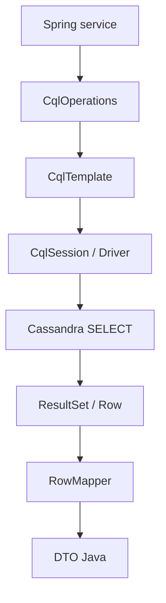

# ORDER BY, LIMIT và PER PARTITION LIMIT trong Cassandra CQL

Khi làm việc với **Spring Data Cassandra**, việc viết `SELECT ... ORDER BY ... LIMIT ...` dễ gợi liên tưởng đến SQL quan hệ. Tuy nhiên, Apache Cassandra không mặc nhiên sắp xếp kết quả trên toàn bộ cluster rồi chọn `N` hàng đầu tiên. Dữ liệu được phân bố theo **partition key** và sắp thứ tự theo **clustering columns bên trong mỗi partition**. Vì vậy, ba mệnh đề CQL **`ORDER BY`**, **`LIMIT`** và **`PER PARTITION LIMIT`** phải được hiểu cùng mô hình dữ liệu phân tán.

Bài học thuộc chương **CQL và CqlTemplate** của module `SPRING_DATA_CASSANDRA`. Mục tiêu là hiểu ý nghĩa từng mệnh đề, phân biệt giới hạn tổng và giới hạn theo partition, viết truy vấn có thể dự đoán chi phí, sử dụng `CqlTemplate`/`CqlOperations` để truyền tham số và ánh xạ `Row`, đồng thời xác định lúc nào cần phân trang hoặc thiết kế bảng khác.

> **Thông điệp cốt lõi:** `ORDER BY` trong CQL gắn với **clustering order**, `LIMIT` giới hạn **tổng số hàng được trả**, còn `PER PARTITION LIMIT` giới hạn **số hàng của từng partition**. Không mệnh đề nào tự sửa được một truy vấn thiếu partition key hoặc một bảng được thiết kế sai theo access pattern.

## 1. Nhắc lại partition key và clustering columns

Primary key trong Cassandra có thể gồm hai phần:

```sql
PRIMARY KEY (
    (partition_key_1, partition_key_2),
    clustering_1,
    clustering_2
)
```

- **Partition key** quyết định partition và tập replica chứa dữ liệu. Với khóa tổng hợp `(a, b)`, phải xét **cả a và b** khi định vị một partition.
- **Clustering columns** sắp xếp các hàng **bên trong** partition theo thứ tự từ trái sang phải được định nghĩa ở schema.
- **Clustering order** (mặc định hoặc khai báo bằng `WITH CLUSTERING ORDER BY`) quyết định chiều `ASC`/`DESC` được lưu trữ và có thể đọc hiệu quả.

Ví dụ, ta thiết kế bảng danh sách đơn hàng theo một khách và một tháng:

```sql
CREATE TABLE orders_by_customer_month (
    customer_id uuid,
    bucket_month date,
    placed_at timestamp,
    order_id uuid,
    state text,
    total_minor bigint,
    PRIMARY KEY ((customer_id, bucket_month), placed_at, order_id)
) WITH CLUSTERING ORDER BY (
    placed_at DESC,
    order_id DESC
);
```

Trong bảng này, **`(customer_id, bucket_month)`** là partition key tổng hợp, còn `placed_at`, `order_id` là clustering columns. Mọi đơn của cùng một khách trong một tháng nằm trong một logical partition. Với một partition, đơn đặt gần đây nhất xuất hiện trước theo `placed_at DESC`; `order_id` phân biệt các đơn cùng timestamp.

Ví dụ dữ liệu logic:

```text
Partition (customer_id = A, bucket_month = 2026-11-01)
  2026-11-25 11:00  O105  PAID      200000
  2026-11-25 09:30  O104  NEW       150000
  2026-11-23 14:00  O103  SHIPPED   300000
  2026-11-21 10:15  O102  PAID       70000

Partition (customer_id = B, bucket_month = 2026-11-01)
  2026-11-25 12:30  O207  NEW       120000
  2026-11-24 18:20  O206  PAID      450000
  2026-11-20 08:00  O205  PAID       55000
```

Đây là biểu diễn khái niệm; các ID thực tế có thể là UUID. Thứ tự bên trong từng partition có thể dựa trên clustering key, nhưng **không có một thứ tự thời gian toàn cục mặc định giữa A và B**.

## 2. Cú pháp và thứ tự ba mệnh đề

Cú pháp khái quát của phần `SELECT` cần học:

```sql
SELECT column_1, column_2
FROM table_name
WHERE primary_key_conditions
ORDER BY clustering_column DESC
PER PARTITION LIMIT 2
LIMIT 10;
```

Các mệnh đề có thể được sử dụng độc lập theo những điều kiện mà Cassandra hỗ trợ:

| Mệnh đề | Áp dụng vào đâu? | Câu hỏi nó giải quyết |
|---|---|---|
| `ORDER BY` | Thứ tự hàng theo clustering columns trong phạm vi truy vấn hợp lệ | Trong một partition, đọc các hàng theo chiều nào? |
| `LIMIT n` | Số hàng tối đa của **toàn bộ kết quả** | Câu truy vấn trả nhiều nhất bao nhiêu hàng? |
| `PER PARTITION LIMIT n` | Số hàng tối đa **của mỗi partition** tham gia kết quả | Mỗi partition đóng góp tối đa bao nhiêu hàng? |

Theo cú pháp CQL thông dụng, `ORDER BY` xuất hiện trước `PER PARTITION LIMIT`, rồi mới đến `LIMIT`. `ALLOW FILTERING`, nếu dùng, là mệnh đề riêng và không biến bộ giới hạn này thành một cơ chế tối ưu dữ liệu không đúng khóa.

Các giá trị giới hạn phải hợp lệ; khi nhận số lượng từ API, ứng dụng cần kiểm tra `n > 0` và áp trần hợp lý. Với prepared statement ở các bản Cassandra hỗ trợ, có thể dùng bind marker `?` cho giới hạn thay vì nối chuỗi đầu vào vào CQL.

## 3. ORDER BY: chỉ dùng theo clustering order được hỗ trợ

Với bảng `orders_by_customer_month`, truy vấn mới nhất cho một khách trong một tháng:

```sql
SELECT order_id, placed_at, state, total_minor
FROM orders_by_customer_month
WHERE customer_id = ?
  AND bucket_month = ?
ORDER BY placed_at DESC, order_id DESC
LIMIT 20;
```

**Vì sao hiệu quả?**

1. Điều kiện `WHERE` chỉ ra đầy đủ partition key: `customer_id` và `bucket_month`.
2. `ORDER BY` sử dụng đúng thứ tự của clustering columns: `placed_at` rồi `order_id`.
3. Hai chiều `DESC` phù hợp với `WITH CLUSTERING ORDER BY` đã khai báo.
4. `LIMIT 20` giới hạn số hàng được trả khi danh sách chỉ cần 20 đơn.

Với schema này, nếu bỏ `ORDER BY` và vẫn truy vấn đúng một partition, Cassandra thường trả các hàng theo **clustering order mặc định** (mới nhất trước trong ví dụ). Tuy vậy, viết rõ `ORDER BY` có thể làm ý đồ của truy vấn dễ đọc hơn.

### 3.1. Đảo chiều thứ tự hợp lệ

Cassandra hỗ trợ đọc theo chiều clustering mặc định hoặc **chiều đảo ngược** được phép. Ví dụ cần 10 đơn **cũ nhất** của một khách trong tháng:

```sql
SELECT order_id, placed_at, state
FROM orders_by_customer_month
WHERE customer_id = ?
  AND bucket_month = ?
ORDER BY placed_at ASC, order_id ASC
LIMIT 10;
```

Truy vấn trên đảo chiều đồng thời `placed_at` và `order_id`, tương ứng với thứ tự `DESC, DESC` trong schema. Nó không yêu cầu Cassandra sắp xếp lại dữ liệu theo một cột không thuộc khóa.

Nếu schema có clustering directions hỗn hợp như `(placed_at DESC, event_code ASC)`, những cấu hình được hỗ trợ cho truy vấn phải **khớp thứ tự khai báo hoặc đảo chiều tổng thể** theo quy tắc CQL; không thể tự đặt tổ hợp ASC/DESC tùy ý cho từng cột.

### 3.2. Không dùng ORDER BY trên cột thường tùy ý

Ví dụ không phù hợp:

```sql
-- state là cột thông thường, không thuộc clustering key.
SELECT *
FROM orders_by_customer_month
WHERE customer_id = ?
  AND bucket_month = ?
ORDER BY state ASC
LIMIT 20;
```

`state` không phải clustering column, nên Cassandra không có sẵn thứ tự vật lý theo `state` trong partition. Chỉ thêm `LIMIT 20` **không** biến câu truy vấn thành “20 đơn sắp theo trạng thái”. Nếu đây là access pattern quan trọng, nên tạo một **bảng theo truy vấn** khác, ví dụ đặt `state` vào partition/clustering key phù hợp và quản lý dữ liệu phi chuẩn hóa.

Tương tự, `ORDER BY total_minor DESC` không hợp lệ theo mô hình clustering của bảng; đây không phải truy vấn SQL `ORDER BY` tổng quát trên mọi cột.

### 3.3. Không bỏ qua partition key

```sql
-- Không phải đường đọc global top 20 hợp lệ/hiệu quả.
SELECT *
FROM orders_by_customer_month
ORDER BY placed_at DESC
LIMIT 20;
```

Bảng được phân bố theo `(customer_id, bucket_month)`, không sắp theo `placed_at` trên toàn cluster. `ORDER BY` không thể yêu cầu mỗi node gửi các hàng mới nhất rồi tự động hợp nhất thành “20 đơn mới nhất toàn hệ thống” theo nghĩa SQL quan hệ.

Đối với một dashboard toàn hệ thống, có thể cần bảng đọc riêng được bucket/shard theo thời gian, giải pháp tìm kiếm/phân tích riêng, hoặc một pipeline tính toán tổng hợp. Thiết kế phải tính rõ giới hạn tải và chi phí fan-out.

## 4. ORDER BY và điều kiện WHERE phải đi cùng nhau

Một điều kiện `WHERE` đúng thường bắt đầu từ partition key, rồi ràng buộc clustering columns theo tiền tố. Ví dụ lấy các đơn giữa hai mốc:

```sql
SELECT order_id, placed_at, total_minor
FROM orders_by_customer_month
WHERE customer_id = ?
  AND bucket_month = ?
  AND placed_at >= ?
  AND placed_at < ?
ORDER BY placed_at DESC
LIMIT 20;
```

Truy vấn lọc khoảng trên **clustering column đầu tiên** `placed_at`, sau khi đã xác định partition. Sử dụng khoảng nửa mở `[from, to)` giúp tránh trùng lặp mốc khi chia cửa sổ thời gian.

Nhưng câu truy vấn sau không được giải quyết chỉ bằng `ORDER BY`:

```sql
-- Thiếu bucket_month, tức thiếu một phần composite partition key.
SELECT order_id, placed_at
FROM orders_by_customer_month
WHERE customer_id = ?
ORDER BY placed_at DESC
LIMIT 20;
```

Muốn đọc xuyên nhiều tháng, ứng dụng phải xử lý các partition/bucket riêng hoặc thiết kế bảng khác phù hợp với nhu cầu “đơn gần nhất bất kể tháng”. **`ORDER BY` sắp theo cấu trúc của bảng**, không tự nối những partition tháng thành một chuỗi thời gian toàn cục.

### Lưu ý trường hợp IN

Một số mẫu truy vấn dùng `IN` trên partition key để chỉ định một **tập nhỏ các partition**. Đây không đồng nghĩa Cassandra hỗ trợ ORDER BY toàn cục ổn định trên một tập partition tùy ý. Khi kết hợp `IN` và `ORDER BY`, CQL và driver có những giới hạn riêng, đặc biệt liên quan paging/sắp xếp; tài liệu CQL nêu tình huống `cqlsh` cần tắt paging để thực hiện một số truy vấn này.

Với danh sách lớn hoặc ứng dụng cần trang tiếp theo có thứ tự nhất quán xuyên các partition, giải pháp dễ kiểm soát hơn thường là **truy vấn từng partition rồi merge ở phía ứng dụng**. Đừng coi `IN` + `ORDER BY` là giải pháp phân trang cho toàn bộ cluster.

## 5. LIMIT: giới hạn tổng số hàng được trả

CQL:

```sql
SELECT order_id, placed_at, state
FROM orders_by_customer_month
WHERE customer_id = ?
  AND bucket_month = ?
LIMIT 3;
```

Trong partition khách A ở dữ liệu minh họa, kết quả tối đa ba hàng theo clustering order `placed_at DESC`: O105, O104, O103. Nếu có ít hơn ba hàng phù hợp, kết quả trả ít hơn ba.

`LIMIT 3` nghĩa là **không trả nhiều hơn ba row** cho câu truy vấn, **không** phải “bỏ qua ba row”, “lấy trang thứ ba”, hay “đảm bảo đã đọc đúng ba row trên đĩa”. Trong Cassandra, chi phí đọc thực tế còn phụ thuộc SSTable, tombstone, sự đồng bộ replica, truy vấn có thể được đáp ứng theo khóa hay phải lọc thêm và các điều kiện đặc biệt.

```sql
-- Tổng kết quả không quá 20 hàng.
SELECT order_id, placed_at
FROM orders_by_customer_month
WHERE customer_id = ?
  AND bucket_month = ?
ORDER BY placed_at DESC
LIMIT 20;
```

Một số lỗi diễn giải thường gặp:

- `LIMIT 20` không có nghĩa Cassandra trả 20 hàng từ **mỗi** partition nếu truy vấn đụng nhiều partition.
- `LIMIT 20` không tạo thứ tự ổn định khi không có đường sắp xếp rõ ràng.
- `LIMIT 20` không thay `fetch size`/paging của driver.
- `LIMIT 20` không làm truy vấn thiếu partition key trở thành một truy vấn hiệu quả.

Một truy vấn dạng `SELECT ... FROM table LIMIT 10` không có `WHERE` có thể trả một số hàng nhưng thường **không có SLA hay thứ tự ổn định** phù hợp ứng dụng. Không nên dùng nó để xây trang “10 đơn mới nhất toàn cluster”.

## 6. PER PARTITION LIMIT: giới hạn riêng cho mỗi partition

`PER PARTITION LIMIT k` được thiết kế cho truy vấn có thể lấy từ **nhiều partition** mà muốn tối đa `k` hàng từ **mỗi partition**.

Hãy dùng một bảng riêng cho ví dụ nhiều partition:

```sql
CREATE TABLE recent_events_by_device (
    device_id uuid,
    occurred_at timestamp,
    event_id uuid,
    metric_value double,
    PRIMARY KEY (device_id, occurred_at, event_id)
) WITH CLUSTERING ORDER BY (
    occurred_at DESC,
    event_id DESC
);
```

Trong mô hình này, mỗi `device_id` là một partition; trong partition, các sự kiện được sắp mới nhất trước. Bảng được dùng để **minh họa thao tác** trên tập thiết bị nhỏ và dữ liệu có giới hạn. Với luồng sự kiện dài hạn trong production, giữ toàn bộ lịch sử của một thiết bị trong một partition có nguy cơ tạo partition rất rộng/hot; nên cân nhắc bucket theo ngày/giờ, TTL và cách fan-out phù hợp.

Giả sử có hai device A, B, mỗi device đều có nhiều sự kiện. Truy vấn:

```sql
SELECT device_id, occurred_at, event_id, metric_value
FROM recent_events_by_device
WHERE device_id IN (?, ?)
PER PARTITION LIMIT 2;
```

Có thể trả **tối đa hai sự kiện từ A và hai từ B**. Vì Cassandra chọn mỗi partition theo clustering order, đó thường là hai sự kiện mới nhất **trong từng device** theo schema minh họa.

Hãy hình dung:

```text
Device A: A10 (10:00), A09 (09:00), A08 (08:00), ...
Device B: B12 (12:00), B11 (11:00), B07 (07:00), ...

PER PARTITION LIMIT 2:
  từ A → A10, A09
  từ B → B12, B11

Tổng tối đa 4 hàng, nhưng không hàm ý thứ tự global A/B.
```

`IN (?, ?)` là ví dụ chỉ định **hai partition cụ thể**, không phải giấy phép fan-out đến hàng nghìn device tùy ý. Nếu cần tất cả device, phần lớn workload cần định nghĩa danh sách device từ một nguồn khác và thực hiện những truy vấn có kiểm soát.

### 6.1. Nếu chỉ có một partition?

```sql
SELECT *
FROM recent_events_by_device
WHERE device_id = ?
PER PARTITION LIMIT 2;
```

Truy vấn theo một partition và không có xử lý tập hợp phức tạp sẽ nhận nhiều nhất hai hàng; trong trường hợp đơn giản này, hiệu ứng giới hạn giống `LIMIT 2`. Sự khác biệt xuất hiện rõ nhất khi truy vấn đọc **nhiều partition**, bởi mỗi partition được áp giới hạn riêng.

### 6.2. Không đảm bảo “mỗi nhóm nghiệp vụ” nếu nhóm đó không phải partition

`PER PARTITION LIMIT` không có nghĩa “hai hàng mỗi giá trị `state`” hoặc “hai hàng mỗi khách hàng” nếu primary key của bảng không tạo partition theo đúng các nhóm ấy.

Ví dụ trong `orders_by_customer_month`, mỗi partition là **(customer_id, bucket_month)**. Do đó, nếu một truy vấn hợp lệ đọc nhiều partition, `PER PARTITION LIMIT 2` nghĩa là **tối đa hai đơn trên mỗi cặp khách–tháng**, **không phải hai đơn cho cả lịch sử mỗi khách**.

Muốn “hai đơn gần nhất của mỗi khách bất kể tháng”, cần thiết kế tập truy vấn và bước hợp nhất qua các bucket; không thể đổi ý nghĩa của partition bằng cách thêm một mệnh đề vào `SELECT`.

## 7. Kết hợp PER PARTITION LIMIT và LIMIT

Cassandra cho phép sử dụng cả hai mệnh đề trong cùng một câu `SELECT`:

```sql
SELECT device_id, occurred_at, event_id
FROM recent_events_by_device
WHERE device_id IN (?, ?)
PER PARTITION LIMIT 2
LIMIT 3;
```

Ý nghĩa đồng thời:

- **`PER PARTITION LIMIT 2`:** A đóng góp không quá hai hàng, B không quá hai hàng.
- **`LIMIT 3`:** **cả truy vấn** trả không quá ba hàng.
- Kết quả **không bắt buộc** phải có chính xác hai hàng từ A và một từ B; thứ tự thu thập giữa các partition không phải một hợp đồng sắp theo `occurred_at` toàn cục.

| Số hàng có trong các partition được xét | `PER PARTITION LIMIT 2` | Thêm `LIMIT 3` |
|---|---|---|
| A có 4, B có 3 | Tối đa 2 từ A + 2 từ B = 4 | **Tối đa 3** hàng tổng cộng |
| A có 1, B có 8 | Tối đa 1 từ A + 2 từ B = 3 | Tối đa 3 |
| A có 0, B có 8 | Tối đa 0 từ A + 2 từ B = 2 | Tối đa 2 |
| Chỉ A được truy vấn, A có 4 | Tối đa 2 từ A | Tối đa 2 |

**Không nên dùng `LIMIT 3` khi yêu cầu là “đảm bảo hai hàng từ mọi partition được liệt kê”.** Giới hạn tổng có thể khiến một số partition không đóng góp đủ số hàng dù chúng có dữ liệu. Đối với yêu cầu phải đủ `k` hàng/nhóm, hãy dùng `PER PARTITION LIMIT k` phù hợp, không kèm tổng LIMIT quá thấp, hoặc thực hiện các truy vấn partition riêng để kiểm soát số hàng.

## 8. Trường hợp kinh điển: “Top N của mỗi nhóm” và “Top N toàn hệ thống”

Hai câu hỏi nghiệp vụ này không tương đương.

| Yêu cầu | Diễn giải | Thiết kế phù hợp |
|---|---|---|
| “20 đơn mới nhất của khách A trong tháng M” | Top N **trong một partition** | Bảng `orders_by_customer_month`, `LIMIT 20` |
| “2 sự kiện mới nhất của mỗi device trong tập A, B” | Top N **cho mỗi partition** | `recent_events_by_device` + `PER PARTITION LIMIT 2` |
| “20 đơn mới nhất của mọi khách trong toàn bộ hệ thống” | Top N **global**, nhiều partition | Bảng/query projection riêng, hoặc fan-out giới hạn + merge |
| “2 đơn mới nhất của mỗi khách trong 12 tháng” | Mỗi khách gồm nhiều **partition tháng** | Đọc nhiều bucket, hợp nhất theo khách, lấy top 2 sau merge |

Nếu muốn **Top N toàn hệ thống**, `LIMIT N` một mình không mang lại điều đó. Cần có **đường truy cập cho thứ tự global** hoặc phân mảnh có quy tắc rồi hợp nhất những danh sách con được sắp cục bộ. Cassandra không cung cấp SQL `ORDER BY arbitrary_column` cho toàn bộ cluster như một engine phân tích tổng quát.

Ví dụ bảng vật lý thiết kế để truy vấn dòng sự kiện mới nhất có thể dùng bucket theo thời gian và shard:

```sql
CREATE TABLE recent_events_by_day_shard (
    bucket_day date,
    shard int,
    occurred_at timestamp,
    event_id uuid,
    device_id uuid,
    PRIMARY KEY ((bucket_day, shard), occurred_at, event_id)
) WITH CLUSTERING ORDER BY (
    occurred_at DESC,
    event_id DESC
);
```

Ứng dụng biết danh sách shard của một ngày, đọc vài hàng mới nhất từ **mỗi shard** rồi merge `occurred_at` để lấy top N chung. Chi phí fan-out, logic retry, tie-break theo `event_id` và việc chuyển sang ngày trước cần được thiết kế rõ. Nếu yêu cầu là phân tích toàn lịch sử đa chiều, công cụ phân tích/tìm kiếm chuyên biệt có thể phù hợp hơn.

## 9. Dùng CqlTemplate/CqlOperations để thực hiện truy vấn có giới hạn

`CqlTemplate` là thành phần ở tầng CQL của Spring Data Cassandra, triển khai giao diện `CqlOperations`. Nó giúp thực thi statement, bind tham số, dùng `RowMapper` để đọc `Row` và chuyển một số lỗi driver sang hệ `DataAccessException` của Spring.

Khác với `CassandraTemplate`, **`CqlTemplate` không tự động materialize một entity theo `@Table` như thao tác `select` cấp mapping**; với `RowMapper`, lập trình viên kiểm soát rõ cách chuyển từng row thành DTO.



### 9.1. DAO lấy 20 đơn mới nhất theo tháng

Định nghĩa một DTO kiểu record (cần Java 16+):

```java
import java.time.Instant;
import java.util.UUID;

public record OrderPreview(
    UUID orderId,
    Instant placedAt,
    String state,
    long totalMinor
) {}
```

Một DAO dùng **interface `CqlOperations`**:

```java
import java.time.LocalDate;
import java.util.List;
import java.util.UUID;

import org.springframework.data.cassandra.core.cql.CqlOperations;
import org.springframework.stereotype.Repository;

@Repository
public class OrderCqlDao {

    private final CqlOperations cql;

    public OrderCqlDao(CqlOperations cql) {
        this.cql = cql;
    }

    public List<OrderPreview> recentOrders(
            UUID customerId, LocalDate bucketMonth, int requestedLimit) {

        int limit = Math.max(1, Math.min(requestedLimit, 100));

        return cql.query(
            "SELECT order_id, placed_at, state, total_minor " +
            "FROM orders_by_customer_month " +
            "WHERE customer_id = ? AND bucket_month = ? " +
            "ORDER BY placed_at DESC, order_id DESC LIMIT ?",
            (row, rowNum) -> new OrderPreview(
                row.getUuid("order_id"),
                row.getInstant("placed_at"),
                row.getString("state"),
                row.getLong("total_minor")
            ),
            customerId, bucketMonth, limit
        );
    }
}
```

Đây là mẫu API được tài liệu Spring Data Cassandra mô tả cho `CqlOperations.query(String, RowMapper<T>, Object... args)`; Spring Data tạo prepared statement và bind các tham số theo thứ tự. Cần có **CqlOperations bean** được cấu hình trong ứng dụng và đúng keyspace có bảng đã tạo.

Trường `total_minor bigint` được ánh xạ thành `long`; trong ví dụ giả định cột này **luôn có giá trị**. Nếu schema cho phép null, nên dùng `Long` và kiểm tra `row.isNull("total_minor")` trước khi gọi getter primitive.

Đặt giới hạn ở tầng API để tránh người dùng yêu cầu trả hàng triệu kết quả. Với một API public, nên **từ chối** số `requestedLimit` không hợp lệ hoặc ghi rõ chính sách clamp thay vì âm thầm biến `0` thành `1`, tùy hợp đồng sản phẩm.

### 9.2. Truy vấn PER PARTITION LIMIT bằng CqlOperations

Một DTO cho `recent_events_by_device`:

```java
import java.time.Instant;
import java.util.UUID;

public record DeviceEvent(
    UUID deviceId,
    Instant occurredAt,
    UUID eventId,
    Double metricValue
) {}
```

CQL với tối đa hai partition cụ thể:

```java
List<DeviceEvent> deviceEvents = cql.query(
    "SELECT device_id, occurred_at, event_id, metric_value " +
    "FROM recent_events_by_device " +
    "WHERE device_id IN (?, ?) " +
    "PER PARTITION LIMIT 2",
    (row, rowNum) -> new DeviceEvent(
        row.getUuid("device_id"),
        row.getInstant("occurred_at"),
        row.getUuid("event_id"),
        row.isNull("metric_value")
            ? null
            : row.getDouble("metric_value")
    ),
    deviceIdA, deviceIdB
);
```

Ví dụ trên là **một đoạn nằm trong method** đã có biến `cql`, `deviceIdA` và `deviceIdB`. `CqlTemplate` có thể trả kết quả theo thứ tự thực tế của Cassandra, nhưng không nên coi `List` này là một danh sách đã merge toàn cục theo `occurred_at`. Nếu UI cần thứ tự toàn cục, hãy merge/sort theo quy tắc nghiệp vụ sau khi biết tập kết quả đã đủ cho yêu cầu.

`RowMapper` ở đây là mapping tường minh: nếu muốn dùng entity mapping với `@Table`, cân nhắc `CassandraTemplate` hoặc repository. Lựa chọn template nào không thay đổi ngữ nghĩa `PER PARTITION LIMIT` trên server.

## 10. CqlTemplate không có nghĩa mọi truy vấn đều cần lấy List

Một `CqlOperations.query(..., RowMapper, ...)` trả về `List`, phù hợp với số lượng hàng **đã giới hạn nhỏ**. Nếu truy vấn có thể trả hàng nghìn hoặc hàng triệu hàng, cần xem API stream/callback hoặc đường paging của driver tương ứng.

| Cách đọc | Điểm mạnh | Rủi ro |
|---|---|---|
| `query(..., RowMapper, ...)` trả `List` | DTO rõ ràng, dễ dùng | Tích lũy toàn bộ kết quả vào RAM |
| `query(..., RowCallbackHandler, ...)` | Xử lý từng row trong callback | Vẫn phải kiểm soát lượng row từ CQL và tài nguyên downstream |
| `queryForResultSet(...)` | Truy cập trực tiếp driver `ResultSet` | Ứng dụng chịu trách nhiệm đọc/paging và vòng đời logic |
| `CqlSession.execute(statement)` | Kiểm soát statement, page size/consistency, paging state | Tự xử lý nhiều chi tiết driver hơn |

Các overload thực tế phụ thuộc dòng Spring Data Cassandra đã resolve; hãy tham khảo đúng Javadoc của phiên bản đó. Một API tên `queryForStream` không biến câu truy vấn không giới hạn thành rẻ: dữ liệu vẫn có thể phải đi qua nhiều page, node và partition.

### LIMIT khác fetch size / page size

Ví dụ Java Driver 4.x cho một partition:

```java
import com.datastax.oss.driver.api.core.cql.SimpleStatement;

SimpleStatement statement = SimpleStatement.builder(
        "SELECT order_id, placed_at, state, total_minor " +
        "FROM orders_by_customer_month " +
        "WHERE customer_id = ? AND bucket_month = ?")
    .addPositionalValues(customerId, bucketMonth)
    .setPageSize(50)
    .build();
```

`setPageSize(50)` điều chỉnh số hàng driver cố lấy trên một lần fetch trang, **không đặt giới hạn tổng số hàng của toàn truy vấn**. Ngược lại, `LIMIT 50` giới hạn số hàng toàn truy vấn; Cassandra có thể vẫn fetch theo page size nhỏ hơn. Chúng giải quyết hai bài toán khác nhau.

**Paging state** là token opaque liên quan statement và tham số truy vấn. Không coi nó là `OFFSET`, số trang hay bảo đảm một snapshot bất biến nếu dữ liệu đang thay đổi. Đổi `customerId`, `bucketMonth`, giới hạn hoặc thứ tự có thể khiến paging state cũ không còn phù hợp. Khi muốn tiếp tục đọc qua tháng khác, ứng dụng cần truy vấn bucket khác với logic riêng.

## 11. Hiệu năng và consistency khi ORDER BY/LIMIT/PER PARTITION LIMIT

Một truy vấn CQL đúng cú pháp chưa chắc đáp ứng SLA. Đánh giá đồng thời:

**1. Partition key và độ lệch tải.** `LIMIT 10` trên bảng thiếu partition key có thể vẫn yêu cầu đọc dữ liệu phân tán, và `PER PARTITION LIMIT 2` trên hàng nghìn partition vẫn tốn rất nhiều request/bytes. Đừng dùng mệnh đề giới hạn để che giấu hot partition hoặc full scan.

**2. Kích thước partition.** Bảng `recent_events_by_device` chỉ dành cho ví dụ; thiết bị ghi hàng triệu sự kiện sẽ tạo partition rộng nếu không có bucketing hoặc TTL. `LIMIT 2` không làm partition nhỏ đi về mặt lưu trữ hay compaction.

**3. Tombstone.** Nếu hàng cũ hết TTL hoặc bị xóa, Cassandra có thể phải xem xét tombstone và các SSTable liên quan trước khi tìm đủ hàng sống. Vì vậy `LIMIT 2` không phải cam kết chỉ đọc hai hàng vật lý.

**4. Clustering order.** Đọc xuôi theo trật tự đã được thiết kế thường phù hợp với mục tiêu “mới nhất trước”. Thay đổi thứ tự `ORDER BY` không được phép tùy ý trên cột thường, và đảo chiều có thể có đặc tính hiệu năng riêng tùy phiên bản/lưu trữ.

**5. Consistency level.** `LOCAL_ONE`, `LOCAL_QUORUM`, `ALL` ảnh hưởng số replica cần phản hồi, khả năng sẵn sàng và latency. Thêm `LIMIT` không tự hạ CL, cũng không bảo đảm tất cả replica có trạng thái giống nhau. Nếu client timeout, không suy ra chắc chắn truy vấn không được thực thi.

**6. Fan-out.** Khi đọc nhiều partition bằng `IN` hoặc nhiều query riêng, chi phí coordinator, network và merge tăng. Phải giới hạn số partition truy vấn đồng thời, đặc biệt khi hệ thống đa datacenter.

**7. Độ mới dữ liệu.** Danh sách “mới nhất” được xác định theo clustering timestamp của dữ liệu ứng dụng ghi vào. Cassandra không tự bảo đảm đồng hồ của mọi producer đồng bộ, cũng không cung cấp thứ tự nghiệp vụ toàn cầu chỉ từ `ORDER BY occurred_at`.

Để vận hành, theo dõi p95/p99 read latency, số partition/truy vấn, tombstone, kích thước partition, pending compaction và các chỉ số driver. Tối ưu query thường bắt đầu bằng **thiết kế access pattern**, không phải thay mệnh đề `LIMIT` từ 100 xuống 10 rồi bỏ qua vấn đề cốt lõi.

## 12. Các câu truy vấn thường bị hiểu sai

| Truy vấn hoặc yêu cầu | Điều dễ hiểu sai | Cách hiểu đúng |
|---|---|---|
| `ORDER BY placed_at DESC` với partition key đầy đủ | “Cassandra sắp xếp toàn bộ cluster.” | Chỉ theo clustering order trong phạm vi truy vấn hợp lệ |
| `ORDER BY state ASC` khi `state` không phải clustering | “Bất cứ cột nào đều sắp xếp được.” | Không phải `ORDER BY` hợp lệ của bảng ví dụ |
| `LIMIT 20` | “Tối đa 20 hàng mỗi khách.” | Tổng kết quả câu truy vấn không quá 20 hàng |
| `PER PARTITION LIMIT 2` | “Chính xác hai hàng mỗi nhóm nghiệp vụ.” | Tối đa hai hàng trên **mỗi partition** theo primary key |
| `PER PARTITION LIMIT 2 LIMIT 3` | “Chắc chắn A có 2 và B có 1.” | Tổng không quá ba; không bảo đảm phân phối giữa partition |
| `LIMIT 20` thay cho paging | “LIMIT là số trang hoặc offset.” | LIMIT chỉ là giới hạn tổng, paging state do driver quản lý |
| `SELECT ... LIMIT 10` không WHERE | “Mười hàng mới nhất toàn cluster.” | Một tập hàng không có thứ tự global được cam kết |
| `ALLOW FILTERING ... LIMIT 10` | “Chỉ quét mười hàng.” | Có thể cần xem rất nhiều dữ liệu để tìm hàng thỏa điều kiện |
| `ORDER BY` + `IN` | “Luôn có global order và paging đơn giản.” | Có giới hạn CQL/driver; cần thử nghiệm hoặc query từng partition |
| `setPageSize(50)` | “Truy vấn chỉ trả 50 hàng tổng cộng.” | Đây là kích thước trang fetch, không phải LIMIT |

## 13. Lab: so sánh ba mệnh đề trên dữ liệu nhỏ

Chỉ dùng một **keyspace lab** có thể xóa được. Không chạy trên bảng production đang chứa dữ liệu người dùng.

### Chuẩn bị

1. Tạo bảng `recent_events_by_device` ở mục 6 và xác nhận schema đúng.
2. Chọn hai UUID thiết bị A và B, tạo `event_id` riêng cho mỗi hàng.
3. Chèn ít nhất ba sự kiện vào A và ba sự kiện vào B với timestamp khác nhau:

```sql
INSERT INTO recent_events_by_device
(device_id, occurred_at, event_id, metric_value)
VALUES
(11111111-1111-1111-1111-111111111111,
 '2026-11-25T10:00:00Z',
 aaaaaaaa-aaaa-aaaa-aaaa-aaaaaaaaaaa1,
 10.0);

INSERT INTO recent_events_by_device
(device_id, occurred_at, event_id, metric_value)
VALUES
(11111111-1111-1111-1111-111111111111,
 '2026-11-25T09:00:00Z',
 aaaaaaaa-aaaa-aaaa-aaaa-aaaaaaaaaaa2,
 9.0);

INSERT INTO recent_events_by_device
(device_id, occurred_at, event_id, metric_value)
VALUES
(11111111-1111-1111-1111-111111111111,
 '2026-11-25T08:00:00Z',
 aaaaaaaa-aaaa-aaaa-aaaa-aaaaaaaaaaa3,
 8.0);

INSERT INTO recent_events_by_device
(device_id, occurred_at, event_id, metric_value)
VALUES
(22222222-2222-2222-2222-222222222222,
 '2026-11-25T12:00:00Z',
 bbbbbbbb-bbbb-bbbb-bbbb-bbbbbbbbbbb1,
 12.0);

INSERT INTO recent_events_by_device
(device_id, occurred_at, event_id, metric_value)
VALUES
(22222222-2222-2222-2222-222222222222,
 '2026-11-25T11:00:00Z',
 bbbbbbbb-bbbb-bbbb-bbbb-bbbbbbbbbbb2,
 11.0);

INSERT INTO recent_events_by_device
(device_id, occurred_at, event_id, metric_value)
VALUES
(22222222-2222-2222-2222-222222222222,
 '2026-11-25T07:00:00Z',
 bbbbbbbb-bbbb-bbbb-bbbb-bbbbbbbbbbb3,
 7.0);
```

Các UUID/timestamp chỉ dùng cho lab; bảng đơn giản có partition key `device_id` là bài tập giới hạn kích thước. Nếu chạy trực tiếp trong `cqlsh`, các câu `INSERT` trên dùng literal; không cần bind marker.

### Chạy và đối chiếu

Truy vấn 1 — `LIMIT` trên một partition:

```sql
SELECT device_id, occurred_at, metric_value
FROM recent_events_by_device
WHERE device_id = 11111111-1111-1111-1111-111111111111
ORDER BY occurred_at DESC
LIMIT 2;
```

**Kỳ vọng:** từ A nhận tối đa hai sự kiện mới nhất: 10:00 và 09:00.

Truy vấn 2 — `PER PARTITION LIMIT` trên hai partition:

```sql
SELECT device_id, occurred_at, metric_value
FROM recent_events_by_device
WHERE device_id IN (
    11111111-1111-1111-1111-111111111111,
    22222222-2222-2222-2222-222222222222
)
PER PARTITION LIMIT 2;
```

**Kỳ vọng:** từ A có 10:00, 09:00; từ B có 12:00, 11:00; **tổng tối đa bốn hàng**, không áp một thứ tự toàn cục theo thời gian.

Truy vấn 3 — kết hợp cả hai giới hạn:

```sql
SELECT device_id, occurred_at, metric_value
FROM recent_events_by_device
WHERE device_id IN (
    11111111-1111-1111-1111-111111111111,
    22222222-2222-2222-2222-222222222222
)
PER PARTITION LIMIT 2
LIMIT 3;
```

**Kỳ vọng:** toàn bộ truy vấn có tối đa ba hàng; không khẳng định partition A hay B luôn đóng góp đúng bao nhiêu hàng.

Cuối cùng thử `ORDER BY metric_value DESC` với một partition, ghi nhận lỗi CQL (vì `metric_value` không phải clustering column). Thử query đúng kiểu `ORDER BY occurred_at ASC` để thấy thứ tự đảo chiều. Với bảng chỉ có vài hàng, kết quả giúp hiểu ngữ nghĩa nhưng **chưa thể suy ra hiệu năng production**.

## 14. Tình huống thiết kế và câu hỏi tự kiểm

**Tình huống 1 — nhiều khách, nhiều tháng.** API muốn hiển thị hai đơn mới nhất của mỗi khách trong 12 tháng. Bảng hiện tại partition theo `(customer_id, bucket_month)`. Có thể chỉ chạy một truy vấn `PER PARTITION LIMIT 2` rồi coi kết quả là hai đơn gần nhất cho cả khách không?

**Đáp án:** không. Mỗi cặp khách–tháng là một partition. `PER PARTITION LIMIT 2` chỉ giới hạn tối đa hai đơn **mỗi tháng**. Ứng dụng cần đọc các bucket thích hợp, hợp nhất theo khách và lấy hai đơn mới nhất hoặc thiết kế projection riêng cho access pattern này.

**Tình huống 2 — giao diện top 10 toàn công ty.** Chỉ có bảng `orders_by_customer_month`. Thêm `ORDER BY placed_at DESC LIMIT 10` mà không truyền khách/tháng có giải quyết được không?

**Đáp án:** không. Clustering order chỉ có ý nghĩa trong partition, không cung cấp global top 10. Cần query-driven projection/phương án phân tích riêng.

**Tình huống 3 — hai device và yêu cầu công bằng.** Có A và B, mỗi thiết bị ít nhất mười hàng. Dùng `PER PARTITION LIMIT 2 LIMIT 3` để trả hai hàng từ mỗi thiết bị có phù hợp không?

**Đáp án:** không. Giới hạn tổng 3 nhỏ hơn số hàng mong muốn 4. Dùng `PER PARTITION LIMIT 2` không kèm giới hạn tổng quá thấp hoặc thực hiện hai truy vấn riêng với `LIMIT 2`.

**Tình huống 4 — paging.** Developer dùng `setPageSize(25)` rồi tuyên bố API không bao giờ trả quá 25 hàng nếu code duyệt toàn bộ `ResultSet`. Nhận định đúng không?

**Đáp án:** sai. Page size điều khiển **cách fetch**; nếu tiếp tục duyệt `ResultSet`, driver có thể fetch trang tiếp theo. Cần `LIMIT` hoặc logic ứng dụng chặn tổng số hàng tùy yêu cầu và quản lý paging state đúng cách.

## 15. Checklist khi viết ORDER BY/LIMIT qua CqlTemplate

1. **Mẫu truy vấn rõ chưa?** “Mới nhất cho ai, trong bucket nào, trên một hay nhiều partition?”
2. **Đủ partition key chưa?** Nếu là composite key, đã có toàn bộ thành phần chưa?
3. **Clustering order khớp yêu cầu UI không?** `ORDER BY` chỉ có thể theo thứ tự được CQL hỗ trợ.
4. **Có lọc khoảng trên clustering key không?** Cần ràng buộc tiền tố đúng khi lọc.
5. **Dùng LIMIT hay PER PARTITION LIMIT?** Phân biệt tổng số hàng và số hàng của mỗi partition.
6. **Kết hợp cả hai thì có cắt mất nhóm không?** Tổng LIMIT có thể khiến partition không đủ kết quả mong muốn.
7. **Có kỳ vọng global sort không?** Nếu có, phải thiết kế đường truy cập/merge riêng.
8. **Fan-out có giới hạn không?** Tránh `IN` trên tập partition khổng lồ.
9. **Đang bind tham số an toàn không?** Dùng prepared statement; giới hạn giá trị `LIMIT`.
10. **CqlTemplate và driver sử dụng đúng session/CL không?** Kiểm tra keyspace, consistency, timeout và converter.
11. **Paging state có được xử lý đúng không?** Không nhầm page size với LIMIT, không reuse state sau khi đổi query.
12. **Đã đo hiệu năng chưa?** Thử dữ liệu đại diện, theo dõi tombstone, partition size và p95/p99.

Hãy ghi nhớ: **`ORDER BY` khai thác trật tự clustering, `LIMIT` kiểm soát số hàng toàn truy vấn, `PER PARTITION LIMIT` kiểm soát số hàng trên từng partition.** Với Spring Data Cassandra, `CqlTemplate` giúp bind tham số và chuyển `Row` thành Java DTO, nhưng **chỉ thiết kế bảng và access pattern đúng với Cassandra mới tạo đường đọc có chi phí dự đoán được**.

## Tài liệu tham khảo

- [Apache Cassandra — Data Manipulation / SELECT](https://cassandra.apache.org/doc/stable/cassandra/developing/cql/dml.html): cú pháp và ngữ nghĩa `ORDER BY`, `LIMIT`, `PER PARTITION LIMIT`.
- [Apache Cassandra — CQL single-file reference](https://cassandra.apache.org/doc/stable/cassandra/developing/cql/cql_singlefile.html): quy tắc truy vấn và cú pháp giới hạn kết quả.
- [Spring Data Cassandra — CQL Template API](https://docs.spring.io/spring-data/cassandra/reference/cassandra/cql-template.html): `CqlTemplate`, `RowMapper`, bind tham số và xử lý `ResultSet`.
- [Spring Data Cassandra — CqlTemplate API](https://docs.spring.io/spring-data/cassandra/docs/current/api/org/springframework/data/cassandra/core/cql/CqlTemplate.html): các overload `query`, `execute`, `queryForResultSet`.
