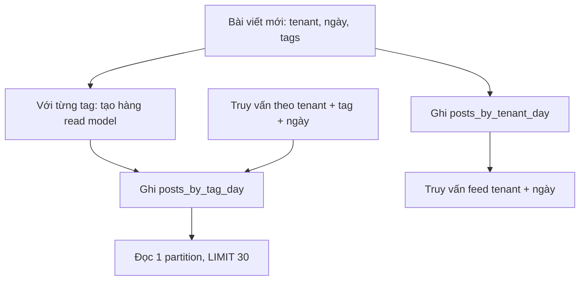

# IN, CONTAINS và các ràng buộc theo kiểu dữ liệu hoặc chỉ mục

Trong **Spring Data Cassandra**, viết câu CQL đúng cú pháp mới là bước đầu. Một truy vấn còn phải phù hợp với **partition key**, **clustering columns**, kiểu dữ liệu của cột và khả năng hỗ trợ của chỉ mục trên Apache Cassandra. Hai toán tử thường gây nhầm lẫn nhất là **`IN`** và **`CONTAINS`**: chúng trông giống những phép lọc quen thuộc trong SQL, nhưng không cho phép truy vấn tự do trên mọi cột như một cơ sở dữ liệu quan hệ.

Bài học thuộc chương **CQL và CqlTemplate**, tập trung vào ba câu hỏi:

1. Khi nào `IN` có thể lấy nhiều giá trị khóa, và tại sao nó có nguy cơ biến một thao tác đọc thành **nhiều partition read**?
2. `CONTAINS`/`CONTAINS KEY` dùng với **list, set, map** thế nào, và tại sao câu CQL có thể bị từ chối dù kiểu dữ liệu phù hợp?
3. Khi nào nên cân nhắc **secondary index**, **Storage-Attached Index (SAI)** hoặc **bảng được thiết kế theo truy vấn** thay vì dựa vào lọc sau đọc?

Các ví dụ sử dụng CQL, Spring Data Cassandra và Java Driver 4. Hỗ trợ chỉ mục, kết hợp điều kiện và những giới hạn cụ thể có thể khác nhau theo phiên bản Cassandra và loại index; cần thử trên **phiên bản cluster thực tế** trước khi dùng trong production.

## 1. `IN` và `CONTAINS` không giải quyết cùng vấn đề

| Toán tử | Ý nghĩa ở mức CQL | Trường hợp thường gặp | Điều cần kiểm tra |
| --- | --- | --- | --- |
| `column IN (v1, v2, ...)` | Giá trị cột bằng **một trong các giá trị** được liệt kê | Nhiều giá trị của một khóa, chẳng hạn các ID hoặc một thành phần khóa hợp lệ | Vị trí cột trong primary key; số partition/giá trị; hạn chế của phiên bản |
| `collection CONTAINS value` | Collection chứa **một phần tử**; với map, kiểm tra **value** | `set<text>`, `list<text>`, `map<text,text>` | Kiểu collection, chỉ mục/đường đọc và khả năng thực thi |
| `map_column CONTAINS KEY key` | Map chứa **một khóa** | `map<text,text>` | Map có đúng kiểu? Index có hỗ trợ tìm theo key không? |

**`IN` không phải kiểm tra phần tử trong collection.** Chẳng hạn `event_id IN (?, ?)` là điều kiện trên giá trị của cột `event_id`; còn `tags CONTAINS ?` hỏi xem tập `tags` của **một hàng** có phần tử được chỉ định hay không.

**`CONTAINS` không có nghĩa “chuỗi chứa chuỗi con”.** Không thể dùng `title CONTAINS 'spring'` với cột `title text` như một công cụ tìm kiếm toàn văn. Truy vấn substring/full-text yêu cầu hướng lưu trữ hoặc công nghệ tìm kiếm phù hợp; không được suy ra từ tên toán tử.

## 2. Bảng minh họa và các access pattern

Giả sử ứng dụng quản lý bài viết theo tenant. Trên một màn hình, người dùng xem bài viết mới nhất của tenant trong ngày; ở màn hình khác, người dùng lọc theo tag.

```sql
CREATE TABLE posts_by_tenant_day (
    tenant_id   text,
    post_day    date,
    post_id     timeuuid,
    title       text,
    tags        set<text>,
    attributes  map<text, text>,
    PRIMARY KEY ((tenant_id, post_day), post_id)
) WITH CLUSTERING ORDER BY (post_id DESC);
```

Giải thích:

- `(tenant_id, post_day)` là **partition key ghép**. Một tenant và một ngày tương ứng một partition logic.
- `post_id` kiểu `timeuuid` là **clustering column**; thứ tự giảm dần phù hợp với yêu cầu hiển thị bài mới trước khi UUID được tạo theo thời gian.
- `tags set<text>` là tập không trùng phần tử. Nó thuận tiện để lưu metadata của bài viết, **không tự tạo đường đọc theo tag**.
- `attributes map<text,text>` lưu thuộc tính mở rộng. Map là một collection, không phải một bảng chỉ mục toàn cục.

Truy vấn theo thiết kế của bảng:

```sql
SELECT post_id, title, tags
FROM posts_by_tenant_day
WHERE tenant_id = ? AND post_day = ?
LIMIT 30;
```

Câu CQL có **đủ partition key**, đọc tối đa 30 hàng đã được tổ chức theo clustering order. Đây là đường đọc mặc định cần đối chiếu trước khi định nghĩa repository hoặc thao tác qua `CqlTemplate`.

### Mục tiêu truy vấn không giống mục tiêu lưu trữ

Việc đặt `tags` vào cùng hàng giúp màn hình hiển thị tag sau khi tải bài viết. Nhưng câu hỏi “lấy tất cả bài mang tag `java` trong một ngày” là **access pattern khác**. Một collection có giá trị mong muốn không đồng nghĩa hệ thống có thể nhanh chóng xác định các partition chứa giá trị đó.

## 3. `IN` với partition key: đúng cú pháp nhưng phải tính fan-out

Với bảng có **khóa đơn**, `IN` dễ hình dung nhất:

```sql
CREATE TABLE posts_by_id (
    post_id    uuid PRIMARY KEY,
    tenant_id  text,
    title      text
);
```

Khi biết một nhóm ID:

```sql
SELECT post_id, tenant_id, title
FROM posts_by_id
WHERE post_id IN (?, ?, ?);
```

Đây là truy vấn nhiều **partition key đơn** có thể được Cassandra thực hiện, nhưng không nên coi là một point lookup duy nhất. Các ID có thể nằm trên những replica khác nhau; coordinator và driver cần xử lý nhiều đường đọc. Trả về ba hàng cũng không đồng nghĩa kết quả sẽ có thứ tự như danh sách ID đầu vào.

Với **partition key ghép** `(tenant_id, post_day)`, CQL hỗ trợ một số cách dùng `IN` trên thành phần khóa theo các ràng buộc của phiên bản. Một dạng thường được phép là cố định thành phần trước và dùng `IN` ở thành phần **cuối của partition key**:

```sql
-- Ví dụ có thể đọc nhiều partition: mỗi ngày là một partition khác.
SELECT post_id, title
FROM posts_by_tenant_day
WHERE tenant_id = 'tenant-a'
  AND post_day IN ('2026-11-24', '2026-11-25');
```

Đừng đảo thành `tenant_id IN (...) AND post_day IN (...)` rồi mặc định Cassandra sẽ chấp nhận mọi tổ hợp hoặc tối ưu như SQL. Với khóa ghép, vị trí thành phần và giới hạn đối với `IN` cần được kiểm tra theo phiên bản CQL cụ thể. Trong API sản phẩm, **đọc từng ngày bằng câu truy vấn có đầy đủ partition key** thường làm rõ số partition, timeout và cách phân trang hơn.

### Chi phí của nhiều partition

Nếu một câu `IN` bao gồm `N` giá trị partition key khác nhau, số partition logic cần truy cập có thể tăng tới `N` (trừ các giá trị trùng). Khi truy vấn còn trải nhiều bucket thời gian, số partition tăng theo số tổ hợp key thực sự phải đọc.

| Số giá trị/partition | Kết quả mong muốn | Rủi ro |
| ---: | --- | --- |
| 1 | Một partition hoặc một hàng | Đường đọc rõ ràng, dễ giới hạn |
| 5 | Hợp nhất một nhóm kết quả nhỏ | Thêm request nội bộ/độ trễ đuôi |
| 500 | Kết quả từ nhiều vị trí dữ liệu | Dễ gây tải cao, timeout, khó phân trang |

Đây là số **minh họa**, không phải giới hạn chính thức của Cassandra. Hãy giới hạn kích thước `IN` tại biên API; với danh sách rất lớn, cân nhắc đọc theo lô có ngân sách đồng thời, tác vụ nền hoặc thiết kế access pattern khác.

**Chú ý thứ tự:** clustering order chỉ có ý nghĩa bên trong từng partition. Một câu `IN` chạm nhiều partition **không bảo đảm thứ tự thời gian toàn cục** để dùng làm feed “mới nhất trước”. Cần trộn kết quả có kiểm soát hoặc thiết kế một bảng phục vụ truy vấn tổng hợp phù hợp.

## 4. `IN` với clustering column: phải giữ thứ tự ràng buộc khóa

Trong bảng `posts_by_tenant_day`, `post_id` là clustering column duy nhất. Khi đã biết toàn bộ partition key, có thể yêu cầu một nhóm `post_id`:

```sql
SELECT post_id, title
FROM posts_by_tenant_day
WHERE tenant_id = ?
  AND post_day = ?
  AND post_id IN (?, ?);
```

Đây là một truy vấn **bên trong partition đã biết**, khác với dùng `IN` trên partition key để đọc nhiều partition. Nếu bảng có nhiều clustering columns, cần tuân thủ thứ tự hạn chế của CQL: các cột đứng trước thường phải được ràng buộc phù hợp trước khi lọc cột sau, và `IN` không thể được áp dụng tùy tiện cho mọi vị trí hoặc kết hợp tùy ý với range.

Ví dụ bảng có:

```sql
PRIMARY KEY ((tenant_id, event_day), occurred_at, event_id)
```

Một truy vấn chỉ `WHERE tenant_id = ? AND event_day = ? AND event_id IN (?, ?)` bỏ qua clustering column đứng trước `occurred_at`; không nên cho rằng Cassandra sẽ hỗ trợ và thực thi nó hiệu quả. Nếu truy vấn theo `event_id` thường xuyên, cần bảng lookup hoặc key khác.

**Tự kiểm tra:** `IN` giúp biểu diễn một nhóm giá trị **trên cột đã có đường truy cập phù hợp**, không làm mất đi trật tự partition key → clustering columns vốn quyết định cách Cassandra lưu hàng.

## 5. `CONTAINS` trên set/list và `CONTAINS KEY` trên map

Với collection CQL, những điều kiện sau biểu diễn ba yêu cầu khác nhau:

```sql
-- Câu ví dụ về biểu thức lọc; có thể bị từ chối
-- khi chưa có chỉ mục/đường đọc phù hợp.

-- set/list: collection chứa một phần tử?
SELECT post_id, title
FROM posts_by_tenant_day
WHERE tags CONTAINS 'cassandra';

-- map: có khóa 'language' không?
SELECT post_id, title
FROM posts_by_tenant_day
WHERE attributes CONTAINS KEY 'language';

-- map: có giá trị 'vi' không?
SELECT post_id, title
FROM posts_by_tenant_day
WHERE attributes CONTAINS 'vi';
```

**Các câu trên minh họa ngữ nghĩa toán tử, không phải bộ truy vấn được bảo đảm chạy trên bảng vừa tạo.** Nếu không có index hoặc đường truy cập tương thích, Cassandra có thể từ chối với yêu cầu thêm index/`ALLOW FILTERING` hoặc các hạn chế truy vấn khác. Việc thêm `ALLOW FILTERING` chỉ để ép chạy có thể khiến truy vấn quét lượng dữ liệu lớn; đây không phải giải pháp mặc định cho production.

### So sánh collection và các phép lọc

| Kiểu cột | Điều kiện muốn kiểm tra | Toán tử đúng về ngữ nghĩa |
| --- | --- | --- |
| `set<text>` | Tag `"java"` có trong tập không? | `tags CONTAINS 'java'` |
| `list<text>` | Danh sách có phần tử `"java"` không? | `labels CONTAINS 'java'` |
| `map<text,text>` | Có khóa `"region"` không? | `attributes CONTAINS KEY 'region'` |
| `map<text,text>` | Có một value `"apac"` không? | `attributes CONTAINS 'apac'` |
| `text` | Title có chứa chuỗi con `"java"` không? | **Không dùng `CONTAINS`** cho scalar text |
| `int`, `timestamp`, `uuid` | Scalar có là một phần tử collection không? | **Không dùng `CONTAINS`** nếu cột không phải collection |

Trong Spring Data Cassandra, những cột trên thường được ánh xạ thành `Set<String>`, `List<String>` hoặc `Map<String,String>`. Entity mapping giúp đọc/ghi collection, nhưng **không tự tạo index** cho phép tra cứu membership nhanh.

### Giới hạn về dữ liệu collection

- Collection không được thiết kế để chứa **vô hạn phần tử**. Nếu một hàng có hàng chục nghìn tag hoặc thuộc tính tăng mãi, kích thước cell/partition và chi phí cập nhật/đọc sẽ thành vấn đề.
- Set không có thứ tự phần tử có ý nghĩa nghiệp vụ; list giữ thứ tự. Map lưu cặp khóa–giá trị. Hãy chọn đúng loại vì `CONTAINS` không sửa được việc dùng sai mô hình.
- Không dùng phần tử `null` như một giá trị collection hợp lệ. Khi nghiệp vụ cần biểu diễn “không có thông tin”, cần thiết kế field/giá trị phù hợp.
- **Frozen collection** có ngữ nghĩa cập nhật như một giá trị gộp; khả năng lập index/tìm theo phần tử phụ thuộc kiểu collection và triển khai index. Không giả định `frozen<map<...>>` hỗ trợ đầy đủ mọi biến thể truy vấn `CONTAINS`.

## 6. Chỉ mục: điều kiện cần có thể vẫn chưa đủ

Trong Cassandra, secondary index cung cấp **một đường truy cập bổ sung** tới một số cột không thuộc khóa chính. Tuy nhiên, cú pháp, loại cột hỗ trợ và khả năng kết hợp điều kiện phụ thuộc phiên bản Cassandra và **loại index**.

Một số lựa chọn cần phân biệt:

| Cách tiếp cận | Ý tưởng | Khi cần cân nhắc |
| --- | --- | --- |
| **Secondary index truyền thống (2i)** | Đánh chỉ mục một số cột/giá trị collection tùy khả năng của cluster | Khối lượng, selectivity và phân bố dữ liệu phù hợp; phải thử hiệu năng |
| **Storage-Attached Index (SAI)** | Index bám theo cấu trúc lưu trữ Cassandra, hỗ trợ các kiểu/truy vấn nhất định tùy phiên bản | Khi cluster có hỗ trợ, workload được kiểm chứng, index phù hợp kiểu dữ liệu |
| **Bảng thiết kế theo truy vấn** | Nhân bản các thuộc tính cần thiết, đặt field tìm kiếm trong partition key | Đường đọc phổ biến, cần SLA dự đoán được hoặc bảo đảm hạn chế theo tenant/bucket |
| **Dịch vụ tìm kiếm chuyên dụng** | Chỉ mục tìm kiếm ngoài Cassandra | Full-text, phân tích phức tạp, ranking hoặc tìm kiếm đa điều kiện |

Nếu cluster hỗ trợ secondary index collection tương ứng, một cú pháp minh họa cho cột `tags` kiểu set là:

```sql
-- Ví dụ định nghĩa index trên collection.
-- Cần kiểm tra cú pháp/loại index trên phiên bản cluster đang dùng.
CREATE INDEX posts_tags_idx ON posts_by_tenant_day (tags);
```

Lệnh trên **không phải khuyến nghị tự động tạo index trong production**. Với map, việc cần index trên **key**, **value** hay **entry** là các nhu cầu khác nhau; cú pháp như `KEYS(...)`, `VALUES(...)`, `ENTRIES(...)` và mức hỗ trợ thực tế cần được xác nhận theo công cụ/index cụ thể. Một index trên map value không mặc nhiên phục vụ `CONTAINS KEY`.

Ngay cả khi index được tạo thành công, truy vấn `CONTAINS` vẫn có thể phải truy cập nhiều partition trên cluster. Kết quả thường không có thứ tự “mới nhất trước” toàn cục chỉ vì cột `post_id` là clustering column ở một bảng khác.

### 6.1. Chọn index theo workload, không theo mong muốn cú pháp

Trước khi dùng `CONTAINS` làm API sản phẩm, cần trả lời:

1. Giá trị tìm kiếm phổ biến hay hiếm? Ví dụ gần như mọi bài đều có tag `"news"` thì selectivity thấp.
2. Truy vấn có luôn biết `tenant_id` và bucket ngày, hay tìm trên toàn cluster?
3. Số lượng hàng trả về và thời gian giữ dữ liệu là bao nhiêu?
4. Có cần `ORDER BY` theo thời gian hoặc lấy top K không?
5. Chỉ mục thực sự hỗ trợ toán tử và kiểu collection trên phiên bản đang chạy không?
6. Tác động ghi, compaction, disk và độ trễ p95/p99 sau khi thêm index là gì?

**Index là một lựa chọn thiết kế cần kiểm thử**, không phải nút bật để Cassandra trở thành hệ tìm kiếm tùy ý trên mọi cột. Cũng không nên dùng `ALLOW FILTERING` để che giấu việc bảng không phục vụ yêu cầu đọc.

## 7. Khi truy vấn theo tag là đường đọc chính: tạo bảng riêng

Nếu màn hình quan trọng là “lấy bài mới nhất theo tenant, tag và ngày”, một bảng read model thường làm chi phí dễ dự đoán hơn:

```sql
CREATE TABLE posts_by_tag_day (
    tenant_id   text,
    tag         text,
    post_day    date,
    post_id     timeuuid,
    title       text,
    PRIMARY KEY ((tenant_id, tag, post_day), post_id)
) WITH CLUSTERING ORDER BY (post_id DESC);
```

Truy vấn:

```sql
SELECT post_id, title
FROM posts_by_tag_day
WHERE tenant_id = ?
  AND tag = ?
  AND post_day = ?
LIMIT 30;
```

Với mỗi bài có nhiều tag, writer có thể ghi **một hàng cho mỗi tag** trong `posts_by_tag_day`, đồng thời ghi bản chính trong `posts_by_tenant_day`. Cách này làm tăng số lần ghi (*write amplification*) và chi phí đồng bộ, nhưng cho phép truy vấn theo tag với **full partition key**, tránh phải tìm toàn cluster qua một collection index.



**Đánh đổi:** Cassandra không cung cấp một giao dịch ACID quan hệ cho việc ghi tùy ý qua nhiều bảng/partition. Khi một bước ghi thất bại, ứng dụng cần idempotency, retry có giới hạn và đối soát dữ liệu. Ngoài ra, cần tính kích thước/hot partition theo từng tag: tag rất phổ biến trong một tenant/ngày có thể tạo partition nóng và đòi hỏi bucket nhỏ hơn hoặc một chiến lược khác.

Nếu người dùng yêu cầu kết hợp đồng thời nhiều tag, ví dụ phải chứa cả `java` và `spring`, cần xác định semantics giao/ hợp tập kết quả, số partition phải đọc và cách tổng hợp. Đừng giả định một toán tử `CONTAINS` sẽ giải quyết hiệu quả tất cả tổ hợp tag.

## 8. Sử dụng `CqlTemplate` với `IN` và tham số được bind

`CqlTemplate` thuộc tầng truy cập CQL của Spring Data Cassandra. Nó dùng câu lệnh và `RowMapper` để đọc dữ liệu, không phụ thuộc trực tiếp vào `@Table`/`@PrimaryKey` như `CassandraTemplate`. Ví dụ sau truy vấn **bảng `posts_by_id`** đã tạo ở mục 3.

### 8.1. Khởi tạo một template dùng chung `CqlSession`

```java
import com.datastax.oss.driver.api.core.CqlSession;
import org.springframework.data.cassandra.core.cql.CqlTemplate;
import org.springframework.context.annotation.Bean;
import org.springframework.context.annotation.Configuration;

@Configuration
public class CqlAccessConfiguration {
    @Bean
    CqlTemplate cqlTemplate(CqlSession session) {
        return new CqlTemplate(session);
    }
}
```

Ví dụ này chỉ phù hợp nếu ứng dụng **chưa có bean `CqlTemplate` tương đương**. Khi có auto-configuration hoặc cấu hình riêng, không tạo hai bean gây nhập nhằng; tận dụng cùng `CqlSession` do ứng dụng quản lý thay vì tạo session mới mỗi lần request.

### 8.2. Truy vấn nhiều ID với giới hạn rõ ràng

```java
import java.util.Collections;
import java.util.List;
import java.util.UUID;
import com.datastax.oss.driver.api.core.cql.SimpleStatement;
import org.springframework.data.cassandra.core.cql.CqlTemplate;

public record PostBrief(UUID postId, String title) {}

public class PostLookup {
    private final CqlTemplate cql;

    public PostLookup(CqlTemplate cql) {
        this.cql = cql;
    }

    public List<PostBrief> findByIds(List<UUID> ids) {
        if (ids == null) {
            throw new IllegalArgumentException("ids không được null");
        }
        if (ids.isEmpty()) {
            return List.of();
        }
        if (ids.size() > 20 || ids.stream().anyMatch(id -> id == null)) {
            throw new IllegalArgumentException("Chỉ cho phép 1..20 ID hợp lệ");
        }

        String placeholders = String.join(
                ", ", Collections.nCopies(ids.size(), "?"));
        String cqlText = "SELECT post_id, title FROM posts_by_id " +
                "WHERE post_id IN (" + placeholders + ")";

        SimpleStatement statement = SimpleStatement.builder(cqlText)
                .addPositionalValues(ids.toArray())
                .setPageSize(50)
                .build();

        return cql.query(statement, (row, rowNum) ->
                new PostBrief(
                        row.getUuid("post_id"),
                        row.getString("title")));
    }
}
```

Ở đây, chuỗi CQL chỉ được tạo bằng **số lượng dấu `?` do code kiểm soát**; từng UUID được truyền bằng bind values, không nối giá trị đầu vào vào câu lệnh. Với câu truy vấn cố định và gọi lặp nhiều lần, có thể cân nhắc prepared statement/cache theo hình dạng truy vấn; đoạn này ưu tiên minh họa cách bind một danh sách `IN` có độ dài thay đổi.

**Hai lưu ý quan trọng:**

- `IN` với nhiều ID **không bảo đảm kết quả cùng thứ tự `ids`**. Nếu API phải giữ thứ tự người gọi, hãy map kết quả theo UUID rồi xây dựng danh sách trả về theo thứ tự đầu vào, đồng thời xử lý ID không tồn tại.
- `setPageSize(50)` là kích thước trang tải của **driver**, không thay thế giới hạn input `IN` hoặc chính sách số kết quả cần trả; khi dữ liệu có nhiều trang, các cơ chế paging vẫn phải được xử lý phù hợp.

### 8.3. CqlTemplate không vượt qua hạn chế index

Đoạn Java sau cho thấy cách biểu diễn điều kiện `CONTAINS`, **không có nghĩa câu lệnh luôn được cluster chấp nhận**:

```java
// Chỉ sử dụng khi schema/index và phiên bản Cassandra
// đã được kiểm chứng hỗ trợ truy vấn membership tương ứng.
String query = "SELECT post_id, title FROM posts_by_tenant_day " +
        "WHERE tags CONTAINS ?";

// Bind giá trị 'cassandra' thay vì nối chuỗi CQL.
// Có thể thực thi bằng CqlTemplate với SimpleStatement/RowMapper
// sau khi xác minh đường đọc/index phù hợp.
```

Nếu cluster báo không hỗ trợ truy vấn hoặc yêu cầu filtering, đổi từ Repository sang `CqlTemplate` **không khiến truy vấn hợp lệ hơn**. Phải sửa access pattern, index hoặc schema trước.

## 9. Thông báo lỗi: phân biệt lỗi cú pháp, kiểu và đường truy cập

Khi thử CQL, nên phân loại nguyên nhân thay vì mặc định mọi lỗi là “thiếu index”.

| Hiện tượng | Nguyên nhân có thể | Bước kiểm tra |
| --- | --- | --- |
| `CONTAINS` áp dụng lên cột `text` | Sai toán tử/kiểu dữ liệu | Xem kiểu cột CQL; dùng mô hình tìm kiếm chuỗi phù hợp |
| `CONTAINS KEY` trên `set` | `CONTAINS KEY` chỉ có nghĩa với map | Dùng `CONTAINS` cho phần tử set |
| `IN` trên cột thường không có đường truy cập | Cột không nằm ở vị trí key/index hỗ trợ | Xem partition key, clustering order và index |
| `IN` trên một thành phần khóa ghép không đúng vị trí | Vi phạm quy tắc ràng buộc khóa | Cung cấp đủ các thành phần bắt buộc, thiết kế lại truy vấn |
| `CONTAINS` đúng kiểu nhưng Cassandra từ chối | Thiếu index hoặc khả năng query/index không phù hợp | Xác minh phiên bản cluster, loại index, hạn chế filtering |
| Câu `IN` chạy nhưng timeout ở tải lớn | Truy cập quá nhiều partition hoặc kết quả lớn | Giới hạn input, batch có kiểm soát, đo fan-out và p95/p99 |
| Kết quả `IN` không đúng thứ tự yêu cầu | Không có cam kết sắp xếp toàn cục | Sắp xếp trong ứng dụng hoặc thay đổi bảng đọc |
| Quét bằng `ALLOW FILTERING` làm latency cao | Đường đọc không giới hạn phù hợp | Thiết kế bảng theo truy vấn hoặc index được kiểm chứng |

Thông điệp lỗi, mức hỗ trợ các toán tử và cách tối ưu có thể khác theo phiên bản Cassandra/driver. Với lỗi khó hiểu, thực hiện truy vấn tối thiểu có **giá trị mẫu và full partition key** trước, xác minh schema/keyspace, rồi thêm từng điều kiện để xác định chính xác ràng buộc không được hỗ trợ.

## 10. Paging, consistency và hiệu năng khi truy vấn membership

Các toán tử CQL không tách rời đặc tính phân tán:

### Paging

Cassandra sử dụng **paging state** để tiếp tục đọc kết quả. Đây không phải `OFFSET` tùy ý, và paging state của một truy vấn `IN`/index không nên bị tái sử dụng cho câu truy vấn đã thay đổi tham số hoặc hình dạng. Nếu API cần top 30 từ nhiều partition, phải xác định thứ tự hợp lệ và cơ chế ghép kết quả; một `LIMIT 30` trong câu CQL không tự tạo trang kết quả “mới nhất trước” toàn hệ thống.

### Consistency

Mức consistency như `LOCAL_ONE` và `LOCAL_QUORUM` ảnh hưởng số replica cần trả lời và đặc tính khả dụng/độ trễ. Nhưng consistency level **không làm một câu `CONTAINS` thiếu index trở nên hợp lệ**, cũng không tạo snapshot nguyên tử khi ứng dụng phải đọc nhiều partition.

### Hiệu năng

Đo cả **số partition được truy cập**, số hàng trả về, request/round trip, p95/p99, timeout/retry và chi phí ghi của index. Một truy vấn có vẻ ngắn vì chỉ dùng `IN` hoặc `CONTAINS` vẫn có thể tạo fan-out lớn. Khi dùng collection index, cần đánh giá selectivity của tag phổ biến và chi phí index trong lúc cập nhật collection.

**Khi nào không nên dùng `IN` hoặc `CONTAINS` trực tiếp?** Khi đầu vào không giới hạn, truy vấn cần kết quả sắp xếp toàn cục từ nhiều partition, hoặc collection filter đã trở thành API nóng với SLA chặt. Những trường hợp đó đáng thiết kế bảng read model mới hơn là cố ép một câu WHERE ngày càng phức tạp.

## 11. Checklist trước khi đưa truy vấn vào production

1. **Xác định use case:** đọc từng ID, đọc một partition, lọc collection hay tìm kiếm toàn văn?
2. **Kiểm tra schema:** biết chính xác partition key, clustering columns và kiểu dữ liệu của cột.
3. **Giới hạn `IN`:** số giá trị được cap; danh sách rỗng/null được xử lý trong ứng dụng; đánh giá số partition thực tế.
4. **Chọn đúng toán tử:** `IN` cho nhóm giá trị của cột; `CONTAINS` cho phần tử collection; `CONTAINS KEY` cho khóa map.
5. **Xác minh khả năng index:** theo loại collection, loại index và phiên bản cluster; đừng suy từ cú pháp đơn thuần.
6. **Không lạm dụng `ALLOW FILTERING`:** phải chứng minh phạm vi dữ liệu và tải có thể chấp nhận.
7. **Cân nhắc read model:** nếu query theo tag/thuộc tính là đường đọc chính, xem xét bảng phục vụ theo tenant, tag, bucket.
8. **Bind tham số:** dùng `SimpleStatement`/prepared statement; không nối giá trị người dùng vào CQL.
9. **Thiết kế thứ tự và paging:** không mặc định `IN` trên nhiều partition tạo global order hoặc hỗ trợ offset.
10. **Thử với Cassandra thật:** đo p95/p99, fan-out, lỗi index, consistency, throughput và dữ liệu có tag phổ biến.

## 12. Bài tập tình huống

**Tình huống A.** Bảng `posts_by_id` có `post_id uuid PRIMARY KEY`. Một endpoint nhận 1.000 UUID để hiển thị theo đúng thứ tự đầu vào. Có nên đưa tất cả vào một câu `IN` duy nhất?

**Gợi ý:** Không nên mặc định. Cần giới hạn/cắt lô đầu vào, kiểm soát đồng thời và tải; sau đọc phải tự khôi phục thứ tự theo danh sách UUID vì `IN` không bảo đảm thứ tự đầu vào.

**Tình huống B.** Trường `title` có kiểu `text`. Developer viết `WHERE title CONTAINS 'spring'`. Câu này biểu diễn đúng tìm kiếm chuỗi con không?

**Gợi ý:** Không. `CONTAINS` phục vụ membership collection, không phải substring của scalar text. Chọn cách tìm kiếm phù hợp và kiểm tra khả năng index/full-text của hệ thống.

**Tình huống C.** Bảng có `attributes map<text,text>`. Cần tìm hàng mà map có khóa `"region"`; developer dùng `attributes CONTAINS 'region'`. Sai ở đâu?

**Gợi ý:** `CONTAINS` trên map kiểm tra **value**, còn `CONTAINS KEY` kiểm tra **key**. Cũng cần đường đọc/index hỗ trợ để câu WHERE chạy đúng trên cluster.

**Tình huống D.** Một API cực phổ biến yêu cầu 30 bài mới nhất theo tenant/tag/ngày. Hệ thống đang quét cột `tags set<text>` trên toàn bảng. Hướng thiết kế nào giúp chi phí dự đoán hơn?

**Gợi ý:** Xem xét bảng `posts_by_tag_day` với partition key `(tenant_id, tag, post_day)`, clustering `post_id DESC`, cập nhật read model khi ghi bài; đánh giá write amplification và partition nóng.

## Kết luận

**`IN`** biểu diễn nhiều giá trị của một cột nhưng phải tuân thủ vị trí khóa và có thể làm tăng số partition cần đọc. **`CONTAINS`** và **`CONTAINS KEY`** diễn đạt điều kiện membership trên collection/map, không phải tìm kiếm chuỗi con; việc thực thi chúng còn phụ thuộc index hoặc đường truy cập được Cassandra hỗ trợ.

Trong Spring Data Cassandra, `CqlTemplate` giúp chủ động viết CQL, bind tham số và ánh xạ `Row`, nhưng **không vượt qua các giới hạn của schema, partition key, clustering order và index**. Hãy xác định query contract trước, chọn kiểu dữ liệu và index/read model phù hợp, sau đó mới viết câu CQL và đo hiệu năng trên dữ liệu đại diện.
