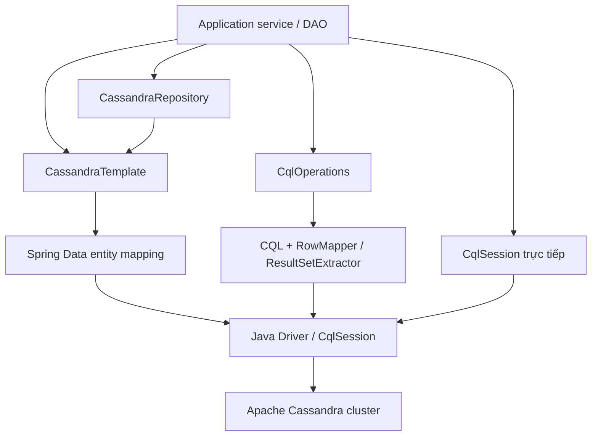

# CqlTemplate và giao diện CqlOperations

Khi xây dựng ứng dụng truy cập **Apache Cassandra bằng Spring Data Cassandra**, không phải thao tác dữ liệu nào cũng cần ánh xạ thành entity. Có lúc chúng ta chỉ muốn đọc một số cột, chạy CQL đã được tối ưu theo partition key, xử lý trực tiếp `Row` hoặc thực thi một câu lệnh điều kiện. **`CqlTemplate`** giải quyết nhóm nhu cầu này bằng một API mức CQL của Spring Data; **`CqlOperations`** là giao diện mô tả các thao tác mà template cung cấp.

Đây là một tầng thấp hơn `CassandraTemplate`. Ta vẫn hưởng lợi từ việc quản lý `CqlSession`, API callback và dịch ngoại lệ sang hệ thống `DataAccessException` của Spring, nhưng **phải tự viết CQL và tự quyết định cách chuyển dữ liệu hàng CQL thành đối tượng Java**. Những annotation `@Table`, `@PrimaryKey` hay custom entity converters không tự động được áp dụng cho một `RowMapper` viết tay.

Bài này dùng tình huống **đọc và cập nhật đăng ký khóa học của một học viên**. Từ đó ta sẽ thực hành `CqlOperations.query(...)`, `queryForObject(...)`, `queryForRows(...)`, `execute(...)`, parameter binding, callback và kiểm soát các giới hạn về paging, consistency, hiệu năng trong hệ dữ liệu phân tán.

## 1. Phân biệt bốn thành phần dễ nhầm

Trong một dự án Spring Data Cassandra, các API có quan hệ nhưng không hoàn toàn tương đương:

| Thành phần | Công dụng | Mức trừu tượng |
| --- | --- | --- |
| `CassandraRepository` | CRUD và query methods cho entity đã mapping | Cao |
| `CassandraTemplate` / `CassandraOperations` | Thao tác entity bằng mapping metadata, Query/Update API | Cao – trung |
| **`CqlTemplate` / `CqlOperations`** | Thực thi CQL trực tiếp, bind tham số, lấy dữ liệu qua callback và `RowMapper` | Trung – thấp |
| `CqlSession` của Java Driver | Truy cập driver trực tiếp, tự quản lý statement, kết quả và tùy chọn | Thấp |



`CassandraTemplate` thường phù hợp khi cần lưu/đọc `Course`, `Enrollment` hay một entity có composite primary key. `CqlTemplate` phù hợp khi câu truy vấn trả **projection** nhỏ, khi code muốn kiểm soát CQL hoặc xử lý dữ liệu từ `Row` mà không cần lập một entity đầy đủ.

**CqlOperations là interface, không phải lớp thực thi.** Trong ứng dụng có thể inject `CqlOperations` để giảm sự phụ thuộc vào class cụ thể, còn một bean `CqlTemplate` thực thi các method đó. Cách này cũng giúp thay thế bằng stub/mock trong unit test.

### CqlTemplate không thay thế thiết kế bảng theo truy vấn

Dù gọi bằng API nào, Cassandra vẫn áp dụng quy tắc CQL: partition key giúp định vị partition, clustering key quyết định thứ tự hàng trong partition, secondary index có giới hạn và `ALLOW FILTERING` không phải giải pháp mặc định cho truy vấn thiếu đường truy cập.

`CqlTemplate` **không tự tạo partition key, index, JOIN, offset pagination hoặc transaction ACID xuyên nhiều bảng**. Việc chọn API là quyết định ở tầng Java; cách lưu và truy vấn dữ liệu phân tán vẫn phải được thiết kế ở CQL.

## 2. Ví dụ xuyên suốt: đăng ký khóa học theo học viên

API cần phục vụ yêu cầu:

```text
GET /tenants/{tenantId}/students/{studentId}/enrollments
```

Dữ liệu được sắp xếp từ đăng ký mới nhất đến cũ nhất. Một khóa học có thể có nhiều học viên, nhưng ở đây ta chọn hướng đọc **các khóa học của một học viên trong một tenant**.

Giả sử keyspace `learning` đã được triển khai:

```sql
CREATE TABLE IF NOT EXISTS learning.enrollments_by_student (
    tenant_id uuid,
    student_id uuid,
    enrolled_at timestamp,
    course_id uuid,
    enrollment_status text,
    teacher_note text,
    PRIMARY KEY ((tenant_id, student_id), enrolled_at, course_id)
) WITH CLUSTERING ORDER BY (enrolled_at DESC, course_id ASC);
```

Ý nghĩa từng phần:

- **`(tenant_id, student_id)`** là partition key ghép. Đọc danh sách đăng ký của một học viên cần biết đủ hai giá trị.
- **`enrolled_at`** là clustering column sắp giảm dần; không cần sort dữ liệu trên toàn cluster sau khi đọc.
- **`course_id`** là clustering column tiếp theo, phân biệt các đăng ký có cùng thời điểm.
- **`enrollment_status`** và **`teacher_note`** là regular columns, có thể không có giá trị sống.

CQL phù hợp với API:

```sql
SELECT enrolled_at, course_id, enrollment_status
FROM learning.enrollments_by_student
WHERE tenant_id = ? AND student_id = ?
LIMIT ?;
```

Query có đầy đủ partition key, số hàng tối đa được kiểm soát và chỉ chọn những cột cần trả về. Các dấu `?` là **bind variables**, không phải vị trí để ghép thẳng input HTTP thành chuỗi CQL.

Nếu API cần “tất cả học viên của một khóa học”, ta phải cân nhắc một bảng khác được thiết kế với partition key `(tenant_id, course_id)`. Không đổi `CqlTemplate` sang `CassandraTemplate` rồi mong cùng bảng tự trả lời được hướng truy vấn mới.

## 3. Đưa CqlTemplate vào ứng dụng Spring Boot

### 3.1. Bean CqlSession và CqlOperations

Khi dùng Spring Boot với starter Spring Data Cassandra, framework thường cấu hình `CqlSession` dựa trên những thông số như contact points, local datacenter và keyspace. Nếu ứng dụng chưa có một bean `CqlOperations` phù hợp, có thể tạo tường minh:

```java
import com.datastax.oss.driver.api.core.CqlSession;
import org.springframework.context.annotation.Bean;
import org.springframework.context.annotation.Configuration;
import org.springframework.data.cassandra.core.cql.CqlOperations;
import org.springframework.data.cassandra.core.cql.CqlTemplate;

@Configuration(proxyBeanMethods = false)
public class CqlAccessConfiguration {

    @Bean
    public CqlOperations cqlOperations(CqlSession session) {
        return new CqlTemplate(session);
    }
}
```

Constructor `new CqlTemplate(session)` nhận `CqlSession` hiện có. **Không tự tạo một session mới cho từng lời gọi repository**: session của Java Driver quản lý kết nối và metadata, có chi phí khởi tạo lớn và phải được quản lý theo vòng đời ứng dụng.

Nếu Spring context **đã** cung cấp bean `CqlTemplate` hoặc `CqlOperations`, không cần thêm một bean trùng. Kiểm tra cấu hình và phiên bản Spring Boot/Spring Data đang sử dụng trước khi khai báo. Trong ứng dụng nhiều cluster, cần chọn đúng session và bean bằng qualifier/configuration rõ ràng.

Ví dụ cấu hình local:

```yaml
spring:
  cassandra:
    contact-points: 127.0.0.1
    port: 9042
    local-datacenter: datacenter1
    keyspace-name: learning
    schema-action: none
```

Tên `datacenter1` chỉ là ví dụ cho một cluster local phù hợp; môi trường thực phải dùng tên datacenter mà Cassandra quảng bá. `schema-action: none` có nghĩa schema cần được tạo bằng CQL migration/bootstrap trước khi ứng dụng phụ thuộc vào nó.

### 3.2. Inject interface vào DAO

```java
import org.springframework.data.cassandra.core.cql.CqlOperations;
import org.springframework.stereotype.Repository;

@Repository
public class EnrollmentCqlDao {
    private final CqlOperations cql;

    public EnrollmentCqlDao(CqlOperations cql) {
        this.cql = cql;
    }

    // Các phương thức truy cập dữ liệu được bổ sung ở phần sau.
}
```

Điểm mạnh của interface `CqlOperations` là DAO chỉ phụ thuộc một hợp đồng thao tác CQL. Khi viết integration test, ta dùng implementation thật; khi unit test business validation, có thể thay dependency bằng fake/mock.

Không nhất thiết tất cả truy vấn phải đưa vào cùng một DAO. Nên nhóm method theo **bảng/đường truy cập và trách nhiệm dữ liệu**, giữ logic HTTP, kiểm tra quyền và orchestration ở service.

## 4. Truy vấn nhiều hàng với query và RowMapper

`RowMapper<T>` là callback chuyển một hàng `com.datastax.oss.driver.api.core.cql.Row` thành một đối tượng Java kiểu `T`. Nó không yêu cầu `@Table` hoặc một entity đầy đủ.

Định nghĩa DTO chỉ chứa ba trường của API:

```java
import java.time.Instant;
import java.util.UUID;

public record EnrollmentSummary(
        UUID courseId,
        Instant enrolledAt,
        String status) {
}
```

`CqlOperations.query(String, RowMapper<T>, Object... args)` chuẩn bị và bind truy vấn, rồi gọi mapper cho từng hàng kết quả.

Ví dụ một DAO hoàn chỉnh cho thao tác đọc:

```java
import java.util.List;
import java.util.Objects;
import java.util.UUID;

import org.springframework.data.cassandra.core.cql.CqlOperations;
import org.springframework.data.cassandra.core.cql.RowMapper;
import org.springframework.stereotype.Repository;

@Repository
public class EnrollmentReadDao {

    private static final String RECENT_CQL = """
        SELECT course_id, enrolled_at, enrollment_status
        FROM learning.enrollments_by_student
        WHERE tenant_id = ? AND student_id = ?
        LIMIT ?
        """;

    private static final RowMapper<EnrollmentSummary> SUMMARY_MAPPER =
        (row, rowNum) -> new EnrollmentSummary(
            row.getUuid("course_id"),
            row.getInstant("enrolled_at"),
            row.getString("enrollment_status")
        );

    private final CqlOperations cql;

    public EnrollmentReadDao(CqlOperations cql) {
        this.cql = cql;
    }

    public List<EnrollmentSummary> findRecent(
            UUID tenantId, UUID studentId, int limit) {

        Objects.requireNonNull(tenantId, "tenantId");
        Objects.requireNonNull(studentId, "studentId");

        if (limit < 1 || limit > 100) {
            throw new IllegalArgumentException(
                "limit must be between 1 and 100");
        }

        return cql.query(
            RECENT_CQL, SUMMARY_MAPPER, tenantId, studentId, limit);
    }
}
```

Giải thích:

1. **CQL được giữ cố định.** Tham số đến từ HTTP chỉ đi vào bind variables.
2. **Đầy đủ partition key** nên query định vị được dữ liệu của học viên.
3. **`LIMIT` kiểm soát tổng số hàng**, không phải số trang hay giá trị OFFSET.
4. **`RowMapper` đọc bằng tên cột**. Trong ví dụ, `row.getInstant("enrolled_at")` phù hợp CQL `timestamp` và Java Driver 4.x.
5. `query` trả một `List<EnrollmentSummary>`, không tự biến `EnrollmentSummary` thành Spring Data entity.
6. `RowMapper` nên stateless và có thể tái sử dụng. Tham số `rowNum` là thứ tự hàng **trong result đang được mapper xử lý**, không phải clustering key hay vị trí hàng trên toàn cluster.

### Xử lý NULL khi đọc

Nếu `enrollment_status` là CQL NULL, `getString("enrollment_status")` trả về `null`. Khi trường cần thể hiện trạng thái thiếu, DTO có thể giữ `String status` nullable hoặc dùng trạng thái miền rõ ràng.

Với getter primitive như `row.getInt(...)` hay `row.getBoolean(...)`, Java Driver có thể trả giá trị primitive mặc định khi CQL NULL. Nếu nghiệp vụ cần phân biệt `NULL` với `0`/`false`, sử dụng `row.isNull("column")` hoặc object getter.

**Một RowMapper viết tay không tự chạy các custom conversions đăng ký bằng `CassandraCustomConversions`**. Nếu entity dùng value object, cần chuyển đổi trong mapper hoặc chọn `CassandraTemplate` khi muốn mapping entity tự động.

## 5. Đọc đúng một hàng hoặc một giá trị

`CqlOperations` có các biến thể `queryForObject` phù hợp khi query được mong đợi trả về **chính xác một hàng**.

### 5.1. Đọc một giá trị scalar

Nếu đã biết **đầy đủ primary key** của một đăng ký, ta có thể đọc trạng thái của đúng hàng:

```java
import java.time.Instant;
import java.util.UUID;
import org.springframework.data.cassandra.core.cql.CqlOperations;

public class EnrollmentStatusLookup {

    private final CqlOperations cql;

    public EnrollmentStatusLookup(CqlOperations cql) {
        this.cql = cql;
    }

    public String findRequiredStatus(
            UUID tenantId, UUID studentId,
            Instant enrolledAt, UUID courseId) {

        return cql.queryForObject("""
            SELECT enrollment_status
            FROM learning.enrollments_by_student
            WHERE tenant_id = ? AND student_id = ?
              AND enrolled_at = ? AND course_id = ?
            """,
            String.class,
            tenantId, studentId, enrolledAt, courseId);
    }
}
```

Ở phiên bản Spring Data Cassandra hiện đại, biến thể `queryForObject(cql, String.class, args...)` kỳ vọng **một hàng, một cột**:

- Nếu có đúng một hàng và giá trị không NULL, trả về `String`.
- Nếu có đúng một hàng nhưng cột được đọc là CQL NULL, giá trị kết quả có thể là Java `null`.
- Nếu query trả **0 hàng hoặc nhiều hơn 1 hàng**, API này có thể ném `IncorrectResultSizeDataAccessException`.
- Nếu query trả hơn một cột trong khi yêu cầu scalar, cũng không phù hợp với hợp đồng.

Vì vậy, **đừng dùng `queryForObject` như `findById` có kết quả tùy chọn** nếu chuyện “không có hàng” là bình thường. Với nhu cầu đó, dùng `query` trả danh sách rồi kiểm tra số lượng, hoặc chọn API repository `findById` thích hợp.

### 5.2. Đọc một hàng thành DTO

Nếu muốn một DTO có nhiều field, dùng overload nhận `RowMapper`:

```java
EnrollmentSummary one = cql.queryForObject(
    """
    SELECT course_id, enrolled_at, enrollment_status
    FROM learning.enrollments_by_student
    WHERE tenant_id = ? AND student_id = ?
      AND enrolled_at = ? AND course_id = ?
    """,
    (row, rowNum) -> new EnrollmentSummary(
        row.getUuid("course_id"),
        row.getInstant("enrolled_at"),
        row.getString("enrollment_status")),
    tenantId, studentId, enrolledAt, courseId);
```

Đây là **đoạn thân method** giả định đã có `cql`, `tenantId`, `studentId`, `enrolledAt` và `courseId`. Hành vi khi không đủ/chưa đúng một hàng tương tự `queryForObject` khác.

### 5.3. Đừng dùng COUNT trên toàn bộ bảng để lấy số hàng rẻ

`queryForObject("SELECT COUNT(*) ...", Long.class, args...)` có thể hợp lệ khi câu CQL dùng partition key phù hợp. Nhưng `COUNT(*)` của Cassandra không phải cơ chế đếm metadata miễn phí: với lượng dữ liệu lớn, nó có thể quét nhiều hàng và tạo tải đáng kể.

Nếu API cần thống kê số lượng thường xuyên, cân nhắc bảng/projection counter có thiết kế riêng, hoặc giới hạn vùng đếm và tần suất truy vấn. Không dùng `COUNT(*)` trên dữ liệu lớn để mô phỏng phân trang kiểu SQL.

## 6. queryForRows và queryForList: lấy dữ liệu không cần entity

Ngoài callback `RowMapper`, `CqlOperations` cho phép trả dữ liệu gần hơn với định dạng CQL.

### 6.1. queryForRows

`queryForRows(String cql, Object... args)` trả một `Iterable<Row>`. Khi logic cần truy cập cột của Java Driver trực tiếp:

```java
import java.util.ArrayList;
import java.util.List;
import java.util.UUID;
import com.datastax.oss.driver.api.core.cql.Row;

public List<UUID> findCourseIds(
        UUID tenantId, UUID studentId) {

    Iterable<Row> rows = cql.queryForRows(
        """
        SELECT course_id
        FROM learning.enrollments_by_student
        WHERE tenant_id = ? AND student_id = ?
        LIMIT 50
        """,
        tenantId, studentId);

    List<UUID> ids = new ArrayList<>();
    for (Row row : rows) {
        ids.add(row.getUuid("course_id"));
    }
    return ids;
}
```

Đoạn này được đặt **bên trong class có field `CqlOperations cql`**. Không ép toàn bộ `Iterable<Row>` thành `List` rất lớn khi kết quả không có giới hạn. Việc duyệt `ResultSet`/`Iterable<Row>` có thể khiến driver lấy thêm page trong nền theo cơ chế fetch; **không nhầm kiểu Iterable với việc chỉ đọc một page**.

### 6.2. queryForList

`CqlOperations.queryForList(...)` có thể trả danh sách biểu diễn các hàng dưới dạng `Map<String,Object>` theo API hỗ trợ của phiên bản. Nó hữu ích cho công cụ kiểm tra dữ liệu hoặc truy vấn ad hoc có cấu trúc động.

Nhược điểm là:

- Tên cột được truy cập bằng chuỗi, ít an toàn kiểu hơn DTO/record.
- Cần tự chuyển kiểu và kiểm tra null.
- Trả về nhiều cột không cần thiết làm tăng payload.
- Không nên lạm dụng để tránh định nghĩa hợp đồng dữ liệu rõ ràng.

Khi endpoint đã có contract cố định, **`RowMapper<EnrollmentSummary>` là lựa chọn dễ bảo trì hơn**.

## 7. Callback của CqlOperations

Để xử lý trực tiếp kết quả CQL mà không muốn viết vòng lặp ở mỗi DAO, `CqlTemplate` cung cấp một số callback:

| Callback | Mục đích | Tình huống |
| --- | --- | --- |
| `RowMapper<T>` | Từ mỗi `Row` tạo một đối tượng | DTO/projection dạng danh sách |
| `RowCallbackHandler` | Xử lý từng `Row` mà không buộc API trả về list đối tượng | Tính tổng nhỏ, xử lý từng hàng |
| `ResultSetExtractor<T>` | Đọc toàn bộ `ResultSet` theo cách ứng dụng muốn và trả một kết quả | Tổng hợp, dựng cấu trúc tùy biến |
| `PreparedStatementBinder` | Tùy biến cách bind tham số cho prepared statement | Trường hợp cần kiểu bind đặc thù/statement options |
| `PreparedStatementCreator` | Tùy biến việc chuẩn bị statement | Câu lệnh cần kiểm soát khâu prepare |
| `SessionCallback<T>` | Thực hiện logic trực tiếp trên session trong phạm vi template | Tương tác driver đặc biệt |

### 7.1. RowCallbackHandler

Ví dụ xử lý trạng thái của tối đa 20 đăng ký:

```java
import java.util.ArrayList;
import java.util.List;
import org.springframework.data.cassandra.core.cql.RowCallbackHandler;

// Trích đoạn trong DAO với field cql và hai UUID đầu vào:
List<String> statuses = new ArrayList<>();

cql.query(
    """
    SELECT enrollment_status
    FROM learning.enrollments_by_student
    WHERE tenant_id = ? AND student_id = ?
    LIMIT 20
    """,
    (RowCallbackHandler) row ->
        statuses.add(row.getString("enrollment_status")),
    tenantId, studentId);
```

Callback xử lý từng hàng; nó **không đảm bảo giảm tải nếu câu CQL vẫn quét hàng triệu kết quả**. Luôn đặt giới hạn phù hợp hoặc thiết kế API phân trang thật.

### 7.2. ResultSetExtractor

Một extractor có thể trả cấu trúc tổng hợp khác `List`. Ví dụ minh họa đếm số hàng `ACTIVE` trong **tối đa 50 hàng đã chọn**:

```java
import com.datastax.oss.driver.api.core.cql.Row;
import org.springframework.data.cassandra.core.cql.ResultSetExtractor;

// Trích đoạn trong DAO với field cql và hai UUID:
Integer activeAmongFirst50 = cql.query(
    """
    SELECT enrollment_status
    FROM learning.enrollments_by_student
    WHERE tenant_id = ? AND student_id = ?
    LIMIT 50
    """,
    (ResultSetExtractor<Integer>) resultSet -> {
        int active = 0;
        for (Row row : resultSet) {
            if ("ACTIVE".equals(row.getString("enrollment_status"))) {
                active++;
            }
        }
        return active;
    },
    tenantId, studentId);
```

Đây là số hàng ACTIVE **trong 50 hàng truy vấn trả về**, không phải tổng số đăng ký ACTIVE của học viên. Một API thống kê toàn bộ cần thiết kế dữ liệu/đường đọc phù hợp, thay vì lặp lại `COUNT` hoặc quét dữ liệu không giới hạn.

**Lưu ý:** `RowCallbackHandler`, `ResultSetExtractor` và `RowMapper` là các interface khác nhau; chọn đúng overload và kiểu callback. Một lambda có thể trở nên mơ hồ nếu compiler nhìn thấy nhiều overload nhận functional interface, nên có thể khai báo biến callback với kiểu cụ thể hoặc ép kiểu tường minh như ví dụ.

## 8. Ghi dữ liệu bằng execute

`CqlOperations.execute(...)` có thể thực thi CQL `INSERT`, `UPDATE`, `DELETE` hoặc DDL. Các overload có tham số dạng `Object... args` dùng prepared statement và bind giá trị theo thứ tự.

### 8.1. INSERT

```java
import java.time.Instant;
import java.util.UUID;

public void insertEnrollment(
        UUID tenantId, UUID studentId, UUID courseId,
        Instant enrolledAt, String status) {

    cql.execute(
        """
        INSERT INTO learning.enrollments_by_student
            (tenant_id, student_id, enrolled_at, course_id,
             enrollment_status)
        VALUES (?, ?, ?, ?, ?)
        """,
        tenantId, studentId, enrolledAt, courseId, status);
}
```

Đây là đoạn thân class đã có `CqlOperations cql`. `INSERT` của Cassandra thường có tính chất **upsert**: ghi vào cùng primary key có thể cập nhật các cột được chỉ định. Nó không mặc định báo lỗi nếu khóa đã tồn tại.

Nếu cần đảm bảo “chỉ tạo khi chưa có”, có thể xét `IF NOT EXISTS` (LWT) với chi phí và yêu cầu consistency tương ứng.

### 8.2. UPDATE chỉ cột cần thay

```java
public void changeStatus(
        UUID tenantId, UUID studentId,
        Instant enrolledAt, UUID courseId,
        String nextStatus) {

    cql.execute(
        """
        UPDATE learning.enrollments_by_student
        SET enrollment_status = ?
        WHERE tenant_id = ? AND student_id = ?
          AND enrolled_at = ? AND course_id = ?
        """,
        nextStatus, tenantId, studentId, enrolledAt, courseId);
}
```

Câu `UPDATE` nhắm tới **đầy đủ primary key** và không động vào `teacher_note`. Nếu muốn sửa một field của hàng, dạng này thường dễ kiểm soát hơn việc tạo entity thiếu dữ liệu rồi gọi `save()` khiến các field NULL không mong muốn có thể bị ghi đi.

Nhưng lưu ý: Cassandra `UPDATE` thông thường cũng có thể **tạo hàng mới** nếu khóa chưa tồn tại. Sự thành công của lệnh không phải bằng chứng trước đó đã có enrollment.

### 8.3. DELETE

```java
public void deleteEnrollment(
        UUID tenantId, UUID studentId,
        Instant enrolledAt, UUID courseId) {

    cql.execute(
        """
        DELETE FROM learning.enrollments_by_student
        WHERE tenant_id = ? AND student_id = ?
          AND enrolled_at = ? AND course_id = ?
        """,
        tenantId, studentId, enrolledAt, courseId);
}
```

Xóa một hàng tạo tombstone theo cơ chế Cassandra. Không đặt `DELETE` thiếu clustering key nếu mục tiêu chỉ là một enrollment, vì một câu lệnh theo partition key có thể xóa **cả partition**.

### 8.4. Boolean từ execute nói lên điều gì?

`CqlOperations.execute(...)` trả **`boolean` biểu thị kết quả `applied` của statement**, không phải `int` số hàng bị ảnh hưởng kiểu JDBC.

Đối với CQL ghi thường (không có `IF`), `true` không chứng minh rằng có một hàng cũ để cập nhật, có đúng một row thay đổi, hay mọi projection khác đã đồng bộ.

Đối với conditional statement có `IF`, giá trị `applied` có ý nghĩa trực tiếp: điều kiện được thỏa để mutation được áp dụng hay không.

Ví dụ chỉ chuyển trạng thái ACTIVE sang CANCELLED khi dữ liệu đang phù hợp:

```java
public boolean cancelIfActive(
        UUID tenantId, UUID studentId,
        Instant enrolledAt, UUID courseId) {

    return cql.execute(
        """
        UPDATE learning.enrollments_by_student
        SET enrollment_status = ?
        WHERE tenant_id = ? AND student_id = ?
          AND enrolled_at = ? AND course_id = ?
        IF enrollment_status = ?
        """,
        "CANCELLED",
        tenantId, studentId, enrolledAt, courseId,
        "ACTIVE");
}
```

LWT có cơ chế phối hợp và chi phí khác ghi bình thường; không dùng chỉ để “an tâm hơn” khi API không cần compare-and-set. Nếu một timeout xảy ra, vẫn cần chiến lược retry/kiểm tra kết quả đúng nghiệp vụ.

## 9. Statement, PreparedStatement và binding an toàn

### 9.1. Khi nào CqlTemplate dùng prepared statement?

Theo tài liệu Spring Data Cassandra, các overload **có `Object... args`** như `query(cql, mapper, args...)` hoặc `execute(cql, args...)` dùng cơ chế prepared statement/bind. Overload chỉ có một chuỗi CQL tĩnh có thể thực thi trực tiếp dưới dạng statement không bind.

Vì vậy, ưu tiên:

```java
cql.query(
    "SELECT course_id FROM learning.enrollments_by_student " +
    "WHERE tenant_id = ? AND student_id = ? LIMIT 10",
    (row, n) -> row.getUuid("course_id"),
    tenantId, studentId);
```

Thay vì:

```java
// KHÔNG LÀM: nối giá trị người dùng vào câu CQL.
String unsafeCql =
    "SELECT course_id FROM learning.enrollments_by_student " +
    "WHERE tenant_id = " + tenantId +
    " AND student_id = " + studentId;
```

Ngay cả khi ví dụ hiện tại dùng UUID được xác thực, giữ quy tắc bind tránh lỗi định dạng, quoting và injection khi mã nguồn được tái sử dụng với text hoặc giá trị khác.

### 9.2. Bind giá trị khác với bind tên bảng/cột

Prepared statements bind **giá trị CQL**, không bind tùy ý identifier như tên keyspace, bảng hay cột. Nếu ứng dụng thực sự cần chọn bảng theo môi trường/tenant, phải có danh sách định danh được kiểm soát và validate nghiêm ngặt; **không đưa tên bảng nhận từ request trực tiếp vào CQL**.

Với mô hình multi-tenant, ưu tiên tổ chức partition key có `tenant_id` khi phù hợp và áp dụng kiểm tra quyền riêng, thay vì để client tự quyết định keyspace/tên bảng.

### 9.3. Tùy chọn ở mức Statement

Ngoài overload chuỗi CQL, `CqlOperations` nhận `Statement<?>` của Java Driver. Cách này hữu ích khi cần page size, execution profile hoặc một số thuộc tính cụ thể:

```java
import java.util.UUID;
import com.datastax.oss.driver.api.core.cql.SimpleStatement;

public List<UUID> readFewIds(
        UUID tenantId, UUID studentId) {

    SimpleStatement statement = SimpleStatement.newInstance(
        """
        SELECT course_id
        FROM learning.enrollments_by_student
        WHERE tenant_id = ? AND student_id = ?
        LIMIT 50
        """,
        tenantId, studentId
    ).setPageSize(25);

    return cql.query(
        statement,
        (row, rowNum) -> row.getUuid("course_id"));
}
```

Lưu ý `SimpleStatement.newInstance(...)` trong ví dụ tạo statement với các giá trị bind kiểu driver; đó là cơ chế ở Java Driver, không giống converter entity. Khi thực thi một query nhiều lần, cân nhắc prepared statements và execution profile có chủ đích.

Nếu muốn áp dụng consistency, timeout và retry policy riêng, phải cân nhắc **replication factor, datacenter, SLA và loại thao tác**; không hardcode ngẫu nhiên các mức `LOCAL_ONE` hoặc `LOCAL_QUORUM` chỉ vì có API set trong statement.

## 10. Paging: tránh hiểu sai LIMIT và page size

Dữ liệu Cassandra có thể trải trên nhiều page. Cần phân biệt:

| Khái niệm | Ý nghĩa |
| --- | --- |
| `LIMIT 50` | Số hàng tối đa mà toàn bộ query trả về |
| `pageSize = 25` | Kích thước trang mong muốn khi driver lấy dữ liệu |
| **Paging state** | Thông tin tiếp diễn của cùng query/bind parameters |
| `OFFSET 25` | Không phải cơ chế phân trang tùy ý được Cassandra hỗ trợ như một số RDBMS |

Một điểm quan trọng: **`CqlOperations.query(...)` trả `List`**, và quá trình mapper đọc có thể tiếp tục lấy nhiều page để dựng kết quả. Đặt page size nhỏ **không** tự ngăn ứng dụng tải toàn bộ tập kết quả nếu không có giới hạn CQL hoặc nếu code duyệt hết.

`CqlOperations.queryForRows(...)` trả `Iterable<Row>` nhưng iterator cũng có thể đi qua các page. Đừng mặc định `Iterable` là “chỉ page đầu”.

### 10.1. API cần trang tiếp theo thì làm sao?

Nếu sản phẩm cần “Xem thêm” với `nextPageToken`:

1. Xác định CQL và bind parameters ổn định theo partition key/clustering.
2. Chọn API hỗ trợ paging state của Java Driver hoặc các abstraction paging của Spring Data phù hợp.
3. Giới hạn số hàng và kích thước mỗi trang.
4. Duy trì chính xác CQL, giá trị bind, quyền truy cập và ngữ cảnh token khi truy vấn tiếp.
5. Không coi paging state là số trang có thể nhảy tùy ý.
6. Chấp nhận hoặc xử lý việc dữ liệu thay đổi giữa hai lần lấy trang theo hợp đồng API.

`CqlTemplate` là lớp thuận tiện cho CQL nhưng **không tự định nghĩa hợp đồng HTTP cursor cho ứng dụng**. Nếu API đòi điều khiển chính xác từng trang và lấy paging state, có thể dùng `CqlSession` và result-set API hoặc cơ chế paging chuyên biệt phù hợp. Tránh viết code lấy một `List` rất lớn rồi chia nhỏ để giả lập paging.

### 10.2. Đọc đúng partition vẫn có thể chậm

Partition key giúp định vị nhưng một partition quá lớn hoặc quá nóng vẫn có thể gây độ trễ. Cần cân nhắc bucket, retention/TTL, thiết kế clustering và hạn mức query trước khi cố tối ưu Java mapper.

Hiệu năng quan trọng hơn số dòng Java: đo p95/p99 latency, số hàng/page, kích thước partition, timeout, tombstone/compaction và tải trên replica.

## 11. So sánh CqlTemplate với CassandraTemplate

Giả sử cả hai API đều đọc danh sách của cùng một học viên:

### CqlTemplate

```java
List<EnrollmentSummary> summaries = cql.query(
    """
    SELECT course_id, enrolled_at, enrollment_status
    FROM learning.enrollments_by_student
    WHERE tenant_id = ? AND student_id = ? LIMIT 20
    """,
    (row, n) -> new EnrollmentSummary(
        row.getUuid("course_id"),
        row.getInstant("enrolled_at"),
        row.getString("enrollment_status")),
    tenantId, studentId);
```

### CassandraTemplate

```java
import org.springframework.data.cassandra.core.CassandraTemplate;
import org.springframework.data.cassandra.core.query.Criteria;
import org.springframework.data.cassandra.core.query.Query;

// Giả định EnrollmentByStudent là entity đã ánh xạ bảng/CQL đúng.
Query query = Query.query(Criteria.where("tenant_id").is(tenantId))
    .and(Criteria.where("student_id").is(studentId))
    .limit(20);

List<EnrollmentByStudent> entities =
    cassandraTemplate.select(query, EnrollmentByStudent.class);
```

Đoạn code thứ hai là **minh họa trong method** có `CassandraTemplate cassandraTemplate` và các input cần thiết; kết quả là entity đã mapping, không phải DTO được dựng trực tiếp như với `RowMapper`.

| Tiêu chí | CqlTemplate | CassandraTemplate |
| --- | --- | --- |
| Đầu vào chính | CQL string hoặc `Statement<?>` | Entity, `Query`, `Update` và mapping API |
| Kết quả thông dụng | Scalar, `List<T>` qua mapper, `Row`, callback | Entity/đối tượng được Spring Data mapping |
| Annotation mapping | Không tự dùng `@Table`/`@Column` trong mapper viết tay | Có dùng metadata mapping của entity |
| Custom conversions | Không tự gọi `CassandraCustomConversions` trong `RowMapper` | Có thể áp dụng trong đường entity mapping |
| Kiểm soát CQL | Tường minh do lập trình viên viết | Có thể dùng query fluent và SQL/CQL-specific API |
| Phù hợp | CQL projection, truy vấn tùy biến, callback | CRUD/entity-oriented data access |

**Không cần chọn duy nhất một API cho cả dự án**. Có thể dùng repository cho CRUD, `CassandraTemplate` cho truy vấn entity tùy chỉnh, và `CqlTemplate` cho các projection CQL chuyên biệt. Điều quan trọng là không duplicate logic binding và validation một cách khó kiểm soát.

## 12. Ngoại lệ: CqlTemplate giúp gì và không giúp gì?

`CqlTemplate` bắt các ngoại lệ driver phù hợp rồi **dịch sang hệ `org.springframework.dao.DataAccessException`**. Điều này giúp code ứng dụng xử lý lỗi theo nhóm Spring data-access thay vì phải phụ thuộc hoàn toàn vào chi tiết của Java Driver.

Ví dụ những tình huống cần xử lý:

| Tình huống | Biểu hiện | Cách phản hồi hợp lý |
| --- | --- | --- |
| Keyspace/bảng chưa có | CQL thất bại khi prepare/execute | Kiểm tra migration, tên keyspace, không tạo bảng tùy tiện ở request |
| Sai partition/clustering predicate | Query bị Cassandra từ chối hoặc chạy không hiệu quả | Sửa mô hình bảng/truy vấn thay vì bật `ALLOW FILTERING` |
| `queryForObject` trả 0 hoặc nhiều hàng | `IncorrectResultSizeDataAccessException` | Chọn method phù hợp và xác định đúng số hàng mong đợi |
| Timeout đọc/ghi | Data-access exception liên quan timeout | Đo cluster/driver, timeout policy và bảo đảm retry an toàn |
| Cột/kiểu không khớp | Driver mapping/getter lỗi | Đối chiếu schema với tên cột, kiểu CQL và DTO |
| Network/availability | Không có node khả dụng hoặc replica không đáp ứng | Theo dõi topology, consistency, retry có giới hạn |
| Dữ liệu CQL NULL | Getter trả null hoặc mặc định primitive | Dùng wrapper/`isNull`, không đánh đồng với giá trị hợp lệ |

**Template không tự retry vô hạn, không bảo đảm mọi exception đều có thể retry, và không biến timeout thành “ghi chắc chắn thất bại”.** Cassandra có thể đã áp dụng mutation dù client không nhận được xác nhận. Khi retry ghi, cần idempotency, khóa ổn định, quy tắc thứ tự sự kiện và khả năng đối soát.

### Đừng nuốt ngoại lệ để “trả về danh sách rỗng”

Ví dụ sai về mặt nghiệp vụ:

```java
try {
    return enrollmentReadDao.findRecent(tenantId, studentId, 20);
} catch (Exception ignored) {
    return List.of();  // Sai: lỗi cluster trông giống không có dữ liệu.
}
```

Nếu cluster unavailable, HTTP API nên báo lỗi phù hợp hoặc dùng fallback được thiết kế có chủ đích; không biến lỗi dữ liệu thành “học viên chưa đăng ký khóa nào”.

## 13. CQL nhất quán với mô hình phân tán

Tầng Java không thay thế các đặc tính của Cassandra:

### 13.1. Consistency

Mức như `LOCAL_ONE` hoặc `LOCAL_QUORUM` quyết định các điều kiện phối hợp replica cho từng thao tác, phụ thuộc vào replication factor và datacenter. Chúng không biến ghi nhiều bảng phi chuẩn hóa thành một transaction.

Nếu một enrollment cũng được ghi ở bảng `students_by_course`, việc `cql.execute(...)` thành công trên `enrollments_by_student` **không chứng minh** bảng thứ hai đã được cập nhật. Cần thiết kế luồng đồng bộ, retry, đối soát hoặc cơ chế sự kiện phù hợp.

### 13.2. Upsert và LWT

`INSERT`/`UPDATE` thông thường có thể ghi vào primary key đã có hoặc tạo row tương ứng. Chỉ dùng `IF NOT EXISTS`/`IF...` khi nghiệp vụ thực sự cần điều kiện đồng thời; điều đó có chi phí cao hơn và không thay thế transaction đa bảng.

### 13.3. TTL, NULL và tombstone

Ghi regular column bằng CQL `NULL` có ngữ nghĩa xóa giá trị và thường tạo tombstone. Nếu muốn **không thay đổi** một cột trong PATCH, chỉ đưa cột thực sự cần sửa vào câu `UPDATE` hoặc dùng bind variable `UNSET` được driver hỗ trợ.

Đặt TTL khi dữ liệu có vòng đời rõ ràng; không dùng TTL ngẫu nhiên để kiểm soát kích thước partition khi chưa tính đến nhu cầu đọc dữ liệu cũ, tombstone và consistency.

### 13.4. Không tự đặt transaction kiểu RDBMS

Một method Java:

```java
void updateTwoProjections() {
    cql.execute("INSERT INTO table_a ...", /* args */);
    cql.execute("INSERT INTO table_b ...", /* args */);
}
```

**không tự mang lại rollback ACID giữa hai bảng**. Phần trên chỉ là pseudo-code minh họa hành vi hai statement, không phải câu CQL hoàn chỉnh. Cần thiết kế luồng cập nhật projection độc lập và cơ chế phục hồi sau lỗi một phần.

## 14. Kiểm thử CqlOperations đúng mức

### 14.1. Unit test

Với DAO chỉ inject interface `CqlOperations`, unit test có thể mock interface để kiểm tra:

- Query CQL có đúng câu `WHERE` mong muốn?
- Tham số bind có đúng thứ tự `tenantId`, `studentId`, `limit`?
- Validation từ chối `limit <= 0` hoặc `limit > 100`?
- DAO xử lý `DataAccessException` theo chính sách hay chỉ để exception propagate?

Nhưng mock không chứng minh CQL hợp lệ trên cluster hoặc mapping CQL type hoạt động. Đừng dùng unit test làm bằng chứng đã kiểm chứng hiệu năng.

### 14.2. Integration test với Cassandra thật

Một integration test nên dùng **Testcontainers** hoặc cluster test cô lập và schema tạo bằng CQL rõ ràng.

Kịch bản đề xuất:

1. Dựng Cassandra test có keyspace/bảng `enrollments_by_student`.
2. Seed hai hàng trong cùng partition với `enrolled_at` khác nhau.
3. Tạo `CqlTemplate` từ `CqlSession` test và inject vào `EnrollmentReadDao`.
4. Gọi `findRecent(tenantId, studentId, 1)`, kiểm tra trả khóa học mới hơn.
5. Kiểm tra học viên/tenant khác không lấy được dữ liệu của partition test.
6. Thử `queryForObject` trên hàng tồn tại và hàng không tồn tại; xác minh exception đúng contract.
7. Thử `execute` với `UPDATE ... IF enrollment_status = ?` cho cả điều kiện đúng và sai.
8. Thử cột `teacher_note` NULL và giá trị cụ thể, kiểm tra `RowMapper`/getter.
9. Dùng UUID test riêng và dọn chính xác dữ liệu do test tạo, không gọi `DELETE` trên cluster chia sẻ.

Ví dụ assertion trên DAO khi đã có setup Cassandra test:

```java
List<EnrollmentSummary> recent =
    enrollmentReadDao.findRecent(tenantId, studentId, 1);

assertThat(recent).hasSize(1);
assertThat(recent.get(0).courseId()).isEqualTo(newerCourseId);
```

Đoạn test này giả định đã khai báo `enrollmentReadDao`, `tenantId`, `studentId`, `newerCourseId` trong test class. Các lớp/nơi tạo schema và fixture cần được bổ sung theo dự án. **Không chạy test truy cập dữ liệu trên production**.

### 14.3. Bài test về paging và hiệu năng

Một node Cassandra trong Testcontainers phù hợp để kiểm tra CQL, type mapping và callback, nhưng **không mô phỏng đầy đủ replica failures hoặc consistency của cluster nhiều node**. Với các thay đổi về RF, retry và timeout, cần môi trường/topology test thích hợp.

Hãy tạo nhiều hơn một page dữ liệu để quan sát `ResultSet` fetch, đo số hàng thực sự được xử lý khi `query` trả `List` và khi `queryForRows` trả `Iterable<Row>`, tránh kết luận sai rằng page size là LIMIT.

## 15. Lỗi thường gặp và cách debug

| Triệu chứng | Nguyên nhân khả dĩ | Bước xử lý đầu tiên |
| --- | --- | --- |
| Spring không inject được `CqlOperations` | Chưa tạo bean hoặc có cấu hình trùng/không đúng session | Kiểm tra bean graph và `@Configuration` |
| `Unknown keyspace` / `Unconfigured table` | Schema chưa migration hoặc sai môi trường | Xác minh keyspace, DC và schema thực tế |
| `RowMapper` báo sai tên cột | `SELECT` không trả cột cần đọc, alias sai | So sánh CQL, metadata result và getter |
| `getInt` trả 0 dù CQL thiếu giá trị | Primitive getter không biểu diễn NULL | Kiểm tra `row.isNull` hoặc object getter |
| `queryForObject` ném exception vì không có row | Method mong đợi chính xác một hàng | Dùng `query`/repository Optional khi row có thể vắng |
| `execute` trả true nhưng hàng không “đổi” | Ghi thường không là phép đếm affected rows | Kiểm tra idempotency, khóa, điều kiện CQL |
| CQL truy vấn theo cột regular bị từ chối | Bảng không được thiết kế cho query đó | Thiết kế bảng theo truy vấn; không mặc định `ALLOW FILTERING` |
| Có page size nhưng API tiêu thụ nhiều RAM | `query` materialize toàn bộ kết quả hoặc duyệt iterator hết trang | LIMIT, paging state/cursor và giới hạn DTO |
| Lỗi khi bind đối tượng custom | `CqlTemplate` không dùng entity converter như dự đoán | Chuyển về kiểu Java Driver hỗ trợ hoặc dùng entity mapping |
| Timeout xuất hiện sau deploy | Partition lớn, hot key, network, RF/consistency, tải node | Kiểm tra p95/p99, driver/cluster metrics |
| Ghi hai bảng nhưng dữ liệu lệch | Không có transaction đa projection | Retry, reconciliation và nguồn sự thật |
| Lỗi chỉ trên reactive endpoint | Gọi blocking `CqlTemplate` trên event loop | Dùng API reactive/async phù hợp |

Quy trình debug hiệu quả: kiểm tra **profile/session → keyspace/schema → CQL và partition key → bind types → callback/mapping → driver/cluster metrics**. Chỉ điều chỉnh timeout sau khi có dữ liệu đo; tăng timeout không giải quyết được schema sai hoặc query fan-out vô hạn.

## 16. Reactive và bất đồng bộ

`CqlTemplate` dùng mô hình **blocking**. Với ứng dụng reactive, không gọi trực tiếp các method blocking trong event loop rồi hy vọng reactor tự chuyển chúng thành non-blocking.

Spring Data Cassandra còn có các biến thể như:

- `AsyncCqlTemplate` cho mô hình bất đồng bộ dựa trên `CompletableFuture`.
- `ReactiveCqlTemplate` cho Reactive Streams/Project Reactor.

Lựa chọn phụ thuộc loại ứng dụng và cách quản lý `CqlSession`, mapper, backpressure cũng như paging. Không trộn tự do `Mono`, blocking `query(...)` và driver async trong một method thiếu ranh giới rõ ràng.

**Hành vi CQL bên dưới vẫn giống nhau về thiết kế dữ liệu**: query phải có đường truy cập hợp lệ, consistency theo replica, giới hạn partition và xử lý ghi đa bảng vẫn do ứng dụng chịu trách nhiệm.

## 17. Bài tập tự thực hành

Giả sử Cassandra có bảng:

```sql
CREATE TABLE learning.progress_by_student (
    tenant_id uuid,
    student_id uuid,
    course_id uuid,
    completed_lessons int,
    score_percent double,
    PRIMARY KEY ((tenant_id, student_id), course_id)
);
```

Ứng dụng cần lấy tiến độ của một học viên và cập nhật số bài học hoàn thành.

Hãy trả lời:

1. Khi dùng `CqlOperations.query(...)`, vì sao phải truyền cả `tenant_id` và `student_id`?
2. Viết `RowMapper` trả về record `ProgressSummary(UUID courseId, Integer completedLessons, Double scorePercent)`. Làm sao xử lý một cột `completed_lessons` chưa có giá trị?
3. Khi muốn cập nhật `completed_lessons = 0`, CQL `UPDATE` nên chứa những điều kiện khóa nào?
4. `cql.execute(updateCql, 0, tenantId, studentId, courseId)` trả true có chứng minh row đã tồn tại trước đó không?
5. Nếu query chỉ cần 50 bản ghi đầu tiên, `LIMIT 50` và `pageSize=50` có cùng ý nghĩa không?
6. Khi query không trả row nào, `queryForObject` có phải lựa chọn tốt cho endpoint trả danh sách không?
7. Tại sao `@Table` trên `Progress` không khiến `CqlOperations.query(...)` tự trả về entity?
8. Nếu cần đọc từng trang với `nextPageToken`, nên sử dụng khái niệm Cassandra nào thay vì `OFFSET`?
9. Nếu cập nhật hai bảng phi chuẩn hóa bằng hai lần `cql.execute`, có transaction đa bảng không?
10. Test trên Cassandra thật cần xác minh điều gì mà mock `CqlOperations` không thể xác minh?

**Gợi ý lời giải:** truy vấn theo đúng partition key `(tenant_id, student_id)`. Với kiểu số có thể thiếu, dùng wrapper và `row.isNull(...)` hoặc getter object. `UPDATE` một hàng cần đầy đủ primary key, gồm `course_id`. `execute` trả applied flag chứ không phải affected rows; `LIMIT` giới hạn tổng số hàng còn page size định cỡ mỗi lượt fetch. `queryForObject` phù hợp khi mong chính xác một hàng. API dùng cursor/paging state, và hai câu ghi không có transaction ACID xuyên bảng. Integration test phải thực sự bind CQL, kiểm chứng kiểu và mapping.

## 18. Checklist áp dụng CqlTemplate trong production

- [ ] Đã thiết kế CQL theo **partition key và clustering columns**, không né lỗi bằng `ALLOW FILTERING`.
- [ ] Có bean `CqlOperations`/`CqlTemplate` dùng `CqlSession` được quản lý đúng lifecycle.
- [ ] Tham số được bind; không ghép input người dùng vào CQL.
- [ ] Đã chọn đúng API `query`, `queryForObject`, `queryForRows` hay `execute` theo contract kết quả.
- [ ] `RowMapper` xử lý cột nullable, schema và kiểu Java Driver đúng.
- [ ] Không nhầm `CqlTemplate` với entity mapping của `CassandraTemplate`.
- [ ] Không diễn giải boolean từ `execute` là số hàng cập nhật.
- [ ] Có `LIMIT`/page size/paging state phù hợp; không tự materialize kết quả không giới hạn.
- [ ] Xử lý timeout và retry an toàn, không giả định mutation chưa được áp dụng khi client timeout.
- [ ] Đã xác minh RF/datacenter/consistency và quyền truy cập trên môi trường triển khai.
- [ ] Có integration test với Cassandra thật, bao gồm dữ liệu NULL, nhiều hàng và query không có kết quả.
- [ ] Không dùng blocking `CqlTemplate` trong luồng reactive cần non-blocking.
- [ ] Có metrics và ngưỡng cảnh báo cho latency, timeout, hot/large partitions và tombstone.

## Ghi nhớ

**`CqlTemplate` là lớp thực thi CQL mức thấp của Spring Data Cassandra, còn `CqlOperations` là hợp đồng API để ứng dụng gọi các thao tác đó.** Chúng giúp giảm mã lặp cho chuẩn bị statement, binding, xử lý `ResultSet` và dịch ngoại lệ, nhưng không tự ánh xạ entity theo metadata Spring Data như `CassandraTemplate`.

**`query` + `RowMapper` phù hợp với danh sách DTO**, `queryForObject` yêu cầu kết quả đúng kích thước, `queryForRows` trả hàng driver để xử lý trực tiếp, còn `execute` áp dụng mutation/DDL và trả cờ `applied` — **không phải affected-row count**.

Sau cùng, mọi truy vấn vẫn phải phù hợp với **partition key, clustering, consistency, paging và giới hạn của Cassandra phân tán**. Chọn đúng API Java chỉ là một phần; mô hình dữ liệu theo truy vấn và kế hoạch vận hành quyết định hiệu năng và tính đúng đắn của hệ thống.

### Tài liệu tham khảo

- [Spring Data Cassandra — CQL Template API](https://docs.spring.io/spring-data/cassandra/reference/cassandra/cql-template.html)
- [Spring Data Cassandra — CqlOperations API](https://docs.spring.io/spring-data/cassandra/docs/current/api/org/springframework/data/cassandra/core/cql/CqlOperations.html)
- [Spring Data Cassandra — CqlTemplate API](https://docs.spring.io/spring-data/cassandra/docs/current/api/org/springframework/data/cassandra/core/cql/CqlTemplate.html)
- [Spring Data Cassandra — Prepared Statements](https://docs.spring.io/spring-data/cassandra/reference/cassandra/prepared-statements.html)
- [Spring Data Cassandra — CassandraTemplate](https://docs.spring.io/spring-data/cassandra/reference/cassandra/template.html)
- [Apache Cassandra — CQL](https://cassandra.apache.org/doc/stable/cassandra/developing/cql/)
