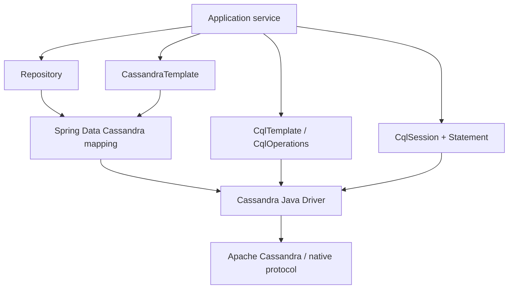

# Truy vấn bằng CQL tường minh hoặc Statement

## 1. Vị trí của CQL tường minh trong Spring Data Cassandra

**Spring Data Cassandra** cho phép truy cập Apache Cassandra qua repository, `CassandraTemplate`, `CqlTemplate` và Java Driver. Dù dùng API nào, lệnh đọc/ghi cuối cùng vẫn phải tuân thủ **Cassandra Query Language (CQL)**, đặc biệt là quy tắc partition key, clustering columns và truy vấn phân tán. Với những đường truy cập đơn giản, repository và entity mapping giúp giảm mã lặp. Khi cần kiểm soát câu CQL, kiểu dữ liệu trả về, request options hoặc thao tác đặc thù, ta có thể dùng **CQL tường minh** hoặc đối tượng **`Statement`** của Java Driver.



**Hai khái niệm phải tách bạch:**

- **CQL tường minh:** câu lệnh như `SELECT ... WHERE ...`, `INSERT`, `UPDATE`, `DELETE` được lập trình viên chỉ rõ. CQL có thể được truyền cho `CqlTemplate`, hoặc Java Driver thực thi.
- **`Statement` của Java Driver:** đối tượng Java biểu diễn một yêu cầu CQL cùng giá trị bind và các request options như page size, consistency, timeout hoặc idempotence. Các dạng phổ biến gồm `SimpleStatement`, `PreparedStatement` và `BoundStatement`.

`CqlTemplate` **không đồng nghĩa** với `CassandraTemplate`: hai lớp làm việc ở hai mức trừu tượng khác nhau. Một template mức thấp cũng không tự sửa truy vấn khi thiếu partition key.

## 2. Chuẩn bị một schema phục vụ truy vấn

Giả sử hệ thống tiếp nhận sự kiện của thiết bị. Hai API quan trọng:

1. Liệt kê 50 sự kiện mới nhất của **một thiết bị trong một ngày**.
2. Đọc các sự kiện của **một thiết bị trong một khoảng thời gian** để tiếp tục phân trang.

Schema minh họa:

```sql
-- Chỉ sử dụng cấu hình replication này cho môi trường local đơn node.
CREATE KEYSPACE IF NOT EXISTS telemetry_demo
WITH replication = {
    'class': 'SimpleStrategy',
    'replication_factor': 1
};

CREATE TABLE IF NOT EXISTS telemetry_demo.events_by_device_day (
    device_id uuid,
    day_bucket date,
    occurred_at timestamp,
    event_id uuid,
    event_type text,
    payload text,
    PRIMARY KEY ((device_id, day_bucket), occurred_at, event_id)
) WITH CLUSTERING ORDER BY (occurred_at DESC, event_id ASC);
```

Trong đó:

| Thành phần | Vai trò | Hệ quả cho câu `WHERE` |
| --- | --- | --- |
| `(device_id, day_bucket)` | **Partition key phức hợp** | Đường đọc một partition cần biết cả hai giá trị |
| `occurred_at` | Clustering column đầu tiên | Có thể chọn phạm vi thời gian bên trong partition |
| `event_id` | Clustering column thứ hai | Phân biệt sự kiện trùng timestamp |
| `event_type`, `payload` | Cột thường | Không mặc nhiên cho phép lọc hiệu quả chỉ bằng các cột này |

Một truy vấn hợp với khóa:

```sql
SELECT device_id, day_bucket, occurred_at, event_id, event_type, payload
FROM telemetry_demo.events_by_device_day
WHERE device_id = ?
  AND day_bucket = ?
  AND occurred_at >= ?
  AND occurred_at < ?
LIMIT ?;
```

Ứng dụng tính `day_bucket` từ thời gian sự kiện theo quy ước UTC; Cassandra không tự tính hoặc tự kiểm tra bucket khớp với `occurred_at`. Khi API yêu cầu nhiều ngày, service phải xác định các bucket giao với khoảng, giới hạn số partition cần đọc, ghép và phân trang kết quả.

**Không thể** chỉ đổi cú pháp từ repository sang `CqlSession` để biến `WHERE event_type = ?` thành truy vấn có phạm vi hẹp trên bảng này. Nếu lọc theo loại sự kiện là nghiệp vụ quan trọng, cần thiết kế read model/chỉ mục phù hợp và đo trên dữ liệu thật.

## 3. `CqlTemplate`: truyền CQL và ánh xạ kết quả ở mức thấp

Trong Spring Data Cassandra, `org.springframework.data.cassandra.core.cql.CqlTemplate` là một API kiểu template cho các thao tác CQL mức thấp. Nó hỗ trợ điều phối truy cập session, xử lý tài nguyên và cách lấy kết quả; **không cần entity mapping cho mọi truy vấn**.

### 3.1. Một truy vấn đơn giản với RowMapper

Ví dụ truy vấn metadata máy chủ; câu này cố định, không chứa tham số từ người dùng:

```java
import java.util.List;

import org.springframework.data.cassandra.core.cql.CqlTemplate;
import org.springframework.stereotype.Service;

@Service
public class CassandraServerInfoService {

    private final CqlTemplate cqlTemplate;

    public CassandraServerInfoService(CqlTemplate cqlTemplate) {
        this.cqlTemplate = cqlTemplate;
    }

    public List<String> releaseVersions() {
        return cqlTemplate.query(
            "SELECT release_version FROM system.local",
            (row, rowNum) -> row.getString("release_version")
        );
    }
}
```

`RowMapper` nhận một hàng do driver đọc và chuyển thành giá trị Java. Trong ví dụ, service không cần entity `@Table` cho `system.local` vì chỉ muốn đọc một cột quản trị. Trong một ứng dụng Spring Boot có auto-configuration phù hợp, `CqlTemplate` có thể được cung cấp như bean; nếu cấu hình thủ công, cần tạo một template **dựa trên `CqlSession` dùng chung**.

Khi tích hợp thật:

- Tránh đưa truy vấn metadata ra endpoint công khai không có phân quyền.
- Đừng coi giá trị trả về từ `system.local` là tổng hợp trạng thái của mọi node; nó phản ánh node mà câu truy vấn đến.
- Khi mapping nhiều cột, kiểm tra kiểu và trạng thái null của từng cột (`getUuid`, `getInstant`, `getString`, v.v.).
- Chọn cách truy xuất kết quả phù hợp: `query` có thể tập hợp hàng vào danh sách, trong khi API lớn nên có giới hạn và phân trang.

### 3.2. Vì sao không tự ghép giá trị đầu vào vào CQL?

**Không nên**:

```java
// Không dùng để truy vấn với input từ client.
String cql = "SELECT * FROM events_by_device_day WHERE device_id = "
    + deviceId + " AND day_bucket = '" + day + "'";
```

Việc ghép chuỗi có thể gây sai định dạng literal, lỗi escaping, rủi ro injection hoặc tạo quá nhiều biến thể câu truy vấn. Dùng **bind markers** với cơ chế tham số hóa mà API lựa chọn hỗ trợ; với các truy vấn lặp lại, `PreparedStatement`/`BoundStatement` của Java Driver là lựa chọn rõ ràng.

Tên **table, column, keyspace và đoạn cú pháp CQL** không thể thay bằng bind marker như giá trị. Nếu API có yêu cầu chọn trường sắp xếp hoặc bảng động, ánh xạ từ một **whitelist cố định** do ứng dụng định nghĩa, không nối trực tiếp chuỗi người dùng vào định danh CQL.

## 4. `CqlSession`: nền tảng của Java Driver

`CqlSession` thuộc Java Driver 4.x, quản lý việc khám phá topology, kết nối, cấu hình request, chuẩn bị câu lệnh và thực thi CQL. Khi dùng Spring Boot, nên inject **session được framework quản lý** thay vì tạo một session mới cho mỗi request.

```java
import com.datastax.oss.driver.api.core.CqlSession;
import org.springframework.stereotype.Repository;

@Repository
public class DeviceEventCqlAdapter {

    private final CqlSession session;

    public DeviceEventCqlAdapter(CqlSession session) {
        this.session = session;
    }

    // Các phương thức execute sẽ được triển khai ở những phần dưới.
}
```

Các kiểu `Statement` thường gặp:

| Kiểu | Dùng để làm gì? | Khi nào nên chọn? |
| --- | --- | --- |
| `SimpleStatement` | Chứa CQL và có thể chứa giá trị tham số/request options; không cần bước prepare trên server | Thao tác ít lặp, truy vấn hành chính, thử nghiệm |
| `PreparedStatement` | Đại diện cho câu CQL đã được prepare trên server/driver quản lý | Một mẫu truy vấn được gọi lặp đi lặp lại |
| `BoundStatement` | Bản đã bind giá trị cụ thể từ `PreparedStatement`; có thể mang page size, consistency, timeout | Đa số request nghiệp vụ dùng prepared CQL |
| `BatchStatement` | Gom các lệnh ghi trong một batch theo quy tắc Cassandra | Trường hợp batch phù hợp đã được đánh giá; **không** phải cách tăng tốc mặc định |

`PreparedStatement` là **mẫu câu truy vấn**, còn `BoundStatement` là **một lần sử dụng mẫu đó với giá trị cụ thể**. Không chia sẻ một đối tượng bound đã bị chỉnh sửa trạng thái giữa nhiều request; tạo một bound statement riêng cho mỗi lần gọi. Các statement của Driver 4.x được thiết kế với phong cách immutable hoặc builder; các phương thức như `setPageSize` thường trả một đối tượng statement đã được cấu hình.

## 5. `SimpleStatement`: diễn đạt CQL trực tiếp

`SimpleStatement` hữu ích khi cần gọi một câu CQL ít lặp lại. Ví dụ tra cứu một partition với các giá trị được truyền ở vị trí bind marker:

```java
import java.time.LocalDate;
import java.util.UUID;

import com.datastax.oss.driver.api.core.CqlSession;
import com.datastax.oss.driver.api.core.cql.ResultSet;
import com.datastax.oss.driver.api.core.cql.SimpleStatement;

public final class SimpleEventReader {

    private final CqlSession session;

    public SimpleEventReader(CqlSession session) {
        this.session = session;
    }

    public ResultSet queryOneDay(UUID deviceId, LocalDate day) {
        SimpleStatement statement = SimpleStatement.newInstance(
            """
            SELECT event_id, occurred_at, event_type
            FROM telemetry_demo.events_by_device_day
            WHERE device_id = ? AND day_bucket = ?
            LIMIT 50
            """,
            deviceId,
            day
        ).setPageSize(25);

        return session.execute(statement);
    }
}
```

Ở đây:

1. `SimpleStatement.newInstance` chứa CQL và giá trị tương ứng với các `?`.
2. `.setPageSize(25)` chỉ định kích thước page mục tiêu của driver; không thay `LIMIT 50`.
3. `session.execute(...)` thực hiện **lời gọi đồng bộ**. Trong luồng HTTP nhiều request, phải tính đến việc block thread và dùng cơ chế async/reactive nếu kiến trúc yêu cầu.
4. Hàm trả `ResultSet` để minh họa; code production thường nên ánh xạ kết quả sang DTO ở **tầng persistence**, không để controller tự sử dụng `Row`/`ResultSet`.

**Cảnh báo:** simple statement có bind markers không đồng nghĩa với prepared statement. Với mẫu truy vấn được gọi nhiều lần, nên chuẩn bị CQL một lần rồi tạo các `BoundStatement` để tái sử dụng cơ chế prepare và metadata kiểu tham số.

## 6. `PreparedStatement` và `BoundStatement`: lựa chọn cho query lặp lại

### 6.1. Prepare một mẫu truy vấn có đủ partition key

```java
import com.datastax.oss.driver.api.core.CqlSession;
import com.datastax.oss.driver.api.core.cql.PreparedStatement;
import org.springframework.stereotype.Repository;

@Repository
public class PreparedEventReader {

    private final CqlSession session;
    private final PreparedStatement readByTimeRange;

    public PreparedEventReader(CqlSession session) {
        this.session = session;
        this.readByTimeRange = session.prepare(
            """
            SELECT event_id, occurred_at, event_type, payload
            FROM telemetry_demo.events_by_device_day
            WHERE device_id = ?
              AND day_bucket = ?
              AND occurred_at >= ?
              AND occurred_at < ?
            LIMIT ?
            """
        );
    }

    // Phương thức đọc nằm bên dưới.
}
```

Lời gọi `session.prepare(...)` thường nên được tái sử dụng: không đặt trong vòng lặp qua từng hàng hoặc tự prepare một mẫu CQL không đổi hàng nghìn lần. Tuy nhiên, prepare ngay trong constructor nghĩa là khởi tạo bean có thể phụ thuộc Cassandra đang sẵn sàng tại thời điểm startup; với môi trường có chính sách kết nối khác, cân nhắc vòng đời và điểm khởi tạo phù hợp.

### 6.2. Bind dữ liệu và ánh xạ kết quả

Ví dụ DTO dạng `record` (Java 17+):

```java
import java.time.Instant;
import java.util.UUID;

public record DeviceEventDto(
    UUID eventId,
    Instant occurredAt,
    String eventType,
    String payload
) {
}
```

Thêm phương thức sau vào `PreparedEventReader`:

```java
import java.time.Instant;
import java.time.LocalDate;
import java.util.ArrayList;
import java.util.List;
import java.util.UUID;

import com.datastax.oss.driver.api.core.DefaultConsistencyLevel;
import com.datastax.oss.driver.api.core.cql.BoundStatement;
import com.datastax.oss.driver.api.core.cql.ResultSet;
import com.datastax.oss.driver.api.core.cql.Row;

public List<DeviceEventDto> readOneDay(
        UUID deviceId,
        LocalDate day,
        Instant fromInclusive,
        Instant toExclusive,
        int limit) {

    if (limit < 1 || limit > 200) {
        throw new IllegalArgumentException("limit phải từ 1 đến 200");
    }
    if (!fromInclusive.isBefore(toExclusive)) {
        throw new IllegalArgumentException("Khoảng thời gian không hợp lệ");
    }

    BoundStatement statement = readByTimeRange.bind(
        deviceId,
        day,
        fromInclusive,
        toExclusive,
        limit
    ).setPageSize(100)
     .setConsistencyLevel(DefaultConsistencyLevel.LOCAL_QUORUM);

    ResultSet resultSet = session.execute(statement);
    List<DeviceEventDto> result = new ArrayList<>();

    for (Row row : resultSet) {
        result.add(new DeviceEventDto(
            row.getUuid("event_id"),
            row.getInstant("occurred_at"),
            row.getString("event_type"),
            row.getString("payload")
        ));
    }
    return result;
}
```

Đoạn trên thuộc **thân lớp `PreparedEventReader`**, sử dụng hai field `session` và `readByTimeRange` đã khởi tạo ở ví dụ trước. Mặc dù câu CQL có `LIMIT`, `for (Row row : resultSet)` của **synchronous driver** có thể kích hoạt việc lấy thêm các page cho đến khi đọc hết số kết quả phù hợp; không nhầm kích thước page với số hàng cuối cùng. Với API cần trả **một trang rồi dừng**, hãy dùng quy trình cursor/paging state rõ ràng thay vì đọc hết `ResultSet` và giữ trong bộ nhớ.

Trong ví dụ chọn `LOCAL_QUORUM` để minh họa thiết lập **request-level consistency**; ứng dụng thật phải chọn consistency dựa vào replication factor và yêu cầu nhất quán/khả dụng. Không dùng giá trị này như quy tắc mặc định cho mọi trường hợp, nhất là cụm có RF và topology khác nhau.

### 6.3. Lợi ích và giới hạn của prepared statement

**Lợi ích:** câu CQL không phải nối chuỗi dữ liệu người dùng, metadata kiểu bind rõ ràng, phần chuẩn bị được driver/server quản lý và có thể tái sử dụng giữa các request.

**Giới hạn:** prepared statement **không thay thế** việc chọn partition key, không tự tạo chỉ mục và không khiến một query quét nhiều partition trở nên rẻ. Cùng một câu `SELECT ... WHERE device_id = ?` vẫn không đáp ứng đầy đủ partition key `(device_id, day_bucket)` trên bảng mẫu.

Không tạo vô số mẫu prepared CQL chỉ vì mỗi request có tên bảng, số lượng cột hay cú pháp khác nhau. Với tập query nghiệp vụ xác định, tạo số lượng mẫu có kiểm soát và quan sát tài nguyên prepare/cache trong driver/cluster.

## 7. Chọn kiểu lấy kết quả: một hàng, nhiều hàng và số lượng lớn

| Nhu cầu | Kỹ thuật thường dùng | Cần lưu ý |
| --- | --- | --- |
| Lấy một bản ghi theo khóa đầy đủ | `ResultSet.one()` hoặc repository `findById` | `one()` có thể trả `null` nếu không có hàng |
| Danh sách nhỏ, có `LIMIT` hợp lý | Duyệt `ResultSet` và map sang DTO | Không đọc nhiều cột/payload không dùng |
| Danh sách lớn | Paging với driver hoặc Spring Data `Slice` | Tránh `.all()` với dữ liệu rất lớn |
| Kết quả chỉ một cột | `CqlTemplate` + mapper/scalar query | Kiểm tra giá trị `null`, kiểu CQL |
| Cần entity mapping đầy đủ | `CassandraTemplate` hoặc repository | Tránh tự lặp lại nhiều metadata ánh xạ bằng tay |
| Dùng CQL mới hoặc tùy chọn request chi tiết | `CqlSession` + statement | Kiểm tra tương thích server/driver, timeout, consistency |

Ví dụ tra cứu một hàng bằng prepared CQL:

```java
PreparedStatement statement = session.prepare(
    """
    SELECT event_type
    FROM telemetry_demo.events_by_device_day
    WHERE device_id = ?
      AND day_bucket = ?
      AND occurred_at = ?
      AND event_id = ?
    """
);

Row row = session.execute(
    statement.bind(deviceId, day, occurredAt, eventId)
).one();

String type = row == null ? null : row.getString("event_type");
```

Đây là trường hợp **khóa đầy đủ**, xác định một hàng. Nếu API chỉ biết `eventId` mà không có `deviceId`/`day`/`occurredAt`, hãy cân nhắc bảng lookup `events_by_id` riêng. Không suy ra có thể tìm nhanh một clustering value khi chưa biết partition key.

### Không coi `SELECT *` là lựa chọn mặc định

Với CQL tường minh, nên chọn những cột thật sự cần:

```sql
SELECT event_id, occurred_at, event_type
FROM telemetry_demo.events_by_device_day
WHERE device_id = ?
  AND day_bucket = ?
LIMIT 50;
```

Nếu `payload` lớn, tránh tải nó cho một màn hình chỉ hiển thị ID và loại sự kiện. Giảm dữ liệu truyền qua mạng và chi phí mapping thường có giá trị hơn việc vi chỉnh vài dòng chuyển đổi Java.

## 8. Phân trang: `LIMIT`, page size và paging state

Đây là ba khái niệm khác nhau:

- **`LIMIT n` của CQL:** giới hạn tổng số hàng tối đa mà câu query trả về.
- **Page size của driver:** số hàng mục tiêu được lấy trong một page từ server. Khi còn kết quả, driver có thể lấy page tiếp theo.
- **Paging state:** vị trí tiếp tục của **một query và các tham số tương ứng**; không phải offset tuyệt đối hoặc số thứ tự trang.

Ví dụ, `LIMIT 200` với `.setPageSize(50)` có thể cần nhiều lần fetch để đọc đến 200 hàng. Một `ResultSet` synchronous có thể tự fetch page khi iterator tiếp tục; vì vậy muốn API mỗi lần trả 50 hàng cần chủ động kiểm soát tiêu thụ kết quả và cursor, không chỉ đặt page size.

### 8.1. Thiết kế cursor cho API

```http
GET /devices/{deviceId}/events?day=2026-11-25&limit=50&cursor=...
```

Một cursor cấp API nên:

1. Liên kết với `deviceId`, `day`, bộ lọc, chiều sắp xếp và những tham số ảnh hưởng đến query.
2. Chứa hoặc tham chiếu paging state/khóa vị trí tiếp tục theo cách **opaque**; có thể ký hoặc mã hóa token tùy yêu cầu bảo mật.
3. Có phiên bản định dạng và chính sách hết hạn để hỗ trợ triển khai/đổi schema.
4. Bị từ chối nếu người dùng thay tenant, thiết bị, điều kiện truy vấn hoặc không còn quyền đọc.
5. Được kiểm thử với ranh giới trang, trang cuối, tập dữ liệu rỗng và dữ liệu vừa được ghi/xóa.

Driver 4.x cung cấp hỗ trợ paging state và dạng **safe paging state** có cơ chế kiểm tra tính phù hợp với statement; chọn API cụ thể theo phiên bản driver, không tự giải mã/sửa nội dung token. Paging state **không phải bằng chứng phân quyền** và không bảo đảm snapshot bất biến khi có ghi đồng thời.

### 8.2. Fan-out khi đọc nhiều partition

Nếu endpoint cần 7 ngày, partition key của bảng mẫu là `(device_id, day_bucket)`, service có thể cần duyệt tới 7 partition. Cassandra không sắp xếp **toàn cục** kết quả từ nhiều truy vấn ngày thành một stream theo thời gian. Service phải:

- Xác định bucket dựa trên tham số API và giới hạn cửa sổ thời gian.
- Quyết định đọc tuần tự từ ngày mới nhất hay song song có giới hạn.
- Ghép kết quả theo `(occurred_at DESC, event_id ASC)` và xử lý trùng/rớt hàng tại ranh giới trang.
- Duy trì cursor của **nhiều query/partition** khi cần.
- Theo dõi số partition/request, số hàng đọc và p95/p99 latency.

Không kỳ vọng `CqlTemplate`, `BoundStatement` hay `LIMIT` tự giải quyết bài toán thiết kế theo truy vấn.

## 9. Thực thi câu lệnh ghi bằng CQL tường minh

### 9.1. Insert với bound parameters

```java
PreparedStatement insert = session.prepare(
    """
    INSERT INTO telemetry_demo.events_by_device_day
        (device_id, day_bucket, occurred_at,
         event_id, event_type, payload)
    VALUES (?, ?, ?, ?, ?, ?)
    """
);

session.execute(insert.bind(
    deviceId,
    day,
    Instant.parse("2026-11-25T08:15:00Z"),
    UUID.randomUUID(),
    "TEMPERATURE",
    "{\"celsius\": 26.5}"
));
```

Đây là ví dụ ghi một sự kiện với khóa đầy đủ. Cassandra sử dụng **upsert** theo primary key: hai lần ghi cùng `(device_id, day_bucket, occurred_at, event_id)` có thể cập nhật cùng một hàng; nếu `event_id` mới ở lần retry, ứng dụng có thể vô tình tạo **hai sự kiện nghiệp vụ**.

Nếu cần tránh ghi trùng do retry, service nên cấp **ID ổn định cho cùng một sự kiện** và có idempotency key hoặc cơ chế kiểm tra phù hợp. CQL `INSERT ... IF NOT EXISTS` sử dụng lightweight transaction (LWT) khi cần điều kiện “chỉ tạo nếu chưa có”, nhưng tốn chi phí hơn ghi thường.

### 9.2. Update và delete

```sql
UPDATE telemetry_demo.events_by_device_day
SET payload = ?
WHERE device_id = ?
  AND day_bucket = ?
  AND occurred_at = ?
  AND event_id = ?;

DELETE FROM telemetry_demo.events_by_device_day
WHERE device_id = ?
  AND day_bucket = ?
  AND occurred_at = ?
  AND event_id = ?;
```

Các lệnh sửa/xóa một hàng cần điều kiện khóa phù hợp. `UPDATE` **không sửa trực tiếp primary key**; chuyển một bản ghi sang bucket khác đòi hỏi ghi với khóa mới và xử lý khóa cũ. Delete/TTL có thể sinh tombstone, nên không dùng xóa hàng loạt không kiểm soát như một thao tác “rẻ”.

### 9.3. Batch không phải giao dịch quan hệ hoặc giải pháp tăng tốc mặc định

Java Driver hỗ trợ `BatchStatement` và Cassandra có cú pháp `BEGIN BATCH ... APPLY BATCH`. Batch có ngữ nghĩa và chi phí riêng; đặc biệt, **batch lớn xuyên nhiều partition** có thể đặt áp lực lên coordinator và cluster. Không dùng batch chỉ để giảm số lời gọi mạng hoặc suy ra tính ACID xuyên mọi bảng.

Nếu một sự kiện phải được ghi sang nhiều read model phi chuẩn hóa, application service cần xác định nguồn sự thật, quy tắc retry, đối soát và yêu cầu đọc-sau-ghi. `CqlTemplate.execute(...)` trên bảng A không tự đảm bảo bảng B đã được cập nhật.

## 10. Consistency, timeout, idempotence và retry

Các request options của Java Driver có thể được đặt ở cấu hình mặc định hoặc trên từng statement. Chẳng hạn:

```java
BoundStatement statement = readByTimeRange.bind(
    deviceId, day, fromInclusive, toExclusive, 50
).setPageSize(50)
 .setConsistencyLevel(DefaultConsistencyLevel.LOCAL_QUORUM);
```

Khi lựa chọn options:

| Tùy chọn | Ý nghĩa | Không nên suy diễn |
| --- | --- | --- |
| Consistency level | Số lượng/kiểu replica cần tham gia theo topology | Không tạo transaction xuyên bảng |
| Request timeout | Ngân sách chờ request phía client | Không bảo đảm server đã dừng toàn bộ xử lý |
| Page size | Lượng dữ liệu mong muốn trong một lần fetch | Không thay `LIMIT` hoặc thiết kế cursor |
| Idempotence flag | Thông tin để driver/retry policy biết thao tác có thể gửi lại an toàn hay không | Không tự biến một phép tăng counter thành idempotent |
| Retry policy | Xử lý các tình huống lỗi cụ thể | Không thể retry vô hạn hoặc suy ra timeout đồng nghĩa ghi thất bại |

Một `SELECT` bất biến có thể được retry theo chính sách phù hợp. Một `INSERT` với **primary key cố định** có thể idempotent về hình dạng hàng trong một số tình huống, nhưng vẫn phải cân nhắc TTL, timestamps, side effects và những bảng đọc khác. Counter increment, thay đổi danh sách theo hành vi không idempotent, hoặc ghi sinh ID mới mỗi lần **không an toàn khi retry mù quáng**.

`LOCAL_QUORUM` có ích với một số bài toán replication trong datacenter, nhưng không phải mức nhất quán đúng cho mọi workload. Đặc biệt, nếu cluster có nhiều DC, `local-datacenter` của driver và replication strategy của keyspace cần khớp cấu hình thực tế.

## 11. Xử lý lỗi theo tầng

| Triệu chứng | Điều cần kiểm tra | Hướng xử lý |
| --- | --- | --- |
| Không khởi tạo `CqlSession` | Contact points, DNS, port, datacenter, auth, TLS | Xác minh kết nối từ chính runtime ứng dụng |
| `InvalidQueryException` / lỗi CQL | Thiếu partition key, tên cột/bảng sai, cú pháp không hỗ trợ | Kiểm tra DDL và CQL trên phiên bản server thật |
| Lỗi bind marker hoặc codec | Số lượng/vị trí bind, kiểu Java ↔ CQL | Dùng đúng kiểu như `UUID`, `LocalDate`, `Instant`, `BigDecimal` |
| Không tìm thấy bảng/keyspace | Sai keyspace mặc định hoặc schema chưa được tạo | Quản lý DDL/migration trước khi startup |
| Query chạy nhưng trả rỗng | Sai `day_bucket`, múi giờ, dữ liệu hoặc consistency | Kiểm tra khóa và dữ liệu seed bằng CQL |
| Timeout hoặc p99 cao | Hot partition, tombstone, fan-out, payload, topology, queue | Đo đường query và số partition; không chỉ tăng timeout |
| Phân trang lặp/thiếu hàng | Paging state dùng sai query hoặc dữ liệu thay đổi | Cursor theo query, giới hạn, key order và kiểm thử cạnh tranh |
| Ghi rồi retry tạo hai sự kiện | ID mới ở mỗi lần gửi hoặc thao tác không idempotent | Sinh ID ổn định, thiết kế idempotency và retry policy |

**Không đưa stack trace chứa chi tiết kết nối, secret hoặc raw CQL với dữ liệu nhạy cảm** vào HTTP response. Tầng persistence có thể ghi thông tin kỹ thuật đã ẩn dữ liệu; service phân loại lỗi và controller trả mã lỗi phù hợp.

### Khi nào ưu tiên template thay cho driver trực tiếp?

Tránh trộn lẫn trách nhiệm:

- Chọn **repository** nếu thao tác CRUD/lookup theo khóa đơn giản, entity mapping đáp ứng yêu cầu.
- Chọn **`CassandraTemplate`** khi cần thao tác gắn với entity hoặc xây query qua API Spring Data.
- Chọn **`CqlTemplate`** khi muốn thực hiện CQL tường minh và dùng cách ánh xạ hàng/ngoại lệ theo phong cách Spring mà không cần entity đầy đủ.
- Chọn **`CqlSession` + statement** khi cần bind/prepare chi tiết, request options, async execution, paging state hoặc tính năng Java Driver không được tầng template mô tả rõ.

Đây là tiêu chí dựa trên **mức điều khiển mong muốn**, không phải xếp hạng một công cụ luôn nhanh hơn các công cụ khác. Cùng một CQL với cùng request options thường có cùng bản chất truy cập dữ liệu Cassandra.

## 12. Chiến lược kiểm thử

### 12.1. Unit test ở boundary ứng dụng

Với một adapter inject `CqlSession`/`CqlTemplate`, unit test có thể kiểm tra validation, tên query và việc chọn option. Với service nghiệp vụ, mock một **interface persistence** của ứng dụng thay vì giả lập toàn bộ Java Driver nếu điều đó làm test khó bảo trì.

Một unit test chỉ xác nhận phương thức `session.execute(...)` được gọi **không chứng minh CQL hợp lệ** hoặc đúng thứ tự clustering. Cần integration test.

### 12.2. Integration test với Cassandra thật

Một bộ kiểm thử tối thiểu:

1. Tạo keyspace/bảng trên Cassandra test instance với phiên bản phù hợp ứng dụng.
2. Insert vài sự kiện của cùng thiết bị/ngày, bao gồm hai sự kiện có cùng timestamp nhưng khác `event_id`.
3. Verify câu prepared CQL và bound values định vị đúng partition, trả đúng thứ tự `occurred_at DESC, event_id ASC`.
4. Test `LIMIT`, page size và việc đọc nhiều page. Xác nhận không lặp/thiếu hàng tại ranh giới.
5. Test trường hợp `day_bucket` sai, partition rỗng và phạm vi `[from, to)` qua 00:00 UTC.
6. Test null/missing values, sai kiểu bind, `one() == null` và chính sách ngoại lệ.
7. Test thao tác write idempotent và non-idempotent sau timeout hoặc gửi lại.
8. Test consistency/độ trễ trên cluster đại diện nếu mục tiêu là sản phẩm phân tán thật.

### 12.3. Đo hiệu năng và khả năng vận hành

Theo dõi:

| Chỉ số | Mục đích |
| --- | --- |
| p50/p95/p99 latency theo query/API | Phát hiện tail latency và truy vấn bất thường |
| Số partition/bucket cho mỗi request | Kiểm soát fan-out |
| Số hàng/byte trả về mỗi page | Phát hiện payload quá lớn |
| Số request timeout và retry | Nhận biết network/coordinator quá tải |
| Hot partitions, tombstone scans | Phát hiện vấn đề data model/retention |
| Tải replica, số kết nối, queue | Phân biệt nút thắt driver và cluster |

Việc chuyển một đoạn code từ `CqlTemplate` sang `PreparedStatement` có thể giúp tổ chức code hoặc tối ưu overhead nhất định, nhưng không chữa được vấn đề truy vấn phải đọc hàng nghìn partition. Thiết kế bảng theo truy vấn, giới hạn thời gian và kiểm soát concurrency vẫn là ưu tiên.

## 13. Bài tập thực hành

**Bài 1 — CQL tường minh:** Viết truy vấn lấy 20 sự kiện gần nhất của một thiết bị trong ngày. Giải thích vì sao phải biết cả `device_id` và `day_bucket`, và vì sao chỉ `event_type` chưa đủ cho bảng mẫu.

**Bài 2 — Simple vs Prepared:** Tạo một `SimpleStatement` cho truy vấn chạy một lần và một `PreparedStatement` tái sử dụng cho truy vấn chạy nhiều lần. Phân biệt khái niệm statement, bind markers, thời điểm prepare và cách thiết lập page size.

**Bài 3 — Mapping:** Dùng `CqlTemplate` + `RowMapper` đọc `system.local.release_version`; dùng `CqlSession` + `Row` ánh xạ sự kiện thành DTO. Tại sao hai cách không cần entity `@Table` nhưng repository thường sử dụng mapping metadata?

**Bài 4 — Paging:** Query có `LIMIT 120` và page size 30. Hãy giải thích vì sao có thể phải fetch nhiều page, và thiết kế `nextCursor` cho endpoint trả 30 hàng/lần. Nếu dữ liệu trải 7 ngày, cursor cần thêm thông tin nào?

**Bài 5 — Ghi và retry:** Một endpoint ghi sự kiện bằng `UUID.randomUUID()` mỗi lần nhận request. Client timeout rồi gửi lại. Phân tích khả năng tạo sự kiện trùng nghiệp vụ và đề xuất phương án dùng ID ổn định hoặc idempotency key.

**Bài 6 — Consistency:** Trên cluster có replication factor 3 trong DC local, hãy so sánh ảnh hưởng của `LOCAL_ONE` và `LOCAL_QUORUM` tới độ mới dữ liệu, khả năng đáp ứng khi replica lỗi và latency. Vì sao không thể dùng một consistency setting để bảo đảm hai bảng denormalized luôn đồng bộ?

### Câu hỏi tự kiểm tra

1. `CqlTemplate` khác `CassandraTemplate` ở ranh giới nào?
2. `SimpleStatement`, `PreparedStatement` và `BoundStatement` khác nhau ra sao?
3. Lúc nào nên prepare một câu CQL, và vì sao không prepare lại cho mỗi hàng?
4. Bind marker có thể thay tên bảng hoặc tên cột không?
5. Vì sao `WHERE device_id = ?` chưa đủ trên bảng có partition key `(device_id, day_bucket)`?
6. `LIMIT` và page size khác nhau thế nào?
7. Vì sao dùng `ResultSet` đồng bộ rồi duyệt toàn bộ có thể kích hoạt fetch nhiều page?
8. Paging state có phải cơ chế phân quyền hoặc snapshot bất biến không?
9. Vì sao `UPDATE`, counter hoặc một `INSERT` sinh UUID mới có thể không an toàn khi retry mù quáng?
10. Công cụ nào phù hợp hơn nếu bạn cần entity mapping đầy đủ, và công cụ nào phù hợp hơn nếu bạn cần request options chi tiết của Java Driver?

## Kết luận

**CQL tường minh** giúp kiểm soát chính xác câu lệnh gửi đến Cassandra; **`Statement` của Java Driver** đóng gói câu lệnh, bind values và request options. `CqlTemplate` là lựa chọn mức thấp theo phong cách Spring; `CassandraTemplate` và repository phù hợp hơn khi muốn tận dụng entity mapping; `CqlSession` với `PreparedStatement`/`BoundStatement` phù hợp với truy vấn lặp lại, điều khiển paging và consistency chi tiết. Nhưng tính đúng và hiệu năng vẫn bắt đầu từ **partition key, clustering columns, lựa chọn bảng theo truy vấn, giới hạn dữ liệu, xử lý retry và cursor**. Việc chuyển API truy cập dữ liệu không thay thế các quyết định thiết kế ấy.
