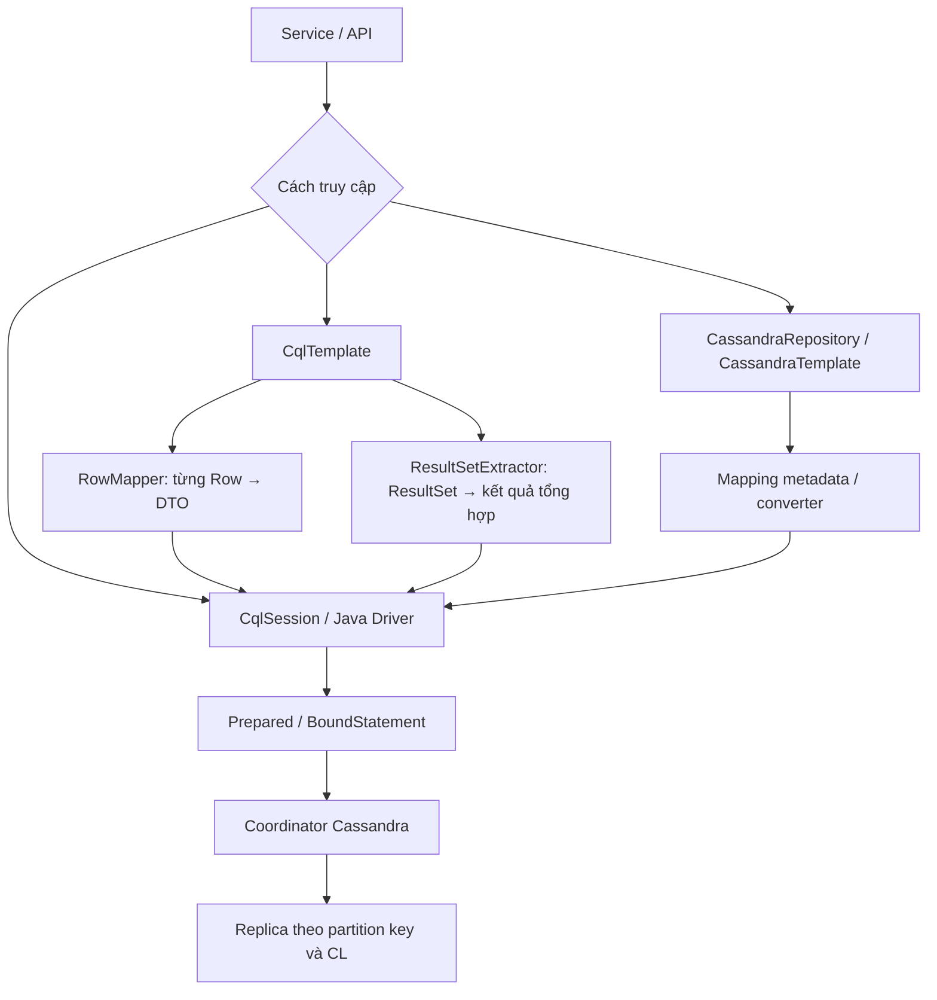
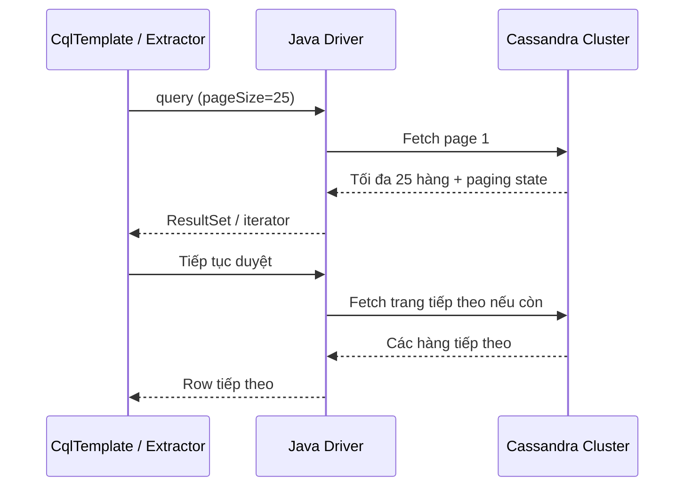

# RowMapper, ResultSetExtractor và trích xuất kết quả

## 1. Vì sao cần tự trích xuất kết quả CQL?

Với **Spring Data Cassandra**, hai cách truy cập dữ liệu thường gặp là repository và `CassandraTemplate`: chúng sử dụng metadata entity để ánh xạ các hàng Cassandra sang đối tượng Java. Tuy nhiên, có những truy vấn không phù hợp để trả về một entity đầy đủ:

- API chỉ cần ba cột của một bảng có nhiều thuộc tính.
- Một tác vụ báo cáo muốn **tính tổng, đếm và nhóm** kết quả trong phạm vi một partition.
- Một câu CQL trả về cấu trúc khác entity, ví dụ bảng tổng hợp hoặc một DTO chỉ đọc.
- Ứng dụng cần kiểm soát cách xử lý `null`, `decimal`, `timestamp`, hoặc muốn giảm chi phí khởi tạo các entity không cần thiết.

Khi đó, **`CqlTemplate`** cung cấp lớp truy cập CQL tương đối thấp của Spring Data Cassandra; **`RowMapper<T>`** và **`ResultSetExtractor<T>`** là hai chiến lược trích xuất kết quả thường dùng.

Mục tiêu bài học:

1. Phân biệt `CqlTemplate`, `CassandraTemplate` và `CqlSession` của Java Driver.
2. Dùng `RowMapper` để chuyển từng `Row` của driver thành DTO có kiểu.
3. Dùng `ResultSetExtractor` để chuyển **cả tập kết quả** thành một giá trị tổng hợp.
4. Hiểu `ResultSet` Cassandra khác với JDBC, nhất là khi kết quả được phân trang.
5. Dùng CQL có bind parameters, partition key, giới hạn kết quả và consistency level phù hợp.
6. Tránh mất dữ liệu do chuyển kiểu, tải toàn bộ kết quả vào bộ nhớ hoặc tổng hợp dữ liệu phân tán không kiểm soát.

Bài thuộc chương **CQL và CqlTemplate** của module `SPRING_DATA_CASSANDRA`. Ví dụ dùng Spring Boot 3.x, Spring Data Cassandra 4.x và Java Driver 4.x để minh họa; khi dùng phiên bản khác cần đối chiếu đúng chữ ký API đang có.

> **Ranh giới quan trọng:** `RowMapper` và `ResultSetExtractor` quyết định **Java xử lý kết quả như thế nào**. Chúng không thay đổi cách Cassandra chọn replica theo partition key, không bảo đảm một truy vấn quét nhiều partition trở nên nhanh và không thay thế thiết kế bảng theo truy vấn.

## 2. Vị trí của CqlTemplate trong kiến trúc



Các lớp có trách nhiệm khác nhau:

| Thành phần | Chức năng | Khi nào phù hợp? |
| --- | --- | --- |
| `CqlSession` | Phiên Java Driver để gửi CQL, chuẩn bị/bind statement và nhận `ResultSet`. | Cần kiểm soát driver API, execution profile, paging state hoặc truy vấn đặc thù. |
| `CqlTemplate` | Cung cấp các thao tác CQL theo phong cách template, tích hợp exception handling của Spring Data. | Viết truy vấn CQL có DTO mapping hoặc extractor riêng, không cần entity converter. |
| `RowMapper<T>` | Ánh xạ **một** `Row` thành **một** đối tượng kiểu `T`. | Danh sách DTO, projection thủ công, chuyển đổi cột có kiểm soát. |
| `ResultSetExtractor<T>` | Xử lý **một** `ResultSet` và trả về một giá trị `T` tùy ý. | Tổng hợp nhỏ có giới hạn, kiểm tra trạng thái kết quả, cấu trúc đầu ra không phải một-dòng-một-đối-tượng. |
| `CassandraTemplate` | API Spring Data có entity mapping và conversion. | `select`/`insert`/`update` theo đối tượng và metadata entity. |
| `CassandraRepository` | Abstraction repository, CRUD và các phương thức query khai báo. | Truy cập dữ liệu ứng dụng theo entity và mẫu truy vấn ổn định. |

**Đừng nhầm tên:** `CqlTemplate` trong Spring Data Cassandra sử dụng **CQL**, không phải `JdbcTemplate`. Hai thư viện có các interface trùng ý tưởng như `RowMapper` nhưng **khác package, khác kiểu `Row` và `ResultSet`**.

Các import thường gặp với Java Driver 4.x:

```java
import org.springframework.data.cassandra.core.cql.CqlTemplate;
import org.springframework.data.cassandra.core.cql.RowMapper;
import org.springframework.data.cassandra.core.cql.ResultSetExtractor;

import com.datastax.oss.driver.api.core.CqlSession;
import com.datastax.oss.driver.api.core.cql.Row;
import com.datastax.oss.driver.api.core.cql.ResultSet;
```

Không dùng `java.sql.ResultSet` hoặc `org.springframework.jdbc.core.RowMapper` trong đoạn mã Cassandra này.

## 3. Một bảng mẫu theo truy vấn

Giả sử sản phẩm cần hiển thị **các hoạt động gần nhất của một tài khoản theo ngày**, đồng thời có một màn hình thống kê nhỏ cho đúng ngày đó.

Trong một lab Cassandra một node tại data center `dc1`, tạo:

```sql
-- RF=1 chỉ dùng cho môi trường học một node.
CREATE KEYSPACE IF NOT EXISTS learning
WITH replication = {
    'class': 'NetworkTopologyStrategy',
    'dc1': 1
};

CREATE TABLE IF NOT EXISTS learning.activity_by_account_day (
    account_id uuid,
    activity_day date,
    occurred_at timestamp,
    activity_id uuid,
    activity_type text,
    amount decimal,
    description text,
    PRIMARY KEY ((account_id, activity_day), occurred_at, activity_id)
) WITH CLUSTERING ORDER BY (
    occurred_at DESC,
    activity_id ASC
);
```

Đọc hai lớp khóa:

- **Partition key:** `(account_id, activity_day)`. Hai giá trị xác định một partition để coordinator tìm replica.
- **Clustering columns:** `(occurred_at, activity_id)`. Chúng phân biệt và sắp xếp hàng **trong** partition; thời điểm mới hơn xuất hiện trước.
- **Các cột dữ liệu:** `activity_type`, `amount`, `description`. Chúng không thể thay thế partition key trong truy vấn được định tuyến hiệu quả.

Tạo vài dòng dữ liệu mẫu:

```sql
INSERT INTO learning.activity_by_account_day (
    account_id, activity_day, occurred_at, activity_id,
    activity_type, amount, description
) VALUES (
    11111111-1111-1111-1111-111111111111,
    '2026-11-25',
    '2026-11-25T08:00:00Z',
    22222222-2222-2222-2222-222222222222,
    'PURCHASE',
    125000.75,
    'Thanh toán đơn hàng'
);

INSERT INTO learning.activity_by_account_day (
    account_id, activity_day, occurred_at, activity_id,
    activity_type, description
) VALUES (
    11111111-1111-1111-1111-111111111111,
    '2026-11-25',
    '2026-11-25T07:00:00Z',
    33333333-3333-3333-3333-333333333333,
    'LOGIN',
    'Đăng nhập tài khoản'
);

INSERT INTO learning.activity_by_account_day (
    account_id, activity_day, occurred_at, activity_id,
    activity_type, amount, description
) VALUES (
    11111111-1111-1111-1111-111111111111,
    '2026-11-25',
    '2026-11-25T06:00:00Z',
    44444444-4444-4444-4444-444444444444,
    'PURCHASE',
    49999.25,
    'Mua gói dịch vụ'
);
```

Bản ghi `LOGIN` không có `amount` nên giá trị cột đó được đọc là `null`; nó **không tự động bằng 0**.

Câu truy vấn chính:

```sql
SELECT activity_id, occurred_at, activity_type, amount, description
FROM learning.activity_by_account_day
WHERE account_id = 11111111-1111-1111-1111-111111111111
  AND activity_day = '2026-11-25'
LIMIT 100;
```

Kỳ vọng có ba hàng trong một partition, theo thứ tự `08:00`, `07:00`, `06:00`. `LIMIT 100` đặt trần số hàng cho bài lab; ứng dụng vẫn phải định nghĩa số bản ghi tối đa và cách phân trang khi tải dữ liệu thực.

## 4. Khởi tạo CqlTemplate và cấu hình kết nối

Với ứng dụng **Spring Boot 3.x** có dependency `spring-boot-starter-data-cassandra`, một cấu hình cơ bản là:

```yaml
spring:
  cassandra:
    contact-points: 127.0.0.1
    port: 9042
    local-datacenter: dc1
    keyspace-name: learning
    schema-action: NONE
```

`schema-action: NONE` thể hiện ý định dùng schema đã được tạo bằng CQL hoặc migration. Tên `dc1` phải trùng data center Cassandra thực tế công bố; ứng dụng chạy trong **cùng Docker network** với service Cassandra thường phải dùng hostname của service, không dùng `127.0.0.1` trỏ về container ứng dụng.

`CqlTemplate` cần một `CqlSession` được quản lý vòng đời bởi Spring. Khi ứng dụng chưa có bean `CqlTemplate`, có thể khai báo:

```java
package com.example.activity.config;

import com.datastax.oss.driver.api.core.CqlSession;

import org.springframework.context.annotation.Bean;
import org.springframework.context.annotation.Configuration;
import org.springframework.data.cassandra.core.cql.CqlTemplate;

@Configuration
public class CqlAccessConfig {

    @Bean
    CqlTemplate cqlTemplate(CqlSession session) {
        return new CqlTemplate(session);
    }
}
```

Nếu dự án đã có bean `CqlTemplate`, **không tạo thêm một bean trùng tên/vai trò**. Điều quan trọng là dùng lại `CqlSession` của ứng dụng thay vì khởi tạo một session mới cho mỗi truy vấn. Khi lựa chọn giữa Boot auto-configuration và Java configuration như `AbstractCassandraConfiguration`, cần thống nhất **một nguồn cấu hình session**.

`CqlTemplate` chủ yếu làm việc với CQL và các kiểu của driver. Nó **không tự dựa trên `@Table`/`@PrimaryKey`** để dựng DTO như `CassandraTemplate`. Vì vậy, khi trích xuất kết quả thủ công, code phải biết chính xác tên cột CQL và kiểu Java phù hợp.

## 5. RowMapper: ánh xạ từng hàng thành một DTO

### 5.1. Hợp đồng của RowMapper

Về ý tưởng, `RowMapper<T>` có phương thức:

```java
T mapRow(Row row, int rowNum);
```

Mỗi lần được gọi, mapper nhận:

- `row`: một `com.datastax.oss.driver.api.core.cql.Row` của Cassandra Driver.
- `rowNum`: chỉ số hàng mà template đang xử lý. Đây là **thông tin trong lượt xử lý kết quả**, không phải primary key hay chỉ số lưu trữ bền vững.
- Giá trị trả về: đối tượng `T` đại diện cho hàng đó.

`RowMapper` thường nên **không giữ trạng thái biến đổi giữa các lần gọi**. Nếu code chỉ đọc cột và tạo DTO mới, nó dễ tái sử dụng, dễ kiểm thử và không phụ thuộc thứ tự gọi của các thread khác nhau.

### 5.2. DTO không phụ thuộc entity mapping

Vì truy vấn chỉ cần một số cột, dùng DTO Java 17:

```java
package com.example.activity.dto;

import java.math.BigDecimal;
import java.time.Instant;
import java.util.UUID;

public record ActivityView(
    UUID activityId,
    Instant occurredAt,
    String activityType,
    BigDecimal amount,
    String description
) {
}
```

DTO không cần `@Table`, `@PrimaryKey` hoặc các annotation mapping của Spring Data Cassandra; đây chỉ là hình dạng dữ liệu mà API cần trả về.

### 5.3. Triển khai RowMapper

```java
package com.example.activity.query;

import com.example.activity.dto.ActivityView;

import org.springframework.data.cassandra.core.cql.RowMapper;
import com.datastax.oss.driver.api.core.cql.Row;

public final class ActivityRowMapper implements RowMapper<ActivityView> {

    @Override
    public ActivityView mapRow(Row row, int rowNum) {
        return new ActivityView(
            row.getUuid("activity_id"),
            row.getInstant("occurred_at"),
            row.getString("activity_type"),
            row.isNull("amount") ? null : row.getBigDecimal("amount"),
            row.getString("description")
        );
    }
}
```

Những điểm quan trọng:

1. `getUuid` khớp CQL `uuid`; `getInstant` khớp `timestamp`; `getBigDecimal` khớp `decimal`.
2. `row.isNull("amount")` phân biệt giá trị chưa có với số tiền bằng 0. Việc API trả `null`, bỏ field hay chuyển thành 0 cần hợp đồng nghiệp vụ riêng.
3. DTO tạo mới mỗi lần; không lưu `Row` của driver vào cache hoặc trả trực tiếp cho controller.
4. Mapper chỉ đọc đúng các cột trong `SELECT`. Nếu thêm một getter cho cột chưa được chọn, driver có thể báo lỗi tìm cột trong metadata của kết quả.
5. `rowNum` không nên dùng làm ID hoặc cursor; thứ tự trong partition được định nghĩa bởi **clustering order**, còn phân trang được điều khiển bởi driver.

Nếu mỗi truy vấn đều cần mapping giống nhau, tách `ActivityRowMapper` thành một class tái sử dụng là hợp lý. Với DTO rất nhỏ, có thể dùng lambda `(row, rowNum) -> new ActivityView(...)`.

### 5.4. Dùng RowMapper với CqlTemplate

Một ví dụ truy vấn CQL **cố định để kiểm thử lab**:

```java
import java.util.List;

import org.springframework.data.cassandra.core.cql.CqlTemplate;
import com.example.activity.dto.ActivityView;

List<ActivityView> activity = cqlTemplate.query(
    "SELECT activity_id, occurred_at, activity_type, amount, description " +
    "FROM learning.activity_by_account_day " +
    "WHERE account_id = 11111111-1111-1111-1111-111111111111 " +
    "AND activity_day = '2026-11-25' LIMIT 100",
    new ActivityRowMapper()
);
```

`CqlTemplate.query(...)` ở ví dụ này thực hiện truy vấn rồi áp dụng mapper cho từng hàng, trả về một `List<ActivityView>`. Với ba bản ghi mẫu, danh sách có ba DTO; trường `amount` của hoạt động `LOGIN` là `null`.

**Đừng ghép đầu vào người dùng trực tiếp vào chuỗi CQL.** Câu truy vấn chứa UUID/ngày cố định ở đây chỉ để người học kiểm thử mapper. Ở service thực tế, hãy dùng **prepared/bound statement** như phần tiếp theo.

## 6. Truy vấn động an toàn với prepared statement

Cassandra tối ưu truy vấn khi có partition key. Với truy vấn danh sách theo ngày, hai tham số `account_id` và `activity_day` cần được bind theo kiểu, không nối chuỗi từ HTTP request.

Ví dụ repository CQL ở tầng thấp:

```java
package com.example.activity.query;

import java.time.LocalDate;
import java.util.List;
import java.util.UUID;

import com.datastax.oss.driver.api.core.CqlSession;
import com.datastax.oss.driver.api.core.cql.BoundStatement;
import com.datastax.oss.driver.api.core.cql.PreparedStatement;

import org.springframework.data.cassandra.core.cql.CqlTemplate;

import com.example.activity.dto.ActivityView;

public class ActivityCqlQueryService {

    private final CqlTemplate cqlTemplate;
    private final PreparedStatement findLatest;
    private final ActivityRowMapper rowMapper = new ActivityRowMapper();

    public ActivityCqlQueryService(
            CqlTemplate cqlTemplate, CqlSession session) {
        this.cqlTemplate = cqlTemplate;
        this.findLatest = session.prepare(
            "SELECT activity_id, occurred_at, activity_type, amount, description " +
            "FROM learning.activity_by_account_day " +
            "WHERE account_id = ? AND activity_day = ? LIMIT 100"
        );
    }

    public List<ActivityView> latest(UUID accountId, LocalDate day) {
        BoundStatement statement = findLatest.bind(accountId, day)
            .setPageSize(25);

        return cqlTemplate.query(statement, rowMapper);
    }
}
```

Trong một ứng dụng Spring, hãy đăng ký class này bằng `@Service` hoặc một `@Bean` để có constructor injection; đoạn trên tập trung vào API truy vấn.

- `PreparedStatement` có thể tái sử dụng, trong khi mỗi lần gọi `bind(...)` tạo statement chứa các giá trị của request đó.
- `LocalDate` là kiểu tương ứng với CQL `date`, `UUID` tương ứng `uuid`.
- Đủ cả hai thành phần partition key giúp Java Driver có khả năng **token-aware routing** và Cassandra chỉ cần truy cập partition đã chỉ định.
- `setPageSize(25)` là kích thước **fetch page**; `LIMIT 100` giới hạn tổng số hàng của truy vấn. Hai tham số giải quyết hai nhu cầu khác nhau.
- Đối với các phiên bản Spring Data có API template khác về overload cho `Statement<?>`, giữ nguyên nguyên tắc: bind tham số với Java Driver và dùng API `CqlTemplate` được phiên bản đó hỗ trợ; kiểm thử trong ứng dụng của bạn.

Một phương án thuần Java Driver khi cần điều khiển sâu paging state:

```java
import java.util.ArrayList;
import java.util.List;

import com.datastax.oss.driver.api.core.cql.ResultSet;
import com.datastax.oss.driver.api.core.cql.Row;

ResultSet resultSet = session.execute(findLatest.bind(accountId, day));
List<ActivityView> mapped = new ArrayList<>();
ActivityRowMapper mapper = new ActivityRowMapper();

int index = 0;
for (Row row : resultSet) {
    mapped.add(mapper.mapRow(row, index++));
}
```

Với đường thuần driver, bạn **tự chịu trách nhiệm** giới hạn dữ liệu, xử lý exceptions, mapping và cách tổ chức kết quả. Đường template giúp giảm boilerplate nhưng không thay thế cơ chế paging/thống kê của Cassandra.

## 7. ResultSetExtractor: trích xuất cả kết quả thành một đối tượng

### 7.1. Sự khác nhau về hợp đồng

`ResultSetExtractor<T>` nhận **toàn bộ `ResultSet` của một truy vấn** rồi trả về một `T`:

```java
T extractData(ResultSet resultSet);
```

Nó phù hợp khi kết quả **không** có dạng “mỗi hàng sinh một DTO”:

- Tạo một đối tượng summary gồm tổng tiền và số lượng hoạt động.
- Nhóm kết quả thành `Map<String, Long>` theo `activity_type`.
- Kiểm tra các trường metadata/trạng thái của kết quả khi API tương ứng hỗ trợ.
- Duyệt dữ liệu đã giới hạn và tạo một cấu trúc không phải `List<Row>`.

Đây là điểm khác với `RowMapper`: mapper được gọi cho **từng hàng**, còn extractor được gọi **một lần cho kết quả** và tự quyết định có duyệt các hàng hay không.

### 7.2. Định nghĩa summary DTO

```java
package com.example.activity.dto;

import java.math.BigDecimal;
import java.util.Map;

public record ActivitySummary(
    long activityCount,
    BigDecimal totalPurchaseAmount,
    long missingAmounts,
    Map<String, Long> countByType
) {
}
```

Theo dữ liệu lab, ta mong đợi:

| Trường | Giá trị |
| --- | --- |
| `activityCount` | `3` |
| `totalPurchaseAmount` | `175000.00` |
| `missingAmounts` | `1`, do hàng `LOGIN` không có `amount` |
| `countByType` | `PURCHASE: 2`, `LOGIN: 1` |

Kết quả trên có ý nghĩa vì **truy vấn được giới hạn vào một partition/ngày và tối đa 100 hàng**. Nó không phải số liệu toàn hệ thống hoặc toàn bộ lịch sử tài khoản.

### 7.3. Triển khai extractor

```java
package com.example.activity.query;

import java.math.BigDecimal;
import java.util.LinkedHashMap;
import java.util.Map;

import org.springframework.data.cassandra.core.cql.ResultSetExtractor;
import com.datastax.oss.driver.api.core.cql.ResultSet;
import com.datastax.oss.driver.api.core.cql.Row;

import com.example.activity.dto.ActivitySummary;

public final class ActivitySummaryExtractor
        implements ResultSetExtractor<ActivitySummary> {

    @Override
    public ActivitySummary extractData(ResultSet resultSet) {
        long count = 0;
        long missingAmounts = 0;
        BigDecimal totalPurchaseAmount = BigDecimal.ZERO;
        Map<String, Long> byType = new LinkedHashMap<>();

        for (Row row : resultSet) {
            count++;

            String type = row.getString("activity_type");
            byType.merge(type, 1L, Long::sum);

            if (row.isNull("amount")) {
                missingAmounts++;
                continue;
            }

            if ("PURCHASE".equals(type)) {
                BigDecimal amount = row.getBigDecimal("amount");
                totalPurchaseAmount = totalPurchaseAmount.add(amount);
            }
        }

        return new ActivitySummary(
            count,
            totalPurchaseAmount,
            missingAmounts,
            Map.copyOf(byType)
        );
    }
}
```

Những quyết định nghiệp vụ phải được nói rõ:

1. `totalPurchaseAmount` chỉ tính hàng có `activity_type = PURCHASE`; không cộng giá trị `amount` của loại khác.
2. `null` không bị mặc định là 0: code đếm riêng số hàng thiếu `amount`.
3. `BigDecimal` phù hợp CQL `decimal` để không đưa sai số nhị phân của `double` vào phép cộng tiền.
4. Extractor không gọi `resultSet.all()` để materialize toàn bộ các hàng thành `List<Row>` trước khi xử lý.
5. `Map.copyOf` tạo map không thể sửa qua API thông thường. Nếu đầu ra cần thứ tự hiển thị cố định, hãy chuẩn hóa thứ tự một cách tường minh, thay vì trông chờ iteration order của `Map.copyOf`.
6. Với kết quả **không có hàng**, hàm vẫn tạo `ActivitySummary` có count bằng 0 và tổng bằng 0. Đây là một hợp đồng có chủ đích, không phải kết luận Cassandra có bản ghi tổng bằng 0.

Nếu `activity_type` có thể là `null`, cần thiết kế cách xử lý riêng: `Map.copyOf` không cho phép key `null`, nên ở ví dụ schema nên có quy tắc nghiệp vụ bắt buộc loại hoạt động; hoặc mapper phải chuẩn hóa `null` thành một giá trị phân loại.

### 7.4. Gọi extractor qua CqlTemplate

```java
import org.springframework.data.cassandra.core.cql.ResultSetExtractor;
import com.example.activity.dto.ActivitySummary;

ResultSetExtractor<ActivitySummary> extractor =
    new ActivitySummaryExtractor();

ActivitySummary summary = cqlTemplate.query(
    "SELECT activity_type, amount " +
    "FROM learning.activity_by_account_day " +
    "WHERE account_id = 11111111-1111-1111-1111-111111111111 " +
    "AND activity_day = '2026-11-25' LIMIT 100",
    extractor
);
```

Giá trị trả về là **một `ActivitySummary`**, không phải `List<ActivitySummary>`. Với input động, dùng prepared/bound statement tương tự phần 6:

```java
PreparedStatement prepared = session.prepare(
    "SELECT activity_type, amount " +
    "FROM learning.activity_by_account_day " +
    "WHERE account_id = ? AND activity_day = ? LIMIT 100"
);

ActivitySummary summary = cqlTemplate.query(
    prepared.bind(accountId, day).setPageSize(25),
    new ActivitySummaryExtractor()
);
```

**Giới hạn quan trọng:** Nếu số hoạt động một ngày vượt `100`, summary này chỉ tổng hợp **những hàng được trả về của truy vấn có `LIMIT 100`**. Không đặt tên kết quả là “tổng doanh thu cả ngày” nếu nó không đọc đủ toàn bộ dữ liệu hoặc không có bảng tổng hợp riêng. Truy vấn CQL có `LIMIT` không tự làm phép tính tổng chính xác trên mọi partition.

## 8. So sánh RowMapper, ResultSetExtractor và RowCallbackHandler

| Tiêu chí | `RowMapper<T>` | `ResultSetExtractor<T>` | `RowCallbackHandler` |
| --- | --- | --- | --- |
| Đơn vị nhận | Một `Row` và `rowNum` | Một `ResultSet` | Một `Row` |
| Giá trị trả về từ callback | Một `T` cho mỗi hàng | Một `T` cho cả truy vấn | Không trả đối tượng cho từng hàng |
| Dạng kết quả thường gặp | `List<DTO>` | Summary/map/kết quả tổng hợp | Ghi log/đếm/xử lý từng hàng có side effect có kiểm soát |
| Ai duyệt hàng? | Template duyệt và gọi mapper | Extractor tự duyệt | Template duyệt và gọi callback |
| Rủi ro chính | Tạo danh sách quá lớn | Quét quá nhiều hàng hoặc tích lũy state quá lớn | Side effect lặp khi retry, khó xử lý transactional consistency |
| Khi dùng | Danh sách kết quả có mapping một-dòng-một-đối-tượng | Hình dạng đầu ra tùy biến, thống kê giới hạn | Xử lý từng hàng không cần danh sách |

`RowCallbackHandler` là một lựa chọn khác trong hệ CQL của Spring Data, nhưng bài này tập trung vào hai chiến lược đầu. Dù dùng callback nào, nếu query yêu cầu nhiều trang thì driver có thể phải tiếp tục fetch; không được hiểu “đọc từng hàng” là “database chỉ đọc một hàng” hay không gây áp lực mạng/CPU.

**Cách chọn nhanh:**

- API trả danh sách bản ghi: bắt đầu với `RowMapper` hoặc projection/template có entity mapping.
- API trả summary nhỏ từ một partition có giới hạn: cân nhắc `ResultSetExtractor`.
- API cần tổng hợp hàng triệu bản ghi hoặc nhiều tenant: **thiết kế lại bảng tổng hợp/pipeline xử lý**, không dùng extractor để quét toàn bộ cluster từ một request HTTP.
- API trả entity cần write-back: `CassandraTemplate`/repository có mapping rõ ràng thường dễ bảo trì hơn DTO trích xuất thủ công.

## 9. ResultSet Cassandra và paging: không giống JDBC

### 9.1. Một ResultSet có thể bao gồm nhiều lần fetch

Trong Java Driver 4.x, `ResultSet` của truy vấn đồng bộ đại diện kết quả và có thể **tự lấy thêm trang** khi bạn duyệt iterator. `setPageSize(25)` điều khiển kích thước fetch page, không có nghĩa `for (Row row : resultSet)` chỉ xử lý 25 hàng rồi dừng.



Vì vậy:

- `ResultSetExtractor` có thể tiêu thụ **toàn bộ kết quả** khi vòng `for` chạy đến hết.
- `CqlTemplate.query(..., RowMapper)` thường trả về danh sách các DTO của các hàng được duyệt; với truy vấn không giới hạn, danh sách này có thể tốn nhiều bộ nhớ.
- `ResultSet.all()` thường materialize tất cả các hàng còn lại; cần thận trọng nếu kết quả lớn.
- Truy vấn có `LIMIT 100` sẽ không trả quá 100 hàng cho lần truy vấn ấy; một request muốn đọc trang tiếp theo của **toàn bộ tập dữ liệu** phải thiết kế đúng hợp đồng paging, không chỉ đổi page size.
- Cassandra không cung cấp `OFFSET` như một cách hiệu quả để nhảy qua hàng nghìn bản ghi của một partition.
- Paging state của driver là opaque token gắn với statement/bind values; không nên tự sửa hoặc coi nó là một cursor bền vững không đổi theo thời gian.

### 9.2. Nên dùng ResultSetExtractor để tính tổng toàn partition không?

Chỉ khi partition có **giới hạn đã biết** và chi phí quét chấp nhận được. Với dữ liệu tăng theo thời gian, cách làm `SELECT ... LIMIT 100` rồi cộng kết quả thường tạo **số liệu không đầy đủ**; bỏ `LIMIT` rồi đọc hàng triệu dòng lại có nguy cơ cao về latency và tài nguyên.

Các lựa chọn thực tế hơn:

1. **Bảng tổng hợp theo truy vấn**: lưu số liệu đã tổng hợp theo tài khoản/ngày nếu nghiệp vụ yêu cầu phản hồi nhanh.
2. **Xử lý bất đồng bộ/stream**: cập nhật bảng báo cáo từ sự kiện với cơ chế idempotency và reconciliation.
3. **Cửa sổ nhỏ**: chỉ cho phép tổng hợp trong khoảng dữ liệu có giới hạn, ví dụ một vài chục hoặc vài trăm sự kiện mới nhất.
4. **Bài toán phân tích lớn**: dùng công cụ/kiến trúc analytics phù hợp thay vì truy vấn OLTP Cassandra quét toàn cluster.

Nếu sử dụng Cassandra counter cho thống kê, phải nghiên cứu semantics riêng của counter, đặc biệt việc retry và idempotency. Không tự suy luận rằng `counter` tương đương phép cộng nguyên tử có transaction đa partition kiểu RDBMS.

### 9.3. Đọc nhanh hơn không đồng nghĩa đọc đúng hơn

`RowMapper` hoặc extractor là code **chạy sau khi Cassandra đã xử lý request**. Nếu partition key không phù hợp, query chạm nhiều partition hoặc có nhiều tombstone, mapping nhanh hơn cũng không loại bỏ chi phí đọc của cluster.

Ưu tiên tối ưu theo thứ tự: **mẫu truy vấn → partition key → giới hạn/paging → consistency level → tải node → hiệu quả mapper**. Đo latency p95/p99 trước và sau thay đổi; không tối ưu số lượng cấp phát DTO trong khi bottleneck là I/O hoặc coordinator.

## 10. Kiểu dữ liệu và xử lý null

Trích xuất thủ công giúp rõ ràng về dữ liệu, nhưng cũng mang rủi ro chuyển kiểu. Bảng sau dùng Java Driver 4.x:

| Kiểu CQL | API đọc thường dùng của Row | Java |
| --- | --- | --- |
| `uuid` | `row.getUuid("activity_id")` | `UUID` |
| `text`, `varchar` | `row.getString("activity_type")` | `String` |
| `timestamp` | `row.getInstant("occurred_at")` | `Instant` |
| `date` | `row.getLocalDate("activity_day")` | `LocalDate` |
| `decimal` | `row.getBigDecimal("amount")` | `BigDecimal` |
| `int` | `row.getInt("some_count")` | `int`/`Integer` theo quy tắc null |
| `bigint` | `row.getLong("some_count")` | `long`/`Long` theo quy tắc null |

### Nguyên tắc bảo toàn ý nghĩa dữ liệu

- **`decimal` → `BigDecimal`:** tiền và các giá trị cần thập phân chính xác không nên chuyển qua `double` rồi cộng; scale và rounding phải do nghiệp vụ quy định.
- **`timestamp` → `Instant`:** giá trị Cassandra đại diện mốc thời gian, thông thường có độ chính xác tới mili giây. Zone hiển thị như `Asia/Ho_Chi_Minh` thuộc về tầng nghiệp vụ/UI, không được lưu kèm trong timestamp.
- **`date` → `LocalDate`:** ngày lịch không mang timezone. Nếu ngày là một phần của partition key, tất cả writer/reader phải thống nhất quy tắc tính ngày.
- **`null`:** dùng `row.isNull(column)` cho cột nullable, đặc biệt với getter trả primitive. Đừng biến dữ liệu vắng mặt thành 0 một cách vô thức.
- **Tên cột:** `row.getX("name")` phải khớp tên hoặc alias của cột **được chọn** trong `SELECT`, không nhất thiết khớp tên field Java camelCase.
- **Không truyền Row ra ngoài:** `Row` gắn với dữ liệu và metadata driver, không phải DTO ổn định của API. Chuyển về object Java rõ ràng tại repository/query layer.

Ví dụ với alias:

```sql
SELECT activity_id AS id,
       occurred_at AS happened_time,
       amount
FROM learning.activity_by_account_day
WHERE account_id = 11111111-1111-1111-1111-111111111111
  AND activity_day = '2026-11-25'
LIMIT 10;
```

Khi query đặt alias `id` và `happened_time`, mapper cần dùng `row.getUuid("id")` và `row.getInstant("happened_time")`; không tiếp tục truy cập tên cột gốc trên kết quả chỉ công bố alias mới.

### Khi mapping lỗi có nên trả kết quả rỗng?

Không. Nếu cột bị thiếu, kiểu dữ liệu không khớp hoặc query thay đổi schema ngoài dự kiến, việc bắt mọi exception rồi trả `List.of()` khiến API nhìn giống “không có dữ liệu”. Nó che khuất lỗi triển khai.

Nên tách:

- **Không có hàng**: kết quả hợp lệ và rỗng.
- **Có hàng nhưng giá trị nullable**: mapper áp dụng hợp đồng null.
- **Schema/codec/conversion error**: lỗi phải được ghi nhận với query fingerprint, tên bảng/cột và trace phù hợp, không log dữ liệu nhạy cảm.
- **Cassandra timeout/unavailable**: trả lỗi/fallback theo hợp đồng nghiệp vụ, không giả định cơ sở dữ liệu đang trống.

## 11. Trích xuất kết quả có điều kiện: phân biệt truy vấn đọc và LWT

Một `ResultSet` không phải lúc nào cũng là kết quả `SELECT` thông thường. Cassandra có **lightweight transaction (LWT)** cho `INSERT ... IF NOT EXISTS` hoặc `UPDATE ... IF ...`. Kết quả câu lệnh điều kiện thường có cột trạng thái `[applied]`.

Ví dụ CQL:

```sql
CREATE TABLE IF NOT EXISTS learning.request_by_id (
    request_id uuid PRIMARY KEY,
    state text
);

INSERT INTO learning.request_by_id (request_id, state)
VALUES (
    55555555-5555-5555-5555-555555555555,
    'RECEIVED'
) IF NOT EXISTS;
```

Với Java Driver 4.x, ví dụ:

```java
import java.util.UUID;

import com.datastax.oss.driver.api.core.CqlSession;
import com.datastax.oss.driver.api.core.cql.PreparedStatement;
import com.datastax.oss.driver.api.core.cql.Row;

PreparedStatement once = session.prepare(
    "INSERT INTO learning.request_by_id " +
    "(request_id, state) VALUES (?, ?) IF NOT EXISTS"
);

Row row = session.execute(
    once.bind(requestId, "RECEIVED")
).one();

boolean applied = row != null && row.getBoolean("[applied]");
```

Không dùng `RowMapper<ActivityView>` của `SELECT` để xử lý kết quả LWT: cột và semantics khác nhau. Nếu cần xử lý cả result set điều kiện, có thể tạo extractor riêng, nhưng **không suy luận thành công chỉ vì không có exception**; phải kiểm tra trạng thái `[applied]`. LWT có thêm chi phí coordination/latency và semantics riêng so với ghi thông thường.

**Lưu ý:** Kết quả khi write timeout vẫn có thể không chắc chắn đối với client; khi retry cần ID ổn định và chính sách idempotency phù hợp. `ResultSetExtractor` không giải quyết trạng thái bất định của mutation nếu coordinator hết thời gian chờ.

## 12. Lỗi thường gặp và cách chẩn đoán

| Triệu chứng | Nguyên nhân khả dĩ | Cách xử lý |
| --- | --- | --- |
| Import nhầm `RowMapper` của JDBC | `org.springframework.jdbc.core.RowMapper` dùng `java.sql.ResultSet`. | Import `org.springframework.data.cassandra.core.cql.RowMapper` và `com.datastax...Row`. |
| Mapper báo không tìm thấy cột | `SELECT` không chọn cột, alias đổi tên, schema drift. | Đối chiếu các getter với cột/alias trong truy vấn; tránh `SELECT *` nếu DTO cần schema ổn định. |
| `amount` bất ngờ thành 0 | Code gán mặc định cho `null` mà không có hợp đồng. | Dùng `isNull`, lưu ý missing amount khác số tiền 0. |
| Tiền tổng bị lệch vài chữ số | Chuyển `decimal` sang `double` và cộng xấp xỉ. | Dùng `BigDecimal`, quy tắc scale/rounding và kiểm thử. |
| Mapper đúng nhưng API chậm | Partition lớn, tombstone, truy vấn nhiều partition hoặc CL cao. | Kiểm tra query, partition key, page size/`LIMIT`, latency và metrics. |
| Extractor cho ra tổng thiếu dữ liệu | Query giới hạn `LIMIT` hoặc chỉ duyệt một trang. | Công bố phạm vi summary hoặc dùng bảng tổng hợp; kiểm thử nhiều trang. |
| Bộ nhớ tăng mạnh | `query(..., RowMapper)` trả danh sách rất lớn, hoặc extractor gọi `all()`. | Giới hạn kết quả; chia trang; tránh quét/đưa mọi hàng vào RAM. |
| `NoSuchBeanDefinitionException` cho `CqlTemplate` | Ứng dụng chưa đăng ký bean hoặc config không được scan. | Tạo bean từ `CqlSession` đang được quản lý; kiểm tra Spring context. |
| Kết quả rỗng dù có dữ liệu | Sai keyspace, partition key, DC, bound value hoặc loại thời gian/ngày. | Kiểm tra schema, hai thành phần partition key, kiểu `LocalDate`, local DC. |
| `ReadTimeout`, `Unavailable` | Không đủ phản hồi hợp lệ theo CL hoặc node/replica chậm. | Kiểm tra trạng thái cluster, RF/CL, retry và tải; không chỉ sửa mapper. |
| Query tham số bị lỗi hoặc không an toàn | Nối chuỗi đầu vào người dùng thành CQL. | Dùng prepared/bound statement, validate đầu vào, tránh ghép CQL tùy ý. |
| LWT không áp dụng nhưng không có exception | Điều kiện `IF NOT EXISTS`/`IF` không thỏa. | Đọc `[applied]`, xử lý xung đột theo nghiệp vụ. |

### Một quy trình khoanh vùng

1. **Xác nhận CQL:** cùng statement và bind values có trả hàng trong `cqlsh` hoặc Java Driver không?
2. **Xác nhận routing:** query có đủ partition key, đúng keyspace/DC và kiểu bind không?
3. **Xác nhận mapper:** các cột/alias có đủ, các getter có dùng đúng kiểu và hợp đồng null không?
4. **Xác nhận giới hạn:** `LIMIT`, page size và paging state có khiến dữ liệu trả về ít hơn nghiệp vụ yêu cầu không?
5. **Xác nhận tải:** đo latency theo query và trạng thái node/replica; tối ưu schema nếu partition quá lớn.
6. **Xác nhận semantics:** nếu là LWT, đọc `[applied]`; nếu là ghi timeout, không giả định thao tác chưa xảy ra.

## 13. Bài thực hành tổng hợp

Dùng bảng `learning.activity_by_account_day` và ba dòng mẫu từ phần 3.

### Bài 1 — RowMapper trả danh sách DTO

Viết `ActivityRowMapper` với `getUuid`, `getInstant`, `getString`, `getBigDecimal`. Dùng `CqlTemplate.query(...)` để lấy hoạt động theo account/ngày.

Kết quả mong đợi:

- Danh sách có **3 DTO**, theo `occurred_at DESC`.
- `activityType` lần lượt là `PURCHASE`, `LOGIN`, `PURCHASE`.
- Hoạt động `LOGIN` có `amount == null`; không tự điền 0 nếu API không yêu cầu.

### Bài 2 — ResultSetExtractor trả summary

Dùng `ActivitySummaryExtractor` để đếm và tổng hợp ba hàng.

Kết quả mong đợi:

- `activityCount = 3`.
- `totalPurchaseAmount` so giá trị số với `175000.00` bằng `BigDecimal.compareTo(...) == 0` (không phụ thuộc scale).
- `missingAmounts = 1`.
- `countByType` gồm `PURCHASE = 2` và `LOGIN = 1`.

Thử chuyển `LIMIT 100` thành `LIMIT 2`: summary chỉ phản ánh **hai hàng được truy vấn trả về**, không phản ánh toàn bộ partition. Đây là bằng chứng cho việc cần định nghĩa rõ phạm vi tổng hợp.

### Bài 3 — Prepared statement và paging

Thay UUID/ngày hardcoded bằng `PreparedStatement` và `bind(accountId, day)`. Thêm khoảng 60 dòng mẫu với ID riêng trong cùng partition, đặt `pageSize = 20` và `LIMIT 100`.

Xác minh:

1. Khi dùng iterator đầy đủ, các trang tiếp theo vẫn được fetch khi cần.
2. `pageSize = 20` không giới hạn cả query còn 20 hàng.
3. Nếu API chỉ muốn trả đúng 20 hàng cho một page, phải dùng cơ chế paging và contract riêng, thay vì vô tình trả danh sách 60 dòng.
4. Một query có `LIMIT 100` không thể chứng minh tổng số hoạt động vượt quá 100.

### Bài 4 — Lựa chọn API phù hợp

Với mỗi yêu cầu, chọn công cụ:

| Yêu cầu | Lựa chọn hợp lý |
| --- | --- |
| Trả 20 hoạt động mới nhất cho UI | `RowMapper` + CqlTemplate, hoặc projection/repository phù hợp |
| Trả summary từ tối đa 100 hoạt động gần nhất | `ResultSetExtractor` + giới hạn được công bố |
| Trả toàn bộ doanh thu của hàng triệu hoạt động | Bảng tổng hợp/pipeline chuyên dụng, **không** quét hết bằng extractor |
| Tạo record chỉ khi chưa tồn tại | LWT điều kiện, kiểm tra `[applied]` |
| Cập nhật entity có mapping và vòng đời rõ ràng | `CassandraTemplate`/repository theo schema và yêu cầu nghiệp vụ |

## 14. Checklist trước khi đưa vào dự án

- [ ] Đã phân biệt `RowMapper` và `ResultSetExtractor` theo hình dạng kết quả cần trả.
- [ ] Import đúng các interface Spring Data Cassandra và các kiểu `Row`/`ResultSet` của Java Driver.
- [ ] `SELECT` chỉ lấy các cột DTO cần dùng; mapper không truy cập cột hoặc alias bị thiếu.
- [ ] Bind giá trị bằng prepared/bound statement, tránh nối chuỗi input người dùng vào CQL.
- [ ] Có đủ partition key; truy vấn phù hợp clustering order và thiết kế bảng theo query pattern.
- [ ] Trường nullable được xử lý đúng; `decimal` dùng `BigDecimal`, `timestamp` dùng `Instant` khi phù hợp.
- [ ] Đã đặt giới hạn kết quả, page size và hợp đồng paging; không vô tình materialize tập rất lớn.
- [ ] Summary có định nghĩa phạm vi rõ ràng; không coi kết quả `LIMIT` là tổng toàn bộ dữ liệu.
- [ ] Không dùng CqlTemplate để che lỗi schema, replica timeout hoặc partition quá lớn.
- [ ] Có xử lý phân biệt empty result, mapping error, timeout/unavailable và conditional write không áp dụng.
- [ ] Repository/template và CQL trực tiếp không vô tình dùng keyspace, CL hoặc converter khác với dự định.
- [ ] Có integration test trên Cassandra với dữ liệu `null`, nhiều trang, dữ liệu lớn trong phạm vi kiểm soát.
- [ ] Đã đo latency, lượng dữ liệu truyền và bộ nhớ; cân nhắc bảng tổng hợp cho tác vụ báo cáo.

**Kết luận:** `RowMapper` phù hợp khi cần chuyển **mỗi hàng CQL thành một DTO**, còn `ResultSetExtractor` phù hợp khi cần chuyển **tập kết quả thành một giá trị tổng hợp hoặc cấu trúc khác**. Dù dùng cách nào, chất lượng truy vấn Spring Data Cassandra vẫn bắt đầu từ **partition key, thiết kế bảng theo truy vấn, consistency level, paging và kiểm soát hiệu năng**. Trích xuất kết quả đúng nghĩa nghiệp vụ quan trọng hơn việc chỉ biến một `ResultSet` thành object Java thành công.
