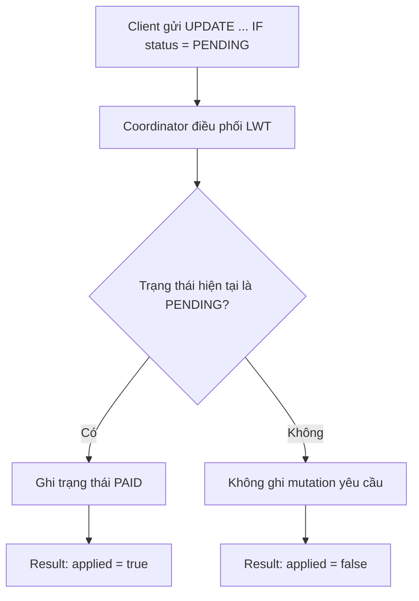
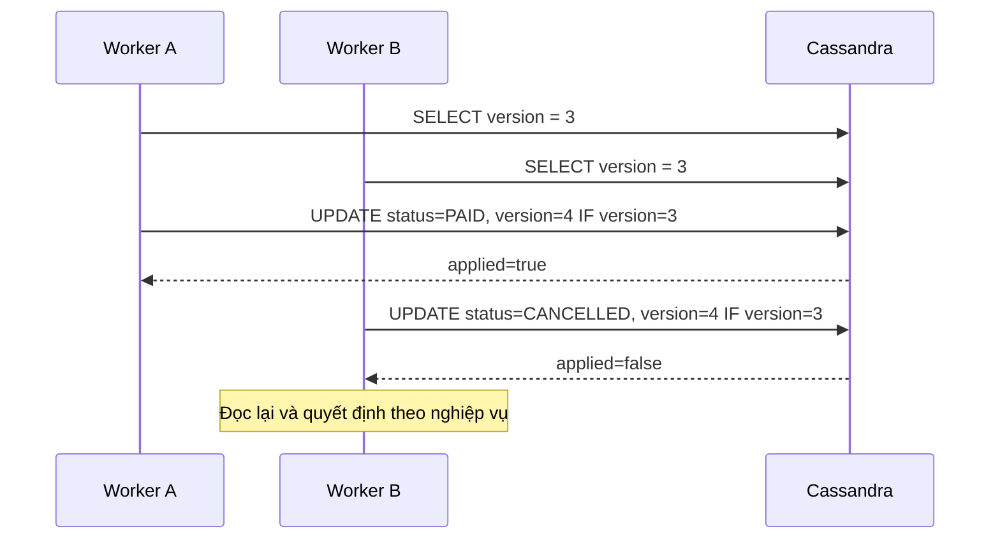
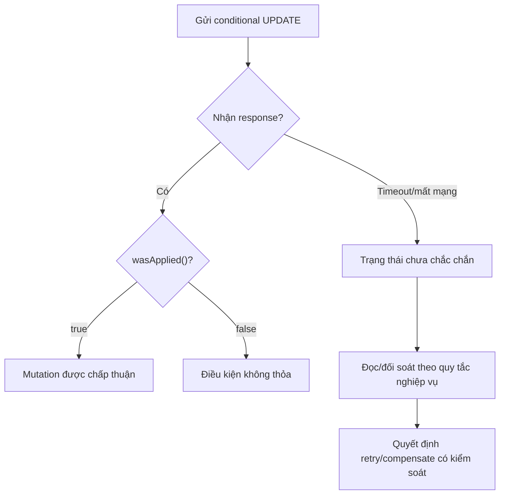

# Thực hiện câu lệnh cập nhật và đọc kết quả điều kiện bằng CqlTemplate

Khi làm việc với **Spring Data Cassandra**, một phương thức cập nhật dữ liệu có thể có hai ý nghĩa hoàn toàn khác nhau: **ghi giá trị mới theo khóa** hoặc **chỉ ghi khi dữ liệu hiện tại thỏa một điều kiện**. Trong Apache Cassandra, loại thứ hai thường dùng CQL `UPDATE ... IF ...` và cơ chế **lightweight transaction (LWT)**. Nếu không đọc kết quả điều kiện đúng cách, ứng dụng có thể báo “cập nhật thành công” trong khi Cassandra đã từ chối mutation vì trạng thái dữ liệu thay đổi.

Bài thuộc chương **CQL và CqlTemplate** của module **SPRING_DATA_CASSANDRA**. Ta sẽ đi từ cú pháp CQL đến `CqlTemplate.execute(...)`, `queryForResultSet(...)`, `ResultSet.wasApplied()`, binding tham số, xử lý tranh chấp ghi và những đánh đổi về consistency/hiệu năng. `CassandraRepository` và `CassandraTemplate` vẫn hữu ích cho entity mapping, nhưng `CqlTemplate` phù hợp khi cần kiểm soát câu CQL và kết quả điều kiện ở mức thấp hơn.

Các ví dụ dùng Java, Spring Data Cassandra theo mô hình imperative và Java driver 4.x. Hãy đối chiếu chữ ký API theo phiên bản của dự án nếu sử dụng nhánh Spring Data khác.

## 1. Phân biệt cập nhật thường với cập nhật có điều kiện

Xét hệ thống đơn hàng có trạng thái `PENDING` (chờ thanh toán), `PAID` (đã trả tiền) và `CANCELLED` (đã hủy). Bảng sau cho phép tra cứu đúng một đơn theo `order_id`:

```sql
-- Giả sử keyspace commerce đã tồn tại.
CREATE TABLE commerce.orders_by_id (
    order_id uuid PRIMARY KEY,
    status text,
    version int,
    total_amount decimal,
    updated_at timestamp
);

INSERT INTO commerce.orders_by_id (
    order_id, status, version, total_amount, updated_at
) VALUES (
    11111111-1111-1111-1111-111111111111,
    'PENDING',
    3,
    250000.00,
    '2026-11-25T09:00:00Z'
);
```

Khóa chính `order_id` cũng là **partition key đơn**, nên câu lệnh có `WHERE order_id = ...` có thể định tuyến tới các replica phù hợp.

### 1.1. UPDATE thông thường

```sql
UPDATE commerce.orders_by_id
SET status = 'PAID'
WHERE order_id = 11111111-1111-1111-1111-111111111111;
```

Đối với UPDATE thông thường:

- Cassandra ghi mutation cho khóa được chỉ định; **không bắt buộc hàng đó đã tồn tại**. UPDATE có thể tạo dữ liệu mới cho khóa chưa từng xuất hiện.
- Không có điều kiện kiểm tra trạng thái cũ. Nếu một luồng xử lý hủy đơn vừa ghi `CANCELLED`, mutation mới có thể ghi `PAID` theo quy tắc hòa giải timestamp của Cassandra.
- Kết quả không có “số hàng bị ảnh hưởng” theo kiểu `UPDATE ...` của nhiều hệ RDBMS.
- Không được kết luận “đúng một đơn hàng có sẵn đã được chuyển trạng thái” chỉ vì driver không báo lỗi.

### 1.2. UPDATE có điều kiện

```sql
UPDATE commerce.orders_by_id
SET status = 'PAID'
WHERE order_id = 11111111-1111-1111-1111-111111111111
IF status = 'PENDING';
```

Cassandra chỉ áp dụng mutation nếu **trạng thái hiện tại** thỏa `status = 'PENDING'`. CQL có `IF` thực hiện cơ chế LWT dựa trên Paxos và có chi phí cao hơn ghi thông thường.

| Trường hợp | Giá trị trước khi kiểm tra | Điều kiện `IF status = 'PENDING'` | Kết quả |
| --- | --- | --- | --- |
| Đơn chờ thanh toán | `PENDING` | Đúng | `[applied] = true`; cập nhật sang `PAID`. |
| Đơn đã hủy | `CANCELLED` | Sai | `[applied] = false`; **không áp dụng** cập nhật. |
| Đơn đã trả tiền | `PAID` | Sai | `[applied] = false`; không tự hiểu là lỗi mạng. |
| Chưa có hàng theo khóa | Không tồn tại | Điều kiện không thỏa | Thường trả `[applied] = false`; không tạo hàng bằng lệnh này. |

Điểm cần nhớ: `IF` là **điều kiện áp dụng mutation ở Cassandra**, không phải câu lệnh `if` trong Java chạy trước khi gửi CQL.



Sơ đồ minh họa quyết định điều kiện. LWT đòi hỏi nhiều bước phối hợp và các mức consistency phù hợp; không nên xem nó như một lần so sánh trong bộ nhớ của riêng coordinator.

## 2. Thực thi UPDATE bằng CqlTemplate

`CqlTemplate` thuộc package `org.springframework.data.cassandra.core.cql`. Nó cung cấp API thực thi CQL, bind tham số và chuyển đổi các lỗi driver sang hệ ngoại lệ truy cập dữ liệu của Spring. `CqlTemplate` **khác với** `CassandraTemplate`:

| API | Thường dùng cho |
| --- | --- |
| `CassandraRepository` | CRUD và truy vấn phổ biến dựa trên entity và kiểu khóa. |
| `CassandraTemplate` | Thao tác theo entity mapping, `Query`/`Criteria`, insert/update/delete có options. |
| `CqlTemplate` | Viết câu CQL cụ thể, bind tham số, đọc `ResultSet` hoặc ánh xạ hàng theo callback. |
| `CqlSession` (Java driver) | Prepared statement, serial consistency, paging state và kiểm soát statement mức thấp. |

Cả ba lớp Spring Data hoạt động trên Java driver và chịu sự điều khiển của schema/replication của Cassandra. Dùng `CqlTemplate` không tự làm truy vấn thiếu partition key trở nên hiệu quả.

### 2.1. Gọi execute với tham số bind

Một service Spring nhận bean `CqlTemplate` đã được cấu hình trong `ApplicationContext`:

```java
import java.util.UUID;
import org.springframework.data.cassandra.core.cql.CqlTemplate;
import org.springframework.stereotype.Service;

@Service
public class OrderStatusCqlService {

    private final CqlTemplate cqlTemplate;

    public OrderStatusCqlService(CqlTemplate cqlTemplate) {
        this.cqlTemplate = cqlTemplate;
    }

    public void markPaidUnconditionally(UUID orderId) {
        cqlTemplate.execute(
            "UPDATE commerce.orders_by_id " +
            "SET status = ? WHERE order_id = ?",
            "PAID", orderId
        );
    }
}
```

`?` là **bind marker** cho *giá trị*, không dùng để thay tên bảng/cột. Spring Data chuẩn bị và bind các tham số theo vị trí. Cách này giúp tránh nối trực tiếp input vào câu CQL và cho driver kiểm soát kiểu dữ liệu phù hợp.

**Không cần mở hay đóng `CqlSession` mới bên trong mỗi request.** Trong ứng dụng Spring Boot, session và template nên có vòng đời theo context.

### 2.2. Boolean từ execute có ý nghĩa gì?

Một overload của `CqlTemplate.execute(...)` trả về `boolean` biểu thị **statement có được áp dụng**. Điều này đặc biệt hữu ích với CQL điều kiện:

```java
public boolean markPaidIfPending(UUID orderId) {
    return cqlTemplate.execute(
        "UPDATE commerce.orders_by_id " +
        "SET status = ? WHERE order_id = ? IF status = ?",
        "PAID", orderId, "PENDING"
    );
}
```

Nếu method trả `true`, Cassandra đã xác nhận điều kiện áp dụng. Nếu trả `false`, điều kiện không thỏa và mutation yêu cầu không được áp dụng.

**Cảnh báo:** Với `UPDATE` **không có `IF`**, kết quả `true` về cơ bản không mang nghĩa “đã sửa một hàng có sẵn”. Driver `ResultSet.wasApplied()` cũng trả `true` cho câu lệnh **không điều kiện**, vì không có điều kiện nào để từ chối. Đừng dùng boolean đó làm phép đếm bản ghi thay đổi.

## 3. Đọc kết quả [applied] và dữ liệu hiện tại

Khi thực thi CQL có `IF`, Cassandra trả về kết quả điều kiện với cột đặc biệt `[applied]`. Kết quả thường quan sát như sau bằng `cqlsh`:

```text
-- Khi điều kiện đúng:
 [applied]
-----------
      True

-- Khi điều kiện sai:
 [applied] | status
-----------+-----------
     False | CANCELLED
```

Nếu không áp dụng, Cassandra có thể trả về **giá trị hiện tại của những cột liên quan đến điều kiện** (hoặc thông tin bổ sung tùy câu lệnh). Không mặc định mọi phiên bản và mọi kiểu `IF` đều trả toàn bộ entity. Hãy kiểm tra metadata của `ResultSet` nếu muốn đọc giá trị cụ thể.

### 3.1. Chỉ cần biết có áp dụng hay không

`CqlTemplate.execute(...)` trả `boolean` là đủ cho workflow đơn giản:

```java
import java.util.UUID;

public boolean cancelIfPending(UUID orderId) {
    return cqlTemplate.execute(
        "UPDATE commerce.orders_by_id " +
        "SET status = ? WHERE order_id = ? IF status = ?",
        "CANCELLED", orderId, "PENDING"
    );
}
```

Ứng dụng cần xử lý **hai nhánh**:

- `true`: thao tác chuyển trạng thái đã được Cassandra chấp thuận.
- `false`: trạng thái không còn như kỳ vọng; có thể trả HTTP 409 Conflict hoặc phân tích nghiệp vụ để quyết định bước tiếp theo.

Không bắt buộc ném exception khi `false`; đây thường là **kết quả nghiệp vụ hợp lệ của điều kiện không thỏa**, không phải lỗi mạng.

### 3.2. Dùng queryForResultSet khi cần thông tin chi tiết

Nếu muốn đọc `ResultSet` để quan sát cột `[applied]` và các giá trị đi kèm, `CqlTemplate` có overload `queryForResultSet(...)`:

```java
import com.datastax.oss.driver.api.core.cql.ResultSet;
import java.util.UUID;

public boolean cancelWithResultSet(UUID orderId) {
    ResultSet result = cqlTemplate.queryForResultSet(
        "UPDATE commerce.orders_by_id " +
        "SET status = ? WHERE order_id = ? IF status = ?",
        "CANCELLED", orderId, "PENDING"
    );

    return result.wasApplied();
}
```

`ResultSet.wasApplied()` là phương thức của Java driver để đọc cờ áp dụng **mà không cần tự giải mã chuỗi `"[applied]"`**. Nếu cần thông tin đối chiếu sau lần CAS thất bại:

```java
import com.datastax.oss.driver.api.core.cql.ResultSet;
import com.datastax.oss.driver.api.core.cql.Row;

ResultSet result = cqlTemplate.queryForResultSet(
    "UPDATE commerce.orders_by_id " +
    "SET status = ? WHERE order_id = ? IF status = ?",
    "PAID", orderId, "PENDING"
);

if (!result.wasApplied()) {
    Row failureRow = result.one();
    // Có thể xem các cột thực sự có trong failureRow, nếu có.
    // Không tự giả định toàn bộ OrderEntity được trả về.
}
```

Khi cần xử lý trạng thái hiện tại, nên xác định rõ contract của CQL và các cột trả về; có thể thực hiện truy vấn `SELECT` lại bằng mức consistency phù hợp nếu quy tắc nghiệp vụ yêu cầu. Việc SELECT lại sau CAS thất bại **không khóa dữ liệu**, vì một writer khác vẫn có thể tiếp tục cập nhật.

### 3.3. Vì sao không dùng update count?

Trong JDBC/SQL quan hệ, nhiều API `executeUpdate()` trả số hàng bị ảnh hưởng. Cassandra không duy trì hàng theo mô hình transaction và kiểm tra tồn tại giống RDBMS; CQL `UPDATE` không điều kiện có thể upsert. Vì thế:

- Không diễn giải `true` thành “đã update đúng 1 hàng”.
- Không diễn giải `false` thành “không tìm thấy ID” — nó có thể chỉ là trạng thái khác kỳ vọng.
- Không dùng `ResultSet` của CQL `UPDATE` để mong có một bản sao đầy đủ của đối tượng vừa ghi.

Nếu API cần phân biệt `NOT_FOUND` với `STATE_CONFLICT`, hãy thiết kế phương thức nghiệp vụ và quy trình đọc bổ sung; hiểu rõ cạnh tranh giữa việc đọc lại và những mutation khác.

## 4. So sánh ba dạng điều kiện IF

Cassandra hỗ trợ một số điều kiện hữu ích:

### 4.1. IF EXISTS — chỉ cập nhật hàng đang tồn tại

```sql
UPDATE commerce.orders_by_id
SET status = 'PAID'
WHERE order_id = 11111111-1111-1111-1111-111111111111
IF EXISTS;
```

Nếu hàng không tồn tại, `[applied] = false`. Điều này khác UPDATE thông thường có thể upsert. **IF EXISTS không kiểm tra trạng thái nghiệp vụ**: hàng đang `CANCELLED` vẫn có thể bị đổi sang `PAID` nếu câu lệnh không bổ sung điều kiện thích hợp.

### 4.2. IF status = ... — kiểm tra trạng thái kỳ vọng

```sql
UPDATE commerce.orders_by_id
SET status = 'PAID'
WHERE order_id = 11111111-1111-1111-1111-111111111111
IF status = 'PENDING';
```

Lựa chọn này phù hợp cho state machine đơn giản: chỉ cho phép chuyển trạng thái khi trạng thái trước khớp kỳ vọng. Nếu cần nhiều điều kiện, có thể sử dụng biểu thức `IF` theo cú pháp phiên bản Cassandra hỗ trợ.

### 4.3. INSERT ... IF NOT EXISTS — chỉ tạo khi chưa có khóa

```sql
INSERT INTO commerce.orders_by_id (
    order_id, status, version, total_amount
) VALUES (
    11111111-1111-1111-1111-111111111111,
    'PENDING', 1, 250000.00
) IF NOT EXISTS;
```

Đây là **conditional insert** dành cho yêu cầu tạo mới không trùng khóa. `IF NOT EXISTS` khác với `UPDATE ... IF EXISTS`; chúng biểu đạt quy tắc nghiệp vụ khác nhau. Trong cả hai trường hợp, cần đọc `[applied]`.

**Không dùng** `SELECT` để kiểm tra tồn tại rồi `INSERT`/`UPDATE` như giải pháp đảm bảo nguyên tử: giữa hai lệnh, một client khác có thể thay đổi dữ liệu.

## 5. Optimistic concurrency với cột version

Giả sử đơn hàng có `status` và `version`. Client đọc `version = 3`, sau đó muốn chuyển trạng thái và tăng version lên 4:

```sql
UPDATE commerce.orders_by_id
SET status = 'PAID',
    version = 4
WHERE order_id = 11111111-1111-1111-1111-111111111111
IF version = 3;
```

Đây là một dạng **compare-and-set (CAS)**: chỉ cập nhật khi version hiện tại vẫn là giá trị mong đợi. Với những yêu cầu đồng thời cùng dựa trên version 3, nhiều nhất một thao tác có thể thắng và chuyển version sang 4 nếu mọi writer cùng tuân theo protocol này.



Ví dụ dịch vụ:

```java
import java.util.UUID;
import org.springframework.data.cassandra.core.cql.CqlTemplate;
import org.springframework.stereotype.Service;

@Service
public class OrderVersionService {

    private final CqlTemplate cqlTemplate;

    public OrderVersionService(CqlTemplate cqlTemplate) {
        this.cqlTemplate = cqlTemplate;
    }

    public boolean changeStatus(UUID orderId,
                                String nextStatus,
                                int expectedVersion) {
        if (expectedVersion == Integer.MAX_VALUE) {
            throw new IllegalArgumentException("Version overflow");
        }

        return cqlTemplate.execute(
            "UPDATE commerce.orders_by_id " +
            "SET status = ?, version = ? " +
            "WHERE order_id = ? IF version = ?",
            nextStatus, expectedVersion + 1,
            orderId, expectedVersion
        );
    }
}
```

**Quy tắc quan trọng:**

1. Version là **giá trị nghiệp vụ**; ứng dụng phải tự tăng sau khi đã xác nhận điều kiện.
2. Không dùng `SET version = version + 1` như với counter; đây là cột `int` thông thường và Cassandra không hỗ trợ phép cộng tùy ý trên cột số thông thường.
3. Mọi writer có thể ảnh hưởng đến trạng thái cần tuân cùng một chiến lược cập nhật. Nếu có một code path `UPDATE ...` không điều kiện ghi version hoặc status, nó có thể làm hỏng tính đúng đắn của protocol.
4. Không đồng nhất LWT với transaction ACID xuyên nhiều partition. CAS tập trung vào điều kiện trên dữ liệu trong phạm vi Cassandra hỗ trợ.

### 5.1. Nên kiểm tra cả status lẫn version?

Có thể yêu cầu cả version lẫn trạng thái:

```sql
UPDATE commerce.orders_by_id
SET status = 'PAID', version = 4
WHERE order_id = 11111111-1111-1111-1111-111111111111
IF version = 3 AND status = 'PENDING';
```

Hai điều kiện thể hiện ràng buộc nghiệp vụ cụ thể: version phải đúng và trạng thái phải cho phép chuyển. Trong code, cần xử lý khi CAS trả `false`: kiểm tra lại thông tin hiện thời, trả conflict, hoặc thử lại nếu nghiệp vụ cho phép.

**Không tự động retry mọi conflict**. Ví dụ một lệnh đánh dấu trả tiền thất bại do đơn đã hủy không nên “thử lại bằng cách bỏ điều kiện”, vì như vậy vi phạm state machine.

## 6. Consistency, serial consistency và chi phí LWT

Cassandra có nhiều mức nhất quán. Với UPDATE thông thường, consistency level như `LOCAL_QUORUM` quy định số replica trong DC cục bộ cần xác nhận mutation. Với LWT, còn có **serial consistency** liên quan đến pha Paxos dùng để kiểm tra/đồng thuận về điều kiện.

| Cài đặt | Vai trò | Ví dụ |
| --- | --- | --- |
| Regular consistency | Số replica cần xác nhận ở pha đọc/ghi tương ứng của request. | `LOCAL_QUORUM` |
| Serial consistency | Mức phối hợp serial trong LWT; ảnh hưởng phạm vi điều kiện đồng thuận. | `SERIAL` hoặc `LOCAL_SERIAL` |
| Replication factor | Số bản sao của partition trên topology/keyspace. | RF = 3 tại `dc1` |
| Driver timeout | Thời hạn chờ ở client/driver. | Chính sách theo SLA của dịch vụ |

`LOCAL_SERIAL` thường là lựa chọn cân nhắc khi traffic và yêu cầu nhất quán đều đặt trong cùng DC, nhưng không nên mặc định thay cho `SERIAL` trong hệ nhiều DC nếu cần ràng buộc xuyên vùng. Phải thiết kế phạm vi consistency theo nhu cầu thực tế và topology.

Ví dụ cấu hình theo statement của **Java driver 4.x**, rồi thực thi qua `CqlTemplate`:

```java
import com.datastax.oss.driver.api.core.DefaultConsistencyLevel;
import com.datastax.oss.driver.api.core.cql.SimpleStatement;
import java.util.UUID;

UUID orderId = UUID.fromString(
    "11111111-1111-1111-1111-111111111111");

SimpleStatement conditionalUpdate = SimpleStatement.builder(
        "UPDATE commerce.orders_by_id " +
        "SET status = ? WHERE order_id = ? IF status = ?")
    .addPositionalValues("PAID", orderId, "PENDING")
    .setConsistencyLevel(DefaultConsistencyLevel.LOCAL_QUORUM)
    .setSerialConsistencyLevel(DefaultConsistencyLevel.LOCAL_SERIAL)
    .build();

boolean applied = cqlTemplate.execute(conditionalUpdate);
```

Đoạn này minh họa sự phân biệt **consistency thông thường** và **serial consistency**. Ở dự án thật, cần định nghĩa chính sách thống nhất ở tầng driver/application, tránh thay đổi rải rác từng use case mà không hiểu topology.

### Vì sao LWT tốn chi phí?

UPDATE có `IF` dùng Paxos, cần những vòng trao đổi bổ sung giữa coordinator và các replica có liên quan. So với UPDATE thông thường, LWT thường có:

- Độ trễ và lưu lượng mạng cao hơn.
- Khả năng tranh chấp khi nhiều writer cùng cố cập nhật một partition.
- Rủi ro timeout và nhầm trạng thái nếu client mất kết nối trước khi nhận phản hồi.
- Nhu cầu theo dõi tỷ lệ `applied=false`, latency CAS và conflict nghiệp vụ.

**Chỉ dùng LWT khi cần thực sự bảo đảm điều kiện cạnh tranh.** Nếu nghiệp vụ chấp nhận last-write-wins, ghi idempotent hoặc nhật ký sự kiện tách riêng, hãy cân nhắc mô hình khác. Không biến mọi UPDATE thành LWT chỉ để “an toàn hơn”.

## 7. Timeout, retry và kết quả không chắc chắn

Một trường hợp khó: client gửi `UPDATE ... IF ...`, Cassandra xử lý xong nhưng phản hồi bị mất trên mạng. Client gặp timeout.

Có hai kết luận cần phân biệt:

- `applied = false` **đã nhận được từ Cassandra**: điều kiện không thỏa, mutation không được áp dụng.
- **Timeout hoặc mất kết nối**: client **không biết chắc** điều kiện đã được áp dụng hay chưa. Không nên tự suy ra `false`.



Retry lại cùng CAS có thể trả `false` **vì lần đầu đã thành công và thay đổi trạng thái/version**. Ví dụ `IF version=3`: lần đầu thành công đưa version lên 4, lần hai thất bại vì không còn version 3. Vì vậy, “lần retry trả false” không chứng minh lần đầu chưa từng áp dụng.

Các thực hành hữu ích:

1. Đặt giới hạn retry rõ ràng; không retry vô hạn khi conflict.
2. Với thao tác có hiệu ứng ngoài Cassandra (thanh toán, gửi email), cần idempotency key hoặc protocol riêng để không thực hiện hiệu ứng hai lần.
3. Theo dõi loại lỗi: `false` do IF khác với timeout/unavailable, lỗi cú pháp hoặc thiếu quyền.
4. Khi tình trạng chưa chắc chắn, đọc lại với consistency phù hợp, đối chiếu version/status/idempotency marker trước khi quyết định.
5. Không thay đổi ý nghĩa điều kiện trong lúc retry, ví dụ bỏ `IF` chỉ để yêu cầu “chạy cho xong”.

Cassandra không tự giải quyết đồng bộ giao dịch giữa cập nhật dữ liệu và một hệ thống bên ngoài; cần thiết kế orchestration/outbox hoặc workflow chịu lỗi phù hợp.

## 8. CqlTemplate và CassandraTemplate nên dùng khi nào?

`CqlTemplate` phù hợp với câu lệnh CQL và kết quả driver. `CassandraTemplate` thuận tiện hơn khi làm việc với entity mapping:

| Tình huống | Cách tiếp cận phù hợp |
| --- | --- |
| Đọc một entity bằng full primary key | `CassandraRepository.findById` hoặc `CassandraTemplate.selectOneById`. |
| Cập nhật một số cột theo partition key và kiểm tra `IF` | `CqlTemplate.execute(...)`, hoặc `ResultSet` khi cần thông tin bổ sung. |
| Chuyển dữ liệu giữa DTO/entity và bảng | `CassandraTemplate` với metadata/converters. |
| Tùy chỉnh sâu consistency, timestamp, statement options | `CqlTemplate` dùng Statement của driver hoặc trực tiếp `CqlSession` được quản lý. |
| Truy vấn nhiều hàng trong partition, paging | Query theo partition/clustering với API paging phù hợp. |

Một service có thể dùng cả `CassandraRepository` và `CqlTemplate` nếu từng phần có lý do riêng. Nhưng không nên tạo nhiều session cho các abstraction đó. Cấu hình `spring.cassandra.local-datacenter`, credentials, TLS và keyspace phải thống nhất với schema thực tế.

## 9. Những sai lầm thường gặp khi cập nhật có điều kiện

| Sai lầm | Vì sao sai | Cách sửa |
| --- | --- | --- |
| Diễn giải `execute() == true` như “đã cập nhật 1 row” | UPDATE thường không cung cấp JDBC update count. | Chỉ dùng `applied` để đánh giá CQL điều kiện. |
| Không đọc `[applied]` sau `UPDATE ... IF` | LWT có thể từ chối mutation mà không ném lỗi. | Kiểm tra `boolean` hoặc `ResultSet.wasApplied()`. |
| Xem `applied=false` là lỗi mạng | Đây thường là điều kiện không thỏa. | Trả conflict/điều phối theo trạng thái nghiệp vụ. |
| Xem timeout như `applied=false` | Response có thể thất lạc sau khi mutation đã áp dụng. | Đối soát state và xây retry an toàn. |
| Chạy `SELECT` rồi UPDATE thường để chống tranh chấp | Hai request không nguyên tử; có race condition. | Dùng `IF` CAS/LWT khi thực sự cần. |
| Bỏ partition key khỏi `WHERE` | Cassandra không thể định vị mutation đúng cách. | Cung cấp full primary key theo yêu cầu CQL. |
| Cố thay đổi partition key trong `SET` | Primary key quyết định định danh và vị trí dữ liệu. | Ghi khóa mới và xử lý dữ liệu cũ qua workflow riêng. |
| Tăng version bằng phép cộng của cột `int` thông thường | CQL không hỗ trợ arbitrary arithmetic cho cột số thường như SQL RDBMS. | Tính version mới ở client và dùng `IF version = old`. |
| Chạy LWT cho mọi cập nhật khối lượng lớn | Paxos tăng latency và tài nguyên. | Chỉ CAS với đường nghiệp vụ cần điều kiện, đo tải. |
| Hiển thị giá trị hiện tại từ kết quả IF mà không kiểm tra cột | Kết quả trả về khác nhau tùy điều kiện/câu lệnh. | Xem metadata; SELECT lại nếu cần DTO hoàn chỉnh. |

## 10. Kiểm tra trên môi trường tích hợp

Không thể xác minh tính đúng đắn CAS bằng cách chỉ nhìn code Java. Một bài test tích hợp có thể:

1. Tạo keyspace/bảng trên Cassandra test tương thích phiên bản, với RF và topology thích hợp.
2. Ghi một đơn `PENDING, version=3`.
3. Gọi `markPaidIfPending(id)`; xác minh kết quả `true` và trạng thái chuyển thành `PAID`.
4. Gọi lại cùng điều kiện `PENDING`; xác minh kết quả `false`, không có mutation chuyển trạng thái thứ hai.
5. Tạo hai writer cùng `expectedVersion=3`, chạy đồng thời; xác minh **không có hai CAS cùng thắng** trên cùng version.
6. Mô phỏng timeout/retry hoặc disconnect; xác minh workflow đối soát không tạo hiệu ứng nghiệp vụ trùng.
7. Đo latency UPDATE thường so với LWT, tỷ lệ conflict và ảnh hưởng của consistency/serial consistency.
8. Kiểm tra quyền `MODIFY`, TLS, local datacenter, timeout và log CQL không lộ dữ liệu nhạy cảm.

Mẫu test đơn giản với `CqlTemplate` (đòi hỏi Cassandra test thật):

```java
import static org.junit.jupiter.api.Assertions.*;
import java.util.UUID;
import org.junit.jupiter.api.Test;

class OrderConditionalUpdateIT {

    private CqlTemplate cqlTemplate; // Inject từ Spring test context.

    @Test
    void onlyAppliesWhenExpectedStatusMatches() {
        UUID id = UUID.randomUUID();
        cqlTemplate.execute(
            "INSERT INTO commerce.orders_by_id (order_id, status, version) " +
            "VALUES (?, ?, ?)", id, "PENDING", 3);

        boolean first = cqlTemplate.execute(
            "UPDATE commerce.orders_by_id SET status = ? " +
            "WHERE order_id = ? IF status = ?",
            "PAID", id, "PENDING");

        boolean second = cqlTemplate.execute(
            "UPDATE commerce.orders_by_id SET status = ? " +
            "WHERE order_id = ? IF status = ?",
            "CANCELLED", id, "PENDING");

        assertTrue(first);
        assertFalse(second);
    }
}
```

Đây là **khung minh họa assertion**; để chạy thực tế phải cấu hình Spring test context, inject `CqlTemplate` và môi trường Cassandra thử nghiệm. Tên khóa mới giúp tránh phụ thuộc record của test khác. Không nên dùng `Thread.sleep` để “đoán” rằng LWT đã hoàn tất: kết quả trả về đã là tín hiệu áp dụng mutation theo consistency của request.

## 11. Bài tập tình huống

**Tình huống A — Tranh chấp thanh toán:** Hai worker cùng đọc đơn ở `PENDING`. Worker A định chuyển sang `PAID`, worker B định `CANCELLED`. Điều gì xảy ra nếu cả hai dùng UPDATE thường? Điều gì khác khi cả hai dùng `IF status = 'PENDING'`?

**Tình huống B — Đọc boolean:** Một lập trình viên dùng `boolean updated = cqlTemplate.execute("UPDATE ...")` và ghi log “đã sửa 1 row” mỗi khi `updated == true`. Giải thích vì sao log có thể sai.

**Tình huống C — CAS timeout:** Lần đầu gọi `UPDATE ... IF version = 5` bị timeout. Lần retry cùng điều kiện trả `false`, nhưng hàng hiện có `version = 6`. Có thể kết luận gì và không thể kết luận gì? Nên đối soát như thế nào?

**Tình huống D — Đọc kết quả:** Một conditional update trả `[applied] = false` kèm một vài giá trị hiện tại. Có được tự ánh xạ chúng thành `OrderEntity` đầy đủ không?

**Tình huống E — Hiệu năng:** Một bảng có hàng triệu bản ghi, hầu hết cập nhật chỉ để thay timestamp “đã xem”. Có nên chuyển toàn bộ UPDATE sang LWT không?

**Đáp án gợi ý:**

1. UPDATE thường không kiểm tra trạng thái hiện tại; kết quả phụ thuộc thứ tự/timestamp mutation. Với CAS trên cùng partition, điều kiện chỉ cho phép mutation phù hợp được áp dụng, worker còn lại nhận `false` và cần xử lý conflict.
2. `execute` không cung cấp số hàng bị ảnh hưởng; với không điều kiện, `true` không chứng minh có sẵn một hàng.
3. Không chắc lần đầu thành công hay một writer khác đã thay version; phải kiểm tra thêm trạng thái và dấu vết/idempotency của workflow, không retry mù.
4. Không. Phải kiểm tra cột thực được trả, hoặc SELECT lại một bản ghi đầy đủ.
5. Không mặc định; LWT đắt hơn. Chỉ dùng nếu yêu cầu concurrency thực sự buộc có điều kiện cập nhật.

**Ghi nhớ:** `CqlTemplate` cho phép thực thi CQL với bind parameter và quan sát kết quả điều kiện. Với `UPDATE ... IF ...`, luôn đọc `[applied]` thông qua `execute(...)` hoặc `ResultSet.wasApplied()`. Phân biệt **condition failed** với **timeout không chắc chắn**, chọn mức consistency phù hợp, dùng version/CAS khi có tranh chấp và tránh lạm dụng LWT trên đường ghi khối lượng lớn.

### Tài liệu đối chiếu

- [Spring Data Cassandra — CQL Template API](https://docs.spring.io/spring-data/cassandra/reference/cassandra/cql-template.html)
- [Spring Data Cassandra — CqlTemplate Java API](https://docs.spring.io/spring-data/cassandra/reference/api/java/org/springframework/data/cassandra/core/cql/CqlTemplate.html)
- [Apache Cassandra — CQL UPDATE và điều kiện IF](https://cassandra.apache.org/doc/stable/cassandra/developing/cql/cql_singlefile.html)
- [Java driver — ResultSet.wasApplied()](https://docs.datastax.com/en/latest-java-driver-api/com/datastax/oss/driver/api/core/cql/ResultSet.html)
