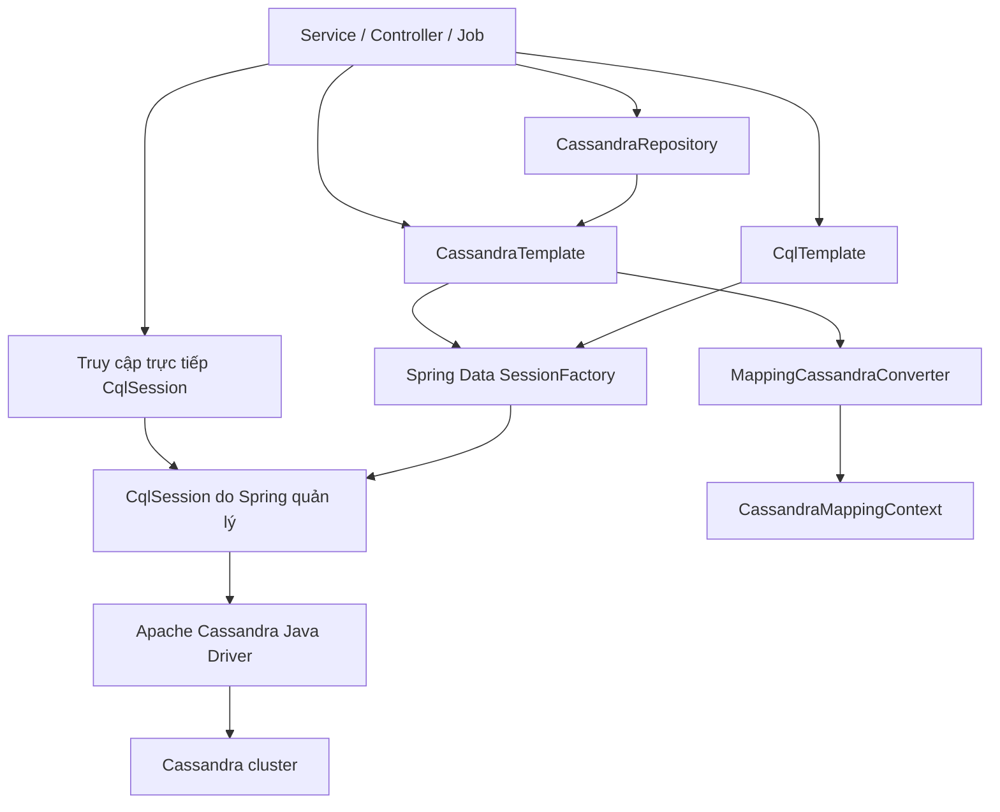
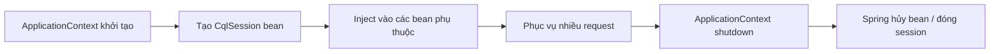

# Dùng chung CqlSession do Spring quản lý

## Mục tiêu học tập

Trong ứng dụng **Spring Data Cassandra**, `CqlSession` là đối tượng trung tâm của Apache Cassandra Java Driver để gửi câu lệnh **CQL** tới cụm. Nó không phải một kết nối TCP đơn lẻ và cũng không phải “phiên giao dịch” kiểu Hibernate. Một ứng dụng Spring Boot thông thường nên để **Spring quản lý vòng đời một `CqlSession` dùng chung**, rồi tái sử dụng nó qua `CqlTemplate`, `CassandraTemplate`, repository hoặc các service cần thao tác trực tiếp với driver.

Bài học thuộc chương **CQL và CqlTemplate** của module `SPRING_DATA_CASSANDRA`. Đây là một chủ đề nền tảng khi học entity mapping, repository, truy vấn CQL, partition key, paging, consistency và hiệu năng trên mô hình dữ liệu phân tán.

Sau bài này, bạn có thể:

- Phân biệt `CqlSession` của driver với `SessionFactory`, `CqlTemplate`, `CassandraTemplate` và repository của Spring Data.
- Giải thích lý do **không tạo hoặc đóng session mỗi khi có HTTP request**.
- Cấu hình kết nối bằng Spring Boot, inject session bằng constructor injection và tái sử dụng prepared statements.
- Nhận biết ranh giới ownership của session, cơ chế Spring đóng tài nguyên khi ứng dụng shutdown, và khi nào nên tạo cấu hình thủ công.
- Tránh những lỗi với keyspace, nhiều session, chia sẻ dữ liệu mutable, transaction, timeout và retry.
- Thiết kế kiểm thử và quan sát để xác nhận ứng dụng đang dùng cấu hình session nhất quán.

## 1. CqlSession đại diện cho điều gì?

Trong **Apache Cassandra Java Driver 4.x**, `com.datastax.oss.driver.api.core.CqlSession` đại diện cho một phiên làm việc logic với cụm Cassandra. Session cho phép ứng dụng:

- Chuẩn bị câu lệnh qua `prepare(...)`.
- Gửi truy vấn, thao tác ghi hoặc DDL qua `execute(...)`.
- Thực thi bất đồng bộ qua API như `executeAsync(...)`.
- Truy cập metadata của cụm và các khả năng khác mà driver cung cấp.

Driver quản lý các kết nối vật lý tới những node phù hợp, topology, load balancing, pooling, retry và phần lớn công việc phối hợp request. Vì vậy **một `CqlSession` không tương đương một socket mạng**.

Có thể hình dung:

```text
HTTP request A ─> Service A ─┐
HTTP request B ─> Service B ─┼──> CqlSession dùng chung
Background job ─> Worker ───┘           |
                                        v
                             Java Driver: topology,
                             connection pools, request routing
                                        |
                                        v
                              Cassandra cluster
                             /       |        \
                           Node 1  Node 2   Node 3
```

**CqlSession được thiết kế để được tái sử dụng và dùng từ nhiều luồng.** Dùng chung đúng cách tránh việc mỗi service phải tự xây dựng lại thông tin topology và các tài nguyên kết nối đến cluster.

### Một session dùng chung không có nghĩa “mọi request dùng một kết nối”

Driver có thể duy trì nhiều kết nối và gửi các request tới các node khác nhau tùy routing policy, partition key, topology và cấu hình. Mục tiêu của việc dùng chung là **chia sẻ một đối tượng điều phối và các tài nguyên driver sống lâu**, không phải buộc tất cả lưu lượng đi qua một đường truyền duy nhất.

### CqlSession không phải transaction scope

Không nên suy luận:

- Cùng một `CqlSession` thì hai câu `INSERT` vào hai partition sẽ thành một giao dịch ACID.
- Cùng session thì tất cả request sẽ nhìn thấy dữ liệu mới cùng thời điểm trên mọi replica.
- Gọi `close()` nghĩa là “commit transaction”.

Cassandra cung cấp các ngữ nghĩa consistency, conditional update/LWT và batch riêng. Việc dùng chung session **không thay thế thiết kế đường ghi, xử lý lỗi giữa chừng và idempotency**.

## 2. Bean graph: các lớp Spring Data cùng dùng tầng session

Trong ứng dụng cấu hình theo Spring Data Cassandra, đường truy cập dữ liệu có thể được mô tả khái niệm:



Sơ đồ diễn giải **trách nhiệm và quan hệ sử dụng**, không khẳng định tất cả phiên bản Spring Data đều có đúng cùng các bean trung gian hoặc constructor. Ý chính là **các API cấp cao và những service dùng driver trực tiếp đều có thể dựa trên cùng cấu hình kết nối**.

| Thành phần | Trách nhiệm | Khi nên dùng |
| --- | --- | --- |
| **`CqlSession`** | API gốc của driver để prepare/execute CQL, truy cập metadata. | Khi cần điều khiển statement hoặc driver trực tiếp. |
| **`SessionFactory`** | Abstraction Spring Data cho việc sử dụng session. | Hạ tầng để template và các thành phần Spring Data truy cập session thống nhất. |
| **`CqlTemplate`** | Thao tác CQL ở tầng Spring Data với mapping kết quả dạng thấp, chẳng hạn row mapper. | Khi CQL cần viết rõ và không cần materialize một entity đầy đủ. |
| **`CassandraTemplate`** | Thao tác với entity, mapping metadata và conversion. | CRUD/query theo các bảng và entity đã ánh xạ. |
| **`CassandraRepository`** | API repository khai báo theo domain/khóa chính. | Các đường CRUD và truy vấn được tổ chức thành interface. |

**`CqlTemplate` và `CassandraTemplate` là hai mức abstraction khác nhau.** CqlTemplate thích hợp với thao tác CQL tương đối trực tiếp; CassandraTemplate dùng metadata ánh xạ entity của Spring Data. Chúng không cần mỗi cái tự tạo một driver session riêng.

## 3. Cách mặc định: để Spring Boot tạo và quản lý CqlSession

Với Spring Boot và starter Spring Data Cassandra tương thích, ứng dụng thường chỉ cần khai báo thông số kết nối. Auto-configuration sẽ lắp ráp các thành phần phù hợp khi điều kiện cấu hình được đáp ứng.

Ví dụ `application.yml` cho môi trường phát triển:

```yaml
spring:
  cassandra:
    contact-points: 127.0.0.1
    port: 9042
    local-datacenter: datacenter1
    keyspace-name: learning_app
```

Giải thích:

| Thuộc tính | Vai trò | Lưu ý |
| --- | --- | --- |
| `contact-points` | Các địa chỉ ban đầu để driver kết nối/khám phá cụm. | Không nhất thiết phải liệt kê toàn bộ node. |
| `port` | Cổng native transport CQL. | Thường là 9042 nhưng phụ thuộc cụm. |
| `local-datacenter` | Datacenter cục bộ dùng cho chính sách định tuyến. | Phải trùng tên datacenter thực của Cassandra. |
| `keyspace-name` | Keyspace mặc định mà Spring/driver dự kiến sử dụng. | Keyspace phải tồn tại và tài khoản phải có quyền. |

Các tên property thuộc namespace `spring.cassandra.*` thường gặp ở các thế hệ Spring Boot hiện đại; với phiên bản cũ, tên thuộc tính có thể khác. **Luôn xác nhận dựa trên phiên bản Spring Boot và Spring Data Cassandra đang sử dụng**, không ghép cấu hình từ nhiều thế hệ.

Ví dụ giả định:

- Cluster Cassandra đã chạy ở `127.0.0.1:9042`.
- Datacenter có tên `datacenter1`.
- Keyspace `learning_app` đã tồn tại và người dùng ứng dụng được cấp quyền.
- Dependency starter và các thư viện driver tương thích.

Ứng dụng production thường còn cần **TLS, authentication, cấu hình driver, credential secret** và kết nối qua network được kiểm soát. Không đưa username/password thật vào ví dụ hoặc hardcode trong class Java.

### Tác dụng của auto-configuration

Khi không có yêu cầu đặc biệt, Spring có thể cung cấp bean `CqlSession` và các bean tầng dữ liệu dựa trên nó. Các service chỉ cần **inject bean được quản lý**. Nhờ đó:

1. Một nơi xác định contact points, datacenter, keyspace và chính sách driver.
2. Tài nguyên kết nối được dùng lại.
3. Các tầng Spring Data không vô tình truy cập những cụm hoặc keyspace khác nhau.
4. Container quản lý khởi tạo, dependency và shutdown.
5. Việc điều chỉnh TLS/credential/driver options không cần sửa từng repository.

Không nên tự tạo một session khác “cho chắc” nếu phần auto-configuration đã hoạt động đúng.

## 4. Constructor injection: dùng session được Spring chia sẻ

Service bên dưới dùng `CqlSession` do Spring cung cấp. Trong ví dụ, dữ liệu sự kiện được lưu theo thiết bị và ngày, phù hợp với truy vấn “lấy những sự kiện mới nhất của một thiết bị trong một ngày”.

### 4.1. Schema CQL

```sql
CREATE TABLE events_by_device_day (
    device_id uuid,
    event_day date,
    event_time timestamp,
    event_id uuid,
    event_type text,
    PRIMARY KEY ((device_id, event_day), event_time, event_id)
) WITH CLUSTERING ORDER BY (event_time DESC, event_id ASC);
```

Trong bảng:

- `(device_id, event_day)` là **partition key**.
- `event_time` và `event_id` là **clustering columns**.
- `event_type` là regular column.

Câu truy vấn cần biết cả `device_id` lẫn `event_day` để tìm một partition; sắp xếp `event_time DESC` đã được định nghĩa ở schema.

### 4.2. Dịch vụ đọc sử dụng một session dùng chung

```java
import java.time.Instant;
import java.time.LocalDate;
import java.util.ArrayList;
import java.util.List;
import java.util.UUID;

import com.datastax.oss.driver.api.core.CqlSession;
import com.datastax.oss.driver.api.core.cql.BoundStatement;
import com.datastax.oss.driver.api.core.cql.PreparedStatement;
import com.datastax.oss.driver.api.core.cql.ResultSet;
import com.datastax.oss.driver.api.core.cql.Row;
import org.springframework.stereotype.Service;

record EventView(Instant eventTime, UUID eventId, String eventType) {}

@Service
public class DeviceEventReader {

    private final CqlSession session;
    private final PreparedStatement findByDeviceAndDay;

    public DeviceEventReader(CqlSession session) {
        this.session = session; // Bean do Spring quản lý
        this.findByDeviceAndDay = session.prepare("""
            SELECT event_time, event_id, event_type
            FROM events_by_device_day
            WHERE device_id = ? AND event_day = ?
            LIMIT ?
            """);
    }

    public List<EventView> latest(
            UUID deviceId, LocalDate eventDay, int limit) {

        if (limit < 1 || limit > 100) {
            throw new IllegalArgumentException("limit must be 1..100");
        }

        BoundStatement statement = findByDeviceAndDay.bind(
                deviceId, eventDay, limit);
        ResultSet rows = session.execute(statement);

        List<EventView> result = new ArrayList<>();
        for (Row row : rows) {
            result.add(new EventView(
                    row.getInstant("event_time"),
                    row.getUuid("event_id"),
                    row.getString("event_type")));
        }
        return result;
    }
}
```

Đây là ví dụ cho Java 17+ và Java Driver 4.x, giả định keyspace mặc định đã chọn, bảng đã được tạo, và Spring thực sự cấu hình `CqlSession`. Một dự án có thể đặt `EventView` vào file riêng; việc đó không ảnh hưởng bài học về session.

Các điểm chính:

1. Constructor chỉ **nhận session**, không gọi `CqlSession.builder()`.
2. `PreparedStatement` được tạo một lần theo vòng đời bean, rồi tái sử dụng.
3. Mỗi request gọi `bind(...)` để có **`BoundStatement` riêng** với tham số của nó.
4. Mỗi câu truy vấn có đủ partition key và giới hạn `LIMIT` rõ ràng.
5. **Không có `session.close()` trong phương thức `latest(...)`.**

Lưu ý: chuẩn bị câu lệnh ngay trong constructor tạo **phụ thuộc lúc startup vào schema Cassandra**. Nếu bảng chưa tồn tại, bean có thể không khởi tạo được. Trong production, nên chạy migration và xác minh schema sẵn sàng trước khi deploy service mới; hoặc thiết kế cơ chế chuẩn bị statement phù hợp với thứ tự khởi động.

### Không tạo session mới trong từng lần gọi

Đây là **phản ví dụ**:

```java
// Không làm như thế này trong một HTTP handler:
public List<EventView> latestBad(UUID deviceId, LocalDate day) {
    try (CqlSession oneOff = CqlSession.builder()
            .withLocalDatacenter("datacenter1")
            .build()) {
        // Mỗi request tự tạo và đóng một driver session.
        // Còn dễ sai contact points, keyspace và authentication.
        return List.of();
    }
}
```

Đoạn mã minh họa **anti-pattern** và cố ý không triển khai truy vấn thật. Mỗi lần tạo session có thể phát sinh chi phí bắt tay kết nối, khám phá topology, metadata, pooling và đóng tài nguyên; đồng thời service có thể âm thầm dùng cấu hình khác những repository khác.

Ở chương trình command-line độc lập hoặc bài thử nghiệm đơn lẻ, tạo session với `try-with-resources` có thể phù hợp **nếu chương trình tự sở hữu session đó**. Quy tắc quan trọng là **ai tạo và sở hữu tài nguyên thì chịu trách nhiệm đóng nó**; trong Spring Boot điển hình, chủ sở hữu là application context.

## 5. CqlTemplate dùng chung cấu hình session như thế nào?

`CqlTemplate` cung cấp thao tác CQL ở tầng Spring Data, giúp ứng dụng làm việc với kết quả hàng và các callback/mapper mà không phải tự thực hiện mọi công việc boilerplate ở service.

Một class có thể inject `CqlTemplate` qua constructor:

```java
import java.util.List;

import org.springframework.data.cassandra.core.cql.CqlTemplate;
import org.springframework.stereotype.Repository;

@Repository
public class CassandraVersionReader {

    private final CqlTemplate cqlTemplate;

    public CassandraVersionReader(CqlTemplate cqlTemplate) {
        this.cqlTemplate = cqlTemplate;
    }

    public List<String> versionsSeenByQuery() {
        return cqlTemplate.query(
                "SELECT release_version FROM system.local",
                (row, rowNum) -> row.getString("release_version"));
    }
}
```

Ví dụ chỉ minh họa **RowMapper và việc inject template**, không phải phép kiểm tra sức khỏe toàn cụm. Bảng `system.local` mô tả thông tin cục bộ của node trả lời; muốn kiểm tra cluster health cần thêm dữ liệu topology, node status và quan sát riêng.

**Một điểm kiến trúc quan trọng:** CqlTemplate và CassandraTemplate có thể được Spring cấu hình trên nền `SessionFactory`/`CqlSession` dùng chung. Chúng không cần tự mở một kết nối mới cho mỗi câu query. Khi ứng dụng đã có các bean do auto-configuration cung cấp, hãy inject bean đó thay vì tự lắp một template gắn với một session khác.

### CqlTemplate so với CqlSession trực tiếp

| Tiêu chí | CqlTemplate | CqlSession trực tiếp |
| --- | --- | --- |
| Mức abstraction | Spring Data CQL operations. | Java Driver. |
| Nhận kết quả | Có thể dùng mapper/callback hoặc kiểu API Spring Data hỗ trợ. | Trực tiếp nhận `ResultSet`, `Row`, `AsyncResultSet`. |
| Chuyển entity | Không phải nhiệm vụ cốt lõi của CqlTemplate. | Không tự biết `@Table` hoặc `@PrimaryKey` của Spring Data. |
| Kết nối | Dùng hạ tầng session được Spring cấu hình. | Inject cùng bean `CqlSession` để dùng lại. |
| Khi phù hợp | CQL rõ ràng, ánh xạ kết quả theo hàng. | Prepared CQL, tùy chọn driver, async hoặc nhu cầu đặc thù. |

Chữ ký API và overload cụ thể phụ thuộc phiên bản Spring Data Cassandra. Trước khi đưa ví dụ vào production, hãy đối chiếu tài liệu phiên bản đang dùng, đặc biệt đối với callback, binding tham số và kiểu trả về.

## 6. CassandraTemplate và repository có cần một session khác không?

Không. Một cấu hình thông thường cho phép các tầng:

```text
Service A -> CqlTemplate ----------\
Service B -> CassandraTemplate -----+-> Hạ tầng Spring Data -> CqlSession
Service C -> CassandraRepository ---/
Service D -> CqlSession (inject trực tiếp)
```

`CassandraTemplate` dựa vào metadata ánh xạ entity (ví dụ `@Table`, `@PrimaryKey`, `@Column`) và converter của Spring Data Cassandra. Repository thường xây trên hạ tầng template để cung cấp API CRUD/query theo entity. Trong khi đó, service dùng `CqlSession` trực tiếp tự diễn đạt CQL và cách đọc `Row`.

Những thành phần này giải quyết **các mức abstraction khác nhau**, không phải **các cụm Cassandra khác nhau**. Nếu một service đọc dữ liệu trực tiếp qua driver và một service khác ghi qua repository, điều mong muốn là cả hai dùng cùng schema/keyspace và chính sách kết nối được kiểm soát.

### Dùng session chung không làm query tự “hiểu entity”

Ví dụ:

```java
// Driver thuần không đọc @Table hay @Column của entity:
ResultSet rows = session.execute(
        "SELECT event_time, event_id FROM events_by_device_day " +
        "WHERE device_id = 11111111-1111-4111-8111-111111111111 " +
        "AND event_day = '2026-11-25'");
```

Phép đọc trên nhận `ResultSet` của driver. Nếu muốn kết quả là một entity Java, bạn cần mapping thông qua tầng Spring Data hoặc tự lấy giá trị cột từ `Row`. **Cùng sử dụng một session không tự áp dụng MappingCassandraConverter cho mọi câu driver CQL.**

### Mỗi bảng vẫn phải phù hợp với truy vấn

Session chung cũng không làm truy vấn sau được hỗ trợ hiệu quả:

```sql
-- Bảng ví dụ dùng partition key (device_id, event_day).
-- Không thể tự nhiên truy vấn toàn bộ ngày chỉ bằng device_id:
-- SELECT * FROM events_by_device_day WHERE device_id = ...;
```

Điểm đúng là request nên biết cả `device_id` và `event_day`, hoặc ứng dụng cần thiết kế thêm bảng/luồng truy vấn phục vụ trường hợp tìm xuyên nhiều bucket ngày. Đây là quyết định của mô hình dữ liệu Cassandra, không phải cấu hình session.

## 7. Thread safety: chia sẻ session, không chia sẻ trạng thái request

Một `CqlSession` được thiết kế để sử dụng từ nhiều thread. Nhưng **các đối tượng chứa trạng thái cho từng request vẫn phải được quản lý đúng phạm vi**.

### 7.1. Mẫu an toàn với prepared statement

```text
Bean Service (singleton)
   |
   +--> CqlSession dùng chung       : giữ suốt vòng đời ứng dụng
   |
   +--> PreparedStatement          : có thể tái sử dụng
   |
   +--> Request A -> BoundStatement A (device A, ngày X)
   |
   +--> Request B -> BoundStatement B (device B, ngày Y)
```

`PreparedStatement` là phần định nghĩa câu truy vấn đã được prepare; mỗi lần `bind(...)` tạo statement với bộ giá trị riêng. Trong Java Driver 4.x, các statement/builder được thiết kế theo kiểu thích hợp cho việc xây dựng và sử dụng an toàn khi tránh chia sẻ trạng thái mutable không kiểm soát.

### 7.2. Anti-pattern: dùng một biến mutable chung cho tham số request

```java
// Phản ví dụ: không giữ tham số của request dưới dạng trạng thái chung.
@Service
public class BadEventReader {
    private UUID currentDeviceId;
    private LocalDate currentDay;

    public void setRequest(UUID deviceId, LocalDate day) {
        this.currentDeviceId = deviceId;
        this.currentDay = day;
    }
}
```

Nếu bean singleton phục vụ nhiều request đồng thời, request B có thể ghi đè `currentDeviceId` trước khi request A thực thi. **Vấn đề ở mutable state của service**, không phải ở `CqlSession`.

Thiết kế tốt hơn là giữ `deviceId`, `day` và `BoundStatement` trong phạm vi method:

```java
BoundStatement statement = findByDeviceAndDay.bind(
        deviceId, eventDay, limit);
ResultSet rows = session.execute(statement);
```

Không dùng một builder mutable chung rồi thay bộ tham số cho từng request nếu không có đồng bộ hóa thích hợp. Với paging state, cũng không dùng chung cursor giữa hai client hoặc hai câu query khác nhau.

## 8. Vòng đời của CqlSession: ai tạo, ai đóng?

Một bean Spring thường có vòng đời:



Điểm cần ghi nhớ:

- Bean `CqlSession` thường sống lâu cùng ứng dụng.
- Service/Repository được inject session **không sở hữu** việc đóng session đó.
- Khi Spring context dừng, tài nguyên của bean session do Spring quản lý cần được giải phóng theo lifecycle của cấu hình đang sử dụng.
- Không đóng session sau mỗi tác vụ vì các thành phần khác có thể đang dùng nó.

### Phản ví dụ: đóng bean được inject

```java
// Không làm thế này với CqlSession được Spring quản lý:
public void deleteSomething(UUID id) {
    try {
        session.execute(preparedDelete.bind(id));
    } finally {
        session.close(); // Phá hỏng những request khác dùng chung session.
    }
}
```

Sau `close()`, các thao tác gửi query qua session đó có thể thất bại; lỗi thường lan ra nhiều component, không chỉ request đang chạy.

### Khi nào try-with-resources là phù hợp?

Nếu một chương trình **tự tạo** session cho một tác vụ độc lập và **không đăng ký nó cho Spring quản lý**, `try (CqlSession session = ...)` là hợp lý vì chủ sở hữu biết chính xác thời điểm kết thúc tài nguyên.

Nhưng nếu session được Spring inject từ application context, **không bọc nó bằng try-with-resources trong service method**. Đóng tài nguyên là nhiệm vụ của container khi ứng dụng ngừng hoạt động.

## 9. Khi nào mới nên tự định nghĩa bean CqlSession?

Có những trường hợp cần cấu hình không thể diễn đạt qua properties tiêu chuẩn, ví dụ một cơ chế xác thực/TLS chuyên biệt hoặc tùy chọn driver riêng. Khi đó bạn có thể dùng extension points do Spring Boot cung cấp, hoặc khai báo bean thủ công **một cách có chủ đích**.

Ví dụ minh họa cấu hình độc lập, không dùng song song với một bean `CqlSession` auto-configured khác:

```java
import java.net.InetSocketAddress;

import com.datastax.oss.driver.api.core.CqlIdentifier;
import com.datastax.oss.driver.api.core.CqlSession;
import org.springframework.context.annotation.Bean;
import org.springframework.context.annotation.Configuration;

@Configuration
public class CustomCassandraSessionConfig {

    @Bean(destroyMethod = "close")
    public CqlSession cqlSession() {
        return CqlSession.builder()
                .addContactPoint(new InetSocketAddress("127.0.0.1", 9042))
                .withLocalDatacenter("datacenter1")
                .withKeyspace(CqlIdentifier.fromCql("learning_app"))
                .build();
    }
}
```

Ví dụ dùng để **giải thích ownership**: Spring tạo một bean và gọi thao tác đóng phù hợp khi bean bị hủy. Nó chưa bao gồm TLS/credential, retry/timeout, observability, secret management hay các yêu cầu production.

**Không sao chép nguyên cấu hình thủ công này vào một dự án đã dùng auto-configuration mà chưa kiểm tra điều kiện back-off và wiring.** Khi tự định nghĩa bean, bạn có thể làm Boot không tự tạo session như trước hoặc khiến hai cấu hình kết nối cạnh tranh nhau.

### Quy trình tùy chỉnh an toàn

1. Xác định vì sao properties không đáp ứng.
2. Kiểm tra extension points hiện có của phiên bản Spring Boot/driver; ưu tiên tùy biến builder/options mà vẫn giữ lifecycle chuẩn nếu được hỗ trợ.
3. Xác định **một bean chính** cho nhu cầu kết nối ứng dụng.
4. Đảm bảo `SessionFactory`, `CqlTemplate`, `CassandraTemplate` và repository sử dụng đúng bean đó.
5. Cấu hình shutdown phù hợp, không để session bị đóng hai lần từ nhiều chủ sở hữu độc lập.
6. Viết integration test để chứng minh truy vấn CQL đi tới đúng cluster/keyspace.

## 10. Nhiều CqlSession trong cùng ứng dụng: ngoại lệ có chủ đích

Không phải mọi ứng dụng đều chỉ có một session. Một hệ thống tích hợp **hai cụm Cassandra độc lập** hoặc hai cấu hình bảo mật khác biệt có thể cần nhiều bean.

Nhưng trường hợp này phải được **định tuyến rõ ràng**. Ví dụ về ý tưởng:

```text
Primary cluster:
  @Qualifier("primaryCqlSession") CqlSession

Analytics cluster:
  @Qualifier("analyticsCqlSession") CqlSession

Repository/template của mỗi luồng phải được wiring tới đúng hạ tầng.
```

Nếu trong context có nhiều bean cùng kiểu, injection chỉ theo type có thể mơ hồ. Có thể dùng tên bean/`@Qualifier` và cấu hình repository/template riêng theo khả năng phiên bản Spring Data đang dùng.

Không tạo một `CqlSession` riêng cho **mỗi khách hàng** chỉ vì dữ liệu multi-tenant nếu tất cả dùng chung một cluster và cùng chính sách kết nối. Số session có thể tăng tài nguyên và khó vận hành; trước hết đánh giá thiết kế tenant keyspace, bảo mật, quotas và partition key.

### Cẩn thận khi đổi keyspace theo request

`CqlSession` có keyspace mặc định và các query có thể dùng tên bảng định tính nếu phiên bản/driver hỗ trợ. Không dùng:

```sql
-- Anti-pattern trong session chia sẻ giữa nhiều request:
USE tenant_a;
-- Sau đó request khác lại thử USE tenant_b;
```

như một cơ chế chuyển tenant tùy tiện trên session dùng chung. Thay đổi trạng thái keyspace ở phạm vi session hoặc cách driver xử lý câu lệnh `USE` có thể ảnh hưởng chuẩn bị statement, metadata và an toàn khi chạy đồng thời; không được xem đây là context riêng cho từng HTTP request.

Nếu thực sự cần nhiều keyspace, hãy chọn mô hình rõ ràng: định danh bảng đầy đủ trong CQL khi thích hợp, các cấu hình session/template tách biệt có chủ đích, và quy định security/tenant isolation được kiểm thử. Đồng thời, entity mapping và repository phải khớp bảng/keyspace mà chúng sử dụng.

## 11. Session chung không có nghĩa chia sẻ transaction hay dữ liệu cache

Hai service dùng chung session:

```text
OrderService
   |-- INSERT orders_by_id
   |
   |-- INSERT orders_by_customer_month
   |
   +-- đều gọi qua cùng CqlSession
```

Vẫn phải xử lý khả năng:

- Ghi vào bảng thứ nhất thành công nhưng bảng thứ hai timeout.
- Dữ liệu ở các replica chưa được quan sát với cùng consistency.
- Retry một thao tác có thể cần kiểm tra version/logic nghiệp vụ.
- Dữ liệu denormalized giữa nhiều bảng cần đối soát.

Không tồn tại tính chất “dùng cùng session thì tất cả ghi thành một transaction có rollback”. CQL `BATCH` và LWT có ngữ nghĩa riêng, không tương đương transaction ACID nhiều bảng tùy ý của RDBMS.

Tương tự, `CqlSession` không phải cache business data do ứng dụng quản lý. Driver có thể cache metadata hoặc prepared statements, nhưng nó không phải nơi ứng dụng tùy tiện cất dữ liệu người dùng rồi kỳ vọng consistency tự được duy trì.

## 12. Consistency, timeout, paging và prepared statements

### 12.1. Consistency level thuộc về thao tác dữ liệu

Cassandra có các consistency level như `ONE`, `LOCAL_QUORUM` và những mức khác. Lựa chọn phụ thuộc replication, topology, độ trễ và nhu cầu nhất quán của nghiệp vụ.

Một session có thể có cấu hình mặc định cho các statement, và các tùy chọn có thể được đặt trên từng statement theo khả năng của driver.

Ví dụ dùng statement riêng:

```java
import com.datastax.oss.driver.api.core.DefaultConsistencyLevel;

BoundStatement statement = findByDeviceAndDay
        .bind(deviceId, eventDay, 20)
        .setConsistencyLevel(DefaultConsistencyLevel.LOCAL_QUORUM);

ResultSet rows = session.execute(statement);
```

Đây là cách minh họa cấu hình **trên request CQL**, không phải thay đổi cấu hình của session dùng chung cho tất cả service. Khi sử dụng `LOCAL_QUORUM`, cluster và replication trong datacenter cần được thiết kế tương thích.

**Không có “consistency mạnh tuyệt đối” chỉ vì mọi query đi qua một `CqlSession`.** Mức nhất quán là đặc điểm của thao tác cùng cách bố trí replica và các ghi cạnh tranh.

### 12.2. Timeout và retry

Driver có timeout, chính sách retry và khả năng đánh dấu idempotence cho statement. Trong service production:

1. Xác định timeout hợp lý với SLA.
2. Giới hạn số lần thử lại.
3. Chỉ retry an toàn khi hiểu ngữ nghĩa thao tác.
4. Theo dõi các request timeout và trường hợp thao tác có thể đã được server xử lý dù client không nhận phản hồi.
5. Không tạo session mới mỗi khi timeout, vì có thể tăng tải và làm gián đoạn các request khác.

Đặc biệt, thao tác counter hoặc workflow gồm nhiều bước có thể **không idempotent**; retry tự động không được áp dụng mù quáng.

### 12.3. Paging

Driver hỗ trợ **paging** trên kết quả truy vấn. Khi đọc dữ liệu lớn:

- Đặt giới hạn kết quả và page size phù hợp.
- Xử lý paging state nếu cần cursor cho UI.
- Không giả định Cassandra có `OFFSET` hiệu quả để nhảy trực tiếp tới một trang sâu.
- Không truyền paging state của query A sang query B hoặc của tenant khác.

Nếu bảng được bucket theo ngày, một paging state cho `(device_id, event_day)` **không tự chuyển sang ngày khác**. Session dùng chung không thay đổi quy tắc đó.

### 12.4. Chuẩn bị query một lần, bind nhiều lần

Trong hot path:

```text
Startup hoặc bước khởi tạo hợp lệ:
  CqlSession.prepare(CQL có marker ?)
                |
                v
        PreparedStatement (tái sử dụng)
                |
     +----------+----------+
     |                     |
Request A               Request B
  bind(A)                 bind(B)
     |                     |
  execute(A)             execute(B)
```

Việc này tách **cấu trúc query** khỏi **tham số mỗi request**, giảm lặp lại các bước không cần thiết và giúp driver sử dụng prepared statements đúng mục đích.

**Điều kiện:** schema CQL cần tồn tại trước lúc prepare; sau thay đổi schema, cần hiểu cơ chế cập nhật metadata/reprepare của driver. Không xử lý lỗi prepare bằng cách liên tục tạo session mới.

## 13. Readiness: ứng dụng khởi động chưa chắc Cassandra đã sẵn sàng

Ứng dụng có thể tạo được bean nhưng chưa thực thi thành công query nghiệp vụ nếu:

- Contact point có thể tiếp nhận kết nối nhưng keyspace chưa được tạo.
- Tài khoản không có quyền vào bảng.
- Schema migration chưa hoàn tất hoặc các node chưa đạt schema agreement.
- Driver đang làm mới metadata sau DDL.
- Chỉ một số node/replica đang hoạt động, gây lỗi ở consistency level đã chọn.

Do đó cần phân biệt:

| Tín hiệu | Nó chứng minh điều gì | Điều chưa chứng minh |
| --- | --- | --- |
| `CqlSession` bean được tạo | Cấu hình ứng dụng đã đi qua bước khởi tạo tương ứng. | Mọi query nghiệp vụ đều đúng schema và có quyền. |
| Một query `system.local` thành công | Có thể thực thi truy vấn với đường kết nối hiện tại. | Mọi replica của mọi partition đều khỏe. |
| Schema agreement đạt trong phạm vi kiểm tra | Các node được kiểm tra cùng biết schema. | Backfill, index build và tất cả service tương thích. |
| Query đại diện với partition key hợp lệ thành công | Đường truy cập cụ thể đang hoạt động. | Toàn bộ workload sẽ đạt latency hoặc nhất quán yêu cầu. |

Với ứng dụng Spring Boot dùng Actuator, có thể sử dụng health checks liên quan đến Cassandra theo khả năng auto-configuration và phiên bản. Dù vậy, **health check nên đủ nhẹ**, tránh thường xuyên quét bảng lớn hoặc tạo prepared statement mới trên mỗi lần kiểm tra.

### Phân biệt lỗi session và lỗi mô hình dữ liệu

- Không kết nối được cluster hoặc lỗi datacenter/TLS thường liên quan **driver/session configuration**.
- Query thiếu partition key hoặc dùng regular column trái quy tắc CQL liên quan **schema/query design**.
- Query hợp lệ nhưng chậm do hot partition, tombstone hoặc payload lớn liên quan **workload/data modeling**.
- Sai tên cột trong entity hoặc conversion không phù hợp liên quan **Spring Data mapping**, không phải do số lượng session.

Không nên khởi tạo lại `CqlSession` như phương án mặc định cho mọi loại lỗi.

## 14. Kiểm thử việc dùng chung session

### 14.1. Xác nhận Spring tạo bean như dự kiến

Nếu dự án chỉ dự kiến có **một** `CqlSession`, có thể viết integration test với Spring context:

```java
import static org.junit.jupiter.api.Assertions.assertEquals;

import com.datastax.oss.driver.api.core.CqlSession;
import org.junit.jupiter.api.Test;
import org.springframework.beans.factory.annotation.Autowired;
import org.springframework.boot.test.context.SpringBootTest;
import org.springframework.context.ApplicationContext;

@SpringBootTest
class CassandraSessionWiringTest {

    @Autowired
    private ApplicationContext context;

    @Test
    void onlyOneManagedCqlSessionBean() {
        assertEquals(1,
                context.getBeansOfType(CqlSession.class).size());
    }
}
```

Test này kiểm tra **số bean CqlSession trong context**, không thể chỉ từ đó khẳng định mọi template đã được wiring đến đúng bean hoặc mọi node đang khỏe. Nếu kiến trúc cố ý có nhiều session, cần điều chỉnh kiểm tra theo tên bean/qualifier thay vì khăng khăng bằng 1.

### 14.2. Integration test dùng cùng dữ liệu

Một test tích hợp có thể:

1. Tạo schema test trong keyspace riêng.
2. Ghi một event qua prepared CQL sử dụng `CqlSession` được inject.
3. Đọc lại bằng `CqlTemplate` hoặc `CassandraTemplate` được cấu hình cùng đường kết nối.
4. Xác nhận khóa partition và dữ liệu trả về đúng.
5. Kiểm tra `CqlTemplate` và repository không âm thầm đọc từ keyspace khác.

Việc kiểm tra cross-API này hữu ích hơn chỉ đếm bean, vì nó xác nhận **hành vi của các tầng truy cập dữ liệu**, bao gồm schema, quyền và mapping.

### 14.3. Kiểm thử cạnh tranh

Thử gửi nhiều request đồng thời đến `DeviceEventReader.latest(...)` với các `deviceId` và `eventDay` khác nhau:

- Mỗi request nhận đúng dữ liệu của khóa nó truyền vào.
- Không có biến tham số mutable ở bean singleton bị ghi đè.
- Không service nào vô tình gọi `close()` trên session dùng chung.
- Kết quả và độ trễ không bất thường khi tải tăng.

Với bài kiểm tra tải, quan sát thêm driver metrics, lượng kết nối, request timeouts, p95/p99 latency và phân bố tải giữa các node. Không suy luận hiệu năng chỉ từ việc code sử dụng một bean.

## 15. Những lỗi thường gặp khi chia sẻ CqlSession

| Triệu chứng | Nguyên nhân nên điều tra | Hướng xử lý |
| --- | --- | --- |
| Một service chạy được, service khác báo session đã đóng | Code ứng dụng gọi `close()` trên bean được inject. | Tìm vị trí đóng session; để Spring quản lý shutdown. |
| Sau tăng traffic, số kết nối/session tăng nhanh | Tự `CqlSession.builder().build()` trong mỗi request/job. | Tái sử dụng bean sống lâu; theo dõi driver resources. |
| CqlTemplate đọc từ keyspace khác repository | Cấu hình bean/template/session trùng hoặc không thống nhất. | Kiểm tra bean graph, qualifiers, keyspace và tên bảng. |
| Startup lỗi do CQL prepare | Bảng chưa được tạo hoặc schema chưa sẵn sàng. | Chạy migration/schema gate trước service, kiểm tra câu CQL. |
| Ứng dụng không kết nối được Cassandra | Contact point, local datacenter, network, TLS, credential sai. | Kiểm tra driver config và cluster health. |
| Nhiều bean CqlSession gây injection mơ hồ | Định nghĩa nhiều bean cùng kiểu không có routing rõ. | Dùng `@Qualifier`/cấu hình tách biệt hoặc giảm còn một bean. |
| Dữ liệu tenant A xuất hiện ở request tenant B | Trạng thái request/keyspace mutable hoặc khóa tenant thiếu. | Không thay session state per request; luôn bind tenant key đúng. |
| Query có lúc bị lỗi `unknown column` sau deploy | DDL/schema agreement/driver metadata chưa sẵn sàng. | Phối hợp migration và kiểm tra schema trước rollout. |
| Query chậm dù chỉ dùng một session | Partition quá lớn/nóng, tombstone, paging hoặc consistency chưa phù hợp. | Phân tích CQL và workload, không tạo thêm session để chữa lỗi. |
| Retry gây tác dụng phụ lặp | Chưa phân loại idempotency của thao tác CQL. | Thiết kế retry riêng cho write/counter/workflow. |

### Trình tự chẩn đoán gợi ý

1. **Xác định ownership:** bean nào tạo và đóng `CqlSession`?
2. **Xác định số lượng session:** có vô tình nhiều instance hoặc nhiều cấu hình trùng không?
3. **Đối chiếu connection config:** contact points, local datacenter, keyspace, TLS và credential.
4. **Đối chiếu đường truy cập:** CqlTemplate, CassandraTemplate, repository và driver direct có dự kiến dùng cùng cluster/keyspace không?
5. **Đối chiếu câu CQL:** partition key, clustering key, kiểu dữ liệu và quyền.
6. **Xem concurrency:** tham số nào được lưu ở singleton, tham số nào thuộc phạm vi request?
7. **Quan sát vận hành:** timeout, pool, throughput, consistency và latency tại các node.

Nếu một vấn đề xảy ra với một truy vấn cụ thể nhưng các truy vấn khác vẫn khỏe, hãy bắt đầu từ **CQL và schema** trước khi kết luận có vấn đề ở `CqlSession`.

## 16. Bài tập vận dụng

**Bài 1 — Session theo request.** Một controller tự tạo `CqlSession` trong mỗi lần gọi và đóng nó khi trả response. Điều gì chưa phù hợp?

**Gợi ý:** Chi phí tạo topology/connection pools và đóng tài nguyên lặp lại, nguy cơ cấu hình khác session chung. Nên inject bean do Spring quản lý và dùng lại.

**Bài 2 — Dùng nhiều abstraction.** Service A dùng `CqlTemplate`, service B dùng `CassandraTemplate`, service C dùng `CqlSession`. Có nhất thiết phải tạo ba kết nối/session riêng không?

**Gợi ý:** Không. Các API này có thể cùng sử dụng hạ tầng session được Spring cấu hình; chúng khác nhau chủ yếu ở mức abstraction và mapping.

**Bài 3 — Đóng session.** Một method nhận `CqlSession` được inject và gọi `session.close()` trong `finally`. Hệ quả gì?

**Gợi ý:** Các service khác sử dụng cùng bean có thể thất bại vì session đã đóng. Không đóng tài nguyên do Spring sở hữu trong handler.

**Bài 4 — Prepared statement.** Tại sao nên giữ `PreparedStatement` để tái sử dụng nhưng tạo `BoundStatement` riêng theo từng request?

**Gợi ý:** Prepared statement thể hiện câu CQL dùng chung; bound statement mang bộ giá trị tham số của một lần thực thi, tránh lẫn dữ liệu giữa các request.

**Bài 5 — Chuyển tenant.** Một ứng dụng dùng một session chia sẻ và gọi `USE tenant_keyspace` tùy HTTP request. Đây có phải cơ chế tenant isolation rõ ràng không?

**Gợi ý:** Không. Cần mô hình keyspace/schema, wiring và quyền truy cập có chủ đích; không dựa vào trạng thái session bị thay đổi tùy tiện giữa nhiều request.

**Bài 6 — Cùng session nhưng hai bảng.** Tạo đơn gồm hai lần ghi `orders_by_id` và `orders_by_customer_month` qua cùng một `CqlSession`. Nếu lần ghi thứ hai lỗi, lần đầu có tự rollback không?

**Gợi ý:** Không. Cùng session không tạo transaction ACID nhiều bảng; cần retry/idempotency và đối soát cho dữ liệu denormalized.

**Bài 7 — Query sai partition.** Bảng có partition key `(device_id, event_day)`. Dùng session chia sẻ và `LOCAL_QUORUM` có cho phép đọc hiệu quả chỉ với `device_id` không?

**Gợi ý:** Không. Cần đủ partition key hoặc một cách nhìn dữ liệu khác; consistency và session không thay đổi quy tắc CQL.

## Tổng kết

Trong ứng dụng Spring Data Cassandra, **`CqlSession` là tài nguyên driver nên được chia sẻ và quản lý vòng đời bởi Spring**. `CqlTemplate`, `CassandraTemplate`, repository và những service cần driver trực tiếp có thể sử dụng cùng hạ tầng kết nối, thay vì từng nơi tự tạo/đóng session. Session dùng chung hỗ trợ tái sử dụng kết nối, metadata và prepared statements, nhưng **không được chia sẻ trạng thái request mutable**.

Quy tắc triển khai: **cấu hình tập trung → inject session/template → prepare hợp lý → bind riêng từng request → không đóng session trong service → để container shutdown tài nguyên**. Dùng chung session không thay đổi đặc điểm phân tán của Cassandra: thiết kế partition key, consistency, paging, retry và hiệu năng vẫn phụ thuộc vào schema CQL và các yêu cầu nghiệp vụ.
