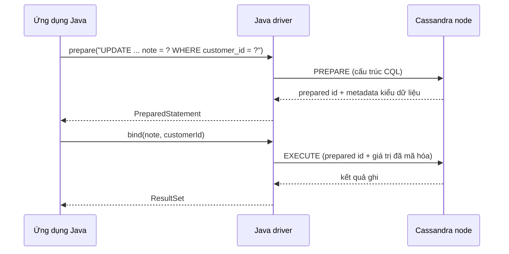

# Gắn tham số thay vì ghép dữ liệu trực tiếp vào CQL

Trong ứng dụng dùng **Spring Data Cassandra**, giá trị truy vấn thường đến từ request HTTP, sự kiện hoặc dữ liệu nghiệp vụ: mã khách hàng, mã đơn hàng, ghi chú, khoảng thời gian, số lượng kết quả. Nếu chèn trực tiếp các giá trị này vào chuỗi **CQL (Cassandra Query Language)** bằng phép nối chuỗi, mã nguồn sẽ khó đọc, dễ sai cú pháp khi gặp dấu nháy, dễ sai kiểu dữ liệu và có nguy cơ **CQL injection**.

**Prepared statement** giải quyết vấn đề bằng cách giữ **cấu trúc câu lệnh CQL cố định** và truyền dữ liệu riêng qua **bind markers** (`?` hoặc `:name`). Java driver chuẩn bị câu lệnh, nhận metadata kiểu dữ liệu, sau đó thực thi nhiều lần với các giá trị khác nhau. Trong Spring Data Cassandra, cùng nguyên tắc này xuất hiện ở `CqlSession`, `CqlTemplate`, `CassandraTemplate` và repository.

Bài học thuộc chương **Prepared statement** của module **SPRING_DATA_CASSANDRA**. Ví dụ sử dụng API Apache Cassandra Java driver **4.x** và **Spring Data Cassandra 4.5.x**. Cú pháp và chi tiết API có thể thay đổi theo phiên bản; cần đối chiếu dependency của dự án trước khi tích hợp.

## 1. Mục tiêu học tập

Sau bài này, bạn có thể:

1. Giải thích khác biệt giữa **ghép dữ liệu vào chuỗi CQL** và **gắn dữ liệu bằng bind marker**.
2. Dùng `CqlSession.prepare(...)`, `PreparedStatement` và `BoundStatement` để ghi/đọc dữ liệu theo đúng kiểu.
3. Sử dụng bind marker theo **vị trí** và **tên**, tránh hoán đổi sai thứ tự tham số.
4. Phân biệt chỗ **được bind** (giá trị dữ liệu, `LIMIT`, `TTL` trong cú pháp hỗ trợ) với chỗ **không bind được** (tên bảng/cột và cấu trúc CQL).
5. Biết cách Spring Data Cassandra chuẩn bị/gắn tham số qua `CqlTemplate`, `CassandraTemplate` và `@Query`.
6. Tái sử dụng statement hợp lý; hiểu cache phía driver/server, metadata và tác động lên định tuyến partition.
7. Xử lý `null`, `UNSET`, phân trang, consistency và lỗi kiểu dữ liệu mà không quay về nối chuỗi.

## 2. Bắt đầu bằng một bảng phù hợp truy vấn

Giả sử một ứng dụng quản lý hồ sơ khách hàng. Mẫu truy vấn chính là **đọc hoặc cập nhật hồ sơ bằng `customer_id`**, vì vậy dùng `customer_id` làm partition key:

```sql
-- Chỉ là cấu hình thực hành một node, không dùng nguyên dạng cho production.
CREATE KEYSPACE IF NOT EXISTS sdc_bind_lab
WITH replication = {
    'class': 'SimpleStrategy',
    'replication_factor': 1
};

CREATE TABLE IF NOT EXISTS sdc_bind_lab.customer_profiles (
    customer_id uuid PRIMARY KEY,
    display_name text,
    note text,
    updated_at timestamp
);
```

Trong môi trường sản xuất nhiều datacenter, hãy dùng replication strategy và replication factor phù hợp thiết kế thực tế; bài này tập trung vào **cách truyền giá trị an toàn**, không phải chiến lược đặt replica.

Ví dụ một row:

| `customer_id` | `display_name` | `note` |
|---|---|---|
| `11111111-1111-1111-1111-111111111111` | `Nguyen A` | `O'Brien da xac nhan don` |

Dữ liệu tên và ghi chú ở đây chỉ là ví dụ. Đáng chú ý, `O'Brien` có **dấu nháy đơn**: đây là một trong những trường hợp thường gây lỗi khi dùng phép nối chuỗi.

## 3. Cách không nên làm: ghép giá trị trực tiếp vào CQL

Ví dụ Java không nên sử dụng:

```java
UUID customerId = UUID.fromString(
    "11111111-1111-1111-1111-111111111111"
);

String note = "O'Brien da xac nhan don";

// KHÔNG NÊN: dữ liệu được ghép trực tiếp thành cú pháp CQL.
String unsafeCql =
    "UPDATE sdc_bind_lab.customer_profiles SET note = '" + note +
    "' WHERE customer_id = " + customerId;

session.execute(unsafeCql);
```

Chuỗi được tạo ra có dạng:

```sql
UPDATE sdc_bind_lab.customer_profiles
SET note = 'O'Brien da xac nhan don'
WHERE customer_id = 11111111-1111-1111-1111-111111111111;
```

Trong CQL, dấu `'` trong `O'Brien` làm giá trị chuỗi bị kết thúc giữa chừng. Câu lệnh có thể **lỗi cú pháp**; trong tình huống dữ liệu ác ý và cấu trúc ghép phức tạp hơn, việc đưa input vào cú pháp cũng có thể tạo rủi ro injection.

Những hạn chế khác của cách ghép:

- `timestamp`, `uuid`, `decimal` và các collection cần biểu diễn literal đúng cú pháp CQL; định dạng chuỗi tùy tiện rất dễ sai.
- Khi mỗi giá trị tạo một chuỗi khác, ứng dụng khó tái sử dụng một câu lệnh chuẩn bị và metadata của nó.
- Log lỗi có thể in ra dữ liệu khách hàng hoặc trường nhạy cảm đã bị nhúng vào CQL.
- Việc escape thủ công từng ký tự theo ngữ cảnh rất dễ thiếu sót và **không phải chiến lược an toàn lâu dài**.
- Các chuỗi CQL được dựng động khó kiểm thử, bảo trì và kiểm tra chính sách truy cập.

**Không cần biết một payload injection cụ thể mới thấy vấn đề**: chỉ một dấu nháy hợp lệ trong tên người dùng đã làm phép nối chuỗi trở nên mong manh.

### 3.1. Vì sao chỉ escape dấu nháy vẫn chưa đủ?

Trong CQL, một literal text có thể được viết bằng cách nhân đôi dấu nháy đơn, chẳng hạn `'O''Brien'`. Tuy nhiên, việc thay `'` thành `''` bằng code riêng **không thay thế prepared statement** vì còn nhiều kiểu dữ liệu và vị trí cú pháp khác.

Hơn nữa, các input như **tên bảng, tên cột, hướng sắp xếp** không được xử lý như literal text. Không thể có một hàm “escape mọi thứ” để vừa sinh identifier, vừa bảo vệ giá trị và thay thế hoàn toàn việc thiết kế query.

## 4. Cách nên làm: cấu trúc CQL cố định + dữ liệu được bind

Dùng placeholder `?` trong CQL:

```java
String cql = """
    UPDATE sdc_bind_lab.customer_profiles
    SET note = ?
    WHERE customer_id = ?
    """;
```

Khi thực thi, driver bind `note` thành giá trị của cột `text` và `customerId` thành giá trị `uuid`. Chúng không được ghép vào một chuỗi CQL mới.



Chu trình **prepare** có thể được tái sử dụng nhiều lần. Khi kết quả chuẩn bị còn trong cache, lần gọi tiếp theo thường không cần server phân tích cú pháp cùng một CQL lại từ đầu.

### 4.1. Những lợi ích chính

| Lợi ích | Giải thích |
|---|---|
| **Tách dữ liệu khỏi cú pháp** | Dấu nháy, ký tự đặc biệt trong `text` được mã hóa như **giá trị**, không được phân tích thành mã CQL |
| **An toàn kiểu dữ liệu** | Prepared metadata mô tả kiểu CQL; driver có thể kiểm tra codec/giá trị trước khi gửi |
| **Tái sử dụng** | Một câu `INSERT/SELECT/UPDATE` được prepare có thể bind nhiều bộ tham số |
| **Giảm overhead lặp lại** | Server có thể tái dùng kết quả parse, driver có thể tái dùng metadata |
| **Hỗ trợ routing** | Khi đủ partition key, driver có thể xác định routing key và ưu tiên replica phù hợp |
| **Dễ quan sát** | Có thể ghi nhận loại câu lệnh và thời gian thực thi mà không cần ghi giá trị nhạy cảm |

Prepared statement **không tự làm mọi truy vấn nhanh hơn**: `SELECT * FROM table` không có `WHERE` dù được prepare vẫn có thể quét rộng. Điều quyết định phạm vi đọc vẫn là **partition key, clustering columns, index và access pattern**.

## 5. Java driver 4.x: ví dụ ghi bằng PreparedStatement

Một cách viết thực tế là tạo `PreparedStatement` một lần trong DAO/service gắn với `CqlSession` đang hoạt động.

```java
import java.time.Instant;
import java.util.UUID;

import com.datastax.oss.driver.api.core.CqlSession;
import com.datastax.oss.driver.api.core.cql.BoundStatement;
import com.datastax.oss.driver.api.core.cql.PreparedStatement;

public class CustomerProfileWriter {

    private final CqlSession session;
    private final PreparedStatement insertProfile;
    private final PreparedStatement updateNote;

    public CustomerProfileWriter(CqlSession session) {
        this.session = session;

        this.insertProfile = session.prepare("""
            INSERT INTO sdc_bind_lab.customer_profiles
                (customer_id, display_name, note, updated_at)
            VALUES (?, ?, ?, ?)
            """);

        this.updateNote = session.prepare("""
            UPDATE sdc_bind_lab.customer_profiles
            SET note = ?, updated_at = ?
            WHERE customer_id = ?
            """);
    }

    public void insert(
        UUID customerId, String displayName, String note
    ) {
        BoundStatement statement = insertProfile.bind(
            customerId, displayName, note, Instant.now()
        );
        session.execute(statement);
    }

    public void changeNote(UUID customerId, String note) {
        BoundStatement statement = updateNote.bind(
            note, Instant.now(), customerId
        );
        session.execute(statement);
    }
}
```

Điểm cần chú ý:

- `session.prepare(...)` tạo object mô tả câu CQL đã chuẩn bị.
- `insertProfile.bind(...)` tạo **`BoundStatement` mới** chứa dữ liệu đã gắn.
- **Thứ tự tham số** của `bind(...)` phải trùng thứ tự các dấu `?` từ trái sang phải.
- `UUID` tương ứng `uuid`, `Instant` tương ứng `timestamp`, còn `String` tương ứng `text` theo codec được driver hỗ trợ.
- Cùng `insertProfile` được dùng cho nhiều khách hàng khác nhau; **không phải prepare một câu mới cho mỗi khách**.
- Không tạo và đóng `CqlSession` mỗi request; ứng dụng Spring Boot thường quản lý một session dùng chung cùng connection pool.

**Cần nhớ semantics của Cassandra:** `INSERT` thường là **upsert**. Bind parameter chỉ giải quyết việc chuyển dữ liệu an toàn, **không tự thêm `IF NOT EXISTS`** hay đảm bảo bản ghi được tạo mới. Nếu yêu cầu “chỉ ghi khi chưa có”, dùng conditional CQL và kiểm tra `ResultSet.wasApplied()`.

### 5.1. Thử với dữ liệu chứa dấu nháy

```java
UUID id = UUID.fromString(
    "11111111-1111-1111-1111-111111111111"
);

CustomerProfileWriter writer = new CustomerProfileWriter(session);
writer.insert(id, "Nguyen A", "O'Brien da xac nhan don");
writer.changeNote(id, "Ghi chu co ky tu ' va dau -- binh thuong");
```

Trong các lời gọi này, `'` và `--` là **nội dung của giá trị text**, không làm biến đổi câu `INSERT` hay `UPDATE` đã được chuẩn bị. Cassandra lưu chính giá trị truyền vào (trong giới hạn kiểu cột và các quy tắc CQL).

Trong bài thực hành `cqlsh`, nếu muốn viết literal tương ứng, bạn phải escape chuỗi theo CQL, chẳng hạn `'O''Brien da xac nhan don'`. Nhưng ở Java, **hãy bind value thay vì tự escape**.

## 6. Bind theo vị trí, theo tên và tính bất biến của BoundStatement

### 6.1. Bind theo vị trí

```java
PreparedStatement prepared = session.prepare("""
    UPDATE sdc_bind_lab.customer_profiles
    SET display_name = ?, note = ?
    WHERE customer_id = ?
    """);

BoundStatement statement = prepared.bind()
    .setString(0, "Nguyen A")
    .setString(1, "O'Brien")
    .setUuid(2, customerId);

session.execute(statement);
```

Index bắt đầu từ **0**:

| Vị trí | Marker | Giá trị |
|---|---|---|
| 0 | `display_name = ?` | `"Nguyen A"` |
| 1 | `note = ?` | `"O'Brien"` |
| 2 | `customer_id = ?` | `UUID customerId` |

Dùng index giúp giải quyết trường hợp cùng một cột xuất hiện nhiều lần, ví dụ `created_at >= ? AND created_at < ?`. Tuy nhiên, nếu sửa thứ tự CQL mà quên sửa thứ tự bind, lỗi có thể xuất hiện khi chạy hoặc tệ hơn là dữ liệu hợp lệ về kiểu nhưng bị hoán đổi ý nghĩa.

### 6.2. Bind bằng tên marker

Java driver hỗ trợ marker dạng `:name`:

```java
PreparedStatement prepared = session.prepare("""
    UPDATE sdc_bind_lab.customer_profiles
    SET display_name = :display_name,
        note = :note
    WHERE customer_id = :customer_id
    """);

BoundStatement statement = prepared.bind()
    .setString("display_name", "Nguyen A")
    .setString("note", "O'Brien")
    .setUuid("customer_id", customerId);

session.execute(statement);
```

Với tên rõ ràng, mã Java ít phụ thuộc vào thứ tự xuất hiện của từng placeholder. Java driver cũng có thể đặt tên marker `?` theo cột tương ứng, nhưng khi một cột xuất hiện nhiều lần, tên có thể **không phân biệt được từng vị trí**. Trong tình huống đó, sử dụng marker theo vị trí hoặc đặt tên rõ ràng.

**Không nhầm tên bind marker với tên bảng/cột.** Trong `:customer_id`, dấu `:` cho biết một **giá trị** được bind vào vị trí tương ứng của điều kiện, không phải tên cột được chọn động.

### 6.3. BoundStatement là immutable

Với Java driver 4.x, các setter trên `BoundStatement` trả về **object mới**. Ví dụ sau không đúng:

```java
BoundStatement statement = prepared.bind();

statement.setString("note", "Da kiem tra"); // Kết quả bị bỏ qua.
statement.setUuid("customer_id", customerId);

session.execute(statement); // Có thể vẫn còn biến UNSET.
```

Phải nhận lại giá trị:

```java
BoundStatement statement = prepared.bind();
statement = statement.setString("note", "Da kiem tra");
statement = statement.setUuid("customer_id", customerId);
session.execute(statement);
```

Hoặc chain:

```java
BoundStatement statement = prepared.bind()
    .setString("note", "Da kiem tra")
    .setUuid("customer_id", customerId);
```

Nếu có nhiều setter hoặc execution options, dùng `boundStatementBuilder()` để tránh các object trung gian:

```java
BoundStatement statement = prepared.boundStatementBuilder()
    .setString("note", "Da kiem tra")
    .setUuid("customer_id", customerId)
    .build();
```

**Phân biệt concurrency:** `PreparedStatement` mặc định có thể dùng chung giữa nhiều luồng, `BoundStatement` immutable có thể chia sẻ an toàn, nhưng `BoundStatementBuilder` **mutable**, không nên được chia sẻ giữa các request/luồng.

## 7. Gắn đúng kiểu: UUID, thời gian và null

### 7.1. Đúng Java type cho CQL type

| CQL type | Java type thông dụng trong driver 4.x | Cách bind |
|---|---|---|
| `uuid` | `UUID` | `setUuid(...)` hoặc `bind(UUID)` |
| `text` / `varchar` | `String` | `setString(...)` |
| `timestamp` | `Instant` | `setInstant(...)` |
| `int` | `int` / `Integer` | `setInt(...)` |
| `bigint` | `long` / `Long` | `setLong(...)` |
| `decimal` | `BigDecimal` | `setBigDecimal(...)` |
| `date` | `LocalDate` | `setLocalDate(...)` |

Metadata của prepared statement giúp driver biết kiểu CQL của từng vị trí. Đừng tự biến timestamp thành một chuỗi tùy ý theo múi giờ máy ứng dụng, hoặc biến decimal thành `double` khi nghiệp vụ cần chính xác số thập phân.

Ví dụ query theo thời gian của một partition:

```sql
-- Bảng minh họa thêm cho các đơn hàng:
CREATE TABLE IF NOT EXISTS sdc_bind_lab.orders_by_customer_month (
    customer_id uuid,
    order_month text,
    created_at timestamp,
    order_id uuid,
    total decimal,
    PRIMARY KEY ((customer_id, order_month), created_at, order_id)
) WITH CLUSTERING ORDER BY (created_at DESC, order_id ASC);
```

Dùng `Instant` cho khoảng thời gian:

```java
PreparedStatement findInRange = session.prepare("""
    SELECT order_id, created_at, total
    FROM sdc_bind_lab.orders_by_customer_month
    WHERE customer_id = ?
      AND order_month = ?
      AND created_at >= ?
      AND created_at < ?
    """);

BoundStatement statement = findInRange.bind(
    customerId,
    "2026-11",
    Instant.parse("2026-11-20T00:00:00Z"),
    Instant.parse("2026-11-26T00:00:00Z")
);

session.execute(statement);
```

`customer_id` + `order_month` là **toàn bộ composite partition key**. `created_at` là clustering column đầu tiên nên điều kiện phạm vi có đường truy cập phù hợp. **Bind marker không làm hợp lệ một truy vấn CQL sai quy tắc partition/clustering.**

### 7.2. CQL NULL và UNSET không giống nhau

Trong các mutation, có ba trạng thái cần phân biệt:

| Trạng thái của biến | Ý nghĩa thường gặp khi ghi |
|---|---|
| Giá trị cụ thể | Ghi giá trị tương ứng |
| `NULL` | Với regular column, có thể tạo tombstone/xóa giá trị đang có |
| `UNSET` | Bỏ qua việc ghi cột tương ứng, không thay nó trong mutation |

Với native protocol v4 trở lên (Cassandra 2.2+), driver hỗ trợ `UNSET` cho biến ở những vị trí CQL cho phép.

Ví dụ đã prepare:

```java
PreparedStatement update = session.prepare("""
    UPDATE sdc_bind_lab.customer_profiles
    SET note = ?, updated_at = ?
    WHERE customer_id = ?
    """);
```

**Xóa giá trị `note`:**

```java
BoundStatement clearNote = update.bind()
    .setToNull(0)
    .setInstant(1, Instant.now())
    .setUuid(2, customerId);

session.execute(clearNote);
```

**Giữ nguyên `note`, chỉ đổi `updated_at`:**

```java
BoundStatement keepNote = update.bind()
    .unset(0)
    .setInstant(1, Instant.now())
    .setUuid(2, customerId);

session.execute(keepNote);
```

`UNSET` **không thể thay thế `NULL` ở mọi vị trí**: partition/clustering key và các biến cần thiết của điều kiện CQL phải được cung cấp hợp lệ. Hãy kiểm tra quy tắc protocol và statement tương ứng.

**Cẩn thận khi dùng mapper:** tùy cách `CassandraTemplate` hoặc mapper xử lý null property, hành vi ghi bỏ qua cột và ghi null có thể khác nhau. Không suy ra semantics chỉ từ loại Java object; integration test mutation cần thiết khi dữ liệu có TTL/tombstone.

## 8. Bind giá trị được ở đâu? Không được ở đâu?

Bind marker đại diện cho **giá trị dữ liệu** tại các vị trí CQL hỗ trợ, không phải một mảnh cú pháp bất kỳ.

### 8.1. Các vị trí điển hình hợp lệ

```sql
-- Giá trị khóa trong WHERE.
SELECT display_name
FROM sdc_bind_lab.customer_profiles
WHERE customer_id = ?;

-- Giá trị ghi và khóa trong INSERT.
INSERT INTO sdc_bind_lab.customer_profiles
(customer_id, display_name, note)
VALUES (?, ?, ?);

-- Giá trị trong UPDATE.
UPDATE sdc_bind_lab.customer_profiles
SET note = ?
WHERE customer_id = ?;

-- Giá trị trong điều kiện CAS/LWT.
INSERT INTO sdc_bind_lab.customer_profiles
(customer_id, display_name)
VALUES (?, ?)
IF NOT EXISTS;

-- LIMIT cũng có thể nhận bind marker.
SELECT customer_id, display_name
FROM sdc_bind_lab.customer_profiles
LIMIT ?;
```

CQL còn hỗ trợ bind marker cho các giá trị thích hợp của `TTL` và `TIMESTAMP`, ví dụ:

```sql
INSERT INTO sdc_bind_lab.customer_profiles
(customer_id, display_name)
VALUES (?, ?)
USING TTL ?;
```

**Ràng buộc:** `LIMIT` được bind vẫn phải được validate về miền giá trị ở ứng dụng. Ví dụ giới hạn một API trong khoảng **1..100** để người dùng không yêu cầu trả hàng triệu row. `LIMIT 20` khi không có `WHERE` vẫn **không tạo danh sách 20 hàng mới nhất toàn cluster**.

### 8.2. Tên bảng, tên cột, lệnh CQL không thể là bind value

Những ví dụ sau **không phải CQL prepared hợp lệ**:

```sql
-- Sai: bind marker không thay được tên bảng.
SELECT * FROM ? WHERE customer_id = ?;

-- Sai: bind marker không thay được tên cột.
SELECT * FROM sdc_bind_lab.customer_profiles WHERE ? = ?;

-- Sai: bind marker không đại diện một câu ORDER BY tùy ý.
SELECT * FROM sdc_bind_lab.orders_by_customer_month
WHERE customer_id = ? AND order_month = ?
ORDER BY ?;
```

Một cách xử lý yêu cầu chọn bảng/cột động có kiểm soát là **allowlist**:

```java
public final class TableSelector {

    public static String approvedTable(String tableKey) {
        return switch (tableKey) {
            case "profiles" -> "sdc_bind_lab.customer_profiles";
            case "orders" -> "sdc_bind_lab.orders_by_customer_month";
            default -> throw new IllegalArgumentException(
                "Bang khong duoc ho tro"
            );
        };
    }
}
```

Ứng dụng chỉ dùng chuỗi tên bảng được **định nghĩa sẵn** trong code/config đáng tin cậy. Không đưa thẳng input như `request.getParameter("table")` vào CQL.

Nếu cần sắp xếp theo các trường khác nhau, chọn trong một tập **mẫu CQL hợp lệ đã biết**. Với Cassandra, `ORDER BY` còn phải tuân thủ clustering columns và ràng buộc partition key; validate cú pháp thôi chưa đủ.

### 8.3. Truy vấn động nên thay đổi cấu trúc có chủ đích

Giả sử client có thể truyền điều kiện `created_at >= ...` hoặc không. Đây là **hai cấu trúc CQL khác nhau**, nên chuẩn bị **hai statement cố định**:

```java
PreparedStatement listMonth = session.prepare("""
    SELECT order_id, created_at
    FROM sdc_bind_lab.orders_by_customer_month
    WHERE customer_id = ? AND order_month = ?
    LIMIT ?
    """);

PreparedStatement listSince = session.prepare("""
    SELECT order_id, created_at
    FROM sdc_bind_lab.orders_by_customer_month
    WHERE customer_id = ? AND order_month = ? AND created_at >= ?
    LIMIT ?
    """);
```

Chọn `listMonth` hoặc `listSince` dựa trên request đã validate, rồi bind dữ liệu. Đừng tạo ra hàng nghìn chuỗi CQL gần giống nhau bằng cách chèn literal timestamp, vì như vậy làm phân mảnh cache prepared statement.

## 9. Gắn LIMIT đúng cách mà vẫn tránh đọc rộng

Ví dụ một DAO đọc các đơn hàng của một khách trong tháng:

```java
import java.util.ArrayList;
import java.util.List;
import java.util.UUID;

import com.datastax.oss.driver.api.core.CqlSession;
import com.datastax.oss.driver.api.core.cql.PreparedStatement;
import com.datastax.oss.driver.api.core.cql.Row;

public class MonthlyOrderReader {

    private final CqlSession session;
    private final PreparedStatement latest;

    public MonthlyOrderReader(CqlSession session) {
        this.session = session;
        this.latest = session.prepare("""
            SELECT order_id
            FROM sdc_bind_lab.orders_by_customer_month
            WHERE customer_id = ? AND order_month = ?
            LIMIT ?
            """);
    }

    public List<UUID> latestOrderIds(
        UUID customerId, String month, int requestedLimit
    ) {
        if (requestedLimit < 1 || requestedLimit > 100) {
            throw new IllegalArgumentException("limit phai tu 1 den 100");
        }

        List<UUID> ids = new ArrayList<>();

        for (Row row : session.execute(
            latest.bind(customerId, month, requestedLimit))) {
            ids.add(row.getUuid("order_id"));
        }

        return ids;
    }
}
```

Thứ tự danh sách trong **một partition** dựa trên clustering order `created_at DESC`. Một câu không có `WHERE customer_id = ... AND order_month = ...` sẽ không mang cùng tính chất về hiệu năng, cho dù cùng bind `LIMIT = 20`.

Không dùng:

```java
// Không nên: đọc dữ liệu rộng về Java rồi mới lọc/sắp xếp.
session.execute("SELECT * FROM sdc_bind_lab.orders_by_customer_month");
```

khi nghiệp vụ chỉ cần một partition. **Prepared statement giúp câu CQL được xử lý/bind đúng, không tự thiết kế lại schema Cassandra cho bạn**.

## 10. Spring Data Cassandra: CqlTemplate, CassandraTemplate và Repository

Không phải lúc nào cũng cần tự gọi `session.prepare(...)`. Spring Data đã tích hợp cơ chế chuẩn bị câu lệnh trong nhiều lớp API.

### 10.1. CqlTemplate: truyền CQL cố định cùng args

`CqlTemplate` hỗ trợ các overload có danh sách tham số. Khi cung cấp **CQL và args**, template thực hiện prepare/bind phù hợp thay vì buộc lập trình viên nối giá trị vào chuỗi.

Ví dụ:

```java
import java.util.UUID;

import org.springframework.data.cassandra.core.cql.CqlTemplate;
import org.springframework.stereotype.Service;

@Service
public class CustomerNameReader {

    private final CqlTemplate cqlTemplate;

    public CustomerNameReader(CqlTemplate cqlTemplate) {
        this.cqlTemplate = cqlTemplate;
    }

    public String getDisplayName(UUID customerId) {
        return cqlTemplate.queryForObject(
            """
            SELECT display_name
            FROM sdc_bind_lab.customer_profiles
            WHERE customer_id = ?
            """,
            String.class,
            customerId
        );
    }
}
```

`queryForObject` dùng cho trường hợp mong đợi một row/một cột và có thể có ngoại lệ nếu không đúng số lượng row. Nếu “không tìm thấy hồ sơ” là tình huống bình thường, hãy thiết kế cách trả `Optional`/xử lý ngoại lệ hoặc dùng API đọc khác phù hợp.

Tham khảo một ví dụ ghi:

```java
cqlTemplate.execute(
    """
    UPDATE sdc_bind_lab.customer_profiles
    SET note = ?
    WHERE customer_id = ?
    """,
    "O'Brien da xac nhan don",
    customerId
);
```

Cần nhớ `execute` cho write có thể trả trạng thái applied; **ghi không điều kiện** không chứng minh row đã tồn tại trước đó. Muốn kiểm tra điều kiện, phải dùng CQL `IF NOT EXISTS`/`IF EXISTS` và xử lý kết quả theo quy tắc LWT.

### 10.2. CassandraTemplate: ánh xạ entity và chuẩn bị mặc định

`CassandraTemplate` ánh xạ dữ liệu giữa Java entity và Cassandra row. Theo tài liệu Spring Data Cassandra 4.5, prepared statement được **bật mặc định** trong template và có thể điều khiển bằng `setUsePreparedStatements(true/false)` khi cần.

Giả sử có entity `CustomerProfile` ánh xạ bảng `customer_profiles`:

```java
import java.time.Instant;
import java.util.UUID;

import org.springframework.data.cassandra.core.mapping.Column;
import org.springframework.data.cassandra.core.mapping.PrimaryKey;
import org.springframework.data.cassandra.core.mapping.Table;

@Table("customer_profiles")
public class CustomerProfile {

    @PrimaryKey("customer_id")
    private UUID customerId;

    @Column("display_name")
    private String displayName;

    @Column("note")
    private String note;

    @Column("updated_at")
    private Instant updatedAt;

    public CustomerProfile() {}

    public UUID getCustomerId() { return customerId; }
    public void setCustomerId(UUID value) { customerId = value; }

    public String getDisplayName() { return displayName; }
    public void setDisplayName(String value) { displayName = value; }

    public String getNote() { return note; }
    public void setNote(String value) { note = value; }

    public Instant getUpdatedAt() { return updatedAt; }
    public void setUpdatedAt(Instant value) { updatedAt = value; }
}
```

`CqlSession` của Spring Boot phải trỏ đúng keyspace `sdc_bind_lab` nếu dùng `@Table("customer_profiles")` không định danh keyspace trực tiếp.

Một method dùng `CassandraTemplate`:

```java
import java.util.UUID;

import com.datastax.oss.driver.api.core.cql.SimpleStatement;
import org.springframework.data.cassandra.core.CassandraTemplate;
import org.springframework.stereotype.Service;

@Service
public class CustomerProfileLookup {

    private final CassandraTemplate template;

    public CustomerProfileLookup(CassandraTemplate template) {
        this.template = template;
    }

    public CustomerProfile find(UUID id) {
        SimpleStatement query = SimpleStatement.newInstance(
            """
            SELECT customer_id, display_name, note, updated_at
            FROM customer_profiles
            WHERE customer_id = ?
            """,
            id
        );

        return template.selectOne(query, CustomerProfile.class);
    }
}
```

**Điểm dễ nhầm:** `SimpleStatement.newInstance(cql, id)` là một object statement của **Java driver**. Khi chuyển `SimpleStatement` vào `CassandraTemplate` và cơ chế chuẩn bị được bật, **template trích query + parameters và chuẩn bị/bind** theo cách Spring Data quy định. Nhưng nếu gọi thẳng `session.execute(SimpleStatement.newInstance(...))`, đó **không đương nhiên** là `PreparedStatement`; driver có thể thực thi simple statement với values theo giao thức của nó.

Spring Data cũng hỗ trợ `template.selectOne(Query.query(Criteria.where("customer_id").is(id)), CustomerProfile.class)`. Query API tạo statement từ mapping metadata, thường không cần viết tay chuỗi CQL.

### 10.3. Repository: không tự ghép input trong @Query

Định nghĩa repository:

```java
import java.util.Optional;
import java.util.UUID;

import org.springframework.data.cassandra.repository.CassandraRepository;
import org.springframework.data.cassandra.repository.Query;

public interface CustomerProfileRepository
        extends CassandraRepository<CustomerProfile, UUID> {

    @Query("""
        SELECT customer_id, display_name, note, updated_at
        FROM customer_profiles
        WHERE customer_id = ?0
        """)
    Optional<CustomerProfile> lookupByCustomer(UUID customerId);
}
```

Ở đây `?0` là **cú pháp tham chiếu tham số phương thức của Spring Data repository**, khác với dấu `?` ở **CQL prepared statement** của Java driver. Spring Data tạo và bind câu truy vấn tương ứng khi thực thi; giá trị `customerId` không được nối như literal UUID vào chuỗi query trong source code.

Với một truy vấn đơn giản theo primary key, `repository.findById(customerId)` đã đủ và thường phù hợp hơn việc định nghĩa `@Query` dư thừa. Ví dụ `@Query` chủ yếu để chỉ rõ cách Spring Data nhận giá trị đầu vào.

**Lưu ý:** method tên đẹp hoặc `@Query` có marker không làm truy vấn regular column không có index trở thành truy vấn tốt. Nếu `findByNote(String note)` sinh điều kiện theo `note` (regular column, không có index), Cassandra vẫn có thể từ chối hoặc cần lọc rộng. Truy vấn luôn phải phù hợp thiết kế bảng.

### 10.4. Bảng so sánh API

| API | Cách dùng bind | Mức kiểm soát |
|---|---|---|
| `CqlSession.prepare(...)` | `PreparedStatement.bind(...)`, `BoundStatement` | Cao nhất: statement, codec, consistency, paging, timeout |
| `CqlTemplate` | `queryForObject(cql, type, args...)` hoặc callback | CQL thủ công nhưng tự quản lý prepare/bind và ngoại lệ Spring |
| `CassandraTemplate` | `Query/Criteria`, `SimpleStatement` hoặc entity API | Mapping entity, prepared statement mặc định bật |
| `CassandraRepository` | Method parameters, `@Query`, query derivation | Code ngắn, truy vấn theo domain model |

Cả bốn cách đều cần **CQL hợp lệ và schema theo truy vấn**. Lựa chọn abstraction nên dựa trên tính phức tạp câu truy vấn và nhu cầu kiểm soát metadata/driver.

## 11. Chuẩn bị một lần, bind nhiều lần và cache hoạt động ra sao?

### 11.1. PreparedStatement không phải BoundStatement

`PreparedStatement` đại diện **cấu trúc query + metadata đã chuẩn bị**, có thể tái sử dụng. `BoundStatement` đại diện **một lần thực thi với bộ giá trị cụ thể**.

```java
PreparedStatement find = session.prepare("""
    SELECT display_name
    FROM sdc_bind_lab.customer_profiles
    WHERE customer_id = ?
    """);

BoundStatement forA = find.bind(
    UUID.fromString("11111111-1111-1111-1111-111111111111")
);

BoundStatement forB = find.bind(
    UUID.fromString("22222222-2222-2222-2222-222222222222")
);

session.execute(forA);
session.execute(forB);
```

Hai request dùng chung `find` nhưng **không chia sẻ object builder mutable** hoặc ghi đè giá trị tham số của request khác.

### 11.2. Cache nằm ở đâu?

Java driver 4.x và Cassandra có cache/metadata liên quan prepared statements:

| Lớp | Vai trò |
|---|---|
| **Ứng dụng** | Giữ tham chiếu `PreparedStatement` trong DAO/service để tránh gọi prepare liên tục |
| **Driver `CqlSession`** | Có cache prepared statement theo query string và execution parameters phù hợp |
| **Cassandra node** | Nhận `PREPARE`, phân tích CQL và giữ prepared metadata/ID để dùng lại |
| **Giao thức** | Khi chạy, gửi prepared ID và các giá trị đã mã hóa thay vì parse lại toàn bộ câu text |

Cache phía driver trong Java driver 4.x khiến việc chuẩn bị lại **cùng CQL** không nhất thiết gửi round-trip mới. Nhưng vẫn nên prepare các query tĩnh **một lần theo vòng đời DAO/session**, không gọi trên mỗi request nếu không cần.

Cache key chú ý **chuỗi CQL chính xác** và các execution parameters dùng để chuẩn bị. Khác whitespace hoặc chèn literal khác có thể tạo các entry riêng. Đừng tạo vô số query variant chỉ vì `customerId`, `timestamp` hoặc `LIMIT` khác nhau; các giá trị đó nên là bind parameters.

### 11.3. Tái chuẩn bị trên nhiều node

Cassandra không yêu cầu mọi node có sẵn cùng prepared metadata tại mọi thời điểm. Driver có thể chuẩn bị trên các node liên quan; khi coordinator trả `UNPREPARED`, driver thường **reprepare rồi thử lại**. Điều này có thể tạo thêm độ trễ nhất thời, đặc biệt khi node restart hoặc topology thay đổi.

Không nên xử lý lỗi `UNPREPARED` bằng cách tự đổi toàn bộ ứng dụng sang ghép CQL string. Nếu sự cố xảy ra nhiều, kiểm tra:

- Version và cấu hình Java driver.
- Tần suất node restart và trạng thái cluster.
- Số lượng query text khác nhau do ứng dụng tạo.
- Kích thước/eviction của prepared cache, đặc biệt nếu prepare quá nhiều literal-variant.
- Thời điểm deploy schema và schema agreement.

Một số phiên bản driver cung cấp metric `cql-prepared-cache-size`. Đo kèm số statement được chuẩn bị, request latency và tỷ lệ reprepare; **không** tự khẳng định “prepare luôn nhanh hơn” cho một query chỉ chạy một lần.

### 11.4. Schema change và SELECT *

Prepared result metadata có thể phụ thuộc vào danh sách cột. Với Cassandra **3.x và các giao thức đời cũ**, việc prepare `SELECT *` rồi thêm/xóa cột có thể gây stale result metadata và decode sai dữ liệu trong những tình huống nhất định.

Ví dụ tốt hơn:

```sql
SELECT customer_id, display_name, note, updated_at
FROM sdc_bind_lab.customer_profiles
WHERE customer_id = ?;
```

thay vì:

```sql
SELECT *
FROM sdc_bind_lab.customer_profiles
WHERE customer_id = ?;
```

Cassandra 4 cùng native protocol v5 bổ sung cơ chế xử lý stale result metadata tốt hơn, nhưng **liệt kê các cột cần dùng** vẫn giúp contract của API rõ ràng, giảm dữ liệu không cần thiết và dễ kiểm soát migration.

Khi thay đổi tên bảng/cột, kiểu dữ liệu hoặc schema chính, cần quản lý **migration** và tương thích nhiều phiên bản ứng dụng. Prepared statement không phải một loại migration và không tự sửa những câu CQL trở nên không hợp lệ.

## 12. Prepared statement, consistency và paging

### 12.1. Gắn dữ liệu và consistency level là hai quyết định khác nhau

Một `BoundStatement` có thể cấu hình consistency level:

```java
import com.datastax.oss.driver.api.core.DefaultConsistencyLevel;

BoundStatement statement = prepared.bind(customerId)
    .setConsistencyLevel(DefaultConsistencyLevel.LOCAL_QUORUM);

session.execute(statement);
```

Đoạn trên giả định `prepared` tương ứng query có **một** marker `customer_id = ?`, và cluster đã có replication strategy phù hợp. `LOCAL_QUORUM` là ví dụ, không phải lựa chọn mặc định cho mọi hệ thống.

Bind parameter cho phép driver biết partition key và có thể định tuyến tốt hơn; **consistency level** quy định điều kiện phản hồi của replica. Cả hai không thay thế nhau và không làm query không có partition key trở thành hiệu quả.

### 12.2. LIMIT khác paging

`LIMIT ?` giới hạn **tổng số row trả về từ statement**. `setPageSize(...)` của driver giới hạn số row mỗi trang fetch (subject to protocol/server constraints).

Ví dụ:

```java
BoundStatement statement = latest.bind(customerId, "2026-11", 100)
    .setPageSize(20);
```

Giả sử `latest` là prepared query `WHERE customer_id = ? AND order_month = ? LIMIT ?`. Statement có giới hạn tối đa **100 row**, trong khi driver thường lấy kết quả theo các trang **20 row** (có thể cần nhiều lượt fetch).

- `LIMIT` không tự tạo thứ tự toàn cầu trên nhiều partition.
- Paging state không phải `OFFSET` có thể nhảy tới trang bất kỳ.
- Đọc toàn bộ các trang vẫn tiêu thụ toàn bộ dữ liệu trong phạm vi kết quả; fetch size nhỏ không “cứu” một truy vấn quét rất rộng.
- Khi triển khai cursor HTTP, phải giữ nguyên query shape và bind values tương ứng, tránh tái sử dụng paging state cho truy vấn khác.

### 12.3. Timeout và idempotence

Dù sử dụng prepared statement, một `INSERT` hoặc `UPDATE` vẫn có thể timeout/mất kết nối sau khi server đã thực hiện mutation. Retry phải dựa trên **tính idempotent của thao tác nghiệp vụ**, không phải chỉ vì câu lệnh đã được prepare.

Một số statement có thể được đánh dấu idempotent để driver thực hiện các cơ chế retry/speculative execution phù hợp; **đừng đánh dấu một lệnh tăng counter hoặc tạo side effect không idempotent là idempotent** chỉ để giảm lỗi. Với `INSERT IF NOT EXISTS` hoặc CAS version, retry sau timeout có thể nhận `[applied] = false` dù request đầu đã thành công; cần idempotency key và đối soát khi đó là yêu cầu nghiệp vụ.

## 13. Những lỗi phổ biến khi bind parameters

| Triệu chứng | Nguyên nhân có thể | Cách xử lý |
|---|---|---|
| `InvalidQueryException`, syntax error với dấu `?` | Dùng marker ở nơi CQL không cho phép hoặc gửi CQL marker qua công cụ không chuẩn bị statement | Kiểm tra cú pháp, dùng driver prepare/bind |
| `CodecNotFoundException` hoặc `IllegalArgumentException` | Java type không phù hợp kiểu CQL hoặc truyền thừa/thiếu args | So khớp prepared variable metadata và codec |
| Kết quả sai mặc dù CQL chạy | Đổi thứ tự các marker cùng kiểu, ví dụ hai `text` bị đảo | Dùng named markers hoặc test đối chiếu tham số |
| `BoundStatement` còn UNSET | Gọi setter nhưng bỏ qua object immutable được trả về | Chain hoặc gán lại object |
| `Invalid null key` | Bind null/UNSET vào partition key bắt buộc | Validate key trước khi thực thi |
| Nhiều truy vấn `PREPARE` và cache phình | Dựng CQL có literal thay đổi theo request | Cố định query shape, chuyển giá trị sang marker |
| `UNPREPARED` xuất hiện nhiều | Node khởi động lại, cache server mất entry, query variants quá lớn | Quan sát cluster, driver reprepare và cache |
| Query vẫn rất chậm dù được prepare | Thiếu partition key, nhiều tombstone/partition, index kém | Sửa schema/query và đo I/O, latency |
| `?0` được gửi thẳng vào `session.prepare` | Nhầm cú pháp tham số của repository `@Query` với CQL marker | Dùng `?`/`:name` cho driver, `?0` trong Spring repository |
| `SELECT *` sau đổi schema gây lỗi decode | Prepared result metadata cũ trong cấu hình/version có giới hạn | Liệt kê cột, phối hợp schema migration và version |
| `LIMIT ?` được bind bằng số quá lớn | Không validate request limit | Giới hạn range của limit và bảo vệ API |
| Tưởng bound parameter bảo vệ mọi truy vấn động | Tên bảng/cột/ORDER BY vẫn được ghép từ input | Dùng allowlist và những query shape đã được thiết kế |

### 13.1. Quy trình chẩn đoán

1. **Xác định statement thực tế**: CQL cố định hay CQL được ghép động? Tham số nào được bind?
2. **Kiểm tra schema CQL**: kiểu cột, partition key, clustering, tên keyspace/table.
3. **Kiểm tra metadata binder**: thứ tự/kiểu tham số, `NULL`/`UNSET`, codec Java driver.
4. **Kiểm tra phiên bản**: Cassandra Server, Java driver, Spring Data Cassandra và giao thức.
5. **Tách lỗi prepare và execute**: lỗi syntax/schema có thể xảy ra ngay ở `prepare()`; timeout/consistency thường xảy ra ở execution.
6. **Đánh giá hiệu năng**: có sử dụng được partition routing, query có đọc quá rộng, cache prepared có quá nhiều variant không?
7. **Kiểm tra dữ liệu đầu vào đặc biệt**: dấu nháy, Unicode, chuỗi rỗng, timezone, giá trị null, UUID không hợp lệ.

Không log các bind values chứa thông tin nhạy cảm chỉ để debug. Ưu tiên log **query identifier**, tên thao tác, thời gian, trạng thái lỗi, endpoint và correlation ID theo chính sách bảo mật.

## 14. Bài tập thực hành

### Bài 1 — Sửa code nối chuỗi

Cho đoạn code:

```java
String cql = "UPDATE sdc_bind_lab.customer_profiles " +
    "SET note = '" + note +
    "' WHERE customer_id = " + customerId;
session.execute(cql);
```

**Yêu cầu:** Viết lại bằng `session.prepare("UPDATE ... SET note = ? WHERE customer_id = ?")` và `bind(note, customerId)`. Thử với `note = "O'Brien"` và giải thích vì sao dữ liệu không bị diễn giải thành cú pháp.

### Bài 2 — Phân biệt marker theo vị trí và theo tên

Cho query:

```sql
SELECT order_id
FROM sdc_bind_lab.orders_by_customer_month
WHERE customer_id = ?
  AND order_month = ?
  AND created_at >= ?
  AND created_at < ?;
```

**Yêu cầu:** Gán đúng thứ tự `UUID`, `String`, `Instant`, `Instant`. Sau đó viết lại bằng marker `:customer_id`, `:month`, `:from_time`, `:to_time`.

**Gợi ý:** Hai thời điểm cùng là `Instant` nên đảo thứ tự có thể **không gây lỗi codec** nhưng làm sai khoảng thời gian truy vấn.

### Bài 3 — Giải thích ví dụ immutable

```java
BoundStatement statement = prepared.bind();
statement.setUuid(0, customerId);
session.execute(statement);
```

**Câu hỏi:** Lỗi ở đâu? Hãy sửa bằng phép gán lại hoặc chain setter.

**Đáp án:** `setUuid` trả một `BoundStatement` mới; đoạn code bỏ qua giá trị trả về.

### Bài 4 — Nhận diện marker không hợp lệ

Chọn câu có thể dùng marker:

- `WHERE customer_id = ?`
- `LIMIT ?`
- `FROM ?`
- `WHERE ? = customer_id`
- `USING TTL ?`

**Đáp án:** Những vị trí giá trị như `customer_id = ?`, `LIMIT ?` và `TTL ?` là hợp lệ trong cú pháp hỗ trợ. Tên bảng hoặc cột không được thay bằng bind marker.

### Bài 5 — Giảm số query variant

Một endpoint sinh CQL:

```java
String cql = "SELECT display_name FROM sdc_bind_lab.customer_profiles " +
    "WHERE customer_id = " + customerId;
```

Sau 100.000 request với 100.000 khách, ứng dụng tạo nhiều chuỗi CQL khác nhau.

**Yêu cầu:** Chuyển sang một query cố định với marker `?`, dùng `PreparedStatement` được giữ trong DAO và tạo `BoundStatement` mới cho mỗi customerId. Giải thích tác động lên prepared cache và routing key.

### Bài 6 — NULL hay UNSET?

Có query `UPDATE ... SET note = ?, updated_at = ? WHERE customer_id = ?`.

**Yêu cầu:** Viết hai đoạn bind: một đoạn **xóa `note`** bằng `setToNull(0)`, một đoạn **giữ nguyên `note`** bằng `unset(0)`. Giải thích nguy cơ tombstone và giới hạn của `UNSET`.

### Bài 7 — API truy cập theo khóa

Hãy viết endpoint lấy hồ sơ theo `customer_id` bằng `CassandraTemplate.selectOne(SimpleStatement, CustomerProfile.class)` hoặc repository `findById`. Giải thích vì sao không cần `findAll()` rồi lọc trong Java, và tại sao prepared statement không giải quyết một full-table scan.

### Bài 8 — Đọc mã Spring Data

Trong repository:

```java
@Query("SELECT * FROM customer_profiles WHERE customer_id = ?0")
Optional<CustomerProfile> lookupByCustomer(UUID id);
```

**Câu hỏi:** `?0` thuộc cú pháp nào? Nếu viết Java driver `session.prepare(...)` trực tiếp, marker tương ứng sẽ là gì?

**Đáp án:** `?0` là marker tham số theo index của Spring Data repository. Driver CQL dùng `?` hoặc `:name`.

## 15. Câu hỏi tự kiểm tra

1. **Vì sao không nên ghép String vào CQL?** Dễ sai cú pháp, sai kiểu, rủi ro injection, sinh nhiều query text khó cache và có thể lộ dữ liệu qua log.
2. **PreparedStatement có chứa dữ liệu customerId của một request cụ thể không?** Không. `BoundStatement` mới chứa bộ giá trị cho lần thực thi.
3. **`PreparedStatement.bind(...)` làm gì?** Gắn giá trị vào bind variables và tạo statement có thể thực thi.
4. **BoundStatement 4.x có mutable không?** Implementation mặc định immutable; setter trả object mới. Builder mutable và không thread-safe.
5. **Có thể bind tên bảng `FROM ?` không?** Không. Cần tên được chọn từ allowlist hoặc những query shape tin cậy.
6. **Có thể bind `LIMIT` không?** Có, với CQL hỗ trợ; ứng dụng vẫn phải validate giá trị và phạm vi truy vấn.
7. **Đã prepare query nhưng không có partition key thì có nhanh không?** Không nhất thiết; có thể vẫn quét rộng.
8. **Spring Data Cassandra 4.5 có tự sử dụng prepared statements trong CassandraTemplate không?** Có, mặc định bật; kiểm tra cấu hình thực tế và các overload.
9. **Khác biệt giữa CqlTemplate và Java driver trực tiếp?** `CqlTemplate` giúp quản lý prepare/bind và chuyển ngoại lệ Spring; driver cho kiểm soát chi tiết `PreparedStatement`/`BoundStatement`.
10. **Tại sao `UNSET` khác `NULL`?** `UNSET` bỏ qua cập nhật cột; `NULL` trong mutation thường thể hiện xóa/tombstone.
11. **Có nên prepare một câu CQL riêng cho từng UUID khác nhau?** Không. Giữ query cố định, bind UUID khác nhau.
12. **Prepared statement có bảo đảm tính nhất quán của dữ liệu không?** Không. Consistency level, replication và cơ chế conditional write là các quyết định riêng.

## Tài liệu tham khảo

- [Apache Cassandra Java Driver 4.19 — Prepared statements](https://apache.github.io/cassandra-java-driver/4.19.0/core/statements/prepared/): `prepare`, `bind`, named markers, cache, `UNSET` và reprepare.
- [Apache Cassandra Java Driver 4.19 — Performance](https://apache.github.io/cassandra-java-driver/4.19.0/core/performance/): chi phí prepare, routing và thực hành dùng lại statement.
- [Apache Cassandra Java Driver 4.19 — PreparedStatement API](https://apache.github.io/cassandra-java-driver/4.19.0/api/com/datastax/oss/driver/api/core/cql/PreparedStatement.html): `bind` và `boundStatementBuilder`.
- [Apache Cassandra Java Driver 4.19 — SettableByIndex API](https://apache.github.io/cassandra-java-driver/4.19.0/api/com/datastax/oss/driver/api/core/data/SettableByIndex.html): `setToNull`, `setUuid`, `setInstant` và các kiểu dữ liệu.
- [Spring Data Cassandra 4.5 — Prepared Statements](https://www.springframework.org/spring-data/cassandra/reference/4.5/cassandra/prepared-statements.html): `CqlTemplate`, `CassandraTemplate`, chuẩn bị mặc định và cache ở driver.
- [Spring Data Cassandra 4.5 — CqlTemplate API](https://docs.spring.io/spring-data/cassandra/docs/4.5.x/api/org/springframework/data/cassandra/core/cql/CqlTemplate.html): overload nhận CQL và arguments.
- [Spring Data Cassandra — Repository Query Methods](https://docs.spring.io/spring-data/cassandra/reference/cassandra/repositories/query-methods.html): tham số repository, query derivation và query options.
- [Apache Cassandra — CQL Reference](https://cassandra.apache.org/doc/stable/cassandra/developing/cql/cql_singlefile.html): bind markers trong giá trị, `LIMIT`, `TTL`, `TIMESTAMP` và prepared cache.
- [Apache Cassandra — Data Modeling](https://cassandra.apache.org/doc/stable/cassandra/developing/data-modeling/): partition key, clustering columns và thiết kế bảng theo truy vấn.
