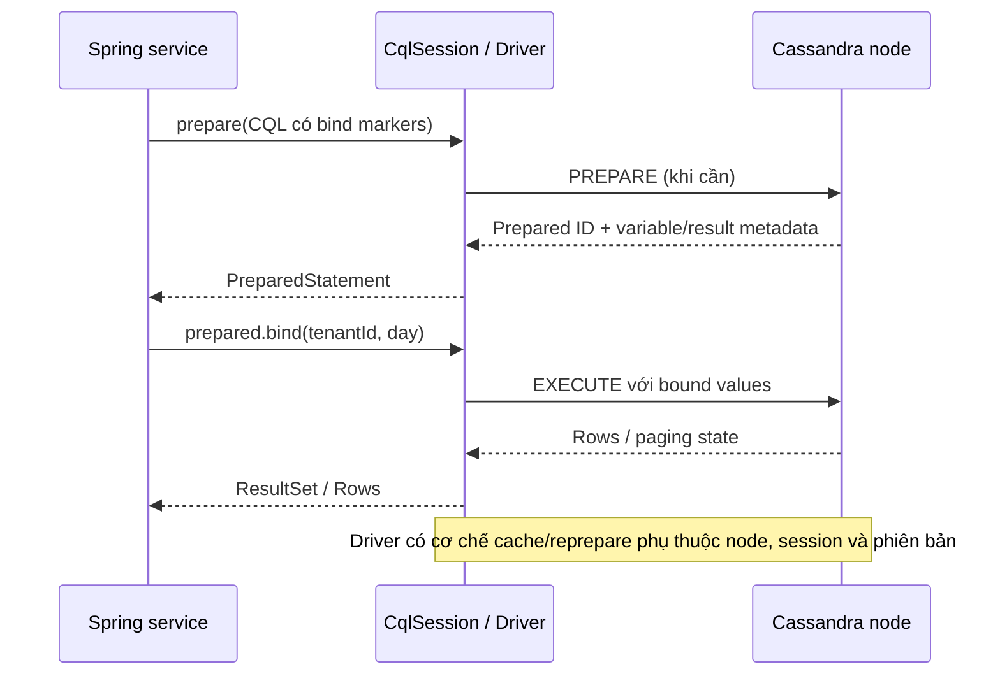

# Chuẩn bị câu lệnh qua CqlTemplate, CassandraTemplate và Repository

**Prepared statement** là một cơ chế quan trọng của Apache Cassandra: ứng dụng chuẩn bị **cấu trúc câu CQL** rồi **gắn giá trị tham số** cho từng lần thực thi. Với những truy vấn lặp lại, cách này giúp tránh xây lại chuỗi CQL chứa giá trị cụ thể, tận dụng metadata kiểu dữ liệu và hỗ trợ Java Driver xác định routing key khi câu lệnh đủ partition key. Tuy nhiên, **có dùng tham số `?` chưa đủ để khẳng định mọi đường truy vấn đều đã được server `PREPARE` và được cache như nhau**.

Bài học thuộc chương **Prepared statement** của module **`SPRING_DATA_CASSANDRA`**. Module hướng dẫn truy cập Cassandra bằng entity mapping, repository, `CassandraTemplate` và CQL; đồng thời yêu cầu thiết kế bảng theo truy vấn, hiểu partition key, consistency, paging và kiểm soát hiệu năng trong mô hình phân tán. Ta sẽ so sánh **`CqlTemplate`/`CqlOperations`**, **`CassandraTemplate`**, **Repository** và **`CqlSession`** để biết nên chuẩn bị và sử dụng câu lệnh ở tầng nào.

**Mục tiêu sau bài học:**

1. Phân biệt `PREPARE`, `PreparedStatement`, `BoundStatement`, bind marker và tham số hóa.
2. Viết truy vấn tham số an toàn qua `CqlOperations`, `CassandraTemplate` và Repository.
3. Biết khi nào phải dùng `CqlSession.prepare(...)` để **kiểm soát prepared statement tường minh**.
4. Tránh tạo câu lệnh với literal thay đổi từng request, tạo session mới hoặc prepare vô ích.
5. Kiểm soát routing key, consistency level, page size, null/UNSET, schema change và error handling.
6. Chọn API phù hợp mà không kỳ vọng prepared statement sửa được data model sai.

## 1. Tại sao cần prepared statement?

Giả sử API lấy các sự kiện của một tenant theo ngày. Cách viết nối giá trị trực tiếp vào CQL tạo một chuỗi mới theo mỗi request:

```java
// KHÔNG NÊN: chuỗi CQL được lắp từ dữ liệu đầu vào.
String cql = "SELECT event_id, status FROM events_by_tenant_day " +
    "WHERE tenant_id = " + tenantInput +
    " AND event_day = '" + dayInput + "' LIMIT 25";
```

Cách này gây ra nhiều rủi ro:

- **Dữ liệu và cấu trúc CQL trộn lẫn**, có nguy cơ lỗi cú pháp và CQL injection khi đầu vào bị xử lý không đúng.
- Các giá trị tenant/ngày khác nhau tạo nhiều **chuỗi câu lệnh khác nhau**, không có lợi cho việc reuse một prepared query shape.
- Việc chuyển kiểu UUID, date, timestamp và chuỗi bị đẩy sang tự viết format, dễ sai.
- Khó quan sát và nhóm truy vấn theo **query shape** khi log chứa literal thay đổi liên tục.

Thay vào đó, câu CQL có **bind markers**:

```sql
SELECT event_id, status
FROM events_by_tenant_day
WHERE tenant_id = ?
  AND event_day = ?
LIMIT 25;
```

Đối với Cassandra, đây là một **query shape cố định**; mỗi lần gọi chỉ khác hai giá trị có kiểu. Trong Java Driver, ứng dụng có thể `prepare` câu đó một lần rồi `bind` giá trị cho mỗi request.

### Hai khái niệm liên quan nhưng không đồng nhất

**Tham số hóa (parameter binding)** là việc truyền giá trị tách biệt khỏi câu CQL. **Chuẩn bị phía server (prepare)** là bước Cassandra xử lý cấu trúc câu lệnh và trả metadata/ID cho một prepared statement. Một framework có thể cung cấp API truyền tham số rồi **tự quản lý đường thực thi nội bộ**; không nên khẳng định framework luôn gửi PREPARE, cache toàn bộ hay dùng đúng một cơ chế ở mọi phiên bản chỉ vì method nhận đối số.

## 2. Prepared statement hoạt động qua Java Driver như thế nào?



Các đối tượng chính:

| Đối tượng | Vai trò | Vòng đời thường dùng |
| --- | --- | --- |
| `CqlSession` | Giao diện logic đến cluster, quản lý driver/pool/metadata | Bean dùng chung suốt vòng đời ứng dụng |
| `PreparedStatement` | Câu CQL đã prepare cùng metadata về tham số | Dùng lại cho **cùng query shape** |
| `BoundStatement` | Prepared statement đã gắn **giá trị cụ thể** và options của lần chạy | Tạo riêng theo thao tác/request |
| `ResultSet`/`AsyncResultSet` | Các hàng và trạng thái phân trang trả về | Theo lần thực thi câu lệnh |
| Spring `CqlOperations` | API chạy CQL, bind args, `RowMapper` và callback | Dùng lại cùng Spring infrastructure |
| Spring `CassandraTemplate`/Repository | Ánh xạ entity và query abstraction | Bean dùng lại cùng hạ tầng Cassandra |

Trong Java Driver 4.x, `PreparedStatement` có thể dùng chung giữa nhiều luồng. Các kiểu statement/builder theo API driver v4 được thiết kế theo phong cách **immutable**; những phương thức tùy chỉnh như `setConsistencyLevel(...)` thường **trả về statement mới**. Vì vậy phải giữ giá trị trả về:

```java
BoundStatement bound = prepared.bind(tenantId, day)
    .setConsistencyLevel(DefaultConsistencyLevel.LOCAL_QUORUM)
    .setPageSize(25);
```

Không gọi setter rồi bỏ kết quả với giả định một object chung đã bị sửa. Đồng thời, **không tạo một `CqlSession` mới để thực thi từng bound statement**: session đã quản lý kết nối và topology.

### Phía server không phải một “cache toàn cluster” vô điều kiện

Prepared statement gắn với **CQL và ngữ cảnh keyspace/schema**; driver hỗ trợ cache và có thể tự reprepare khi node không còn nhớ prepared ID (ví dụ node khởi động lại). Không nên giả định tất cả node của cluster có sẵn cùng prepared metadata mãi mãi. Quá nhiều query shape thay đổi sẽ làm tăng công việc prepare, số entry trong cache và nguy cơ thông báo/giới hạn tài nguyên phía Cassandra.

## 3. Schema CQL xuyên suốt ví dụ

Ứng dụng lưu các event đặt chỗ của tenant theo ngày:

```sql
CREATE TABLE IF NOT EXISTS events_by_tenant_day (
    tenant_id uuid,
    event_day date,
    occurred_at timestamp,
    event_id uuid,
    status text,
    payload text,
    PRIMARY KEY ((tenant_id, event_day), occurred_at, event_id)
) WITH CLUSTERING ORDER BY (occurred_at DESC, event_id ASC);
```

**Ý nghĩa của khóa:**

- `(tenant_id, event_day)` là **composite partition key**, quyết định token/replica.
- `occurred_at` và `event_id` là **clustering columns**, quyết định thứ tự và định vị hàng trong partition.
- `status` và `payload` là cột thường. Có prepared statement **không làm các cột này tự trở thành chỉ mục tìm kiếm**.

Truy vấn chính:

```sql
SELECT occurred_at, event_id, status
FROM events_by_tenant_day
WHERE tenant_id = ?
  AND event_day = ?
LIMIT 25;
```

Câu truy vấn có đủ partition key, chỉ chọn các cột cần thiết và giới hạn kết quả. Nó là ứng viên tốt để chuẩn bị/dùng lại vì nhiều tenant/ngày cùng sử dụng **một cấu trúc CQL**.

### Truy vấn có prepare vẫn có thể rất đắt

```sql
-- Không phù hợp với bảng nếu không có đường truy vấn/index riêng:
SELECT * FROM events_by_tenant_day
WHERE status = ?;
```

Dù prepared statement giúp bind `status`, Cassandra **vẫn cần điều kiện phân vùng hoặc cơ chế truy vấn được thiết kế**. Nếu query thiếu partition key, Cassandra có thể từ chối hoặc phải thực hiện đọc/quét rộng khi dùng filtering/index không phù hợp. **Chuẩn bị câu lệnh không thay đổi phân phối dữ liệu.**

## 4. Chuẩn bị tường minh qua CqlSession

Đây là cách minh bạch nhất khi cần chứng minh code **thực sự gọi driver prepare**.

```java
import java.time.LocalDate;
import java.time.Instant;
import java.util.UUID;

import com.datastax.oss.driver.api.core.CqlSession;
import com.datastax.oss.driver.api.core.DefaultConsistencyLevel;
import com.datastax.oss.driver.api.core.cql.BoundStatement;
import com.datastax.oss.driver.api.core.cql.PreparedStatement;
import com.datastax.oss.driver.api.core.cql.ResultSet;
import com.datastax.oss.driver.api.core.cql.Row;

public class EventQueries {
    private final CqlSession session;
    private final PreparedStatement latestByDay;

    public EventQueries(CqlSession session) {
        this.session = session;
        this.latestByDay = session.prepare("""
            SELECT occurred_at, event_id, status
            FROM events_by_tenant_day
            WHERE tenant_id = ? AND event_day = ?
            LIMIT 25
            """);
    }

    public ResultSet latest(UUID tenantId, LocalDate day) {
        BoundStatement query = latestByDay.bind(tenantId, day)
                .setConsistencyLevel(DefaultConsistencyLevel.LOCAL_QUORUM)
                .setPageSize(25);
        return session.execute(query);
    }
}
```

Ví dụ trên giả định `CqlSession` đã là bean do Spring quản lý và schema/keyspace sẵn sàng lúc khởi tạo `EventQueries`. Ứng dụng thực tế cần quyết định có prepare lúc startup hay khởi tạo theo nhu cầu, nhất là khi muốn xử lý trường hợp cluster chưa sẵn sàng; **không nên catch lỗi khởi tạo rồi lặng lẽ cho service báo ready** nếu mọi API đều phụ thuộc Cassandra.

### Chuỗi bước

1. Spring cung cấp **`CqlSession` dùng chung** cho `EventQueries`.
2. Constructor `prepare(...)` **một lần cho query shape**. `PreparedStatement` là field được tái sử dụng.
3. Mỗi request `bind(tenantId, day)` tạo các giá trị phù hợp **kiểu CQL** của hai bind markers.
4. Dùng bound statement chỉ định options nếu cần.
5. `session.execute(...)` trả về kết quả; tầng DAO ánh xạ `Row` sang DTO hoặc chuyển tiếp có kiểm soát.

Đoạn minh họa cho thấy hợp đồng Java Driver; trong dự án nên trả DTO/slice có giới hạn thay vì để `ResultSet` sống tự do qua ranh giới service/controller.

### Dùng bind theo vị trí hoặc tên

Với marker `?`, `bind(tenantId, day)` gắn giá trị theo thứ tự xuất hiện. Driver cũng cung cấp API đặt giá trị theo tên/ID của biến trong prepared metadata khi phù hợp. Cần chú ý **tên biến có thể không trùng tên property Java**, và những trường hợp một cột xuất hiện nhiều lần trong câu CQL có thể khiến việc bind theo tên cần kiểm tra kỹ. Với ví dụ đơn giản có hai marker, bind theo vị trí rõ ràng và dễ test.

## 5. Qua CqlTemplate / CqlOperations: CQL tham số hóa

`CqlOperations` là interface cho thao tác CQL trong Spring Data Cassandra; `CqlTemplate` là implementation phổ biến. Khi đã có `CassandraTemplate`, có thể lấy các hoạt động CQL mức thấp bằng:

```java
import org.springframework.data.cassandra.core.CassandraTemplate;
import org.springframework.data.cassandra.core.cql.CqlOperations;

CqlOperations cql = cassandraTemplate.getCqlOperations();
```

Điều này **không mở một session mới**. API CQL vẫn sử dụng hạ tầng Cassandra của ứng dụng đã cấu hình.

Ví dụ truy vấn tham số hóa với `RowMapper`:

```java
import java.time.Instant;
import java.time.LocalDate;
import java.util.List;
import java.util.UUID;

public record EventSummary(
        Instant occurredAt,
        UUID eventId,
        String status) {
}

public class EventSummaryGateway {
    private final CqlOperations cql;

    public EventSummaryGateway(CassandraTemplate template) {
        this.cql = template.getCqlOperations();
    }

    public List<EventSummary> latest(UUID tenantId, LocalDate day) {
        return cql.query("""
            SELECT occurred_at, event_id, status
            FROM events_by_tenant_day
            WHERE tenant_id = ? AND event_day = ?
            LIMIT 25
            """,
            (row, rowNumber) -> new EventSummary(
                    row.getInstant("occurred_at"),
                    row.getUuid("event_id"),
                    row.getString("status")),
            tenantId, day);
    }
}
```

Đoạn mã dùng Java hỗ trợ `record` và text block; cần import `CqlOperations`/`CassandraTemplate` từ các dòng ở trên, đặt từng public class đúng file Java và cấu hình bean phù hợp. Overload nhận **CQL, `RowMapper`, bind arguments** là đường sử dụng CQL tham số hóa thường gặp ở `CqlOperations` của Spring Data Cassandra.

### Điều gì đã được bảo đảm, điều gì cần kiểm tra?

**Bảo đảm ở cấp code:** các giá trị `tenantId` và `day` **không được nối vào chuỗi CQL**; chương trình truyền chúng như arguments có kiểu qua API Spring Data. Các giá trị được bind theo thứ tự marker.

**Không nên suy diễn tự động:** việc `cql.query(...)` nhận arguments không chứng minh mọi phiên bản Spring Data sẽ **cache một `PreparedStatement` trong cùng cách thức** hoặc rằng một lời gọi này sẽ không cần PREPARE trên node. Nếu requirement của bạn bắt buộc kiểm soát prepare/cache/reprepare, sử dụng `CqlSession.prepare(...)` trực tiếp hoặc các API prepared-statement/callback được **tài liệu phiên bản đang dùng** hỗ trợ, rồi kiểm tra bằng metrics/log.

### Khi thích hợp chọn CqlTemplate

- Câu CQL cố định, dùng bind markers và trả về DTO nhỏ.
- Cần `RowMapper` đọc cột theo tên, chuyển null và xác thực kết quả rõ ràng.
- Không muốn gắn mọi projection vào `@Table`/entity đầy đủ.
- Muốn dùng exception translation của Spring Data cho các thao tác CQL mức thấp.

Nếu phần lớn nghiệp vụ là CRUD/entity mapping, không cần đổi mọi method sang `CqlTemplate` chỉ để có dấu `?`.

## 6. PreparedStatement qua CqlTemplate: giới hạn kiểm soát

Trong Spring Data Cassandra, API `CqlOperations`/`CqlTemplate` còn có các **callback và overload thao tác câu lệnh chuẩn bị**, với chi tiết phụ thuộc phiên bản. Một đường thao tác có thể:

```text
CqlTemplate / CqlOperations
    → nhận câu CQL và arguments hoặc callback
    → thực thi qua CqlSession do Spring cấu hình
    → trả Row / DTO / kết quả thao tác
```

Nếu mục tiêu chỉ là truyền tham số và đọc dữ liệu, `query(String, RowMapper, Object...)` thường đủ. Nếu mục tiêu là:

- **giữ một `PreparedStatement` field được cache đúng theo chiến lược của bạn**;
- cấu hình `BoundStatement` bằng execution profile, tracing, idempotence, routing options đặc biệt;
- kiểm soát khi nào prepare và cách xử lý reprepare;
- thực hiện batch nhiều bound statements hoặc API driver riêng;

thì **`CqlSession` trực tiếp** có contract rõ hơn và dễ kiểm chứng hơn.

**Không nên gọi `session.prepare(...)` trong vòng lặp request** chỉ để “cho chắc chắn là prepared”. Driver có thể cache theo query shape, nhưng việc gọi lặp không làm tốt hơn quy trình reuse có chủ đích và làm code khó quan sát.

## 7. CassandraTemplate: query builder và entity mapping

`CassandraTemplate` là abstraction cao hơn, biết `@Table`, `@PrimaryKey`, `@Column`, conversion cho UDT/tuple và các options của Spring Data. Ta khai báo entity trước:

```java
import java.io.Serializable;
import java.time.Instant;
import java.time.LocalDate;
import java.util.UUID;
import org.springframework.data.cassandra.core.cql.Ordering;
import org.springframework.data.cassandra.core.mapping.PrimaryKeyClass;
import org.springframework.data.cassandra.core.mapping.PrimaryKeyColumn;
import org.springframework.data.cassandra.core.mapping.PrimaryKeyType;

@PrimaryKeyClass
public class EventKey implements Serializable {
    @PrimaryKeyColumn(name = "tenant_id", ordinal = 0,
            type = PrimaryKeyType.PARTITIONED)
    private UUID tenantId;

    @PrimaryKeyColumn(name = "event_day", ordinal = 1,
            type = PrimaryKeyType.PARTITIONED)
    private LocalDate eventDay;

    @PrimaryKeyColumn(name = "occurred_at", ordinal = 2,
            type = PrimaryKeyType.CLUSTERED, ordering = Ordering.DESCENDING)
    private Instant occurredAt;

    @PrimaryKeyColumn(name = "event_id", ordinal = 3,
            type = PrimaryKeyType.CLUSTERED, ordering = Ordering.ASCENDING)
    private UUID eventId;

    // Bổ sung constructor, getter/setter, equals và hashCode.
}
```

Entity:

```java
import org.springframework.data.cassandra.core.mapping.Column;
import org.springframework.data.cassandra.core.mapping.PrimaryKey;
import org.springframework.data.cassandra.core.mapping.Table;

@Table("events_by_tenant_day")
public class TenantEvent {
    @PrimaryKey
    private EventKey key;

    @Column("status")
    private String status;

    @Column("payload")
    private String payload;

    // Bổ sung constructor, getter/setter.
}
```

Đây là những **đoạn mapping minh họa**, không phải compilation unit hoàn chỉnh. Đảm bảo lớp khóa, thứ tự cột và loại partition/clustering khớp CQL schema; bổ sung constructor/getter/setter/`equals`/`hashCode` theo quy ước Spring Data của dự án.

### Truy vấn theo đúng partition key

```java
import org.springframework.data.cassandra.core.CassandraTemplate;
import org.springframework.data.cassandra.core.query.Criteria;
import org.springframework.data.cassandra.core.query.Query;

Query query = Query.query(
    Criteria.where("tenant_id").is(tenantId),
    Criteria.where("event_day").is(day)
).limit(25);

List<TenantEvent> events =
        cassandraTemplate.select(query, TenantEvent.class);
```

`CassandraTemplate` sử dụng metadata để chuyển object/điều kiện thành CQL và ánh xạ `Row` về `TenantEvent`. Tên bảng được lấy từ `@Table("events_by_tenant_day")`, và hai giá trị khóa được chuyển theo type mapping.

**Về chuẩn bị câu lệnh:** cách xây `Query` và `Criteria` thể hiện ý định của ứng dụng một cách type-aware, nhưng **không nên khẳng định từ đoạn code rằng đã tạo một `PreparedStatement` explicit được cache vào biến**. Đường phát CQL/prepare/bind của template có thể phụ thuộc Spring Data Cassandra version, statement factory và lựa chọn thực thi. Khi cần kiểm soát driver prepare một cách chính xác, hãy dùng đường `CqlSession` ở mục 4 hoặc đối chiếu chính API phiên bản hiện tại.

## 8. Repository: query methods và @Query có bind arguments

Repository phù hợp với thao tác CRUD và truy vấn lặp lại có query shape cố định. Có thể dùng `@Query` để diễn đạt CQL với **parameter markers** do Spring Data Cassandra bind:

```java
import java.time.LocalDate;
import java.util.List;
import java.util.UUID;
import org.springframework.data.cassandra.repository.CassandraRepository;
import org.springframework.data.cassandra.repository.Query;

public interface EventRepository
        extends CassandraRepository<TenantEvent, EventKey> {

    @Query("""
        SELECT tenant_id, event_day, occurred_at,
               event_id, status, payload
        FROM events_by_tenant_day
        WHERE tenant_id = ?0 AND event_day = ?1
        LIMIT 25
        """)
    List<TenantEvent> latest(UUID tenantId, LocalDate day);
}
```

`?0` và `?1` trong `@Query` là ký pháp tham số theo thứ tự method của **Spring Data**, khác với `?` thuần trong một `PreparedStatement` của Java Driver. Chúng giúp framework gắn các giá trị đầu vào mà không tự nối literal.

Repository cũng có derived queries, ví dụ method dựa trên property. Nhưng với Cassandra, dù là derived method hay `@Query`, truy vấn vẫn phải có **partition key/clustering restrictions hợp lệ**.

### Repository có bảo đảm mỗi method được server-side prepare một lần không?

Không nên suy ra điều đó chỉ từ `@Query` hoặc tên method. **Contract chính** của Repository là map entity, bind tham số và thực hiện query theo abstraction của Spring Data; chi tiết prepare/cache/statement generation là implementation detail của **phiên bản cụ thể**. Cần xác minh nếu mục tiêu tối ưu phụ thuộc trực tiếp vào prepared statement cache.

Nếu query đã ổn định và các option thông thường được API hỗ trợ, **giữ Repository** thường dễ bảo trì hơn chuyển sang driver chỉ vì nghĩ “prepared là nhanh hơn”.

## 9. Bảng so sánh ba đường Spring và driver

| Tiêu chí | CqlOperations / CqlTemplate | CassandraTemplate | Repository | CqlSession trực tiếp |
| --- | --- | --- | --- | --- |
| Mức abstraction | CQL + callback/RowMapper | Entity + Query/Criteria | Interface CRUD/query | Java Driver |
| Cách truyền giá trị | Bind args / prepared callback tùy API | Criteria/entity mapping | Method params, `@Query` markers | `PreparedStatement.bind(...)` |
| Kiểm soát `PREPARE` tường minh | Theo API overload/callback/version | Thường không đặt trong code gọi | Không đặt trong interface | **Rõ ràng nhất** |
| Cache `PreparedStatement` ở field ứng dụng | Có thể cần đường driver rõ ràng | Không phải mục tiêu chính | Không phải contract interface | **Dễ chủ động** |
| Ánh xạ entity | Tự map với RowMapper hoặc converter | **Có** | **Có** | Tự map `Row`/dùng converter |
| Tùy chọn per statement | Phụ thuộc API | Theo Query/options được hỗ trợ | Theo annotation/config/version | **Rộng nhất** |
| Tính rõ ràng cho CRUD | Trung bình | Tốt | **Tốt nhất** | Nhiều boilerplate |
| Projection nhỏ | **Rất phù hợp** | Phù hợp khi mapping hỗ trợ | Phù hợp nếu projection/query method hỗ trợ | Phù hợp nhưng tự map |
| Yêu cầu paging đặc biệt | Callback/API phụ thuộc version | API paging của Spring Data | Slice/paging tùy version | **Kiểm soát trực tiếp** |

Không nhất thiết chọn một API duy nhất cho cả ứng dụng. Một kiến trúc dễ bảo trì có thể dùng Repository cho CRUD, `CassandraTemplate` cho query linh hoạt, `CqlOperations` cho projection và `CqlSession` cho những use case thật sự cần quyền kiểm soát prepare/driver.

## 10. Dùng lại prepared statement và tránh tràn cache

**Prepared statement hiệu quả nhất khi cùng query shape được gọi nhiều lần** với các giá trị khác nhau:

```text
Query shape A: WHERE tenant_id = ? AND event_day = ? LIMIT 25
    → tenant A, day X
    → tenant B, day X
    → tenant A, day Y

PreparedStatement A: một cấu trúc, nhiều BoundStatement.
```

Ngược lại, nếu code mỗi request đổi **cú pháp CQL**:

```sql
SELECT ... FROM events_by_tenant_day WHERE tenant_id = ... LIMIT 10;
SELECT ... FROM events_by_tenant_day WHERE tenant_id = ... LIMIT 11;
SELECT ... FROM events_by_tenant_day WHERE tenant_id = ... LIMIT 12;
```

thì dễ tạo nhiều query shapes. Mục tiêu không phải cấm mọi query động, mà là **giới hạn số biến thể cấu trúc**, tách giá trị khỏi CQL và cache/reuse những câu lệnh thực sự lặp lại.

### Ba nhóm biến thường làm thay đổi query shape

1. **Tên bảng, cột, keyspace hoặc hướng sort**: không phải dữ liệu có thể bind giống `UUID`. Cần allowlist/cấu hình có kiểm soát.
2. **Danh sách điều kiện tùy chọn**: thêm/bớt `WHERE` làm thay đổi câu CQL. Nên giới hạn các tổ hợp query hợp lệ và test từng tổ hợp.
3. **`LIMIT`, TTL hoặc tùy chọn**: một số vị trí cú pháp/version có thể cho dùng bind marker; không tự suy rộng rằng mọi token CQL đều có thể bind. Nếu cần giới hạn linh hoạt, dùng API và cú pháp đã được **đúng phiên bản Cassandra/driver** hỗ trợ, hoặc giới hạn số query shapes được phép.

**Cảnh báo vận hành:** “prepare mọi câu lệnh phát sinh” không phải cách chữa chậm. Nó có thể làm tăng công việc prepare và số statement được theo dõi khi query shapes quá đa dạng.

## 11. Prepared statement và routing key

Trong Cassandra, driver có thể ưu tiên replica phù hợp khi xác định được token của partition. Với table:

```sql
PRIMARY KEY ((tenant_id, event_day), occurred_at, event_id)
```

truy vấn cần **cả `tenant_id` và `event_day`** để xác định đầy đủ partition key.

```java
BoundStatement query = latestByDay.bind(tenantId, day);
```

Khi `PreparedStatement` chứa metadata cột của các bind markers phù hợp, driver có cơ sở tính **routing key** và chọn coordinator/replica theo load-balancing policy. Tuy nhiên:

- Có prepared statement **không bảo đảm** driver luôn có đủ thông tin routing key cho mọi câu CQL.
- Không có đầy đủ partition key thì không thể suy ra token duy nhất theo thiết kế bảng.
- **Token-aware routing không chia nhỏ hot partition**; nhiều request cùng key vẫn tập trung vào tập replica tương ứng.
- Contact points chỉ phục vụ bootstrap; driver không mặc định gửi mọi request vào đúng contact point ban đầu.

**Bài học:** Prepared statement hỗ trợ điều phối hiệu quả khi kết hợp với **schema và query shape tốt**; nó không thay thế việc thiết kế partition key.

## 12. Bind đúng kiểu: UUID, date, timestamp, null và UNSET

Bind markers có **kiểu CQL** được suy ra từ prepared statement metadata. Các kiểu Java phổ biến:

| CQL type | Java Driver type điển hình | Ví dụ |
| --- | --- | --- |
| `uuid` | `UUID` | `UUID.fromString(...)` |
| `date` | `LocalDate` | `LocalDate.of(2026, 11, 25)` |
| `timestamp` | `Instant` | `Instant.parse("2026-11-25T03:00:00Z")` |
| `text`/`varchar` | `String` | `"CREATED"` |
| `int` | `Integer`/`int` | `25` |
| `bigint` | `Long`/`long` | `250000L` |

### Null và UNSET không giống nhau

Trong những thao tác ghi Cassandra:

- **Gắn null** cho một cột có thể mang ngữ nghĩa ghi giá trị null/xóa giá trị, tạo **tombstone** theo loại mutation.
- **UNSET** (nếu CQL/phiên bản/operation hỗ trợ) có thể khiến server **bỏ qua** bind marker tương ứng, không làm thay đổi giá trị cột đó.
- **Không truyền một giá trị** và **truyền null** là hai hành vi khác nhau; phương thức convenience của framework có thể quyết định cách tạo mutation.

Ví dụ từ Java Driver 4.x (chỉ minh họa ý nghĩa, không áp dụng mù quáng cho primary key):

```java
BoundStatement statement = prepared.bind()
        .setUuid(0, tenantId)
        .setLocalDate(1, day);

// Với một CQL UPDATE có marker cho cột không khóa:
// statement = statement.setToNull(index);
// statement = statement.unset(index);
```

Trước khi dùng `setToNull`/`unset`, phải kiểm tra đúng **statement, cột, marker index và khả năng hỗ trợ** của Cassandra/driver. **Không dùng null hoặc UNSET cho phần bắt buộc của partition key** để mong truy vấn tự tìm mọi partition.

### Named markers, thứ tự và schema evolution

Nếu một câu lệnh có nhiều `?`, hãy giữ thứ tự bind được kiểm thử rõ ràng. Hai marker đều có kiểu `uuid` nhưng đảo tenant ID và event ID có thể không báo lỗi type, lại ghi/truy vấn sai dữ liệu. Với tuple/UDT, phải dùng type đúng keyspace và ordinal/field names chính xác.

## 13. Consistency, TTL và thông số theo lần thực thi

Prepared statement chỉ mô tả **cấu trúc query và metadata**; nhiều lựa chọn vận hành nên được đưa vào **bound statement hoặc execution profile** tùy use case:

```java
BoundStatement query = latestByDay.bind(tenantId, day)
        .setConsistencyLevel(DefaultConsistencyLevel.LOCAL_QUORUM)
        .setPageSize(25);
```

`LOCAL_QUORUM` là ví dụ, **không phải default phù hợp với mọi cluster**. Với replication factor nhiều data center, local quorum là mức phản hồi ở DC cục bộ; cần cân nhắc nghiệp vụ, RF và topology khi chọn consistency. Một `PreparedStatement` có thể được dùng với nhiều `BoundStatement` mang options khác nhau.

TTL là lựa chọn **ghi** để dữ liệu hết hạn logic sau thời gian đã định; nó không tự dọn ngay dữ liệu vật lý. Khi dùng Spring Data, có thể dùng insert/update options theo API phiên bản, hoặc một CQL được kiểm soát có `USING TTL`. **Không thay đổi đồng thời nhiều tham số khi benchmark** rồi quy hiệu năng cho “đã chuẩn bị câu lệnh”.

### Sự khác biệt giữa prepared statement và idempotence

Một câu lệnh được `prepare` không tự trở thành **idempotent**. Ví dụ:

- Một `INSERT`/`UPDATE` đặt giá trị xác định có đặc tính khác thao tác tăng counter hoặc LWT.
- Retry sau timeout có thể khiến cùng thao tác được gửi lại khi request trước đã áp dụng trên server.
- Idempotence và retry policy là **quyết định riêng** dựa trên câu CQL và quy tắc nghiệp vụ.

Đừng bật retry vô hạn chỉ vì dùng prepared statements; điều đó có thể khuếch đại tải trong giờ cao điểm.

## 14. Paging: LIMIT không phải page size

Đây là điểm dễ gây nhầm khi thay đổi từ Repository sang driver:

| Cơ chế | Ý nghĩa |
| --- | --- |
| `LIMIT 25` | Tổng số hàng tối đa trả về theo câu CQL |
| `setPageSize(25)` | Kích thước mục tiêu của **mỗi lần fetch một trang** |
| `paging state` | Trạng thái opaque để tiếp tục đọc trang tiếp theo |
| `OFFSET 1000` | Không phải mô hình phân trang truy cập ngẫu nhiên của Cassandra |

Với câu `LIMIT 25` và `setPageSize(25)`, thường truy vấn trả kết quả trong một trang khi kích thước hàng/giới hạn cho phép; nhưng **không nên suy ra** cả hệ thống paging chỉ từ hai con số này.

Nếu bỏ `LIMIT` mà để page size 25:

```java
// Nếu câu CQL không có LIMIT, truy vấn có thể còn nhiều trang.
BoundStatement query = prepared.bind(tenantId, day)
        .setPageSize(25);
```

`ResultSet` đồng bộ có thể tự fetch trang tiếp khi duyệt iterator. `AsyncResultSet` cần code chủ động dùng `fetchNextPage()`; khi triển khai API nhiều trang, phải quản lý paging state đúng query shape/parameters và phiên bản driver.

### Repository/Template không tự cho phép OFFSET

Các API `Slice`, paging của Spring Data hoặc những query builder giúp thao tác trang thuận tiện hơn, nhưng Cassandra vẫn vận hành theo **cursor/paging state**, không hỗ trợ nhảy tới trang số rất lớn với chi phí hằng số.

Nếu query đọc nhiều partition ngày, một paging state của một partition **không phải cursor toàn cục** của tất cả bucket. Phải có logic merge/cursor nhiều nguồn và giới hạn số query song song.

## 15. Chuẩn bị câu lệnh với thao tác ghi và LWT

Prepared statement cũng có ích với `INSERT`, `UPDATE` và `DELETE` khi các lệnh này lặp lại cùng cấu trúc:

```sql
UPDATE events_by_tenant_day
SET status = ?
WHERE tenant_id = ?
  AND event_day = ?
  AND occurred_at = ?
  AND event_id = ?;
```

Ví dụ Java:

```java
PreparedStatement updateStatus = session.prepare("""
    UPDATE events_by_tenant_day
    SET status = ?
    WHERE tenant_id = ? AND event_day = ?
      AND occurred_at = ? AND event_id = ?
    """);

session.execute(updateStatus.bind(
        "PROCESSED", tenantId, day, occurredAt, eventId));
```

Câu CQL có **đầy đủ primary key** và được tham số hóa. Nhưng nếu hai worker cùng cập nhật, ghi không có điều kiện sẽ tuân ngữ nghĩa timestamp/conflict resolution của Cassandra, **không phải compare-and-swap**.

### LWT: phải đọc kết quả applied

```sql
UPDATE events_by_tenant_day
SET status = ?
WHERE tenant_id = ?
  AND event_day = ?
  AND occurred_at = ?
  AND event_id = ?
IF status = ?;
```

```java
PreparedStatement conditional = session.prepare("""
    UPDATE events_by_tenant_day
    SET status = ?
    WHERE tenant_id = ? AND event_day = ?
      AND occurred_at = ? AND event_id = ?
    IF status = ?
    """);

ResultSet result = session.execute(conditional.bind(
        "PROCESSED", tenantId, day, occurredAt, eventId, "RECEIVED"));

Row row = result.one();
boolean applied = row != null && row.getBoolean("[applied]");
```

LWT cần xử lý `[applied]`, chứ không coi việc network call kết thúc là **đã áp dụng mutation**. Nó có chi phí phối hợp replica cao hơn ghi thường; không dùng LWT đại trà chỉ vì câu lệnh có thể prepare. CqlTemplate, CassandraTemplate hoặc repository có thể cung cấp một số thao tác conditional tùy API/version, nhưng khi ứng dụng cần **phản hồi driver chính xác**, dùng `CqlSession` trực tiếp là lựa chọn rõ ràng.

## 16. Khi schema đổi hoặc node mất prepared metadata

Mô hình Cassandra phân tán có thể phát sinh các tình huống:

1. **Node restart** hoặc prepared cache phía server không còn ID cũ; driver có thể tự reprepare theo cơ chế của nó.
2. **Schema migration** đổi bảng, cột, kiểu hoặc keyspace; một prepared metadata cũ có thể không còn phù hợp.
3. **Cluster nhiều node** đang trong giai đoạn schema chưa đồng thuận, hoặc client metadata chưa được cập nhật đủ.
4. **Truy vấn động** tạo quá nhiều prepared statements khác nhau khiến hiệu quả caching giảm.

Không tự viết một vòng lặp `prepare → execute → catch → prepare` vô hạn mỗi lần gặp lỗi. Hãy để driver xử lý tình huống missing prepared ID theo khả năng của phiên bản, đồng thời:

- Triển khai schema migration có kiểm soát, chờ đồng thuận schema khi cần.
- Quan sát lỗi schema/type mismatch, PREPARE/reprepare và timeout qua log/metrics.
- Tái tạo câu lệnh/khởi động lại thành phần khi **schema thực sự đổi** và ứng dụng cần metadata mới.
- Giới hạn query shapes tạo bởi input; không prepare tên bảng/column tùy ý.

### PreparedStatement có thể gắn ngữ cảnh keyspace

Cùng một chuỗi `SELECT ... FROM events_by_tenant_day` nhưng chạy dưới hai keyspace khác nhau **không nhất thiết là cùng một statement có thể dùng lẫn nhau**. Tên đầy đủ `keyspace.table` hoặc ngữ cảnh session có ý nghĩa với metadata, routing và loại tham số. Dùng đúng schema/keyspace đích; không chuyển một `PreparedStatement` đã tạo ở session/cluster A sang session/cluster B mà không đánh giá.

## 17. Khi nào nên dùng CqlTemplate, CassandraTemplate hay Repository?

| Nhu cầu | Ưu tiên | Lý do |
| --- | --- | --- |
| CRUD theo ID và entity mapping chuẩn | **Repository** | Ngắn gọn, dễ test; bind theo contract Spring Data |
| Truy vấn cố định có điều kiện rõ | **Repository + @Query** | CQL tham số hóa và contract interface dễ đọc |
| Query động nhưng vẫn đúng partition/clustering key | **CassandraTemplate** | `Query`/`Criteria` và mapping entity |
| Projection nhỏ từ CQL cố định | **CqlOperations/CqlTemplate** | `RowMapper` và bind arguments tường minh |
| Bắt buộc kiểm soát `session.prepare` và tái sử dụng PS field | **CqlSession** | Kiểm soát rõ lifecycle/cache ở tầng ứng dụng |
| LWT cần xử lý `[applied]` chi tiết | **CqlSession** hoặc API Spring hỗ trợ đầy đủ | Đúng semantics của conditional mutation |
| Async paging/driver-specific options | **CqlSession** hoặc API async/reactive phù hợp | Kiểm soát bound statement, paging state |
| Truy vấn thiếu partition key hoặc cần JOIN | **Thiết kế lại data model** | Đổi API/prepare không sửa hạn chế CQL |

**Nguyên tắc:** dùng mức trừu tượng cao nhất còn thể hiện đúng dữ liệu, query shape và semantics. Đừng chuyển tất cả Repository sang Driver chỉ để thấy có dòng `prepare(...)` trong code.

## 18. Những lỗi thường gặp và cách sửa

| Lỗi hoặc hiểu lầm | Hậu quả | Cách sửa |
| --- | --- | --- |
| Nối UUID/date/text trực tiếp vào chuỗi CQL | Lỗi định dạng/injection, khó reuse query shape | Dùng bind marker và typed parameters |
| Mỗi request lại `CqlSession.builder().build()` | Tốn kết nối/metadata, tăng socket/threads | Một session bean dùng chung do Spring quản lý |
| Mỗi request tự `prepare(...)` dù query shape cố định | Làm code rườm rà và thêm đường prepare/cache không cần thiết | Tái sử dụng `PreparedStatement` field hoặc API Spring phù hợp |
| Coi `CqlTemplate.query(...)` có args là bằng chứng driver cache một PS duy nhất | Khẳng định sai về implementation | Phân biệt binding với explicit prepare; kiểm tra version/log/metrics |
| Tạo prepared statement chứa literal tenant/day | Nhiều query shapes, khó cache, tăng tài nguyên | Dùng `?` cho values |
| Bind đảo hai tham số cùng kiểu | Query sai nhưng có thể không lỗi type | Test thứ tự/name markers và giá trị kỳ vọng |
| Bind null/UNSET cho partition key | Truy vấn không thể định vị partition | Luôn cung cấp đầy đủ khóa bắt buộc |
| Coi `setPageSize(25)` là `LIMIT 25` | Có thể đọc thêm trang/bytes | Phân biệt page fetch và tổng giới hạn |
| LWT không kiểm tra `[applied]` | Báo ghi thành công khi điều kiện không đạt | Đọc phản hồi conditional |
| Retry mọi lỗi prepared statement vô hạn | Khuếch đại tải khi cluster bất ổn | Phân loại schema/reprepare/timeout và giới hạn retry |
| Đổi API để sửa query theo `status` không có index | Đọc sai hoặc quét rộng | Thiết kế bảng/index theo query |
| In toàn bộ bind values nhạy cảm vào log | Rò rỉ dữ liệu ứng dụng | Log query shape/latency, ẩn giá trị nhạy cảm |

## 19. Quan sát hiệu quả prepared statement

Muốn biết một thay đổi có ích hay không, cần đo **cùng CQL**, cùng dữ liệu và cùng mức tải trước/sau:

| Chỉ số | Câu hỏi |
| --- | --- |
| QPS và số query shapes | Có nhiều biến thể CQL do literal hoặc điều kiện tùy ý không? |
| Prepare/reprepare events | Có prepare lại quá nhiều khi node restart hoặc schema đổi không? |
| p50/p95/p99 client latency | Thời gian end-to-end có thực sự cải thiện không? |
| Server-side latency | Bottleneck nằm ở query trên replica hay client mapping? |
| Timeout/retry | Tải có bị nhân lên trong giờ cao điểm không? |
| Bytes/rows mỗi response | Có chọn `payload` lớn khi API chỉ cần summary không? |
| Partition size/hotness | Một `(tenant_id,event_day)` có bị đọc/ghi quá tập trung không? |
| CPU/GC ở ứng dụng | Có tạo quá nhiều object/chuỗi CQL hay conversion tốn kém không? |
| Compaction/tombstones | Prepared query có vẫn phải quét nhiều tombstone do data model không? |

Khi so sánh các API:

1. Giữ **cùng query shape**, partition key, LIMIT, page size và projected columns.
2. Giữ **cùng consistency level, RF/topology**, dữ liệu và concurrency.
3. Làm nóng kết nối/session, lặp lại phép thử để giảm nhiễu.
4. Tách **thời gian prepare lần đầu** khỏi **thời gian execute bound statement lặp lại** nếu đang đo hiệu quả caching.
5. Không kết luận “Driver nhanh hơn Template” nếu bài test Driver chọn ít cột hoặc bỏ conversion mà không tính chi phí tạo DTO sau đó.

**Lưu ý:** không phải tất cả metrics prepared cache đều được bật sẵn trong driver/Spring Boot; cần kiểm tra cấu hình metrics, version và khả năng quan sát tương ứng. Không nên tự suy ra “cache hit” chỉ từ độ trễ thấp.

## 20. Bài thực hành: cùng một truy vấn qua ba API

Mục tiêu là cùng đọc 25 event mới nhất của một tenant trong một ngày bằng **CqlOperations**, **CassandraTemplate** và **Repository**, rồi so với **explicit prepared statement** của driver.

**Bước 1 — Chuẩn bị bảng và dữ liệu:** tạo `events_by_tenant_day` theo mục 3, chèn một số event cho hai tenant và nhiều ngày. Chỉ chạy trong môi trường thực hành hoặc test đã được cấp quyền.

**Bước 2 — Driver explicit prepare:**

```java
PreparedStatement ps = session.prepare("""
    SELECT occurred_at, event_id, status
    FROM events_by_tenant_day
    WHERE tenant_id = ? AND event_day = ?
    LIMIT 25
    """);

ResultSet a = session.execute(ps.bind(tenantId, day));
```

**Bước 3 — CqlOperations:**

```java
List<EventSummary> b = cql.query("""
    SELECT occurred_at, event_id, status
    FROM events_by_tenant_day
    WHERE tenant_id = ? AND event_day = ?
    LIMIT 25
    """,
    (row, i) -> new EventSummary(
        row.getInstant("occurred_at"),
        row.getUuid("event_id"),
        row.getString("status")),
    tenantId, day);
```

**Bước 4 — CassandraTemplate:** dùng `Query.query(Criteria.where("tenant_id").is(...), Criteria.where("event_day").is(...)).limit(25)`. Nếu template trả entity với `payload` còn CqlOperations chọn DTO không có `payload`, ghi rõ đây là **hai projection khác nhau**; muốn benchmark công bằng phải điều chỉnh chúng về cùng dữ liệu được trả.

**Bước 5 — Repository:** dùng `EventRepository.latest(tenantId, day)` ở mục 8. Kiểm tra đúng ID, thứ tự theo clustering và số hàng phù hợp.

**Bước 6 — Thử input khác:** dùng nhiều `tenantId` và `day` hợp lệ nhưng **không đổi cấu trúc CQL**; bảo đảm các giá trị được bind đúng, không chèn literal vào query text.

**Bước 7 — Phân biệt chuẩn bị/binding:** chỉ Driver ở bước 2 gọi `prepare(...)` **tường minh trong code ví dụ**. Ở bước 3–5, xác minh hành vi chuẩn bị nội bộ qua tài liệu/trace/metrics tương ứng của phiên bản đang chạy trước khi kết luận cache.

**Bước 8 — Kiểm tra null/thiếu khóa:** không truyền null cho tenant/day; thử một truy vấn thiếu `event_day` trong môi trường test để hiểu tại sao **prepared không thay được quy tắc partition key**.

**Bước 9 — Đo thực tế:** tách latency của lần prepare đầu tiên và các lần execute sau; dùng cùng page size, consistency, schema và payload để so sánh.

## 21. Câu hỏi tự kiểm tra

**Câu 1.** Tham số hóa câu CQL với `?` và server-side `PREPARE` có phải cùng một khái niệm không?

<details>
<summary>Gợi ý trả lời</summary>

Không. Parameter binding tách giá trị khỏi cấu trúc CQL. PREPARE là một bước server xử lý câu lệnh và trả metadata/ID. Framework có thể xử lý chi tiết prepare khác nhau theo API và phiên bản.
</details>

**Câu 2.** Với `@Query` chứa `?0` và `?1` trong Repository, ta có thể kết luận một `PreparedStatement` Java Driver duy nhất đã được cache trong field interface không?

<details>
<summary>Gợi ý trả lời</summary>

Không. `?0` và `?1` là tham số binding của Spring Data; cách framework phát CQL/prepare/cache là implementation detail cần kiểm chứng theo phiên bản. Repository không khai báo field PS trong interface.
</details>

**Câu 3.** Vì sao `CqlSession.prepare(...)` trong constructor của gateway là cách minh bạch khi muốn reuse query shape?

<details>
<summary>Gợi ý trả lời</summary>

Nó tạo `PreparedStatement` tường minh, lưu lại và `bind` giá trị trên mỗi lần gọi. Cần quản lý startup/schema readiness, session lifecycle và các ngoại lệ có thể xảy ra.
</details>

**Câu 4.** Một prepared query chỉ có `WHERE tenant_id = ?` trên bảng partition key `(tenant_id,event_day)` có đảm bảo định vị đúng một partition không?

<details>
<summary>Gợi ý trả lời</summary>

Không. Partition key là tổ hợp cả tenant_id và event_day. Để truy vấn một partition theo thiết kế phải cung cấp đủ hai thành phần, bất kể query có prepared hay không.
</details>

**Câu 5.** `setPageSize(25)` và `LIMIT 25` khác nhau ở điểm nào?

<details>
<summary>Gợi ý trả lời</summary>

Page size giới hạn kích thước mục tiêu của một lần fetch; LIMIT đặt tổng số hàng tối đa câu CQL trả về. Có page size 25 không có nghĩa cả query chỉ có 25 hàng.
</details>

**Câu 6.** Bind null cho một trường update và UNSET khác gì nhau?

<details>
<summary>Gợi ý trả lời</summary>

Null có thể mang nghĩa xóa giá trị và tạo tombstone; UNSET (khi hỗ trợ) bỏ qua cột/marker tương ứng. Cần chọn theo semantics nghiệp vụ và không áp dụng cho partition key bắt buộc.
</details>

**Câu 7.** Một `UPDATE ... IF status = ?` đã prepared và execute xong không lỗi mạng. Đã chắc chắn cập nhật thành công chưa?

<details>
<summary>Gợi ý trả lời</summary>

Chưa. Cần đọc `[applied]` từ kết quả LWT. `false` nghĩa điều kiện không được đáp ứng; không phải lỗi transport.
</details>

**Câu 8.** Khi nào nên giữ `CassandraTemplate`/Repository thay vì chuyển mọi query sang `CqlSession`?

<details>
<summary>Gợi ý trả lời</summary>

Khi đã biểu diễn được query shape/semantics và mapping đúng, dùng abstraction cao hơn giúp code gọn và dễ bảo trì. Chỉ xuống driver khi cần kiểm soát prepare/statement/options chi tiết hoặc phản hồi đặc thù.
</details>

## 22. Ghi nhớ

- **Prepared statement** là cấu trúc CQL đã chuẩn bị; **BoundStatement** là một lần chạy với giá trị cụ thể. `CqlSession` sống dài và được dùng chung; `PreparedStatement` nên reuse theo query shape.
- **Bind markers là điều kiện cần cho tham số hóa**, nhưng không phải bằng chứng đủ rằng mọi đường Spring Data đều **PREPARE/cache** cùng cách. Phân biệt rõ **API contract** và **chi tiết implementation theo phiên bản**.
- **CqlOperations/CqlTemplate** có API CQL và bind arguments, phù hợp projection + `RowMapper`. Có thể lấy từ `CassandraTemplate.getCqlOperations()`.
- **CassandraTemplate** dùng `Query`/`Criteria` và entity mapping; **Repository** dùng CRUD, derived query và `@Query`. Cả hai có thể truyền tham số an toàn nhưng không cần code ứng dụng giữ `PreparedStatement`.
- Khi phải kiểm soát chính xác `prepare`, reuse một PS, per-statement options, LWT `[applied]` hay async paging, **`CqlSession` trực tiếp** là lựa chọn rõ ràng.
- Prepared statement **không sửa được truy vấn thiếu partition key**, hot partition, quét rộng, tombstone hoặc logic paging sai.
- Cần kiểm tra **UUID/date/timestamp types, null vs UNSET, consistency, page size, retry, schema agreement** và behavior khi node reprepare.
- Đo hiệu năng theo **cùng CQL, dữ liệu, consistency, RF, page size và tải**, tách bước prepare đầu khỏi execute nhiều lần.

### Tài liệu tham khảo

- [Spring Data Cassandra – CQL Template](https://docs.spring.io/spring-data/cassandra/reference/cassandra/cql-template.html)
- [Spring Data Cassandra – CassandraTemplate](https://docs.spring.io/spring-data/cassandra/reference/cassandra/template.html)
- [Spring Data Cassandra – Repository query methods](https://docs.spring.io/spring-data/cassandra/reference/cassandra/repositories/query-methods.html)
- [Spring Data Cassandra – Object mapping](https://docs.spring.io/spring-data/cassandra/reference/object-mapping.html)
- [Apache Cassandra Java Driver – Prepared statements](https://apache.github.io/cassandra-java-driver/4.18.0/core/statements/prepared/)
- [Apache Cassandra Java Driver – Statement execution](https://apache.github.io/cassandra-java-driver/4.18.0/core/statements/)
- [Apache Cassandra – Data modeling](https://cassandra.apache.org/doc/stable/cassandra/developing/data-modeling/intro.html)
