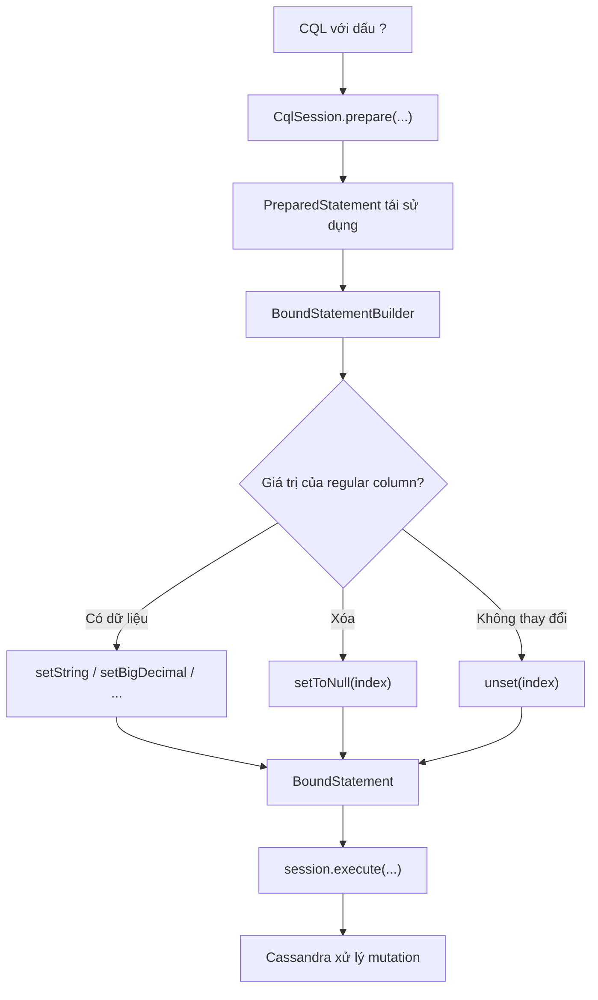

# Phân biệt giá trị null với tham số UNSET

Trong **Apache Cassandra**, hai thao tác có vẻ giống nhau ở tầng Java lại mang ý nghĩa rất khác nhau khi ghi dữ liệu: **bind `null`** và **để tham số ở trạng thái `UNSET`**. Với prepared statement, lựa chọn này quyết định một cột bị **xóa giá trị** hay **được giữ nguyên**.

Điểm khác biệt đặc biệt quan trọng khi ứng dụng **Spring Data Cassandra** triển khai API cập nhật một phần (`PATCH`), dùng `CqlSession` với prepared statement, hoặc kết hợp repository/`CassandraTemplate` với các thao tác CQL tùy chỉnh. Một lỗi nhỏ trong cách bind có thể khiến cột đang chứa dữ liệu bị xóa ngoài ý muốn, tạo tombstone hoặc khiến yêu cầu cập nhật không thực hiện đúng ý định.

Bài thuộc chương **Prepared statement**. Chúng ta sẽ phân biệt ba trạng thái *có giá trị, null và UNSET*; giải thích tác động của chúng trong `INSERT`/`UPDATE`; minh họa API Cassandra Java Driver 4; thiết kế request PATCH; và kiểm tra hành vi thực tế trên bảng Cassandra.

> **Thông điệp chính:** Đối với một cột dữ liệu thông thường trong mutation Cassandra, **giá trị cụ thể** nghĩa là ghi giá trị đó, **`null`** thường nghĩa là xóa giá trị bằng tombstone, còn **`UNSET`** nghĩa là *không áp dụng phép ghi lên cột ấy*. `UNSET` không phải một giá trị được lưu trong database.

## 1. Tại sao phải phân biệt ba trạng thái?

Giả sử bảng chi tiết đơn hàng đang có dữ liệu:

| tenant_id | order_id | status | delivery_note |
| --- | --- | --- | --- |
| `t1` | `o1` | `PENDING` | `Giao sau 18:00` |

Service nhận request “chỉ cập nhật trạng thái thành `PAID`”. Có ba cách diễn giải cho cột `delivery_note`:

1. **Giữ nguyên:** client không cung cấp `delivery_note`, nên sau cập nhật vẫn là `Giao sau 18:00`.
2. **Xóa:** client chủ động gửi `delivery_note: null` với ý nghĩa bỏ ghi chú.
3. **Đổi giá trị:** client gửi `delivery_note: "Giao trước 20:00"`.

Nếu code không phân biệt *field vắng mặt* với *field xuất hiện có giá trị null*, cả hai trường hợp đầu có thể bị gộp thành một biến Java `null`. Khi bind `null` vào prepared statement của Cassandra, ứng dụng có thể **xóa ghi chú ngay cả khi client chỉ muốn cập nhật status**.

### Bảng ý nghĩa cần thuộc

| Trạng thái bound value | Tác động lên regular column đang có | Ví dụ |
| --- | --- | --- |
| **Giá trị cụ thể** | Ghi/ghi đè theo semantics Cassandra | `"PAID"`, `125000.00` |
| **`null`** | Xóa giá trị của cột tại write timestamp, thường sinh tombstone | Xóa `delivery_note` |
| **`UNSET`** | Bỏ qua cột trong mutation; không thay giá trị hiện hữu | Giữ nguyên `delivery_note` |

Bảng này mô tả **tham số ghi của prepared statement** trong trường hợp thông thường. `NULL` trong truy vấn đọc, trường khóa chính, điều kiện LWT, collection hoặc các tham số đặc biệt có ràng buộc riêng. Không được suy rằng `UNSET` có thể được dùng ở mọi vị trí của CQL.

## 2. CQL schema mẫu và dữ liệu ban đầu

Ta dùng một bảng được thiết kế để đọc/ghi theo định danh đơn hàng:

```sql
CREATE TABLE IF NOT EXISTS orders_ks.orders_by_id (
    tenant_id uuid,
    order_id uuid,
    status text,
    delivery_note text,
    total_amount decimal,
    updated_at timestamp,
    PRIMARY KEY ((tenant_id, order_id))
);
```

Trong bảng này:

- `(tenant_id, order_id)` là **composite partition key**; cả hai giá trị phải có khi ghi hoặc truy vấn một đơn.
- `status`, `delivery_note`, `total_amount`, `updated_at` là **regular columns**.
- Bảng chỉ minh họa thao tác; `orders_ks` phải tồn tại trước và có replication strategy/RF phù hợp môi trường.
- Các câu `UPDATE` theo key bên dưới không quét nhiều partition; việc chọn key đúng là điều kiện riêng với việc bind `null` hoặc `UNSET`.

Tạo dữ liệu thử nghiệm trong một keyspace dành riêng cho học tập:

```sql
INSERT INTO orders_ks.orders_by_id (
    tenant_id,
    order_id,
    status,
    delivery_note,
    total_amount,
    updated_at
) VALUES (
    11111111-1111-1111-1111-111111111111,
    22222222-2222-2222-2222-222222222222,
    'PENDING',
    'Giao sau 18:00',
    125000.00,
    '2026-11-25T03:00:00Z'
);
```

Đọc lại:

```sql
SELECT status, delivery_note, total_amount, updated_at
FROM orders_ks.orders_by_id
WHERE tenant_id = 11111111-1111-1111-1111-111111111111
  AND order_id = 22222222-2222-2222-2222-222222222222;
```

Trong các phần tiếp theo, giả sử giá trị ban đầu của `delivery_note` là `Giao sau 18:00`. Đây là tiền đề quan trọng: khi thử `UNSET`, ta cần một giá trị có sẵn để chứng minh nó **không bị thay đổi**.

## 3. Prepared statement và bound statement nằm ở đâu?

Prepared statement là một **mẫu truy vấn có bind markers**. Ví dụ:

```sql
UPDATE orders_ks.orders_by_id
SET status = ?, delivery_note = ?
WHERE tenant_id = ? AND order_id = ?;
```

Quá trình sử dụng có hai bước:

1. **Prepare:** driver gửi/đăng ký mẫu CQL và nhận metadata của các bind variables.
2. **Bind + execute:** mỗi lần chạy, ứng dụng cung cấp giá trị hoặc tín hiệu UNSET cho những vị trí hợp lệ, rồi thực thi một bound statement.



**`null` và `UNSET` không được phân biệt bằng tên biến Java**. Chúng là hai **trạng thái binding** mà driver có thể biểu diễn cho một parameter của prepared statement. Ví dụ dưới đây dùng API **DataStax/Apache Cassandra Java Driver 4** thường được dùng cùng Spring Boot 3.x/Spring Data Cassandra hiện đại.

### Bind markers là dữ liệu, không phải cấu trúc CQL

Prepared statement an toàn hơn nối chuỗi dữ liệu người dùng trực tiếp vào câu CQL. Tuy nhiên bind marker chủ yếu dành cho **giá trị**: không nên mong `?` thay tên bảng, tên cột hoặc một đoạn `ORDER BY` tùy ý. Những lựa chọn cấu trúc phải được xác nhận từ danh sách hợp lệ trong code.

## 4. Java Driver 4: bind giá trị, null và UNSET

Đoạn code dưới đây thể hiện đủ ba hành vi trên cùng một statement:

```java
import java.util.UUID;

import com.datastax.oss.driver.api.core.CqlSession;
import com.datastax.oss.driver.api.core.cql.BoundStatement;
import com.datastax.oss.driver.api.core.cql.BoundStatementBuilder;
import com.datastax.oss.driver.api.core.cql.PreparedStatement;

public final class OrderPatchWriter {

    private static final String UPDATE_CQL = """
        UPDATE orders_ks.orders_by_id
        SET status = ?, delivery_note = ?
        WHERE tenant_id = ? AND order_id = ?
        """;

    private final CqlSession session;
    private final PreparedStatement update;

    public OrderPatchWriter(CqlSession session) {
        this.session = session;
        this.update = session.prepare(UPDATE_CQL);
    }

    public void changeStatusWithoutTouchingNote(
            UUID tenantId,
            UUID orderId,
            String newStatus) {

        BoundStatementBuilder b = update.boundStatementBuilder();

        b.setString(0, newStatus); // Ghi giá trị mới cho status.
        b.unset(1);                // Giữ nguyên delivery_note.
        b.setUuid(2, tenantId);    // Partition key: bắt buộc.
        b.setUuid(3, orderId);     // Partition key: bắt buộc.

        BoundStatement statement = b.build();
        session.execute(statement);
    }

    public void changeStatusAndClearNote(
            UUID tenantId,
            UUID orderId,
            String newStatus) {

        BoundStatementBuilder b = update.boundStatementBuilder();

        b.setString(0, newStatus);
        b.setToNull(1);            // Xóa delivery_note.
        b.setUuid(2, tenantId);
        b.setUuid(3, orderId);

        session.execute(b.build());
    }

    public void changeStatusAndSetNote(
            UUID tenantId,
            UUID orderId,
            String newStatus,
            String newNote) {

        BoundStatementBuilder b = update.boundStatementBuilder();

        b.setString(0, newStatus);
        b.setString(1, newNote);   // Ghi giá trị mới.
        b.setUuid(2, tenantId);
        b.setUuid(3, orderId);

        session.execute(b.build());
    }
}
```

**Thứ tự các vị trí bắt đầu từ 0**, theo thứ tự xuất hiện của bind markers `?` trong câu CQL:

| Index | Cột/vị trí | Khi bind |
| --- | --- | --- |
| `0` | `status = ?` | Giá trị trạng thái mới |
| `1` | `delivery_note = ?` | `setString`, `setToNull` hoặc `unset` |
| `2` | `tenant_id = ?` | UUID khóa bắt buộc |
| `3` | `order_id = ?` | UUID khóa bắt buộc |

Trong code thực tế, nên dùng tên bind marker hoặc một abstraction rõ ràng để giảm sai thứ tự ở statement dài, đồng thời kiểm tra metadata của prepared statement. Không nên thay đổi thứ tự `?` trong CQL mà quên cập nhật code bind.

### Kết quả mong đợi

Giả sử dữ liệu ban đầu là `PENDING / Giao sau 18:00`:

| Phương thức gọi | `status` sau ghi | `delivery_note` sau ghi |
| --- | --- | --- |
| `changeStatusWithoutTouchingNote(..., "PAID")` | `PAID` | **Giữ `Giao sau 18:00`** |
| `changeStatusAndClearNote(..., "PAID")` | `PAID` | **Không còn giá trị** |
| `changeStatusAndSetNote(..., "PAID", "Giao trước 20:00")` | `PAID` | **`Giao trước 20:00`** |

Mỗi hàng của bảng là một **kịch bản độc lập bắt đầu từ dữ liệu ban đầu**. Nếu chạy liên tiếp cả ba lệnh, kết quả cuối phải được hiểu theo thứ tự mutation và timestamp, không phải ba trạng thái tồn tại đồng thời.

### Vì sao tái sử dụng PreparedStatement?

Một đối tượng `PreparedStatement` có thể được tái sử dụng để tạo nhiều bound statements. Không cần gọi `session.prepare(UPDATE_CQL)` cho mọi đơn hàng. Driver thường có cache prepared statements và tự xử lý một số tình huống reprepare theo cơ chế của nó, nhưng **application code vẫn nên tập trung quản lý các mẫu truy vấn ổn định**.

Mỗi lần gọi phải tạo/bind trạng thái mới đúng ý định. Tránh chia sẻ một `BoundStatementBuilder` mutable giữa nhiều luồng, vì logic bind của request này có thể ảnh hưởng request khác nếu dùng chung builder.

## 5. `null` có ý nghĩa gì khi ghi cột trong Cassandra?

Trong một mutation thông thường, cập nhật cột bằng `null` tương ứng **xóa giá trị của cột**, với metadata xóa được Cassandra theo dõi. Ví dụ CQL trực tiếp:

```sql
UPDATE orders_ks.orders_by_id
SET delivery_note = null
WHERE tenant_id = 11111111-1111-1111-1111-111111111111
  AND order_id = 22222222-2222-2222-2222-222222222222;
```

Hành vi tương ứng khi câu CQL sử dụng bind marker là `setToNull(index)`.

### Tombstone là gì?

Cassandra sao chép dữ liệu trên nhiều replica. Khi một cột bị xóa, chỉ xóa bytes ngay tại một replica là không đủ: replica đang offline có thể vẫn giữ giá trị cũ, rồi làm giá trị ấy xuất hiện trở lại trong quá trình đồng bộ.

Vì vậy Cassandra sử dụng **tombstone** — thông tin đánh dấu xóa theo mô hình phân tán. Tombstone tham gia vào quá trình hòa giải dữ liệu giữa replica, đọc và compaction; việc loại bỏ nó khỏi storage phụ thuộc chính sách và điều kiện an toàn của hệ thống.

```text
Trước mutation:
  delivery_note = "Giao sau 18:00"

Bind null:
  delivery_note -> deletion marker / tombstone

Đọc ứng dụng:
  delivery_note -> không còn giá trị (thường thấy null)

Storage:
  tombstone có thể còn tồn tại cho tới khi đủ điều kiện dọn dẹp
```

Các hệ quả:

- Xóa cột không phải là “cập nhật chuỗi thành rỗng”.
- Việc `SELECT` trả `null` không chứng minh không có tombstone vật lý.
- Tạo quá nhiều tombstone, đặc biệt khi liên tục ghi null vào cột không cần thiết, có thể ảnh hưởng đọc và compaction.
- Tombstone cũ và dữ liệu từ replica chậm hội tụ có các ràng buộc vận hành riêng; không tự ý giảm thời gian lưu tombstone hoặc thay repair policy mà không đánh giá cluster.

### Null khác chuỗi rỗng và collection rỗng

| Giá trị Java/ý định | Ý nghĩa mong muốn | Không nên đánh đồng |
| --- | --- | --- |
| `""` | Ghi chuỗi rỗng, nếu kiểu CQL hỗ trợ | Không phải xóa cột |
| `"Giao trước 20:00"` | Ghi giá trị mới | Không phải giữ nguyên |
| `null` bound vào `delivery_note` | Xóa cột | Không phải UNSET |
| `UNSET` bound vào `delivery_note` | Không cập nhật cột | Không phải chuỗi rỗng |
| `Set.of()` | Giá trị collection rỗng, nếu operation/schema cho phép | Không mặc nhiên giống xóa hay UNSET |

Với collection, UDT, counter hoặc các cấu trúc đặc biệt, semantics cụ thể còn phụ thuộc loại statement và cách bind. Hãy kiểm tra với schema thực thay vì suy từ một ví dụ cột `text`.

## 6. UNSET thật sự có nghĩa là gì?

`UNSET` là trạng thái của **bound variable** dùng để biểu thị rằng ứng dụng **không cung cấp giá trị cập nhật** cho parameter đó. Trong mutation phù hợp, Cassandra bỏ qua assignment tương ứng.

Trở lại lệnh:

```sql
UPDATE orders_ks.orders_by_id
SET status = ?, delivery_note = ?
WHERE tenant_id = ? AND order_id = ?;
```

Nếu bind:

```text
?0 = "PAID"
?1 = UNSET
?2 = tenant UUID
?3 = order UUID
```

thì hiệu ứng mong muốn tương tự **chỉ cập nhật status**, không thay `delivery_note`.

**Đây là biểu diễn giả lập của bound values, không phải cú pháp CQL hợp lệ để copy vào `cqlsh`.** `UNSET` là một trạng thái bind do driver cung cấp; không nên viết `SET delivery_note = UNSET` trong câu CQL thông thường rồi coi đó là literal được lưu trữ.

### UNSET không tạo dữ liệu mới cho cột đó

- Nếu cột trước đó có giá trị, `UNSET` **giữ nguyên** giá trị.
- Nếu cột trước đó không có giá trị, `UNSET` **không tự tạo giá trị**.
- Nếu cột trước đó có TTL, `UNSET` không phải là hành động làm mới TTL của cột ấy.
- Nếu cột trước đó có tombstone, `UNSET` không “phục hồi” giá trị cũ.
- Với các mutation khác trong cùng statement, những cột đã bind giá trị vẫn được xử lý theo CQL.

Đây không phải một phép “đọc trước rồi ghi lại giá trị cũ”: Cassandra đơn giản **không ghi mutation cho cột đã UNSET**. Do đó không cần đọc `delivery_note` chỉ để đưa lại cùng chuỗi vào `UPDATE` khi client không muốn đổi nó.

## 7. Ba trạng thái trong PATCH API: absent, null, value

Một request JSON thường có ba dạng:

**Không truyền trường:**

```json
{
  "status": "PAID"
}
```

**Truyền null một cách tường minh:**

```json
{
  "status": "PAID",
  "deliveryNote": null
}
```

**Truyền giá trị:**

```json
{
  "status": "PAID",
  "deliveryNote": "Giao trước 20:00"
}
```

Cùng một field `deliveryNote` nhưng ý nghĩa theo hợp đồng PATCH được định nghĩa trong bài là:

| JSON | Trạng thái domain | Driver bind |
| --- | --- | --- |
| Không có `deliveryNote` | Không đụng tới ghi chú | `unset(1)` |
| Có `"deliveryNote": null` | Xóa ghi chú | `setToNull(1)` |
| Có `"deliveryNote": "..."` | Thay ghi chú | `setString(1, "...")` |

**Quan trọng:** Đây là **hợp đồng PATCH do ứng dụng chọn**, không phải tất cả HTTP PATCH đều có semantics này. Cần tài liệu hóa hợp đồng API; JSON Merge Patch là một hướng tham khảo, còn JSON Patch có biểu diễn thao tác khác.

### Vì sao một DTO String thông thường dễ gây lỗi?

Ví dụ:

```java
public record UpdateOrderRequest(
    String status,
    String deliveryNote
) {}
```

Nếu bộ giải mã JSON gán `deliveryNote == null` cho cả khi field **vắng mặt** và khi field **có giá trị null**, service **không còn đủ thông tin** để quyết định `unset(1)` hay `setToNull(1)`.

Không thể sửa lỗi này bằng cách viết:

```java
if (request.deliveryNote() == null) {
    builder.setToNull(1);
}
```

Vì code trên vô tình diễn giải *không gửi ghi chú* thành *hãy xóa ghi chú*.

Hãy giữ **presence flag** hoặc thiết kế một kiểu đại diện ba trạng thái ngay từ tầng request parsing.

## 8. Mẫu triển khai PATCH ba trạng thái bằng Java

Một cấu trúc đơn giản cho service Java 17:

```java
public record PatchField<T>(
    boolean provided,
    T value
) {
    public static <T> PatchField<T> absent() {
        return new PatchField<>(false, null);
    }

    public static <T> PatchField<T> present(T value) {
        return new PatchField<>(true, value);
    }
}
```

Ở đây:

- `PatchField.absent()` tương ứng **không có field trong request**.
- `PatchField.present(null)` tương ứng **field tồn tại nhưng client gửi null**.
- `PatchField.present("...")` tương ứng **field tồn tại và có giá trị**.

Không dùng `Optional<String>` đơn thuần để đại diện cả ba trạng thái nếu serializer/parser biến absent và explicit-null thành cùng `Optional.empty()`.

### Parser JSON giữ thông tin field presence

Ví dụ dùng Jackson `JsonNode` (phần service phải kiểm tra xác thực/ủy quyền và kiểu JSON):

```java
import com.fasterxml.jackson.databind.JsonNode;

public PatchField<String> readDeliveryNote(JsonNode body) {
    if (!body.has("deliveryNote")) {
        return PatchField.absent();
    }

    JsonNode node = body.get("deliveryNote");

    if (node.isNull()) {
        return PatchField.present(null);
    }

    if (!node.isTextual()) {
        throw new IllegalArgumentException(
            "deliveryNote must be string or null"
        );
    }

    return PatchField.present(node.textValue());
}
```

Cần phân biệt các trường hợp **không có field**, **field null**, **field có giá trị**, và **field sai kiểu**. Đừng tự động `asText()` mọi kiểu dữ liệu (số, boolean, object) thành chuỗi nếu hợp đồng API yêu cầu string.

### Bind PATCH bằng prepared statement

Giả sử status là trường bắt buộc, còn delivery note được update một phần:

```java
public void patchOrder(
        UUID tenantId,
        UUID orderId,
        String status,
        PatchField<String> note) {

    if (tenantId == null || orderId == null) {
        throw new IllegalArgumentException("Missing order identity");
    }
    if (status == null) {
        throw new IllegalArgumentException("Missing status");
    }

    BoundStatementBuilder b = update.boundStatementBuilder();

    b.setString(0, status);

    if (!note.provided()) {
        b.unset(1);
    } else if (note.value() == null) {
        b.setToNull(1);
    } else {
        b.setString(1, note.value());
    }

    b.setUuid(2, tenantId);
    b.setUuid(3, orderId);

    session.execute(b.build());
}
```

Đây là **phương thức minh họa bên trong `OrderPatchWriter`** ở phần trước, nơi `update` và `session` đã được khai báo. Với code thực, cần xử lý authorization, validation, timeout, kết quả thực thi và lỗi phù hợp.

### Nếu mọi field tùy chọn đều vắng mặt?

Một request không thay đổi cột nào nên được xử lý rõ ở tầng API. Có thể trả `204 No Content`/kết quả no-op theo hợp đồng hoặc từ chối request rỗng. Không nên mặc định tạo `UPDATE` mà mọi giá trị regular column đều `UNSET`, vì có thể dẫn tới truy vấn vô nghĩa, hành vi khác theo phiên bản hoặc chi phí không cần thiết.

## 9. UNSET và null trong INSERT

Với Cassandra, `INSERT` thường có tính **upsert** theo primary key. Do đó trạng thái parameter không chỉ quan trọng khi `UPDATE` mà còn khi `INSERT` vào khóa đã tồn tại.

Ví dụ prepared CQL:

```sql
INSERT INTO orders_ks.orders_by_id (
    tenant_id, order_id, status, delivery_note
) VALUES (?, ?, ?, ?);
```

Giả sử key đã có `status = 'PENDING'` và `delivery_note = 'Giao sau 18:00'`:

| Bind status | Bind note | Hiệu ứng mong muốn |
| --- | --- | --- |
| `"PAID"` | `UNSET` | Ghi status mới, **giữ note cũ** |
| `"PAID"` | `null` | Ghi status mới, **xóa note** |
| `"PAID"` | `"Giao trước 20:00"` | Ghi cả hai giá trị mới |

Nếu key **chưa tồn tại**, trường `UNSET` không được ghi thành cell; khi đọc, cột ấy thường không có giá trị. Nếu bind `null`, Cassandra xử lý như một phép xóa tương ứng theo write timestamp, có thể tạo tombstone; điều này khác việc không ghi cell.

**Không dùng INSERT upsert như cách mặc định để bảo đảm “đơn hàng phải chưa tồn tại”.** Nếu cần tạo chỉ khi chưa có, đánh giá `IF NOT EXISTS` và LWT theo yêu cầu nghiệp vụ.

## 10. Những vị trí không thể dùng UNSET để “bỏ qua”

`UNSET` hữu ích cho **tham số giá trị trong mutation**, nhưng không phải cơ chế làm mọi điều kiện trở nên tùy chọn.

| Vị trí parameter | Có nên UNSET? | Lý do |
| --- | --- | --- |
| Regular column trong `UPDATE SET col = ?` | **Có thể**, để không cập nhật cột | Hành vi chính của bài |
| Regular column trong `INSERT (...col...) VALUES (...?...)` | **Có thể**, để bỏ qua giá trị cột | Không ghi cell cho cột đó |
| `tenant_id = ?` trong `WHERE` của update | **Không** | Partition key bắt buộc để định vị hàng |
| `order_id = ?` là thành phần partition key | **Không** | Primary key không được null/unset |
| Điều kiện lọc `SELECT ... WHERE status = ?` | **Không dùng UNSET để biến điều kiện thành tùy chọn** | Phải tạo query phù hợp hoặc chọn read model khác |
| Điều kiện `IF ... = ?` của LWT | **Không dùng để “bỏ qua” điều kiện** | Conditional mutation cần biểu diễn ràng buộc hợp lệ |
| Bind marker tên bảng/cột | **Không áp dụng** | Tên bảng/cột là cấu trúc CQL, không phải dữ liệu bind thông thường |

Tương tự, **`null` và `UNSET` đều không được sử dụng để tạo primary key rỗng** trong mutation Cassandra. Lỗi như “invalid null/unset value for primary key” không thể được sửa bằng cách tăng timeout.

### Không dùng UNSET để thay thiết kế bảng theo truy vấn

Một API cho phép bỏ trống `customer_id` không đồng nghĩa ta có thể dùng:

```sql
SELECT *
FROM orders_ks.orders_by_customer_month
WHERE tenant_id = ?
  AND customer_id = ?
  AND bucket_month = ?;
```

rồi bind `UNSET` cho `customer_id`. Truy vấn Cassandra cần đường truy cập phù hợp với partition key và các quy tắc CQL. Nếu bộ lọc khác nhau dẫn đến mẫu đọc khác, hãy thiết kế read model hoặc tạo **câu query hợp lệ riêng** cho mỗi mẫu đọc.

## 11. Tác động tới TTL và write timestamp

Một phép ghi Cassandra có timestamp, và có thể có TTL áp dụng cho các giá trị được ghi. `null` và `UNSET` không có cùng tác động tới dữ liệu hiện hữu.

Giả sử `delivery_note` được ghi trước đó với TTL là 24 giờ:

- Bind **`UNSET`** cho `delivery_note` trong `UPDATE` khác không làm mới TTL hoặc timestamp của cột ghi chú.
- Bind **giá trị mới** tạo mutation mới cho cột; TTL áp dụng theo statement/write options tương ứng.
- Bind **`null`** biểu thị xóa cột; đây không phải “để TTL cũ tiếp tục đếm” theo cùng nghĩa như UNSET.

Ví dụ CQL dùng TTL:

```sql
UPDATE orders_ks.orders_by_id
USING TTL 3600
SET status = ?, delivery_note = ?
WHERE tenant_id = ? AND order_id = ?;
```

Khi bind `delivery_note = UNSET`, cột ghi chú không được làm mới chỉ vì có TTL trong statement. `status` nếu được ghi sẽ chịu TTL theo cú pháp và quy tắc của request tương ứng.

**Lưu ý:** TTL, timestamp, batch, counter và các loại collection có các hạn chế/chi tiết riêng theo phiên bản Cassandra. Đừng suy từ ví dụ cột `text` rằng mọi kiểu dữ liệu có hành vi giống nhau. Tránh dùng explicit write timestamp tùy tiện nếu không hiểu quy tắc giải quyết xung đột theo timestamp.

### Tại sao không nên “đọc rồi ghi lại” một cột không thay đổi?

Một cách cài đặt PATCH thiếu hiệu quả là:

1. Đọc `delivery_note` hiện tại.
2. Nếu client không gửi ghi chú, copy giá trị đọc được vào `UPDATE`.
3. Ghi lại cả `status` và `delivery_note`.

Cách này có vấn đề:

- Tạo thêm một lần đọc không cần thiết.
- Có thể tăng write amplification.
- Có thể vô tình **làm mới TTL** của cột ghi chú nếu statement có TTL mới.
- Có thể ghi đè thay đổi vừa được request khác thực hiện giữa bước đọc và ghi.

Dùng `UNSET` cho cột không thay đổi tránh phần mutation trên cột ấy. Tuy nhiên nó không giải quyết mọi xung đột khi **hai request cùng sửa một cột**.

## 12. Những vấn đề khi dùng Spring Data Cassandra repository và CassandraTemplate

Cơ chế `UNSET` vừa trình bày là **tín hiệu ở tầng Java Driver bound statement**. Các API `repository.save(...)`, `CassandraTemplate.insert(...)` và `CassandraTemplate.update(...)` lại có lớp mapping và xây statement riêng.

Ví dụ Java entity:

```java
@Table("orders_by_id")
public class OrderById {

    @PrimaryKey
    private OrderKey key;

    @Column("status")
    private String status;

    @Column("delivery_note")
    private String deliveryNote;

    // Constructor và accessor tương ứng.
}
```

Nếu service tạo một object mới chỉ chứa `status` rồi gọi:

```java
repository.save(partialEntity);
```

**Không được mặc định các property `null` trong entity sẽ tương đương UNSET**. Hành vi thực tế phụ thuộc loại thao tác, metadata, phiên bản Spring Data Cassandra, cấu hình ghi null và cách statement được sinh ra.

Có các trường hợp khác nhau cần phân biệt:

- Framework có thể **bỏ qua một property null** trong một số đường ghi/cấu hình.
- Framework có thể tạo bound value **null** ở một số đường ghi, làm xóa cột.
- Một entity partial thiếu dữ liệu còn có nguy cơ khiến thuộc tính khác bị xử lý ngoài ý định.
- Repository `save` không phải API PATCH ba trạng thái được định nghĩa tự động.

Do đó, để triển khai PATCH có yêu cầu rõ “absent = giữ nguyên, null = xóa”, hãy **xác minh CQL/bind thực tế** hoặc sử dụng prepared statement/operation có khả năng biểu đạt đúng ba trạng thái. Không nên tự tin rằng chuyển từ repository sang `CassandraTemplate` sẽ thay đổi semantics null theo ý muốn.

### CassandraTemplate và cập nhật chọn cột

`CassandraTemplate` cung cấp các API query/update ở mức cao hơn so với raw driver. Khi muốn cập nhật có chọn lọc, service có thể xây một `Update` gồm **chỉ những cột thực sự cần thay đổi**, thay vì tạo entity partial và lưu toàn bộ.

Ý tưởng:

```text
Request thiếu deliveryNote:
  Xây update chỉ với SET status = ...

Request có deliveryNote = null:
  Xây update có thao tác xóa ghi chú theo API/CQL được hỗ trợ

Request có deliveryNote = "abc":
  Xây update với SET delivery_note = "abc"
```

Cần kiểm tra **semantics cập nhật null** trong API `Update` cụ thể của phiên bản Spring Data Cassandra; một lời gọi `set("delivery_note", null)` không nên được giả định thay cho mọi trường hợp mà không test.

Nếu cần kiểm soát hoàn toàn bytecode/driver binding, truy cập `CqlSession` và prepared statement có thể dễ diễn giải hơn. Nhưng vẫn phải duy trì cùng cách quản lý session, timeouts, CL, auth và monitoring với ứng dụng Spring.

## 13. UNSET, LWT/CAS và cập nhật cạnh tranh

Giả sử hai request cùng sửa cùng một đơn:

- Request A: `status = PAID`, `delivery_note = UNSET`.
- Request B: `status = CANCELLED`, `delivery_note = UNSET`.

Cả hai chỉ ghi cột `status`. `UNSET` giúp **không đụng tới ghi chú**, nhưng nó **không giải quyết tranh chấp trên status**. Cassandra xử lý mutation theo timestamp và quy tắc hòa giải của nó; thứ tự thực thi trên client không mặc định tạo transaction nghiệp vụ.

Nếu yêu cầu “chỉ chuyển từ PENDING sang PAID khi hiện vẫn PENDING”, cân nhắc conditional update:

```sql
UPDATE orders_ks.orders_by_id
SET status = ?
WHERE tenant_id = ? AND order_id = ?
IF status = 'PENDING';
```

Đây là ví dụ **LWT/CAS**: kết quả phải được kiểm tra trạng thái applied; thao tác điều kiện có chi phí và ràng buộc riêng. `UNSET` không thay thế `IF status = ...`.

### Khi nào cần LWT?

| Yêu cầu | Hướng xử lý |
| --- | --- |
| Thêm ghi chú mới, không muốn ảnh hưởng status | `UNSET` status, ghi note |
| Xóa ghi chú, giữ status | `setToNull` note, `UNSET` status |
| Đổi status khi giá trị cũ đúng điều kiện | Conditional update/LWT |
| Nhiều request cùng sửa status | Thiết kế conflict policy, CAS hoặc mô hình sự kiện phù hợp |
| Cập nhật nhiều read model cùng nghiệp vụ | Đối soát/idempotency; không mặc định một transaction SQL |
| Không ghi khi client không gửi field | Mô hình PATCH giữ presence và dùng UNSET/bỏ assignment |

LWT có thể cho một điều kiện mạnh hơn đối với mutation phù hợp, nhưng không làm các thao tác trên nhiều partition hoặc nhiều bảng tự có rollback và snapshot isolation như giao dịch quan hệ.

## 14. UNSET và NULL trong CQL BATCH

Một CQL batch có thể chứa nhiều statement đã bind. Với một mutation được đưa vào batch:

- Bound regular column `UNSET` vẫn mang ý nghĩa bỏ qua cột đó.
- Bound `null` vẫn có thể tạo phép xóa tương ứng.
- Loại batch (logged/unlogged) không biến hai trạng thái này thành đồng nghĩa.

Nhưng **batch không phải cách chữa mọi vấn đề nguyên tử/hiệu năng**. Logged batch có cơ chế batchlog và bảo đảm riêng về việc áp dụng các mutation; batch không cung cấp isolation của transaction SQL nhiều partition. Unlogged batch trên nhiều partition có rủi ro và chi phí khác.

Khi muốn ghi nhiều entity, đừng tạo một batch khổng lồ chỉ để “gom nhiều trường PATCH”. Hãy xét partition key, số partition, mục tiêu consistency, kích thước payload và cơ chế retry/idempotency.

## 15. Quan sát dữ liệu sau update: vì sao SELECT null chưa nói hết?

Giả sử sau lệnh bind `null` ta chạy:

```sql
SELECT delivery_note
FROM orders_ks.orders_by_id
WHERE tenant_id = 11111111-1111-1111-1111-111111111111
  AND order_id = 22222222-2222-2222-2222-222222222222;
```

Kết quả đọc thường thấy **`null`/không có giá trị**. Nhưng cùng kết quả đọc cũng có thể xảy ra nếu cột chưa bao giờ được ghi hoặc đã hết TTL.

Vì vậy:

- `SELECT delivery_note` **không đủ** để chứng minh có tombstone vật lý.
- Để chứng minh `UNSET` giữ nguyên cột, phải **seed giá trị ban đầu**, thực hiện update, rồi đọc lại và so sánh.
- Để quan sát tác động tới TTL/write time của một cột còn sống, có thể tham khảo `TTL(delivery_note)` và `WRITETIME(delivery_note)` khi câu truy vấn/kiểu cột cho phép. Chúng không phải công cụ đáng tin để phân biệt mọi tình trạng absent/tombstone trong mọi phiên bản.
- Muốn đánh giá tombstone ở mức vận hành, cần metric, tracing và các công cụ quản trị phù hợp. Đừng diễn dịch việc không thấy giá trị là “storage đã giải phóng ngay”.

Một kế hoạch kiểm thử đúng phải kiểm tra **hiệu ứng trước/sau**, không chỉ gọi `execute` thành công.

## 16. Kiểm thử tích hợp: ba kịch bản không thể bỏ qua

Các thử nghiệm sau cần chạy trên **keyspace test riêng** với bảng `orders_by_id` và dữ liệu rõ ràng. Không thực hiện thử xóa dữ liệu ghi chú trên đơn hàng production.

### Test A — UNSET giữ giá trị cũ

1. Seed row: `status=PENDING`, `delivery_note=Giao sau 18:00`.
2. Prepare statement cập nhật `status`, `delivery_note`.
3. Bind `status=PAID`, `delivery_note=UNSET`.
4. Bind đầy đủ `tenant_id`, `order_id`; execute.
5. Đọc lại với CL đã thiết kế cho test.

**Kỳ vọng:** `status=PAID`; `delivery_note=Giao sau 18:00`.

### Test B — null xóa giá trị

1. Seed lại row với note ban đầu.
2. Bind `status=PAID`, `delivery_note=null` bằng `setToNull(1)`.
3. Execute rồi đọc lại.

**Kỳ vọng:** `status=PAID`; `delivery_note` không còn giá trị khi đọc. Không kiểm tra “tombstone đã biến mất khỏi disk”, bởi điều đó không đúng về vòng đời xóa của Cassandra.

### Test C — giá trị mới ghi đè

1. Seed lại row với note ban đầu.
2. Bind `status=PAID`, `delivery_note="Giao trước 20:00"` bằng `setString(1, ...)`.
3. Execute rồi đọc lại.

**Kỳ vọng:** cả hai cột phản ánh giá trị mới.

### Ví dụ test Java rút gọn

```java
import static org.junit.jupiter.api.Assertions.assertEquals;

import java.util.UUID;

import org.junit.jupiter.api.Test;

class OrderPatchWriterIntegrationTest {

    // Giả định đã có session, writer, helper seed/read và keyspace test.

    @Test
    void unsetShouldPreserveExistingNote() {
        UUID tenantId = UUID.randomUUID();
        UUID orderId = UUID.randomUUID();

        seedOrder(tenantId, orderId, "PENDING", "Giao sau 18:00");

        writer.changeStatusWithoutTouchingNote(
            tenantId, orderId, "PAID"
        );

        OrderSnapshot after = readOrder(tenantId, orderId);

        assertEquals("PAID", after.status());
        assertEquals("Giao sau 18:00", after.deliveryNote());
    }
}
```

`seedOrder`, `readOrder`, `OrderSnapshot` và các field fixture chỉ là phần trợ giúp **do test project định nghĩa**; đây không phải class JUnit chạy độc lập nếu chưa bổ sung setup. Trong thử nghiệm production-like, dùng CL phù hợp RF và chú ý các request liên tiếp, timestamp, TTL và replica hội tụ để tránh kết luận nhầm từ một bài test yếu.

### Một bảng test matrix hữu ích

| Dữ liệu ban đầu | Bind status | Bind note | Sau ghi: status | Sau ghi: note |
| --- | --- | --- | --- | --- |
| `PENDING / "A"` | `PAID` | `UNSET` | `PAID` | `"A"` |
| `PENDING / "A"` | `PAID` | `null` | `PAID` | Không có giá trị |
| `PENDING / "A"` | `PAID` | `"B"` | `PAID` | `"B"` |
| `PENDING / null` | `PAID` | `UNSET` | `PAID` | Vẫn không có giá trị |
| `PENDING / "A"` | `UNSET` | `"B"` | `PENDING` | `"B"` |
| `PENDING / "A"` | `UNSET` | `UNSET` | Không nên gửi no-op | Không nên gửi no-op |

Các hàng độc lập, được seed lại trước khi chạy. Trường hợp all-UNSET được ghi như **cảnh báo thiết kế API**, không khẳng định mọi phiên bản Cassandra xử lý một câu update hoàn toàn UNSET giống nhau.

## 17. Kiểm thử trạng thái bị thiếu trong JSON

Không chỉ test driver, còn phải test request decoding:

| JSON request | `body.has("deliveryNote")` | Giá trị domain | Hành động |
| --- | --- | --- | --- |
| `{"status":"PAID"}` | `false` | `PatchField.absent()` | UNSET |
| `{"status":"PAID","deliveryNote":null}` | `true` | `PatchField.present(null)` | setToNull |
| `{"status":"PAID","deliveryNote":"B"}` | `true` | `PatchField.present("B")` | setString |
| `{"status":"PAID","deliveryNote":12}` | `true` | Không hợp lệ | Từ chối trước khi gửi CQL |

Nếu bỏ qua kiểm thử này, code repository/driver có thể hoàn toàn đúng mà API vẫn xóa dữ liệu sai vì DTO đã làm mất thông tin field presence.

## 18. Lỗi thường gặp và cách chẩn đoán

| Hiện tượng | Nguyên nhân có thể | Cách xử lý |
| --- | --- | --- |
| Cập nhật `status` làm `delivery_note` biến mất | Bind `null` cho field vắng mặt | Giữ presence và dùng `unset` |
| Cập nhật ghi chú nhưng giá trị không đổi | Bind nhầm `UNSET` thay vì giá trị | Kiểm tra index/marker và nhánh PATCH |
| Driver báo lỗi null/unset primary key | Key marker chưa được set | Validate và bind đủ thành phần primary key |
| Query `SELECT` báo lỗi khi một filter không có giá trị | Dùng UNSET trong `WHERE` | Chọn query khác phù hợp schema và mẫu đọc |
| Dữ liệu có vẻ không mất sau bind null | Đọc ở replica/DC chưa hội tụ hoặc timestamp cạnh tranh | Kiểm tra CL, timestamp và trạng thái cluster |
| Tombstone tăng nhanh | Ghi null vào cột thường xuyên, kể cả khi không có ý định xóa | Chỉ xóa khi explicit; dùng UNSET cho absent |
| Một cột bị reset TTL | Ghi lại giá trị cũ thay vì UNSET | Tránh ghi cột không thay đổi |
| `repository.save` làm thay đổi cột ngoài ý định | Entity partial/null semantics không rõ | Kiểm tra mapping và generated statement; dùng update chọn cột/driver |
| Update cạnh tranh làm mất trạng thái mới | UNSET không giải quyết tranh chấp trên cùng cột | Chính sách concurrency, conditional update/LWT |
| Thứ tự bind sai sau chỉnh CQL | Vị trí `?` bị thay đổi | Dùng binding theo tên/metadata, test mọi nhánh |
| Test chỉ SELECT thấy null nên kết luận “không có tombstone” | Nhầm giá trị trả về với trạng thái storage | Seed và kiểm tra trước/sau; dùng metric đúng mục đích |
| Tăng timeout vẫn lỗi CQL | Schema/key không hợp lệ hoặc bind sai kiểu | Sửa query/binding, không chữa bằng timeout |

### Lưu ý về logging

Không log toàn bộ prepared statement parameters nếu chúng chứa dữ liệu nhạy cảm, ID khách hàng hoặc ghi chú giao hàng. Để debug có thể log **tên operation, tên bảng, trạng thái branch** (`VALUE`/`NULL`/`UNSET`), kết quả và latency; tránh lộ giá trị thật. Thử nghiệm với dữ liệu giả và logging có giới hạn.

## 19. Phạm vi bảo đảm và performance

| Quyết định | Giải quyết vấn đề gì? | Không giải quyết vấn đề gì? |
| --- | --- | --- |
| Prepared statement | Tái dùng cấu trúc CQL, bind dữ liệu an toàn và ổn định | Không sửa thiết kế partition key |
| `UNSET` | Không thay đổi cột khi client không muốn cập nhật | Không chống ghi đè cạnh tranh trên cột khác |
| Bind `null` | Xóa giá trị cột có chủ đích | Không xóa vật lý tức thời khỏi mọi replica |
| Consistency level | Điều kiện xác nhận theo replica/DC | Không biến cập nhật nhiều hàng thành transaction |
| LWT/CAS | Điều kiện cập nhật trong phạm vi được hỗ trợ | Không thay thế toàn bộ transaction SQL |
| `CassandraTemplate` | API xây truy vấn và mapping entity | Không tự giải thích absent/null của mọi PATCH DTO |
| Partition/clustering key đúng | Đọc/ghi đúng partition, sắp xếp trong partition | Không tự xử lý nghiệp vụ PATCH |
| Paging | Đọc dữ liệu từng phần | Không thay đổi hành vi null/UNSET |

Với request PATCH, dùng `UNSET` đúng cách còn giúp giảm mutation không cần thiết: không ghi lại những cột không đổi, tránh làm mới TTL sai và hạn chế tạo tombstone do bind null ngoài ý muốn. Nhưng một bảng có partition key gây hot spot vẫn phải giải quyết từ thiết kế truy vấn; tối ưu cách bind không thay đổi phân phối dữ liệu.

## 20. Bài tập áp dụng

### Bài 1 — giữ lại ghi chú

Bảng có `status = 'PENDING'` và `delivery_note = 'A'`. Client gửi:

```json
{"status":"PAID"}
```

**Câu hỏi:** Bind gì cho hai marker trong `SET status = ?, delivery_note = ?`?

<details>
<summary>Đáp án gợi ý</summary>

Bind `status = "PAID"`, `delivery_note = UNSET`. Không dùng `null` vì client không yêu cầu xóa ghi chú. Các marker partition key vẫn phải được bind đầy đủ.

</details>

### Bài 2 — chủ động xóa ghi chú

Client gửi:

```json
{"status":"PAID","deliveryNote":null}
```

**Câu hỏi:** Bind `null` và `UNSET` có cùng kết quả không?

<details>
<summary>Đáp án gợi ý</summary>

Không. Khi bind `setToNull` cho `delivery_note`, mutation mang ý nghĩa xóa cột. Nếu bind `UNSET`, giá trị cũ được giữ nguyên. Với hợp đồng PATCH của bài, explicit JSON null phải ánh xạ tới xóa.

</details>

### Bài 3 — khóa chính thiếu

Code tạo prepared statement:

```sql
UPDATE orders_ks.orders_by_id
SET status = ?
WHERE tenant_id = ? AND order_id = ?;
```

Sau đó bind `status = "PAID"`, `tenant_id` đầy đủ, nhưng `order_id = UNSET`.

**Câu hỏi:** Có thể hiểu là “cập nhật mọi đơn thuộc tenant” không?

<details>
<summary>Đáp án gợi ý</summary>

Không. `order_id` là thành phần partition key bắt buộc; UNSET không làm điều kiện `WHERE` biến mất. Statement không hợp lệ cho mục đích đó. Nếu cần cập nhật nhiều đơn trong tenant, phải thiết kế truy vấn/luồng công việc phù hợp, không dùng UNSET để tạo phép cập nhật hàng loạt không có khóa.

</details>

### Bài 4 — dùng repository lưu entity partial

Service tạo entity có `status="PAID"` và `deliveryNote=null` rồi gọi `repository.save(...)`. Developer nói “null Java sẽ luôn có nghĩa UNSET”.

**Câu hỏi:** Câu khẳng định có an toàn không?

<details>
<summary>Đáp án gợi ý</summary>

Không. Hành vi phụ thuộc phiên bản Spring Data Cassandra, API write, mapping và cách tạo statement. Cần kiểm tra CQL/bound values thực tế hoặc dùng cơ chế PATCH thể hiện rõ ba trạng thái. Không nên lấy object partial làm nguồn dữ liệu update toàn phần mà không xác minh null-handling.

</details>

### Bài 5 — TTL có cần đổi không?

`delivery_note` được ghi với TTL và chưa hết hạn. Client chỉ muốn đổi `status`.

**Câu hỏi:** Vì sao đọc `delivery_note` rồi ghi lại có thể không tối ưu?

<details>
<summary>Đáp án gợi ý</summary>

Việc đọc rồi ghi lại gây thêm I/O, có thể ghi đè giá trị mới của request khác và nếu statement có TTL mới có thể làm thay đổi thời điểm hết hạn của note. Dùng `UNSET` giúp không tạo mutation mới cho `delivery_note` khi không có ý định thay đổi.

</details>

### Bài 6 — UNSET có giải quyết được race condition không?

Hai request cùng đổi `status` của một đơn, còn cả hai đều UNSET `delivery_note`.

**Câu hỏi:** Ghi chú được giữ, nhưng trạng thái đơn có chắc chắn tuân theo thứ tự nghiệp vụ không?

<details>
<summary>Đáp án gợi ý</summary>

Không. UNSET chỉ tránh thay đổi cột ghi chú. Hai ghi `status` vẫn cạnh tranh theo cơ chế timestamp và conflict resolution của Cassandra. Nếu cần “chỉ chuyển từ trạng thái hiện tại X”, hãy đánh giá conditional update/LWT và kiểm tra kết quả áp dụng.

</details>

## 21. Checklist khi bind null và UNSET trong production

- [ ] Phân biệt rõ ba trạng thái **VALUE**, **NULL** và **UNSET** ở tầng nghiệp vụ.
- [ ] Hợp đồng PATCH nói rõ field **absent** khác field **explicit null**.
- [ ] DTO/parser giữ được thông tin field presence; không chỉ dùng nullable String.
- [ ] Prepared statement tái sử dụng được, nhưng mỗi execution bind lại tham số đúng.
- [ ] Đã xác minh thứ tự bind markers hoặc dùng tên marker phù hợp.
- [ ] Các thành phần primary key không null, không UNSET và luôn được validate.
- [ ] UNSET chỉ được dùng ở những vị trí mutation hợp lệ, không để “bỏ” điều kiện query.
- [ ] Không bind null cho cột mà client không hề muốn xóa.
- [ ] Đã hiểu null mutation có thể sinh tombstone và ảnh hưởng compaction/repair.
- [ ] Không ghi lại giá trị cột không thay đổi chỉ để lấp bind marker.
- [ ] Đã thử sự khác biệt giữa UNSET và null khi bản ghi **đã tồn tại**.
- [ ] Đã thử trường hợp key chưa có, insert/upsert và request no-op.
- [ ] Đã kiểm tra TTL/write timestamp và điều kiện ghi đồng thời nếu quan trọng.
- [ ] Với `repository.save`/`CassandraTemplate.update`, đã xác minh null-handling thực tế trên phiên bản dự án.
- [ ] Không hiểu UNSET như cơ chế optimistic locking; cân nhắc LWT khi cần điều kiện trạng thái.
- [ ] Chọn CL/timeout và xử lý retry phù hợp với RF, DC và yêu cầu nghiệp vụ.
- [ ] Có integration tests cho JSON absent/null/value, sai kiểu, thiếu key và kết quả trước/sau.
- [ ] Có monitoring tombstone, timeout và error nhưng không ghi log dữ liệu nhạy cảm.
- [ ] Không chạy thao tác thử xóa dữ liệu trên bản ghi production.

**Kết luận:** **`null` là yêu cầu xóa giá trị cột**, còn **`UNSET` là yêu cầu không ghi gì lên cột đó** trong những mutation có hỗ trợ. Khác biệt này không chỉ là một chi tiết API của Cassandra Java Driver: nó quyết định tính đúng đắn của PATCH, cách xử lý TTL/tombstone, và khả năng bảo toàn những trường mà client không sửa. Khi kết hợp Spring Data Cassandra, hãy thiết kế hợp đồng ba trạng thái từ request tới prepared statement, kiểm tra đường ghi thực tế của repository hoặc `CassandraTemplate`, và xác minh bằng dữ liệu thật trên môi trường thử nghiệm trước khi triển khai.
