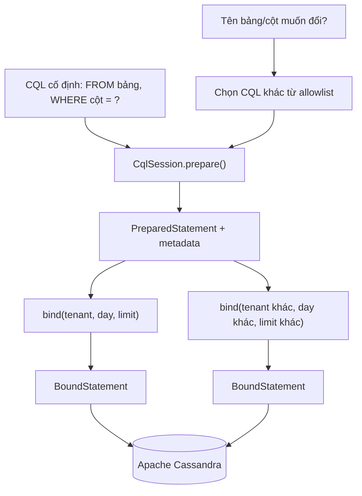

# Tên bảng, tên cột và giới hạn của tham số truy vấn

Trong **Spring Data Cassandra**, prepared statement giúp ứng dụng thực thi nhiều lần cùng một câu CQL với các giá trị khác nhau mà không phải ghép trực tiếp dữ liệu người dùng vào chuỗi truy vấn. Tuy nhiên, một nhầm lẫn thường gặp là cho rằng dấu `?` có thể đại diện cho **bất kỳ phần nào** của CQL — từ giá trị, tên bảng, tên cột cho tới `ORDER BY`. Điều đó không đúng.

Khi dùng Apache Cassandra qua `CqlSession`, `CqlTemplate`, `CassandraTemplate` hoặc repository, cần phân biệt **giá trị có thể bind** và **cấu trúc truy vấn phải xác định trước**. Bài học thuộc chương **Prepared statement** này tập trung vào giới hạn đó, cách xử lý yêu cầu chọn bảng/cột động một cách an toàn và tác động của quá nhiều biến thể CQL tới tính đúng đắn, hiệu năng và vận hành.

## 1. Prepared statement thực sự chuẩn bị điều gì?

Một câu CQL có hai phần:

- **Cấu trúc:** `SELECT`, tên keyspace/bảng, danh sách cột, toán tử, `ORDER BY`, điều kiện khóa và hình dạng câu lệnh.
- **Giá trị:** tenant ID, ngày cần đọc, mã đơn hàng, giới hạn số hàng hoặc các giá trị được cập nhật — tại **những vị trí mà ngữ pháp CQL cho phép bind marker**.

Với prepared statement, ứng dụng gửi câu CQL có bind marker tới Cassandra để chuẩn bị. Server phân tích câu lệnh dựa trên **schema hiện có**, xác định metadata của các biến và dữ liệu kết quả. Mỗi lần thực thi, ứng dụng tạo một `BoundStatement` với những **giá trị phù hợp kiểu**, rồi gửi để thực thi cấu trúc truy vấn đã chuẩn bị.



**Điểm cốt lõi:** bind marker là chỗ đặt **giá trị dữ liệu**, không phải cơ chế thay thế token ngôn ngữ CQL sau khi câu lệnh đã được phân tích. Server phải biết đang đọc bảng nào và so sánh cột nào trước khi ràng buộc kiểu của các giá trị.

## 2. Bảng minh họa: truy vấn đã biết partition key

Giả sử hệ thống lưu sự kiện theo tenant và ngày UTC:

```sql
CREATE TABLE audit_events_by_tenant_day (
    tenant_id   text,
    event_day   date,
    event_id    timeuuid,
    actor_id    text,
    event_type  text,
    payload     text,
    PRIMARY KEY ((tenant_id, event_day), event_id)
) WITH CLUSTERING ORDER BY (event_id DESC);
```

Trong bảng này:

1. `(tenant_id, event_day)` là **partition key ghép**, định vị partition.
2. `event_id timeuuid` là **clustering column**, cho phép thứ tự thời gian trong partition khi ID được tạo đúng ngữ nghĩa `timeuuid`.
3. `actor_id` và `event_type` là **cột thường**. Thêm một điều kiện `WHERE actor_id = ?` không tự biến cột đó thành khóa hoặc tạo index.

Một câu CQL phù hợp với access pattern “20 sự kiện mới nhất của tenant trong ngày”:

```sql
SELECT event_id, actor_id, event_type, payload
FROM audit_events_by_tenant_day
WHERE tenant_id = ?
  AND event_day = ?
LIMIT ?;
```

Ở đây **tên bảng và tên cột là cố định**, còn tenant, ngày và giới hạn số hàng được truyền thành giá trị. `LIMIT` chấp nhận bind marker trong những phiên bản CQL thông dụng được minh họa; khi áp dụng cho một phiên bản Cassandra cụ thể, vẫn cần kiểm tra cú pháp của cluster thực tế và giới hạn `limit` trong service.

## 3. Những gì có thể và không thể bind

| Vị trí | Ví dụ | Có dùng bind marker? | Giải thích |
| --- | --- | --- | --- |
| Giá trị trong `WHERE` | `tenant_id = ?` | **Có** | Server đã biết cột `tenant_id` có kiểu `text` |
| Giá trị `INSERT` | `VALUES (?, ?, ?)` | **Có** | Các cột đích đã được khai báo |
| Giá trị trong `UPDATE` | `SET event_type = ?` | **Có** | Bind giá trị cần ghi |
| Giới hạn kết quả | `LIMIT ?` | **Có, khi cú pháp CQL hỗ trợ** | Marker biểu diễn số nguyên, không phải từ khóa |
| Phần tử của `IN` | `id IN (?, ?, ?)` | **Có, tại các vị trí giá trị hợp lệ** | Hình dạng và số marker của ví dụ vẫn nằm trong CQL |
| Giá trị của collection filter | `tags CONTAINS ?` | **Có, nếu câu WHERE/index hợp lệ** | Bind giá trị không làm query thiếu index trở nên hợp lệ |
| Tên bảng | `FROM ?` | **Không** | Tên bảng là identifier cần biết khi prepare |
| Tên keyspace | `FROM ?.audit_events` | **Không** | Keyspace cũng là identifier |
| Tên cột sau `SELECT` | `SELECT ? FROM ...` | **Không dùng để chọn tên cột** | Marker không thay được danh sách cột trong projection |
| Tên cột ở `WHERE` | `WHERE ? = 'tenant-a'` | **Không dùng để chọn cột** | Vị trí cột thuộc cấu trúc CQL |
| Toán tử | `WHERE id ? ?` | **Không** | `=`, `<`, `>`, `IN` là cú pháp, không phải giá trị |
| Tên cột và chiều sắp xếp | `ORDER BY ? ?` | **Không** | Cần viết rõ clustering column và `ASC`/`DESC` |
| Toàn bộ điều kiện `WHERE` | `WHERE ?` | **Không** | Không thể bind một mảnh CQL như một chuỗi SQL |

Không nên suy từ bảng trên rằng mọi giá trị có cú pháp `?` đều hợp lệ ở bất kỳ vị trí nào. CQL còn có các giới hạn theo loại statement, phiên bản server, kiểu cột, primary key và index. **Bind marker giải quyết truyền giá trị; nó không xóa bỏ quy tắc truy vấn của Cassandra.**

## 4. Ví dụ Java Driver 4: prepare một lần, bind nhiều lần

Với Java Driver 4, một service có thể dùng `CqlSession`, `PreparedStatement` và `BoundStatement`:

```java
import java.time.LocalDate;
import java.util.ArrayList;
import java.util.List;
import java.util.UUID;
import com.datastax.oss.driver.api.core.CqlSession;
import com.datastax.oss.driver.api.core.cql.BoundStatement;
import com.datastax.oss.driver.api.core.cql.PreparedStatement;
import com.datastax.oss.driver.api.core.cql.ResultSet;
import com.datastax.oss.driver.api.core.cql.Row;

public final class AuditEventReader {
    private final CqlSession session;
    private final PreparedStatement findInDay;

    public record AuditBrief(UUID eventId, String actorId, String eventType) {}

    public AuditEventReader(CqlSession session) {
        this.session = session;
        this.findInDay = session.prepare(
            "SELECT event_id, actor_id, event_type " +
            "FROM audit_events_by_tenant_day " +
            "WHERE tenant_id = ? AND event_day = ? LIMIT ?");
    }

    public List<AuditBrief> findRecent(
            String tenantId, LocalDate day, int limit) {
        if (tenantId == null || tenantId.isBlank() || day == null) {
            throw new IllegalArgumentException("Thiếu partition key");
        }
        if (limit < 1 || limit > 100) {
            throw new IllegalArgumentException("limit phải từ 1 đến 100");
        }

        BoundStatement bound = findInDay.bind(tenantId, day, limit);
        ResultSet result = session.execute(bound);

        List<AuditBrief> events = new ArrayList<>();
        for (Row row : result) {
            events.add(new AuditBrief(
                row.getUuid("event_id"),
                row.getString("actor_id"),
                row.getString("event_type")));
        }
        return events;
    }
}
```

Các đặc điểm đáng chú ý:

- Câu CQL được prepare **một lần trong vòng đời của object reader**, thay vì prepare liên tục mỗi HTTP request.
- Giá trị `String`, `LocalDate` và `int` được bind theo thứ tự `?`; driver biết kiểu CQL tương ứng từ metadata của câu lệnh.
- `PreparedStatement` có thể được tái sử dụng an toàn cho nhiều request; mỗi lần bind sinh statement mang giá trị riêng. Không dùng chung một builder mutable rồi thay dữ liệu giữa nhiều thread.
- Cần quản lý `CqlSession` như một tài nguyên dùng chung trong ứng dụng Spring; không mở/đóng session cho mỗi lần đọc.
- `timeuuid` trong `Row` có thể đọc thành `UUID`, nhưng một `UUID.randomUUID()` kiểu v4 **không phải** giá trị timeuuid hợp lệ để ghi vào cột `timeuuid`. Ví dụ trên chỉ đọc ID đã lưu.

Ví dụ giả định keyspace/schema đã được triển khai và session có keyspace mặc định thích hợp. Trong hệ nhiều keyspace, nên chỉ định rõ đường truy cập đã được phê duyệt, chẳng hạn `FROM audit.audit_events_by_tenant_day` nếu keyspace của ví dụ được đặt tên `audit`; đây là **một câu CQL khác** với bản không đủ tên.

### Prepare không đồng nghĩa truy vấn sẽ hiệu quả

Ngay cả khi statement được prepare và bind đúng, một query không có đủ partition key, dùng `ALLOW FILTERING` trên tập dữ liệu lớn hoặc đọc nhiều partition vẫn có thể chậm. Prepared statement không thay thế thiết kế bảng theo truy vấn, kiểm soát paging/consistency hay phép đo p95/p99 của Cassandra.

## 5. Những ví dụ không hợp lệ: tên bảng và tên cột

Hãy xem các ý tưởng sau:

```sql
-- KHÔNG hợp lệ để thay tên bảng:
SELECT event_id FROM ? WHERE tenant_id = ?;

-- KHÔNG hợp lệ để thay tên cột trong WHERE:
SELECT event_id FROM audit_events_by_tenant_day
WHERE ? = ?;

-- KHÔNG dùng marker để thay tên cột trong SELECT:
SELECT ? FROM audit_events_by_tenant_day
WHERE tenant_id = ? AND event_day = ?;

-- KHÔNG hợp lệ để bind từ khóa và hướng sắp xếp:
SELECT event_id FROM audit_events_by_tenant_day
WHERE tenant_id = ? AND event_day = ?
ORDER BY event_id ?;
```

Các ví dụ ở đây nhằm chỉ ra **cấu trúc không thể thay bằng tham số**, không phải các câu lệnh để chạy thử trên production. Ví dụ `SELECT ?` không phải cách yêu cầu Cassandra lấy một cột có tên bằng giá trị bind; nếu cú pháp hoặc loại biểu thức được phiên bản nào đó cho phép trong hoàn cảnh khác, nó vẫn **không biến marker thành identifier**.

Lý do kỹ thuật: khi `prepare()`, Cassandra phải tìm metadata của bảng, phân tích các cột, kiểm tra kiểu và quyết định đường truy cập. Nếu bảng và tên cột chỉ được biết lúc `bind()`, quá trình chuẩn bị ấy không có đủ thông tin.

## 6. Khi cần chọn bảng động: dùng allowlist, không nối input thô

Một yêu cầu có thể cho phép người dùng chọn xem dữ liệu đang hoạt động hay đã lưu trữ. Ví dụ có hai bảng **được thiết kế sẵn, cùng schema tương thích**:

```text
audit_events_by_tenant_day
audit_events_archive_by_tenant_day
```

Giả định bảng archive đã được tạo bởi migration có kiểm soát. Dù chọn bảng theo request, **không bao giờ** đưa một chuỗi `tableName` tùy ý từ API vào `FROM ` bằng phép cộng chuỗi. Thay vào đó, chỉ chọn từ một tập tên **đã biết tại thời điểm viết mã**:

```java
public enum EventSource {
    LIVE("audit_events_by_tenant_day"),
    ARCHIVE("audit_events_archive_by_tenant_day");

    private final String table;

    EventSource(String table) {
        this.table = table;
    }

    public String table() {
        return table;
    }
}
```

```java
import com.datastax.oss.driver.api.core.CqlSession;
import com.datastax.oss.driver.api.core.cql.PreparedStatement;
import java.util.EnumMap;
import java.util.Map;

public final class MultiSourceReader {
    private final Map<EventSource, PreparedStatement> prepared;

    public MultiSourceReader(CqlSession session) {
        this.prepared = new EnumMap<>(EventSource.class);
        for (EventSource source : EventSource.values()) {
            // source.table() chỉ đến từ các hằng số allowlist,
            // KHÔNG đến từ chuỗi tùy ý của người dùng.
            String cql = "SELECT event_id, actor_id, event_type " +
                    "FROM " + source.table() + " " +
                    "WHERE tenant_id = ? AND event_day = ? LIMIT ?";
            prepared.put(source, session.prepare(cql));
        }
    }

    public PreparedStatement statementFor(EventSource source) {
        PreparedStatement statement = prepared.get(source);
        if (statement == null) {
            throw new IllegalArgumentException("Nguồn dữ liệu không hỗ trợ");
        }
        return statement;
    }
}
```

Ứng dụng vẫn dùng bind marker cho `tenantId`, `eventDay` và `limit` khi thực thi statement đã chọn. Điều quan trọng là người dùng chọn **một lựa chọn nghiệp vụ đã được cho phép**, còn server ánh xạ lựa chọn đó sang **một cấu trúc CQL đã biết**.

Một số quy tắc để giữ an toàn:

1. Không sử dụng giá trị input thô làm tên bảng, tên cột hoặc tên keyspace.
2. **Allowlist** là danh sách identifier/câu CQL hợp lệ do ứng dụng sở hữu; không chỉ là một regex cho phép chữ và số.
3. Kiểm tra quyền người dùng đối với cả **tenant** lẫn **nguồn dữ liệu**. CQL được bind an toàn không tự thực thi phân quyền nghiệp vụ.
4. Tránh tạo **một bảng riêng cho mỗi tenant** chỉ để có truy vấn động. Việc đó làm phình số đối tượng schema; dùng `tenant_id` trong partition key thường dễ quản lý hơn nếu phù hợp access pattern.
5. Nếu hai bảng không có schema tương thích, đừng ép chúng dùng cùng một query chỉ vì tên cột gần giống; tách câu CQL hoặc mapping tương ứng.

### Quoting identifier không biến input thành đáng tin

CQL phân biệt identifier thông thường với identifier đặt trong dấu nháy kép (ví dụ `"MixedCaseTable"`). Quoting nhằm biểu diễn **tên đã biết** chứa chữ hoa/ký tự đặc biệt theo quy tắc CQL, **không phải** cách thay thế việc cho phép tùy ý một bảng từ request. Với tên bảng do hệ thống quản lý, ưu tiên đặt tên đơn giản, nhất quán và không cần quoting đặc biệt.

## 7. Chọn tên cột, phép lọc và hướng sắp xếp động

Một API báo cáo có thể cho phép người dùng chọn một số trường trong danh sách. Thay vì cố bind tên cột bằng `?`, chọn một tập **projection cố định**:

```java
public enum EventProjection {
    BRIEF("event_id, event_type"),
    DETAILS("event_id, actor_id, event_type, payload");

    private final String columns;

    EventProjection(String columns) {
        this.columns = columns;
    }

    public String columns() {
        return columns;
    }
}
```

```java
String statementText =
        "SELECT " + projection.columns() +
        " FROM audit_events_by_tenant_day " +
        "WHERE tenant_id = ? AND event_day = ? LIMIT ?";
```

`projection` phải được chuyển từ input thành một `EventProjection` đã được định nghĩa sẵn; không truyền trực tiếp chuỗi như `"event_id, payload"` do client tự gửi. Hãy đối chiếu cột được chọn với kiểu `RowMapper` tương ứng — `BRIEF` không có `payload`, nên code đọc `payload` trên projection này là lỗi mapping.

Tương tự, nếu UI hỗ trợ “mới nhất” hoặc “cũ nhất”, không bind hướng `ASC`/`DESC`:

```java
String newest = "SELECT event_id, event_type " +
        "FROM audit_events_by_tenant_day " +
        "WHERE tenant_id = ? AND event_day = ? " +
        "ORDER BY event_id DESC LIMIT ?";

String oldest = "SELECT event_id, event_type " +
        "FROM audit_events_by_tenant_day " +
        "WHERE tenant_id = ? AND event_day = ? " +
        "ORDER BY event_id ASC LIMIT ?";
```

Với schema đã cho, `event_id` là clustering column và truy vấn ràng buộc đủ partition key, nên hai hướng trên thể hiện những đường sắp xếp CQL hợp lý. Nhưng **không thể đổi tùy ý `ORDER BY actor_id`**: `actor_id` là cột thường, không có thứ tự clustering để Cassandra sử dụng. Nếu business yêu cầu sắp xếp theo actor, cần một access pattern/bảng đọc khác hoặc xử lý trên tập kết quả đã được giới hạn một cách có chủ đích.

Với các toán tử `=`, `<`, `>`, `IN`, hãy chọn **một CQL template được kiểm chứng** cho từng phép lọc hợp lệ. Không bind một mảnh `"actor_id = ?"` làm giá trị của `WHERE ?`. Điều kiện trên cột không phải khóa vẫn phải phù hợp với schema hoặc index; chọn từ allowlist không bảo đảm Cassandra chấp nhận query không hợp lệ.

## 8. `IN` có số lượng tham số thay đổi

Một API nhận danh sách ID có thể cần truy vấn:

```sql
SELECT event_id, event_type
FROM audit_events_by_tenant_day
WHERE tenant_id = ? AND event_day = ?
  AND event_id IN (?, ?, ?);
```

Ba marker sau `IN` chỉ đại diện cho **ba giá trị** được bind, không đại diện cho tên cột hay toàn bộ biểu thức. Khi số ID thay đổi, số marker trong dạng truy vấn này cũng thay đổi:

```text
IN (?)               → một cấu trúc CQL
IN (?, ?)            → cấu trúc CQL khác
IN (?, ?, ?)         → cấu trúc CQL khác nữa
```

Vì vậy, việc prepare câu CQL riêng cho **mọi độ dài danh sách có thể xảy ra** dễ tạo nhiều entry trong prepared statement cache của client và trên server. Một số phiên bản CQL/driver còn hỗ trợ những hình thức bind một collection cho `IN`; phải kiểm tra chính xác cú pháp, metadata và giới hạn của cluster thay vì tự suy từ SQL.

Nếu chọn cách xây số marker, chỉ xây dựng chúng từ **số phần tử đã được kiểm soát**, còn từng ID là tham số bind:

```java
import java.util.Collections;
import java.util.List;
import java.util.UUID;
import com.datastax.oss.driver.api.core.CqlSession;
import com.datastax.oss.driver.api.core.cql.PreparedStatement;

public PreparedStatement prepareForIds(
        CqlSession session, List<UUID> eventIds) {

    if (eventIds == null || eventIds.isEmpty()
            || eventIds.size() > 20
            || eventIds.stream().anyMatch(id -> id == null)) {
        throw new IllegalArgumentException("Chỉ nhận 1..20 UUID hợp lệ");
    }

    String placeholders = String.join(
            ", ", Collections.nCopies(eventIds.size(), "?"));
    String cql = "SELECT event_id, event_type " +
            "FROM audit_events_by_tenant_day " +
            "WHERE tenant_id = ? AND event_day = ? " +
            "AND event_id IN (" + placeholders + ")";

    // Ví dụ chỉ chuẩn bị hình dạng; mã gọi cần bind
    // tenantId, eventDay và từng UUID đúng thứ tự marker.
    return session.prepare(cql);
}
```

Ví dụ này tập trung vào **ranh giới giữa cấu trúc và giá trị**, không phải mẫu tối ưu để gọi `prepareForIds()` cho từng request. Trong production, nên **tái sử dụng những hình dạng CQL thực sự có nhu cầu**, cap số ID và cân nhắc lô nhỏ/driver options phù hợp. Nếu danh sách rất lớn, điều chỉnh query contract thay vì xây một `IN` khổng lồ.

Ngoài ra, `IN` trên clustering key **không được phép bỏ qua quy tắc partition key**: ở đây câu CQL vẫn cố định `tenant_id` và `event_day`. `IN` không tạo đường tìm kiếm toàn cluster miễn phí. Với `IN` trên nhiều partition key, số đường đọc và độ trễ đuôi còn tăng theo fan-out.

## 9. Named bind marker vẫn không phải tên cột

Ngoài marker vị trí `?`, CQL/Java Driver cũng hỗ trợ **named bind marker** ở những vị trí hợp lệ. Ví dụ:

```sql
SELECT event_id, event_type
FROM audit_events_by_tenant_day
WHERE tenant_id = :tenant
  AND event_day = :day
LIMIT :max_rows;
```

Khi dùng tên `tenant`, `day` và `max_rows`, ứng dụng vẫn bind **giá trị** vào những biến đã được xác định trong metadata statement. Chẳng hạn:

```java
import java.time.LocalDate;
import com.datastax.oss.driver.api.core.cql.BoundStatement;
import com.datastax.oss.driver.api.core.cql.PreparedStatement;

BoundStatement bound = prepared.boundStatementBuilder()
        .setString("tenant", "tenant-a")
        .setLocalDate("day", LocalDate.of(2026, 11, 25))
        .setInt("max_rows", 30)
        .build();
```

`prepared` trong đoạn code là `PreparedStatement` được tạo bằng **câu CQL có named markers vừa nêu**. Tên `tenant` và `day` là tên bind marker, **không phải** tên cột động; cột CQL vẫn là `tenant_id` và `event_day`.

Named markers hữu ích cho readability, đặc biệt khi một câu có nhiều tham số cùng kiểu. Cần dùng tên marker nhất quán, tránh trùng tên không chủ ý và kiểm tra đặc tính bind của phiên bản driver nếu một tên marker xuất hiện nhiều lần.

## 10. Quan hệ giữa `CqlTemplate`, `CassandraTemplate` và repository

Các tầng Spring Data Cassandra phục vụ những mức trừu tượng khác nhau:

| Tầng API | Thao tác liên quan | Ai xác định tên bảng/cột? |
| --- | --- | --- |
| `CqlSession` của Java Driver | `prepare`, `bind`, `execute` | Chuỗi CQL do code cung cấp |
| `CqlTemplate` | Thực thi CQL, map `Row` qua `RowMapper` | Chuỗi CQL/statement do code cung cấp |
| `CassandraTemplate` | `select`, `insert`, `update` trên entity/query | Phần lớn từ mapping `@Table`, `@Column` và `Query` |
| `CassandraRepository` | CRUD và các truy vấn có định nghĩa | Từ metadata entity, method/query đã cấu hình |

Trong `CqlTemplate`, bạn thường tự viết `FROM table_name` và danh sách cột. Trong `CassandraTemplate`, framework có thể sinh CQL từ metadata entity. Nhưng **không có tầng API nào cho phép một bind marker tự biến thành tên bảng hoặc tên cột**.

Ví dụ một lời gọi `CqlTemplate` dùng câu lệnh được tạo trước với giá trị đã bind:

```java
import java.time.LocalDate;
import java.util.List;
import java.util.UUID;
import com.datastax.oss.driver.api.core.cql.SimpleStatement;
import org.springframework.data.cassandra.core.cql.CqlTemplate;

public record AuditItem(UUID eventId, String eventType) {}

public List<AuditItem> queryOneDay(
        CqlTemplate cql, String tenantId, LocalDate day) {

    SimpleStatement stmt = SimpleStatement.builder(
            "SELECT event_id, event_type " +
            "FROM audit_events_by_tenant_day " +
            "WHERE tenant_id = ? AND event_day = ? LIMIT 30")
            .addPositionalValues(tenantId, day)
            .build();

    return cql.query(stmt, (row, index) ->
            new AuditItem(row.getUuid("event_id"),
                          row.getString("event_type")));
}
```

**Phân biệt:** `SimpleStatement` mang các bind values như trên là một cách truyền giá trị tách khỏi chuỗi CQL; nó **không tự đồng nghĩa** với `PreparedStatement` đã được `CqlSession.prepare()` và tái sử dụng trên server. Nếu mục tiêu là tối ưu đường đọc lặp nhiều lần, cần kiểm tra cơ chế chuẩn bị/tái sử dụng statement thật sự của driver và hệ thống.

Tương tự, `@Query` trong repository có quy ước placeholder riêng của Spring Data (ví dụ `?0`, `?1` cho các tham số phương thức trong một số kiểu query). Đó là cách framework liên kết **giá trị**, không phải lối đặt tên bảng động. Khi thiết kế query, phân biệt placeholder ở tầng Spring Data với marker `?` hoặc `:name` của CQL/driver.

## 11. Prepared statement cache, thay đổi schema và vận hành

Chuẩn bị statement giúp tránh lặp lại một phần công việc phân tích CQL, nhưng quá nhiều truy vấn khác hình dạng cũng có chi phí:

- **Cache cardinality:** câu CQL khác tên bảng/cột, projection, `ORDER BY` hoặc số marker `IN` có thể trở thành những prepared statements khác nhau. Sinh vô hạn biến thể từ input người dùng sẽ tạo áp lực bộ nhớ/cache.
- **Server và client:** driver quản lý thông tin prepared statement ở client, còn các node Cassandra tham gia thực thi cũng cần nhận biết prepared metadata; một statement từng được chuẩn bị không đồng nghĩa mọi node mãi mãi đều có sẵn nó.
- **Node restart/failover:** một node có thể mất trạng thái prepared cached. Driver thường có cơ chế tự chuẩn bị lại khi gặp tình trạng tương ứng; hệ thống vẫn phải quan sát lỗi và retry theo chính sách.
- **Schema migration:** thêm/xóa/đổi cột hoặc bảng có thể làm metadata của một prepared statement không còn tương thích. Triển khai migration theo trình tự, chờ schema agreement, kiểm thử đường đọc/ghi và cập nhật statement/cache khi thay đổi cấu trúc.
- **Parameter type:** dùng đúng kiểu CQL và Java. Ví dụ cột `date` thường được bind bằng `LocalDate`; cột `timeuuid` cần UUID đúng biến thể, không phải một chuỗi tùy ý.
- **Không prepare mỗi request:** nếu query shape cố định, nên prepare một lần và tái sử dụng. Lặp `session.prepare` không có lợi như việc nắm giữ một đối tượng đã chuẩn bị.

Việc chuẩn bị lại sau schema change không thay thế **kiểm thử tương thích giữa phiên bản ứng dụng và schema**. Nếu code cũ tham chiếu cột đã xóa, prepare lại có thể vẫn thất bại vì câu CQL không còn hợp lệ.

### Đặt giới hạn ở biên API

Trong hệ nhiều tenant, một endpoint cho phép chọn tùy ý bảng, số giá trị `IN`, cột `ORDER BY` và `LIMIT` có thể gây cả lỗi bảo mật lẫn tải vận hành. Một hợp đồng API tốt nên cung cấp các lựa chọn hữu hạn:

- Một tập **view** và **projection** được xác nhận trước.
- Giới hạn `LIMIT` và số phần tử `IN`.
- Phân quyền dựa trên tenant ở server, không tin vào `tenant_id` do client tùy ý gửi.
- Timeout, page size, consistency và mức đồng thời tương ứng với SLA.
- Log cấu trúc truy vấn và số liệu hiệu năng, không ghi dữ liệu bí mật trong bind values.

Đây là cách biến một tập truy vấn dự đoán được thành các prepared statements thực sự hữu ích, thay vì dùng dynamic CQL như một engine truy vấn tổng quát không kiểm soát.

## 12. Những lỗi thường gặp và cách phân biệt

| Hiện tượng | Nguyên nhân thường gặp | Hướng kiểm tra |
| --- | --- | --- |
| `SELECT ... FROM ?` báo syntax error | Tên bảng không phải bind value | Dùng tên bảng cố định/allowlist |
| `WHERE ? = ?` không chọn được cột | Bind marker không thay identifier | Viết cột cụ thể trong CQL template |
| `ORDER BY event_id ?` bị từ chối | Không thể bind `ASC`/`DESC` | Dùng hai câu CQL cố định nếu sắp xếp hợp lệ |
| `PreparedStatement.bind` lỗi kiểu | Java value không khớp CQL metadata | Kiểm tra cột, `LocalDate`/`UUID` và thứ tự marker |
| Query đã prepare nhưng chậm | Partition key/index/filter hoặc fan-out không phù hợp | Kiểm tra access pattern và tài nguyên cluster |
| Nhiều prepared statement cache entries | Quá nhiều tên bảng, projection, số lượng marker khác nhau | Hạn chế query shapes, tái sử dụng statement |
| Statement lỗi sau migration | Cột/bảng hoặc metadata đã đổi | Kiểm tra schema agreement và query tương thích |
| Bind an toàn nhưng đọc dữ liệu tenant khác | Ứng dụng chưa ràng buộc phân quyền | Lấy tenant từ ngữ cảnh đã xác thực, kiểm tra quyền |
| `IN` trả kết quả khác thứ tự đầu vào | Không có cam kết global ordering | Sắp xếp theo hợp đồng ở tầng ứng dụng hoặc đổi bảng |
| `LIMIT` lớn gây tải | Chỉ bind đúng kiểu, chưa validate giá trị | Giới hạn số hàng ở service, thiết kế paging |

Khi phát hiện lỗi, phân biệt **lỗi cú pháp hoặc schema xảy ra lúc prepare**, **lỗi kiểu/giá trị khi bind** và **lỗi truy cập dữ liệu lúc execute**. Không chuyển mọi exception thành “không tìm thấy bản ghi”; một timeout hoặc lỗi schema là sự cố riêng cần quan sát.

## 13. Checklist và bài tập

Trước khi chấp nhận một prepared statement mới:

1. **Query contract rõ ràng:** truy vấn đọc gì, cần filter nào, phải giới hạn bao nhiêu hàng?
2. **Schema khớp CQL:** bảng/keyspace, cột, partition key và clustering order đúng với access pattern.
3. **Chỉ bind dữ liệu:** không đưa tên bảng, tên cột, toán tử hay hướng sort vào marker.
4. **Allowlist cấu trúc động:** view, projection và hướng sort được code kiểm soát, không phải chuỗi raw.
5. **Đúng kiểu/thứ tự:** truyền `LocalDate`, `UUID`, `String` và các số theo metadata đã prepare.
6. **Tái sử dụng shape:** không prepare trên mỗi request; tránh số biến thể CQL không giới hạn.
7. **Có giới hạn vận hành:** cap `LIMIT`, độ dài `IN`, paging và mức độ song song.
8. **Thử trên cluster thật:** đo p95/p99, xử lý node restart, schema migration và lỗi consistency/index.

**Tình huống A — Chọn bảng:** Một API nhận `table=orders_by_tenant` và developer định viết `SELECT * FROM ? WHERE tenant_id = ?`. Có thể sửa bằng cách thêm dấu nháy quanh marker không?

**Đáp án gợi ý:** Không. Tên bảng là identifier, không phải giá trị bind. Tạo một allowlist các bảng được phép hoặc các câu CQL đã định nghĩa sẵn; vẫn bind `tenant_id` như một giá trị.

**Tình huống B — Lọc theo cột động:** Người dùng chọn `filterField=actor_id` hoặc `filterField=event_type`. Developer viết `WHERE ? = ?`. Cần làm gì?

**Đáp án gợi ý:** Chọn câu CQL cụ thể theo một tập field hợp lệ, sau đó kiểm tra schema/index hoặc thiết kế bảng truy vấn thích hợp cho từng field. Chỉ giá trị ở vế phải mới được bind; không phải mọi field đều có thể lọc hiệu quả trên cùng bảng.

**Tình huống C — Sort:** API có `sort=ASC|DESC` trên `event_id`. Có nên viết `ORDER BY event_id ?`?

**Đáp án gợi ý:** Không. Dùng hai CQL templates đã kiểm chứng `ORDER BY event_id ASC` và `ORDER BY event_id DESC`, chọn theo enum của server, rồi bind tenant, day và limit. Cả hai chỉ hợp lý khi clustering order và partition filter cho phép.

**Tình huống D — Cache:** Một endpoint nhận từ 1 đến 5.000 UUID và sinh một prepared CQL khác nhau cho từng kích thước `IN`. Vấn đề nào có thể xuất hiện?

**Đáp án gợi ý:** Số query shapes tăng mạnh, gây cache pressure và tạo fan-out/độ trễ cao. Giới hạn số ID, chia lô theo ngân sách đồng thời, tái sử dụng một số shapes hoặc cân nhắc khả năng bind collection được phiên bản Cassandra hỗ trợ.

## Kết luận

Trong prepared statement của Cassandra, **giá trị truy vấn** và **cấu trúc CQL** là hai loại đầu vào khác nhau. `?` và named marker giúp bind dữ liệu an toàn theo kiểu, nhưng **không thể dùng chúng để thay tên bảng, tên cột, keyspace, toán tử hay hướng `ORDER BY`**. Khi ứng dụng cần chọn cấu trúc truy vấn động, hãy sử dụng **allowlist các câu CQL hoặc identifier đã được kiểm chứng** và tiếp tục bind các giá trị riêng rẽ.

Với Spring Data Cassandra, chọn đúng tầng `CqlSession`, `CqlTemplate`, `CassandraTemplate` hoặc repository không thay đổi nguyên tắc đó. **Thiết kế truy vấn theo partition key → xác định cấu trúc CQL hợp lệ → prepare/tái sử dụng → bind đúng kiểu → kiểm soát paging, consistency và hiệu năng** là quy trình giúp ứng dụng an toàn và có chi phí truy cập dự đoán được.
