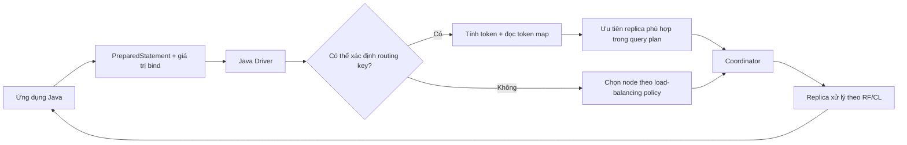
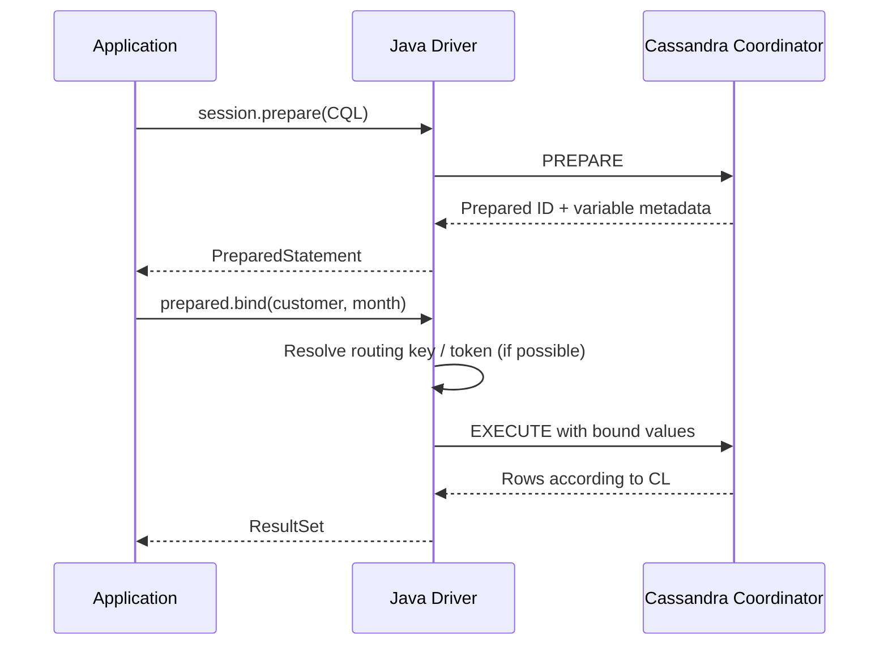

# Định tuyến theo token và điều kiện Driver có đủ thông tin khóa

Trong Apache Cassandra, một partition được phân bố đến các replica theo **token của partition key**. Khi ứng dụng Java sử dụng **prepared statement**, Cassandra Java Driver có thể tính ra *routing key* từ những giá trị đã bind và dùng metadata của cluster để **ưu tiên một node có bản sao của partition** làm coordinator. Cơ chế này thường gọi là **token-aware routing**.

Tuy nhiên, `PreparedStatement` không phải “công tắc thần kỳ” bảo đảm mọi truy vấn luôn đến đúng replica. Driver phải biết **keyspace, bảng, vị trí các thành phần partition key trong tham số bind, giá trị hợp lệ và topology**. Khi thiếu những thông tin ấy, hoặc node mong muốn không khả dụng, driver sử dụng kế hoạch định tuyến dự phòng của load-balancing policy. Truy vấn vẫn có thể chạy đúng nhưng phải đi thêm bước chuyển tiếp từ coordinator đến replica, làm tăng số hop mạng và ảnh hưởng độ trễ.

Bài thuộc chương **Prepared statement** của module `SPRING_DATA_CASSANDRA`. Nội dung tập trung vào logic định tuyến của **Java Driver 4.x**, ví dụ CQL và Java, sự kết hợp với repository, CassandraTemplate/CqlTemplate, consistency level, paging và kiểm soát hiệu năng. Các API cần được đối chiếu với đúng phiên bản Spring Boot, Spring Data Cassandra, Java Driver và Cassandra đang chạy.

## 1. Partition key, token và coordinator: ba khái niệm khác nhau

Giả sử bảng theo yêu cầu “xem đơn của một khách trong một tháng”:

```sql
CREATE TABLE orders_by_customer_month (
    customer_id uuid,
    bucket_month date,
    placed_at timestamp,
    order_id uuid,
    state text,
    total_minor bigint,
    PRIMARY KEY ((customer_id, bucket_month), placed_at, order_id)
) WITH CLUSTERING ORDER BY (
    placed_at DESC,
    order_id DESC
);
```

Ở đây:

- **Partition key:** cặp `(customer_id, bucket_month)`.
- **Clustering columns:** `placed_at` và `order_id`, quyết định thứ tự và tính duy nhất của hàng **trong partition**.
- **Token:** kết quả bộ partitioner áp dụng lên biểu diễn byte của **toàn bộ partition key**. Với `Murmur3Partitioner` thông dụng, token biểu diễn bằng số nguyên có dấu; không phải timestamp hoặc UUID của hàng.
- **Replica:** các node giữ dữ liệu partition theo replication strategy, RF và topology.
- **Coordinator:** node nhận statement từ driver, điều phối thao tác đến replica và tổng hợp phản hồi phù hợp consistency level.

**Token được tính từ partition key, không phải từ toàn bộ primary key.** Hai đơn của cùng `customer_id` và `bucket_month` có `placed_at` hoặc `order_id` khác nhau vẫn thuộc cùng một partition, do đó có cùng token.

Với composite partition key, không thể tính đúng token chỉ từ `customer_id`: còn cần `bucket_month`. Việc lấy hash chuỗi `customer_id + bucket_month` bằng một hàm bất kỳ trong ứng dụng cũng không tương đương bộ partitioner của Cassandra; driver dùng cách mã hóa CQL và metadata phù hợp.

### Cấu trúc luồng truy vấn



Driver **không gửi truy vấn trực tiếp cho từng replica để thay coordinator**. Nó chọn node đầu tiên trong kế hoạch định tuyến; node ấy làm coordinator. Khi là replica của partition, coordinator có thể xử lý một phần việc ngay tại chỗ và giảm số hop so với một coordinator không giữ partition. Tuy nhiên, coordinator vẫn phải liên lạc với những replica khác nếu consistency level yêu cầu.

## 2. Token-aware routing giúp gì và không giúp gì?

Token-aware routing được thiết kế để giảm các lần chuyển tiếp không cần thiết và phân phối truy vấn hợp lý theo token của partition.

| Khi driver có routing key | Khi driver không có routing key |
|---|---|
| Có thể tra token map để xác định nhóm replica của partition | Không thể suy ra replica của một partition cụ thể từ statement |
| Load-balancing policy có thể ưu tiên replica hợp lệ | Dùng các node hợp lệ theo chính sách cân bằng tải dự phòng |
| Giảm khả năng coordinator phải chuyển tiếp yêu cầu sang replica ở node khác | Coordinator được chọn có thể không phải replica, cần chuyển tiếp |
| Vẫn chịu ảnh hưởng DC, trạng thái node, kết nối, retry và CL | Truy vấn vẫn có thể đúng nếu CQL hợp lệ và cluster có replica phục vụ |

**Không phải lời bảo đảm:** “Prepared statement luôn đến đúng một replica”. Kế hoạch định tuyến chịu ảnh hưởng của node khả dụng, local datacenter, metadata đang có, chính sách cân bằng tải, trạng thái phiên kết nối, thông tin schema và cơ chế thử lại. Một số driver/phiên bản có cách chọn replica ưu tiên khác nhau.

Điều này cũng **không phải nhất quán dữ liệu**. Token-aware routing liên quan **chọn coordinator**; `LOCAL_ONE`, `LOCAL_QUORUM`, `ALL` liên quan **số/phạm vi replica cần xác nhận**. Chọn coordinator gần partition không tự nâng CL hoặc bảo đảm các projection nghiệp vụ ở nhiều bảng đồng bộ.

## 3. Java Driver cần những thông tin gì?

Một truy vấn được prepare chỉ giúp driver **có cơ hội** nắm metadata. Để xác định routing key, cần đủ thông tin sau:

| Điều kiện | Vì sao quan trọng | Tình huống thường thất bại |
|---|---|---|
| **Keyspace và bảng được nhận diện** | Token map và replica placement gắn với keyspace/table metadata | Statement không có ngữ cảnh bảng/keyspace rõ ràng |
| **Driver biết partition-key bind variables** | Cần biết tham số nào tương ứng từng thành phần partition key | Server không trả hoặc driver không suy ra được metadata routing cho mẫu CQL |
| **Mọi thành phần partition key có giá trị** | Composite key cần đủ các phần để tạo routing key | Chỉ bind `customer_id` nhưng thiếu `bucket_month` |
| **Giá trị được mã hóa bằng codec phù hợp** | Routing key được tính từ biểu diễn byte theo CQL type | Bind sai kiểu hoặc thiếu codec cho kiểu tùy chỉnh |
| **Token map/topology dùng được** | Phải biết node nào là replica cho token trong keyspace | Metadata chưa cập nhật, node đang join/leave hoặc driver chưa biết topology |
| **Load-balancing policy hỗ trợ và cho phép node** | Token-aware là một yếu tố của query plan | Replica không thuộc DC được phép, đang down hoặc không có connection |

Với Java Driver 4.x, khi prepare những CQL statement được Cassandra hỗ trợ, **metadata của prepared statement** có thể chứa vị trí các bind marker ứng với partition key. Driver dựa trên metadata này và các giá trị trong `BoundStatement` để xác định routing key. Không nên suy ra rằng **mọi** prepared statement trả đủ metadata; lệnh động/phức tạp và các câu truy vấn không chỉ ra một partition duy nhất có thể không cung cấp được đường định tuyến như mong muốn.

### Composite key phải đủ hai giá trị

Với bảng `orders_by_customer_month`:

```sql
-- Đủ partition key, có cơ hội tính một routing key.
SELECT order_id, placed_at, state
FROM orders_by_customer_month
WHERE customer_id = ?
  AND bucket_month = ?
LIMIT 20;
```

Truy vấn chỉ có:

```sql
-- Không có đầy đủ composite partition key.
SELECT order_id, placed_at, state
FROM orders_by_customer_month
WHERE customer_id = ?
LIMIT 20;
```

không còn xác định một partition. Câu thứ hai có thể bị Cassandra từ chối nếu không có cơ chế truy vấn đặc biệt; kể cả được phép lọc, driver cũng không có một routing key tương ứng cho partition cần đọc. **Không dùng `ALLOW FILTERING` như cách bù một phần partition key bị thiếu** trên đường đọc quan trọng.

### Bind value phải có thể sử dụng

Một giá trị `null` hoặc `UNSET` không phải giá trị hợp lệ để xác định partition key cho mutation thông thường. Với câu lệnh đòi hỏi `customer_id` và `bucket_month`, phải kiểm tra đầu vào trước khi gọi driver. Dùng `UUID.randomUUID()` hoặc bucket ngày/tháng mới cho mỗi lần retry cũng có thể chuyển yêu cầu sang **partition khác**, gây lỗi nghiệp vụ độc lập với token-aware routing.

## 4. PreparedStatement, BoundStatement và routing key

Trong Java Driver 4.x, quy trình điển hình:

1. **Prepare** mẫu CQL một lần cho cùng session/keyspace/schema.
2. Cassandra xác thực/phân tích CQL và trả metadata của các bind marker.
3. Driver giữ `PreparedStatement` để tái sử dụng.
4. Mỗi request tạo `BoundStatement` chứa **giá trị tham số riêng**.
5. Driver xác định routing key/token nếu có đủ thông tin, rồi chọn coordinator theo query plan.



Các bước minh họa logic, không có nghĩa driver nhất thiết thực hiện mọi bước network đúng một lần: prepare có cơ chế cache/prepare lại trên node, và việc kết nối có thể thay đổi qua quá trình vận hành.

**PreparedStatement** thường được chia sẻ giữa các request; **BoundStatement** mang giá trị của một lần gọi. Không ghép chuỗi CQL chứa dữ liệu người dùng mỗi lần request để mô phỏng prepared statement. Điều đó làm tăng nguy cơ CQL injection, tạo nhiều mẫu câu lệnh không cần thiết và cản trở tái sử dụng.

## 5. Ví dụ Java: truy vấn đủ khóa để driver định tuyến

Giả sử keyspace `shop` đã có bảng nêu ở mục 1. Ví dụ Java Driver 4.x:

```java
import java.net.InetSocketAddress;
import java.time.LocalDate;
import java.util.UUID;

import com.datastax.oss.driver.api.core.CqlSession;
import com.datastax.oss.driver.api.core.cql.BoundStatement;
import com.datastax.oss.driver.api.core.cql.PreparedStatement;
import com.datastax.oss.driver.api.core.cql.ResultSet;

try (CqlSession session = CqlSession.builder()
        .addContactPoint(new InetSocketAddress("127.0.0.1", 9042))
        .withLocalDatacenter("dc1")
        .withKeyspace("shop")
        .build()) {

    PreparedStatement findByCustomerMonth = session.prepare(
        "SELECT order_id, placed_at, state, total_minor " +
        "FROM shop.orders_by_customer_month " +
        "WHERE customer_id = ? AND bucket_month = ? LIMIT ?"
    );

    UUID customerId = UUID.fromString(
        "11111111-1111-1111-1111-111111111111"
    );
    LocalDate month = LocalDate.of(2026, 11, 1);

    BoundStatement statement = findByCustomerMonth.bind(
        customerId, month, 20
    );

    ResultSet rows = session.execute(statement);

    rows.forEach(row -> {
        UUID id = row.getUuid("order_id");
        System.out.println(id);
    });
}
```

Ví dụ chỉ nhằm minh họa cú pháp; phải có Cassandra đang chạy, keyspace `shop` và schema chính xác mới thực thi được. Ký hiệu `?` là positional bind marker. Những giá trị `customerId`, `month` được mã hóa theo các CQL types `uuid`, `date`. `LIMIT` cũng được bind để tránh nối trực tiếp số do client cung cấp vào CQL.

Với hai tham số partition key đều có giá trị và metadata đầy đủ, driver có thể tạo routing key. **Kết quả đọc không phụ thuộc việc client tự biết địa chỉ replica**: ứng dụng chỉ gửi query và driver/cluster xử lý topology.

Trong môi trường Spring Boot, **không tạo session bằng try-with-resources trên mỗi request**. Nên inject `CqlSession` do ứng dụng quản lý vòng đời, prepare/cached những mẫu CQL dùng thường xuyên và giữ `PreparedStatement` như một dependency dùng lại.

### Chuẩn bị một lần, bind nhiều lần

```java
public final class CustomerMonthReader {
    private final CqlSession session;
    private final PreparedStatement prepared;

    public CustomerMonthReader(CqlSession session) {
        this.session = session;
        this.prepared = session.prepare(
            "SELECT order_id, placed_at, state, total_minor " +
            "FROM shop.orders_by_customer_month " +
            "WHERE customer_id = ? AND bucket_month = ? LIMIT ?"
        );
    }

    public ResultSet read(UUID customerId, LocalDate month, int maxRows) {
        if (customerId == null || month == null) {
            throw new IllegalArgumentException(
                "Both partition-key components are required");
        }
        if (maxRows < 1 || maxRows > 100) {
            throw new IllegalArgumentException("maxRows must be 1..100");
        }

        BoundStatement bound = prepared.bind(customerId, month, maxRows);
        return session.execute(bound);
    }
}
```

Đoạn lớp này dùng các import Java Driver, `UUID` và `LocalDate` ở ví dụ trước; khi tổ chức source thật phải bổ sung imports, bean lifecycle và xử lý ResultSet theo yêu cầu. `ResultSet` có thể fetch thêm trang khi được duyệt: đừng chuyển nó thành danh sách khổng lồ nếu truy vấn dài.

Nếu có thay đổi schema/metadata trong lúc triển khai, driver có thể cần cập nhật metadata hoặc **reprepare** statement trên node; không dùng PreparedStatement cache vĩnh viễn qua những thay đổi schema mà không có kế hoạch kiểm chứng.

## 6. Thế nào là “đủ thông tin khóa” cho INSERT, UPDATE, DELETE?

Khả năng định tuyến không giới hạn ở `SELECT`. Những mutation có đầy đủ partition-key values cũng có thể được xác định theo token, nếu driver có metadata thích hợp.

### INSERT với khóa tổng hợp

```sql
INSERT INTO shop.orders_by_customer_month (
    customer_id, bucket_month, placed_at, order_id, state, total_minor
) VALUES (?, ?, ?, ?, ?, ?);
```

Khi prepare statement và bind toàn bộ khóa `customer_id`, `bucket_month`, driver có đủ giá trị để xác định partition. `placed_at` và `order_id` phân biệt hàng trong partition, nhưng **không thay đổi token**.

### UPDATE phải xác định hàng cần cập nhật

```sql
UPDATE shop.orders_by_customer_month
SET state = ?
WHERE customer_id = ?
  AND bucket_month = ?
  AND placed_at = ?
  AND order_id = ?;
```

Các bind marker cho partition key nằm trong `WHERE`; server/driver có thể nhận ra từ prepared metadata. Không nhất thiết các marker đầu tiên trong CQL là partition key: ở ví dụ, `state` xuất hiện trước `customer_id`. **Không đoán vị trí khóa theo thứ tự tham số**; hãy để metadata của prepared statement xác định phần nào là partition key.

### DELETE có đủ khóa

```sql
DELETE FROM shop.orders_by_customer_month
WHERE customer_id = ?
  AND bucket_month = ?
  AND placed_at = ?
  AND order_id = ?;
```

`DELETE` ở đây tác động một hàng. Trong Cassandra, xóa có thể tạo tombstone; khả năng định tuyến tốt không loại bỏ chi phí tombstone và compaction.

### Truy vấn một partition nhưng nhiều clustering rows

```sql
SELECT order_id, placed_at
FROM shop.orders_by_customer_month
WHERE customer_id = ?
  AND bucket_month = ?
  AND placed_at >= ?
  AND placed_at < ?;
```

Hai thành phần partition key vẫn cố định, nên việc lọc khoảng trên clustering column `placed_at` **không ngăn xác định partition token**. Điều kiện range này khác với `WHERE token(customer_id, bucket_month) > ?` dùng cho quét theo token range (phân tích ở mục 9).

## 7. Những trường hợp Driver không thể xác định một routing key đáng tin cậy

| Mẫu CQL | Vấn đề routing | Hướng xử lý |
|---|---|---|
| `SELECT` theo đủ partition key, bind giá trị hợp lệ | Có khả năng tạo routing key khi metadata đầy đủ | Giữ prepared statement và bind đúng |
| `SELECT` chỉ theo một phần composite partition key | Không xác định một partition | Sửa yêu cầu hoặc thiết kế bảng đọc khác |
| `SELECT` lọc cột thường qua `ALLOW FILTERING` | Có thể phải đọc nhiều partition | Không coi token-aware routing là giải pháp |
| `WHERE customer_id IN (?, ?, ?)` với nhiều partition | Có thể liên quan nhiều routing keys; không thể giả định một token duy nhất | Tách các truy vấn partition cụ thể nếu cần tối ưu/kiểm soát |
| `SELECT` theo token range | Mô tả dải token, không phải một partition key đã biết | Dùng cơ chế scan/token-range có kiểm soát |
| CQL động đổi tên bảng/keyspace hoặc cấu trúc câu lệnh | Prepared metadata/cache theo một mẫu không còn áp dụng | Dùng mẫu truy vấn ổn định, chuẩn bị riêng cho mỗi schema hợp lệ |
| Kiểu Java không có codec phù hợp | Không mã hóa được bind value thành CQL type hợp lệ | Sửa mapping/converter hoặc đăng ký codec |
| `SimpleStatement` không có routing key/token tường minh | Không thể mặc định có metadata bind giống prepared statement | Dùng prepared statement hoặc API explicit routing phù hợp |
| Batch chứa mutation cho nhiều partition | Không có một routing key đại diện mọi mutation | Tránh batch đa partition chỉ để tăng throughput |

Điểm cần phân biệt: **Cassandra từ chối truy vấn** và **driver không định tuyến token-aware** là hai vấn đề riêng. Một statement có thể hợp lệ nhưng không đủ thông tin để chọn coordinator tối ưu. Ngược lại, một statement có đủ token nhưng cú pháp hoặc điều kiện CQL sai vẫn có thể bị từ chối.

### Composite partition key và IN

Với một danh sách nhiều khách, việc `customer_id IN (...)` thường làm truy vấn hướng tới **nhiều partition**; đây không phải một routing key đơn giản. Các quy tắc `IN`, `ORDER BY` và paging trên nhiều partition có thể có giới hạn riêng theo phiên bản Cassandra. Nếu ứng dụng chỉ cần vài khách, thực hiện query riêng có đầy đủ partition key cho từng khách rồi merge kết quả phía ứng dụng có thể cho hiệu năng và lỗi dễ dự đoán hơn. Nếu danh sách rất lớn, cân nhắc thiết kế truy vấn khác thay vì fan-out không giới hạn.

## 8. Prepared statement và SimpleStatement không tương đương

Java Driver cho phép nhiều dạng statement. Chúng không phải lúc nào có cùng khả năng suy ra routing key.

```java
SimpleStatement simple = SimpleStatement.builder(
        "SELECT * FROM shop.orders_by_customer_month " +
        "WHERE customer_id = ? AND bucket_month = ?")
    .addPositionalValues(customerId, month)
    .build();
```

Đoạn trên có positional values, nhưng **không phải PreparedStatement**. Tùy driver, statement dạng simple có thể không có metadata chính xác về các biến tương ứng partition key để tự tính routing key. Khi cần route ổn định cho đường truy vấn lõi, nên chuẩn bị một **PreparedStatement** rồi bind giá trị.

Driver cũng cung cấp những API để chỉ định **routing key hoặc routing token tường minh** trên statement trong các trường hợp đặc biệt. Đây là lựa chọn cấp thấp, chỉ dùng khi ứng dụng biết chính xác cách mã hóa partition key hoặc token cần truy vấn, và hiểu mối quan hệ với keyspace. **Tự hash UUID hay nối string để tạo routing key là dễ sai**; sai routing hint có thể dẫn driver đến coordinator kém tối ưu, không sửa được dữ liệu phân vùng thực tế.

So sánh:

| Đặc điểm | `PreparedStatement + BoundStatement` | `SimpleStatement` |
|---|---|---|
| Parse/prepare server | Chuẩn bị mẫu, tái sử dụng theo cơ chế driver/server | Thực thi statement dạng simple |
| Bind marker và metadata | Có variable metadata từ prepare | Không có cùng hợp đồng prepared metadata |
| Token-aware tự động | Có thể tính từ bind partition key đủ + metadata | Không nên mặc định; có thể cần explicit routing hint |
| Tái sử dụng mẫu CQL | Tốt cho hot paths | Thích hợp cho thao tác đơn giản/ít dùng |
| Dữ liệu người dùng | Bind value thay vì ghép chuỗi | Cũng có API positional values, nhưng không đồng nghĩa prepare |
| Chọn coordinator | Vẫn do load-balancing query plan | Vẫn do load-balancing query plan |

**Đừng gọi `prepare()` lại mỗi request.** Driver đã có cơ chế cache, nhưng vẫn có chi phí kiểm tra và rủi ro prepare storm khi ứng dụng tạo vô số mẫu CQL khác nhau. Giữ mẫu query ổn định và prepare một lần khi phù hợp, hoặc quản lý một cache có kích thước kiểm soát được.

## 9. Token-aware routing không phải truy vấn hàm token()

CQL cho phép dùng hàm `token()` trong những ngữ cảnh nhất định để chọn **phạm vi token**, ví dụ các tác vụ phân tích, migration hoặc scan có điều phối:

```sql
-- Minh họa truy vấn theo khoảng token, không phải point lookup.
SELECT customer_id, bucket_month, placed_at, order_id
FROM shop.orders_by_customer_month
WHERE token(customer_id, bucket_month) > ?
  AND token(customer_id, bucket_month) <= ?;
```

Hai tham số này là **ranh giới token**, không phải giá trị `customer_id` và `bucket_month` của một partition cụ thể. Query có thể đi qua nhiều partition, nên không có một routing key đại diện cho toàn bộ dải.

Phân biệt:

- **Token-aware routing:** driver tính token từ **partition key của một statement** để ưu tiên coordinator có replica phù hợp.
- **Token-range query:** câu CQL yêu cầu Cassandra đọc **một khoảng token**; có thể phục vụ nhiều partition, chi phí tùy quy mô.

Không dùng `token()` để tạo “phân trang thay OFFSET” một cách máy móc cho ứng dụng. Thứ tự token không tương đương thứ tự nghiệp vụ như `placed_at`; muốn phân trang người dùng vẫn nên dựa vào partition/clustering key và cơ chế paging state.

## 10. Replication factor, datacenter và consistency level

Giả sử cluster có **ba node trong DC `dc1`** và keyspace `shop` dùng `NetworkTopologyStrategy` với RF=3.

```sql
CREATE KEYSPACE IF NOT EXISTS shop
WITH replication = {
    'class': 'NetworkTopologyStrategy',
    'dc1': 3
};
```

Với mỗi partition, Cassandra đặt các bản sao theo replication strategy và token map. Driver có `local-datacenter: dc1` sẽ ưu tiên những node phù hợp với DC và chính sách định tuyến; trong số node đủ điều kiện, token-aware routing có thể ưu tiên replica.

| CL | Điều kiện minh họa (RF=3, một DC) | Vai trò của routing |
|---|---|---|
| `LOCAL_ONE` | Cần một replica cục bộ trả lời | Coordinator là replica có thể giảm hop |
| `LOCAL_QUORUM` | Cần hai trên ba replica cục bộ | Coordinator là replica vẫn phải điều phối các phản hồi khác |
| `ALL` | Cần toàn bộ ba replica | Routing tốt không làm bớt số replica bắt buộc |

Các con số chỉ đúng với giả định **RF=3** trong DC đã nêu. Với RF=1, `LOCAL_QUORUM` cũng chỉ cần một replica. Nếu node được ưu tiên không khả dụng, load-balancing policy có thể chọn node khác; câu lệnh vẫn được xử lý nếu topology/CL còn đáp ứng, nhưng không có bảo đảm node được chọn luôn là một replica của token.

Trong hệ thống nhiều datacenter, tên `local-datacenter` của driver và RF trong từng DC phải được cấu hình nhất quán. Không suy luận rằng contact point đầu tiên quyết định datacenter của ứng dụng. Token-aware routing **không buộc** ứng dụng phải chờ remote DC nếu CL đang dùng chỉ yêu cầu replica cục bộ; cũng không sửa được cấu hình RF thiếu replica.

## 11. Kết hợp Spring Data Cassandra với Java Driver

Spring Data Cassandra có ba tầng thường gặp:

```text
Business service
  ├─ CassandraRepository      CRUD / derived query / @Query
  ├─ CassandraOperations      Entity mapping + query APIs
  │     └─ CassandraTemplate
  ├─ CqlOperations            CqlTemplate, RowMapper, CQL thuần
  └─ CqlSession               Java Driver, prepared/bound statements
```

Repository và template có thể dùng **chung một `CqlSession` do Spring Boot quản lý**. Tuy nhiên, không nên kết luận “mọi query Spring Data luôn được prepare và token-aware” khi chưa kiểm tra CQL thực tế cùng phiên bản Spring Data/Driver. Tầng Spring có thể chọn đường đi khác nhau tùy phương thức, mapping và query API.

### 11.1. CqlSession được inject và prepared statement được giữ lại

```java
import java.time.LocalDate;
import java.util.UUID;

import com.datastax.oss.driver.api.core.CqlSession;
import com.datastax.oss.driver.api.core.cql.BoundStatement;
import com.datastax.oss.driver.api.core.cql.PreparedStatement;

import org.springframework.stereotype.Repository;

@Repository
public class OrderCqlReader {
    private final CqlSession session;
    private final PreparedStatement query;

    public OrderCqlReader(CqlSession session) {
        this.session = session;
        this.query = session.prepare(
            "SELECT order_id, placed_at, state, total_minor " +
            "FROM shop.orders_by_customer_month " +
            "WHERE customer_id = ? AND bucket_month = ? LIMIT 20"
        );
    }

    public int countFetched(UUID customerId, LocalDate bucketMonth) {
        BoundStatement bound = query.bind(customerId, bucketMonth);
        int n = 0;
        for (var ignored : session.execute(bound)) {
            n++;
        }
        return n;
    }
}
```

`countFetched` chỉ đếm số hàng **đã trả trong giới hạn của query**, không phải tổng số hàng trong partition. Đây là DAO mẫu; ứng dụng thực tế nên trả DTO hoặc API phân trang phù hợp hơn và chuẩn bị query ở thời điểm lifecycle có thể xử lý lỗi kết nối.

Ví dụ này cho phép nhìn thấy rõ: **CQL có đầy đủ partition key**, **PreparedStatement được tái sử dụng**, **BoundStatement nhận giá trị khác nhau mỗi lần**. Trong Spring Boot, hạn chế tự tạo session thứ hai vì có thể làm metadata, codec, local DC hoặc policy không giống session đang dùng trong repository khác.

### 11.2. CqlTemplate và CassandraTemplate

`CqlTemplate`/`CqlOperations` giúp thực thi CQL và dùng `RowMapper`; `CassandraTemplate`/`CassandraOperations` hỗ trợ mapping `@Table`, `@PrimaryKey`, `Query` và `Criteria`. Chúng thường chạy qua driver nhưng không thay đổi điều kiện định tuyến:

- Đường đọc theo **đủ partition key** là nền tảng cho query-driven design.
- Nếu underlying driver statement có metadata phù hợp, driver mới có thể tính routing key.
- **Mapping layer không cung cấp routing key chỉ vì Java entity chứa trường ID** nếu CQL được tạo ra không phù hợp với khóa phân vùng của schema.
- Với các truy vấn hot path, có thể chủ động dùng `CqlSession` và prepared statement để kiểm soát ranh giới CQL, bind và statement options.

Ví dụ repository tra cứu một bản ghi theo `order_id` sẽ thích hợp nếu bảng có **partition key `order_id`**. Nhưng nếu bảng thực dùng `(customer_id, bucket_month)`, gọi một phương thức “tìm theo order ID” mà thiếu hai giá trị partition key không thể tự biến thành truy vấn theo token hợp lệ. Khi đó cần một bảng tra cứu riêng hoặc thay access pattern.

## 12. Paging state, timeout và retry

Prepared statement và token-aware routing có thể đi cùng paging. Ví dụ:

```java
BoundStatement bound = prepared.bind(customerId, bucketMonth, 200)
    .setPageSize(50);
```

Trong ví dụ này:

- `LIMIT 200` (nếu CQL đã có `LIMIT ?`) đặt **giới hạn tổng** số hàng của statement.
- `setPageSize(50)` đặt kích thước trang fetch của driver, **không** tự giới hạn tổng ở 50.
- Paging state gắn với **statement, query và tham số**; không nên tái sử dụng nó cho một khách/tháng hoặc mẫu CQL khác.

Driver có thể chọn coordinator cho những page request theo query plan, trong khi replica và metadata có thể thay đổi trong lúc thực thi. Token-aware routing không tạo snapshot cố định giữa nhiều page và không bảo đảm kết quả đứng yên nếu dữ liệu bị cập nhật đồng thời.

**Timeout khác thất bại chắc chắn:** với `INSERT`/`UPDATE`, mutation có thể đã được áp dụng ở một số replica trước khi client timeout. Khi retry, hãy giữ nguyên primary key và mã yêu cầu nghiệp vụ, tránh sinh ID mới gây trùng. Cần chọn CL, timeout và retry policy theo tính idempotent và rủi ro nghiệp vụ, không bật retry vô điều kiện.

Khi ứng dụng cần đọc nhiều bucket tháng, mỗi bucket là một partition khác; nên dùng query riêng và quản lý merge/paging theo từng bucket, không giả định token-aware routing sẽ tự nối toàn bộ lịch sử thành một partition.

## 13. Batch và truy vấn nhiều partition: hiểu giới hạn định tuyến

Một logged batch chứa mutation tới **nhiều partition** không có cùng routing key duy nhất. Driver có thể chọn coordinator theo quy tắc riêng; không nên kỳ vọng batch tự tăng throughput nhờ token-aware routing.

```sql
BEGIN BATCH
    INSERT INTO shop.orders_by_customer_month (
        customer_id, bucket_month, placed_at, order_id, state, total_minor
    ) VALUES (?, ?, ?, ?, ?, ?);
    INSERT INTO shop.orders_by_customer_month (
        customer_id, bucket_month, placed_at, order_id, state, total_minor
    ) VALUES (?, ?, ?, ?, ?, ?);
APPLY BATCH;
```

Nếu hai `customer_id + bucket_month` khác nhau, có thể có nhiều nhóm replica tham gia. Logged batch có chi phí và mục tiêu nguyên tử nhất định, **không biến toàn bộ xử lý thành transaction ACID cô lập giữa nhiều partition**. Để ghi dữ liệu khối lượng lớn, nên đánh giá riêng mô hình thực thi bất đồng bộ/concurrency có giới hạn, batch theo partition khi phù hợp, backpressure và retry.

Với `IN` trên nhiều partition, CQL có thể trả dữ liệu chính xác nhưng driver không nhất thiết có một routing key để ưu tiên mọi replica cùng lúc. Khi truy vấn hot path cần truy xuất nhiều partition độc lập, fan-out có kiểm soát và merge ở ứng dụng thường dễ đo/giám sát hơn một statement quá rộng.

## 14. Quan sát xem driver có thực sự định tuyến như mong đợi

Không thể chỉ nhìn vào Java code có `session.prepare()` để kết luận token-aware routing luôn được sử dụng. Nên kiểm tra theo một quy trình đo có kiểm soát:

1. **Xác minh topology:** node nào tham gia, node nào đang up, DC/rack và RF/keyspace qua công cụ quản trị Cassandra.
2. **Xác minh CQL:** prepared query có đầy đủ partition key hay không, dùng một hay nhiều partition?
3. **Xác minh bind:** không null/unset ở các thành phần khóa; kiểu Java/CQL và codec đúng.
4. **Xác minh metadata:** driver nhận đúng keyspace/schema, token map và thông tin bind variables từ prepare?
5. **Quan sát coordinator:** dùng logging/tracing hoặc driver observability khi phù hợp trong môi trường thử nghiệm để biết request đến node nào.
6. **So sánh trường hợp fallback:** thử `SimpleStatement` không có routing hint, truy vấn thiếu khóa hoặc một node tạm không khả dụng, theo dõi thay đổi.
7. **Đo độ trễ:** p50/p95/p99 theo statement, số hop mạng nếu đo được, timeout/retry, mức tải replica và coordinator.
8. **Không kết luận quá mức:** một request bất kỳ đến replica không chứng minh driver đã tính routing key; có thể do tình cờ chọn đúng node.

CQL có thể bật tracing trong bối cảnh kiểm thử để xem coordinator và quá trình thực thi, nhưng tracing tốn tài nguyên, **không nên bật toàn bộ request production**. Các thông tin nhạy cảm trong bind values phải được che khi log.

### Công cụ hỗ trợ đối chiếu token

Trong `cqlsh`, để xem token của một partition key cụ thể:

```sql
SELECT token(customer_id, bucket_month)
FROM shop.orders_by_customer_month
WHERE customer_id = 11111111-1111-1111-1111-111111111111
  AND bucket_month = '2026-11-01'
LIMIT 1;
```

Câu truy vấn chỉ trả token nếu có hàng thỏa điều kiện; `token()` ở đây để **quan sát token phía Cassandra**, không phải chỉ thị driver route query theo token. Nếu chưa có hàng, có thể dùng biểu thức `token(...)` ở nơi CQL cho phép để thử giá trị, nhưng không cần biến nó thành đường truy vấn của ứng dụng.

Khi kiểm tra, đối chiếu node thực nhận request với token map/replica placement của keyspace. Không đoán replica từ IP ngẫu nhiên hoặc lấy `hashCode()` của Java để tính token.

## 15. Lỗi thường gặp và cách xử lý

| Triệu chứng | Nguyên nhân có thể | Cách kiểm tra |
|---|---|---|
| Prepared query đúng nhưng vẫn chậm | Hot partition, tombstone, CL, network, replica quá tải | Đo partition size, p95/p99, tracing và node metrics |
| Driver không chọn replica như mong đợi | Thiếu metadata routing, node down, policy/local DC, token map cũ | Đối chiếu statement, keyspace, policy và topology |
| Câu SELECT với `customer_id` không chạy | Thiếu `bucket_month` trong composite key | Truyền đủ partition key hoặc thiết kế bảng khác |
| `CodecNotFoundException` khi bind | Kiểu Java không map được sang CQL type | Sửa codec/converter và kiểu tham số |
| CQL lỗi khi bind NULL/UNSET vào key | Partition key phải có giá trị hợp lệ | Validate đầu vào trước khi tạo BoundStatement |
| Query dùng `IN` trên nhiều khách có độ trễ biến động | Fan-out nhiều partition, không có một routing key | Giới hạn tập partition hoặc tách query |
| Vẫn thấy hop dù có routing key | Coordinator không phải replica phù hợp, CL yêu cầu thêm replica | Kiểm tra policy, DC, node health và CL |
| Không còn truy vấn được sau thay đổi schema | Schema agreement/reprepare hoặc mapping không khớp | Kiểm tra metadata, prepared cache và trình tự deploy |
| Paging trùng/thiếu sau khi đổi filter | Paging state bị dùng cho query khác hoặc dữ liệu đổi giữa page | Giữ nguyên query/bind context; dùng cursor đúng |
| Retry tạo nhiều hàng | Ứng dụng tạo ID/bucket mới sau timeout | Sử dụng ID ổn định và retry idempotent |

Đừng nhầm lỗi routing với lỗi dữ liệu: một statement chưa tối ưu về coordinator vẫn có thể trả đúng dữ liệu, còn một statement có routing key tốt vẫn có thể trả lỗi consistency, timeout hoặc CQL nếu các điều kiện khác không được đáp ứng.

## 16. Bài lab: kiểm tra hai đường đọc và một fallback

Lab chỉ nên chạy trên cluster test riêng, không cố ý làm hỏng node production.

### Chuẩn bị

1. Tạo keyspace `shop` với RF phù hợp số node test và bảng `orders_by_customer_month` ở mục 1.
2. Khởi tạo `CqlSession` bằng contact points hợp lệ, `local-datacenter` đúng với node Cassandra.
3. Chèn dữ liệu với hai khách `customerA`, `customerB` và ít nhất hai giá trị `bucket_month`.
4. Dùng **một** `PreparedStatement` `WHERE customer_id = ? AND bucket_month = ?`; bind nhiều giá trị khác nhau.
5. Quan sát số hàng trả và coordinator thông qua tracing/metrics phù hợp.

### Các ca kiểm thử

| Ca | Statement | Kỳ vọng |
|---|---|---|
| A | Prepared `SELECT` + đầy đủ `customer_id`, `bucket_month` | Có cơ hội tính routing key/token và ưu tiên replica |
| B | Prepared `SELECT` theo khách khác/tháng khác | Token có thể khác, query plan có thể ưu tiên replica khác |
| C | `SimpleStatement` tương đương nhưng không có routing hint | Không được mặc định có prepared partition-key metadata |
| D | Prepared `SELECT` chỉ có `customer_id` | Không chỉ rõ một partition, có thể bị Cassandra từ chối |
| E | Prepared `INSERT` đủ composite partition key | Có khả năng routing theo token nếu metadata đầy đủ |
| F | Một node replica tạm không khả dụng **trong lab** | Driver có thể chọn node hợp lệ khác, thành công tùy RF/CL |

**Quan sát cẩn thận:** với **RF=3 trên đúng ba node**, mỗi node có thể là replica của mọi partition. Khi đó so sánh “token A route node 1, token B route node 2” không phải bằng chứng mạnh, vì mọi node đều là replica cho cả A/B. Muốn xem tác dụng chọn replica khác biệt rõ hơn, dùng topology có **nhiều node hơn RF**, ví dụ bốn node RF=3, và cấu hình DC/rack hợp lý. Không tự dựng topology sai chỉ để ép kết quả; hãy dựa vào token map thực tế.

### Câu hỏi tự kiểm

**Câu 1.** Một bảng có `PRIMARY KEY ((account_id, bucket_day), occurred_at)`. Prepared `SELECT` nhận `account_id` nhưng không nhận `bucket_day`. Driver có thể biết một routing key đầy đủ không?

**Đáp án:** không. Composite partition key gồm cả hai phần. Nếu không có `bucket_day`, query không chỉ rõ partition mục tiêu.

**Câu 2.** Prepared `SELECT` đủ partition key và bind đúng, nhưng request vẫn đến một node không phải replica. Điều đó nhất thiết là driver bị lỗi?

**Đáp án:** không. Load-balancing plan, local DC, metadata và node availability có thể khiến coordinator được chọn khác replica ưu tiên. Cần kiểm tra tình huống cụ thể.

**Câu 3.** Dùng `LOCAL_QUORUM` có bảo đảm driver sẽ route tới đúng hai replica và không gọi node nào khác?

**Đáp án:** không. `LOCAL_QUORUM` quy định mức phản hồi cần đạt; coordinator và replica coordination là những quyết định riêng.

**Câu 4.** Java `hashCode()` của khóa tổng hợp có thể dùng để suy ra Cassandra token không?

**Đáp án:** không. Token dựa trên partitioner và biểu diễn CQL của key, không phải hashCode của Java object.

## 17. Checklist cho một đường đọc token-aware

1. **Schema:** đúng keyspace, bảng, partition key và clustering columns theo truy vấn nghiệp vụ.
2. **CQL:** có đủ điều kiện bằng giá trị cụ thể cho toàn bộ partition key hay không?
3. **Statement:** hot path dùng `PreparedStatement` và `BoundStatement` đúng cách?
4. **Metadata:** prepared query có hỗ trợ driver xác định các bind marker của partition key?
5. **Bind:** tất cả thành phần khóa không null/unset, codec CQL phù hợp?
6. **Session:** một `CqlSession` được quản lý vòng đời, topology và token map cập nhật?
7. **Local DC:** load-balancing policy cho phép replica mong muốn, không nhầm DC từ contact point?
8. **CL/timeout:** chọn đúng consistency level và retry idempotent, không đồng nhất với routing?
9. **Paging:** `LIMIT` và `setPageSize` có vai trò riêng, paging state dùng đúng statement?
10. **Fan-out:** tránh dùng `IN` hoặc batch nhiều partition rồi kỳ vọng một token duy nhất.
11. **Monitoring:** đo coordinator, query plan, latency, hop, retry, hot partition và tombstone bằng dữ liệu đại diện.
12. **Triển khai:** khi đổi schema, keyspace hoặc driver version, kiểm tra lại prepared metadata và mapping.

**Kết luận:** token-aware routing là cơ chế tối ưu **chọn coordinator dựa trên token của partition key**. Prepared statement cho driver metadata cần thiết để suy ra routing key, nhưng chỉ khi **đủ keyspace/schema context, bind values của toàn bộ partition key, codec và topology**. Nếu thông tin không đủ, driver vẫn có thể gửi statement theo cơ chế load balancing dự phòng; điều đó không tự sửa hoặc làm hỏng quy tắc CQL. Để dùng Spring Data Cassandra hiệu quả, hãy kết hợp **query-driven table design**, prepared/bound statements, consistency, paging và đo đạc trên cluster thực tế.

## Tài liệu tham khảo để đối chiếu theo phiên bản

- [Apache Cassandra Java Driver — Load Balancing](https://apache.github.io/cassandra-java-driver/4.18.1/core/load_balancing/): các thành phần của query plan, token awareness và local datacenter.
- [Apache Cassandra Java Driver — Prepared Statements](https://apache.github.io/cassandra-java-driver/4.18.1/core/statements/prepared/): prepared/bound statements, metadata và tái sử dụng câu truy vấn.
- [Apache Cassandra Java Driver — Manual Routing](https://apache.github.io/cassandra-java-driver/4.18.1/core/load_balancing/#routing-key): tình huống routing key/token và giới hạn định tuyến.
- [Spring Data Cassandra — CQL Template](https://docs.spring.io/spring-data/cassandra/reference/cassandra/cql-template.html): CqlOperations/CqlTemplate, bind CQL và row mapping.
- [Spring Data Cassandra — CassandraTemplate](https://docs.spring.io/spring-data/cassandra/reference/cassandra/template.html): mapping entity và cách thực hiện truy vấn.
