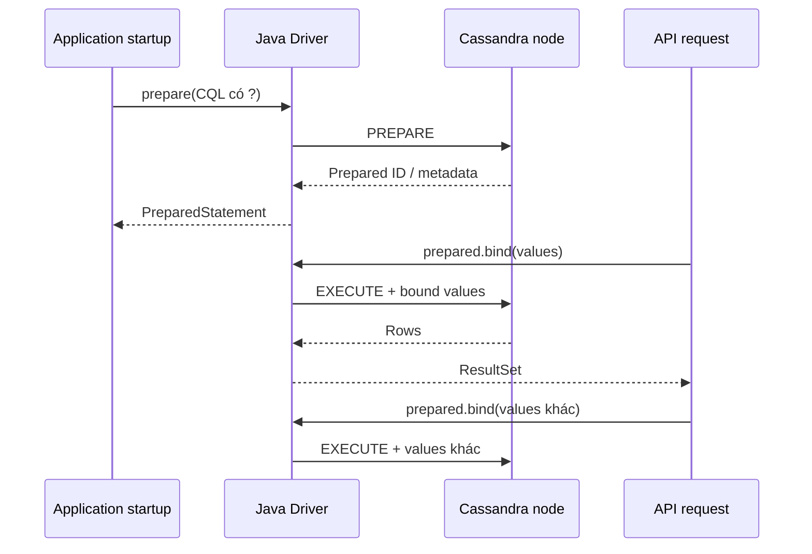
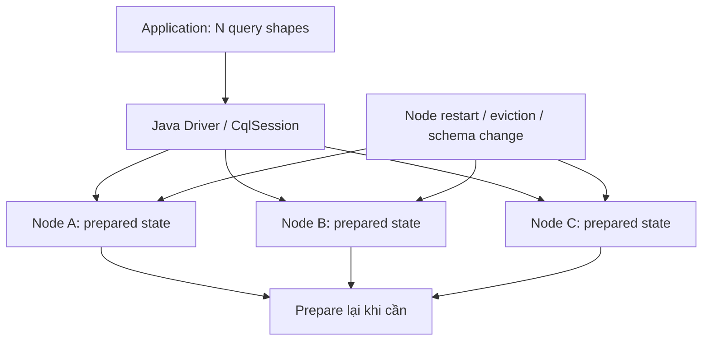

# Giới hạn số dạng câu lệnh và chi phí chuẩn bị quá nhiều truy vấn

## 1. Vấn đề không nằm ở số lần thực thi mà ở số dạng câu lệnh

Trong **Spring Data Cassandra**, repository, `CassandraTemplate`, `CqlTemplate` và `CqlSession` đều có thể đưa truy vấn CQL đến Apache Cassandra. **Prepared statement** giúp tách **cấu trúc CQL** khỏi **giá trị tham số**, nhờ đó cùng một câu truy vấn được dùng cho nhiều request.

Tuy nhiên, nhiều ứng dụng lại chuẩn bị hàng nghìn mẫu CQL gần giống nhau vì nhúng tenant ID, ngày, UUID, `LIMIT`, điều kiện lọc hoặc comment riêng của request vào chuỗi truy vấn. Cache prepared statement lúc đó dễ trở thành một nguồn tiêu thụ tài nguyên thay vì giúp tiết kiệm.

**Query shape** (dạng câu lệnh) là cấu trúc truy vấn gồm tên bảng/cột, mệnh đề, toán tử và vị trí các bind markers. Hai request có **giá trị bind khác nhau** nhưng dùng cùng một cấu trúc có thể tái sử dụng một `PreparedStatement`.

Ví dụ không nên chuẩn bị các câu mang giá trị riêng:

```sql
SELECT event_id, occurred_at
FROM telemetry.events_by_device_day
WHERE device_id = 11111111-1111-4111-8111-111111111111
  AND day_bucket = '2026-11-24'
LIMIT 20;

SELECT event_id, occurred_at
FROM telemetry.events_by_device_day
WHERE device_id = 22222222-2222-4222-8222-222222222222
  AND day_bucket = '2026-11-25'
LIMIT 50;
```

Thay bằng **một mẫu**:

```sql
SELECT event_id, occurred_at
FROM telemetry.events_by_device_day
WHERE device_id = ?
  AND day_bucket = ?
LIMIT ?;
```

Chẳng hạn một API phục vụ 100 thiết bị, 365 ngày và hai mức `LIMIT` có thể sinh tới **100 × 365 × 2 = 73.000 chuỗi CQL khác nhau** nếu ghép literal cho từng tổ hợp. Nếu bind các giá trị, chỉ cần **một dạng CQL**. Con số 73.000 minh họa số tổ hợp tiềm năng, không phải đo đếm các cache entries chắc chắn tồn tại cùng lúc.

> **Mục tiêu:** giữ số mẫu truy vấn hợp lệ theo nghiệp vụ **hữu hạn, rõ ràng và được tái sử dụng**; không cố ép mọi use case vào một biểu thức CQL duy nhất rồi đánh đổi bằng quét dữ liệu hoặc query không phù hợp partition key.

## 2. Vòng đời PREPARE → BIND → EXECUTE

Java Driver 4.x có ba đối tượng chính:

| Đối tượng | Trách nhiệm | Cách dùng |
| --- | --- | --- |
| `CqlSession` | Quản lý kết nối, topology, prepare và execute | Tái sử dụng trong ứng dụng; không tạo cho mỗi HTTP request |
| `PreparedStatement` | Mẫu CQL đã được chuẩn bị, metadata các bind markers | Giữ lại để tái sử dụng cho những request cùng dạng |
| `BoundStatement` | Mẫu đã được gắn giá trị và request options | Tạo mới cho từng lần thực thi |



Sơ đồ là mô hình logic: trong cluster nhiều node, driver có thể phải prepare hoặc **reprepare ở các node khác nhau**. Không nên hiểu PREPARE là một thao tác chỉ thực hiện đúng một lần cho mọi node và tồn tại vĩnh viễn.

### Những chi phí cần nhớ

1. **Độ trễ và network:** prepare có thể cần round trip đến Cassandra.
2. **CPU:** phân tích cú pháp, kiểm tra bảng/cột, tạo metadata kiểu tham số và xử lý CQL.
3. **Bộ nhớ/cache:** driver và các node Cassandra phải quản lý các thông tin liên quan đến câu lệnh.
4. **Reprepare:** node restart, cache eviction, schema change hoặc topology thay đổi có thể làm mẫu cần được chuẩn bị lại.
5. **Khả năng vận hành:** nhiều câu CQL mang literal riêng làm metrics và log khó phân nhóm theo use case.

Driver có thể cache prepared statements và tránh lặp lại một số công việc chuẩn bị cho **cùng câu CQL**. Do đó, không nên khẳng định mọi lời gọi `prepare(sameCql)` đều tạo một cache entry mới. Nhưng gọi `prepare` theo từng request vẫn làm vòng đời code khó kiểm soát, và **cache không giúp hợp nhất các chuỗi CQL khác nhau** do nhúng literal.

## 3. Bảng ví dụ và hai dạng truy vấn cần chuẩn bị

Giả sử dịch vụ thu thập sự kiện thiết bị. API cần xem sự kiện mới nhất trong một ngày hoặc trong một khoảng thời gian:

```sql
-- Chỉ dùng replication factor 1 cho Cassandra local đơn node.
CREATE KEYSPACE IF NOT EXISTS telemetry
WITH replication = {
    'class': 'SimpleStrategy',
    'replication_factor': 1
};

CREATE TABLE IF NOT EXISTS telemetry.events_by_device_day (
    device_id uuid,
    day_bucket date,
    occurred_at timestamp,
    event_id uuid,
    event_type text,
    payload text,
    PRIMARY KEY ((device_id, day_bucket), occurred_at, event_id)
) WITH CLUSTERING ORDER BY (occurred_at DESC, event_id ASC);
```

**Partition key** là `(device_id, day_bucket)`; **clustering columns** là `(occurred_at, event_id)`. Cột `event_type` không phải một phần của primary key và không tự cho phép lọc toàn bảng bằng `WHERE event_type = ?`.

Ta định nghĩa hai mẫu cố định:

```sql
-- Q1: Mới nhất trong một partition.
SELECT event_id, occurred_at, event_type
FROM telemetry.events_by_device_day
WHERE device_id = ? AND day_bucket = ?
LIMIT ?;

-- Q2: Khoảng thời gian trong một partition.
SELECT event_id, occurred_at, event_type
FROM telemetry.events_by_device_day
WHERE device_id = ? AND day_bucket = ?
  AND occurred_at >= ? AND occurred_at < ?
LIMIT ?;
```

Cả Q1 lẫn Q2 đều biết **đầy đủ partition key**; Q2 thêm điều kiện trên clustering column. Một request thay đổi `deviceId`, ngày, thời gian và giới hạn **không yêu cầu mẫu prepared mới**. Nếu đọc nhiều ngày, service xác định những `day_bucket` cần thiết rồi gọi lặp lại query tương ứng, **không sinh một câu CQL chứa ngày dạng literal**.

Lưu ý phân biệt: ít mẫu CQL chưa chắc ít partition. Một API đọc bảy ngày có thể cần bảy partition và ghép kết quả; prepared statement không giải quyết thay việc thiết kế bucket, fan-out hay cursor cấp API.

## 4. Anti-pattern: một câu CQL mới cho mỗi request

Ví dụ không nên dùng:

```java
// Ví dụ sai: không nội suy giá trị request vào câu CQL.
public void badRead(UUID deviceId, LocalDate day, int limit) {
    String cql = "SELECT event_id FROM telemetry.events_by_device_day "
        + "WHERE device_id = " + deviceId
        + " AND day_bucket = '" + day + "'"
        + " LIMIT " + limit;

    PreparedStatement prepared = session.prepare(cql);
    session.execute(prepared.bind());
}
```

Rủi ro:

- Ngày, UUID và `LIMIT` khác nhau làm **CQL text khác nhau**.
- Mỗi mẫu có thể làm phát sinh chi phí prepare/cache trên phía client và các node server.
- Nối chuỗi từ input có nguy cơ sai cú pháp, escaping và injection.
- Hệ thống quan sát vô số câu CQL gần giống nhau thay vì một query family.

Chuyển `prepare(cql)` lên startup **vẫn không hiệu quả** nếu startup chuẩn bị trước một mẫu riêng cho mỗi ngày/tenant. Phải thay phần **giá trị** bằng bind markers.

Không nên phản ứng bằng cách đổi tất cả sang `SimpleStatement` để tránh cache; cách đó chỉ chuyển chi phí sang việc phân tích/thực thi câu CQL không được chuẩn bị, không cải thiện partition key hoặc truy vấn nghiệp vụ. Chọn simple hay prepared dựa vào tần suất lặp và yêu cầu driver, không dựa vào mẹo né vấn đề thiết kế query shape.

## 5. Pattern tốt: query catalog hữu hạn trong persistence adapter

Ví dụ Java 17+ với Java Driver 4.x. `CqlSession` nên là session dùng chung do Spring Boot quản lý:

```java
import java.time.Instant;
import java.time.LocalDate;
import java.util.ArrayList;
import java.util.List;
import java.util.UUID;

import com.datastax.oss.driver.api.core.CqlSession;
import com.datastax.oss.driver.api.core.cql.BoundStatement;
import com.datastax.oss.driver.api.core.cql.PreparedStatement;
import com.datastax.oss.driver.api.core.cql.ResultSet;
import com.datastax.oss.driver.api.core.cql.Row;
import org.springframework.stereotype.Repository;

@Repository
public class DeviceEventReader {

    private static final String LATEST_CQL = """
        SELECT event_id, occurred_at, event_type
        FROM telemetry.events_by_device_day
        WHERE device_id = ? AND day_bucket = ?
        LIMIT ?
        """;

    private static final String RANGE_CQL = """
        SELECT event_id, occurred_at, event_type
        FROM telemetry.events_by_device_day
        WHERE device_id = ? AND day_bucket = ?
          AND occurred_at >= ? AND occurred_at < ?
        LIMIT ?
        """;

    private final CqlSession session;
    private final PreparedStatement latest;
    private final PreparedStatement range;

    public DeviceEventReader(CqlSession session) {
        this.session = session;
        this.latest = session.prepare(LATEST_CQL);
        this.range = session.prepare(RANGE_CQL);
    }

    public List<EventSummary> latest(UUID deviceId, LocalDate day, int limit) {
        checkLimit(limit);

        BoundStatement bound = latest.bind(deviceId, day, limit)
            .setPageSize(Math.min(100, limit));

        return collect(session.execute(bound));
    }

    public List<EventSummary> inRange(
            UUID deviceId, LocalDate day,
            Instant fromInclusive, Instant toExclusive,
            int limit) {
        checkLimit(limit);
        if (!fromInclusive.isBefore(toExclusive)) {
            throw new IllegalArgumentException("Khoảng thời gian không hợp lệ");
        }

        BoundStatement bound = range.bind(
            deviceId, day, fromInclusive, toExclusive, limit
        ).setPageSize(Math.min(100, limit));

        return collect(session.execute(bound));
    }

    private static void checkLimit(int limit) {
        if (limit < 1 || limit > 200) {
            throw new IllegalArgumentException("limit phải từ 1 đến 200");
        }
    }

    private static List<EventSummary> collect(ResultSet rs) {
        List<EventSummary> result = new ArrayList<>();
        for (Row row : rs) {
            result.add(new EventSummary(
                row.getUuid("event_id"),
                row.getInstant("occurred_at"),
                row.getString("event_type")
            ));
        }
        return result;
    }
}

record EventSummary(UUID eventId, Instant occurredAt, String eventType) {
}
```

Ví dụ có đúng **hai templates** và hai trường `PreparedStatement`. Mỗi HTTP request tạo một `BoundStatement` mới, chứa các giá trị riêng. Field `PreparedStatement` được tái sử dụng, không chứa một bộ tham số request dùng chung.

`collect` chỉ phù hợp ở đây vì có `LIMIT` và giá trị `limit` bị chặn tối đa 200; nó có thể fetch thêm page nếu kết quả vượt page size. Nếu API phải trả từng trang, hãy quản lý paging state/cursor thay vì duyệt toàn bộ `ResultSet` như đoạn mã minh họa. Việc prepare trong constructor cũng có thể làm ứng dụng cần kết nối Cassandra thành công ở startup; cân nhắc readiness, retry có giới hạn hoặc cách khởi tạo phù hợp với kiến trúc.

### Các quyết định thiết kế quan trọng

1. Chỉ có một `CqlSession` dùng chung do container quản lý, không tạo mới cho mỗi request.
2. Mỗi **mẫu query** có một chuỗi CQL ổn định, dễ review và kiểm thử.
3. Prepared template có thể tái sử dụng giữa nhiều thread/request; tạo **bound statement riêng** cho từng lần thực thi.
4. Luôn validate `limit`, khoảng thời gian và authorization **trước khi** query.
5. Đo chi phí query thật: page size, consistency, số partition đọc và p95/p99; không chỉ đếm số prepared statements.

## 6. Những nguồn tạo query shapes bùng nổ

| Cách sinh query | Ví dụ điển hình | Biện pháp |
| --- | --- | --- |
| Literal tenant/user/device | `WHERE device_id = <uuid>` | Bind `UUID` |
| Literal ngày, giờ, bucket | `day_bucket = '2026-11-25'` | Bind `LocalDate`, `Instant` |
| Thay `LIMIT` theo request | `LIMIT 10`, `LIMIT 20`, `LIMIT 200` | Dùng `LIMIT ?` và giới hạn đầu vào |
| Giá trị TTL thay đổi | `USING TTL 300`, `USING TTL 600` | Dùng bind marker ở cú pháp CQL được hỗ trợ |
| Danh sách `IN` với số placeholder thay đổi | `IN (?)`, `IN (?, ?)` | Giới hạn độ dài; kiểm tra cách bind collection được phiên bản hỗ trợ |
| Filter điều kiện tùy ý | Ghép thêm các mệnh đề `WHERE`/`AND` | Thiết kế catalog hữu hạn các biến thể CQL hợp lệ |
| Tên bảng theo tenant | `events_tenant_42` | Xem xét bảng chung và tenant trong khóa nếu đáp ứng isolation |
| Comment hoặc whitespace động | Thêm request ID vào text CQL | Dùng log/tracing context, không sửa text query theo request |
| Projection thay đổi tùy ý | Danh sách cột `SELECT` tùy tham số API | Dùng một số projection/read model có chủ đích |
| `ORDER BY` ghép trực tiếp từ HTTP | Tên cột/chiều sắp xếp động | Whitelist các thứ tự được clustering key hỗ trợ |

**Giá trị** có thể bind; **cấu trúc cú pháp, identifier và toán tử** không thể tùy ý thay bằng bind markers. Nếu có hai đường đọc thực sự khác nhau, **hai prepared templates hợp lệ** tốt hơn một query SQL-style cố gắng bao tất cả bộ lọc.

### Nhìn số dạng qua phép nhân các chiều

Giả sử ứng dụng có 4 use cases × 3 filter variants × 2 projections × 50 tenant-specific table names. Số dạng tiềm năng lên đến **1.200** nếu mọi tổ hợp được sử dụng. Với mô hình bảng chung mà tenant được bind vào partition key, số dạng liên quan đến các chiều kia có thể còn **24**.

Đây chỉ là ví dụ về độ lớn **không gian mẫu**, không bảo đảm 1.200 mẫu đang nằm trong cache. Đồng thời, không nên chọn bảng chung chỉ để giảm số câu prepare: isolation, replication, retention, giới hạn kích thước partition và quyền truy cập của từng tenant vẫn quan trọng.

## 7. Bộ lọc động: thêm mẫu khi cần, đừng đánh đổi tính hợp lệ CQL

Giả sử một API cần tìm:

- Danh sách sự kiện gần nhất theo thiết bị và ngày.
- Danh sách sự kiện **theo loại** trong ngày.

Không nên cố dùng một câu "tùy chọn filter" kiểu SQL quan hệ:

```sql
-- Anti-pattern khái niệm, không phải câu CQL được khuyến nghị:
-- WHERE device_id = ?
--   AND day_bucket = ?
--   AND (? IS NULL OR event_type = ?)
```

Trên bảng `events_by_device_day`, `event_type` không thuộc đường truy cập chính. Không có đảm bảo một câu biểu thức boolean linh hoạt như trên được Cassandra hỗ trợ và thực thi hiệu quả.

Thiết kế **một read model riêng** nếu lọc loại sự kiện là yêu cầu thường xuyên:

```sql
CREATE TABLE IF NOT EXISTS telemetry.events_by_device_type_day (
    device_id uuid,
    event_type text,
    day_bucket date,
    occurred_at timestamp,
    event_id uuid,
    PRIMARY KEY ((device_id, event_type, day_bucket), occurred_at, event_id)
) WITH CLUSTERING ORDER BY (occurred_at DESC, event_id ASC);
```

Template thứ hai:

```sql
SELECT event_id, occurred_at
FROM telemetry.events_by_device_type_day
WHERE device_id = ?
  AND event_type = ?
  AND day_bucket = ?
LIMIT ?;
```

Hai templates cho hai đường đọc hợp lệ là thiết kế **có kiểm soát**. Đổi lại, ứng dụng phải ghi dữ liệu tới hai bảng, xử lý write amplification, idempotency và tính nhất quán giữa các read models. Prepared statement không tự đồng bộ các bảng phi chuẩn hóa.

**Nguyên tắc:** thêm một dạng CQL khi có use case và schema hỗ trợ nó, không thêm biến thể cho mọi tham số tự do của API. `ALLOW FILTERING` cũng không phải cách né partition key cho những báo cáo lớn.

## 8. `IN`, danh sách ID và độ phức tạp không nằm riêng ở prepare

Khi API nhận N phần tử, một số code sinh:

```text
IN (?)
IN (?, ?)
IN (?, ?, ?)
...
```

N khác nhau làm CQL text thay đổi, có thể dẫn đến nhiều mẫu prepared. Ở một số câu CQL/phiên bản Cassandra, có thể sử dụng **bind collection cho `IN`** để hạn chế biến thể; nhưng phải **kiểm thử cú pháp cụ thể** theo bảng, kiểu khóa và Java Driver được dùng. Không giả định mọi kiểu `IN`, collection hoặc truy vấn đều chấp nhận cùng cách bind.

Ngay cả khi chỉ cần **một prepared statement**, một lệnh `IN` chứa hàng trăm partition keys vẫn có thể tạo fan-out, tải coordinator và latency lớn. Hãy:

1. Validate số lượng ID; loại phần tử trùng; xác minh quyền truy cập theo tenant.
2. Kiểm tra phép `IN` có hợp lệ với partition key/clustering key thực tế không.
3. Giới hạn số partition một request được phép chạm tới.
4. Cân nhắc các truy vấn đơn partition chạy với độ song song có giới hạn.
5. Đo p95/p99, byte đọc, page size, timeout và mức tải trên replica.

**Ít query shapes không có nghĩa ít dữ liệu phải đọc.** Tránh tối ưu cache trong khi câu CQL vẫn quét quá nhiều partition.

## 9. Cache driver, cache server và tình huống reprepare

### 9.1. Cache tồn tại ở nhiều phía

**Java Driver** lưu metadata/cached prepared statements và hỗ trợ làm việc với trạng thái các node. **Cassandra node** cũng cần biết mẫu prepared tương ứng để thực thi ID đã được gửi. Mỗi node có vòng đời cache và trạng thái riêng.



Một catalog lớn có thể phát sinh chi phí trên **nhiều node**, nhất là khi có nhiều instance ứng dụng hoặc cluster thay đổi. Không nên tính chi phí chỉ bằng một lần prepare trên một client.

### 9.2. `UNPREPARED` có nghĩa gì?

Khi node nhận một prepared statement ID chưa có trong trạng thái của nó, Cassandra có thể trả tình huống **`UNPREPARED`**. Java Driver có cơ chế chuẩn bị lại và gửi request khi phù hợp. Một lần reprepare sau node restart có thể là hành vi bình thường; **reprepare liên tục** mới là dấu hiệu cần điều tra.

Cần kiểm tra:

- Node có khởi động lại, mất kết nối hoặc bị thay thế thường xuyên không?
- Catalog có sinh query shapes không giới hạn làm cache bị churn/eviction không?
- Có schema migration trong lúc traffic cao không?
- Khi nhiều app instances khởi động cùng lúc, có bùng nổ số lần prepare không?
- Có thay đổi version driver, cấu hình cache hoặc topology trong đợt rollout không?

Không tự viết vòng retry vô hạn cho lỗi `UNPREPARED`. Ưu tiên cơ chế driver hỗ trợ, bổ sung giới hạn retry và quan sát cụm.

### 9.3. Warm-up: hữu ích với catalog nhỏ, nguy hiểm khi catalog quá lớn

Prepare trước **các truy vấn hot path** lúc ứng dụng sẵn sàng kết nối có thể giảm latency của request đầu tiên. Nhưng nếu mỗi instance prepare hàng trăm biến thể, rollout đồng loạt có thể gây **thundering herd**:

```text
50 application instances
  x 500 query shapes / instance
  = 25.000 lời gọi chuẩn bị tiềm năng
```

Con số minh họa khối lượng phía ứng dụng, không nhất thiết bằng số PREPARE network thực gửi vì driver có cache/deduplication và các cơ chế khác.

Giải pháp là giảm catalog, chuẩn bị những mẫu thực sự cần, phân giai đoạn deploy, giới hạn số công việc prepare đồng thời và theo dõi startup/readiness cùng p95/p99. Đừng để mỗi request đầu tiên khởi tạo session riêng rồi đồng loạt prepare.

## 10. Request options có thể thay đổi mà không sinh query shape mới

`PreparedStatement` là mẫu; `BoundStatement` chứa **giá trị và cấu hình cho một lần chạy**. Ví dụ:

```java
import com.datastax.oss.driver.api.core.DefaultConsistencyLevel;
import com.datastax.oss.driver.api.core.cql.BoundStatement;

BoundStatement bound = latest.bind(deviceId, day, limit)
    .setPageSize(50)
    .setConsistencyLevel(DefaultConsistencyLevel.LOCAL_QUORUM);

session.execute(bound);
```

`deviceId`, `day`, `limit` là bind values; page size và consistency là request options. Thay page size hoặc consistency trên bound statement **không đòi hỏi sửa chuỗi CQL**.

| Đầu vào | Hướng xử lý | Điều cần bảo vệ |
| --- | --- | --- |
| UUID/tenant ID | Bind parameters | Đúng CQL type; phân quyền tenant |
| Ngày/bucket/thời gian | Bind parameters | Quy ước UTC và bucket chính xác |
| `LIMIT` | Bind marker nếu câu CQL hỗ trợ | Giới hạn trên ở API |
| TTL | Bind marker trong các dạng CQL hỗ trợ | Retention và tombstones |
| Page size | Bound statement option | Không thay thế cursor/`LIMIT` |
| Consistency | Request option hoặc cấu hình | Replication và SLO |
| Timeout | Request option/config phù hợp | Deadline API và retry budget |
| Tên bảng/cột | Catalog/whitelist | Không dùng marker thay identifier |
| Chiều sắp xếp | Mẫu CQL hợp lệ được whitelist | Ràng buộc clustering columns |

**Prepared statement không tự bảo đảm tính idempotent.** Counter increment hoặc một lệnh tạo ID mới ở mỗi lần gửi lại vẫn có thể gây ghi trùng khi timeout. Retry phải tuân thủ ngữ nghĩa nghiệp vụ, không chỉ phụ thuộc cơ chế prepare.

## 11. Ảnh hưởng với repository, `CassandraTemplate` và `CqlTemplate`

Không phải mọi thao tác cần tự viết lớp quản lý prepared statement. Các API có vai trò khác nhau:

| Công cụ | Vai trò | Điểm chú ý về query shapes |
| --- | --- | --- |
| `CassandraRepository` | CRUD, derived query, `@Query` với entity | Hạn chế phương thức filter không khớp schema; ưu tiên query family ổn định |
| `CassandraTemplate` | Query/update thông qua entity mapping | Tránh phát sinh tổ hợp điều kiện quá nhiều và thiếu partition key |
| `CqlTemplate` | CQL tường minh, result mapping kiểu Spring | Bind tham số, không nội suy literal theo request |
| `CqlSession` | Điều khiển `PreparedStatement`, `BoundStatement`, request options | Reuse prepared template theo vòng đời session |

Spring Data có hạ tầng binding và thực thi riêng. Chi tiết nó chuẩn bị/cache từng query ở đâu có thể khác giữa các thế hệ thư viện, vì vậy **không nên kết luận tất cả lời gọi repository đều prepare mới** hoặc tự bổ sung một vòng prepare bên ngoài mà chưa đo thực tế.

Với query đặc thù cần request options chi tiết, adapter inject `CqlSession` có prepared fields rõ ràng là phù hợp. Với CRUD/entity mapping thông thường, repository/`CassandraTemplate` dễ bảo trì hơn.

Đổi từ repository sang driver trực tiếp **không làm query sai partition key thành truy vấn tốt**. Chi phí truy vấn, data model và fan-out vẫn phải được xử lý ở đúng tầng.

## 12. Đo đạc: phân biệt số lần execute và số mẫu được prepare

Một hệ thống có **100.000 lần execute từ 5 mẫu** rất khác hệ thống cố prepare **100.000 mẫu gần như duy nhất**. Cần quan sát cả prepare lẫn query execution.

| Chỉ số | Câu hỏi cần trả lời |
| --- | --- |
| Số query families/catalog entries | Có bao nhiêu đường đọc/ghi có chủ đích? |
| Số lần gọi prepare theo query family | Prepare có xảy ra trên đường request không? |
| Cache hit/miss, cache size nếu hệ giám sát cung cấp | Cache có bị churn hoặc eviction? |
| Reprepare / `UNPREPARED` | Node restart, schema change hay query shape quá nhiều? |
| p50/p95/p99 latency của prepare và execute | Overhead nằm ở khâu chuẩn bị hay CQL thật? |
| CPU/memory/GC của app và Cassandra nodes | Tác động tới tài nguyên |
| Số partition/bucket và byte/hàng đọc | Query có đang quét phạm vi quá rộng? |
| Tải khi rolling deploy/restart | Có bùng nổ prepare khi nhiều instance cùng khởi động? |

**Tên metric cụ thể phụ thuộc phiên bản driver, Spring Boot và hệ quan sát.** Không giả định mọi metric trong bảng đều có sẵn với một tên cố định. Có thể thêm counter ở adapter để đếm số mẫu CQL được khai báo hoặc số lần gọi prepare theo ID cố định như `events.latest` và `events.range`. Tránh log CQL đã nội suy dữ liệu nhạy cảm; không dùng request ID như một phần câu CQL chỉ để trace.

### Vì sao không có công thức cố định cho chi phí prepare?

Số ứng dụng (`A`), số mẫu (`Q`) và số Cassandra nodes (`N`) đều ảnh hưởng khối lượng chuẩn bị/reprepare, nhưng **không có công thức chính xác `A × Q × N` cho số PREPARE thực gửi** vì driver có caching, deduplication, routing, reprepare theo nhu cầu và các trạng thái node khác nhau.

Dùng phép nhân để thấy **chiều tăng trưởng**, rồi đo bằng metrics và log thật. Quan trọng hơn, nếu đã giảm `Q` mà latency vẫn cao, hãy xem partition design, dữ liệu đọc, tombstone và tải trên replica thay vì tiếp tục tinh chỉnh prepared cache.

## 13. Quy trình kiểm soát số dạng câu lệnh trong dự án

Một quy trình thực dụng:

1. **Liệt kê use cases:** endpoint nào cần query theo ID, ngày, trạng thái, khoảng thời gian?
2. **Thiết kế bảng theo truy vấn:** kiểm tra partition key và clustering columns trước khi chọn cú pháp.
3. **Tạo catalog tên cố định:** `events.latest`, `events.range`, `events.byType`; giới hạn số mẫu.
4. **Bind các giá trị thay đổi:** UUID, ngày, `LIMIT`, timestamp, TTL theo cú pháp hỗ trợ.
5. **Whitelist các cấu trúc cần thay đổi:** projection, tên bảng/cột, thứ tự hợp lệ; không ghép chuỗi tùy input.
6. **Reuse prepared fields:** chuẩn bị theo vòng đời adapter, không tạo `CqlSession` hay prepare mới cho mỗi HTTP request.
7. **Giới hạn dữ liệu:** page size, số bucket, fan-out, mức song song và timeout.
8. **Quan sát:** query shapes, số prepare, reprepare, p95/p99 và tài nguyên.
9. **Kiểm thử trên cluster đại diện:** concurrency, nhiều node, rolling restart và migration.
10. **Review định kỳ:** xóa templates không còn dùng, tránh tạo biến thể “chỉ cho trường hợp hiếm” không được kiểm chứng.

### Checklist cho một truy vấn mới

- Query phục vụ use case cụ thể nào?
- Điều kiện `WHERE` có đầy đủ partition key không?
- Các giá trị động có thể bind thay vì đưa vào text CQL không?
- Template mới có thật sự cần thiết hay có thể dùng một mẫu hiện có?
- `LIMIT`, page size, cursor và số partition đã được giới hạn chưa?
- Cần thêm read model, consistency policy hoặc retry/idempotency logic không?
- Integration test đã chạy câu CQL thực tế trên Cassandra chưa?

## 14. Kiểm thử với Java Driver và Cassandra thật

### 14.1. Unit test: ngăn tạo vô số templates

Test các thuộc tính thiết kế:

- Hai `deviceId` khác nhau vẫn chọn `LATEST_CQL` y hệt.
- Hai ngày hoặc hai giới hạn khác nhau chỉ thay **bound values**.
- Đầu vào limit không hợp lệ bị từ chối.
- Không tạo query text bằng nối UUID/ngày/tenant.
- Filter và order tùy ý ngoài whitelist bị từ chối.
- `BoundStatement` không bị chia sẻ như state đã gắn tham số giữa nhiều request.

Unit test không cần Cassandra để xác nhận catalog cố định, nhưng **không thể chứng minh CQL thật sự hợp lệ**.

### 14.2. Integration test: kiểm chứng CQL và bind types

Với bảng `telemetry.events_by_device_day` trên Cassandra test instance:

1. Prepare các templates chính thức, xác nhận bảng/cột/kiểu marker hợp lệ.
2. Bind `UUID`, `LocalDate`, `Instant`, `int` cho nhiều bộ giá trị khác nhau.
3. Chèn hai sự kiện cùng timestamp nhưng khác `event_id`; xác nhận tính duy nhất và thứ tự clustering.
4. Chạy query `LIMIT 120` với page size nhỏ hơn, quan sát việc fetch nhiều page.
5. Test partition rỗng, ngày sai và phạm vi thời gian `[from, to)` tại ranh giới ngày.
6. Test query `byType` trên đúng bảng read model, không lọc `event_type` từ bảng sai khóa.
7. Thử rolling restart một node trong môi trường nhiều node để quan sát reprepare.
8. Chạy nhiều request song song; so sánh số query shapes và p95/p99 trước/sau cải tiến.

Không tự coi integration test trên một Cassandra node là bằng chứng đầy đủ cho reprepare, consistency và failover của cụm phân tán.

### 14.3. Tình huống điều tra

**Triệu chứng:** mỗi lần deploy, phút đầu có độ trễ cao; ứng dụng đã dùng `PreparedStatement` nhưng log cho thấy số lần prepare tăng rất nhanh.

**Nguyên nhân giả định:** trước khi prepare, mã thêm **comment mang request ID** hoặc tenant ID vào text CQL. Mỗi request tạo một chuỗi mới dù truy vấn nghiệp vụ không đổi.

**Cách sửa:** giữ mẫu CQL tĩnh, đưa request ID vào tracing/log context; bind tenant và các tham số; thêm metric đếm mẫu, kiểm thử lại cả startup và p95/p99. Nếu vấn đề vẫn xuất hiện, điều tra reprepare ở node, cache churn, schema migration và load.

## 15. Bài tập thực hành

**Bài 1 — Sửa anti-pattern:** Một developer gọi `session.prepare("... day_bucket = '" + day + "' LIMIT " + limit)` trên mỗi request. Viết lại bằng một mẫu prepared CQL cố định và bind values. Giải thích lợi ích về an toàn và tài nguyên.

**Bài 2 — Tính số mẫu:** Một ứng dụng có 6 báo cáo, 4 filter variants, 3 projections và 200 tenant IDs được ghép thành literal. Ước lượng số chuỗi CQL tiềm năng; so sánh với việc bind tenant ID. Vì sao đây chỉ là số tổ hợp lý thuyết?

**Bài 3 — Query catalog:** API có ba chế độ “mới nhất theo ngày”, “trong khoảng thời gian” và “theo loại sự kiện”. Thiết kế không quá ba templates hợp lệ và bảng CQL phục vụ từng dạng; đánh dấu phần nào dùng bind marker.

**Bài 4 — `IN` và fan-out:** API nhận 1.000 thiết bị. Vì sao giảm số template cho `IN` chưa đủ để query tốt? Đề xuất giới hạn số ID và cách triển khai nhiều truy vấn đơn partition với độ song song hữu hạn.

**Bài 5 — Node restart:** Sau restart một Cassandra node, một số request reprepare. Giải thích trường hợp bình thường và trường hợp cache churn kéo dài; chọn metrics/logs để phân biệt.

**Bài 6 — Request đồng thời:** Hai request cùng dùng field `PreparedStatement` nhưng có device ID khác nhau. Vì sao có thể chia sẻ prepared template, và vì sao cần tạo `BoundStatement` riêng?

**Bài 7 — Paging:** Câu CQL có `LIMIT 200` và bound statement page size 50. Làm sao trả về từng trang 50 hàng với cursor, và tại sao một vòng lặp đọc hết `ResultSet` không phù hợp cho API chỉ cần một trang?

### Tự kiểm tra

1. “Query shape” khác “giá trị bind” thế nào?
2. Vì sao nhúng ID hoặc ngày vào CQL làm tăng số prepared statements tiềm năng?
3. Ai sở hữu `PreparedStatement` và ai tạo `BoundStatement`?
4. `PreparedStatement` có làm thay đổi yêu cầu partition key Cassandra không?
5. Bind marker có thay được tên bảng/cột và toán tử tùy ý không?
6. Tình huống nào có thể kích hoạt reprepare?
7. Khi nào warm-up prepared statements giúp ích, và khi nào tạo tải bùng nổ?
8. Ít query shapes có đồng nghĩa với đọc ít partition không?
9. Request option như page size hoặc consistency có cần sửa text CQL không?
10. Những phép thử nào xác nhận tối ưu prepared statements thực sự có ích?

## Kết luận

**Prepared statements mang lại hiệu quả khi số mẫu CQL được giới hạn và các giá trị thay đổi được bind riêng cho mỗi lần thực thi.** `PreparedStatement` đại diện cho mẫu query, còn `BoundStatement` chứa giá trị và request options của từng request. Việc ghép literal tenant, ngày, UUID, `LIMIT` hay comment động tạo nhiều query shapes, làm tăng nguy cơ chi phí prepare, memory/cache churn và reprepare trong cluster. Hãy xây catalog truy vấn hữu hạn, dùng bind markers, kiểm soát biến thể cú pháp và đo cả phía Java Driver lẫn Cassandra nodes. Trong Spring Data Cassandra, **partition key, clustering columns, dữ liệu thực đọc, paging, consistency và retry** vẫn quyết định tính đúng và hiệu năng thực tế: tối ưu prepared cache không thể thay thế thiết kế bảng theo truy vấn.
