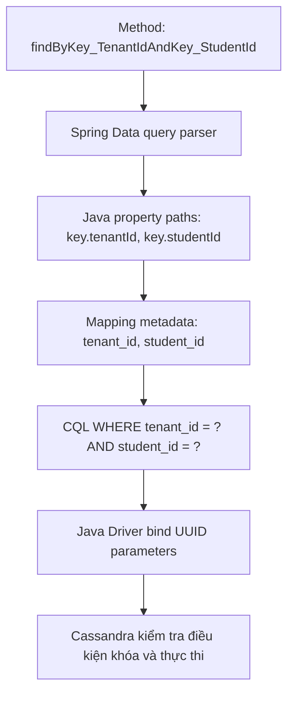

# Tạo điều kiện CQL từ tên phương thức repository

**Spring Data Cassandra** cho phép khai báo các phương thức truy vấn trên `CassandraRepository` mà không cần viết câu CQL cho từng phương thức. Chẳng hạn, một method mang tên `findByKey_TenantIdAndKey_StudentId(...)` có thể được Spring Data phân tích thành điều kiện tìm kiếm dựa trên **các thuộc tính Java của entity**.

Cơ chế này gọi là **truy vấn dẫn xuất từ tên phương thức** (*derived query* hoặc *query derivation*). Nó giúp giảm mã lặp ở tầng truy cập dữ liệu, nhưng có một giới hạn quan trọng: **Spring Data tạo điều kiện CQL; Apache Cassandra mới là hệ thống quyết định điều kiện đó hợp lệ và có đường truy cập hiệu quả hay không**.

Không thể dựa vào một tên method như `findByStatus(...)` để biến cột `status` thành partition key. Nếu bảng Cassandra không được thiết kế để truy vấn theo trạng thái, method có thể được phân tích thành công ở Spring Data nhưng câu CQL thực tế vẫn bị Cassandra từ chối hoặc gây tải không phù hợp.

Bài học này nằm trong chương **Truy vấn dẫn xuất** của module **SPRING_DATA_CASSANDRA**. Ta sẽ đi từ thiết kế bảng theo truy vấn, ánh xạ composite primary key, cách Spring Data phân tích tên method, các ví dụ CQL tương ứng, đến paging, giới hạn của Cassandra, xử lý lỗi và kiểm thử.

## 1. Mục tiêu học tập

Sau bài này, bạn sẽ có thể:

1. Giải thích sự khác nhau giữa **tên phương thức Java**, **thuộc tính entity** và **tên cột CQL**.
2. Khai báo method dẫn xuất theo **partition key** và **clustering columns** mà Cassandra hỗ trợ.
3. Nhận biết vai trò của các từ khóa như `findBy`, `And`, `GreaterThanEqual` và `LessThan` mà không nhầm chúng với một ngôn ngữ truy vấn SQL đầy đủ.
4. Dùng dấu gạch dưới `_` để biểu diễn đường dẫn thuộc tính lồng nhau của composite key khi cần.
5. Phát hiện method có tên hợp lệ nhưng tạo CQL thiếu partition key hoặc lọc regular column không được hỗ trợ.
6. Chọn giữa **derived query**, `@Query`, `CassandraTemplate` và repository fragment theo yêu cầu.
7. Kiểm chứng truy vấn bằng integration test trên **Cassandra thực**, không chỉ kiểm tra tên method có biên dịch.
8. Đánh giá paging, giới hạn kết quả, consistency và hiệu năng của truy vấn trong hệ thống phân tán.

## 2. Query derivation hoạt động như thế nào?

Trong Spring Data, repository có thể khai báo:

```java
List<EnrollmentByStudent> findByKey_TenantIdAndKey_StudentId(
    UUID tenantId,
    UUID studentId
);
```

Spring Data phân tích phần `findBy...` thành một **query tree**:

- `find`: đây là thao tác tìm kiếm dữ liệu.
- `By`: bắt đầu phần biểu diễn điều kiện.
- `Key_TenantId`: đi theo đường dẫn thuộc tính Java `key.tenantId`.
- `And`: kết hợp hai điều kiện.
- `Key_StudentId`: đi theo đường dẫn thuộc tính `key.studentId`.
- Tham số method lần lượt được bind vào hai điều kiện.

Khi mapping thành CQL, các đường dẫn Java phải được giải quyết thông qua metadata của entity và primary key:



Đây là **quy trình logic**, không nhất thiết là chuỗi các lớp được gọi đúng từng bước như sơ đồ trong mọi phiên bản Spring Data.

> **Quy tắc cốt lõi:** Spring Data hiểu mô hình object; Cassandra hiểu mô hình partition và clustering. Một derived query tốt phải phù hợp **cả hai**.

## 3. Thiết kế bảng từ nhu cầu truy vấn

Giả sử nền tảng đào tạo có endpoint:

```text
GET /tenants/{tenantId}/students/{studentId}/enrollments
```

Nhu cầu: lấy các khóa học mà một học viên đã đăng ký, sắp từ mới nhất đến cũ nhất.

Ta chọn bảng theo hướng đọc đó. Giả sử keyspace `learning` đã được tạo:

```sql
CREATE TABLE IF NOT EXISTS learning.enrollments_by_student (
    tenant_id uuid,
    student_id uuid,
    enrolled_at timestamp,
    enrollment_id uuid,
    course_id uuid,
    status text,
    completed_lessons int,
    PRIMARY KEY ((tenant_id, student_id), enrolled_at, enrollment_id)
) WITH CLUSTERING ORDER BY (enrolled_at DESC, enrollment_id ASC);
```

### 3.1. Phân tích primary key

| Thành phần | Loại khóa/cột | Ý nghĩa |
| --- | --- | --- |
| `tenant_id` | Partition key thành phần 1 | Giới hạn dữ liệu theo tenant |
| `student_id` | Partition key thành phần 2 | Chọn đúng học viên trong tenant |
| `enrolled_at` | Clustering column 1 | Sắp hàng theo thời gian đăng ký |
| `enrollment_id` | Clustering column 2 | Định danh hàng khi nhiều sự kiện có cùng thời gian |
| `course_id` | Regular column | Khóa học mà học viên đăng ký |
| `status` | Regular column | Trạng thái đăng ký |
| `completed_lessons` | Regular column | Số bài học đã hoàn thành |

**Partition key thực tế là cả cặp** `(tenant_id, student_id)`. Truy vấn chỉ có `tenant_id` không đủ để chỉ ra một partition trong bảng này, dù nó là thành phần đầu tiên của composite partition key.

Ví dụ câu CQL phù hợp:

```sql
SELECT enrolled_at, enrollment_id, course_id, status
FROM learning.enrollments_by_student
WHERE tenant_id = ? AND student_id = ?;
```

Cassandra định vị partition từ hai giá trị UUID rồi trả các hàng theo thứ tự clustering đã định nghĩa trong bảng.

Câu CQL sau **không phải đường đọc mà bảng được thiết kế**:

```sql
-- Sai mô hình truy cập: thiếu student_id của partition key ghép.
SELECT *
FROM learning.enrollments_by_student
WHERE tenant_id = ?;
```

Câu sau cũng không tự trở thành truy vấn hiệu quả chỉ vì `status` là một field trong entity:

```sql
-- Không được mặc định là truy vấn hợp lệ/hiệu quả:
SELECT *
FROM learning.enrollments_by_student
WHERE status = ?;
```

Cassandra không hỗ trợ lọc tùy ý trên mọi regular column của mọi partition như một RDBMS có hệ thống index thích hợp. Phương án thường cần là **thiết kế thêm bảng theo hướng đọc**, hoặc sử dụng một cơ chế index có chọn lọc, phù hợp phiên bản và workload, sau khi được đánh giá.

### 3.2. Thứ tự clustering không phải ORDER BY toàn cluster

Trong cùng partition, `enrolled_at DESC` giúp đọc các đăng ký mới trước. Điều đó **không** có nghĩa có thể yêu cầu `ORDER BY enrolled_at` trên tất cả partition và Cassandra tự gộp/sắp xếp toàn bộ dữ liệu với chi phí thấp.

Nếu endpoint cần “20 đăng ký mới nhất của một học viên”, truy vấn nên có đầy đủ partition key, sử dụng clustering order và giới hạn kết quả. Đây là quyết định thiết kế schema trước khi viết derived method.

## 4. Ánh xạ composite primary key trong Spring Data Cassandra

Một derived query được tạo từ **tên property Java**, không được tạo trực tiếp từ tên cột trong bảng. Vì vậy cần định nghĩa mapping rõ ràng.

### 4.1. Khóa ghép StudentEnrollmentKey

```java
import java.io.Serializable;
import java.time.Instant;
import java.util.UUID;

import org.springframework.data.cassandra.core.cql.PrimaryKeyType;
import org.springframework.data.cassandra.core.mapping.PrimaryKeyClass;
import org.springframework.data.cassandra.core.mapping.PrimaryKeyColumn;

@PrimaryKeyClass
public class StudentEnrollmentKey implements Serializable {

    @PrimaryKeyColumn(
        name = "tenant_id",
        ordinal = 0,
        type = PrimaryKeyType.PARTITIONED
    )
    private UUID tenantId;

    @PrimaryKeyColumn(
        name = "student_id",
        ordinal = 1,
        type = PrimaryKeyType.PARTITIONED
    )
    private UUID studentId;

    @PrimaryKeyColumn(
        name = "enrolled_at",
        ordinal = 2,
        type = PrimaryKeyType.CLUSTERED
    )
    private Instant enrolledAt;

    @PrimaryKeyColumn(
        name = "enrollment_id",
        ordinal = 3,
        type = PrimaryKeyType.CLUSTERED
    )
    private UUID enrollmentId;

    protected StudentEnrollmentKey() { }

    public StudentEnrollmentKey(
            UUID tenantId,
            UUID studentId,
            Instant enrolledAt,
            UUID enrollmentId) {
        this.tenantId = tenantId;
        this.studentId = studentId;
        this.enrolledAt = enrolledAt;
        this.enrollmentId = enrollmentId;
    }

    public UUID getTenantId() { return tenantId; }
    public UUID getStudentId() { return studentId; }
    public Instant getEnrolledAt() { return enrolledAt; }
    public UUID getEnrollmentId() { return enrollmentId; }

    // Bổ sung setters/equals/hashCode theo contract của entity mapping.
}
```

Annotation `@PrimaryKeyColumn` xác định cột CQL, ordinal và vai trò partition/clustering. Các thuộc tính Java là `tenantId`, `studentId`, `enrolledAt` và `enrollmentId`, khác với tên cột dùng dấu gạch dưới trong CQL.

**Lưu ý:** khi dùng một class làm repository ID, cần định nghĩa `equals`/`hashCode` ổn định dựa trên toàn bộ thành phần khóa, cùng cơ chế khởi tạo phù hợp cho mapper. Các đoạn Java rút gọn để tập trung vào query derivation.

### 4.2. Entity EnrollmentByStudent

```java
import java.util.UUID;

import org.springframework.data.cassandra.core.mapping.Column;
import org.springframework.data.cassandra.core.mapping.PrimaryKey;
import org.springframework.data.cassandra.core.mapping.Table;

@Table("enrollments_by_student")
public class EnrollmentByStudent {

    @PrimaryKey
    private StudentEnrollmentKey key;

    @Column("course_id")
    private UUID courseId;

    @Column("status")
    private String status;

    @Column("completed_lessons")
    private Integer completedLessons;

    protected EnrollmentByStudent() { }

    public EnrollmentByStudent(
            StudentEnrollmentKey key,
            UUID courseId,
            String status,
            Integer completedLessons) {
        this.key = key;
        this.courseId = courseId;
        this.status = status;
        this.completedLessons = completedLessons;
    }

    public StudentEnrollmentKey getKey() { return key; }
    public UUID getCourseId() { return courseId; }
    public String getStatus() { return status; }
    public Integer getCompletedLessons() { return completedLessons; }

    // Bổ sung setters nếu phiên bản Spring Data/thiết kế entity yêu cầu.
}
```

Với `@PrimaryKey private StudentEnrollmentKey key`, đường dẫn property của một giá trị tenant ID là **`key.tenantId`**, còn cột CQL tương ứng là **`tenant_id`**.

Dùng `Integer` thay vì `int` cho `completedLessons` vì regular column có thể chưa có giá trị sống; `null` không đồng nghĩa với `0`.

### 4.3. Không tự đổi property Java thành tên cột CQL

Một method tên `findByTenant_id(...)` không phải cách nên dùng để biểu diễn cột `tenant_id`. Query derivation làm việc với **property path**, còn việc chuyển thành `tenant_id` do mapping metadata thực hiện.

Tên method cần xuất phát từ `key.tenantId`, không phải từ tên vật lý của cột.

## 5. Tạo phương thức repository dẫn xuất

Repository chính:

```java
import java.time.Instant;
import java.util.List;
import java.util.UUID;

import org.springframework.data.cassandra.repository.CassandraRepository;

public interface EnrollmentRepository
        extends CassandraRepository<EnrollmentByStudent, StudentEnrollmentKey> {

    List<EnrollmentByStudent> findByKey_TenantIdAndKey_StudentId(
        UUID tenantId,
        UUID studentId
    );

    List<EnrollmentByStudent>
        findByKey_TenantIdAndKey_StudentIdAndKey_EnrolledAtGreaterThanEqual(
            UUID tenantId,
            UUID studentId,
            Instant fromTime
        );
}
```

Spring Data Commons hỗ trợ tách rõ đường dẫn thuộc tính lồng nhau bằng `_` trong biểu thức tên phương thức. Ở ví dụ này:

- `Key_TenantId` nói rõ property `key.tenantId`.
- `Key_StudentId` nói rõ property `key.studentId`.
- `Key_EnrolledAtGreaterThanEqual` biểu diễn một điều kiện range trên `key.enrolledAt`.
- Phần `And` kết hợp các điều kiện.

**Không thêm dấu gạch dưới tùy ý** trong Java property name; ký tự này đóng vai trò ký hiệu phân tách property path theo quy tắc parser. Nếu entity của dự án đặt tên key field khác `key`, phải điều chỉnh tên method tương ứng.

### 5.1. Method chỉ dùng partition key

Phương thức:

```java
List<EnrollmentByStudent> findByKey_TenantIdAndKey_StudentId(
    UUID tenantId, UUID studentId);
```

về ý nghĩa tương ứng với:

```sql
SELECT *
FROM learning.enrollments_by_student
WHERE tenant_id = ? AND student_id = ?;
```

Cassandra chỉ đọc partition của học viên đó. Vì `enrolled_at` được định nghĩa sắp giảm dần trong schema, hàng thường được trả theo thứ tự clustering.

**Chú ý:** CQL minh họa được viết với tên bảng đủ `learning.enrollments_by_student`. Query do repository tạo thường sử dụng keyspace mặc định/mapping của entity. Hai câu không nhất thiết giống nhau từng dấu cách hoặc thứ tự bind; điều quan trọng là **điều kiện khóa, kiểu dữ liệu và ngữ nghĩa truy vấn**.

### 5.2. Method thêm điều kiện trên clustering column

Phương thức:

```java
List<EnrollmentByStudent>
findByKey_TenantIdAndKey_StudentIdAndKey_EnrolledAtGreaterThanEqual(
    UUID tenantId, UUID studentId, Instant fromTime);
```

tương ứng về mặt logic với:

```sql
SELECT *
FROM learning.enrollments_by_student
WHERE tenant_id = ?
  AND student_id = ?
  AND enrolled_at >= ?;
```

Cassandra có thể dùng điều kiện range trên clustering column đầu tiên sau khi partition key đã được xác định. Không cần quét toàn cluster để tìm những đăng ký gần đây của học viên.

Nếu nghiệp vụ cần khoảng thời gian `[from, to)`, có thể kết hợp điều kiện lớn hơn/bằng và nhỏ hơn nếu phiên bản Spring Data hỗ trợ cú pháp derived tương ứng, hoặc viết `@Query` để nêu chính xác điều kiện CQL như phần sau. Trong hai trường hợp, vẫn phải kiểm tra tập dữ liệu và CQL thực tế.

### 5.3. Tên method dài đến mức nào là hợp lý?

Một method có bốn đến sáu điều kiện và nhiều đường property lồng nhau có thể rất dài, gây khó review. Query derivation hữu ích khi phần điều kiện **rõ ràng, ngắn và khớp schema**; nếu biểu thức cần nhiều toán tử đặc thù, metadata statement, thứ tự clustering rõ ràng hoặc paging phức tạp, `@Query`, `CassandraTemplate` hoặc fragment có thể dễ bảo trì hơn.

**Không đánh giá chất lượng query bằng độ ngắn của Java source**. Câu truy vấn thật và hướng phân phối dữ liệu mới là cơ sở.

## 6. Giải nghĩa các từ khóa theo tên method

Spring Data cung cấp hệ thống phân tích tên phương thức chung; **không phải mọi keyword ở các module SQL/JPA đều được Cassandra hỗ trợ với cùng semantics**. Một tên method được parser chấp nhận không phải bằng chứng CQL cuối cùng được Cassandra hỗ trợ.

| Thành phần tên | Ý nghĩa thường gặp | Cần kiểm tra ở Cassandra |
| --- | --- | --- |
| `findBy` / `readBy` | Truy vấn tìm bản ghi theo điều kiện | Đường truy cập theo partition/clustering |
| `And` | Kết hợp các predicate | Các cột kết hợp phải phù hợp CQL restrictions |
| `GreaterThan` | So sánh lớn hơn | Thường liên quan clustering range; không áp dụng tùy tiện cho regular columns |
| `GreaterThanEqual` | Lớn hơn hoặc bằng | Giới hạn range hợp lệ trên clustering |
| `LessThan` / `LessThanEqual` | So sánh nhỏ hơn | Phải phù hợp khóa/clustering và phiên bản |
| `In` | Tìm trong tập giá trị | Cassandra có quy tắc `IN` riêng; tránh fan-out lớn |
| `OrderBy...Asc/Desc` | Yêu cầu thứ tự khi được hỗ trợ | `ORDER BY` chỉ hợp lệ trong giới hạn clustering/order |
| `First` / `Top` | Giới hạn số kết quả, tùy module/phiên bản | Không thay thế paging thật; xác minh hỗ trợ khi dùng |
| `Or` | Kết hợp nhánh điều kiện | Không mặc định Cassandra hỗ trợ `OR` tùy ý như SQL |
| `Containing` / `Like` | Tìm kiếm chuỗi/tập hợp trong một số module | Cần index/ngữ nghĩa CQL phù hợp; thường không phải lựa chọn trực tiếp an toàn |
| `IsNull` / `NotNull` | Kiểm tra null trong một số datastore | Không mặc định dùng được để quét các hàng có cột NULL trong Cassandra |

**Ví dụ an toàn để học cơ chế:** `findByKey_TenantIdAndKey_StudentId(...)`. Tên method ngắn, đúng property path, còn điều kiện CQL là equality trên partition key.

**Ví dụ cần cẩn trọng:** `findByStatus(...)`. Nó hợp lệ về mặt ý nghĩa property Java nhưng `status` chỉ là regular column trong bảng ví dụ. Truy vấn có thể bị Cassandra từ chối vì không có index/path phù hợp.

Khi cần keyword nâng cao, phải đối chiếu **tài liệu Spring Data Cassandra của phiên bản đang dùng** và chạy integration test với **đúng phiên bản Cassandra**. Không sao chép toàn bộ bảng keywords của Spring Data JPA sang module Cassandra.

## 7. Những truy vấn dẫn xuất sai về thiết kế CQL

### 7.1. Thiếu một phần partition key ghép

Ví dụ method có vẻ tự nhiên:

```java
// Không phải hướng đọc đúng của bảng ví dụ.
List<EnrollmentByStudent> findByKey_TenantId(UUID tenantId);
```

Ý nghĩa CQL:

```sql
SELECT *
FROM learning.enrollments_by_student
WHERE tenant_id = ?;
```

Trong schema này, partition key là `(tenant_id, student_id)`. Chỉ có tenant ID không xác định được partition cụ thể. Câu truy vấn thường bị Cassandra từ chối khi không có cơ chế index/điều kiện bổ sung phù hợp.

Muốn một API liệt kê đăng ký của mọi học viên trong tenant, cần thiết kế một bảng có partition key theo **tenant và bucket/nhóm phù hợp**, hoặc kiến trúc tìm kiếm/đọc khác. Một partition duy nhất chứa tất cả dữ liệu của tenant rất lớn cũng có thể trở thành hot partition, nên cần cân nhắc tải.

### 7.2. Lọc regular column không có chỉ mục/đường đọc

Ví dụ:

```java
// Cú pháp method không có nghĩa query này hiệu quả.
List<EnrollmentByStudent> findByStatus(String status);
```

Dự kiến dẫn tới predicate kiểu:

```sql
SELECT *
FROM learning.enrollments_by_student
WHERE status = ?;
```

Bảng không có partition key `status`, cũng chưa cấu hình index hợp lệ. Đây không phải truy vấn phục vụ được trên quy mô lớn chỉ nhờ Spring Data.

Nếu product muốn tìm mọi đăng ký đang `ACTIVE`, có thể cần bảng `enrollments_by_status_bucket` hoặc một projection khác, và kế hoạch đồng bộ dữ liệu phù hợp với consistency nghiệp vụ.

### 7.3. Lọc theo clustering column mà thiếu partition key

```java
List<EnrollmentByStudent> findByKey_EnrolledAtGreaterThan(
    Instant fromTime);
```

Chỉ có khoảng thời gian mà không có `tenantId`, `studentId`. Dù `enrolled_at` là clustering column, Cassandra không thể tự tìm một partition cụ thể từ điều kiện này.

### 7.4. Dùng `Or` hoặc điều kiện linh hoạt như SQL

Ví dụ tên method:

```java
// Không mặc định CQL hỗ trợ biểu thức OR tùy ý này.
List<EnrollmentByStudent> findByStatusOrCompletedLessons(
    String status, Integer completedLessons);
```

Dù Spring Data parser có thể đọc tên phương thức theo hệ từ khóa chung, Cassandra có giới hạn rõ về tổ hợp predicate. Cần thiết kế query cụ thể, dùng bảng theo hướng đọc hoặc lập chiến lược phối hợp hai truy vấn có kiểm soát khi thật sự cần.

### 7.5. Cố vá bằng ALLOW FILTERING

Một số phiên bản Spring Data Cassandra có hỗ trợ annotation/tuỳ chọn `@AllowFiltering` cho truy vấn được tạo. Nhưng **`ALLOW FILTERING` không biến truy vấn quét nhiều partition thành truy vấn có chi phí ổn định**. Nó cho phép Cassandra thực hiện lọc vốn có thể bị từ chối, với rủi ro độ trễ và tải lớn.

Đừng thêm `@AllowFiltering` chỉ để làm integration test xanh. Hãy phân tích query pattern, partition size, index và mô hình dữ liệu trước.

## 8. Derived query và @Query: chọn khi nào?

`@Query` cho phép viết CQL tường minh trên method repository. Nó vẫn dùng mapping/parameter binding do Spring Data quản lý, nhưng lập trình viên kiểm soát câu CQL.

Ví dụ cùng một truy vấn theo partition key:

```java
import java.util.List;
import java.util.UUID;

import org.springframework.data.cassandra.repository.CassandraRepository;
import org.springframework.data.cassandra.repository.Query;

public interface EnrollmentQueryRepository
        extends CassandraRepository<
            EnrollmentByStudent, StudentEnrollmentKey> {

    @Query("""
        SELECT *
        FROM learning.enrollments_by_student
        WHERE tenant_id = ?0 AND student_id = ?1
        """)
    List<EnrollmentByStudent> findAllForStudent(
        UUID tenantId,
        UUID studentId
    );
}
```

`?0` và `?1` là parameter placeholders theo cú pháp Spring Data ở ví dụ; không nối giá trị client vào CQL string.

Khi dùng `@Query`, tên method `findAllForStudent` **không còn phải mã hóa toàn bộ điều kiện CQL**; nội dung annotation nêu rõ truy vấn.

### So sánh hai cách

| Tiêu chí | Derived method | `@Query` |
| --- | --- | --- |
| Nơi mô tả predicate | Tên method Java | CQL trong annotation |
| Mức lặp CQL | Ít | Viết CQL tường minh |
| Dễ đọc với một vài equality predicates | Thường tốt | Tốt |
| Dễ đọc với composite key và nhiều range | Có thể dài | Thường rõ hơn |
| Kiểm soát SELECT columns và CQL đặc thù | Phụ thuộc projection/khả năng module | Trực tiếp hơn |
| Trách nhiệm tối ưu partition | **Lập trình viên** | **Lập trình viên** |
| Có tự sinh index/bảng mới không? | Không | Không |
| Có tránh được rủi ro truy vấn sai thiết kế không? | Không | Không |

Dùng `@Query` không hợp pháp hóa một câu CQL thiếu partition key. Ngược lại, query dẫn xuất có thể hoàn toàn phù hợp và hiệu quả khi schema được thiết kế tốt.

### Ví dụ khoảng thời gian nửa mở

```java
@Query("""
    SELECT *
    FROM learning.enrollments_by_student
    WHERE tenant_id = ?0
      AND student_id = ?1
      AND enrolled_at >= ?2
      AND enrolled_at < ?3
    """)
List<EnrollmentByStudent> findInTimeWindow(
    UUID tenantId,
    UUID studentId,
    Instant fromInclusive,
    Instant untilExclusive
);
```

Ở đây điều kiện range nằm trên clustering column đầu tiên và được ràng buộc trong một partition. Nên kiểm tra `fromInclusive.isBefore(untilExclusive)` ở service/DAO trước khi gửi CQL.

## 9. Khi nào chuyển sang CassandraTemplate hoặc fragment?

Một số nghiệp vụ truy vấn không phù hợp với phương thức dài được dẫn xuất từ tên:

- Điều kiện được xây theo một số nhánh nghiệp vụ có kiểm soát.
- Cần projection DTO thay vì entity đầy đủ, tùy version và mapping support.
- Muốn điều chỉnh statement options, page size hoặc execution profile ở tầng driver.
- Cần truy vấn nhiều bảng theo một workflow nhưng vẫn kiểm soát lỗi từng bước.
- Muốn expose một API repository có hành vi chuyên biệt, không phải một query duy nhất.

Lúc này có thể dùng:

- **`CassandraTemplate` / `CassandraOperations`:** truy vấn entity bằng Spring Data mapping và Query API.
- **`CqlTemplate` / `CqlOperations`:** CQL và `RowMapper` để trả projection/DTO.
- **`CqlSession`:** làm việc trực tiếp với prepared statements, paging state và driver API.
- **Repository fragment:** thêm interface + class triển khai vào repository composition.

Đừng viết `findBy...` phức tạp chỉ để tránh tạo một class DAO nhỏ. Mục tiêu là **mã nguồn rõ ràng và truy vấn CQL đúng**, không phải chỉ giảm số file.

## 10. Kiểu trả về và khả năng phân trang

Cùng một điều kiện theo partition key có thể có nhiều dạng kết quả. Nhưng lựa chọn return type cần tương thích Spring Data Cassandra phiên bản đang dùng, và không làm mất ngữ nghĩa Cassandra.

### 10.1. Danh sách List

```java
List<EnrollmentByStudent> findByKey_TenantIdAndKey_StudentId(
    UUID tenantId, UUID studentId);
```

Method thường materialize kết quả thành một danh sách. Nếu một học viên có số đăng ký rất lớn, việc đọc hết partition vào `List` có thể làm tăng latency, heap và I/O.

**Đừng giả định query theo partition key luôn rẻ**. Partition có thể lớn hoặc nóng dù địa chỉ partition được xác định chính xác.

### 10.2. Optional và truy vấn một hàng

`findById(fullPrimaryKey)` là lựa chọn rõ ràng khi đã có **đầy đủ khóa**, bao gồm `tenantId`, `studentId`, `enrolledAt` và `enrollmentId`.

```java
Optional<EnrollmentByStudent> enrollment =
    repository.findById(fullKey);
```

Trường hợp không có hàng trả `Optional.empty()`. Ngược lại, một method có kết quả `Optional<T>` nhưng predicate chỉ gồm partition key của một học viên **không đảm bảo có tối đa một hàng**. Đừng chọn `Optional` để che giấu sự thật là truy vấn có thể trả nhiều kết quả.

### 10.3. Slice và paging state

Cassandra phân trang bằng **paging state**, không hỗ trợ offset pagination tùy ý như SQL truyền thống. Trong các phiên bản Spring Data Cassandra hỗ trợ, repository query method có thể làm việc với `Pageable`/`Slice` và những abstraction liên quan như `CassandraPageRequest`.

Ví dụ chữ ký mô tả nhu cầu trả một slice:

```java
import org.springframework.data.domain.Pageable;
import org.springframework.data.domain.Slice;

Slice<EnrollmentByStudent> findByKey_TenantIdAndKey_StudentId(
    UUID tenantId,
    UUID studentId,
    Pageable pageable
);
```

**Chữ ký này là hướng sử dụng cần đối chiếu với phiên bản Spring Data Cassandra của dự án**, đặc biệt là cách framework trả/nhận paging state. Việc có tham số `Pageable` không làm Cassandra tự hỗ trợ `OFFSET` hay tính tổng số bản ghi miễn phí.

Một số điểm quan trọng:

- `Slice` thông thường phù hợp hơn `Page` khi không cần tổng số hàng.
- Paging state phải gắn với **cùng câu CQL và cùng bind values**, bao gồm partition key.
- Token không phải “trang thứ N” có thể truy cập tùy ý.
- Dữ liệu có thể thay đổi giữa các lần lấy trang; pagination không tự mang lại snapshot isolation.
- Nếu API trả cursor cho frontend, cần ràng buộc token với quyền truy cập/định danh tenant và giới hạn vòng đời theo thiết kế sản phẩm.

Không trả toàn bộ hàng thành `List` rồi chia thành các trang trên server Java khi partition lớn. Điều đó chỉ chuyển vấn đề hiệu năng từ HTTP sang database/heap.

### 10.4. Giới hạn số hàng không phải page size

Một câu CQL có `LIMIT 20` giới hạn tổng số hàng kết quả. Page size = 20 điều khiển kích thước từng lượt fetch và **không** tự giới hạn tổng số hàng có thể đọc.

Nếu endpoint muốn “20 mới nhất”, có thể dùng `@Query` kèm `LIMIT` phù hợp hoặc một API hỗ trợ giới hạn đã được xác minh. Không giả định một keyword `Top20` của tất cả Spring Data modules đều cho ra CQL chính xác trong mọi version.

### 10.5. Sắp xếp chỉ theo clustering phù hợp

Spring Data có abstractions `Sort` và keyword `OrderBy`, nhưng Cassandra chỉ chấp nhận những kiểu sắp xếp phù hợp với clustering columns và giới hạn partition. Không thể dùng `Sort.by("status")` trên regular column để yêu cầu Cassandra sort tất cả hàng ở mọi partition.

Nếu bảng đã khai báo `enrolled_at DESC`, thứ tự đó đáp ứng yêu cầu mặc định trong ví dụ. Khi thật sự cần đổi thứ tự, kiểm tra quy tắc `ORDER BY` của Cassandra theo bảng/phiên bản; một số yêu cầu thứ tự có thể cần bảng đọc khác.

## 11. Query derivation không tạo transaction hay consistency mới

### 11.1. Consistency

Khi Spring Data tạo CQL, việc xác nhận đọc/ghi theo số replica vẫn tuân theo consistency level, datacenter và replication factor của cluster/statement. Ví dụ `LOCAL_ONE` và `LOCAL_QUORUM` có trade-off khác nhau về latency, khả dụng và mức xác nhận dữ liệu.

Đổi tên method thành `findStronglyConsistentBy...` **không cấu hình consistency**. Nếu cần consistency khác mặc định, phải sử dụng khả năng của repository/statement/driver phù hợp phiên bản hoặc cấu hình qua execution profile.

### 11.2. Nhiều bảng phi chuẩn hóa

Nếu cùng một enrollment được lưu vào:

```text
enrollments_by_student
students_by_course
```

thì một query method trên `EnrollmentRepository` chỉ đọc bảng được mapping. Nó không làm dữ liệu của hai bảng tự đồng bộ. Cassandra không cung cấp transaction ACID tổng quát xuyên các bảng như một RDBMS.

Một workflow ghi nhiều bảng cần xác định nguồn sự thật, idempotency, retry, xử lý lỗi một phần và đối soát. Đây là trách nhiệm kiến trúc ứng dụng, không thuộc parser của tên method.

### 11.3. Timeout và retry

Khi truy vấn chậm vì partition lớn, có tombstone hoặc cluster đang quá tải, chuyển từ `@Query` sang derived query thường **không chữa được nguyên nhân** nếu câu CQL tương đương nhau.

Khi ghi gặp timeout, Cassandra có thể đã áp dụng mutation dù client không nhận được phản hồi. Retry chỉ nên thực hiện theo ngữ nghĩa an toàn, với ID/khóa ổn định.

## 12. Kiểm tra tính đúng đắn của CQL được sinh

Không nên chỉ viết unit test gọi repository mock rồi khẳng định query derivation hoạt động. Unit test chỉ chứng minh service gọi một method Java; nó **không chứng minh Spring Data phân tích tên đúng**, càng không chứng minh Cassandra thực thi câu CQL.

Một quy trình kiểm chứng:

1. Xác minh entity/primary key mapping khớp CQL schema.
2. Xác minh method name tham chiếu đúng Java property path.
3. Khởi tạo repository thật trên Spring context.
4. Chạy integration test với Apache Cassandra thật trong Testcontainers/cluster test riêng.
5. Gọi các method bằng dữ liệu fixture có nhiều partition.
6. Kiểm tra kết quả, thứ tự clustering, điều kiện range, trường NULL và trạng thái không có hàng.
7. Kiểm tra hành vi với tên method sai hoặc thiếu partition key.
8. Quan sát CQL/metrics phù hợp để xác định truy vấn không quét không cần thiết, đo hiệu năng trên dữ liệu đại diện.

### 12.1. Seed dữ liệu test

Ví dụ CQL dùng trong fixture với hai đăng ký của một học viên:

```sql
INSERT INTO learning.enrollments_by_student (
    tenant_id, student_id, enrolled_at, enrollment_id,
    course_id, status, completed_lessons
) VALUES (
    11111111-1111-1111-1111-111111111111,
    22222222-2222-2222-2222-222222222222,
    '2026-11-01T09:00:00Z',
    33333333-3333-3333-3333-333333333333,
    44444444-4444-4444-4444-444444444444,
    'ACTIVE',
    0
);

INSERT INTO learning.enrollments_by_student (
    tenant_id, student_id, enrolled_at, enrollment_id,
    course_id, status, completed_lessons
) VALUES (
    11111111-1111-1111-1111-111111111111,
    22222222-2222-2222-2222-222222222222,
    '2026-11-20T09:00:00Z',
    55555555-5555-5555-5555-555555555555,
    66666666-6666-6666-6666-666666666666,
    'COMPLETED',
    12
);
```

Với cùng partition key, câu query ở phần 5 phải trả về hai hàng. Vì clustering order `enrolled_at DESC`, đăng ký ngày **20/11** đến trước ngày **01/11**.

Trong test chạy song song, nên dùng UUID/partition key riêng cho mỗi ca test và xóa đúng dữ liệu test tạo. Không trỏ integration test vào production hoặc dùng `deleteAll()` trên cluster chia sẻ.

### 12.2. Integration test kiểm tra qua repository proxy

Ví dụ phần assertion, giả định `repository` đã inject và fixture/schema đã tạo:

```java
import static org.assertj.core.api.Assertions.assertThat;

UUID tenantId = UUID.fromString(
    "11111111-1111-1111-1111-111111111111");
UUID studentId = UUID.fromString(
    "22222222-2222-2222-2222-222222222222");

List<EnrollmentByStudent> rows =
    repository.findByKey_TenantIdAndKey_StudentId(
        tenantId, studentId);

assertThat(rows).hasSize(2);

assertThat(rows.get(0).getKey().getEnrolledAt())
    .isAfter(rows.get(1).getKey().getEnrolledAt());
```

Đây là **đoạn trong integration test**, không phải Java class hoàn chỉnh. Khi chạy test thật, cần cấu hình Testcontainers/cluster test, tạo keyspace/schema, khởi động Spring Boot repository scanning và sử dụng đúng entity mapping.

Thêm ca test:

- Cùng `tenantId`, khác `studentId`: không rò dữ liệu giữa các partition.
- `fromTime` nằm giữa hai mốc: chỉ một hàng thỏa điều kiện.
- Không có hàng: trả `List` rỗng.
- Giá trị `completed_lessons` NULL: mapping sang `Integer` không nhầm với 0.
- Query thiếu một phần partition key: phải được phát hiện là thiết kế không hợp lệ, không sử dụng trong production.
- Truy vấn đủ nhiều hàng: bảo đảm phân trang/giới hạn không vô tình tải quá nhiều dữ liệu.

### 12.3. Test tên method sai

Ví dụ cố ý viết sai property:

```java
// Ví dụ minh họa lỗi parser; KHÔNG thêm vào repository thật:
List<EnrollmentByStudent> findByKey_StudentIdentifier(UUID studentId);
```

Trong `StudentEnrollmentKey` không có property `studentIdentifier`. Spring Data có thể ném lỗi xây dựng query/repository khi ứng dụng khởi động. Điều này khác với trường hợp method có property đúng nhưng CQL sai partition key — loại lỗi thứ hai có thể chỉ xuất hiện khi query được thực thi trên Cassandra.

Việc phân biệt **lỗi parser** và **lỗi CQL ở runtime** giúp định vị sự cố nhanh hơn.

## 13. Tái thiết kế bảng cho truy vấn theo trạng thái

Giả sử product muốn API:

```text
GET /tenants/{tenantId}/students/{studentId}/enrollments?status=ACTIVE
```

Nếu trạng thái chỉ dùng để lọc một partition nhỏ, ứng dụng có thể đọc có giới hạn theo partition key rồi lọc tại service, **nếu** chi phí, kích thước partition và ý nghĩa paging cho phép. Nhưng nếu một học viên có rất nhiều enrollment, lọc sau khi chỉ đọc 20 hàng đầu có thể bỏ lỡ những hàng ACTIVE ở phía sau — không thể mặc định cách này đúng.

Nếu yêu cầu truy vấn trạng thái thường xuyên và dữ liệu đủ lớn, có thể thiết kế thêm bảng:

```sql
CREATE TABLE IF NOT EXISTS learning.enrollments_by_student_status (
    tenant_id uuid,
    student_id uuid,
    status text,
    enrolled_at timestamp,
    enrollment_id uuid,
    course_id uuid,
    PRIMARY KEY ((tenant_id, student_id, status),
                 enrolled_at, enrollment_id)
) WITH CLUSTERING ORDER BY (enrolled_at DESC, enrollment_id ASC);
```

Bây giờ partition key là `(tenant_id, student_id, status)`. Truy vấn:

```sql
SELECT course_id, enrolled_at, enrollment_id
FROM learning.enrollments_by_student_status
WHERE tenant_id = ? AND student_id = ? AND status = ?;
```

có đường truy cập đúng theo partition key. Repository cho bảng này cần entity và key mapping tương ứng; một derived method có thể biểu diễn `key.tenantId`, `key.studentId` và `key.status`.

**Chi phí:** lưu dữ liệu lặp có chủ đích. Khi trạng thái thay đổi từ `ACTIVE` sang `COMPLETED`, bản ghi ở partition `ACTIVE` cần được loại bỏ và bản ghi ở partition `COMPLETED` được tạo/cập nhật. Đây là luồng nghiệp vụ có thể gặp lỗi một phần; cần xử lý retry, trạng thái nhất quán và đối soát.

Thêm bảng đọc không phải giải pháp miễn phí, nhưng phù hợp với triết lý **thiết kế dữ liệu Cassandra theo truy vấn** hơn việc cố ép một method repository lọc mọi cột.

## 14. Các lỗi phổ biến khi dùng derived query

| Triệu chứng | Nguyên nhân có thể | Hướng xử lý |
| --- | --- | --- |
| Spring báo không tìm thấy property | Tên method trỏ sai Java property hoặc nested path | Đối chiếu entity, `key` và các field; dùng `_` để tách đường dẫn khi cần |
| Repository khởi động được nhưng query thất bại | Method parser hợp lệ, điều kiện CQL không hợp lệ với Cassandra | Kiểm tra CQL thực tế, partition/clustering schema |
| Method `findByStatus` gây lỗi hoặc chậm | `status` là regular column, không có access path | Thiết kế bảng theo truy vấn/index được đánh giá |
| Chỉ truyền `tenantId` không đủ | Composite partition key cần cả `tenantId` và `studentId` | Bổ sung đầy đủ điều kiện hoặc đổi bảng phục vụ query |
| Query theo timestamp vẫn lỗi | Clustering range thiếu partition key hoặc sai thứ tự điều kiện | Dùng đầy đủ partition key và clustering restrictions phù hợp |
| Entity property và column khác tên | Nhầm `tenant_id` vật lý với `tenantId` Java | Viết tên method theo Java property, để mapping giải quyết cột |
| Kết quả quá lớn | Trả `List` của partition lớn | Dùng giới hạn/cursor và thiết kế lại bucket nếu cần |
| Sort theo regular field không chạy | Cassandra ORDER BY không hỗ trợ sort tùy ý | Thiết kế clustering/table phục vụ thứ tự cần thiết |
| `Pageable` yêu cầu offset tùy ý | Cassandra dùng paging state, không phải offset pagination | Dùng API/page token phù hợp phiên bản |
| `Optional` trả sai/exception | Predicate có thể trả nhiều hơn một hàng | Dùng `List`/`Slice` hoặc đầy đủ primary key |
| `@AllowFiltering` làm truy vấn rất chậm | Cassandra phải lọc dữ liệu không có đường truy cập phù hợp | Gỡ filtering và sửa mô hình đọc |
| Truy vấn hoạt động ở local nhưng chậm production | Data volume/partition hot/consistency/tombstone khác | Đo driver/cluster metrics, benchmark với dữ liệu đại diện |
| Lọc trạng thái sau khi LIMIT 20 bị thiếu kết quả | Lọc ở Java chỉ trên trang đầu, không phải toàn tập | Thiết kế truy vấn hoặc quy tắc paging/filter đúng |
| Hai bảng đọc cho kết quả khác nhau | Phi chuẩn hóa cập nhật chưa đồng bộ | Retry, reconciliation và nguồn sự thật rõ ràng |
| Unit test xanh nhưng runtime query lỗi | Mock repository không kiểm tra CQL | Integration test Cassandra thật |

### Quy trình debug ngắn

1. Đọc **tên method**: parser có dùng đúng `findBy` và tên property không?
2. Đối chiếu **mapping**: đường `key.tenantId` có ánh xạ đến `tenant_id` không?
3. Đối chiếu **schema**: partition key, clustering order và kiểu CQL thực tế là gì?
4. Quan sát **CQL được sinh** hoặc kiểm tra câu tương đương bằng `cqlsh`.
5. Thử query với **đầy đủ bind values và đúng phiên bản Cassandra**.
6. Đo **độ trễ, số hàng/partition, paging và tải node** trước khi tối ưu.
7. Viết integration test khóa hành vi đúng, không chỉ sửa method cho hết lỗi startup.

## 15. Bài tập thực hành

Một nhóm phát triển có bảng:

```sql
CREATE TABLE learning.progress_by_student (
    tenant_id uuid,
    student_id uuid,
    course_id uuid,
    completed_lessons int,
    updated_at timestamp,
    PRIMARY KEY ((tenant_id, student_id), course_id)
);
```

Entity Java:

```java
@Table("progress_by_student")
public class StudentProgress {
    @PrimaryKey
    private StudentProgressKey key;

    @Column("completed_lessons")
    private Integer completedLessons;

    @Column("updated_at")
    private Instant updatedAt;

    // Constructor và accessor.
}
```

`StudentProgressKey` gồm `tenantId`, `studentId` (partitioned) và `courseId` (clustered).

Hãy trả lời:

1. Viết tên method derived query để lấy tiến độ của **một học viên** bằng `tenantId` và `studentId`. Tại sao cần đủ hai giá trị?
2. Method `findByKey_TenantId(UUID tenantId)` có hợp lệ với đường truy cập của bảng này không?
3. Nếu muốn lấy tiến độ của một khóa học đã biết đầy đủ khóa, nên dùng `findById(fullKey)` hay `findByCourseId(...)`? Vì sao?
4. Có thể dùng `findByCompletedLessonsGreaterThan(0)` để quét toàn bộ dữ liệu không? Nếu không, cần thiết kế gì?
5. Dấu `_` trong `findByKey_TenantId` mang ý nghĩa gì?
6. `@Column("completed_lessons")` có làm tên method `findByCompleted_lessons` trở thành cách khai báo nên dùng không?
7. Nếu endpoint chỉ cần 10 kết quả đầu, tại sao `List` toàn partition không phải lựa chọn tốt?
8. Phân biệt `LIMIT 10` và paging state trong Cassandra.
9. Nếu cần lọc `completed_lessons > 0`, tại sao chỉ đọc 10 hàng đầu rồi lọc trong Java có thể làm thiếu kết quả?
10. Loại test nào phát hiện query CQL thiếu partition key dù method Java đã biên dịch?
11. Khi dữ liệu được sao chép sang bảng khác để đáp ứng truy vấn mới, Spring Data derived query có tự đảm bảo đồng bộ không?
12. Với một composite key có thuộc tính `studentId`, việc đổi tên field thành `studentIdentifier` đòi hỏi sửa những gì?

**Gợi ý:** dùng `findByKey_TenantIdAndKey_StudentId(...)`. Đầy đủ partition key của bảng mới định vị được một logical partition. `findById(fullKey)` phù hợp truy vấn một hàng theo toàn bộ khóa. `completed_lessons` là regular column, không thể dùng tùy ý làm predicate tìm kiếm toàn bảng. Khi cần lọc thường xuyên/tải lớn, thiết kế bảng đọc riêng hoặc index có đánh giá. Method names dùng Java property path; unit test mock không thay thế integration test Cassandra thật.

## 16. Checklist code review

- [ ] Method derived query tham chiếu **Java property đúng tên**.
- [ ] Đường dẫn nested key dùng `_` rõ ràng khi cần.
- [ ] Có đầy đủ partition key của bảng cho truy vấn theo partition.
- [ ] Predicate range trên clustering columns có thứ tự và điều kiện CQL hợp lệ.
- [ ] Không tùy tiện lọc regular columns nếu thiếu index/bảng đọc phù hợp.
- [ ] Không xem parser Spring Data như bộ tối ưu truy vấn Cassandra.
- [ ] Return type phù hợp số hàng thực sự có thể trả về.
- [ ] Có giới hạn kết quả/paging state khi partition có thể lớn.
- [ ] Sort không vượt giới hạn Cassandra `ORDER BY`.
- [ ] CQL/mapping schema được kiểm tra trên Cassandra thật.
- [ ] Có test cho không có hàng, nhiều hàng, partition khác và nullable fields.
- [ ] Có test/đo lường cho paging và kích thước partition đại diện.
- [ ] Không thêm `ALLOW FILTERING` chỉ để che query thiếu partition key.
- [ ] Không giả định derived query tự đồng bộ dữ liệu giữa nhiều bảng.
- [ ] Khi method trở nên quá dài hoặc CQL đặc thù, đã cân nhắc `@Query`/template/fragment.

## 17. Ghi nhớ

**Spring Data Cassandra sinh điều kiện truy vấn từ tên phương thức repository dựa trên tên property Java và metadata mapping.** Với khóa ghép, có thể dùng tên như `findByKey_TenantIdAndKey_StudentId(...)` để mô tả đường `key.tenantId` và `key.studentId`.

**Một tên method hợp lệ không đảm bảo câu CQL hợp lệ hoặc hiệu quả.** Apache Cassandra vẫn cần partition key, clustering restrictions và thiết kế bảng theo truy vấn. Derived query không tạo index, không cho phép tìm kiếm tùy ý, không thêm transaction ACID đa bảng và không thay đổi consistency của cluster.

Hãy dùng **derived query cho điều kiện ngắn, rõ ràng và phù hợp schema**; dùng `@Query` khi cần CQL tường minh, và `CassandraTemplate`/fragment/driver khi yêu cầu vượt phạm vi một tên method dễ đọc. Hiệu năng của Spring Data Cassandra trước hết là hiệu năng của **mô hình dữ liệu Cassandra bên dưới**.

### Tài liệu tham khảo

- [Spring Data Cassandra — Query Methods](https://docs.spring.io/spring-data/cassandra/reference/cassandra/repositories/query-methods.html)
- [Spring Data Cassandra — Cassandra Repositories](https://docs.spring.io/spring-data/cassandra/reference/repositories.html)
- [Spring Data Commons — Query Methods](https://docs.spring.io/spring-data/commons/reference/repositories/query-methods-details.html)
- [Spring Data Commons — Property Expressions](https://docs.spring.io/spring-data/commons/reference/repositories/query-methods-details.html#repositories.query-methods.query-property-expressions)
- [Apache Cassandra — CQL DML](https://cassandra.apache.org/doc/stable/cassandra/developing/cql/dml.html)
- [Apache Cassandra — CQL Data Definition](https://cassandra.apache.org/doc/stable/cassandra/developing/cql/ddl.html)
