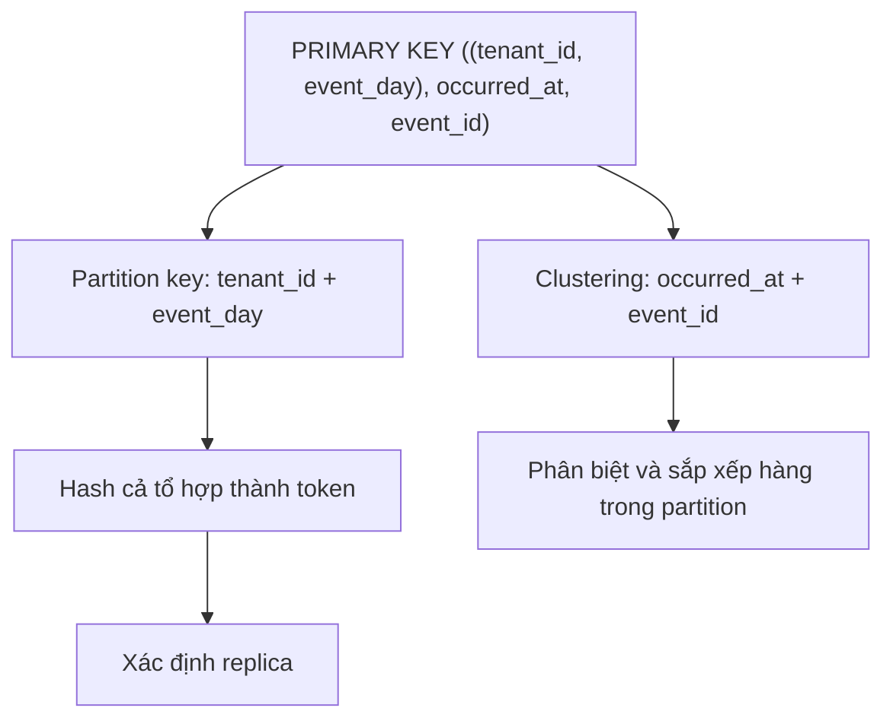
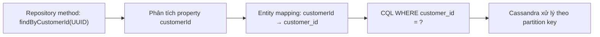
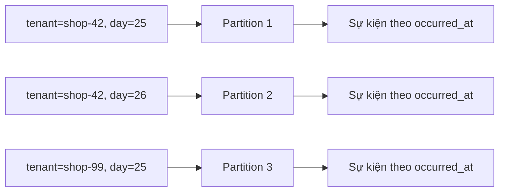

# Tra cứu bằng partition key đơn và ghép trong Spring Data Cassandra

Khi khai báo repository với Spring Data Cassandra, lập trình viên có thể viết `findByCustomerId(...)` hoặc `findByKey_TenantIdAndKey_EventDay(...)` và để framework suy ra truy vấn từ tên phương thức (**derived query**). Nhưng **Cassandra không phải cơ sở dữ liệu quan hệ**: việc Spring Data phân tích được tên method **không có nghĩa CQL tương ứng được Cassandra chấp nhận hoặc chạy hiệu quả**.

Bài thuộc chương **Truy vấn dẫn xuất** của module **SPRING_DATA_CASSANDRA**. Ta sẽ học cách tra cứu theo **partition key đơn** và **partition key ghép**, phân biệt chúng với **full primary key**, định nghĩa entity và `CassandraRepository`, sử dụng `@PrimaryKeyClass`, giới hạn truy vấn khi có clustering columns, cùng những lỗi thiết kế thường gặp khi triển khai `CassandraTemplate` hoặc CQL trực tiếp.

Mục tiêu sau bài học: nhìn vào một câu `PRIMARY KEY` trong schema, xác định được những tham số mà derived query phải nhận, viết được tên method theo **tên thuộc tính Java**, và biết khi nào cần chuyển sang `@Query` hoặc thiết kế bảng khác.

## 1. Phân biệt partition key và full primary key

Trong Cassandra, **primary key** có cấu trúc:

- **Partition key:** một hoặc nhiều cột; toàn bộ tổ hợp giá trị được băm thành token để xác định replica giữ partition.
- **Clustering columns:** các cột theo sau partition key, dùng để sắp xếp và phân biệt các hàng bên trong một partition.

Ba ví dụ CQL:

```sql
-- A. Một partition key, không có clustering column.
PRIMARY KEY (customer_id)

-- B. Một partition key, hai clustering columns.
PRIMARY KEY (device_id, recorded_at, event_id)

-- C. Partition key ghép gồm tenant_id và event_day;
--    occurred_at và event_id là clustering columns.
PRIMARY KEY ((tenant_id, event_day), occurred_at, event_id)
```

| Định nghĩa | Partition key | Clustering columns | Full primary key |
| --- | --- | --- | --- |
| A | `customer_id` | Không có | `customer_id` |
| B | `device_id` | `recorded_at`, `event_id` | Cả ba cột |
| C | `tenant_id`, `event_day` | `occurred_at`, `event_id` | Cả bốn cột |

**Điểm mấu chốt:** Ở ví dụ B, partition key vẫn là **đơn**, mặc dù full primary key có **ba cột**. Ở ví dụ C, **hai cặp ngoặc** `((tenant_id, event_day), ...)` mới thể hiện partition key ghép.



Với bảng B và C, **tra cứu một hàng** thường cần đầy đủ primary key; **tra cứu một nhóm hàng cùng partition** chỉ cần đầy đủ partition key, có thể thêm điều kiện hợp lệ trên clustering columns.

## 2. Derived query hoạt động như thế nào?

Spring Data phân tích tên phương thức repository theo mẫu `findBy<Property>And<Property>...`. Phần sau `By` dựa trên **tên thuộc tính Java của entity**, không phải tên cột CQL viết kiểu snake_case.

Ví dụ:

```java
public interface CustomerRepository
        extends CassandraRepository<CustomerProfile, UUID> {

    Optional<CustomerProfile> findByCustomerId(UUID customerId);
}
```

Nếu entity có thuộc tính `customerId` với `@PrimaryKey("customer_id")`, Spring Data hiểu `CustomerId` trong tên method là property `customerId` và ánh xạ sang cột CQL `customer_id`.

Quá trình logic:



Những điều **không tự xảy ra**:

1. Spring Data không tự tạo partition key hoặc secondary index để thỏa mọi tên method.
2. Không có phép JOIN tự động hay truy vấn hiệu quả tùy ý theo một cột thường.
3. Một method có thể được parser chấp nhận, nhưng CQL phát sinh có thể bị Cassandra từ chối vì thiếu partition key hoặc vi phạm điều kiện clustering.
4. Tên `findBy...` không thay đổi consistency level, replication factor hoặc kích thước partition.
5. Với tên thuộc tính lồng nhau hoặc mô hình version-specific, cần kiểm tra CQL thực tế bằng integration test.

## 3. Tra cứu bằng partition key đơn: bảng hồ sơ khách hàng

Yêu cầu: API lấy một hồ sơ bằng `customer_id`. Schema:

```sql
-- Giả sử keyspace commerce đã được tạo.
CREATE TABLE commerce.customer_profile (
    customer_id uuid PRIMARY KEY,
    display_name text,
    email text,
    created_at timestamp
);

INSERT INTO commerce.customer_profile (
    customer_id, display_name, email, created_at
) VALUES (
    11111111-1111-1111-1111-111111111111,
    'Nguyen An', 'an@example.test',
    '2026-11-25T09:00:00Z'
);
```

`customer_id` là một cột partition key và cũng là **toàn bộ primary key**. Truy vấn tương ứng:

```sql
SELECT *
FROM commerce.customer_profile
WHERE customer_id = 11111111-1111-1111-1111-111111111111;
```

### 3.1. Định nghĩa entity

```java
import java.time.Instant;
import java.util.UUID;
import org.springframework.data.cassandra.core.mapping.Column;
import org.springframework.data.cassandra.core.mapping.PrimaryKey;
import org.springframework.data.cassandra.core.mapping.Table;

@Table("customer_profile")
public class CustomerProfile {

    @PrimaryKey("customer_id")
    private UUID customerId;

    @Column("display_name")
    private String displayName;

    @Column("email")
    private String email;

    @Column("created_at")
    private Instant createdAt;

    public CustomerProfile() {}

    public UUID getCustomerId() { return customerId; }
    public void setCustomerId(UUID value) { customerId = value; }

    public String getDisplayName() { return displayName; }
    public void setDisplayName(String value) { displayName = value; }

    public String getEmail() { return email; }
    public void setEmail(String value) { email = value; }

    public Instant getCreatedAt() { return createdAt; }
    public void setCreatedAt(Instant value) { createdAt = value; }
}
```

Ở đây thuộc tính Java là `customerId`, còn tên cột vật lý là `customer_id`. Method derived query phải dựa trên `customerId`; không viết `findByCustomer_id` chỉ vì CQL dùng dấu gạch dưới.

### 3.2. Repository và hai cách lấy một hàng

```java
import java.util.Optional;
import java.util.UUID;
import org.springframework.data.cassandra.repository.CassandraRepository;

public interface CustomerRepository
        extends CassandraRepository<CustomerProfile, UUID> {

    Optional<CustomerProfile> findByCustomerId(UUID customerId);
}
```

Trong service:

```java
import java.util.Optional;
import java.util.UUID;
import org.springframework.stereotype.Service;

@Service
public class CustomerLookupService {
    private final CustomerRepository customers;

    public CustomerLookupService(CustomerRepository customers) {
        this.customers = customers;
    }

    public Optional<CustomerProfile> load(UUID customerId) {
        return customers.findByCustomerId(customerId);
    }

    public Optional<CustomerProfile> loadByPrimaryKey(UUID customerId) {
        return customers.findById(customerId);
    }
}
```

Vì full primary key chỉ có một cột, cả `findByCustomerId` và `findById` đều giải quyết tra cứu một hàng theo khóa. **`findById` đã được repository kế thừa và thường là lựa chọn đơn giản nhất** khi caller đã có toàn bộ primary key.

Derived query hữu ích hơn khi API cần diễn đạt ý nghĩa nghiệp vụ, thêm tiêu chí hợp lệ hoặc cung cấp các phương thức khác nhau trên những bảng có clustering columns.

### 3.3. Method viết được nhưng không phù hợp schema

Ví dụ:

```java
// Tên method có thể phân tích được thành property email,
// nhưng bảng customer_profile không được định tuyến theo email.
Optional<CustomerProfile> findByEmail(String email);
```

CQL ý tưởng:

```sql
SELECT * FROM commerce.customer_profile
WHERE email = 'an@example.test';
```

Vì `email` không phải partition key và chưa có index/access path phù hợp, Cassandra không thể thực hiện nó như một point lookup hiệu quả. **Derived query không tự tạo index**. Nếu tra cứu bằng email là yêu cầu chính, có thể cần bảng `customer_by_email` với email là partition key (cùng quy tắc uniqueness và đồng bộ nhiều bảng do nghiệp vụ quản lý).

## 4. Partition key đơn nhưng có nhiều hàng: cần phân biệt full ID

Xét bài toán “lấy các mẫu đo của một thiết bị”. Schema:

```sql
CREATE TABLE commerce.readings_by_device (
    device_id uuid,
    recorded_at timestamp,
    reading_id uuid,
    temperature decimal,
    PRIMARY KEY (device_id, recorded_at, reading_id)
) WITH CLUSTERING ORDER BY (recorded_at DESC, reading_id ASC);
```

Ở đây:

- Partition key: **chỉ `device_id`**.
- Clustering columns: `recorded_at`, `reading_id`.
- Full primary key: **cả ba cột**.
- Một thiết bị có thể có nhiều hàng, nhưng những hàng cùng `device_id` thuộc một partition logic.

### 4.1. Lớp khóa đầy đủ

```java
import java.io.Serializable;
import java.time.Instant;
import java.util.Objects;
import java.util.UUID;
import org.springframework.data.cassandra.core.mapping.PrimaryKeyClass;
import org.springframework.data.cassandra.core.mapping.PrimaryKeyColumn;
import org.springframework.data.cassandra.core.mapping.PrimaryKeyType;

@PrimaryKeyClass
public class DeviceReadingKey implements Serializable {

    @PrimaryKeyColumn(name = "device_id", ordinal = 0,
            type = PrimaryKeyType.PARTITIONED)
    private UUID deviceId;

    @PrimaryKeyColumn(name = "recorded_at", ordinal = 1,
            type = PrimaryKeyType.CLUSTERED)
    private Instant recordedAt;

    @PrimaryKeyColumn(name = "reading_id", ordinal = 2,
            type = PrimaryKeyType.CLUSTERED)
    private UUID readingId;

    public DeviceReadingKey() {}

    public UUID getDeviceId() { return deviceId; }
    public void setDeviceId(UUID value) { deviceId = value; }

    public Instant getRecordedAt() { return recordedAt; }
    public void setRecordedAt(Instant value) { recordedAt = value; }

    public UUID getReadingId() { return readingId; }
    public void setReadingId(UUID value) { readingId = value; }

    @Override
    public boolean equals(Object other) {
        if (this == other) return true;
        if (!(other instanceof DeviceReadingKey)) return false;
        DeviceReadingKey that = (DeviceReadingKey) other;
        return Objects.equals(deviceId, that.deviceId)
            && Objects.equals(recordedAt, that.recordedAt)
            && Objects.equals(readingId, that.readingId);
    }

    @Override
    public int hashCode() {
        return Objects.hash(deviceId, recordedAt, readingId);
    }
}
```

`@PrimaryKeyClass` biểu diễn toàn bộ full primary key; annotation `PARTITIONED` và `CLUSTERED` phân biệt vai trò của từng cột. Bảng đã được tạo bằng CQL với `recorded_at DESC`; nếu ứng dụng tự sinh schema bằng mapping, cần bảo đảm cấu hình ordering khớp với thứ tự đó.

### 4.2. Entity và derived query theo partition key

```java
import java.math.BigDecimal;
import org.springframework.data.cassandra.core.mapping.Column;
import org.springframework.data.cassandra.core.mapping.PrimaryKey;
import org.springframework.data.cassandra.core.mapping.Table;

@Table("readings_by_device")
public class DeviceReading {

    @PrimaryKey
    private DeviceReadingKey key;

    @Column("temperature")
    private BigDecimal temperature;

    public DeviceReading() {}

    public DeviceReadingKey getKey() { return key; }
    public void setKey(DeviceReadingKey key) { this.key = key; }

    public BigDecimal getTemperature() { return temperature; }
    public void setTemperature(BigDecimal value) { temperature = value; }
}
```

```java
import java.util.List;
import java.util.UUID;
import org.springframework.data.cassandra.repository.CassandraRepository;

public interface DeviceReadingRepository
        extends CassandraRepository<DeviceReading, DeviceReadingKey> {

    // Key_DeviceId diễn đạt đường dẫn property: key.deviceId.
    List<DeviceReading> findByKey_DeviceId(UUID deviceId);
}
```

**Tại sao `Key_DeviceId`?** Java entity có trường `key` thuộc kiểu `DeviceReadingKey`, bên trong có `deviceId`. Dấu gạch dưới trong tên derived query là tín hiệu **định hướng phân tích property path** của Spring Data: `key.deviceId`. Nó không phải dấu gạch dưới của tên cột CQL `device_id`.

Tùy quy tắc parsing và tên các property khác, `findByKeyDeviceId(...)` có thể cũng phân giải đúng. **Dùng `Key_DeviceId` giúp người đọc thấy rõ ranh giới thuộc tính lồng nhau**, giảm mơ hồ; vẫn cần chạy integration test cho phiên bản Spring Data Cassandra được dùng.

### 4.3. Khác biệt giữa `findById` và `findByKey_DeviceId`

```java
// Tìm chính xác MỘT hàng: yêu cầu full primary key.
DeviceReadingKey fullKey = new DeviceReadingKey();
// set đủ deviceId, recordedAt, readingId trước khi gọi:
repository.findById(fullKey);

// Tìm NHIỀU hàng của một partition: chỉ cần deviceId.
repository.findByKey_DeviceId(deviceId);
```

`findById` không chấp nhận chỉ `deviceId` rồi ngầm hiểu hai clustering columns còn lại là “mọi giá trị”. Ngược lại, `findByKey_DeviceId` phải có khả năng trả nhiều hàng vì một partition có thể chứa nhiều lần đo.

CQL tương ứng:

```sql
-- Đọc toàn bộ hàng của một partition logic (cần giới hạn nếu dữ liệu lớn).
SELECT * FROM commerce.readings_by_device
WHERE device_id = 11111111-1111-1111-1111-111111111111;

-- Đọc một hàng đầy đủ.
SELECT * FROM commerce.readings_by_device
WHERE device_id = 11111111-1111-1111-1111-111111111111
  AND recorded_at = '2026-11-25T09:00:00Z'
  AND reading_id = 22222222-2222-2222-2222-222222222222;
```

**Lưu ý hiệu năng:** Method trả `List` không giới hạn trên một partition dữ liệu lớn có thể tải quá nhiều hàng vào bộ nhớ. Trong sản phẩm thực tế, hãy giới hạn theo thời gian, truy vấn với `LIMIT`, sử dụng paging hoặc thiết kế bucket phù hợp.

## 5. Partition key ghép: tra cứu theo đầy đủ tổ hợp khóa

Một ứng dụng multi-tenant muốn đọc sự kiện của **một tenant trong một ngày**. Chọn `(tenant_id, event_day)` làm partition key ghép:

```sql
CREATE TABLE commerce.events_by_tenant_day (
    tenant_id text,
    event_day date,
    occurred_at timestamp,
    event_id uuid,
    event_type text,
    payload text,
    PRIMARY KEY ((tenant_id, event_day), occurred_at, event_id)
) WITH CLUSTERING ORDER BY (occurred_at DESC, event_id ASC);
```

Mỗi tổ hợp `('shop-42', '2026-11-25')` là **một partition logic**. Trong partition, `occurred_at` sắp xếp sự kiện theo thời gian và `event_id` phân biệt những bản ghi có timestamp trùng.



Những partition này **có thể** được băm tới token khác nhau, nhưng không bảo đảm nằm trên các node vật lý khác nhau; việc đặt replica tùy thuộc token map và replication strategy.

### 5.1. Lớp primary key gồm bốn cột

```java
import java.io.Serializable;
import java.time.Instant;
import java.time.LocalDate;
import java.util.Objects;
import java.util.UUID;
import org.springframework.data.cassandra.core.mapping.PrimaryKeyClass;
import org.springframework.data.cassandra.core.mapping.PrimaryKeyColumn;
import org.springframework.data.cassandra.core.mapping.PrimaryKeyType;

@PrimaryKeyClass
public class TenantEventKey implements Serializable {

    @PrimaryKeyColumn(name = "tenant_id", ordinal = 0,
            type = PrimaryKeyType.PARTITIONED)
    private String tenantId;

    @PrimaryKeyColumn(name = "event_day", ordinal = 1,
            type = PrimaryKeyType.PARTITIONED)
    private LocalDate eventDay;

    @PrimaryKeyColumn(name = "occurred_at", ordinal = 2,
            type = PrimaryKeyType.CLUSTERED)
    private Instant occurredAt;

    @PrimaryKeyColumn(name = "event_id", ordinal = 3,
            type = PrimaryKeyType.CLUSTERED)
    private UUID eventId;

    public TenantEventKey() {}

    public TenantEventKey(String tenantId, LocalDate eventDay,
                          Instant occurredAt, UUID eventId) {
        this.tenantId = tenantId;
        this.eventDay = eventDay;
        this.occurredAt = occurredAt;
        this.eventId = eventId;
    }

    public String getTenantId() { return tenantId; }
    public void setTenantId(String value) { tenantId = value; }

    public LocalDate getEventDay() { return eventDay; }
    public void setEventDay(LocalDate value) { eventDay = value; }

    public Instant getOccurredAt() { return occurredAt; }
    public void setOccurredAt(Instant value) { occurredAt = value; }

    public UUID getEventId() { return eventId; }
    public void setEventId(UUID value) { eventId = value; }

    @Override
    public boolean equals(Object other) {
        if (this == other) return true;
        if (!(other instanceof TenantEventKey)) return false;
        TenantEventKey that = (TenantEventKey) other;
        return Objects.equals(tenantId, that.tenantId)
            && Objects.equals(eventDay, that.eventDay)
            && Objects.equals(occurredAt, that.occurredAt)
            && Objects.equals(eventId, that.eventId);
    }

    @Override
    public int hashCode() {
        return Objects.hash(tenantId, eventDay, occurredAt, eventId);
    }
}
```

`ordinal` xác định thứ tự cột khóa, còn `type = PARTITIONED` chỉ định hai thành phần partition key. Không nhầm **bốn field trong full key** với **bốn thành phần partition key**.

### 5.2. Entity và repository

```java
import org.springframework.data.cassandra.core.mapping.Column;
import org.springframework.data.cassandra.core.mapping.PrimaryKey;
import org.springframework.data.cassandra.core.mapping.Table;

@Table("events_by_tenant_day")
public class TenantEvent {

    @PrimaryKey
    private TenantEventKey key;

    @Column("event_type")
    private String eventType;

    @Column("payload")
    private String payload;

    public TenantEvent() {}

    public TenantEventKey getKey() { return key; }
    public void setKey(TenantEventKey value) { key = value; }

    public String getEventType() { return eventType; }
    public void setEventType(String value) { eventType = value; }

    public String getPayload() { return payload; }
    public void setPayload(String value) { payload = value; }
}
```

```java
import java.time.LocalDate;
import java.util.List;
import org.springframework.data.cassandra.repository.CassandraRepository;

public interface TenantEventRepository
        extends CassandraRepository<TenantEvent, TenantEventKey> {

    // Hai đường dẫn property lồng nhau trong key:
    // key.tenantId AND key.eventDay.
    List<TenantEvent> findByKey_TenantIdAndKey_EventDay(
        String tenantId, LocalDate eventDay
    );
}
```

CQL mà phương thức này **hướng tới**:

```sql
SELECT *
FROM commerce.events_by_tenant_day
WHERE tenant_id = 'shop-42'
  AND event_day = '2026-11-25';
```

Vì `tenant_id` và `event_day` đều là partition key components, Cassandra có đủ thông tin để xác định một partition. Kết quả có thể gồm nhiều sự kiện, theo thứ tự clustering của bảng khi đọc trong partition đó.

**Điểm khác biệt:** Generic `TenantEventKey` của `CassandraRepository<TenantEvent, TenantEventKey>` là **full primary key**; còn method derived query ở trên **chỉ yêu cầu hai field partition key** để đọc các hàng trong partition.

### 5.3. Nếu muốn đọc một sự kiện cụ thể

Có thể gọi `findById` với **đủ bốn giá trị**:

```java
TenantEventKey exactId = new TenantEventKey(
    "shop-42",
    LocalDate.parse("2026-11-25"),
    Instant.parse("2026-11-25T09:00:00Z"),
    UUID.fromString("33333333-3333-3333-3333-333333333333")
);

Optional<TenantEvent> one = repository.findById(exactId);
```

`findById` dùng full primary key; nó không tự mở rộng `eventDay` thành mọi ngày hoặc giả định clustering columns có thể để `null`.

## 6. Vì sao không thể bỏ bớt một cột partition key ghép?

Với `PRIMARY KEY ((tenant_id, event_day), occurred_at, event_id)`, hai method sau **không tạo được đường đọc một partition đầy đủ**:

```java
// Thiếu eventDay.
List<TenantEvent> findByKey_TenantId(String tenantId);

// Thiếu tenantId.
List<TenantEvent> findByKey_EventDay(LocalDate day);
```

Các tên method có thể hợp lệ về mặt cú pháp Java và Spring Data property parsing, nhưng Cassandra không thể tra cứu một partition bằng **một phần tổ hợp partition key** trong truy vấn CQL thông thường.

```sql
-- Không đủ full partition key.
SELECT * FROM commerce.events_by_tenant_day
WHERE tenant_id = 'shop-42';

-- Không đủ full partition key.
SELECT * FROM commerce.events_by_tenant_day
WHERE event_day = '2026-11-25';
```

Nếu ứng dụng cần tất cả sự kiện của tenant trong một tuần, có các hướng:

1. **Biết trước các ngày cần đọc:** gửi các truy vấn riêng theo cặp `(tenantId, day)` cho từng ngày, giới hạn số partition và hợp nhất dữ liệu phía ứng dụng.
2. **Tạo bảng phục vụ truy vấn khác:** ví dụ bảng có partition key `tenant_id` với bucket thời gian phù hợp, nếu khối lượng dữ liệu cho phép.
3. **Dùng hệ tổng hợp/phân tích riêng:** khi cần quét nhiều tenant/ngày trên tập dữ liệu lớn.

Tránh thêm `ALLOW FILTERING` như một cách mặc định để “lách” thiếu khóa, vì có thể dẫn tới chi phí quét rất lớn và khó đoán. Secondary index hoặc các hệ tìm kiếm tích hợp có thể giải quyết một số access pattern, nhưng không biến mọi query thành truy cập partition hiệu quả; cần đánh giá workload, phiên bản Cassandra và giới hạn tài nguyên cụ thể.

## 7. Kết hợp điều kiện clustering với partition key

Khi biết đầy đủ partition key, Cassandra còn cho phép dùng các cột clustering **theo thứ tự và quy tắc mà CQL hỗ trợ**.

Ví dụ với bảng `events_by_tenant_day`, tìm sự kiện từ một thời điểm trong ngày:

```sql
SELECT *
FROM commerce.events_by_tenant_day
WHERE tenant_id = 'shop-42'
  AND event_day = '2026-11-25'
  AND occurred_at >= '2026-11-25T09:00:00Z'
LIMIT 50;
```

`occurred_at` là clustering column đầu tiên, nên điều kiện phạm vi trên cột này là một đường truy vấn tự nhiên khi partition key đã đầy đủ.

Có thể biểu diễn phương thức theo property path:

```java
import java.time.Instant;
import java.time.LocalDate;
import java.util.List;
import org.springframework.data.cassandra.repository.CassandraRepository;

public interface TenantEventRepository
        extends CassandraRepository<TenantEvent, TenantEventKey> {

    List<TenantEvent>
        findByKey_TenantIdAndKey_EventDayAndKey_OccurredAtGreaterThanEqual(
            String tenantId, LocalDate eventDay, Instant fromInclusive
        );
}
```

Đây là **cách diễn đạt dự định truy vấn** bằng derived query khi version Spring Data Cassandra hỗ trợ toán tử tương ứng. Cần kiểm tra method parser, CQL tạo ra và khả năng thực thi trên đúng schema; tên method dài và nhiều điều kiện có thể là tín hiệu nên dùng `@Query` để kiểm soát rõ `LIMIT` và kết quả.

Ví dụ `@Query` tường minh (dùng như **phương án thay thế** trong cùng repository):

```java
import java.time.Instant;
import java.time.LocalDate;
import java.util.List;
import org.springframework.data.cassandra.repository.CassandraRepository;
import org.springframework.data.cassandra.repository.Query;

public interface TenantEventRepository
        extends CassandraRepository<TenantEvent, TenantEventKey> {

    @Query("SELECT * FROM events_by_tenant_day " +
           "WHERE tenant_id = ?0 AND event_day = ?1 " +
           "AND occurred_at >= ?2 LIMIT 50")
    List<TenantEvent> findRecentEvents(
        String tenantId, LocalDate day, Instant fromInclusive
    );
}
```

Đặt các ví dụ repository trùng tên ở phần khác nhau của bài vào **một interface duy nhất khi triển khai**, không định nghĩa nhiều public interface cùng tên trong một package.

**Không tùy ý lọc theo clustering column thứ hai** `event_id` khi không có điều kiện phù hợp trên `occurred_at`. Quy tắc Cassandra thường yêu cầu đi từ trái sang phải theo thứ tự clustering columns; điều kiện phạm vi cũng giới hạn những cột có thể tiếp tục lọc.

## 8. Derived query, `@Query` và `findById`: chọn đúng công cụ

| Nhu cầu | Cách viết phù hợp | Nhận xét |
| --- | --- | --- |
| Tìm một khách hàng theo `customer_id` | `findById(UUID)` hoặc `findByCustomerId(UUID)` | Full primary key một cột. |
| Đọc các mẫu đo của một thiết bị | `findByKey_DeviceId(UUID)` | Partition key đơn; có nhiều clustering rows. |
| Đọc các sự kiện của tenant trong ngày | `findByKey_TenantIdAndKey_EventDay(...)` | Bắt buộc đủ composite partition key. |
| Đọc đúng một sự kiện | `findById(TenantEventKey)` | Cần full primary key gồm bốn cột. |
| Đọc 50 sự kiện mới nhất có điều kiện thời gian | `@Query` có full partition key và `LIMIT` | Tường minh và dễ kiểm soát giới hạn. |
| Đọc mọi sự kiện không biết tenant/ngày | Không nên tạo method scan mặc định | Cần mô hình truy cập hoặc nền tảng xử lý dữ liệu khác. |

Derived query có lợi khi điều kiện **đơn giản, ổn định, khớp khóa**. `@Query` hữu ích khi cần CQL có `LIMIT`, ràng buộc clustering cụ thể hoặc muốn kiểm soát rõ từng cột. `CassandraTemplate` và `CqlTemplate` được cân nhắc khi cần API query động, options, statement-level consistency hay kiểm soát paging, nhưng **đều bị ràng buộc bởi schema Cassandra**.

Một phương thức tên dài không chứng minh nó tối ưu; chi phí phụ thuộc số partition, số replica, lượng dữ liệu mỗi partition, kết cấu clustering và độ nóng của khóa.

## 9. LIMIT, paging và rủi ro partition quá lớn

Một partition `(tenant_id, event_day)` có thể chứa hàng trăm hoặc hàng triệu sự kiện. Gọi phương thức trả `List<TenantEvent>` không giới hạn có thể gây:

- Tăng độ trễ request và dữ liệu truyền qua mạng.
- Dồn bộ nhớ ở service nếu gom kết quả vào `List`.
- Tăng tải coordinator/replica khi partition rất lớn hoặc đang được ghi liên tục.
- Khó phân trang ổn định nếu kết quả thay đổi giữa những lần gọi.

Những giải pháp thường dùng:

1. **Giới hạn CQL:** thêm `LIMIT 50` với truy vấn phù hợp.
2. **Paging state:** dùng cơ chế Cassandra/driver hoặc `Slice<T>` và `Pageable` nếu API Spring Data Cassandra phiên bản đang dùng hỗ trợ đúng yêu cầu. Không giả định có `OFFSET` tùy ý.
3. **Điều kiện clustering:** truy vấn các sự kiện mới hơn/cũ hơn một mốc thời gian, lưu ý các bản ghi cùng timestamp cần tie-breaker `event_id`.
4. **Bucket partition:** nếu một tenant/ngày quá lớn, cân nhắc thêm bucket/giờ vào partition key; việc đọc một ngày khi ấy phải fan-out có kiểm soát.
5. **Giám sát tải:** đo số hàng và byte trên partition nóng, request latency, timeout, số page được đọc và giới hạn bộ nhớ.

**Page size khác `LIMIT`:** page size kiểm soát lượng dữ liệu mỗi lần fetch, còn `LIMIT` hạn chế tổng số hàng câu truy vấn trả. Kể cả đã dùng page size nhỏ, method thu thập hết thành `List` vẫn có thể tốn bộ nhớ lớn.

Khi dùng derived method với tiền tố `findFirst...`/`findTop...`, cần kiểm tra phiên bản Spring Data Cassandra có hỗ trợ cú pháp limiting tương ứng và giới hạn CQL thực tế; không suy luận rằng mọi khả năng query derivation ở JPA đều được chuyển nguyên xi sang Cassandra.

## 10. Tên thuộc tính Java, tên cột CQL và khóa ghép

Một nguồn lỗi thường gặp là trộn lẫn ba cách biểu diễn:

| Thành phần | Ví dụ | Vai trò |
| --- | --- | --- |
| Tên thuộc tính entity | `key` | Trường Java chứa full primary key. |
| Tên thuộc tính trong key class | `tenantId`, `eventDay` | Property path của method: `key.tenantId`, `key.eventDay`. |
| Tên cột CQL | `tenant_id`, `event_day` | Tên lưu trong bảng Cassandra. |
| Annotation mapping | `@PrimaryKeyColumn(name="tenant_id", ...)` | Nối property Java với cột CQL. |
| Derived method | `findByKey_TenantIdAndKey_EventDay` | Parser làm việc trên **property path Java**. |

Nếu schema dùng cột quoted/mixed-case, annotation `@Table`, `@Column` và `@PrimaryKeyColumn` phải phản ánh đúng identifier CQL. Đổi tên trong annotation **không tự thay đổi schema Cassandra**; cần migration riêng khi thật sự đổi cột.

Ví dụ sai phổ biến:

```java
// Không đặt tên method bằng snake_case của CQL:
List<TenantEvent> findByTenant_idAndEvent_day(
    String tenantId, LocalDate day
);
```

Nếu entity không có các property Java tương ứng như cấu trúc tên parser đang hiểu, method có thể không tạo được repository query hoặc tạo truy vấn sai. Cách đáng tin cậy là theo đúng đường dẫn `key.tenantId` và `key.eventDay`; khi cần tính tường minh tuyệt đối, dùng `@Query` với `tenant_id` và `event_day` trong CQL.

## 11. Xử lý lỗi: phương thức tạo được nhưng truy vấn không chạy

| Triệu chứng | Nguyên nhân khả dĩ | Hướng xử lý |
| --- | --- | --- |
| Startup báo lỗi không tìm thấy property trong method | Tên derived method không khớp thuộc tính Java/nested key. | Kiểm tra class entity, key class và tên property; dùng `Key_TenantId` cho đường dẫn lồng nhau. |
| `InvalidQueryException` hoặc lỗi CQL khi chỉ lọc `tenant_id` | Thiếu `event_day` của composite partition key. | Bổ sung đầy đủ thành phần khóa hoặc đổi thiết kế bảng. |
| `findById` không thể gọi bằng UUID của `deviceId` | Repository ID thật là `DeviceReadingKey` gồm clustering columns. | Dùng full key cho một hàng, hoặc derived query theo partition key cho nhiều hàng. |
| Method lọc `event_type` bị Cassandra từ chối | `event_type` không nằm trong khóa/index truy vấn phù hợp. | Thiết kế bảng theo access pattern hoặc chọn index có chủ đích. |
| Result quá lớn, API timeout | Partition lớn, query không giới hạn. | Thêm `LIMIT`/paging, điều kiện clustering, bucket. |
| Derived query có `OrderBy` nhưng bị từ chối | CQL không cho ORDER BY tùy ý trên toàn cluster. | Dùng clustering order trong bảng và điều kiện partition key hợp lệ. |
| Đổi tên cột trong Java nhưng query vẫn sai | Mapping/schema không khớp, hoặc CQL viết tay chưa cập nhật. | Kiểm tra `system_schema` và migration. |
| Đọc thấy dữ liệu cũ ngay sau ghi | Consistency đọc/ghi và replica convergence. | Kiểm tra RF, local DC, CL và nhu cầu đọc sau ghi. |
| Repository hoạt động nhưng một vài partition rất chậm | Hot partition hoặc kích thước partition mất cân đối. | Đo lưu lượng/partition, điều chỉnh key/bucket theo workload. |

Một cách debug có hệ thống:

1. **Xem schema CQL thực tế** — tách đúng partition key và clustering columns.
2. **Xem entity mapping** — xác minh tên property, `@PrimaryKey`, `@PrimaryKeyColumn`, kiểu Java.
3. **Xem method parser** — tên method biểu đạt property path nào?
4. **Xem CQL sinh ra** — có đủ full partition key, điều kiện clustering hợp lệ và giới hạn kết quả không?
5. **Chạy integration test** với dữ liệu đại diện — kết quả, thứ tự, paging, timeout, số partition truy cập.
6. **Xem consistency và topology** nếu schema/query đúng nhưng kết quả chưa đáp ứng kỳ vọng.

Không “chữa” tất cả lỗi bằng `ALLOW FILTERING`, tăng timeout hoặc thêm index tùy tiện. Đây thường chỉ che giấu vấn đề mô hình truy cập.

## 12. Kiểm tra tích hợp với Spring Data Cassandra

Một thử nghiệm tối thiểu cần dữ liệu từ **hai tenant** và **hai ngày** để chứng minh truy vấn không lẫn partition:

```sql
INSERT INTO commerce.events_by_tenant_day (
    tenant_id, event_day, occurred_at, event_id, event_type
) VALUES ('shop-42', '2026-11-25', '2026-11-25T09:00:00Z',
          11111111-1111-1111-1111-111111111111, 'CREATED');

INSERT INTO commerce.events_by_tenant_day (
    tenant_id, event_day, occurred_at, event_id, event_type
) VALUES ('shop-42', '2026-11-26', '2026-11-26T09:00:00Z',
          22222222-2222-2222-2222-222222222222, 'UPDATED');

INSERT INTO commerce.events_by_tenant_day (
    tenant_id, event_day, occurred_at, event_id, event_type
) VALUES ('shop-99', '2026-11-25', '2026-11-25T10:00:00Z',
          33333333-3333-3333-3333-333333333333, 'CREATED');
```

Gọi:

```java
List<TenantEvent> events =
    repository.findByKey_TenantIdAndKey_EventDay(
        "shop-42", LocalDate.parse("2026-11-25")
    );

// Kỳ vọng chỉ các hàng thuộc ('shop-42', '2026-11-25').
for (TenantEvent event : events) {
    assert "shop-42".equals(event.getKey().getTenantId());
    assert LocalDate.parse("2026-11-25")
        .equals(event.getKey().getEventDay());
}
```

Đoạn code cuối dùng Java `assert` để diễn giải điều kiện kỳ vọng; production test nên dùng assertion framework (JUnit/AssertJ) và môi trường Cassandra thật tương thích với phiên bản dự án, không phụ thuộc việc bật/tắt Java assertions.

Cần kiểm tra cả hai chiều: method query được Spring Data parse thành CQL như dự định **và** Cassandra thực sự thực thi được câu lệnh trên schema đã tạo. Bài test này cũng nên xác minh `findById` với full `TenantEventKey` và một case thiếu partition key (kỳ vọng truy vấn bị từ chối nếu không có access path đặc biệt).

## 13. Bài tập tình huống

**Tình huống A — Khóa đơn:** Bảng `profile_by_user` có `PRIMARY KEY (user_id)`. Entity có `userId`. Khi nào nên dùng `findByUserId(UUID)` và khi nào `findById(UUID)` đã đủ?

**Tình huống B — Một partition có nhiều hàng:** Bảng `readings_by_device` dùng `PRIMARY KEY (device_id, recorded_at, reading_id)`. Có thể truyền riêng `device_id` vào `findById` để lấy mọi mẫu đo không? Nếu không, method nào thích hợp?

**Tình huống C — Khóa ghép:** Bảng `events_by_tenant_day` có `PRIMARY KEY ((tenant_id, event_day), occurred_at, event_id)`. API chỉ biết `tenant_id`. Vì sao `findByKey_TenantId(...)` không đủ? Có những phương án gì nếu cần đọc 7 ngày gần nhất?

**Tình huống D — Derived query và CQL:** Một developer thêm `findByEventType(String)` vào repository nhưng Cassandra từ chối. Vì sao tên method hợp lệ không bảo đảm đường truy vấn hiệu quả?

**Tình huống E — Tên property:** Entity có trường `key` kiểu `TenantEventKey`; class này có field `eventDay`. Vì sao tên `findByKey_EventDay` dễ hiểu hơn `findByEvent_day`?

**Tình huống F — Paging:** Một method trả về `List` cho toàn bộ sự kiện của một tenant/ngày và gây timeout. Khi nào nên thêm `LIMIT`, paging hoặc bucket, và page size khác gì LIMIT?

**Gợi ý trả lời:**

1. Cả hai đều phù hợp vì primary key chỉ có một cột; `findById` là method kế thừa thuận tiện nhất khi caller có đầy đủ ID.
2. Không. `findById` cần full key gồm ba cột; `findByKey_DeviceId(UUID)` biểu diễn truy vấn theo partition key và trả nhiều hàng.
3. Phải đủ `tenant_id` và `event_day`. Có thể gửi tối đa 7 truy vấn theo ngày, điều chỉnh mô hình bảng hoặc dùng bảng tổng hợp/analytics cho yêu cầu rộng.
4. Cassandra vẫn yêu cầu đường truy vấn phù hợp schema hoặc index, Spring không tự tạo index từ tên method.
5. Derived parser xử lý **property path Java** `key.eventDay`; dấu gạch dưới ở đây tách đường dẫn thuộc tính lồng nhau, không mang nghĩa snake_case CQL.
6. `LIMIT` hạn chế tổng số hàng query trả; page size giới hạn lượng dữ liệu fetch mỗi trang. Khi partition lớn hoặc nóng, thiết kế bucket và giới hạn đọc có thể cần thiết.

**Ghi nhớ:** Với **Spring Data Cassandra**, derived query là tiện ích chuyển **tên method và property Java** thành truy vấn, không phải cách vượt qua quy tắc Cassandra. **Khóa đơn** chỉ cần giá trị partition key duy nhất; **khóa ghép** phải có **đầy đủ các thành phần** để truy cập một partition. `findById` định vị một hàng bằng **full primary key**, còn method theo partition key có thể trả nhiều hàng. Hãy luôn đối chiếu schema CQL, giới hạn số hàng và kiểm tra hiệu năng trước khi triển khai.
