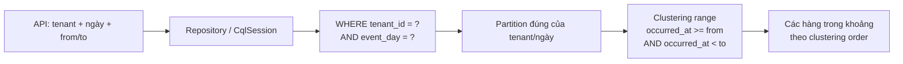

# So sánh khoảng bằng GreaterThan, LessThan và Between

## 1. Vì sao truy vấn theo khoảng cần hiểu Cassandra trước khi đặt tên method?

Trong **Spring Data Cassandra**, Spring Data repository có thể phân tích tên phương thức truy vấn như `findByOccurredAtGreaterThan(...)` để suy ra điều kiện so sánh. Đây là tính năng **truy vấn dẫn xuất (derived queries)**: tên method mô tả điều kiện, còn framework xây truy vấn dựa trên metadata mapping.

Tuy nhiên, Apache Cassandra **không phải** cơ sở dữ liệu quan hệ cho phép thêm tùy ý `WHERE price > ...`, `WHERE created_at BETWEEN ...` trên mọi bảng. Truy vấn có hiệu quả khi phù hợp với **partition key**, **clustering columns**, thứ tự khóa và những khả năng lập chỉ mục được lựa chọn có chủ đích. Derived query chỉ tạo cách biểu đạt; nó không tự sửa một mô hình bảng sai.

Bài học này tập trung vào ba dạng so sánh:

- **`GreaterThan`** — lớn hơn một ngưỡng, về ý nghĩa là `>`.
- **`LessThan`** — nhỏ hơn một ngưỡng, về ý nghĩa là `<`.
- **`Between`** — nằm giữa hai mốc; cần **xác nhận chính xác quy tắc bao gồm/loại trừ hai đầu và khả năng hỗ trợ của phiên bản Spring Data Cassandra**.

Ta sẽ đặt các phép so sánh vào một truy vấn có **đủ partition key** và range trên **clustering column**, so sánh method derivation với câu CQL viết rõ bằng `@Query`, rồi xử lý phân trang, precision của `timestamp`, múi giờ và hiệu năng.

Sau bài học, bạn có thể:

1. Xác định nơi `>`, `<` và khoảng hai đầu được phép sử dụng trong một bảng Cassandra cụ thể.
2. Đặt tên repository method cho các so sánh một phía; nhận biết khi cần chuyển từ `Between` sang `@Query` có điều kiện tường minh.
3. Phân biệt `>` với `>=`, `<` với `<=`, và khoảng **đóng** với khoảng **nửa mở**.
4. Thiết kế phép đọc theo thời gian trong **một partition** hoặc nhiều bucket mà không dùng quét toàn bảng ngoài ý muốn.
5. Kiểm thử đúng các ca ranh giới, múi giờ, mili giây, paging và CL.

> **Phiên bản:** Ví dụ sử dụng phong cách Java Driver 4.x và Spring Data Cassandra tương thích với Spring Boot 3.x. Khả năng nhận diện/tạo CQL của từng keyword dẫn xuất (đặc biệt `Between`) và các overload repository có thể khác theo phiên bản. Khi cần hợp đồng khoảng chính xác, **`@Query` với các dấu toán tử cụ thể là ví dụ chính**; với method dẫn xuất, hãy xác minh query thực tế bằng integration test trên phiên bản đang dùng.

## 2. Đặt bài toán và thiết kế bảng theo truy vấn

### 2.1. Hai màn hình cần dữ liệu gì?

Giả sử hệ thống lưu các sự kiện của một tenant:

- **Màn hình hoạt động gần đây:** lấy 50 sự kiện **sau** một mốc thời gian trong ngày.
- **Màn hình lịch sử theo thời gian:** lấy các sự kiện từ 09:00 đến trước 11:00 của tenant đó trong ngày.

Nếu ta có hàng triệu tenant, một phép quét toàn cluster chỉ để lọc `occurred_at` không phù hợp. Ta xây bảng theo truy vấn **tenant + ngày**, sắp xếp dữ liệu trong partition theo thời gian.

Sơ đồ luồng:



Phần **equality trên partition key** giúp Cassandra xác định partition trước khi thực hiện so sánh range bên trong partition.

### 2.2. CQL schema dùng xuyên suốt bài

Giả sử một Cassandra lab một node ở data center `dc1`:

```sql
-- Replication factor 1 chỉ phục vụ lab một node.
CREATE KEYSPACE IF NOT EXISTS learning
WITH replication = {
    'class': 'NetworkTopologyStrategy',
    'dc1': 1
};

CREATE TABLE IF NOT EXISTS learning.events_by_tenant_day (
    tenant_id uuid,
    event_day date,
    occurred_at timestamp,
    event_id uuid,
    event_type text,
    description text,
    PRIMARY KEY ((tenant_id, event_day), occurred_at, event_id)
) WITH CLUSTERING ORDER BY (
    occurred_at DESC,
    event_id ASC
);
```

Bảng này có:

| Cột | Loại khóa | Ý nghĩa |
| --- | --- | --- |
| `tenant_id` | Partition key, vị trí 0 | Tenant cần truy vấn. |
| `event_day` | Partition key, vị trí 1 | Bucket theo ngày nghiệp vụ. |
| `occurred_at` | Clustering column, vị trí 0 | Thời điểm sự kiện; sắp xếp giảm dần trong partition. |
| `event_id` | Clustering column, vị trí 1 | Định danh duy nhất khi nhiều sự kiện trùng thời điểm mili giây. |
| `event_type`, `description` | Cột dữ liệu thường | Nội dung sự kiện; không phải đường range query chính. |

**Primary key** là bộ `((tenant_id, event_day), occurred_at, event_id)`. Một sự kiện có thể được tìm theo **đủ khóa chính**, còn danh sách trong một ngày có thể đọc theo **hai thành phần partition key** và đặt range trên clustering column `occurred_at`.

Nếu product cần “các sự kiện trong một tuần”, mô hình này phải thực hiện truy vấn nhiều partition/ngày rồi hợp nhất kết quả hoặc có bảng theo query pattern khác. Không có một phép `BETWEEN` trên `event_day` tự động làm tất cả các partition trở thành một phạm vi clustering liên tục.

### 2.3. Seed dữ liệu rõ các đầu mốc

Để học về ranh giới, hãy dùng bốn mốc UTC và một tenant:

```sql
INSERT INTO learning.events_by_tenant_day
(tenant_id, event_day, occurred_at, event_id, event_type, description)
VALUES (
    11111111-1111-1111-1111-111111111111,
    '2026-11-25', '2026-11-25T08:00:00.000Z',
    22222222-2222-2222-2222-222222222222,
    'LOGIN', '08:00 UTC'
);

INSERT INTO learning.events_by_tenant_day
(tenant_id, event_day, occurred_at, event_id, event_type, description)
VALUES (
    11111111-1111-1111-1111-111111111111,
    '2026-11-25', '2026-11-25T09:00:00.000Z',
    33333333-3333-3333-3333-333333333333,
    'VIEW', '09:00 UTC'
);

INSERT INTO learning.events_by_tenant_day
(tenant_id, event_day, occurred_at, event_id, event_type, description)
VALUES (
    11111111-1111-1111-1111-111111111111,
    '2026-11-25', '2026-11-25T10:00:00.000Z',
    44444444-4444-4444-4444-444444444444,
    'PURCHASE', '10:00 UTC'
);

INSERT INTO learning.events_by_tenant_day
(tenant_id, event_day, occurred_at, event_id, event_type, description)
VALUES (
    11111111-1111-1111-1111-111111111111,
    '2026-11-25', '2026-11-25T11:00:00.000Z',
    55555555-5555-5555-5555-555555555555,
    'LOGOUT', '11:00 UTC'
);
```

Khi đọc một partition không chỉ định `ORDER BY` khác, các hàng xuất hiện theo clustering order đã khai báo: **11:00 → 10:00 → 09:00 → 08:00**. Thứ tự trả về của nhiều partition **không** trở thành thứ tự toàn cục chỉ nhờ clustering order trong bảng.

## 3. GreaterThan: giá trị lớn hơn một ngưỡng

**`GreaterThan`** biểu đạt phép so sánh nghiêm ngặt: `occurred_at > threshold`. Bản ghi đúng **bằng** threshold không được chọn.

Ví dụ CQL:

```sql
SELECT tenant_id, event_day, occurred_at, event_id,
       event_type, description
FROM learning.events_by_tenant_day
WHERE tenant_id = 11111111-1111-1111-1111-111111111111
  AND event_day = '2026-11-25'
  AND occurred_at > '2026-11-25T09:00:00.000Z'
LIMIT 100;
```

Dữ liệu mẫu trả về **11:00 và 10:00**, không trả hàng **09:00**. Clustering order giảm dần nên nếu lấy danh sách mà không đổi order, các bản ghi muộn nhất thường xuất hiện trước.

So sánh hai toán tử:

| Điều kiện | Bao gồm chính mốc 09:00? | Kết quả từ dữ liệu mẫu |
| --- | --- | --- |
| `occurred_at > 09:00` | Không | 11:00, 10:00 |
| `occurred_at >= 09:00` | Có | 11:00, 10:00, 09:00 |

Ở Spring Data, những suffix dẫn xuất phổ biến là `GreaterThan` và `GreaterThanEqual`. Tên phương thức phải thể hiện **property Java đã được mapping**, chứ không phải tên SQL với dấu gạch dưới.

Ví dụ theo entity ở phần 6:

```java
List<EventRow> findByTenantIdAndEventDayAndOccurredAtGreaterThan(
    UUID tenantId, LocalDate eventDay, Instant threshold
);

List<EventRow> findByTenantIdAndEventDayAndOccurredAtGreaterThanEqual(
    UUID tenantId, LocalDate eventDay, Instant threshold
);
```

Đây là phương thức **truy vấn dẫn xuất**, không có implementation Java viết tay. Framework phân tích tên và ánh xạ `tenantId` sang `tenant_id`, `eventDay` sang `event_day`, `occurredAt` sang `occurred_at` theo annotation/schema.

**Cảnh báo:** Derived query chỉ hợp lệ nếu Cassandra cho phép predicate trên cột đó theo primary key/index thực tế. Không thể đổi thành `findByDescriptionGreaterThan(...)` rồi mặc định được Cassandra xử lý hiệu quả, bởi `description` ở bảng này là cột dữ liệu thường.

## 4. LessThan: giá trị nhỏ hơn một ngưỡng

**`LessThan`** biểu đạt `occurred_at < threshold`. Hàng đúng bằng threshold không được chọn.

```sql
SELECT tenant_id, event_day, occurred_at, event_id,
       event_type, description
FROM learning.events_by_tenant_day
WHERE tenant_id = 11111111-1111-1111-1111-111111111111
  AND event_day = '2026-11-25'
  AND occurred_at < '2026-11-25T10:00:00.000Z'
LIMIT 100;
```

Với bốn hàng mẫu, kết quả là **09:00 và 08:00**, không có **10:00**.

| Điều kiện | Bao gồm chính mốc 10:00? | Kết quả |
| --- | --- | --- |
| `occurred_at < 10:00` | Không | 09:00, 08:00 |
| `occurred_at <= 10:00` | Có | 10:00, 09:00, 08:00 |

Phương thức dẫn xuất tương ứng (cần kiểm chứng keyword trên phiên bản Spring Data Cassandra thực tế):

```java
List<EventRow> findByTenantIdAndEventDayAndOccurredAtLessThan(
    UUID tenantId, LocalDate eventDay, Instant threshold
);

List<EventRow> findByTenantIdAndEventDayAndOccurredAtLessThanEqual(
    UUID tenantId, LocalDate eventDay, Instant threshold
);
```

Một use case phổ biến là **đọc dữ liệu cũ hơn mốc người dùng đang xem**. Tuy nhiên, chỉ dùng `occurred_at < lastSeenTime` có thể **bỏ sót các sự kiện có cùng timestamp** với bản ghi cuối trang. Nếu hệ thống có nhiều hàng cùng mili giây, cursor phải tính đến **khóa clustering phụ** (`event_id`) hoặc dùng paging state của driver. Không giả định timestamp là khóa duy nhất.

## 5. Between: ý nghĩa khoảng hai đầu và giới hạn của derived query

### 5.1. “Between” có thể bị hiểu theo nhiều quy ước

Trong nghiệp vụ, cụm “từ 09:00 đến 11:00” chưa nói rõ hai đầu có được tính không. Có ba kiểu thường gặp:

| Kiểu khoảng | Điều kiện CQL tường minh | Với dữ liệu mẫu |
| --- | --- | --- |
| **Đóng** `[09:00, 11:00]` | `occurred_at >= 09:00 AND occurred_at <= 11:00` | 11:00, 10:00, 09:00 |
| **Mở** `(09:00, 11:00)` | `occurred_at > 09:00 AND occurred_at < 11:00` | 10:00 |
| **Nửa mở** `[09:00, 11:00)` | `occurred_at >= 09:00 AND occurred_at < 11:00` | 10:00, 09:00 |

Ký hiệu khoảng là **hợp đồng nghiệp vụ**, không phải cú pháp CQL. Với tập dữ liệu thời gian, khoảng **nửa mở** `[from, to)` thường thuận tiện vì hai cửa sổ liền kề không cùng sở hữu sự kiện đúng tại mốc nối.

Ví dụ: cửa sổ thứ nhất `[09:00, 10:00)` và cửa sổ thứ hai `[10:00, 11:00)`. Sự kiện đúng `10:00` chỉ thuộc **cửa sổ thứ hai**, nên tổng hợp hai kết quả không bị đếm đôi.

### 5.2. Keyword Between trong repository

Spring Data trong nhiều module có keyword `Between` cho phép mô tả hai ngưỡng; tên phương thức về mặt ý tưởng như sau:

```java
// Ví dụ tên derived method; phải xác nhận hỗ trợ trong
// Spring Data Cassandra/phiên bản dự án và kiểm tra CQL tạo ra.
List<EventRow> findByTenantIdAndEventDayAndOccurredAtBetween(
    UUID tenantId,
    LocalDate eventDay,
    Instant from,
    Instant to
);
```

**Không mặc định rằng một keyword `Between` có semantics giống nhau ở mọi Spring Data module.** Khả năng hỗ trợ trong Cassandra, việc framework chuyển thành các toán tử bất đẳng thức cụ thể và chính sách **bao gồm/loại trừ hai đầu** là chi tiết phụ thuộc phiên bản cần được xác nhận. Nếu repository parser từ chối keyword, tạo câu CQL không phù hợp, hoặc nghiệp vụ cần quy tắc chặt chẽ, hãy dùng `@Query` bên dưới.

Đặc biệt, không viết `WHERE occurred_at BETWEEN ...` theo thói quen SQL rồi mặc định CQL của phiên bản Cassandra hiện tại hỗ trợ cú pháp đó. Cách an toàn để thể hiện yêu cầu là viết **hai điều kiện so sánh rõ ràng**.

### 5.3. CQL minh bạch cho khoảng đóng

```sql
SELECT tenant_id, event_day, occurred_at, event_id,
       event_type, description
FROM learning.events_by_tenant_day
WHERE tenant_id = 11111111-1111-1111-1111-111111111111
  AND event_day = '2026-11-25'
  AND occurred_at >= '2026-11-25T09:00:00.000Z'
  AND occurred_at <= '2026-11-25T11:00:00.000Z'
LIMIT 100;
```

Đây là khoảng **đóng**. Nếu yêu cầu là đọc log trong khoảng mà hai mốc đều được tính, `>=` và `<=` thể hiện chính xác hợp đồng.

### 5.4. CQL minh bạch cho khoảng nửa mở

```sql
SELECT tenant_id, event_day, occurred_at, event_id,
       event_type, description
FROM learning.events_by_tenant_day
WHERE tenant_id = 11111111-1111-1111-1111-111111111111
  AND event_day = '2026-11-25'
  AND occurred_at >= '2026-11-25T09:00:00.000Z'
  AND occurred_at < '2026-11-25T11:00:00.000Z'
LIMIT 100;
```

Với dữ liệu mẫu, kết quả là **10:00 và 09:00**. Đây thường là lựa chọn dễ kiểm thử và hợp nhất khi phân chia các cửa sổ thời gian liên tiếp.

Một method repository có thể định nghĩa trực tiếp CQL:

```java
@Query(
    "SELECT * FROM events_by_tenant_day " +
    "WHERE tenant_id = ?0 AND event_day = ?1 " +
    "AND occurred_at >= ?2 AND occurred_at < ?3 LIMIT 100"
)
List<EventRow> findInHalfOpenWindow(
    UUID tenantId,
    LocalDate eventDay,
    Instant fromInclusive,
    Instant toExclusive
);
```

Đoạn này **không phải derived query**, vì đã chỉ rõ CQL bằng `@Query`. Đổi lại, ta không còn mơ hồ về toán tử và tính bao hàm.

### 5.5. Trường hợp biên cần được định nghĩa

- Nếu `from == to`, khoảng nửa mở `[from, to)` là **rỗng**; nên trả danh sách rỗng ở tầng service thay vì làm một truy vấn vô ích.
- Nếu `from > to`, coi là input không hợp lệ; đừng âm thầm đảo hai giá trị nếu nghiệp vụ không quy định như vậy.
- Với khoảng đóng `[from, to]`, `from == to` có thể chọn hàng đúng bằng mốc nếu có.
- Với dữ liệu có nhiều sự kiện cùng timestamp, điều kiện khoảng có thể trả nhiều hàng tại cùng một mốc; thứ tự phụ sẽ theo `event_id`.
- Nếu kỳ vọng một phép so sánh tăng dần theo timestamp, nhớ rằng `CLUSTERING ORDER BY (occurred_at DESC, ...)` quyết định **thứ tự trình bày mặc định**, không đổi ý nghĩa `>` và `<`.

## 6. Entity mapping và repository hoàn chỉnh

### 6.1. Entity ánh xạ đúng primary key

Dưới đây là một entity minh họa Spring Data Cassandra, dùng **nhiều `@PrimaryKeyColumn` trên chính entity** để tên property Java phục vụ derived query dễ đọc. Trong thực tế, có thể thay bằng `@PrimaryKeyClass` và truy cập nested property nếu framework/thiết kế mong muốn; khi đó method name phải phản ánh đường property thực.

```java
package com.example.events.domain;

import java.time.Instant;
import java.time.LocalDate;
import java.util.UUID;

import org.springframework.data.cassandra.core.cql.Ordering;
import org.springframework.data.cassandra.core.mapping.Column;
import org.springframework.data.cassandra.core.mapping.PrimaryKeyColumn;
import org.springframework.data.cassandra.core.mapping.PrimaryKeyType;
import org.springframework.data.cassandra.core.mapping.Table;

@Table("events_by_tenant_day")
public class EventRow {

    @PrimaryKeyColumn(
        name = "tenant_id",
        type = PrimaryKeyType.PARTITIONED,
        ordinal = 0
    )
    private UUID tenantId;

    @PrimaryKeyColumn(
        name = "event_day",
        type = PrimaryKeyType.PARTITIONED,
        ordinal = 1
    )
    private LocalDate eventDay;

    @PrimaryKeyColumn(
        name = "occurred_at",
        type = PrimaryKeyType.CLUSTERED,
        ordinal = 0,
        ordering = Ordering.DESCENDING
    )
    private Instant occurredAt;

    @PrimaryKeyColumn(
        name = "event_id",
        type = PrimaryKeyType.CLUSTERED,
        ordinal = 1,
        ordering = Ordering.ASCENDING
    )
    private UUID eventId;

    @Column("event_type")
    private String eventType;

    private String description;

    protected EventRow() {
    }

    // Bổ sung constructor, getters/setters và lifecycle phù hợp.
    // Không dùng thay đổi các thành phần primary key như một update
    // thuộc tính thông thường: đó là một định danh hàng khác.
}
```

Bảng CQL cần **khớp** các annotation. `ordinal` của partition columns và clustering columns được xét trong từng nhóm khóa; `ordering` mô tả thứ tự của clustering column. Annotation không thể tự sửa bảng production khi ứng dụng dùng `schema-action: NONE`.

### 6.2. Repository method dẫn xuất và method khai báo CQL

```java
package com.example.events.repository;

import java.time.Instant;
import java.time.LocalDate;
import java.util.List;
import java.util.UUID;

import org.springframework.data.cassandra.core.mapping.MapId;
import org.springframework.data.cassandra.repository.CassandraRepository;
import org.springframework.data.cassandra.repository.Query;

import com.example.events.domain.EventRow;

public interface EventRepository extends CassandraRepository<EventRow, MapId> {

    // Ý nghĩa: lớn hơn, không bao gồm mốc threshold.
    List<EventRow> findByTenantIdAndEventDayAndOccurredAtGreaterThan(
        UUID tenantId, LocalDate eventDay, Instant threshold
    );

    // Ý nghĩa: nhỏ hơn, không bao gồm mốc threshold.
    List<EventRow> findByTenantIdAndEventDayAndOccurredAtLessThan(
        UUID tenantId, LocalDate eventDay, Instant threshold
    );

    // CQL tường minh cho khoảng nửa mở [from, to).
    @Query(
        "SELECT * FROM events_by_tenant_day " +
        "WHERE tenant_id = ?0 AND event_day = ?1 " +
        "AND occurred_at >= ?2 AND occurred_at < ?3 LIMIT 100"
    )
    List<EventRow> findWindow(
        UUID tenantId,
        LocalDate eventDay,
        Instant fromInclusive,
        Instant toExclusive
    );

    // CQL tường minh cho khoảng đóng [from, to].
    @Query(
        "SELECT * FROM events_by_tenant_day " +
        "WHERE tenant_id = ?0 AND event_day = ?1 " +
        "AND occurred_at >= ?2 AND occurred_at <= ?3 LIMIT 100"
    )
    List<EventRow> findClosedWindow(
        UUID tenantId,
        LocalDate eventDay,
        Instant fromInclusive,
        Instant toInclusive
    );
}
```

Lưu ý:

1. Hai method `GreaterThan`/`LessThan` dùng **derived query**; Spring Data phân tích từ khóa trên property `occurredAt`.
2. Hai method `findWindow`/`findClosedWindow` dùng `@Query`, nhờ đó thể hiện rõ đầu mốc và đặt `LIMIT 100`.
3. Cần kiểm tra **CQL thực sự được sinh** và tương thích với Spring Data Cassandra phiên bản dự án. Không mặc định mọi tên method thành công chỉ vì Java compiler chấp nhận khai báo interface.
4. Các derived method trả `List` trong ví dụ đơn giản **không có `LIMIT` tường minh**; nếu partition có nhiều hàng, cần bổ sung chiến lược giới hạn/phân trang thay vì đưa nguyên danh sách lớn vào bộ nhớ.
5. `MapId` ở đây diễn đạt ID đầy đủ của entity có nhiều `@PrimaryKeyColumn`; truy vấn danh sách theo ngày **không** cần đủ clustering columns vì nó không phải `findById`.

### 6.3. Cấu hình Spring Boot kết nối đúng keyspace

Ví dụ với Spring Boot 3.x:

```yaml
spring:
  cassandra:
    contact-points: 127.0.0.1
    port: 9042
    local-datacenter: dc1
    keyspace-name: learning
    schema-action: NONE
```

Tên DC phải khớp data center thực tế mà Cassandra công bố, ví dụ `SELECT data_center FROM system.local;`. `127.0.0.1` phù hợp nếu app chạy trên host có port mapping; khi Spring Boot chạy ở container khác trong cùng Docker network, phải dùng hostname service Cassandra và cổng nội bộ.

**Không trộn** các thuộc tính `spring.cassandra.*` của Boot 3.x với snippets đời cũ dùng `spring.data.cassandra.*` nếu chưa kiểm tra phiên bản. Nếu ứng dụng sử dụng `AbstractCassandraConfiguration` tùy biến, cần xác định bean `CqlSession` nào là nguồn cấu hình thực tế.

## 7. Viết lớp service bảo vệ input và định nghĩa khoảng

Một repository method đúng về CQL chưa đủ. Service nên kiểm tra đầu vào, ngăn request quét dữ liệu quá lớn, làm rõ khoảng cần đọc và chuyển zone sang instant trước khi query.

```java
package com.example.events.service;

import java.time.Instant;
import java.time.LocalDate;
import java.util.List;
import java.util.UUID;

import org.springframework.stereotype.Service;

import com.example.events.domain.EventRow;
import com.example.events.repository.EventRepository;

@Service
public class EventHistoryService {

    private final EventRepository repository;

    public EventHistoryService(EventRepository repository) {
        this.repository = repository;
    }

    public List<EventRow> readWindow(
            UUID tenantId,
            LocalDate eventDay,
            Instant fromInclusive,
            Instant toExclusive) {

        if (tenantId == null || eventDay == null
                || fromInclusive == null || toExclusive == null) {
            throw new IllegalArgumentException(
                "Tenant, ngay va hai moc thoi gian la bat buoc");
        }

        if (fromInclusive.isAfter(toExclusive)) {
            throw new IllegalArgumentException(
                "Moc bat dau phai nho hon hoac bang moc ket thuc");
        }

        if (fromInclusive.equals(toExclusive)) {
            return List.of();
        }

        return repository.findWindow(
            tenantId, eventDay, fromInclusive, toExclusive);
    }
}
```

Dù đã kiểm tra `from/to`, code trên vẫn chỉ **truy vấn một partition** `(tenantId, eventDay)` và giới hạn 100 hàng. Nếu client truyền khoảng vượt nhiều ngày, method này **không tự tìm các partition ngày khác**. API phải công bố phạm vi hợp lệ (ví dụ, cho phép `from/to` đều trong ngày đã chọn), hoặc có lớp điều phối chia ra nhiều ngày rồi truy vấn từng bucket.

Ngoài ra, để ngăn một ngày có hàng triệu sự kiện được đọc qua các request liên tiếp, cần giới hạn số trang, tốc độ, kích thước partition và kiểm soát backpressure. `LIMIT` giải quyết trần số hàng cho **một lần truy vấn**, không giải quyết mọi rủi ro khi hàng nghìn request song song.

## 8. Các quy tắc CQL khi so sánh range

### 8.1. Equality trên partition key là điều kiện nền

Các query ở ví dụ đều có:

```sql
WHERE tenant_id = ? AND event_day = ?
```

Đây là điều kiện quan trọng vì `tenant_id` và `event_day` **cùng tạo composite partition key**. Thiếu `event_day` đồng nghĩa chưa xác định đúng một partition. Không thể kỳ vọng mọi derived method có `OccurredAtGreaterThan` đều được Cassandra giải quyết hiệu quả khi không chỉ rõ tenant/ngày.

| Điều kiện | Phù hợp bảng ví dụ? | Lý do |
| --- | --- | --- |
| `tenant_id = ? AND event_day = ? AND occurred_at > ?` | Có | Đủ partition key; range trên clustering đầu tiên. |
| `tenant_id = ? AND event_day = ? AND occurred_at < ?` | Có | Tương tự, range giới hạn theo thời gian trong partition. |
| `tenant_id = ? AND event_day = ? AND occurred_at >= ? AND occurred_at < ?` | Có | Hai mốc trên cùng clustering column. |
| `tenant_id = ? AND occurred_at > ?` | Không nên coi là query partition chuẩn | Thiếu `event_day`; không xác định được partition đầy đủ. |
| `event_day > ?` | Không phải cách quét khoảng ngày tối ưu trên bảng này | `event_day` là một phần partition key, không phải clustering column có thể range toàn cluster tùy ý. |
| `event_type > ?` | Không phù hợp mô hình đọc này | `event_type` là cột dữ liệu thường, không phải đường range query đã thiết kế. |
| `tenant_id = ? AND event_day = ? AND event_id > ?` | Không đủ ngữ cảnh clustering | `event_id` đứng sau `occurred_at`; restriction phải tuân thủ thứ tự clustering key. |

**Derived query là cú pháp giúp viết Java gọn, không phải công cụ tạo index tự động**. Một method tên đẹp vẫn có thể gây `InvalidQueryException` hoặc scan tốn kém nếu không hợp schema.

### 8.2. Thứ tự clustering và truy vấn khoảng

Bảng dùng:

```sql
WITH CLUSTERING ORDER BY (occurred_at DESC, event_id ASC)
```

Điều này không làm `occurred_at > ?` đảo nghĩa. Phép so sánh vẫn dựa trên giá trị timestamp; **thứ tự các hàng được trả về** mới chịu ảnh hưởng clustering order. Muốn đổi thứ tự trả về bằng `ORDER BY`, Cassandra có những ràng buộc với thứ tự clustering và partition; cần kiểm thử query hợp lệ, không áp dụng tùy ý `ORDER BY event_type`.

Các lưu ý:

- Range trên **clustering column đầu tiên** là tình huống đơn giản và dễ kiểm soát nhất.
- Các clustering column đứng sau có thể phải có điều kiện ràng buộc phù hợp ở cột đứng trước; không đặt range tùy ý trên một cột clustering bất kỳ rồi kỳ vọng hợp lệ.
- `ALLOW FILTERING` có thể che lỗi thiết kế bằng cách đọc/lọc thêm dữ liệu, nhưng có thể tạo độ trễ tăng theo kích thước dữ liệu. Không dùng nó làm giải pháp mặc định để hỗ trợ method dẫn xuất.

### 8.3. Nhiều khoảng không biến thành một partition

Nếu muốn tìm mọi event từ `2026-11-24T23:00:00Z` đến `2026-11-25T01:00:00Z`, khoảng thời gian trải qua hai ngày UTC. Nếu `event_day` được tính theo UTC, các hàng có thể nằm ở **hai partition** ngày 24 và 25. Không thể dùng `event_day = '2026-11-25'` rồi mong thấy hàng ngày 24.

Hai phương án chính:

1. **Điều phối theo bucket**: xác định các ngày cần quét, gọi truy vấn range trên từng partition và hợp nhất kết quả theo timestamp, có giới hạn số ngày, số hàng và tài nguyên.
2. **Bảng theo query pattern khác**: nếu ứng dụng liên tục cần đọc nhiều ngày và range rộng, cân nhắc mô hình partition khác hoặc bảng phụ để phục vụ truy vấn đó.

Tránh việc sinh một danh sách hàng nghìn partition theo ngày và thực hiện `SELECT` tuần tự trong một request HTTP. Cassandra phân tán nhưng không có nghĩa việc quét nhiều partition là miễn phí.

## 9. Instant, LocalDate và độ chính xác mili giây

### 9.1. Timestamp CQL không giữ timezone

CQL `timestamp` biểu diễn **một mốc thời gian tuyệt đối**, thường ở độ chính xác **mili giây**; Java Driver 4.x thường dùng `Instant`. Chuỗi có offset khác nhau nhưng trỏ tới cùng instant phải so sánh như nhau.

```text
2026-11-25T08:30:00+07:00
            =
2026-11-25T01:30:00Z
```

Khi thiết kế API, nên truyền timestamp ISO 8601 có `Z` hoặc offset rõ ràng. Đừng parse “08:30” thành instant bằng múi giờ mặc định của máy server; kết quả có thể thay đổi khi deploy container khác vùng.

### 9.2. Event day phải dùng cùng quy tắc bucket ở mọi writer

Ví dụ hệ thống lấy ngày nghiệp vụ ở Việt Nam:

```java
import java.time.Instant;
import java.time.LocalDate;
import java.time.ZoneId;

Instant observedAt = Instant.parse("2026-11-24T18:30:00Z");
ZoneId businessZone = ZoneId.of("Asia/Ho_Chi_Minh");

LocalDate eventDay =
    observedAt.atZone(businessZone).toLocalDate();
// eventDay = 2026-11-25
```

Nếu một writer tính `event_day` theo UTC (24/11) còn query reader dùng ngày Việt Nam (25/11), dữ liệu nằm ở **partition khác** và range query sẽ thiếu hàng. Đây là lỗi mô hình dữ liệu, không sửa được bằng đổi `GreaterThan` thành `LessThan` hoặc tăng CL.

Dữ liệu seed phần 2 dùng ngày và timestamp cùng ngày UTC để minh họa khoảng. Trong ứng dụng thực, cần **chọn và tài liệu hóa** zone được dùng cho partition key `event_day`, kể cả backfill dữ liệu cũ.

### 9.3. Độ chính xác timestamp và điểm biên

CQL `timestamp` lưu ở độ chính xác mili giây, còn `Instant` có thể chứa nano giây. Một mốc truy vấn như:

```java
Instant threshold =
    Instant.parse("2026-11-25T09:00:00.000000500Z");
```

có phần nhỏ hơn mili giây. Khi bind vào CQL timestamp, precision không thể được bảo toàn nguyên vẹn ở database. Với ranh giới `>`, `>=`, điều này có thể làm một hàng ở đúng mili giây bị bao gồm hoặc loại trừ khác kỳ vọng nếu ứng dụng dùng precision lớn hơn CQL.

Quy tắc đề xuất:

- Chuẩn hóa/validate mốc timestamp ở ranh giới API theo **mili giây** khi ứng dụng định nghĩa query theo Cassandra timestamp.
- Không làm tròn tùy tiện nếu hợp đồng nghiệp vụ đòi hỏi **đúng sau** một instant có micro/nano giây: cần xác định cách chuyển sang mốc mili giây kế tiếp hay mốc tương đương theo nghĩa so sánh.
- Có thêm `event_id` làm clustering column thứ hai để các sự kiện trùng timestamp mili giây vẫn là hàng khác nhau.
- Test các ca **đúng bằng threshold**, **trước 1 ms**, **sau 1 ms** để khóa chặt hợp đồng.

### 9.4. Dùng khoảng nửa mở cho ngày nghiệp vụ

Nếu muốn lấy cả một ngày theo múi giờ, xác định hai mốc bằng `LocalDate` và `ZoneId`:

```java
import java.time.Instant;
import java.time.LocalDate;
import java.time.ZoneId;

ZoneId zone = ZoneId.of("Asia/Ho_Chi_Minh");
LocalDate day = LocalDate.of(2026, 11, 25);

Instant start = day.atStartOfDay(zone).toInstant();
Instant end = day.plusDays(1).atStartOfDay(zone).toInstant();
// [2026-11-24T17:00:00Z, 2026-11-25T17:00:00Z)
```

Dùng `>= start` và `< end` bảo đảm sự kiện ở đúng ranh giới ngày sau **không** bị lấy vào ngày trước. Với zone có daylight saving time, một ngày có thể có 23 hoặc 25 giờ; không cộng cứng 24 giờ cho mọi `ZoneId`.

Lưu ý: **range theo instant không thay thế partition key**. Vẫn phải chỉ định `event_day` tương ứng với cùng quy tắc bucket. Nếu schema tính ngày theo zone khác, phần chuẩn hóa cần được sửa ở tầng nghiệp vụ hoặc migration dữ liệu, không chỉ sửa query.

## 10. Paging, LIMIT, cursor và hiệu năng

### 10.1. Truy vấn range vẫn có thể trả quá nhiều hàng

Trong một partition lớn, `occurred_at > ?` có thể khớp hàng trăm nghìn sự kiện. Nếu repository trả `List<EventRow>` mà không giới hạn, ứng dụng có thể phải materialize rất nhiều đối tượng, fetch nhiều trang CQL và giữ chúng trong RAM.

Các biện pháp:

- Chọn bucket có kích thước hợp lý; với tenant nhiều sự kiện, một ngày có thể vẫn là hot partition.
- Đặt **giới hạn số hàng** có ý nghĩa cho API, ví dụ 100 hàng mỗi request, bằng `@Query` tường minh hoặc các khả năng limit của phiên bản repository phù hợp.
- Sử dụng **driver page size/paging state** khi cần đọc tiếp, thay vì trả toàn bộ tập dữ liệu ngay.
- Giới hạn số bucket/ngày được đọc trong một request và tổng lượng dữ liệu được hợp nhất.
- Theo dõi p95/p99 latency, timeouts, số retry, partition size và các cảnh báo tombstone.

### 10.2. LIMIT khác page size

`LIMIT 100` nghĩa là câu query trả **tối đa 100 hàng**. Page size của Java Driver, ví dụ `setPageSize(25)`, điều khiển **một lần fetch có mục tiêu tối đa bao nhiêu hàng**, không giới hạn tổng query chỉ còn 25 hàng.

Một ví dụ dùng Java Driver trực tiếp khi cần kiểm soát statement rõ ràng:

```java
import java.time.Instant;
import java.time.LocalDate;
import java.util.UUID;

import com.datastax.oss.driver.api.core.CqlSession;
import com.datastax.oss.driver.api.core.cql.PreparedStatement;
import com.datastax.oss.driver.api.core.cql.BoundStatement;
import com.datastax.oss.driver.api.core.cql.ResultSet;

public final class EventRangeCqlReader {

    private final CqlSession session;
    private final PreparedStatement rangeQuery;

    public EventRangeCqlReader(CqlSession session) {
        this.session = session;
        this.rangeQuery = session.prepare(
            "SELECT tenant_id, event_day, occurred_at, event_id, " +
            "event_type, description " +
            "FROM learning.events_by_tenant_day " +
            "WHERE tenant_id = ? AND event_day = ? " +
            "AND occurred_at >= ? AND occurred_at < ? LIMIT 100"
        );
    }

    public ResultSet read(
            UUID tenantId, LocalDate day,
            Instant start, Instant end) {

        BoundStatement bound = rangeQuery
            .bind(tenantId, day, start, end)
            .setPageSize(25);

        return session.execute(bound);
    }
}
```

Với Spring Data repository, việc dùng `@Query` hoặc derived query thường tiện lợi hơn cho logic CRUD/truy vấn ứng dụng; Java Driver trực tiếp phù hợp khi cần các tùy chỉnh statement, execution profile hoặc paging state ở mức thấp.

### 10.3. Không dùng timestamp làm cursor duy nhất khi có các hàng bằng nhau

Nếu `occurred_at` có nhiều event cùng mili giây, chỉ dùng `occurred_at < lastSeenTimestamp` có thể làm mất các event còn lại ở cùng timestamp. Vấn đề này càng rõ khi clustering key gồm `(occurred_at, event_id)`.

Các cách tiếp cận:

1. **Driver paging state** cho truy vấn có statement/bind values giữ nguyên, theo dõi vòng đời token và tính hợp lệ giữa các lần gọi.
2. **Keyset cursor đầy đủ** theo clustering key khi đã thiết kế query và điều kiện so sánh tuple phù hợp với CQL/phiên bản Cassandra, kèm test ranh giới.
3. **Thay đổi mô hình bucket/key** nếu pagination theo thời gian không đáp ứng volume hoặc yêu cầu thứ tự.

Không biến raw paging state thành ID nghiệp vụ tồn tại vĩnh viễn. Nó có thể phụ thuộc cấu trúc truy vấn, dữ liệu và phiên bản driver. Dữ liệu đồng thời thay đổi cũng có thể khiến kinh nghiệm phân trang từ SQL quan hệ không áp dụng nguyên xi.

## 11. Consistency level và các kết quả khó hiểu

Cùng một câu range query có thể cho kết quả khác tại các thời điểm gần nhau khi có ghi đồng thời và nhiều replica. `GreaterThan`/`LessThan` chỉ là **điều kiện lọc**, còn sự tươi mới/khả dụng của dữ liệu phụ thuộc RF, CL, network và mô hình ghi.

| Tình huống | Cần hiểu đúng |
| --- | --- |
| Ghi vừa thành công ở CL thấp, đọc lại ngay ở CL khác | Có thể đọc từ replica chưa thấy bản ghi mới; kiểm tra kết hợp read/write CL và yêu cầu nghiệp vụ. |
| Đọc `LOCAL_QUORUM` trong RF local = 3 | Thường cần hai replica trong local DC phản hồi; có chi phí và tính khả dụng tương ứng. |
| Query đúng nhưng một event sát biên không xuất hiện | Kiểm tra `>`/`>=`, `<`/`<=`, precision mili giây, bucket ngày và CL, không kết luận một nguyên nhân ngay. |
| Câu range bị `ReadTimeout` | Có thể do partition lớn, nhiều tombstone, replica chậm hoặc CL; đổi comparator không tự xử lý. |
| Retry đọc sau timeout | Đọc thường có thể thử lại theo chính sách phù hợp, nhưng phải giới hạn retry và tránh tạo bão tải khi cluster đang chậm. |
| Dữ liệu có hai writer đồng thời | Cassandra hòa giải mutation theo timestamp và semantics của từng cột; không được mặc định kết quả là transaction tuyến tính toàn bộ cluster. |

Với **lab một node RF = 1**, các phép so sánh vẫn kiểm thử được, nhưng không thể dùng lab để chứng minh hành vi quorum khi mất một replica trong cluster RF = 3. `@Query` và derived method không có quyền thay thế topology/replication của keyspace.

## 12. Lỗi thường gặp khi dùng GreaterThan, LessThan và Between

| Triệu chứng | Nguyên nhân khả dĩ | Cách xử lý |
| --- | --- | --- |
| Method dẫn xuất biên dịch nhưng startup báo parser/Unsupported keyword | Phiên bản Spring Data Cassandra không hỗ trợ keyword hoặc property path cần dùng. | Kiểm tra tài liệu/API của phiên bản; dùng `@Query` tường minh nếu thích hợp. |
| Dùng `Between` nhưng kết quả hai đầu sai kỳ vọng | Không xác định khoảng đóng/mở; framework dùng semantics khác dự kiến. | Viết `>= ... AND < ...` hoặc `>= ... AND <= ...` theo hợp đồng, test đúng mốc. |
| `InvalidQueryException` khi lọc `occurred_at` | Thiếu một phần partition key, sai thứ tự clustering restriction hoặc tên cột. | Đối chiếu CQL `PRIMARY KEY`, bảo đảm equality trên `tenant_id` và `event_day`. |
| Query `event_day > ?` chạy không như SQL | `event_day` là một phần partition key, không phải clustering range trong bảng này. | Tính danh sách bucket cần đọc hoặc thiết kế bảng khác theo query pattern. |
| `ALLOW FILTERING` làm query “chạy được” nhưng chậm | Cassandra phải lọc trên dữ liệu lớn thay vì định tuyến chính xác. | Thiết kế lại partition/index, kiểm tra query plan và volume. |
| Bản ghi ở đúng timestamp không xuất hiện | Dùng `>`/`<` thay vì `>=`/`<=`, hoặc time precision. | Test mốc bằng nhau, lệch 1 ms và cách bind timestamp. |
| Chỉ còn 1 trang đầu dữ liệu | Dùng page size như giới hạn tổng hoặc chưa theo paging state. | Phân biệt LIMIT và fetch page size; thực hiện phân trang đúng API. |
| Kết quả trùng hoặc mất khi phân trang | Cursor chỉ chứa timestamp, không có clustering key phụ. | Dùng paging state hoặc cursor theo đủ thứ tự khóa có kiểm soát. |
| Dữ liệu tối qua bị thiếu | Writer và reader tính `event_day` từ khác ZoneId. | Dùng cùng business zone và kiểm tra backfill/migration nếu đã sai partition. |
| Query trả danh sách quá lớn | Derived finder chưa giới hạn hoặc partition quá rộng. | Thêm giới hạn, chia bucket, paging và theo dõi memory/latency. |
| `ReadTimeout` khi đặt range rộng | Query nặng, tombstone, replica chậm hoặc CL không phù hợp. | Đo partition/query, quan sát cluster, đặt giới hạn và thiết kế bảng thích hợp. |
| Hai ngày hoặc hai tenant trả kết quả lẫn nhau | Param order, bind values hoặc mapping thuộc tính sai. | Test thứ tự `?0`/`?1` và tên property/column với dữ liệu tách biệt. |

### Lựa chọn cách xử lý lỗi ở API

Không nên biến mọi exception thành `List.of()`. Phải phân biệt **kết quả rỗng hợp lệ** với **CQL không hợp lệ**, **lỗi mapping**, **timeout** và **không đủ replica theo CL**. Nếu API nhận hai mốc không hợp lệ, trả lỗi validation rõ ràng; nếu truy vấn timeout, trả trạng thái theo SLA và kế hoạch retry/backoff, không giả định Cassandra không có dữ liệu.

## 13. Ma trận kiểm thử và bài thực hành

### 13.1. Các ca ranh giới bắt buộc

Dùng dữ liệu seed có 08:00, 09:00, 10:00 và 11:00 UTC.

| Truy vấn | Kết quả mong đợi (giờ UTC) |
| --- | --- |
| `occurred_at > 09:00` | 11:00, 10:00 |
| `occurred_at >= 09:00` | 11:00, 10:00, 09:00 |
| `occurred_at < 10:00` | 09:00, 08:00 |
| `occurred_at <= 10:00` | 10:00, 09:00, 08:00 |
| `occurred_at > 09:00 AND occurred_at < 11:00` | 10:00 |
| `occurred_at >= 09:00 AND occurred_at <= 11:00` | 11:00, 10:00, 09:00 |
| `occurred_at >= 09:00 AND occurred_at < 11:00` | 10:00, 09:00 |
| `[09:00, 09:00)` | Rỗng |
| `[09:00, 09:00]` | Hàng đúng 09:00, nếu tồn tại |

Test phải đối chiếu **nội dung + số hàng + ranh giới**, không chỉ kiểm tra repository trả về `List` không null.

### 13.2. Kiểm thử với dữ liệu và khóa khác

1. Thêm sự kiện của **tenant thứ hai** cùng ngày và cùng timestamp; xác nhận query tenant đầu tiên không lấy nhầm.
2. Thêm sự kiện của tenant đầu tiên nhưng **event_day là ngày khác**; xác nhận query chỉ đọc ngày được truyền.
3. Thêm hai sự kiện có cùng `occurred_at` nhưng khác `event_id`; xác nhận cả hai có thể cùng tồn tại trong partition.
4. Chạy query `GreaterThan`, `LessThan` và `findWindow`; so sánh với CQL thủ công trên cùng dữ liệu và CL.
5. Thử hai mốc `from == to` và `from > to` trong service, xác nhận behavior được định nghĩa rõ.
6. Thử threshold ở `2026-11-25T09:00:00.001Z`, xác nhận không vô tình hiểu thành 09:00:00.000.
7. Thử một instant gần 00:00 theo UTC và ngày nghiệp vụ `Asia/Ho_Chi_Minh`, xác nhận bucket dùng đúng zone.
8. Tạo hơn 100 hàng trong một partition, xác nhận `findWindow` trả tối đa 100; đánh giá cần paging state nếu chức năng cho phép đọc tiếp.
9. Cố ý khai báo một derived query thiếu `eventDay` trong một nhánh test, quan sát lỗi hoặc query không được phép; không đưa query đó vào production.
10. Nếu dùng `Between` dẫn xuất trên phiên bản dự án, test chính xác hai đầu và so sánh CQL thực sự được thực thi; khi không được hỗ trợ, chuyển sang `@Query`.

### 13.3. Câu hỏi tự đánh giá

**1. Vì sao `findByOccurredAtGreaterThan` một mình có thể sai trong Cassandra?**

Vì thiếu partition key `(tenant_id, event_day)`, nên Cassandra không thể định tuyến tới đúng một partition theo mô hình đã chọn. Query derivation không tự tạo index.

**2. Khi nào dùng khoảng nửa mở?**

Khi cần ghép các khoảng liên tiếp mà không đếm đôi hàng ở mốc tiếp giáp, nhất là với thời gian: `[from, to)` tương ứng `>= from` và `< to`.

**3. Vì sao không được mặc định `Between` luôn bao gồm hai đầu?**

Vì tên keyword chưa đủ để chứng minh semantics do **Spring Data Cassandra phiên bản đang dùng** tạo ra. Cần kiểm tra hỗ trợ và truy vấn thực tế; `@Query` với toán tử rõ ràng loại bỏ nhầm lẫn này.

**4. Tại sao `GreaterThan` vẫn có thể chậm khi đã có partition key?**

Nếu partition quá lớn, chứa nhiều tombstone hoặc query khớp quá nhiều hàng, dù định tuyến đúng vẫn phải đọc và truyền nhiều dữ liệu. Cần giới hạn/paging, theo dõi tải và điều chỉnh bucket.

**5. Vì sao cursor chỉ có timestamp có thể bỏ sót hàng?**

Vì nhiều hàng có thể cùng mili giây; clustering key thứ hai `event_id` phân biệt chúng. Chỉ dùng `occurred_at < last` có thể bỏ qua những hàng cùng timestamp chưa hiển thị.

**6. Consistency level có sửa được việc query dùng nhầm ngày không?**

Không. CL quyết định số phản hồi replica và ảnh hưởng khả năng đọc dữ liệu mới nhất, nhưng không sửa việc writer/reader tính `event_day` bằng các zone khác nhau và truy vấn nhầm partition.

## 14. Checklist khi review derived range query

- [ ] Mẫu truy vấn được xác định trước khi thiết kế entity và repository.
- [ ] `WHERE` có đủ các thành phần partition key khi đọc trong một partition.
- [ ] Range áp dụng vào clustering column theo thứ tự khóa phù hợp; không dựa vào `ALLOW FILTERING`.
- [ ] Tên property trong method dẫn xuất đúng với Java mapping; đã test CQL phát sinh.
- [ ] Phân biệt nghiêm ngặt `GreaterThan` (`>`) với `GreaterThanEqual` (`>=`), `LessThan` (`<`) với `LessThanEqual` (`<=`).
- [ ] Không suy luận mù về hỗ trợ/tính bao hàm của `Between`; nếu cần, dùng `@Query` rõ `>=`/`<` hoặc `<=`.
- [ ] `from` và `to` được validate, định nghĩa rõ khoảng rỗng và thứ tự đầu mốc.
- [ ] Các giá trị `Instant` được chuẩn hóa theo precision timestamp và truyền dưới dạng bind values.
- [ ] Bucket ngày và timestamp dùng cùng quy tắc business zone khi ghi/đọc.
- [ ] Có `LIMIT` và cơ chế paging thích hợp; không tải vô hạn vào `List`.
- [ ] Khi phân trang theo thời gian, xử lý sự kiện trùng timestamp và clustering key phụ.
- [ ] Test ít nhất các mốc đúng bằng threshold, lệch ±1 ms, hai tenant/ngày, nhiều trang và partition rỗng.
- [ ] Đã xem xét RF/CL, retry và tình trạng replica nhưng không nhầm chúng với so sánh range.
- [ ] Có quan sát latency, timeout, kích thước partition và tác động tombstone.
- [ ] Các method/câu CQL chưa được xác minh trên phiên bản Spring Data/Cassandra thực tế phải được integration test trước triển khai.

**Kết luận:** `GreaterThan` và `LessThan` giúp diễn đạt trực tiếp so sánh một phía trong repository Spring Data Cassandra; `Between` diễn đạt ý tưởng hai mốc nhưng cần kiểm chứng khả năng hỗ trợ và ranh giới trên phiên bản sử dụng. Với API thời gian, `@Query` viết rõ `>= from AND < to` thường khiến hợp đồng dễ hiểu và dễ kiểm thử. Quan trọng hơn cả cú pháp là **đủ partition key, range đúng clustering column, kiểm soát timezone/precision, paging và hiệu năng phân tán**.
