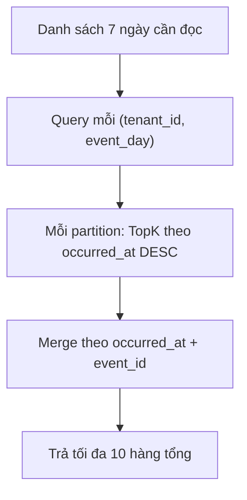

# First, Top và giới hạn số kết quả

Trong **Spring Data Cassandra**, bạn có thể giới hạn số hàng trả về ngay trong tên phương thức Repository bằng các từ khóa **`First`** và **`Top`**. Ví dụ `findFirstBy...` yêu cầu tối đa một kết quả, trong khi `findTop5By...` giới hạn tối đa năm kết quả. Đây là một phần của **truy vấn dẫn xuất (derived queries)**: Spring Data phân tích tên method, tạo truy vấn cho datastore và kết hợp các điều kiện từ tham số.

Tuy nhiên, giới hạn số kết quả **không có nghĩa Cassandra tự tìm được “5 bản ghi mới nhất của toàn bộ cluster”**. Kết quả có đúng ý nghĩa hay không phụ thuộc vào **partition key, clustering order, điều kiện `WHERE`, cách phân trang và trạng thái dữ liệu**. Khi chưa thiết kế bảng hỗ trợ đúng query shape, một lời gọi `Top5` cũng không làm truy vấn hiệu quả hơn.

Bài học thuộc chương **Truy vấn dẫn xuất** của module **`SPRING_DATA_CASSANDRA`**. Module hướng đến việc truy cập Apache Cassandra qua entity mapping, Repository, `CassandraTemplate` và CQL, đồng thời học thiết kế bảng theo truy vấn, partition key, consistency level, paging và kiểm soát hiệu năng trong hệ dữ liệu phân tán. Ở đây chúng ta tập trung vào **cách dùng `First`, `Top` và các lựa chọn giới hạn kết quả** trên một data model Cassandra phù hợp.

**Sau bài học, bạn có thể:**

1. Viết đúng các mẫu `findFirstBy...`, `findTopBy...`, `findFirst10By...` và `findTop10By...`.
2. Phân biệt **giới hạn kết quả**, **sắp xếp**, **kích thước trang** và **paging state**.
3. Thiết kế bảng có clustering order để “đầu tiên/mới nhất” mang nghĩa xác định.
4. Chọn giữa giới hạn **cố định trong tên method** và giới hạn **động** qua `Limit` hoặc `CassandraTemplate`.
5. Kết hợp `Top` với `Slice`/`Pageable` khi phiên bản API hỗ trợ, không suy diễn thành SQL `OFFSET`.
6. Nhận biết khi cần đổi data model hoặc chuyển sang CQL tường minh/Java Driver thay vì lạm dụng Repository.

## 1. Cú pháp First và Top được hiểu như thế nào?

Spring Data Commons cung cấp cơ chế phân tích phần **subject** trước từ `By`. Các từ khóa `First` và `Top` trong phần này có chức năng **giới hạn kết quả**; chúng có thể dùng thay thế nhau.

| Tên phương thức | Giới hạn tối đa | Ý nghĩa |
| --- | ---: | --- |
| `findFirstBy...` | 1 | Lấy tối đa một hàng phù hợp |
| `findTopBy...` | 1 | Tương đương `First` không có số |
| `findFirst3By...` | 3 | Lấy tối đa ba hàng |
| `findTop3By...` | 3 | Tương đương `First3` |
| `readTop10By...` | 10 | `read` cũng là tiền tố truy vấn được Spring Data nhận diện |
| `queryFirst5By...` | 5 | `query` cũng có thể dùng làm tiền tố truy vấn |

Một mẫu tổng quát:

```text
find + [First|Top] + [N] + By + <ĐiềuKiệnTheoProperty>

findFirstByKey_TenantIdAndKey_EventDay(...)
findTop5ByKey_TenantIdAndKey_EventDay(...)
findFirst10ByKey_TenantIdAndKey_EventDay(...)
```

Trong tên method, `N` là **số nguyên cố định được viết trong tên phương thức**, không phải giá trị truyền vào khi gọi. Nếu bỏ số thì `N = 1`. Hai từ khóa `First` và `Top` **không khác nhau về thứ tự thời gian**; muốn “mới nhất” phải xây dựng **ordering** phù hợp.

### Những hiểu lầm nên loại bỏ ngay

- `First` **không luôn là bản ghi được tạo sớm nhất**: nó là phần tử đầu tiên theo thứ tự kết quả của truy vấn.
- `Top` **không có nghĩa sắp xếp giảm dần theo một cột số**: nó chỉ đặt giới hạn; phải xét `ORDER BY` hoặc thứ tự clustering.
- `Top5` **không cho phép tìm top 5 toàn cluster** nếu truy vấn không có đường định vị dữ liệu phù hợp.
- Giới hạn **“tối đa 5” không bảo đảm luôn có 5**; partition có thể chỉ chứa 0–4 hàng.
- Nhiều hàng cùng điều kiện và không có thứ tự rõ thì “đầu tiên” **không phải lựa chọn nghiệp vụ ổn định**.

## 2. Data model minh họa: sự kiện của tenant theo ngày

Giả sử một nền tảng đặt chỗ cần chức năng: “Xem sự kiện mới nhất và 5 sự kiện gần đây của **một tenant trong một ngày**”.

Thiết kế bảng Cassandra theo đúng đường truy vấn:

```sql
CREATE TABLE IF NOT EXISTS tenant_events_by_day (
    tenant_id uuid,
    event_day date,
    occurred_at timestamp,
    event_id uuid,
    event_type text,
    description text,
    PRIMARY KEY ((tenant_id, event_day), occurred_at, event_id)
) WITH CLUSTERING ORDER BY (occurred_at DESC, event_id ASC);
```

| Cột | Vai trò | Vì sao cần? |
| --- | --- | --- |
| `tenant_id` | Thành phần thứ 1 của partition key | Phân tách dữ liệu theo tenant |
| `event_day` | Thành phần thứ 2 của partition key | Bucket theo ngày, giới hạn kích thước partition |
| `occurred_at` | Clustering column | Thời điểm; xếp **giảm dần** trong partition |
| `event_id` | Clustering column | Phân biệt các event trùng timestamp và giúp thứ tự ổn định |
| `event_type`, `description` | Cột thường | Dữ liệu được hiển thị, không làm thay đổi phân vùng |

Một truy vấn phù hợp:

```sql
SELECT tenant_id, event_day, occurred_at,
       event_id, event_type, description
FROM tenant_events_by_day
WHERE tenant_id = 850bbb81-3e2c-4dd2-8691-96ef5a6b7e8c
  AND event_day = '2026-11-25'
LIMIT 5;
```

**Vì bảng có thứ tự clustering mặc định theo `occurred_at DESC`**, năm hàng đầu tiên của **một partition đó** là năm hàng có timestamp cao nhất, với `event_id ASC` làm tiêu chí phụ khi trùng timestamp. `LIMIT 5` giới hạn số hàng trả về theo CQL.

Lưu ý: tên `tenant_events_by_day` và bucket `event_day` chỉ là phương án minh họa. Nếu một tenant cực nóng có hàng triệu event/ngày, vẫn cần đo và xem xét bucket theo giờ hoặc sharding phù hợp. `First`/`Top` không tự giải quyết hot partition.

## 3. Entity và primary key tổng hợp

Spring Data Cassandra có thể ánh xạ bảng nhiều thành phần khóa bằng `@PrimaryKeyClass`:

```java
package example.events.data;

import java.io.Serializable;
import java.time.Instant;
import java.time.LocalDate;
import java.util.UUID;
import org.springframework.data.cassandra.core.cql.Ordering;
import org.springframework.data.cassandra.core.mapping.PrimaryKeyClass;
import org.springframework.data.cassandra.core.mapping.PrimaryKeyColumn;
import org.springframework.data.cassandra.core.mapping.PrimaryKeyType;

@PrimaryKeyClass
public class TenantEventKey implements Serializable {

    @PrimaryKeyColumn(name = "tenant_id", ordinal = 0,
            type = PrimaryKeyType.PARTITIONED)
    private UUID tenantId;

    @PrimaryKeyColumn(name = "event_day", ordinal = 1,
            type = PrimaryKeyType.PARTITIONED)
    private LocalDate eventDay;

    @PrimaryKeyColumn(name = "occurred_at", ordinal = 2,
            type = PrimaryKeyType.CLUSTERED,
            ordering = Ordering.DESCENDING)
    private Instant occurredAt;

    @PrimaryKeyColumn(name = "event_id", ordinal = 3,
            type = PrimaryKeyType.CLUSTERED,
            ordering = Ordering.ASCENDING)
    private UUID eventId;

    public TenantEventKey() {
    }

    // Thêm constructor/getters/setters/equals/hashCode theo khóa CQL.
}
```

Entity đại diện cho hàng:

```java
package example.events.data;

import org.springframework.data.cassandra.core.mapping.Column;
import org.springframework.data.cassandra.core.mapping.PrimaryKey;
import org.springframework.data.cassandra.core.mapping.Table;

@Table("tenant_events_by_day")
public class TenantEvent {

    @PrimaryKey
    private TenantEventKey key;

    @Column("event_type")
    private String eventType;

    @Column("description")
    private String description;

    public TenantEvent() {
    }

    // Thêm constructor và getter/setter cho key/eventType/description.
}
```

Các đoạn trên trình bày **metadata mapping cốt lõi**; trước khi chạy dự án, bổ sung các thành viên Java được chú thích trong comment, đặc biệt `equals` và `hashCode` của khóa. Điều kiện `find...ByKey_TenantIdAndKey_EventDay` sẽ truy cập các property **lồng nhau** `key.tenantId` và `key.eventDay`.

### Dấu gạch dưới trong tên method

Spring Data Commons dùng dấu `_` để **chỉ rõ ranh giới traversal giữa các property**. Vì vậy `Key_TenantId` giúp parser hiểu `key.tenantId` thay vì một property phẳng `keyTenantId`.

```text
findTop5ByKey_TenantIdAndKey_EventDay
            └─ key.tenantId └─ key.eventDay
```

Khi một method phụ thuộc vào nested property, dùng tên traversal tường minh giúp code dễ đọc hơn. Hãy kiểm tra hành vi phân tích property path theo **phiên bản Spring Data Cassandra thực tế**; nếu query shape phức tạp hoặc mapping không phù hợp, có thể dùng `@Query` CQL tường minh thay vì kéo dài tên method vô hạn.

## 4. Repository với First, Top, First5 và Top10

Repository cho bảng trên:

```java
package example.events.data;

import java.time.LocalDate;
import java.util.List;
import java.util.Optional;
import java.util.UUID;
import org.springframework.data.cassandra.repository.CassandraRepository;

public interface TenantEventRepository
        extends CassandraRepository<TenantEvent, TenantEventKey> {

    // Giới hạn 1 hàng trong partition khách/ngày:
    Optional<TenantEvent> findFirstByKey_TenantIdAndKey_EventDay(
            UUID tenantId, LocalDate eventDay);

    // Top không ghi N cũng mặc định là 1:
    Optional<TenantEvent> findTopByKey_TenantIdAndKey_EventDay(
            UUID tenantId, LocalDate eventDay);

    // Tối đa 5 hàng:
    List<TenantEvent> findTop5ByKey_TenantIdAndKey_EventDay(
            UUID tenantId, LocalDate eventDay);

    // Tối đa 10 hàng, cú pháp First tương đương Top:
    List<TenantEvent> findFirst10ByKey_TenantIdAndKey_EventDay(
            UUID tenantId, LocalDate eventDay);
}
```

**Giải thích:**

1. `TenantEventRepository` dùng `TenantEventKey` làm kiểu ID vì bảng có primary key tổng hợp.
2. Mọi phương thức trên đều có **đủ `tenant_id` và `event_day`**, nên query được giới hạn trong một partition.
3. Do schema đã khai báo `occurred_at DESC`, hàng đầu tiên được đọc từ partition là hàng mới nhất theo timestamp, có tiêu chí phụ `event_id ASC`.
4. `findFirstBy...` và `findTopBy...` trả tối đa **một** entity; `Optional` diễn đạt rõ trường hợp partition rỗng.
5. `findTop5By...` và `findFirst10By...` trả `List` có tối đa N phần tử, không tự yêu cầu số phần tử chính xác bằng N.

### Cách gọi từ service

```java
UUID tenantId =
    UUID.fromString("850bbb81-3e2c-4dd2-8691-96ef5a6b7e8c");
LocalDate eventDay = LocalDate.of(2026, 11, 25);

Optional<TenantEvent> newest =
    repository.findFirstByKey_TenantIdAndKey_EventDay(tenantId, eventDay);

List<TenantEvent> recentFive =
    repository.findTop5ByKey_TenantIdAndKey_EventDay(tenantId, eventDay);

newest.ifPresent(event -> {
    // Có thể lấy timestamp/eventId từ event.getKey() sau khi hoàn thiện getter.
});
```

Không tạo thêm `CqlSession` cho từng lần gọi: Repository đã sử dụng hạ tầng Spring Data Cassandra và session được quản lý trong ứng dụng.

## 5. First và Top chuyển thành truy vấn nào?

Về **ý nghĩa**, tên method giới hạn kết quả sẽ tạo truy vấn tương đương kiểu:

```sql
-- Ý nghĩa của findFirstBy...
SELECT tenant_id, event_day, occurred_at,
       event_id, event_type, description
FROM tenant_events_by_day
WHERE tenant_id = ?
  AND event_day = ?
LIMIT 1;

-- Ý nghĩa của findTop5By...
SELECT tenant_id, event_day, occurred_at,
       event_id, event_type, description
FROM tenant_events_by_day
WHERE tenant_id = ?
  AND event_day = ?
LIMIT 5;
```

Đây là **CQL minh họa semantics**, không khẳng định từng phiên bản framework luôn phát ra đúng chuỗi text/cấu trúc statement như trên. Spring Data có thể quyết định bind, quoted identifiers, projection, options và cách thực thi theo phiên bản.

**Điều không thay đổi:** số trong `Top5`/`First5` là **giới hạn kết quả của câu truy vấn**, tương đương ý nghĩa `SELECT ... LIMIT 5` trong Cassandra. `LIMIT` không đổi replication factor, không sửa tombstone, không thay kiểu phân vùng và không áp đặt một thứ tự mới.

## 6. First không giống tìm một bản ghi duy nhất

Giả sử một partition có 100 event:

- Một method **trả về entity đơn** nhưng **không giới hạn query** có thể gặp lỗi kỳ vọng số lượng kết quả nếu nhiều hàng thỏa điều kiện (tùy API/query semantics).
- `findFirstBy...` tuy vẫn có thể gặp lỗi thực thi, nhưng về mặt truy vấn nó yêu cầu **tối đa một hàng**, nên không đòi điều kiện tìm kiếm là duy nhất.

Spring Data Cassandra phân biệt hai trường hợp trong tài liệu về query methods: method truy vấn một kết quả không giới hạn có thể ném `IncorrectResultSizeDataAccessException` khi tìm nhiều hàng; `First` giới hạn truy vấn trước khi ánh xạ một kết quả.

| Nhu cầu | Cách biểu đạt |
| --- | --- |
| Theo khóa đầy đủ, tối đa một hàng bởi schema | `findById(fullKey)` |
| Có thể nhiều hàng, chỉ cần hàng đầu tiên theo thứ tự hợp lệ | `findFirstBy...` |
| Cần kiểm tra có đúng một hàng thỏa điều kiện không | Không dùng `First` để che khả năng có nhiều hàng; dùng contract kiểm tra riêng |
| Cần biết “có hàng nào không?” | Cân nhắc `exists...` theo khóa/query được hỗ trợ |

**Quan trọng:** `First` **không chứng minh tính duy nhất**. Nếu nghiệp vụ “một mã khuyến mãi chỉ có một bản ghi trên toàn hệ thống”, phải bảo đảm uniqueness ở **data model/đường ghi**. Không dùng `findFirst...` để âm thầm bỏ qua dữ liệu trùng.

### Optional và khi không có dữ liệu

`Optional<TenantEvent>` giúp caller xử lý không có hàng:

```java
TenantEvent latest = repository
        .findFirstByKey_TenantIdAndKey_EventDay(tenantId, eventDay)
        .orElse(null);
```

Hoặc trả mã 404/response rỗng theo contract API. Không suy ra lỗi Cassandra chỉ vì một partition chưa có event.

## 7. “Mới nhất” cần ordering rõ, không chỉ có Top

Giả sử DDL dùng clustering order tăng dần:

```sql
-- Ví dụ khái niệm, không phải thay đổi bảng ở mục 2.
PRIMARY KEY ((tenant_id, event_day), occurred_at, event_id)
WITH CLUSTERING ORDER BY (occurred_at ASC, event_id ASC);
```

Thì `findFirstBy...` với ordering mặc định có thể lấy **sớm nhất**, không phải mới nhất. Ngược lại, bảng ở mục 2 có `occurred_at DESC` nên `First` trả hàng có timestamp cao nhất trong partition, nếu hàng đó chưa bị xóa/TTL và điều kiện khác không loại bỏ nó.

### ORDER BY ở Cassandra không phải tự do như SQL quan hệ

Ở Cassandra, sắp xếp kết quả thông thường chỉ có hiệu lực **theo clustering columns trong một partition**, với những quy tắc giới hạn về thứ tự và hướng sắp xếp. Không được chỉ vì Spring Data hỗ trợ `OrderBy...Desc` mà đặt sắp xếp trên bất kỳ cột thường nào.

Ví dụ có thể phù hợp với bảng:

```sql
SELECT occurred_at, event_id, event_type
FROM tenant_events_by_day
WHERE tenant_id = ?
  AND event_day = ?
ORDER BY occurred_at DESC, event_id ASC
LIMIT 5;
```

Cần bảo đảm `ORDER BY` tương thích với **clustering order và các quy tắc CQL của phiên bản Cassandra**, đặc biệt khi có nhiều clustering columns. Với schema trong bài, vì DDL đã định hướng DESC cho `occurred_at`, thường **không cần thêm ORDER BY** cho API “gần nhất”.

### Tie-breaker để hạn chế kết quả không ổn định

Nếu hai event có cùng `occurred_at`, `event_id` trong primary key giúp phân biệt chúng và xác định thứ tự phụ. Đừng lấy **timestamp đơn lẻ** làm khóa duy nhất nếu nhiều sự kiện có thể trùng thời điểm.

Nếu yêu cầu “bản ghi vừa được ghi gần đây nhất” theo **thứ tự commit thực tế**, trường `occurred_at` do ứng dụng cung cấp có thể không phản ánh chính xác thời điểm ghi lên cluster (clock skew, backfill, late events). Phải định nghĩa rõ nghiệp vụ muốn **event time** hay **ingestion time** và thiết kế khóa/sắp xếp tương ứng.

## 8. Dùng Top N như giới hạn tĩnh

Giới hạn **tĩnh** hợp lý khi contract API đã rõ:

- Hiển thị 1 sự kiện mới nhất.
- Hiển thị 5 sự kiện gần đây trên thẻ dashboard.
- Hiển thị 10 sự kiện trên màn hình preview.

```java
Optional<TenantEvent> findFirstByKey_TenantIdAndKey_EventDay(
        UUID tenantId, LocalDate day);

List<TenantEvent> findTop5ByKey_TenantIdAndKey_EventDay(
        UUID tenantId, LocalDate day);

List<TenantEvent> findTop10ByKey_TenantIdAndKey_EventDay(
        UUID tenantId, LocalDate day);
```

**Ưu điểm:** tên method diễn đạt hợp đồng đầu ra; reviewer dễ nhìn thấy upper bound và cần ít mã. **Đánh đổi:** nếu muốn lấy N động theo yêu cầu người dùng, tạo các method `Top5`, `Top10`, `Top25`, `Top50` có thể khiến interface phình ra.

Không chọn N quá lớn chỉ vì muốn “đọc một lần cho hết”: cần đo payload, kích thước partition, tỷ lệ tombstone và độ trễ p99. Một `Top1000` vẫn có thể trả lượng byte lớn nếu mỗi row có cột blob/UDT/payload dài.

## 9. Giới hạn động với Limit

Các phiên bản Spring Data mới hỗ trợ tham số chuyên biệt **`org.springframework.data.domain.Limit`** cho query method. Theo tài liệu Spring Data Cassandra và Spring Data Commons hiện đại, ví dụ:

```java
import java.time.LocalDate;
import java.util.List;
import java.util.UUID;
import org.springframework.data.domain.Limit;

public interface TenantEventRepository
        extends CassandraRepository<TenantEvent, TenantEventKey> {

    List<TenantEvent> findByKey_TenantIdAndKey_EventDay(
        UUID tenantId, LocalDate eventDay, Limit limit);
}
```

Gọi:

```java
List<TenantEvent> events = repository
    .findByKey_TenantIdAndKey_EventDay(
        tenantId, eventDay, Limit.of(20));
```

**Ý nghĩa:** truyền giới hạn số kết quả **tại thời điểm chạy** thay vì mã hóa số 20 vào tên method. `Limit.of(20)` là ví dụ giới hạn động.

### Validate giới hạn tại biên API

Không nên truyền trực tiếp một số không được kiểm soát từ HTTP query parameter:

```java
int requested = requestLimit; // Ví dụ lấy từ API input.
int safeLimit = Math.max(1, Math.min(requested, 100));

List<TenantEvent> events = repository
    .findByKey_TenantIdAndKey_EventDay(
        tenantId, eventDay, Limit.of(safeLimit));
```

Mức 100 chỉ là **chính sách minh họa**: tối đa phù hợp tùy kích thước hàng và SLA. Nếu đầu vào âm/0 cần bị từ chối thay vì tự chỉnh, tầng API có thể validation bằng `@Min`/`@Max` và trả lỗi 400; ví dụ dùng clamp để cho thấy yêu cầu giới hạn tài nguyên.

**Lưu ý tương thích:** `Limit` là API của Spring Data thế hệ mới; nếu dự án dùng Spring Data Cassandra/Commons cũ không hỗ trợ chữ ký này, hãy dùng Repository `TopN` cố định hoặc `CassandraTemplate` với `Query.limit(n)`. Không nâng cấp ngầm thư viện chỉ để chép ví dụ.

### Không phối hợp Top với Limit trong cùng method

Trong Spring Data Commons hiện đại, `Top`/`First` và tham số `Limit` là **hai cách giới hạn thay thế nhau**; không kết hợp cả hai trong một query method:

```java
// Không nên: cả Top5 trong tên và Limit động trong tham số.
// List<TenantEvent> findTop5ByKey_TenantIdAndKey_EventDay(
//     UUID tenantId, LocalDate day, Limit limit);
```

Hãy chọn **giới hạn tĩnh (`TopN`)** hoặc **giới hạn động (`Limit`)**. Tránh API mơ hồ về giới hạn nào được ưu tiên.

## 10. Top N kết hợp Pageable và Slice

Khi cần duyệt một tập kết quả thành nhiều trang, Spring Data Cassandra dùng cơ chế **paging state của Cassandra**. Trong tài liệu Spring Data Commons, `Top` có thể đi cùng `Pageable`: `Top` đặt **trần tổng số kết quả được giới hạn**, còn `Pageable` điều khiển kích thước từng trang trong phạm vi đó.

Ví dụ chữ ký:

```java
import org.springframework.data.domain.Pageable;
import org.springframework.data.domain.Slice;

Slice<TenantEvent> findTop20ByKey_TenantIdAndKey_EventDay(
        UUID tenantId, LocalDate eventDay, Pageable pageable);
```

Một cách dùng Cassandra-specific:

```java
import org.springframework.data.cassandra.core.query.CassandraPageRequest;
import org.springframework.data.domain.Slice;

Slice<TenantEvent> first = repository
    .findTop20ByKey_TenantIdAndKey_EventDay(
        tenantId, eventDay, CassandraPageRequest.first(5));

if (first.hasNext()) {
    Slice<TenantEvent> second = repository
        .findTop20ByKey_TenantIdAndKey_EventDay(
            tenantId, eventDay, first.nextPageable());
}
```

Ý tưởng là duyệt các `Slice` về phía trước theo **paging state**, không phải nhảy theo offset như một database SQL quan hệ. Cần kiểm tra Spring Data Cassandra version và hành vi cụ thể khi kết hợp `TopN` với `Slice`, bao gồm số lượng tối đa của tập giới hạn, việc tạo paging state và tính ổn định của query/parameters.

### Vì sao thích Slice hơn Page trong nhiều luồng Cassandra?

`Slice` tập trung vào **có trang tiếp theo hay không**. `Page` thường có semantics tổng số phần tử/tổng số trang, có thể đòi hỏi phép `COUNT` thêm; một phép đếm phân tán trên dữ liệu lớn rất tốn kém hoặc không phù hợp với workload.

Không giả định `Pageable.ofSize(5).withPage(1000)` tương đương tìm trang số 1000 hiệu quả. Với Cassandra, **paging state là dạng cursor đi tiếp**, không phải `OFFSET` ngẫu nhiên với chi phí hằng số. Nếu chỉ cần tối đa 5 hàng cho một dashboard, `Top5` + `List` đơn giản hơn dùng phân trang.

### Trường hợp không nên ghép nhiều special parameters

Theo Spring Data Commons, những dạng như `Pageable` và `Limit` có thể **xung đột** vì `Pageable` đã mang giới hạn; `Pageable` và `Sort` cũng có quy tắc riêng. Tham khảo API/version cụ thể, không tự cộng dồn mọi `Pageable`, `Limit`, `Sort` trong cùng chữ ký. `TopN` kết hợp `Pageable` là trường hợp được tài liệu Commons mô tả.

## 11. LIMIT khác fetch size và page size

Ba khái niệm thường bị trộn lẫn:

| Khái niệm | Phạm vi | Ví dụ |
| --- | --- | --- |
| **Query limit** | Tổng số hàng phù hợp tối đa của câu CQL | `SELECT ... LIMIT 10`, `Top10` |
| **Driver page size/fetch size** | Kích thước mục tiêu của **một trang** được tải qua network | `boundStatement.setPageSize(10)` |
| **Paging state** | Trạng thái để tiếp tục một query qua các trang | Token được driver/Spring quản lý |

Ví dụ trong Java Driver:

```java
PreparedStatement prepared = session.prepare("""
    SELECT occurred_at, event_id, event_type
    FROM tenant_events_by_day
    WHERE tenant_id = ? AND event_day = ?
    LIMIT 100
    """);

BoundStatement bound = prepared.bind(tenantId, day)
    .setPageSize(20);
```

`LIMIT 100` là **trần kết quả** của query. `setPageSize(20)` là mục tiêu lấy **mỗi lần khoảng 20 hàng**, tức query có thể cần nhiều trang để trả đủ 100 hàng. Cassandra có thể trả số hàng thực tế thấp hơn ở một trang vì giới hạn giao thức/khối lượng dữ liệu.

Ngược lại, `Top5` thường có nghĩa **tối đa năm hàng**, không phải “mỗi trang có năm hàng rồi tải vô hạn trang khác” của chính câu query. Khi đi qua nhiều bucket/ngày, ứng dụng sẽ phải thực hiện nhiều query riêng và giới hạn mỗi query riêng.

## 12. Sort động và OrderBy trong derived queries

Spring Data có thể phân tích suffix `OrderBy<Property>Asc/Desc` hoặc tham số `Sort` ở các API hỗ trợ. Tuy nhiên Cassandra **không có ORDER BY tùy ý trên cột thường** và không thực hiện sắp xếp global trên các partition như hệ phân tích SQL.

### Method OrderBy không thay đổi clustering key

Ví dụ về cách diễn đạt ý định trong tên method:

```java
// Mẫu cần kiểm thử trên schema và Spring Data version đang dùng:
List<TenantEvent>
findTop5ByKey_TenantIdAndKey_EventDayOrderByKey_OccurredAtDesc(
        UUID tenantId, LocalDate eventDay);
```

Trong trường hợp DDL ở mục 2, thứ tự `occurred_at DESC` đã là **clustering order mặc định**; method `findTop5ByKey_TenantIdAndKey_EventDay(...)` ngắn hơn và thường đủ. Nếu cần thêm `ORDER BY`, phải kiểm tra query được tạo và quy tắc sắp xếp hợp lệ của Cassandra, nhất là các clustering columns có hướng ASC/DESC trộn nhau.

Không nên viết:

```java
// Sai về kỳ vọng: status là cột thường, không có cách
// ORDER BY status tùy ý trên bảng tenant_events_by_day.
// findTop5ByKey_TenantIdAndKey_EventDayOrderByEventTypeAsc(...)
```

Muốn xếp hạng theo `event_type` hoặc một “điểm số” khác, cần **thiết kế bảng/query** phù hợp, hoặc xử lý riêng trong một tập dữ liệu đã được giới hạn nhỏ và xác định rõ semantics. Việc tải Top5 theo timestamp rồi sort trong Java theo type **không cho ra Top5 toàn bộ partition theo type**.

### Cảnh báo về tie-breaking

Khi cần thứ tự ổn định, phải xét cả `event_id`. Nếu hai hàng có `occurred_at` giống nhau, thứ tự theo `event_id` xác định các kết quả có cùng timestamp. Không dùng một thứ tự không đầy đủ để làm cursor nếu yêu cầu không trùng/lọt hàng.

## 13. First/Top với điều kiện range trên clustering column

Một nhu cầu thực tế: “Lấy 5 sự kiện **trước** một mốc thời gian của tenant/ngày”. Khi bảng có partition key đầy đủ và clustering theo `occurred_at`, có thể có truy vấn CQL:

```sql
SELECT tenant_id, event_day, occurred_at,
       event_id, event_type, description
FROM tenant_events_by_day
WHERE tenant_id = ?
  AND event_day = ?
  AND occurred_at < ?
LIMIT 5;
```

Ở tầng Repository, một derived query có thể có dạng:

```java
import java.time.Instant;

List<TenantEvent>
findTop5ByKey_TenantIdAndKey_EventDayAndKey_OccurredAtLessThan(
        UUID tenantId, LocalDate eventDay, Instant before);
```

Về ý nghĩa, điều kiện `occurred_at < before` chỉ duyệt phần dữ liệu trước mốc trong partition đã xác định. **Thứ tự kết quả** vẫn theo clustering order áp dụng cho query. Cần xác minh parser property path và CQL phát sinh bằng integration test khi dùng entity có embedded primary key.

### Tránh range trên cột không được hỗ trợ

`findTop5ByEventType...` không trở thành truy vấn tốt vì có `Top5`. `event_type` không nằm trong partition/clustering key; tìm theo nó cần một đường truy vấn khác (ví dụ bảng `tenant_events_by_type_day` hoặc index thích hợp nếu workload cho phép). Đặc biệt không bật `@AllowFiltering` chỉ để ép truy vấn bất kỳ “chạy được” trong giờ cao điểm.

## 14. Top N của nhiều partition không phải top N toàn cục

Bảng `tenant_events_by_day` bucket theo ngày. Nếu màn hình cần “10 event mới nhất của tenant trong **7 ngày**”, không có một method `findTop10ByKey_TenantId(...)` nào tự hợp nhất mọi ngày trong một thứ tự toàn cục, vì thiếu `event_day` trong composite partition key.

Một chiến lược hợp lý khi số bucket có giới hạn:



Muốn đúng **global Top10**, ứng dụng cần kiểm soát:

1. Danh sách ngày/bucket được phép truy vấn (không quét vô hạn lịch sử).
2. Số request song song và giới hạn QPS tới Cassandra.
3. Mỗi partition phải lấy đủ ứng viên để không bỏ sót Top10 toàn cục; với các bucket độc lập, tối đa 10 ứng viên mỗi bucket là một giới hạn trên thường đủ cho Top10 hợp nhất nếu thứ tự thống nhất.
4. Thứ tự tie-break (timestamp + event ID và có thể ngày/partition để tạo thứ tự toàn cục).
5. Paging state riêng khi đọc nhiều trang từ các bucket và chiến lược cursor khi chuyển qua nhiều HTTP requests.

**Khi yêu cầu top N toàn cục xuyên partition diễn ra thường xuyên**, việc tạo bảng materialized theo query (ví dụ timeline đã bucket theo tenant trong các giới hạn hợp lý) có thể phù hợp hơn việc mỗi request fan-out rất nhiều partition.

## 15. LIMIT không đồng nghĩa chi phí đọc luôn nhỏ

Một truy vấn `LIMIT 5` có thể vẫn chậm nếu:

- Partition chứa quá nhiều hàng và nhiều **tombstone** trước khi tới các hàng sống.
- Replica đang có compaction backlog, I/O contention hoặc CPU cao.
- Một partition quá nóng, nhiều client đồng thời đọc cùng nhóm replica.
- Các hàng có `description` hoặc payload rất lớn.
- Consistency level cần nhiều replica phản hồi và một số replica chậm.
- Ứng dụng đã fan-out hàng chục/hàng trăm partition rồi chỉ lấy 5 kết quả cuối cùng.

**LIMIT giới hạn số hàng trả về, không cam kết server chỉ phải đọc đúng N bản ghi vật lý.**

Ví dụ nếu 500 bản ghi mới nhất đã bị xóa/TTL hết hạn, Cassandra có thể phải đi qua nhiều thông tin tombstone trước khi tìm đủ 5 hàng sống. Khi đó đổi `findTop5...` thành `findFirst5...` không thay đổi nguyên nhân gây chậm.

### Những điều cần đo

| Nhóm | Chỉ số gợi ý |
| --- | --- |
| API | p50/p95/p99 latency, error rate, QPS |
| Query | Số hàng/byte trả về, LIMIT, kiểu điều kiện WHERE |
| Driver | Timeout, retry, request in-flight, page fetch |
| Cluster | CPU, disk I/O, compaction, replica health |
| Data model | Kích thước partition, hot keys, tombstone scan |

Nếu tỷ lệ event có TTL cao và bị ghi/xóa liên tục, cần đánh giá thiết kế bucket, TTL, compaction strategy và retention phù hợp. Không lấy `Top5` làm giải pháp dọn dữ liệu hay thay thế compaction.

## 16. Khi cần chuyển sang CassandraTemplate hoặc CqlSession

Repository `First/Top` nên được ưu tiên khi query shape **cố định và rõ ràng**. Khi yêu cầu thay đổi linh hoạt hơn, cân nhắc các cấp API sau.

### 16.1. CassandraTemplate với giới hạn động

```java
import org.springframework.data.cassandra.core.CassandraTemplate;
import org.springframework.data.cassandra.core.query.Criteria;
import org.springframework.data.cassandra.core.query.Query;

int limit = Math.max(1, Math.min(requestedLimit, 100));

Query query = Query.query(
    Criteria.where("tenant_id").is(tenantId),
    Criteria.where("event_day").is(day)
).limit(limit);

List<TenantEvent> events =
    cassandraTemplate.select(query, TenantEvent.class);
```

Template có thể giúp xây điều kiện có/không có mốc thời gian, chọn giới hạn per-request và ánh xạ kết quả về entity. Nó **không thay đổi giới hạn CQL**: query vẫn phải hợp lệ theo partition/clustering key. Khi tham số `Limit` chưa có ở phiên bản Repository, `CassandraTemplate` là một giải pháp động rõ ràng.

### 16.2. Java Driver khi cần prepared statement và page size riêng

```java
PreparedStatement prepared = session.prepare("""
    SELECT occurred_at, event_id, event_type
    FROM tenant_events_by_day
    WHERE tenant_id = ? AND event_day = ?
    LIMIT 20
    """);

BoundStatement statement = prepared.bind(tenantId, day)
    .setConsistencyLevel(DefaultConsistencyLevel.LOCAL_QUORUM)
    .setPageSize(10);

ResultSet result = session.execute(statement);
```

**Cần phân biệt:** `LIMIT 20` là trần của query; `setPageSize(10)` điều khiển kích thước fetch; `LOCAL_QUORUM` là tùy chọn consistency minh họa và phải chọn theo RF/topology/nhu cầu. `CqlSession` là bean dùng chung, không tạo/đóng sau mỗi method.

### 16.3. Khi nào không nên chuyển API?

Nếu chỉ cần `Top5` theo khóa đầy đủ và entity mapping chuẩn, dùng `CassandraTemplate` hoặc driver sẽ **nhiều mã hơn** mà không có bảo đảm nhanh hơn. Hãy giữ Repository và đo end-to-end trên cùng query shape.

## 17. First, Top và tính nhất quán dữ liệu

Một `findFirst...` có thể trả kết quả khác nhau giữa hai lần gọi dù cùng tham số:

- Sự kiện mới được ghi vào cùng partition với timestamp lớn hơn.
- Một hàng bị xóa hoặc hết TTL.
- Dữ liệu được backfill với event time khác.
- Trong điều kiện replication/consistency cụ thể, các replica có trạng thái khả kiến khác nhau tại thời điểm truy vấn.

**Điều này không chứng minh `First` bị sai**; kết quả là “đầu tiên theo trạng thái khả kiến và thứ tự truy vấn ở thời điểm thực thi”. Đừng dùng “first event” để suy ra một snapshot bất biến của lịch sử.

### Consistency level không tạo ordering

Chọn `LOCAL_QUORUM` hay mức khác ảnh hưởng điều kiện các replica phải đáp ứng, không đổi `CLUSTERING ORDER BY`. Tính đúng của “mới nhất” trước tiên dựa trên **giá trị cột thời gian và khóa thứ tự**. Nếu nghiệp vụ yêu cầu “vừa ghi xong phải đọc thấy” hoặc kiểm soát xung đột cập nhật, phải chọn consistency/đường ghi phù hợp, không chỉ tăng Top N.

### Paging khi dữ liệu liên tục đổi

Nếu user bấm “xem thêm”, các event mới hoặc thao tác xóa có thể làm tập kết quả thay đổi giữa các lần đọc. Cursor phải được thiết kế theo contract (thời gian/ID mốc, paging state, số bucket, snapshot expectation). Cassandra paging state không tự cung cấp một **snapshot giao dịch dài hạn** cho toàn bộ timeline thay đổi.

## 18. Những lỗi phổ biến và cách sửa

| Lỗi/nhầm lẫn | Hậu quả | Cách sửa |
| --- | --- | --- |
| `findTop5ByStatus(...)` trên cột thường không có index/query model | Truy vấn lỗi hoặc quét dữ liệu rộng | Thiết kế bảng/index đúng theo query |
| Coi `First` là “sớm nhất” bất kể thứ tự | Trả không đúng bản ghi nghiệp vụ muốn | Kiểm tra clustering order/ORDER BY |
| Coi `Top` là tự sort giảm dần | Trả 5 hàng theo thứ tự khác mong đợi | Định nghĩa ordering rõ |
| Không có điều kiện `event_day` của composite partition key | Query không định vị một partition như dự kiến | Cung cấp đủ partition key |
| Mỗi API tự tạo method `Top1234` theo input | Repository phình to, khó review | Dùng `Limit`/Template với cap |
| Kết hợp `TopN` và tham số `Limit` | Hai giới hạn mâu thuẫn hoặc không được hỗ trợ | Chọn một cơ chế |
| Dùng `Top5` để giả định kết quả luôn đủ 5 | Lỗi index khi partition ít hàng | Xử lý list ít hơn N, có thể rỗng |
| Coi `Top10` là page size 10 | Trộn query limit với fetching | Phân biệt LIMIT, page size, paging state |
| Nhảy đến trang số 1000 bằng `Pageable` | Sai kỳ vọng OFFSET trên Cassandra | Dùng cursor/`Slice.nextPageable()` |
| Thêm `Sort.by("eventType")` trên cột thường | CQL ORDER BY không hợp lệ | Chỉ sort theo clustering được hỗ trợ |
| Dùng `findFirst` để “che” nhiều hàng sai dữ liệu | Bỏ sót uniqueness violation | Kiểm soát uniqueness qua data model/ghi |
| `Top5` vẫn chậm nên tăng timeout liên tục | Che khuất hot partition/tombstone | Đo p99, partition size, retry và compaction |

## 19. Bài thực hành: kiểm chứng First và Top

**Bước 1 — Chuẩn bị schema.** Tạo bảng `tenant_events_by_day` như mục 2 trong keyspace thực hành. Đảm bảo bảng có clustering `occurred_at DESC, event_id ASC`.

**Bước 2 — Thêm dữ liệu mẫu** cho một tenant/ngày. Ví dụ:

```sql
INSERT INTO tenant_events_by_day
    (tenant_id, event_day, occurred_at, event_id, event_type, description)
VALUES
    (850bbb81-3e2c-4dd2-8691-96ef5a6b7e8c, '2026-11-25',
     '2026-11-25T08:00:00Z', 11111111-1111-4111-8111-111111111111,
     'CREATED', 'Event A');

INSERT INTO tenant_events_by_day
    (tenant_id, event_day, occurred_at, event_id, event_type, description)
VALUES
    (850bbb81-3e2c-4dd2-8691-96ef5a6b7e8c, '2026-11-25',
     '2026-11-25T09:00:00Z', 22222222-2222-4222-8222-222222222222,
     'UPDATED', 'Event B');

INSERT INTO tenant_events_by_day
    (tenant_id, event_day, occurred_at, event_id, event_type, description)
VALUES
    (850bbb81-3e2c-4dd2-8691-96ef5a6b7e8c, '2026-11-25',
     '2026-11-25T10:00:00Z', 33333333-3333-4333-8333-333333333333,
     'PAID', 'Event C');
```

**Bước 3 — Đọc bằng CQL:**

```sql
SELECT occurred_at, event_id, event_type
FROM tenant_events_by_day
WHERE tenant_id = 850bbb81-3e2c-4dd2-8691-96ef5a6b7e8c
  AND event_day = '2026-11-25'
LIMIT 2;
```

Kết quả mong đợi: hai event có thời điểm **10:00 rồi 09:00 UTC** nếu không có ghi/xóa khác.

**Bước 4 — Đọc bằng Repository:** hoàn thiện entity ở mục 3 rồi gọi `findFirstByKey_TenantIdAndKey_EventDay`, `findTop5ByKey_TenantIdAndKey_EventDay`. Với dữ liệu ba hàng, `First` trả một event có `occurred_at` 10:00; `Top5` chỉ trả **ba** hàng, không sinh thêm hai giá trị mặc định.

**Bước 5 — Kiểm tra partition rỗng:** dùng `eventDay` không có hàng. `Optional` trả empty và `List` trả collection rỗng (theo contract repository) thay vì coi đó là query lỗi.

**Bước 6 — Giới hạn động:** nếu phiên bản thư viện hỗ trợ `Limit`, thử `Limit.of(2)` và `Limit.of(5)` trên cùng method; so sánh kết quả. Nếu không, dùng `CassandraTemplate` với `Query.limit(2)`.

**Bước 7 — Range:** thử `findTop5ByKey_TenantIdAndKey_EventDayAndKey_OccurredAtLessThan` với mốc 09:30. Kỳ vọng còn event 09:00 và 08:00, đúng thứ tự DESC.

**Bước 8 — Quan sát:** đo latency và số hàng trả về khi N = 1, 2, 5; kiểm tra CQL, partition key, số lần fetch và consistency được áp dụng. Không so sánh hiệu năng khi payload và query shape khác nhau mà không ghi nhận.

## 20. Câu hỏi tự kiểm tra

**Câu 1.** `findTopBy...` khác `findFirstBy...` về số kết quả tối đa không?

<details>
<summary>Đáp án gợi ý</summary>

Không. Khi không có số, cả hai giới hạn tối đa **một** kết quả. Có thể dùng `Top5` hoặc `First5` để yêu cầu tối đa năm.
</details>

**Câu 2.** Bảng có clustering `occurred_at ASC`. `findFirstBy...` có mặc định trả event mới nhất không?

<details>
<summary>Đáp án gợi ý</summary>

Không. Với thứ tự ASC, hàng đầu thường là có timestamp nhỏ nhất trong tập kết quả. Muốn mới nhất cần thiết kế/áp dụng thứ tự DESC hợp lệ.
</details>

**Câu 3.** `findTop5ByKey_TenantIdAndKey_EventDay` nhận một partition chỉ có 3 hàng. Kết quả gồm mấy phần tử?

<details>
<summary>Đáp án gợi ý</summary>

Tối đa **ba** phần tử nếu cả ba hàng còn khả kiến và không có điều kiện loại bỏ. `Top5` đặt upper bound, không tạo ra hàng ảo để đủ năm.
</details>

**Câu 4.** Vì sao `findTop5ByEventType` không sửa được yêu cầu tìm toàn bộ event theo loại trên bảng ví dụ?

<details>
<summary>Đáp án gợi ý</summary>

Vì `event_type` là cột thường, không phải partition key/clustering column. Cassandra cần bảng/index/query model hỗ trợ điều kiện đó; `Top5` chỉ giới hạn kết quả, không tạo đường truy vấn.
</details>

**Câu 5.** Có thể kết hợp `findTop5...(..., Limit limit)` để cho người dùng chọn tối đa 20 phần tử không?

<details>
<summary>Đáp án gợi ý</summary>

Không nên. Theo Spring Data Commons hiện đại, `Top`/`First` và `Limit` là các cơ chế giới hạn thay thế, không mix trong cùng query method. Hãy dùng `findBy...(..., Limit.of(20))` hoặc `CassandraTemplate` với giới hạn được validate.
</details>

**Câu 6.** `Top20` kết hợp `Slice` kích thước 5 có ý nghĩa gì?

<details>
<summary>Đáp án gợi ý</summary>

`Top20` đặt trần 20 hàng cho tập kết quả, còn `Slice`/`Pageable` dùng để đi qua các trang nhỏ hơn trong phạm vi được giới hạn, phụ thuộc hỗ trợ của phiên bản Cassandra module. Duyệt tiến bằng paging state chứ không nhảy offset ngẫu nhiên.
</details>

**Câu 7.** Vì sao `LIMIT 5` có thể vẫn cần quét nhiều dữ liệu?

<details>
<summary>Đáp án gợi ý</summary>

Vì trong partition có thể có nhiều tombstone, dữ liệu hết TTL hoặc trạng thái compaction/I/O chậm. LIMIT chỉ giới hạn số hàng kết quả, không giới hạn tuyệt đối mọi việc đọc nội bộ.
</details>

**Câu 8.** Muốn 10 event mới nhất **xuyên 7 partition ngày**, chỉ gọi `findTop10ByKey_TenantId` có đủ không?

<details>
<summary>Đáp án gợi ý</summary>

Không. Composite partition key còn có `event_day`. Cần giới hạn và điều phối nhiều truy vấn partition, merge có thứ tự/cursor đúng hoặc tạo bảng được thiết kế riêng cho đường đọc nhiều ngày.
</details>

## 21. Ghi nhớ

- **`First` và `Top` là từ khóa giới hạn kết quả** trong tên derived query; không ghi số thì mặc định **1**, `FirstN`/`TopN` là hai cách tương đương về giới hạn.
- **“Đầu tiên” chỉ có nghĩa theo thứ tự kết quả thực tế.** Với Cassandra, muốn “mới nhất” nên thiết kế clustering order đúng và đảm bảo điều kiện truy vấn định vị partition.
- **`Top5` trả tối đa 5, không bảo đảm đủ 5**; `Optional` là lựa chọn phù hợp cho `First` khi không có hàng.
- **`Limit` cho giới hạn động** ở các phiên bản Spring Data hỗ trợ; không mix `Limit` với `Top/First` trong cùng method, và phải giới hạn input từ API.
- **`TopN` có thể kết hợp `Pageable`** theo contract Spring Data, nhưng Cassandra paging phải dựa trên **paging state đi tới**, không phải OFFSET.
- **Query limit khác page size.** `LIMIT 20` giới hạn tổng hàng của câu CQL; `setPageSize(10)` quyết định số hàng mục tiêu mỗi lần fetch.
- **Không có global Top K miễn phí xuyên partition.** Với nhiều bucket/ngày, cần fan-out có giới hạn và merge đúng hoặc một bảng chuyên theo truy vấn.
- **Không sửa được data model bằng một tên method.** Hot partition, tombstone, cột thường không có index và kiểu ORDER BY không hợp lệ vẫn phải xử lý theo quy tắc Cassandra.

### Tài liệu tham khảo

- [Spring Data Cassandra – Cassandra-specific Query Methods](https://docs.spring.io/spring-data/cassandra/reference/cassandra/repositories/query-methods.html)
- [Spring Data Cassandra – Defining Query Methods: Limiting Query Results](https://docs.spring.io/spring-data/cassandra/reference/repositories/query-methods-details.html)
- [Spring Data Cassandra – Cassandra Repositories: Paging](https://docs.spring.io/spring-data/cassandra/reference/cassandra/repositories/repositories.html)
- [Spring Data Cassandra – Object Mapping](https://docs.spring.io/spring-data/cassandra/reference/object-mapping.html)
- [Apache Cassandra – Data modeling](https://cassandra.apache.org/doc/stable/cassandra/developing/data-modeling/intro.html)
- [Apache Cassandra – CQL SELECT](https://cassandra.apache.org/doc/stable/cassandra/developing/cql/dml.html)
