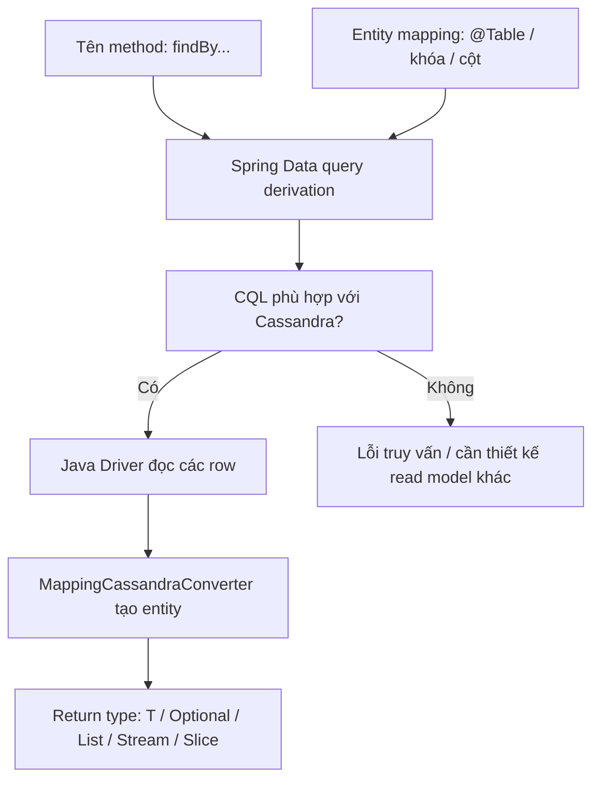
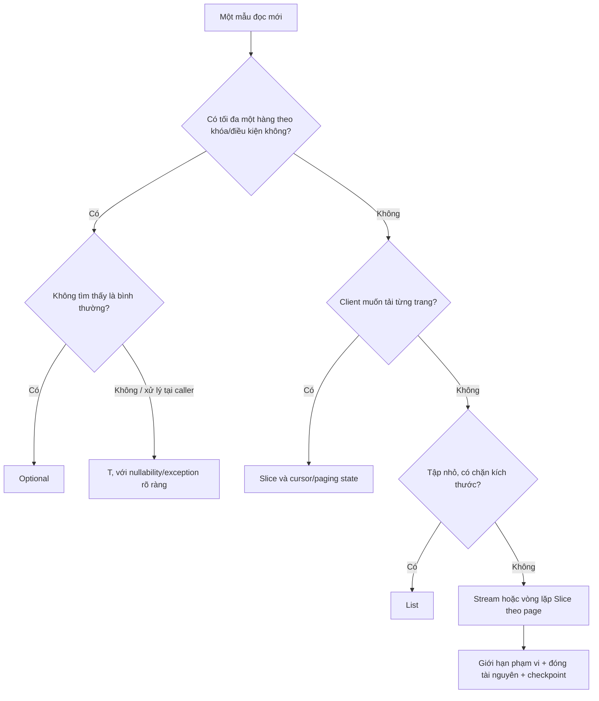
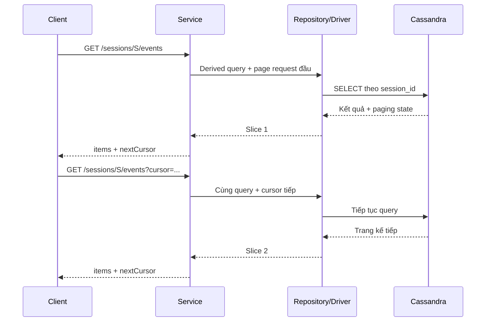
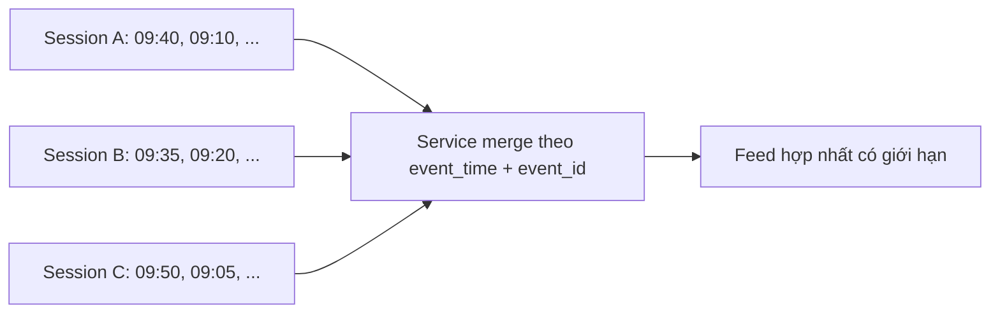

# Kiểu trả về một entity, Optional, List, Stream và Slice

Khi khai báo một phương thức repository như `findByProfileId(...)` hoặc `findByKey_SessionId(...)`, **Spring Data Cassandra** có thể suy ra truy vấn từ tên phương thức (*derived query*). Nhưng còn một quyết định quan trọng khác: phương thức ấy nên trả về **một entity**, **`Optional<T>`**, **`List<T>`**, **`Stream<T>`** hay **`Slice<T>`**?

Kiểu trả về không chỉ là hình thức viết Java. Nó nói rõ hợp đồng về **số lượng kết quả, cách xử lý trường hợp không tìm thấy, mức tiêu thụ bộ nhớ, vòng đời tài nguyên và cơ chế phân trang**. Chọn sai có thể khiến service nhận lỗi khi truy vấn trả nhiều hàng, giữ một danh sách khổng lồ trong RAM, hoặc không tải được trang tiếp theo.

Bài thuộc chương **Truy vấn dẫn xuất** của module **Spring Data Cassandra**. Chúng ta sẽ chọn kiểu trả về theo mẫu đọc thực tế, liên hệ với entity mapping, repository, `CassandraTemplate` và CQL, đồng thời nhớ rằng Apache Cassandra phân phối dữ liệu theo partition key, sắp xếp theo clustering key và có các ràng buộc riêng về consistency và paging.

> **Nguyên tắc:** Chọn kiểu trả về dựa trên **cardinality của mẫu đọc** và **cách client tiêu thụ kết quả**, không dựa vào mong muốn rằng framework sẽ tự sửa một truy vấn CQL không phù hợp.

## 1. Derived query thực chất làm gì?

Spring Data có thể phân tích tên phương thức repository để xác định các property cần lọc, toán tử so sánh và đôi khi là thứ tự sắp xếp.

Ví dụ với entity `CustomerProfile` có property `profileId`:

```java
public interface ProfileRepository
        extends CassandraRepository<CustomerProfile, UUID> {

    Optional<CustomerProfile> findByProfileId(UUID profileId);
}
```

Phương thức `findByProfileId` biểu thị một truy vấn tìm theo property `profileId`. Framework dùng mapping metadata để chuyển tên property Java thành tên cột CQL phù hợp.

Tuy nhiên:

- **Tên method** giúp mô tả điều kiện query.
- **Entity mapping** quy định bảng, primary key và các cột.
- **Kiểu trả về** cho biết service muốn nhận một hay nhiều kết quả và dưới hình thức nào.
- **Schema Cassandra** quyết định CQL nào hợp lệ, có thể dùng partition/clustering key ra sao.
- **Driver và consistency level** ảnh hưởng cách truy vấn được thực thi và replica nào cần phản hồi.



**Đừng nhầm derived query với truy vấn không giới hạn.** Spring Data có thể phân tích được tên `findByStatus(...)`, nhưng nếu `status` chỉ là regular column trên bảng không hỗ trợ lọc theo status, CQL cuối cùng có thể không hợp lệ hoặc không đáp ứng hiệu năng.

## 2. Chuẩn bị hai mẫu dữ liệu để phân biệt cardinality

Để các ví dụ tự chứa, ta dùng **hai bảng** với hai hợp đồng đọc khác nhau.

### Bảng A — tra đúng một hồ sơ bằng ID

```sql
CREATE TABLE IF NOT EXISTS training_ks.profiles_by_id (
    profile_id uuid PRIMARY KEY,
    display_name text,
    locale text
);
```

Mỗi `profile_id` xác định **tối đa một hàng logic**. Nếu có dữ liệu tương ứng, đọc theo ID có thể nhận một entity. Nếu chưa có hoặc đã bị xóa, truy vấn có thể trả không hàng nào.

Query đại diện:

```sql
SELECT profile_id, display_name, locale
FROM training_ks.profiles_by_id
WHERE profile_id = 11111111-1111-1111-1111-111111111111;
```

### Bảng B — nhiều sự kiện trong một phiên

```sql
CREATE TABLE IF NOT EXISTS training_ks.events_by_session (
    session_id uuid,
    event_time timestamp,
    event_id uuid,
    event_type text,
    summary text,
    PRIMARY KEY ((session_id), event_time, event_id)
) WITH CLUSTERING ORDER BY (
    event_time DESC,
    event_id DESC
);
```

Với bảng này:

- `session_id` là **partition key**. Mỗi phiên có thể có nhiều sự kiện.
- `event_time` và `event_id` là **clustering columns**. Các hàng trong một partition được sắp theo thời gian và khóa phân biệt.
- `event_type` và `summary` là **regular columns**. Chúng không tự trở thành bộ lọc hoặc trục sắp xếp hiệu quả.
- Ví dụ giả định **mỗi phiên có kích thước được giới hạn hợp lý**. Nếu một phiên có thể phát sinh vô hạn sự kiện, cần bucket hoặc cách chia partition khác.

Query theo phiên:

```sql
SELECT session_id, event_time, event_id, event_type, summary
FROM training_ks.events_by_session
WHERE session_id = 22222222-2222-2222-2222-222222222222;
```

Query này có thể trả **0, 1 hoặc nhiều hàng**. Vì thế dùng một entity đơn lẻ hay `Optional<SessionEvent>` làm kiểu trả về cho query trên thường **không đúng về cardinality**.

**Lưu ý môi trường:** `training_ks` chỉ là keyspace minh họa, giả định đã được tạo với replication strategy và RF phù hợp. Các ví dụ không yêu cầu ứng dụng tự tạo keyspace production khi khởi động.

## 3. Bản đồ nhanh: chọn kiểu trả về nào?

| Kiểu trả về | Cardinality/kết quả mong đợi | Trường hợp sử dụng chính |
| --- | --- | --- |
| **`T` — một entity** | Tối đa một hàng; có thể null khi không tìm thấy theo nullability contract | Tra ID mà caller chấp nhận xử lý trường hợp không có |
| **`Optional<T>`** | 0 hoặc 1 hàng, biểu diễn vắng mặt tường minh | API tra cứu có thể không tìm thấy |
| **`List<T>`** | 0 đến nhiều hàng, được materialize thành collection | Tập nhỏ/có giới hạn rõ |
| **`Stream<T>`** | 0 đến nhiều hàng, tiêu thụ qua luồng | Xử lý tuần tự mà không muốn giữ toàn bộ `List` |
| **`Slice<T>`** | Một phần của tập nhiều hàng, có thông tin tải tiếp | Infinite scroll, “Xem thêm”, đọc từng trang |

Các kiểu trả về **không tự thay đổi số hàng trong bảng**. Chúng mô tả cách framework chuyển các hàng mà CQL trả về sang Java. Nếu query có thể trả 50 hàng, việc khai báo `Optional<T>` không khiến Cassandra tự hiểu rằng chỉ nên có một hàng.

### Cây quyết định thực hành



Đây là quy tắc chọn **giao diện truy cập dữ liệu**. Sau đó vẫn phải kiểm tra truy vấn dẫn xuất có dùng partition key, clustering key và chiều sắp xếp phù hợp hay không.

## 4. Entity và repository mẫu

### Entity hồ sơ với khóa đơn

```java
import java.util.UUID;

import org.springframework.data.cassandra.core.mapping.Column;
import org.springframework.data.cassandra.core.mapping.PrimaryKey;
import org.springframework.data.cassandra.core.mapping.Table;

@Table("profiles_by_id")
public class CustomerProfile {

    @PrimaryKey("profile_id")
    private UUID profileId;

    @Column("display_name")
    private String displayName;

    @Column("locale")
    private String locale;

    // Constructor, getter và setter theo quy ước dự án.
}
```

Trong ví dụ này, `profileId` là property Java được ánh xạ sang cột `profile_id`. Query derivation dùng **tên property Java**, không bắt buộc ghi tên cột snake_case trong method.

### Composite primary key cho sự kiện

```java
import java.io.Serializable;
import java.time.Instant;
import java.util.UUID;

import org.springframework.data.cassandra.core.cql.Ordering;
import org.springframework.data.cassandra.core.cql.PrimaryKeyType;
import org.springframework.data.cassandra.core.mapping.PrimaryKeyClass;
import org.springframework.data.cassandra.core.mapping.PrimaryKeyColumn;

@PrimaryKeyClass
public class SessionEventKey implements Serializable {

    @PrimaryKeyColumn(
        name = "session_id",
        ordinal = 0,
        type = PrimaryKeyType.PARTITIONED
    )
    private UUID sessionId;

    @PrimaryKeyColumn(
        name = "event_time",
        ordinal = 1,
        type = PrimaryKeyType.CLUSTERED,
        ordering = Ordering.DESCENDING
    )
    private Instant eventTime;

    @PrimaryKeyColumn(
        name = "event_id",
        ordinal = 2,
        type = PrimaryKeyType.CLUSTERED,
        ordering = Ordering.DESCENDING
    )
    private UUID eventId;

    // Constructor, getter/setter, equals/hashCode.
}
```

```java
import org.springframework.data.cassandra.core.mapping.Column;
import org.springframework.data.cassandra.core.mapping.PrimaryKey;
import org.springframework.data.cassandra.core.mapping.Table;

@Table("events_by_session")
public class SessionEvent {

    @PrimaryKey
    private SessionEventKey key;

    @Column("event_type")
    private String eventType;

    @Column("summary")
    private String summary;

    // Constructor, getter và setter theo quy ước dự án.
}
```

Hai class rút gọn để làm rõ metadata, chưa phải source file Java hoàn chỉnh: trước khi chạy phải thêm constructor/accessor và cấu hình Spring Data đúng phiên bản. Với key class, `equals/hashCode` cần dựa trên **đầy đủ các thành phần khóa**.

### Tên method khi property nằm trong key

Vì property `sessionId` nằm **bên trong** object `key`, tên method dẫn xuất nên diễn đạt đường dẫn property:

```java
findByKey_SessionId(UUID sessionId)
```

Ký tự `_` ở đây giúp phân tách rõ đường property `key.sessionId` theo quy tắc parsing của Spring Data. Một số cách viết camel-case không có `_` cũng có thể được phân tích, nhưng dùng dấu phân cách giúp giảm nhập nhằng khi entity có tên property dài. Cần kiểm chứng method parser của **Spring Data Cassandra đang sử dụng** trên project thực.

## 5. Trả về một entity `T`

Hợp đồng:

```java
public interface ProfileRepository
        extends CassandraRepository<CustomerProfile, UUID> {

    CustomerProfile getByProfileId(UUID profileId);
}
```

Vì `profile_id` là primary key, CQL tương đương về mặt ý tưởng:

```sql
SELECT profile_id, display_name, locale
FROM training_ks.profiles_by_id
WHERE profile_id = ?;
```

Đây là truy vấn có tối đa một hàng logic theo khóa. Nếu hàng tồn tại, framework materialize một `CustomerProfile`.

### Nếu không có hàng nào?

Với một method trả **`CustomerProfile` trực tiếp**, Spring Data có thể trả **`null`** khi không tìm thấy theo hợp đồng nullable của method. Tuy nhiên, nếu dự án bật các quy tắc non-null, chẳng hạn annotation/package nullability contract, framework có thể phản ứng bằng exception thay vì cho phép null. Vì vậy **đừng viết service như thể method trả `T` luôn bảo đảm có dữ liệu**.

Ví dụ xử lý an toàn khi method có thể null:

```java
CustomerProfile profile = repository.getByProfileId(profileId);

if (profile == null) {
    throw new ProfileNotFoundException(profileId);
}

// Chỉ sử dụng profile khi đã xác minh khác null.
```

`ProfileNotFoundException` là exception nghiệp vụ mà project phải tự khai báo. Nếu codebase dùng non-null validation ở tầng repository, nên thống nhất hợp đồng với service thay vì vừa dựa vào null vừa kỳ vọng framework luôn ném exception.

### Nếu query trả nhiều hàng?

Một phương thức trả **một entity** nhưng thực tế query khớp nhiều hàng là **sai cardinality**. Spring Data thường phát sinh lỗi loại **`IncorrectResultSizeDataAccessException`** hoặc exception tương ứng, tùy phương thức và phiên bản. Đừng dựa vào việc driver hoặc mapper tình cờ chọn hàng đầu tiên.

Ví dụ không phù hợp:

```java
// Sai về ý nghĩa nếu một session chứa nhiều event:
SessionEvent findByKey_SessionId(UUID sessionId);
```

Muốn lấy **sự kiện đầu tiên**, phải định nghĩa rõ điều kiện giới hạn kết quả và thứ tự theo clustering schema. Không chỉ đổi kiểu trả về thành `SessionEvent` rồi coi truy vấn có `LIMIT 1`.

### Khi nào dùng `T`?

- Khóa/điều kiện đảm bảo tối đa một hàng.
- Caller có quy tắc xử lý trường hợp vắng mặt.
- Project đã có chuẩn nullability rõ ràng.
- Không cần biểu diễn “không tìm thấy” thành một kiểu giá trị riêng.

Với API public và service có nhiều nhánh không tìm thấy, `Optional<T>` thường diễn đạt hợp đồng rõ ràng hơn.

## 6. `Optional<T>`: thể hiện trường hợp không tìm thấy

Khai báo derived query:

```java
public interface ProfileRepository
        extends CassandraRepository<CustomerProfile, UUID> {

    Optional<CustomerProfile> findByProfileId(UUID profileId);
}
```

Một cách dùng:

```java
Optional<CustomerProfile> result =
    repository.findByProfileId(profileId);

CustomerProfile profile = result.orElseThrow(
    () -> new ProfileNotFoundException(profileId)
);
```

Khi không tìm thấy hàng, method trả `Optional.empty()`. Khi có một hàng, method trả `Optional.of(profile)` sau mapping phù hợp.

**`Optional<T>` không có nghĩa “lấy phần tử đầu tiên của danh sách”**. Nếu query khớp nhiều hàng, đây vẫn là hợp đồng 0 hoặc 1; framework có thể báo lỗi cardinality. Đừng dùng `Optional` để che sự thiếu rõ ràng của `WHERE`.

### `findById` có sẵn là một lựa chọn phù hợp

`CassandraRepository<CustomerProfile, UUID>` kế thừa các thao tác CRUD cơ bản, trong đó `findById(profileId)` thường trả `Optional<CustomerProfile>`.

```java
Optional<CustomerProfile> profile =
    repository.findById(profileId);
```

Nếu đã có phương thức chuẩn theo primary key, không nhất thiết phải tạo thêm derived query chỉ để đổi tên method. Derived query hữu ích khi muốn biểu diễn một mẫu đọc riêng có property khác, nhưng phải bảo đảm mẫu đọc đó hợp lệ trong Cassandra.

### Ý nghĩa của “không tìm thấy” trong hệ phân tán

`Optional.empty()` thể hiện **kết quả của request đọc ở thời điểm đó**, theo consistency level, replica và trạng thái dữ liệu hiện có. Nó không phải bằng chứng tuyệt đối rằng ID ấy chưa bao giờ tồn tại:

- Dữ liệu có thể đã bị xóa hoặc hết TTL.
- Ghi từ DC khác có thể chưa hội tụ tới nơi đang đọc.
- Ứng dụng có thể kiểm tra một keyspace/tenant khác với yêu cầu.
- Lỗi CQL hay timeout là **exception**, không phải `Optional.empty()`.

Không viết:

```java
// Không nên: che mọi lỗi thành "không tìm thấy".
try {
    return repository.findById(profileId);
} catch (Exception ex) {
    return Optional.empty();
}
```

Cách này làm mất phân biệt giữa **vắng mặt hợp lệ** và **lỗi hệ thống**. Service nên xử lý hai trường hợp riêng.

## 7. `List<T>`: khi một truy vấn có thể có nhiều hàng

Với bảng `events_by_session`, một phiên có thể có nhiều sự kiện. Một derived query kiểu collection:

```java
import java.util.List;
import java.util.UUID;

import org.springframework.data.cassandra.repository.CassandraRepository;

public interface SessionEventRepository
        extends CassandraRepository<SessionEvent, SessionEventKey> {

    List<SessionEvent> findAllByKey_SessionId(UUID sessionId);
}
```

Vì `session_id` là partition key, query tương ứng có đường đọc hợp lệ:

```sql
SELECT session_id, event_time, event_id, event_type, summary
FROM training_ks.events_by_session
WHERE session_id = ?;
```

`List<T>` biểu diễn **0 đến nhiều entity**. Khi không có hàng, theo hợp đồng Spring Data collection return types, thường trả **collection rỗng**, không phải `null`. Điều này thuận tiện cho vòng lặp hoặc API chỉ cần tập nhỏ.

### `List<T>` có giữ tất cả kết quả trong bộ nhớ không?

Một `List<SessionEvent>` chứa các entity mà framework đã materialize cho lời gọi. Nếu query có thể trả hàng triệu hàng và method không giới hạn, việc tạo một list rất lớn có thể:

- Chiếm nhiều heap và kích hoạt GC.
- Làm response HTTP chậm hoặc vượt kích thước cho phép.
- Khiến driver đọc nhiều trang dữ liệu trong cùng một lời gọi.
- Gây tải lên coordinator/replica khi query phạm vi rộng.
- Làm job thiếu checkpoint và khó phục hồi khi có lỗi.

**Một partition không đồng nghĩa một tập dữ liệu nhỏ.** Session có thể có giới hạn rõ về số event, nhưng nếu hệ thống thực tế không bảo đảm điều đó, phải chọn bucket, truy vấn có giới hạn hoặc phân trang.

### Đừng đổi thành List để sửa một derived query không hợp lệ

Ví dụ:

```java
// Không nên kỳ vọng chạy hiệu quả chỉ vì trả List:
List<SessionEvent> findByEventType(String eventType);
```

`event_type` là **regular column**, trong khi bảng mẫu được phân vùng theo `session_id`. Nếu nhu cầu là “xem mọi event_type = PAYMENT”, cần thiết kế bảng đọc theo loại/ngày, index phù hợp với workload hoặc kiến trúc tìm kiếm khác; không được coi kiểu trả về `List` là giấy phép quét toàn bộ cluster.

### Khi nào dùng List?

- Query có **partition key đầy đủ**.
- Có giới hạn kích thước dữ liệu thật, ví dụ danh sách vài chục sự kiện của một phiên.
- Service cần tất cả phần tử của tập nhỏ trong cùng một request.
- Không cần cursor để tải thêm.

Nếu UI có nút “Xem thêm”, `Slice<T>` phù hợp hơn việc lấy mọi hàng rồi dùng `subList` ở Java.

## 8. `Stream<T>`: duyệt từng entity, không nhất thiết giữ một List lớn

Trong họ Spring Data repository có các query method hỗ trợ **Java `Stream<T>`** theo khả năng của datastore và phiên bản. Ví dụ khai báo mang tính minh họa:

```java
import java.util.UUID;
import java.util.stream.Stream;

public interface SessionEventRepository
        extends CassandraRepository<SessionEvent, SessionEventKey> {

    Stream<SessionEvent> streamByKey_SessionId(UUID sessionId);
}
```

Ví dụ tiêu thụ:

```java
try (Stream<SessionEvent> events =
         repository.streamByKey_SessionId(sessionId)) {

    events.forEach(this::processEvent);
}
```

`processEvent` là method của service; snippet giả định repository/mapper/version thực tế hỗ trợ query method với `Stream`. Nếu datastore module hoặc version không hỗ trợ streaming return type theo derived query, cần dùng API được hỗ trợ của `CassandraTemplate` hoặc lặp theo page; **không nên chỉ đổi signature sang `Stream` rồi tin rằng framework sẽ thực thi đúng**.

### Stream giúp gì?

- Service có thể xử lý phần tử lần lượt thông qua Java Stream API.
- Không cần tự tạo một `List` chứa toàn bộ dữ liệu trước khi xử lý logic.
- Có thể phối hợp các operation như `filter`, `map`, `forEach` và `limit` trên các entity đã được query trả về.
- Giúp viết job nhỏ có luồng xử lý tuần tự rõ ràng.

### Những điều Stream không bảo đảm

- **Không tự biến query thành non-blocking/reactive**. Java `Stream` khác `Flux`/Reactive Streams.
- **Không bảo đảm bộ nhớ hằng số tuyệt đối**: driver có buffer, Spring Data có mapping, pipeline có thể giữ thêm dữ liệu.
- **Không tự có cursor lưu giữa hai HTTP requests**.
- **Không tự có snapshot dữ liệu** khi các page được đọc qua thời gian.
- **Không tự có retry hay checkpoint** sau khi một phần entity đã được xử lý.
- **Không thay đổi CQL**: query thiếu partition key vẫn có vấn đề.

### Đóng Stream và giữ vòng đời hữu hạn

Nên giới hạn vòng đời trong một service method, sử dụng `try-with-resources`:

```java
public void processSession(UUID sessionId) {
    try (Stream<SessionEvent> events =
             repository.streamByKey_SessionId(sessionId)) {

        events.forEach(this::processEvent);
    }
}
```

Một số stream có thể gắn với tài nguyên truy vấn; việc đóng là cách dùng an toàn khi module hỗ trợ. Không trả một `Stream` mở ra controller rồi để framework serialize trong thời gian không kiểm soát.

### Tránh thu toàn bộ Stream thành List

```java
// Nếu kết quả rất lớn, cách này lại giữ toàn bộ entity trong RAM.
List<SessionEvent> all =
    repository.streamByKey_SessionId(sessionId).toList();
```

Ngoài việc không đóng stream, thao tác trên còn làm mất lợi ích tiêu thụ từng phần. Khi chỉ cần tập nhỏ, dùng `List` có giới hạn; khi cần xử lý tuần tự, giữ nguyên vòng đời stream và đặt giới hạn rõ ràng.

## 9. `Slice<T>`: trả một phần kết quả có thể tải tiếp

**`Slice<T>`** phù hợp với màn hình infinite scroll, lịch sử hoạt động hoặc API “Xem thêm”.

Repository có thể khai báo một method nhận tham số paging:

```java
import java.util.UUID;

import org.springframework.data.domain.Pageable;
import org.springframework.data.domain.Slice;

public interface SessionEventRepository
        extends CassandraRepository<SessionEvent, SessionEventKey> {

    Slice<SessionEvent> findByKey_SessionId(
        UUID sessionId,
        Pageable pageable
    );
}
```

**Khác biệt với `List`:** `Slice` cung cấp `getContent()` và thông tin như `hasNext()`, `nextPageable()` theo hợp đồng Spring Data. Không cần đếm chính xác toàn bộ số hàng để quyết định có thể tải phần tiếp theo.

### Sử dụng CassandraPageRequest

Spring Data Cassandra có cơ chế paging dựa trên trạng thái driver; trong các phiên bản hỗ trợ `CassandraPageRequest`, ví dụ theo phong cách API thông dụng:

```java
import org.springframework.data.cassandra.core.query.CassandraPageRequest;
import org.springframework.data.domain.Pageable;
import org.springframework.data.domain.Slice;

Pageable request = CassandraPageRequest.first(25);

Slice<SessionEvent> first =
    repository.findByKey_SessionId(sessionId, request);

List<SessionEvent> items = first.getContent();

if (first.hasNext()) {
    Pageable nextRequest = first.nextPageable();

    Slice<SessionEvent> second =
        repository.findByKey_SessionId(sessionId, nextRequest);
}
```

*Lưu ý phiên bản:* Tên package, factory method của `CassandraPageRequest` và cách lấy/truyền state kế tiếp phải được xác nhận theo Spring Data Cassandra đang dùng. Mẫu trên nhằm thể hiện **ý tưởng paging tuần tự theo cursor**, không phải cam kết mọi release đều có chữ ký y hệt. Không sử dụng `PageRequest.of(1000, 25)` theo giả định Cassandra hỗ trợ nhảy tới offset lớn như SQL.

### Slice và Page khác nhau ở đâu?

| Đặc điểm | `Slice<T>` | `Page<T>` |
| --- | --- | --- |
| Nội dung của phần hiện tại | Có | Có |
| Biết có phần tiếp theo hay không | Có qua hợp đồng Slice | Có thể biết |
| Tổng số hàng/tổng số trang chính xác | **Không phải trách nhiệm của Slice** | Thường có |
| Thích hợp với “Xem thêm” | **Có** | Có thể nhưng thường không cần tổng |
| Phù hợp với Cassandra query lớn | Thường tốt hơn nhu cầu count tổng | Count và total-page logic có thể tốn kém hoặc không được hỗ trợ như SQL |
| Nhảy tới trang số N | Không tự có | Không nên mặc định Cassandra làm rẻ |

`Slice` không phải cơ chế “đọc hết rồi cắt `subList`”. Khi sử dụng đúng API, nó cho phép điều khiển lượng dữ liệu từng phần và tiếp tục từ vị trí paging.

### Vì sao không nên dùng `LIMIT 25` thay cho paging?

CQL:

```sql
SELECT *
FROM training_ks.events_by_session
WHERE session_id = ?
LIMIT 25;
```

`LIMIT 25` giới hạn **tổng số hàng của truy vấn**. Nó không tự tạo “trang tiếp theo của toàn bộ tập sự kiện”. Driver **page size** và **paging state** mới là cơ chế đọc theo nhiều trang trong phạm vi query; cần phân biệt hai thứ.

Nếu method derived hỗ trợ giới hạn `Top`/`First` theo phiên bản, hãy kiểm tra CQL cuối cùng để tránh giới hạn tổng số hàng thành 25 khi API thực chất muốn lặp qua hàng trăm trang.

## 10. Paging state: cursor tiếp tục chứ không phải số trang

Với Cassandra, các trang kết quả thường được kết nối bằng **paging state** — trạng thái mờ do driver và Cassandra sử dụng để tiếp tục đọc tại vị trí phù hợp.



Không được:

- Sửa nội dung paging token để “nhảy” tới page khác.
- Dùng cursor của một `session_id` cho một session khác.
- Dùng lại cursor khi filter, sort, query text hoặc tham số thay đổi.
- Coi paging state là bằng chứng user được phép đọc dữ liệu.
- Tự suy rằng mọi page thuộc một **snapshot bất biến**.

Nếu API cho phép client giữ cursor, cần ràng buộc an toàn với user, tenant, query version và filter, đồng thời kiểm tra authorization độc lập. Có thể ký/mã hóa hoặc giữ tham chiếu cursor server-side theo threat model; không log hoặc phơi bày thông tin nội bộ không cần thiết.

### Data thay đổi giữa hai trang

Ví dụ user tải trang 1 lúc 10:00, trang 2 lúc 10:05. Trong khoảng đó, Cassandra nhận thêm một sự kiện mới có `event_time` cao hơn.

Các trang **không tự hợp thành snapshot tại 10:00**. Những sự kiện mới thêm trước vị trí đã duyệt có thể không xuất hiện trong lần paging đang diễn ra. Hàng bị xóa/hết TTL hoặc được ghi từ DC khác cũng có thể làm kết quả thay đổi.

Nếu cần một bản ghi kiểm toán cố định, thiết kế dữ liệu bất biến theo mốc thời gian, event watermark hoặc pipeline snapshot riêng. Không dùng `Slice` để thay thế một cơ chế snapshot.

## 11. Stream và Slice: cùng nhiều kết quả, khác vòng đời

| Góc nhìn | `Stream<T>` | `Slice<T>` |
| --- | --- | --- |
| Đối tượng chính | Luồng duyệt entity | Một phần kết quả + thông tin next |
| Phù hợp nhất | Job xử lý tuần tự, phạm vi đã giới hạn | API HTTP “Xem thêm”, phân trang UI |
| Vòng đời | Thường trong một thao tác/service method | Mỗi request có thể lấy một slice |
| Tải tiếp sau một request khác | Không tự có token | Có thể dùng `nextPageable`/paging state |
| Resource handling | Nên đóng stream sau khi dùng | Thao tác lấy slice kết thúc theo API |
| Bộ nhớ | Có thể tránh `List` lớn, nhưng vẫn có buffers | Tỷ lệ với nội dung phần hiện tại |
| Lỗi sau một phần công việc | Có thể đã xử lý nhiều entity | Một số trang đã được hiển thị/xử lý |
| Resume sau crash | Tự thiết kế checkpoint | Dễ tổ chức loop theo trang, nhưng checkpoint vẫn cần |
| Snapshot/transaction | Không tự có | Không tự có |

**Quy tắc nhanh:** Màn hình yêu cầu 25 dòng rồi tải thêm → `Slice`. Job xử lý tuần tự toàn bộ một partition nhỏ → cân nhắc `Stream`. Job lớn cần resume sau restart → vòng lặp nhiều `Slice`/bucket cùng checkpoint và idempotency thường dễ kiểm soát hơn một stream sống dài.

## 12. Derived query không được vượt quy tắc partition key

Điều cần kiểm tra **trước** khi chọn `List`, `Stream` hay `Slice` là câu CQL có thể đọc dữ liệu hiệu quả hay không.

Với bảng `events_by_session`:

| Derived method minh họa | Đường CQL dự kiến | Đánh giá |
| --- | --- | --- |
| `findByKey_SessionId(...)` | `WHERE session_id = ?` | Phù hợp: equality trên toàn partition key |
| `findByKey_SessionIdAndKey_EventTimeGreaterThanEqual(...)` | `WHERE session_id = ? AND event_time >= ?` | Phù hợp về mẫu khóa: equality partition + range trên clustering đầu |
| `findByEventType(...)` | `WHERE event_type = ?` | Không phù hợp với bảng mặc định; regular column, không có đường lọc tối ưu |
| `findByKey_EventTimeGreaterThanEqual(...)` | `WHERE event_time >= ?` | Thiếu partition key; không phải mẫu đọc hiệu quả |
| `findBySummaryOrderByKey_EventTimeDesc(...)` | Lọc summary, sort theo clustering trong nhiều partition | Không có sắp xếp toàn cluster miễn phí |

Lưu ý: bảng trên **mô tả ý nghĩa** của tên method, không khẳng định mọi từ khóa đều được parser/module hỗ trợ trên mọi phiên bản. Với query cụ thể, phải xác minh CQL được sinh ra và chạy integration test. Nếu Spring Data không hỗ trợ một toán tử dẫn xuất hay cú pháp giới hạn cần thiết, có thể dùng `@Query`, `CassandraTemplate` hoặc query driver được kiểm soát — nhưng vẫn phải tuân **cùng quy tắc CQL**.

### Không sửa bằng `ALLOW FILTERING` theo thói quen

`ALLOW FILTERING` cho phép Cassandra xét một số truy vấn cần lọc thêm nhưng có thể kéo theo đọc dữ liệu lớn/khó dự đoán. Nó không biến mọi điều kiện lọc/sort thành truy vấn tốt. Nếu màn hình thường xuyên lọc theo `event_type` trên mọi session, nên thiết kế **read model theo loại sự kiện và phạm vi thời gian**, thay vì cho phép một repository method truy vấn toàn bộ dữ liệu.

### Prefix và range trong clustering key

Khóa clustering có thứ tự `(event_time, event_id)`. Truy vấn range trên `event_time` trong một partition có đường đọc tự nhiên. Nhưng không thể tự ý lọc `event_id` độc lập mà không xét các clustering columns đứng trước; Cassandra có quy tắc prefix/range rõ ràng.

Kiểu trả về `Slice` cũng **không làm một điều kiện sai thành đúng**. Nếu schema không hỗ trợ mẫu đọc, phải sửa query hoặc thiết kế bảng khác.

## 13. Một method trả một entity có cần LIMIT 1 không?

Với `profiles_by_id`, **primary key đơn** đảm bảo tối đa một hàng. Không cần `LIMIT 1` để bảo vệ cardinality: `WHERE profile_id = ?` đã định danh hàng.

Với bảng `events_by_session`, `WHERE session_id = ?` có thể trả nhiều event. Nếu thực sự cần “event mới nhất”:

1. Xác định clustering order: bảng dùng `event_time DESC, event_id DESC`.
2. Tạo một truy vấn có giới hạn `LIMIT 1` hoặc một phương thức derived **`First`/`Top` chỉ khi module/phiên bản hỗ trợ**.
3. Xác minh câu CQL và giá trị được trả bằng dữ liệu có nhiều event, gồm event trùng timestamp.
4. Dùng kiểu `Optional<SessionEvent>` nếu partition có thể không có event.

Ví dụ CQL tường minh:

```sql
SELECT session_id, event_time, event_id, event_type, summary
FROM training_ks.events_by_session
WHERE session_id = 22222222-2222-2222-2222-222222222222
LIMIT 1;
```

Vì clustering order đã được khai báo DESC, query lấy hàng đầu trong partition theo schema. Lưu ý `LIMIT 1` chỉ đáp ứng “mới nhất” khi schema và query thực sự phục vụ thứ tự đó; không nên áp dụng công thức tương tự cho mọi bảng.

### Khi nào dùng @Query thay cho method derivation?

Một cách viết biểu đạt rõ giới hạn nếu cần và được module hỗ trợ:

```java
import org.springframework.data.cassandra.repository.Query;

@Query("""
    SELECT session_id, event_time, event_id, event_type, summary
    FROM events_by_session
    WHERE session_id = ?0
    LIMIT 1
    """)
Optional<SessionEvent> findLatestInSession(UUID sessionId);
```

Đây là **declared query**, không còn là derived query thuần túy. Nó cho thấy **return type và query shape là hai quyết định độc lập**. Với production, hãy chọn cách làm dễ kiểm thử và dễ đối chiếu với schema.

## 14. Thiết kế hợp đồng API dựa trên kiểu trả về

Một repository method là một API nội bộ. Service/controller cần quyết định cách biến kết quả thành phản hồi rõ ràng.

### Đọc một hồ sơ

```java
public CustomerProfile getProfileOrFail(UUID profileId) {
    return repository.findByProfileId(profileId)
        .orElseThrow(() -> new ProfileNotFoundException(profileId));
}
```

- `Optional.empty()` → service có thể trả HTTP 404.
- Exception Cassandra `ReadTimeout`, `Unavailable`, lỗi schema/quyền → không trả giả 404, cần xử lý lỗi hạ tầng đúng.
- Với hệ phân tán, 404 mô tả dữ liệu không được tìm thấy trong ngữ cảnh request, không phải cam kết lịch sử vĩnh viễn.

### Danh sách ngắn

```java
public List<SessionEvent> getSessionEvents(UUID sessionId) {
    return repository.findAllByKey_SessionId(sessionId);
}
```

Cách này chỉ hợp lý khi service có **giới hạn số event/partition** hoặc có cách chặn kết quả phù hợp. Với API public, cần cân nhắc giới hạn response và khả năng duyệt các trang.

### Danh sách có nút “Xem thêm”

```json
{
  "items": [
    {
      "eventId": "aaaaaaaa-aaaa-aaaa-aaaa-aaaaaaaaaaaa",
      "eventTime": "2026-11-25T03:00:00Z",
      "eventType": "LOGIN"
    }
  ],
  "nextCursor": "opaque-cursor-or-null"
}
```

Đối tượng `Slice` giúp service xác định content và khả năng có phần tiếp. Không nhất thiết serialize nguyên `Slice` của Spring Data ra JSON: tốt hơn là chuyển thành DTO/hợp đồng API do service kiểm soát, với cursor an toàn.

### Job xử lý tuần tự

```java
try (Stream<SessionEvent> events =
         repository.streamByKey_SessionId(sessionId)) {
    events.forEach(this::indexEvent);
}
```

Khi job có side effect như ghi sang search index hoặc gửi thông báo, phải có idempotency/checkpoint. Stream kết thúc lỗi sau phần tử thứ 900 không tự rollback 899 side effect trước đó.

## 15. Xử lý lỗi trong List, Stream và Slice

| Tình huống | `List<T>` | `Stream<T>` | `Slice<T>` |
| --- | --- | --- | --- |
| Không có hàng | List rỗng | Stream rỗng | Content rỗng, không có trang tiếp |
| Lỗi mapping một row | Lời gọi có thể lỗi trước khi trả list hoàn chỉnh | Có thể lỗi khi duyệt tới row đó | Có thể lỗi khi tải/mapping slice tương ứng |
| Đọc bị timeout | Exception; không giả định có list đầy đủ | Có thể đã xử lý một phần | Trang trước có thể đã được trả, trang tiếp lỗi |
| Dữ liệu đổi trong lúc đọc | Không mặc định snapshot | Không mặc định snapshot | Không mặc định snapshot qua nhiều request |
| Nhiều partition | Không tự gom theo thứ tự toàn cục | Không tự gom theo thứ tự toàn cục | Không tự tạo cursor chung cho nhiều partition |
| Client hủy xử lý | Lời gọi đồng bộ có hạn chế riêng | Cần đóng/cancel tài nguyên phù hợp | Client có thể ngừng tải các trang tiếp theo |
| Retrying | Không có exactly-once | Side effect có thể bị lặp | Cursor, query và checkpoint cần nhất quán |

Khi repository ném exception, **không** đổi lỗi Cassandra thành collection rỗng hoặc `Optional.empty()`. Nếu làm vậy, hệ thống có thể báo “không có đơn hàng” trong khi thực tế cluster đang `Unavailable`.

Với `Stream`, không dùng phép `onClose` hay `try-with-resources` như cơ chế rollback. Chúng chỉ giúp quản lý vòng đời tài nguyên; side effect do service thực hiện vẫn tồn tại.

## 16. Đọc nhiều partition và việc sắp xếp toàn cục

Giả sử một user có nhiều session và muốn “30 sự kiện mới nhất của mọi session”.

Bảng `events_by_session` sắp theo `event_time DESC` **bên trong từng partition `session_id`**. Nếu service gọi `findByKey_SessionId` cho 10 session rồi ghép các `List`, kết quả **không tự được sắp toàn cục**.



Nếu nhu cầu feed này là đường đọc chính, có thể cần bảng **events_by_user_day** hoặc một read model khác với partition key theo user/ngày, cùng cơ chế ghi đồng bộ và giới hạn partition size. Chỉ chuyển kiểu `List` sang `Stream` hoặc `Slice` không thay đổi vị trí lưu dữ liệu.

Nếu service ghép kết quả từ nhiều nguồn:

- Xác định tie-breaker khi các event có cùng timestamp.
- Giữ cursor riêng cho mỗi nguồn hoặc thiết kế một read model hợp nhất.
- Tránh tải toàn bộ lịch sử từng session rồi mới sort trong RAM.
- Xem độ trễ và tính nhất quán khi các nguồn được cập nhật đồng thời.

## 17. Pageable, Sort và hạn chế ORDER BY của Cassandra

Spring Data cho phép nhiều phương thức repository nhận tham số `Pageable` hoặc `Sort`. Nhưng Cassandra không hỗ trợ `ORDER BY` tùy ý trên mọi cột như RDBMS.

Với bảng `events_by_session`:

```sql
PRIMARY KEY ((session_id), event_time, event_id)
-- thứ tự clustering được khai báo: event_time DESC, event_id DESC
```

Thứ tự mặc định trong partition là **thời gian giảm dần**, rồi `event_id` giảm dần. Một yêu cầu UI `sort=summary,asc` không thể được biến thành `ORDER BY summary ASC` trên bảng này chỉ vì controller có nhận tham số sort.

**Nguyên tắc thực hành:**

1. Định nghĩa những kiểu sort UI được hỗ trợ từ schema thật.
2. Chỉ áp dụng sort phù hợp clustering order và các quy tắc CQL của phiên bản Cassandra.
3. Không dùng `PageRequest` SQL-style offset để nhảy trang bất kỳ.
4. Khi đổi sort/filter, bắt đầu lại paging từ trang đầu; không tái dùng cursor cũ.
5. Nếu cần nhiều kiểu sort trái ngược, cân nhắc nhiều read model hoặc giải pháp tìm kiếm/analytics riêng.

`Slice<T>` cho biết **cách phân trang**, không cấp thêm quyền sắp xếp ở tầng storage.

## 18. Consistency level và kiểu trả về không liên quan trực tiếp

Giả sử keyspace có replication factor **RF = 3** tại local datacenter. Service đọc bằng `LOCAL_QUORUM`, nghĩa là cần phản hồi từ ít nhất **2 replica cục bộ** của partition theo quy tắc quorum.

Kể cả khi:

```java
Optional<CustomerProfile> profile =
    profileRepository.findById(profileId);
```

trả `Optional.of(...)` thành công, điều đó không cho biết mọi datacenter đã hội tụ, cũng không bảo đảm một request khác trong tương lai sẽ không gặp timeout.

Tương tự, một `Slice` được tải qua nhiều request có thể chịu tác động từ các trạng thái replica khác nhau theo thời gian. `List` không tăng consistency; `Stream` không làm các page trở thành snapshot.

| Quyết định | Trách nhiệm |
| --- | --- |
| `T` / `Optional` / `List` / `Stream` / `Slice` | Hợp đồng kết quả và cách tiêu thụ ở Java |
| Partition key | Xác định partition và token placement |
| Clustering key | Thứ tự và phạm vi quét trong partition |
| RF / consistency level | Điều kiện replica và trade-off availability/latency |
| Driver page size/paging state | Lượng dữ liệu mỗi fetch và vị trí đọc tiếp |
| TTL/tombstone | Vòng đời dữ liệu/hết hạn/xóa |
| Schema migration | Thay đổi cấu trúc bảng theo kế hoạch |

Đặt kỳ vọng đúng cho từng tầng sẽ giúp debug chính xác hơn khi dữ liệu vắng mặt, page thiếu phần tử hoặc query bị từ chối.

## 19. So sánh repository với CassandraTemplate

Các kiểu kết quả không giới hạn trong derived query. `CassandraTemplate` cũng có thể đọc entity theo query được xây tường minh, ví dụ:

```java
import org.springframework.data.cassandra.core.query.Criteria;
import org.springframework.data.cassandra.core.query.Query;

Query query = Query.query(
    Criteria.where("session_id").is(sessionId)
).limit(20);

List<SessionEvent> events =
    cassandraTemplate.select(query, SessionEvent.class);
```

Đây là lựa chọn khi service cần kiểm soát điều kiện query/statement rõ hơn. Với API phù hợp của phiên bản Spring Data Cassandra, template cũng có các dạng đọc theo slice/stream.

| Repository derived query | CassandraTemplate |
| --- | --- |
| Mô tả điều kiện bằng tên method | Xây điều kiện trong `Query` hoặc API tương ứng |
| Phù hợp query đơn giản, ổn định | Linh hoạt khi query cần điều kiện hoặc options rõ |
| Kết hợp mapping của Spring Data | Cũng dùng mapping/converter của Spring Data |
| Return type là hợp đồng method | Service chọn API trả kết quả phù hợp |
| Vẫn bị ràng buộc CQL | Vẫn bị ràng buộc CQL |

Không có công cụ nào biến truy vấn thiếu partition key thành đường đọc tối ưu một cách tự động. Nếu cần prepared statement hay điều kiện CQL chuyên biệt, dùng `@Query` hoặc driver trực tiếp vẫn phải tôn trọng schema và bảo mật bind parameters.

## 20. Thực hành: viết một repository rõ hợp đồng

Một giao diện mẫu tập hợp các trường hợp. Các method có chung tên property path nhưng khác mục đích cần đặt **tên riêng** để không dựa vào Java overload chỉ khác return type.

```java
import java.time.Instant;
import java.util.List;
import java.util.UUID;
import java.util.stream.Stream;

import org.springframework.data.cassandra.repository.CassandraRepository;
import org.springframework.data.domain.Pageable;
import org.springframework.data.domain.Slice;

public interface SessionEventRepository
        extends CassandraRepository<SessionEvent, SessionEventKey> {

    // Trả cả một tập trong partition; chỉ dùng khi size được kiểm soát.
    List<SessionEvent> findAllByKey_SessionId(UUID sessionId);

    // Đọc theo khoảng từ thời điểm; vẫn phải đủ partition key.
    List<SessionEvent>
        findAllByKey_SessionIdAndKey_EventTimeGreaterThanEqual(
            UUID sessionId,
            Instant fromTime
        );

    // Luồng duyệt cho job có phạm vi hữu hạn.
    Stream<SessionEvent> streamByKey_SessionId(UUID sessionId);

    // Trả theo từng phần, dùng paging state của Cassandra.
    Slice<SessionEvent> findByKey_SessionId(
        UUID sessionId,
        Pageable pageable
    );
}
```

Hãy lưu ý:

- `sessionId` phải là **giá trị khóa hợp lệ** và được xác thực theo user/tenant scope của hệ thống.
- Query với `fromTime` nên có dải thời gian/giới hạn thực tế để tránh đọc quá nhiều hàng.
- Từ khóa dẫn xuất và kiểu `Stream`/`Slice` phải được kiểm chứng theo **module/version** và generated CQL của project.
- Nếu bảng có nhiều tenant, partition key cần bảo đảm cách cô lập tenant phù hợp; ví dụ đã tối giản bằng session ID.
- Với job có thể crash, `Stream` không tự tạo checkpoint. Vòng lặp slice hoặc batch có tiến độ có thể thích hợp hơn.

## 21. Kiểm thử tích hợp cho từng kiểu trả về

Chỉ kiểm thử mock repository là chưa đủ. Cần chạy trên Cassandra test có schema đúng, RF/CL phù hợp để chứng minh query derivation và mapping hoạt động thực tế.

### Chuẩn bị dữ liệu

Tạo các kịch bản:

- `profiles_by_id` có một hồ sơ tồn tại và một UUID không tồn tại.
- `events_by_session` có một session rỗng, một session có 1 hàng, một session có 3 hàng, một session có trên 2 page.
- Hai event cùng `event_time` nhưng khác `event_id` để kiểm tra thứ tự clustering.
- Một số event thuộc session khác để phát hiện điều kiện thiếu partition key.
- Trường hợp cột nullable hoặc converter để phát hiện lỗi materialization.

### Ma trận kiểm thử

| Kiểu | Kịch bản | Điều cần xác nhận |
| --- | --- | --- |
| `T` | Key tồn tại | Entity ánh xạ đúng |
| `T` | Key không tồn tại | Nullability contract đúng như dự án quy định |
| `Optional<T>` | Key không tồn tại | `Optional.empty()`, không phải exception hạ tầng |
| `Optional<T>` | Key tồn tại | `Optional.of(entity)` |
| `List<T>` | Partition rỗng | List rỗng |
| `List<T>` | Nhiều hàng | Có đủ hàng, thứ tự theo schema nếu query dựa trên clustering |
| `Stream<T>` | Nhiều hàng | Tiêu thụ đủ, exception/close được xử lý |
| `Slice<T>` | Ít hơn page size | `hasNext() == false` |
| `Slice<T>` | Nhiều hơn một page | Cursor tiếp tục, không trùng/sót trên dữ liệu test cố định |
| Mọi kiểu | CQL thiếu partition key hoặc lỗi quyền | Lỗi được báo, **không** chuyển thành “rỗng” |
| Mọi kiểu | Cassandra timeout | Đường xử lý lỗi hạ tầng tách khỏi “not found” |

### Ví dụ kiểm tra Optional

```java
UUID id = UUID.randomUUID();

Optional<CustomerProfile> missing =
    profileRepository.findByProfileId(id);

assertTrue(missing.isEmpty());
```

Ví dụ giả định UUID chưa được ghi trong keyspace test. Với test production-like, cần tránh dữ liệu test dùng khóa có khả năng trùng với dữ liệu thật và xác định CL phù hợp.

### Ví dụ kiểm tra List

```java
List<SessionEvent> events =
    sessionEventRepository.findAllByKey_SessionId(sessionId);

assertEquals(3, events.size());
```

Chỉ kết luận đúng nếu test đã seed **chính xác ba event** ở session ấy. Dữ liệu ở partition khác không được xuất hiện.

### Ví dụ kiểm tra Slice

```java
Pageable request = CassandraPageRequest.first(2);

Slice<SessionEvent> first =
    sessionEventRepository.findByKey_SessionId(sessionId, request);

assertEquals(2, first.getContent().size());
assertTrue(first.hasNext());

Slice<SessionEvent> second =
    sessionEventRepository.findByKey_SessionId(
        sessionId, first.nextPageable()
    );
```

Đây là phần thân test minh họa; phải bổ sung imports, assertions cho second page và chuẩn bị dữ liệu ít nhất ba hàng. Với các version API khác, điều chỉnh cách tạo `CassandraPageRequest` theo khả năng thực.

### Thử lỗi “một entity nhưng nhiều hàng”

Nếu khai báo một method đơn kết quả dựa trên `session_id` (không có giới hạn) và seed ba hàng, integration test nên thể hiện rằng **hợp đồng 0/1 không phù hợp**. Tùy phiên bản/implementation, exception cụ thể có thể khác; điều cốt lõi là không được im lặng chọn một row bất kỳ làm kết quả nghiệp vụ.

## 22. Những lỗi thường gặp và cách sửa

| Hiện tượng | Nguyên nhân có thể | Hướng giải quyết |
| --- | --- | --- |
| Method trả `T` bị null khi không có dữ liệu | Không xử lý nhánh missing | Dùng `Optional<T>` hoặc hợp đồng nullability rõ ràng |
| Dùng `Optional<T>` nhưng query có nhiều row | Sai cardinality | Chọn `List`/`Slice` hoặc giới hạn truy vấn đúng nghĩa |
| `List` chiếm nhiều RAM | Query không giới hạn, partition lớn | Truy vấn có giới hạn hoặc `Slice`/stream có phạm vi |
| `Stream` báo lỗi khi đang duyệt | I/O, mapping hoặc driver fetch page sau đó | Xử lý lỗi một phần, close, checkpoint/idempotency |
| `Slice` không tải được trang tiếp | Dùng PageRequest sai, cursor sai query hoặc LIMIT quá thấp | Kiểm tra API CassandraPageRequest, paging state và generated CQL |
| `PageRequest.of(page, size)` chậm hoặc sai kỳ vọng | Nhầm OFFSET với Cassandra paging | Duyệt tuần tự bằng cursor |
| `findByEventType` lỗi CQL | Regular column không có đường lọc | Thêm read model/index đúng workload |
| `findByKey_SessionId` không parse | Sai tên property path hoặc phiên bản parser | Kiểm tra entity property và tên method `key.sessionId` |
| `findAllById` trả khác thứ tự input | Không có bảo đảm thứ tự input của nhiều ID | Sắp lại bằng Map theo key |
| Không thấy event vừa ghi ở DC khác | Replication/CL chưa hội tụ | Phân tích consistency policy và replica |
| Query có event time trùng, paging thiếu | Thiếu tie-breaker/cursor không đủ | Dùng clustering key phụ và xác minh paging |
| Không phân biệt 404 với timeout | Bắt exception rồi trả Optional.empty/List rỗng | Giữ lỗi hạ tầng riêng với không tìm thấy |
| Query được parse nhưng `ORDER BY summary` lỗi | Sort không tương thích clustering | Chọn sort supported hoặc read model mới |

## 23. Bài tập thực hành

### Bài 1 — tra hồ sơ có thể vắng mặt

Màn hình mở một hồ sơ theo `profile_id`, nhưng người dùng có thể cung cấp ID đã bị xóa.

**Câu hỏi:** Nên trả `CustomerProfile` hay `Optional<CustomerProfile>`? Khi không có hàng, điều gì khác với `ReadTimeout`?

<details>
<summary>Gợi ý đáp án</summary>

`Optional<CustomerProfile>` thể hiện rõ dữ liệu có thể vắng mặt. `Optional.empty()` tương ứng truy vấn thành công nhưng không có entity. `ReadTimeout` là lỗi hạ tầng/khả năng phục vụ; không nên biến nó thành `Optional.empty()`.

</details>

### Bài 2 — một session có 5.000 sự kiện

Service muốn trả toàn bộ bằng `List<SessionEvent>` trong một HTTP response.

**Câu hỏi:** Rủi ro nào xuất hiện và chọn API nào?

<details>
<summary>Gợi ý đáp án</summary>

`List` có thể materialize nhiều dữ liệu và tạo response lớn. Nếu UI tải dần, dùng `Slice<SessionEvent>` với page size/cursor. Nếu job cần duyệt, cân nhắc `Stream` hoặc vòng lặp slice có checkpoint. Kiểm tra partition size và khả năng bucket khi session thực sự lớn.

</details>

### Bài 3 — dùng Optional cho query nhiều row

Repository có:

```java
Optional<SessionEvent> findByKey_SessionId(UUID sessionId);
```

Một session chứa ba event.

**Câu hỏi:** Kiểu trả về có đúng không?

<details>
<summary>Gợi ý đáp án</summary>

Không. Điều kiện `session_id = ?` cho phép nhiều hàng trong partition. `Optional` chỉ hợp lý khi query bảo đảm tối đa một hàng hoặc được giới hạn đúng nghĩa bằng CQL/method hỗ trợ `LIMIT 1` theo clustering order. Nếu muốn xem cả tập, chọn `List`/`Slice`/`Stream`.

</details>

### Bài 4 — muốn trang thứ 100

API muốn nhảy thẳng tới trang 100 bằng `PageRequest.of(99, 25)`.

**Câu hỏi:** Vì sao không nên giả định Cassandra hỗ trợ rẻ?

<details>
<summary>Gợi ý đáp án</summary>

Cassandra dùng paging state để tiếp tục truy vấn, không có OFFSET tổng quát như SQL. `Slice` và `CassandraPageRequest` phù hợp với đọc tuần tự; nhảy trang tùy ý cần thiết kế API/data model riêng hoặc một hệ thống hỗ trợ nhu cầu đó.

</details>

### Bài 5 — Stream gặp lỗi sau khi xử lý một phần

Job đọc event bằng Stream rồi gửi thông báo; sau 300 event thì mất kết nối.

**Câu hỏi:** Chỉ gọi lại Stream từ đầu có an toàn không?

<details>
<summary>Gợi ý đáp án</summary>

Không chắc chắn. Một số thông báo đã được gửi có thể bị lặp. Cần idempotency key, checkpoint hoặc cơ chế đối soát. `Stream` không tự rollback side effect và không cung cấp exactly-once delivery.

</details>

### Bài 6 — đổi từ List sang Slice để lọc event_type

Developer có query không hợp lệ theo `event_type` và muốn đổi `List<SessionEvent>` thành `Slice<SessionEvent>` để hết lỗi.

**Câu hỏi:** Điều đó có sửa CQL không?

<details>
<summary>Gợi ý đáp án</summary>

Không. Kiểu trả về chỉ ảnh hưởng cách nhận kết quả/paging. Cassandra vẫn cần đường truy cập phù hợp partition key/clustering/index. Hãy thiết kế bảng đọc theo event type hoặc một giải pháp truy vấn thích hợp cho workload.

</details>

## 24. Checklist chọn kiểu trả về cho derived query

- [ ] Đã xác định mẫu đọc có **0/1 hàng** hay **nhiều hàng** bằng schema và điều kiện truy vấn.
- [ ] Query có đầy đủ partition key hoặc đường truy cập hợp lệ được thiết kế rõ.
- [ ] Chỉ dùng `T`/`Optional<T>` khi cardinality thực sự tối đa một.
- [ ] Có quy tắc rõ ràng cho “không tìm thấy” và không trộn với exception hạ tầng.
- [ ] Không dùng `List<T>` cho tập kết quả không có giới hạn hợp lý.
- [ ] Nếu dùng `Stream<T>`, đã xác nhận module/version hỗ trợ, phạm vi query hữu hạn và cách đóng resource.
- [ ] Nếu có side effect khi duyệt Stream, đã có idempotency/checkpoint hoặc quy trình phục hồi.
- [ ] Nếu UI cần tải tiếp, dùng `Slice<T>`/paging state thay vì tải tất cả rồi cắt danh sách.
- [ ] Đã phân biệt `LIMIT` với driver page size và tổng số hàng của query.
- [ ] Không dùng offset-style pagination hoặc giả định nhảy tới trang N trực tiếp.
- [ ] Cursor được ràng buộc với user, tenant, query, filter, sort và version thích hợp.
- [ ] Đã chấp nhận hoặc xử lý việc không có snapshot giữa các trang.
- [ ] Order/Sort của derived query không vượt clustering order được Cassandra hỗ trợ.
- [ ] Có tie-breaker cho kết quả có giá trị thời gian trùng nhau.
- [ ] Đã kiểm tra tên property Java, đường nested `key.sessionId` và generated CQL.
- [ ] Entity/constructor/converter được kiểm thử với dữ liệu thật của từng kiểu trả về.
- [ ] Đã đo heap, số page, latency và tải replica với dữ liệu đại diện.
- [ ] Đã kiểm tra câu truy vấn trong môi trường có RF, CL và topology phù hợp.
- [ ] Trường hợp nhiều partition cần merge được thiết kế riêng, không suy từ `List`/`Stream`/`Slice`.
- [ ] Đã có integration test cho empty/one/many rows, lỗi nhiều kết quả, timeout và trang tiếp theo.

**Ghi nhớ:** **`T`** và **`Optional<T>`** dành cho truy vấn có tối đa một entity; **`List<T>`** cho tập nhỏ có giới hạn; **`Stream<T>`** cho quá trình tiêu thụ tuần tự trong một vòng đời được kiểm soát; và **`Slice<T>`** cho kết quả tải theo từng phần có thể tiếp tục. Nhưng dù dùng kiểu nào, **Spring Data Cassandra vẫn phải tạo một truy vấn CQL hợp lệ theo partition key, clustering order và consistency policy**. Thiết kế bảng đúng mẫu đọc là điều kiện đầu tiên; chọn return type đúng mới giúp Java API an toàn, dễ hiểu và vận hành được ở quy mô phân tán.
