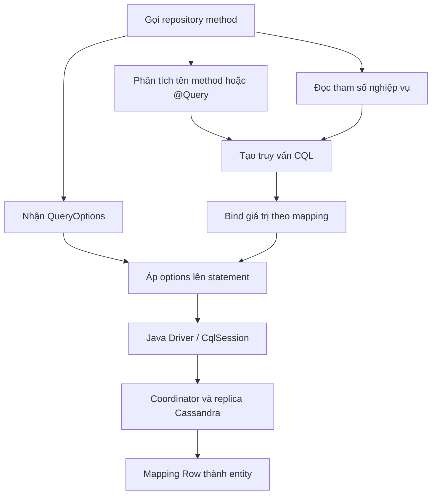

# QueryOptions trong phương thức truy vấn Spring Data Cassandra

Trong Spring Data Cassandra, một **derived query method** là phương thức repository mà Spring phân tích tên để tạo truy vấn CQL, chẳng hạn `findByKeyCustomerIdAndKeyBucketMonth(...)`. Ngoài các giá trị dùng làm điều kiện tìm kiếm, một phương thức repository còn có thể nhận **`QueryOptions`** để điều chỉnh *cách thực thi* truy vấn tại thời điểm gọi: consistency level, kích thước trang fetch, timeout, execution profile hoặc tracing.

Đây là điểm phân biệt quan trọng: **`QueryOptions` không phải một phần của partition key, không phải tham số bind của `WHERE` và không tự tạo điều kiện lọc mới**. Nó được Spring Data nhận diện là **tham số đặc biệt** (*special/non-query parameter*), được áp vào statement trước khi thực thi. Cùng cơ chế này cũng dùng được cho các phương thức repository viết CQL tường minh bằng `@Query`.

Bài thuộc chương **Truy vấn dẫn xuất** của module `SPRING_DATA_CASSANDRA`. Mục tiêu là khai báo đúng `QueryOptions`, sử dụng có chủ đích với repository, phân biệt nó với `@Consistency`, `Pageable`, `LIMIT` và cấu hình driver, đồng thời giữ đúng nguyên tắc thiết kế bảng theo truy vấn, partition key, consistency, paging và hiệu năng của Apache Cassandra.

> **Quy tắc ghi nhớ:** tên phương thức và tham số nghiệp vụ xác định **đọc dữ liệu nào**; `QueryOptions` mô tả **một số tùy chọn thực thi câu truy vấn đó**. Nếu CQL sinh ra sai partition key hoặc clustering prefix, đổi consistency/page size không sửa được access path.

## 1. Bức tranh tổng thể: từ repository method đến CQL

Khi gọi repository method, Spring Data Cassandra xử lý hai loại thông tin:

1. **Tham số truy vấn:** giá trị nghiệp vụ được đưa vào các điều kiện `WHERE`, ví dụ `customerId`, `bucketMonth`, `from`, `to`.
2. **Tham số điều khiển:** metadata/tùy chọn được framework hiểu riêng, ví dụ `QueryOptions`, `Pageable`, `Sort` hoặc `Limit` trong các phiên bản hỗ trợ.



Ví dụ chữ ký method:

```java
List<OrderByCustomerMonth> findByKeyCustomerIdAndKeyBucketMonth(
    UUID customerId,
    LocalDate bucketMonth,
    QueryOptions options
);
```

Hai tham số đầu biểu diễn điều kiện theo khóa, còn `options` không tương ứng một cột CQL tên `options`. Theo tài liệu Spring Data Cassandra, `QueryOptions` được xử lý là **non-query parameter** đối với cả derived method lẫn string-based `@Query`.

### Vai trò của các tầng

| Tầng | Chịu trách nhiệm | Ví dụ |
|---|---|---|
| Repository method | Diễn giải tên truy vấn / `@Query`, xử lý special parameters | `findBy...`, `QueryOptions` |
| Spring Data mapping | Tên field Java ↔ cột CQL, entity, composite key | `@Table`, `@PrimaryKeyClass`, `@Column` |
| Query options | Tùy chỉnh thuộc tính statement theo từng request | `LOCAL_QUORUM`, `pageSize(50)` |
| Java Driver | Kết nối, mã hóa tham số, chọn coordinator, thực thi/paging | `CqlSession`, token-aware routing |
| Cassandra | Đọc/ghi replica theo partition key, RF/CL, thứ tự clustering | Partition `customer_id + bucket_month` |

`QueryOptions` không biến Cassandra thành ORM SQL quan hệ: không có truy vấn `JOIN` tự động, không có offset paging miễn phí, và không có guarantee rằng truy vấn một cột thường sẽ hiệu quả chỉ vì thêm `LIMIT`.

## 2. QueryOptions là lớp nào?

Lớp được dùng trong method signature nằm ở package:

```java
import org.springframework.data.cassandra.core.cql.QueryOptions;
```

Đây **không phải** một lớp tên tương tự của Hibernate/JPA, và cũng không phải trực tiếp `SimpleStatement` của Java Driver. `QueryOptions` ở Spring Data Cassandra là đối tượng chứa những tùy chọn để framework áp vào statement.

Một mẫu tạo đối tượng ở các dòng Spring Data Cassandra hiện đại:

```java
import java.time.Duration;

import com.datastax.oss.driver.api.core.DefaultConsistencyLevel;
import org.springframework.data.cassandra.core.cql.QueryOptions;

QueryOptions options = QueryOptions.builder()
    .consistencyLevel(DefaultConsistencyLevel.LOCAL_QUORUM)
    .pageSize(50)
    .timeout(Duration.ofSeconds(3))
    .build();
```

Các tùy chọn được đặt qua builder; khi không chỉ định một thuộc tính, cơ chế bên dưới dùng default tương ứng thay vì giả định rằng giá trị đó bị ghi đè bằng `null`/0. `QueryOptions.empty()` biểu diễn không đặt override tường minh.

### Những tùy chọn thường dùng

| Builder API | Ý nghĩa | Cần chú ý |
|---|---|---|
| `consistencyLevel(...)` | Consistency level cho statement | Số ACK phụ thuộc RF/DC; không phải schema migration |
| `pageSize(int)` | Số hàng mục tiêu mỗi trang driver fetch | **Không phải** CQL `LIMIT` |
| `timeout(Duration)` | Request timeout cho statement | Không chứng minh server đã hủy request khi timeout |
| `executionProfile(String)` | Chọn driver execution profile đã cấu hình | Profile phải tồn tại và phù hợp với driver session |
| `idempotent(boolean)` | Đánh dấu tính idempotent cho cơ chế driver | Chỉ đánh dấu khi nghiệp vụ thực sự cho phép retry an toàn |
| `tracing(boolean)` / `withTracing()` | Bật tracing cho statement | Có overhead; dùng có chọn lọc |
| `serialConsistencyLevel(...)` | Serial CL cho thao tác dùng LWT | Không dùng để “tăng nhất quán” cho `SELECT` thường |
| `keyspace(...)` | Chỉ định keyspace theo cơ chế statement | Không sửa bảng/khóa và cần kiểm tra session/schema |
| `routingKey(...)` / `routingKeyspace(...)` | Gợi ý định tuyến token ở mức thấp | Dễ sai nếu ứng dụng tự mã hóa partition key không đúng |

**Phiên bản quan trọng:** danh sách trên phản ánh API hiện đại của Spring Data Cassandra. Các phiên bản cũ có thể chưa cung cấp một số builder method hoặc có chữ ký khác. Đề bài không kèm phiên bản dự án, nên hãy đối chiếu Javadoc đúng dòng đang dùng và chạy kiểm thử tích hợp trước khi triển khai.

## 3. Một schema phù hợp với truy vấn dẫn xuất

Giả sử API cần **danh sách đơn hàng theo khách và tháng**; ta thiết kế bảng có clustering theo thời gian:

```sql
CREATE TABLE orders_by_customer_month (
    customer_id uuid,
    bucket_month date,
    placed_at timestamp,
    order_id uuid,
    state text,
    total_minor bigint,
    PRIMARY KEY (
        (customer_id, bucket_month),
        placed_at,
        order_id
    )
) WITH CLUSTERING ORDER BY (
    placed_at DESC,
    order_id DESC
);
```

- `customer_id` và `bucket_month` tạo **composite partition key**. Phải cung cấp cả hai để định vị một partition.
- `placed_at` và `order_id` là **clustering columns**. Thứ tự kết quả trong partition là mới nhất trước, rồi theo `order_id` khi trùng thời gian.
- `state` và `total_minor` là cột thường, không biến thành điều kiện tìm kiếm hiệu quả tùy ý.
- `bucket_month` do ứng dụng tính nhất quán, ví dụ ngày đầu tháng theo UTC. Cassandra không tự suy ra giá trị này từ `placed_at`.

CQL tương ứng:

```sql
SELECT *
FROM orders_by_customer_month
WHERE customer_id = ?
  AND bucket_month = ?;
```

Câu CQL đúng access pattern. Dù thay `QueryOptions.pageSize` từ 20 thành 200, tập partition mà truy vấn chạm đến **không thay đổi**. Muốn đọc nhiều tháng, cần truy vấn nhiều partition có kiểm soát và hợp nhất kết quả phía ứng dụng hoặc thiết kế projection khác.

## 4. Ánh xạ entity với composite primary key

Spring Data Cassandra thường biểu diễn composite primary key bằng `@PrimaryKeyClass` và `@PrimaryKeyColumn`.

```java
import java.io.Serializable;
import java.time.Instant;
import java.time.LocalDate;
import java.util.UUID;

import org.springframework.data.cassandra.core.cql.Ordering;
import org.springframework.data.cassandra.core.mapping.PrimaryKeyClass;
import org.springframework.data.cassandra.core.mapping.PrimaryKeyColumn;
import org.springframework.data.cassandra.core.mapping.PrimaryKeyType;

@PrimaryKeyClass
public class CustomerMonthOrderKey implements Serializable {

    @PrimaryKeyColumn(name = "customer_id", ordinal = 0,
        type = PrimaryKeyType.PARTITIONED)
    private UUID customerId;

    @PrimaryKeyColumn(name = "bucket_month", ordinal = 1,
        type = PrimaryKeyType.PARTITIONED)
    private LocalDate bucketMonth;

    @PrimaryKeyColumn(name = "placed_at", ordinal = 2,
        type = PrimaryKeyType.CLUSTERED, ordering = Ordering.DESCENDING)
    private Instant placedAt;

    @PrimaryKeyColumn(name = "order_id", ordinal = 3,
        type = PrimaryKeyType.CLUSTERED, ordering = Ordering.DESCENDING)
    private UUID orderId;

    // Constructor, getters/setters và equals/hashCode.
}
```

Entity:

```java
import org.springframework.data.cassandra.core.mapping.Column;
import org.springframework.data.cassandra.core.mapping.PrimaryKey;
import org.springframework.data.cassandra.core.mapping.Table;

@Table("orders_by_customer_month")
public class OrderByCustomerMonth {

    @PrimaryKey
    private CustomerMonthOrderKey key;

    @Column("state")
    private String state;

    @Column("total_minor")
    private Long totalMinor;

    // Constructor, getters/setters.
}
```

Đây là **mẫu mapping**, chưa phải các class Java hoàn chỉnh để chạy ngay vì getter/setter, constructor và `equals/hashCode` của key được rút gọn. Trong một dự án Java, các class `public` cần đặt ở file riêng.

`CustomerMonthOrderKey` đại diện toàn bộ danh tính hàng, không chỉ `order_id`. Vì vậy `CassandraRepository<OrderByCustomerMonth, CustomerMonthOrderKey>` có kiểu ID đúng với primary key. Một repository khai báo ID là `UUID` riêng `orderId` sẽ làm sai khái niệm khóa đối với bảng này.

## 5. Truy vấn dẫn xuất nhận QueryOptions như một tham số đặc biệt

Một repository có thể khai báo:

```java
import java.time.LocalDate;
import java.util.List;
import java.util.UUID;

import org.springframework.data.cassandra.core.cql.QueryOptions;
import org.springframework.data.cassandra.repository.CassandraRepository;

public interface OrderByCustomerMonthRepository
    extends CassandraRepository<OrderByCustomerMonth, CustomerMonthOrderKey> {

    List<OrderByCustomerMonth> findByKeyCustomerIdAndKeyBucketMonth(
        UUID customerId,
        LocalDate bucketMonth,
        QueryOptions options
    );
}
```

Tên `findByKeyCustomerIdAndKeyBucketMonth` mô tả đường dẫn thuộc tính `key.customerId` và `key.bucketMonth` của Java entity. Spring Data giải mã tên property thành điều kiện query theo metadata mapping. Với các model có tên field gây mơ hồ, cần sử dụng quy tắc phân tách property path của Spring Data hoặc viết `@Query` để kiểm soát CQL tường minh.

Gọi method:

```java
import java.time.Duration;
import java.time.LocalDate;
import java.util.UUID;

import com.datastax.oss.driver.api.core.DefaultConsistencyLevel;
import org.springframework.data.cassandra.core.cql.QueryOptions;

UUID customerId = UUID.fromString(
    "11111111-1111-1111-1111-111111111111"
);
LocalDate month = LocalDate.of(2026, 11, 1);

QueryOptions quickRead = QueryOptions.builder()
    .consistencyLevel(DefaultConsistencyLevel.LOCAL_ONE)
    .pageSize(25)
    .timeout(Duration.ofSeconds(2))
    .build();

List<OrderByCustomerMonth> orders =
    repository.findByKeyCustomerIdAndKeyBucketMonth(
        customerId, month, quickRead
    );
```

Đoạn gọi giả định `repository` được inject vào service. Hai giá trị đầu **được dùng để bind** cột `customer_id` và `bucket_month`; `quickRead` **không phải tham số bind thứ ba**. Nó tác động những thuộc tính execution của statement.

**Điểm quan trọng:** `pageSize(25)` không có nghĩa kết quả `List` chứa tối đa 25 hàng. Nếu repository materialize toàn bộ kết quả vào list, driver có thể fetch các trang tiếp theo cho đến khi hoàn tất truy vấn. Muốn giới hạn tổng số hàng trả về, cần CQL `LIMIT`, keyword `Top`/`First` hoặc `Limit` special parameter được phiên bản hỗ trợ, hoặc dùng cơ chế phân trang như `Slice`/scrolling.

## 6. QueryOptions cũng áp dụng cho phương thức @Query

Bên cạnh derived method, tài liệu Spring Data Cassandra cho phép cùng special parameter với query viết tường minh bằng `@Query`:

```java
import java.time.Instant;
import java.time.LocalDate;
import java.util.List;
import java.util.UUID;

import org.springframework.data.cassandra.core.cql.QueryOptions;
import org.springframework.data.cassandra.repository.Query;

// Khai báo bên trong OrderByCustomerMonthRepository:
@Query("SELECT * FROM orders_by_customer_month " +
       "WHERE customer_id = ?0 AND bucket_month = ?1 " +
       "AND placed_at >= ?2 AND placed_at < ?3 LIMIT 100")
List<OrderByCustomerMonth> findInTimeWindow(
    UUID customerId,
    LocalDate bucketMonth,
    Instant fromInclusive,
    Instant toExclusive,
    QueryOptions options
);
```

Bốn tham số nghiệp vụ dùng vị trí `?0`, `?1`, `?2`, `?3`. `QueryOptions` **không chiếm vị trí `?4`** vì Spring Data nhận diện nó là tham số điều khiển. Nếu dùng named parameters, cần đặt tên rõ ràng, tránh để một placeholder dành cho `QueryOptions`.

Các điều kiện `WHERE` vẫn theo quy tắc Cassandra: đủ partition key, sau đó lọc khoảng trên clustering column `placed_at`. Ví dụ dùng **khoảng nửa mở** `[fromInclusive, toExclusive)` để tránh tính trùng mốc thời gian khi chia cửa sổ.

`LIMIT 100` giới hạn tổng tối đa 100 hàng; nếu `options.pageSize(25)`, driver có thể fetch theo các trang khoảng 25 hàng. Hai con số không thay thế nhau.

### So sánh cùng một method với hai options khác nhau

```java
QueryOptions lowLatency = QueryOptions.builder()
    .consistencyLevel(DefaultConsistencyLevel.LOCAL_ONE)
    .pageSize(25)
    .build();

QueryOptions strongerRead = QueryOptions.builder()
    .consistencyLevel(DefaultConsistencyLevel.LOCAL_QUORUM)
    .pageSize(100)
    .build();

var fastResult = repository.findInTimeWindow(
    customerId, month, from, to, lowLatency
);

var quorumResult = repository.findInTimeWindow(
    customerId, month, from, to, strongerRead
);
```

Cả hai lời gọi **truy vấn cùng bảng và cùng điều kiện CQL**. Điểm khác là lựa chọn CL và kích thước fetch. Không được kết luận chúng chắc chắn trả đúng cùng tập dữ liệu trong mọi thời điểm: hệ thống phân tán có thể đang có các replica chưa hội tụ và dữ liệu có thể thay đổi giữa hai lần đọc. Việc chọn CL phải dựa trên RF, topology và yêu cầu nhất quán của nghiệp vụ.

## 7. @Consistency tĩnh và QueryOptions động

Nếu một phương thức cần consistency cố định cho mọi lần gọi, Spring Data Cassandra có annotation `@Consistency`:

```java
import java.time.LocalDate;
import java.util.List;
import java.util.UUID;

import com.datastax.oss.driver.api.core.DefaultConsistencyLevel;
import org.springframework.data.cassandra.repository.Consistency;

// Khai báo trong một repository:
@Consistency(DefaultConsistencyLevel.LOCAL_ONE)
List<OrderByCustomerMonth> findByKeyCustomerIdAndKeyBucketMonth(
    UUID customerId,
    LocalDate bucketMonth
);
```

Dùng một method **riêng** nếu repository đã có method tên tương tự với `QueryOptions`: đây là ví dụ chữ ký alternative, không nên copy trùng tên gây overload khó kiểm soát mà không có chủ đích.

| Cách cấu hình | Phạm vi | Khi phù hợp |
|---|---|---|
| `@Consistency(LOCAL_ONE)` | Tĩnh theo khai báo query method | Mọi lần gọi có cùng yêu cầu CL |
| `QueryOptions.builder().consistencyLevel(...)` | Động theo lần gọi repository method | Yêu cầu CL có thể thay đổi theo use case |
| Default ở `CqlTemplate`/driver execution profile | Áp dụng khi statement không override | Chính sách chuẩn của ứng dụng |

Tài liệu chính thức nêu `@Consistency` áp mức nhất quán cho query method và `QueryOptions` áp options trước khi thực thi. **Tránh cấu hình CL vừa bằng annotation vừa bằng `QueryOptions` trên cùng một method nếu không thật sự cần**, vì precedence và tương tác nên được kiểm chứng theo đúng phiên bản thư viện. Khi viết tài liệu nhóm, nên xác định một nơi chịu trách nhiệm đặt CL cho mỗi use case để dễ bảo trì.

### Consistency không đồng nghĩa replication factor

Giả sử keyspace có `NetworkTopologyStrategy` với RF=3 trong một datacenter:

| CL đọc | Số phản hồi yêu cầu minh họa | Nhận xét |
|---|---:|---|
| `LOCAL_ONE` | 1 replica tại DC cục bộ | Độ trễ thường thấp hơn nhưng phụ thuộc trạng thái replica |
| `LOCAL_QUORUM` | 2 trong 3 replica tại DC cục bộ | Có thể tiếp tục khi mất một replica, nếu hai replica còn lại đáp ứng |
| `ALL` | 3 trong 3 | Một replica bắt buộc không đáp ứng có thể làm truy vấn thất bại |

Với RF=1, `LOCAL_QUORUM` cũng chỉ yêu cầu **một** replica, nên dùng nó trong môi trường một node không tạo ra tính chịu lỗi. CL là chính sách **xác nhận cho từng request**, RF là thuộc tính của **keyspace**, còn token-aware routing chọn coordinator: ba khái niệm không thể thay thế nhau.

## 8. Page size, LIMIT, Pageable và scrolling khác nhau thế nào?

`QueryOptions.pageSize(n)` thường bị nhầm với “trả tối đa n kết quả”. Thực tế đó là **fetch size** của driver:

```text
Cùng một partition có 95 hàng hợp lệ.

QueryOptions.pageSize(20)
    Trang fetch 1: khoảng 20 hàng
    Trang fetch 2: khoảng 20 hàng
    ...
    Nếu caller duyệt hết: tổng có thể là 95 hàng

CQL LIMIT 20
    Tổng số hàng của query: tối đa 20

CQL LIMIT 50 + pageSize(20)
    Tổng tối đa 50, driver có thể cần nhiều lượt fetch
```

Bảng phân biệt:

| Khái niệm | Điều nó giới hạn/điều khiển | Có tạo cursor không? |
|---|---|---|
| `QueryOptions.pageSize(20)` | Số hàng mục tiêu trong một lần driver fetch | Driver quản lý paging state khi cần |
| CQL `LIMIT 20` | **Tổng số hàng tối đa** cho câu query | Không tự tạo cơ chế “trang thứ hai” |
| `findTop20By...` | Giới hạn kết quả do tên derived method | Phụ thuộc query được Spring sinh ra |
| `Limit` special parameter | Giới hạn động cho query ở phiên bản hỗ trợ | Không đồng nghĩa page size |
| `Pageable` + `Slice<T>` | API lấy trang và thông tin có trang sau | Spring Data dùng cơ chế paging theo store |
| `CassandraScrollPosition` / scrolling | Duyệt theo vị trí paging trong phiên bản hỗ trợ | Vị trí liên quan paging state |

Ví dụ signature để tách trách nhiệm rõ ràng:

```java
import org.springframework.data.domain.Pageable;
import org.springframework.data.domain.Slice;

// Khai báo bên trong repository:
Slice<OrderByCustomerMonth> findByKeyCustomerIdAndKeyBucketMonth(
    UUID customerId,
    LocalDate bucketMonth,
    Pageable pageable
);
```

Không dùng `PageRequest.of(10000, 50)` như giả định Cassandra hỗ trợ một `OFFSET 500000` rẻ và có snapshot ổn định. Cassandra paging state là một token **opaque** có ngữ cảnh truy vấn, khác với SQL offset; `Slice` thường thích hợp hơn `Page` khi không cần tổng số hàng toàn bộ partition.

**Một tình huống khó:** Nếu method có cả `Pageable` và `QueryOptions`, hãy kiểm tra cách phiên bản Spring Data Cassandra kết hợp special parameters, tránh cấu hình page size xung đột ở hai nơi mà không hiểu precedence. Không cần trộn chúng để chứng minh khả năng của `QueryOptions`: trước hết tạo test riêng cho từng cơ chế.

## 9. Timeout: bảo vệ request, không tự hủy mọi công việc ở Cassandra

Một cách đặt timeout theo lần gọi:

```java
import java.time.Duration;
import org.springframework.data.cassandra.core.cql.QueryOptions;

QueryOptions constrained = QueryOptions.builder()
    .timeout(Duration.ofSeconds(2))
    .pageSize(40)
    .build();
```

Đây là request timeout của statement ở tầng driver. Khi client nhận timeout, không nhất thiết server và mọi replica chưa làm gì hoặc đã hủy toàn bộ xử lý. Với thao tác ghi, một số replica có thể đã áp dụng mutation trước khi client thấy lỗi. Với đọc, timeout không có nghĩa tập dữ liệu đã được đọc hết hay query không đến coordinator.

Khi gặp timeout, xem:

1. Partition key có xác định được partition mục tiêu không?
2. Partition quá rộng/hot hoặc có nhiều tombstone không?
3. Page size và số hàng mà code thực sự duyệt là bao nhiêu?
4. RF/CL, node health và network latency có đáp ứng được SLA không?
5. Driver execution profile và timeout default có đang khác yêu cầu không?

Không nên tăng timeout vô hạn để che giấu truy vấn thiếu khóa hoặc full scan. Và cũng không nên hạ timeout quá thấp rồi bật retry không kiểm soát vì có thể làm tăng tải lên cluster đang chậm.

## 10. Execution profile và defaults

Nếu cùng ứng dụng có nhiều loại workload — ví dụ tra cứu nhanh một partition và báo cáo đọc nhiều hàng — có thể cấu hình **driver execution profiles** với các defaults riêng về timeout, consistency, page size và các thông số khác được driver hỗ trợ.

```java
QueryOptions options = QueryOptions.builder()
    .executionProfile("analytics-read")
    .build();
```

Ví dụ yêu cầu profile `analytics-read` **đã được cấu hình** trên driver session. Method không tự tạo profile. Nếu profile chưa tồn tại, driver có thể không thực thi như dự kiến; cần kiểm tra cấu hình version-specific.

Nguyên tắc chọn default:

- Thiết lập profile chung ở tầng driver cho workload phổ biến.
- Đặt `QueryOptions` ở method call **chỉ khi cần override tường minh** theo use case.
- Tránh phân tán chính sách consistency/timeout qua quá nhiều method mà không có convention.
- Có monitoring để phát hiện một method thường xuyên chạy với options khác chính sách vận hành đã phê duyệt.

Nếu không đặt option nào:

```java
QueryOptions noOverrides = QueryOptions.empty();
```

Điều này có nghĩa **không chủ động override** bằng `QueryOptions`, chứ không phải “không có consistency, không có timeout”. Driver/template vẫn có các defaults.

## 11. Idempotency, retry và tracing

### 11.1. idempotent(boolean) không thay đổi bản chất nghiệp vụ

```java
QueryOptions options = QueryOptions.builder()
    .idempotent(true)
    .build();
```

Cờ này là **thông tin cho driver** khi cân nhắc retry/speculative execution và hành vi liên quan. Nó **không biến** mutation vốn không an toàn thành một mutation idempotent.

Đối với một truy vấn đọc `SELECT` có điều kiện ổn định, đánh dấu idempotent thường dễ hiểu hơn. Với mutation có TTL thay đổi, ghi dựa trên timestamp, counter, hoặc tạo ID khác mỗi lần retry, phải đánh giá riêng. Nếu thao tác có side effect ở tầng ứng dụng (ví dụ phát sự kiện khi query thành công), idempotency của riêng statement CQL không đủ để bảo vệ toàn bộ use case.

Với repository **derived query** dùng để đọc, đừng coi cờ `idempotent(true)` như một tính năng bảo đảm consistency mạnh hay một phương tiện giải quyết duplicate business events.

### 11.2. Tracing có chi phí

```java
QueryOptions debug = QueryOptions.builder()
    .withTracing()
    .build();
```

Tracing Cassandra có thể giúp xác định coordinator, replica và thời gian xử lý từng bước trong môi trường test/debug. Nhưng nó có overhead và có thể tạo dữ liệu tracing bổ sung; không bật tracing trên toàn bộ request production một cách vô điều kiện.

Để quan sát bình thường, ưu tiên metrics/tracing phân tán đã được kiểm soát, đo latency p50/p95/p99, timeout/retry, kích thước partition và lỗi driver. Nếu log statement/parameters, tránh ghi lộ dữ liệu nhạy cảm.

## 12. Serial consistency và LWT không dành cho SELECT thường

`QueryOptions` còn có `serialConsistencyLevel(...)`, ví dụ:

```java
import com.datastax.oss.driver.api.core.DefaultConsistencyLevel;
import org.springframework.data.cassandra.core.cql.QueryOptions;

QueryOptions lwtOptions = QueryOptions.builder()
    .consistencyLevel(DefaultConsistencyLevel.LOCAL_QUORUM)
    .serialConsistencyLevel(DefaultConsistencyLevel.LOCAL_SERIAL)
    .build();
```

**Serial consistency** liên quan cơ chế đồng thuận của **lightweight transactions (LWT)**, ví dụ `INSERT ... IF NOT EXISTS` hoặc `UPDATE ... IF state = ...`. Nó không biến một derived `SELECT` thông thường thành LWT, cũng không thay đổi cách áp dụng partition key. Nếu muốn cập nhật có điều kiện, phải có **câu CQL chứa điều kiện LWT hợp lệ**; thêm options thôi là không đủ.

Đặc biệt, những đường ghi theo repository có thể có cơ chế khác nhau tùy method. Không nên đặt `LOCAL_SERIAL` tràn lan cho các query method mà chưa có mục đích cụ thể và test chính xác hành vi với Cassandra đang chạy.

## 13. QueryOptions không sửa được điều kiện truy vấn sai

Một ví dụ phản tác dụng:

```java
// Sai mô hình đọc nếu state chỉ là cột thường.
List<OrderByCustomerMonth> findByState(
    String state,
    QueryOptions options
);
```

Bảng `orders_by_customer_month` phân vùng theo **`customer_id + bucket_month`**. Truy vấn `WHERE state = ?` không cho Cassandra một partition key phù hợp; thêm options:

```java
QueryOptions expensive = QueryOptions.builder()
    .pageSize(10)
    .timeout(Duration.ofSeconds(30))
    .consistencyLevel(DefaultConsistencyLevel.LOCAL_ONE)
    .build();
```

**không giải quyết** việc phải tìm dữ liệu theo một cột không thuộc khóa. Nếu nghiệp vụ cần “đơn theo trạng thái của toàn hệ thống”, thiết kế một bảng projection theo **`state`, bucket thời gian và shard** phù hợp; hoặc dùng hệ thống tìm kiếm/analytics đúng mục đích.

Tương tự, `ORDER BY` trong derived query phải tuân theo **clustering order**, không sắp tùy ý theo `total_minor`. Spring có thể xây query từ tên method/Sort, nhưng Cassandra mới là bên quyết định cú pháp/truy cập có hợp lệ hay không.

**`@AllowFiltering`** có thể khiến một số truy vấn chạy bằng lọc phía server, nhưng không bảo đảm chi phí thấp, nhất là khi partition lớn hoặc dữ liệu phân tán rộng. `QueryOptions` cũng không phải chỉ thị “thêm ALLOW FILTERING cho query”.

## 14. QueryOptions khác những loại options khác ở đâu?

| API hoặc đối tượng | Đặt ở đâu? | Nên hiểu |
|---|---|---|
| `QueryOptions` | Tham số của repository method hoặc trong query/template APIs hỗ trợ | Các thuộc tính thực thi statement |
| `@Consistency` | Annotation trên repository query method | Một CL tĩnh theo method |
| `Pageable` / `Sort` | Special parameters của repository | Trang/sắp xếp do cơ chế repository hỗ trợ |
| `Limit` | Special parameter hoặc `Top/First` | Giới hạn **tổng** số hàng query |
| `org.springframework.data.cassandra.core.query.Query` | Dựng truy vấn qua CassandraTemplate | Mô tả điều kiện CQL, projection, sort, options |
| `Query.queryOptions(QueryOptions)` | Query API của Spring Data Cassandra | Gắn tùy chọn execution vào Query cụ thể |
| Java Driver `Statement` | Tầng `CqlSession` | Tùy chỉnh trực tiếp statement bằng driver API |
| `WriteOptions` | Tùy chọn cho các thao tác ghi được API hỗ trợ | Một kiểu chuyên biệt liên quan write settings |

Ví dụ nếu dùng `CassandraTemplate` thay vì repository:

```java
import org.springframework.data.cassandra.core.query.Criteria;
import org.springframework.data.cassandra.core.query.Query;
import org.springframework.data.cassandra.core.cql.QueryOptions;

Query query = Query.query(
        Criteria.where("customer_id").is(customerId)
            .and("bucket_month").is(month))
    .queryOptions(QueryOptions.builder()
        .pageSize(50)
        .consistencyLevel(DefaultConsistencyLevel.LOCAL_QUORUM)
        .build());
```

Đoạn này minh họa **khai báo cùng ý đồ** ở tầng template; các imports còn lại (như `DefaultConsistencyLevel`, `customerId`, `month`) nằm trong code bao quanh. API `Query.queryOptions(...)` được Spring Data cung cấp cho những phiên bản tương ứng. Nó không tạo ra một query khác về partition key; vẫn là cùng điều kiện `customer_id = ? AND bucket_month = ?`.

Ở tầng thấp hơn, Java Driver có `SimpleStatement`, `PreparedStatement` và `BoundStatement` với các setter tương đương như `setPageSize`, `setConsistencyLevel`, `setTimeout`. Đừng tạo một `CqlSession` thứ hai chỉ để dùng tùy chọn khác nếu đã có session chung do Spring Boot quản lý.

## 15. Quan hệ giữa QueryOptions và routing theo token

Một câu truy vấn dùng đầy đủ partition key **có thể** được Java Driver định tuyến token-aware nếu có đủ prepared statement metadata và bind values. `QueryOptions` có thể tác động đến một vài routing hints nâng cao, nhưng **không tự tạo routing key chính xác** khi CQL không chứa đủ điều kiện partition key.

Ví dụ đường đọc tốt:

```sql
SELECT *
FROM orders_by_customer_month
WHERE customer_id = ?
  AND bucket_month = ?;
```

Nếu driver có metadata cần thiết, từ `customer_id` và `bucket_month` đã bind, nó có thể xác định token và ưu tiên coordinator gần replica của partition. Thay `pageSize` hoặc `timeout` không làm đổi partition mà query cần đọc.

Tránh đặt `routingKey(...)` thủ công khi không thật sự hiểu cách mã hóa **composite partition key** và metadata keyspace. Nếu gợi ý routing sai, query có thể chọn coordinator kém tối ưu; bản thân việc định tuyến không sửa mô hình partition hoặc tính nhất quán của dữ liệu.

## 16. Đánh giá hiệu năng và tính nhất quán theo thực tế

Đặt options nên gắn với SLA và cách Cassandra thực thi truy vấn:

| Tình huống | Điều thường cần làm | QueryOptions đóng vai trò gì |
|---|---|---|
| Danh sách 20 đơn gần nhất của một khách trong tháng | Có đủ partition key, dùng giới hạn kết quả | Chọn CL, timeout, page size phù hợp |
| Đọc 100.000 đơn lịch sử của một khách | Bucket theo thời gian, có paging/streaming rõ | Điều chỉnh fetch size, không thay tổng giới hạn |
| Truy vấn có nhiều tombstone | Sửa TTL/delete model, repair/compaction và partition design | Timeout cao hơn chỉ là giải pháp tạm nếu có |
| Replica ở trạng thái bất đồng bộ | Chọn CL dựa trên RF và freshness SLA | `LOCAL_QUORUM` có thể phù hợp nhưng không phải ACID transaction |
| Khối lượng traffic lớn | Giới hạn concurrency, backpressure và fan-out | Profile/timeout giúp kiểm soát một phần tài nguyên |
| Query sai partition key | Đổi schema/read model | QueryOptions **không sửa được** |

Một cấu hình `pageSize` rất nhỏ có thể tăng số lần fetch và latency; quá lớn có thể tăng thời gian đáp ứng, network payload và bộ nhớ. Hãy đo trên dữ liệu đại diện với **p95/p99**, kích thước row, tombstone và số trang fetch, không chọn `pageSize` chỉ dựa vào số hàng hiển thị trên UI.

Với `LOCAL_QUORUM`, khi RF=3 trong một DC và cluster khỏe, yêu cầu đọc có mức xác nhận từ đa số replica trong DC; nhưng không đồng nghĩa mọi thao tác trên nhiều bảng projection diễn ra đồng bộ hoặc có giao dịch ACID đa partition. Consistency là một quyết định nghiệp vụ gắn với topology, không phải tùy chọn trang trí.

## 17. Một bài lab kiểm chứng QueryOptions trong repository

Thực hành trên **keyspace test riêng**, không bật schema action có thể drop dữ liệu thật. Với bảng và entity ở mục 3–4:

1. Tạo keyspace lab với RF phù hợp số node; tạo bảng `orders_by_customer_month` như ví dụ CQL.
2. Đảm bảo `@PrimaryKeyClass` và entity được Spring Data nhận diện.
3. Chèn 60 hàng vào **cùng một** `customer_id + bucket_month` nhưng khác `placed_at`/`order_id`; dùng dữ liệu giả.
4. Tạo `QueryOptions.builder().pageSize(10).build()`.
5. Gọi derived method `findByKeyCustomerIdAndKeyBucketMonth(..., options)`.
6. Kiểm tra số hàng được materialize: nếu method trả `List` và không có `LIMIT`, **không được mặc định kết quả chỉ có 10 hàng**.
7. Gọi `@Query` có `LIMIT 25` cùng `pageSize(10)`; kiểm tra tổng hàng tối đa 25.
8. Tạo options `LOCAL_ONE` và `LOCAL_QUORUM` trên môi trường có RF thích hợp, quan sát độ trễ và lỗi khi replica không khả dụng.
9. Kiểm tra logging/metrics phù hợp để xác minh `QueryOptions` không chiếm bind marker và statement nhận page size/timeout đã cấu hình.
10. Thử derived method `findByState(...)` trong lab để thấy một tùy chọn execution không giải quyết được query access path thiếu partition key.

### Ví dụ integration test khung

```java
import static org.junit.jupiter.api.Assertions.*;

import java.time.LocalDate;
import java.util.List;
import java.util.UUID;

import org.junit.jupiter.api.Test;
import org.springframework.beans.factory.annotation.Autowired;
import org.springframework.boot.test.context.SpringBootTest;
import org.springframework.data.cassandra.core.cql.QueryOptions;

@SpringBootTest
class DerivedQueryOptionsTest {

    @Autowired
    OrderByCustomerMonthRepository repository;

    @Test
    void queryOptionsAreNotBindParameters() {
        UUID customer = UUID.fromString(
            "11111111-1111-1111-1111-111111111111"
        );
        LocalDate month = LocalDate.of(2026, 11, 1);

        QueryOptions options = QueryOptions.builder()
            .pageSize(10)
            .build();

        List<OrderByCustomerMonth> result =
            repository.findByKeyCustomerIdAndKeyBucketMonth(
                customer, month, options
            );

        assertNotNull(result);
        // Seed dữ liệu ở setup để khẳng định số hàng/kết quả cụ thể.
    }
}
```

Ví dụ là **khung kiểm thử**, chưa chạy được nếu chưa có môi trường Cassandra, entity class hoàn chỉnh và dữ liệu seed phù hợp. Nó minh họa việc truyền `QueryOptions` như tham số cuối mà **không sinh cột/placeholder thứ ba**. Để test khẳng định chính xác, hãy seed dữ liệu cố định và so CQL/tracing/row counts trong môi trường có kiểm soát.

## 18. Những lỗi phổ biến khi dùng QueryOptions

| Lỗi hoặc hiểu nhầm | Triệu chứng | Cách khắc phục |
|---|---|---|
| Import sai `QueryOptions` | Repository không nhận special parameter | Dùng `org.springframework.data.cassandra.core.cql.QueryOptions` |
| Dùng `QueryOptions` như giá trị của `@Query ?2` | Số bind marker/giá trị không khớp | Chỉ đánh dấu tham số nghiệp vụ trong CQL |
| Nghĩ `pageSize(10)` là `LIMIT 10` | List trả hàng chục/hàng trăm kết quả | Dùng `LIMIT`, `Top`, `Limit` hoặc paging API |
| Gắn CL không phù hợp RF | Query lỗi khi replica thiếu | Đối chiếu keyspace RF, DC và CL |
| Đặt timeout quá nhỏ | Nhiều timeout/retry và tải tăng | Đo p95/p99, xem partition/tombstone và timeout policy |
| Gắn `idempotent(true)` vô điều kiện | Retry gây side effect nghiệp vụ | Chỉ đánh dấu khi statement thật sự idempotent |
| Bật tracing mọi request | Tăng overhead và dữ liệu truy vết | Chỉ bật có chọn lọc trong test/debug |
| Vừa `@Consistency` vừa dynamic CL | Hành vi khó dự đoán giữa phiên bản | Chọn một nơi cấu hình, kiểm thử precedence nếu cần |
| Derived query chỉ dùng `state` | CQL bị từ chối hoặc phải lọc rộng | Thiết kế bảng theo access pattern |
| Đổi `Pageable` và `QueryOptions` tùy tiện | Page size/cursor không rõ | Kiểm tra tương tác special params của đúng phiên bản |
| Chuyển sang Spring Data version khác | Builder method/query signature thay đổi | Chốt dependency và chạy integration tests |

Một sai sót thường gặp là kết luận “truy vấn chạy được trên một node khi có `QueryOptions` nghĩa là an toàn trên production”. Với RF, DC, dataset và TTL khác, cùng CQL có thể gặp hot partition, tombstone, timeout hoặc vấn đề paging. Cần kiểm thử ở topology/dữ liệu đại diện.

## 19. Checklist trước khi đưa QueryOptions vào một query method

1. **Method nhận đúng kiểu?** `org.springframework.data.cassandra.core.cql.QueryOptions` là special parameter.
2. **Điều kiện query đúng?** Đã có đủ partition key và điều kiện clustering theo thứ tự schema chưa?
3. **Bind markers đúng?** Không đưa `QueryOptions` vào `WHERE`, kể cả khi dùng `@Query`.
4. **CL tương thích RF/DC?** `LOCAL_ONE`, `LOCAL_QUORUM` không có cùng số replica trong mọi topology.
5. **Có giới hạn tổng kết quả không?** `pageSize` khác `LIMIT`; tránh materialize list quá lớn.
6. **Có cần paging state không?** Dùng `Slice`/scrolling/driver paging phù hợp với phiên bản và access pattern.
7. **Timeout có hợp lý?** Đo trên dữ liệu đại diện, tránh tăng vô hạn để che query chậm.
8. **Execution profile tồn tại?** Và có xung đột với override trong options không?
9. **Idempotency chính xác?** Không đánh dấu sai để driver retry một mutation không an toàn.
10. **Tracing có kiểm soát?** Tránh bật toàn bộ production traffic.
11. **Có xung đột với `@Consistency` hoặc defaults?** Chọn chính sách nhất quán và document rõ.
12. **Có test round-trip/query?** Xác minh các tùy chọn được áp vào statement trên dependency và Cassandra thực tế.

**Kết luận:** `QueryOptions` là một cơ chế **tùy chỉnh cách thực thi repository query theo từng lần gọi**. Nó dùng được cho **derived methods** và **`@Query` methods**, không được tính là tham số truy vấn CQL. Dùng đúng `QueryOptions` giúp điều chỉnh consistency, fetch size, timeout, execution profile và tracing, nhưng **partition key, clustering, paging và mô hình dữ liệu phân tán** vẫn quyết định truy vấn có đúng và hiệu quả hay không.

## Tài liệu tham khảo

- [Spring Data Cassandra — Cassandra-specific Query Methods](https://docs.spring.io/spring-data/cassandra/reference/cassandra/repositories/query-methods.html): special parameters, `QueryOptions`, `@Consistency`, derived và `@Query`.
- [Spring Data Cassandra — QueryOptions API](https://docs.spring.io/spring-data/cassandra/docs/current/api/org/springframework/data/cassandra/core/cql/QueryOptions.html): lớp `QueryOptions`, `builder()`, `empty()`.
- [Spring Data Cassandra — QueryOptionsBuilder API](https://docs.spring.io/spring-data/cassandra/docs/current/api/org/springframework/data/cassandra/core/cql/QueryOptions.QueryOptionsBuilder.html): consistency, pageSize, timeout, executionProfile, tracing và idempotent.
- [Spring Data Cassandra — Mapping](https://docs.spring.io/spring-data/cassandra/reference/object-mapping.html): `@Table`, `@PrimaryKeyClass`, composite key.
- [Spring Data Cassandra — Derived Query Methods](https://docs.spring.io/spring-data/cassandra/reference/repositories/query-methods-details.html): parsing property paths và special parameters.
